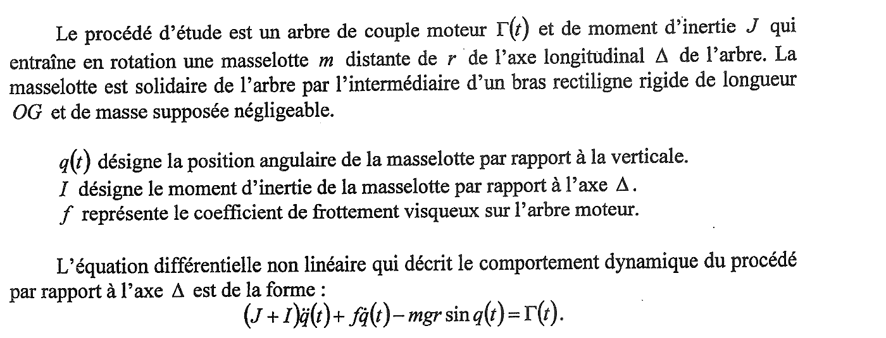
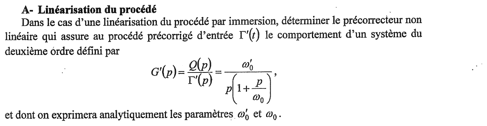
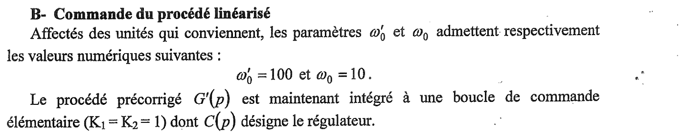
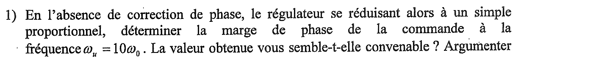
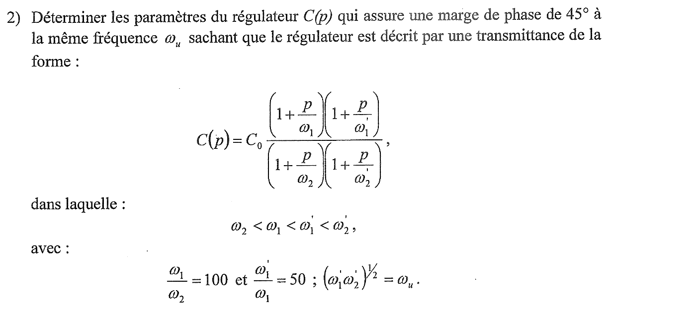
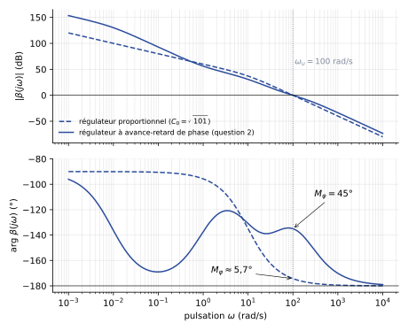
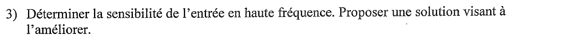
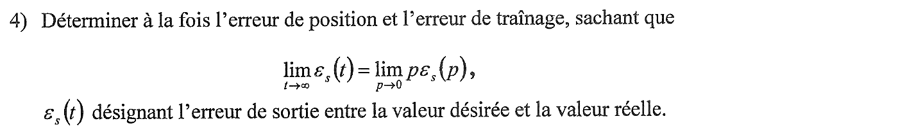



::: {.complement}
Aucun corrigé officiel ni corrigé d'élève pour ce sujet : **toutes les solutions de cette page sont rédigées par Claude**, et chaque résultat numérique a été vérifié par le calcul (Python, bibliothèque `control`). À relire avec un œil critique ; signaler toute erreur.

Le sujet vient de l'ancien module AU201 « Commande linéaire et approches linéarisantes », antérieur à la note de cours actuelle de P. Melchior. Le vocabulaire diffère un peu : le sujet appelle « fréquence » une **pulsation** (en rad/s) et « sensibilité de l'entrée » ce que la note de cours appelle **fonction de sensibilité relative à la consigne** $U(p)/E(p)$ (l'entrée du procédé est la commande $u$). La correction reprend les notations de la note de cours [cours-v03, p. 17] : procédé $G$, régulateur $C$, boucle ouverte $\beta(p) = C(p)\,G(p)$, consigne $E$, sortie $S$, commande $U$, écart $\varepsilon = E - S$, pulsation au gain unité $\omega_u$, marge de phase $M_\varphi$.

L'image de la question B-1 s'arrête sur « Argumenter » : la fin de la phrase est coupée en bas du scan. Le sujet de 2014-2015, identique sur ce point, porte « Argumenter votre réponse. ».

**Le même procédé revient au partiel de 2014-2015** [sujet-1415-cl] ([corrigé](2014-2015-partiel-commande-lineaire.qmd)) : énoncé général, partie A et question B-1 identiques ; la question B-2 y demande un simple correcteur à avance de phase (marge de 54°) ; la question B-3 ci-dessous y devient la question B-4, et la question B-4 ci-dessous y devient la question B-3 (gain statique et erreur de position).
:::

## Énoncé commun {#sec-ann1314cl-enonce}

{fig-alt="Énoncé : arbre de couple moteur Gamma(t) et de moment d'inertie J entraînant une masselotte m à la distance r de l'axe Delta, par un bras rigide OG de masse négligeable ; q(t) position angulaire de la masselotte par rapport à la verticale, I moment d'inertie de la masselotte par rapport à Delta, f coefficient de frottement visqueux ; équation (J + I) q''(t) + f q'(t) - m g r sin q(t) = Gamma(t)."}

:::: {.complement}
**Lecture du modèle.** Avec le signe $-mgr\sin q$, le couple de pesanteur **éloigne** la masselotte de $q = 0$ : la position de référence est la verticale **haute** (équilibre instable, comme un pendule inversé). Autour de $q = 0$, $\sin q \approx q$ et le modèle linéarisé tangent $(J+I)\ddot q + f\dot q - mgr\, q = \Gamma$ a un pôle positif. La partie A évite cette linéarisation approchée en compensant exactement le terme non linéaire.
::::

## Partie A : linéarisation du procédé {#sec-ann1314cl-a}

{fig-alt="Partie A : par une linéarisation du procédé par immersion, déterminer le précorrecteur non linéaire qui donne au procédé précorrigé d'entrée Gamma'(t) le comportement du deuxième ordre G'(p) = Q(p)/Gamma'(p) = omega'0 / (p (1 + p/omega0)) ; exprimer analytiquement omega'0 et omega0."}

:::: {.complement}
::: {.solution}
**Méthode.** Linéariser « par immersion » (ou par bouclage linéarisant) consiste à mesurer l'état $q$ et à **compenser exactement** la non-linéarité par le précorrecteur, au lieu de linéariser autour d'un point de fonctionnement.

**Comportement visé.** $G'(p) = \dfrac{Q(p)}{\Gamma'(p)} = \dfrac{\omega_0'}{p\,(1 + p/\omega_0)}$ correspond à l'équation différentielle
$$\frac{1}{\omega_0}\ddot q(t) + \dot q(t) = \omega_0'\,\Gamma'(t).$$

**Précorrecteur.** On ajoute au nouveau couple d'entrée $\Gamma'$ un terme qui annule le couple de pesanteur :
$$\boxed{\Gamma(t) = \Gamma'(t) - mgr \sin q(t)}$$
En reportant dans l'équation du procédé, le terme $-mgr\sin q$ disparaît :
$$(J + I)\,\ddot q(t) + f\,\dot q(t) = \Gamma'(t) \quad\Longleftrightarrow\quad \frac{J+I}{f}\,\ddot q + \dot q = \frac{1}{f}\,\Gamma'.$$
Par identification avec le comportement visé (conditions initiales nulles) :
$$\boxed{\omega_0' = \frac{1}{f}, \qquad \omega_0 = \frac{f}{J + I}}$$
$\omega_0$ est l'inverse de la constante de temps mécanique ($\mathrm{rad/s}$) ; $\omega_0'$ est un gain en vitesse ($\mathrm{rad\,s^{-1}\,N^{-1}\,m^{-1}}$).

**Conditions de validité.** La compensation est exacte seulement si $m$, $g$, $r$ sont bien connus et si $q$ est mesuré ; une erreur de modèle laisse un terme non linéaire résiduel, traité comme une perturbation par la boucle de la partie B. Le précorrecteur ne doit pas non plus saturer l'actionneur : $|\Gamma| \le |\Gamma'| + mgr$.

**Variante.** Si l'on veut imposer des valeurs de $\omega_0$ et $\omega_0'$ indépendantes des paramètres physiques, le précorrecteur s'écrit plus généralement
$$\Gamma = (J+I)\,\omega_0\omega_0'\,\Gamma' + \big(f - (J+I)\,\omega_0\big)\,\dot q - mgr\sin q,$$
qui redonne bien $\ddot q + \omega_0\dot q = \omega_0\omega_0'\Gamma'$ ; il faut alors mesurer aussi la vitesse $\dot q$. Le sujet demandant d'« exprimer analytiquement » $\omega_0$ et $\omega_0'$, la forme minimale ci-dessus est la réponse attendue la plus probable.
:::
::::

## Partie B : commande du procédé linéarisé {#sec-ann1314cl-b}

{fig-alt="Partie B : on prend omega'0 = 100 et omega0 = 10 ; le procédé précorrigé G'(p) est placé dans une boucle de commande élémentaire (K1 = K2 = 1) de régulateur C(p)."}

:::: {.complement}
**Boucle élémentaire.** $K_1 = K_2 = 1$ : pas de préfiltre ni de gain dans la chaîne de retour, la boucle est à retour unitaire, de boucle ouverte $\beta(p) = C(p)\,G'(p)$ avec
$$G'(p) = \frac{100}{p\,(1 + p/10)}.$$
::::

{fig-alt="B-1 : sans correction de phase, avec un régulateur proportionnel, déterminer la marge de phase à la pulsation omega_u = 10 omega0 ; la valeur est-elle convenable ? Argumenter (fin de phrase coupée sur le scan)."}

:::: {.complement}
::: {.solution}
$\omega_u = 10\,\omega_0 = 100$ rad/s. Un proportionnel $C(p) = C_0$ ne modifie pas la phase :
$$\arg G'(j\omega_u) = -90° - \arctan\frac{\omega_u}{\omega_0} = -90° - \arctan 10 = -174{,}3°,$$
$$\boxed{M_\varphi = 180° + \arg\beta(j\omega_u) = \arctan\frac{\omega_0}{\omega_u} = 5{,}7°}$$
Le gain $C_0$ qui place effectivement la pulsation au gain unité en $\omega_u$ vaut $C_0 = 1/|G'(j\omega_u)| = \sqrt{101} \approx 10{,}05$ ($|G'(j\omega_u)| = 1/\sqrt{101}$, soit $-20{,}0$ dB).

**Ce n'est pas convenable.** La boucle est stable (la phase de $\beta$ n'atteint $-180°$ qu'à l'infini) mais à la limite : le lieu de $\beta$ frôle le point critique. En boucle fermée, $H(p) = \dfrac{1005}{0{,}1\,p^2 + p + 1005}$ : $\omega_n \approx 100$ rad/s et $\xi \approx 0{,}05$, d'où un premier dépassement $D_1 = e^{-\pi\xi/\sqrt{1-\xi^2}} \approx 85\,\%$ et une réponse très oscillante. On vise couramment $M_\varphi \approx 45°$ à $60°$ (relation dépassement / marge de phase du cours [cours-v03, p. 28]) : il faut une **action à avance de phase** autour de $\omega_u$, ce qu'un proportionnel ne peut pas apporter (il ne règle que $\omega_u$, donc la rapidité [cours-v03, p. 29]).
:::
::::

{fig-alt="B-2 : déterminer les paramètres du régulateur C(p) = C0 (1 + p/omega1)(1 + p/omega'1) / ((1 + p/omega2)(1 + p/omega'2)) donnant une marge de phase de 45 degrés à omega_u, avec omega2 < omega1 < omega'1 < omega'2, omega1/omega2 = 100, omega'1/omega1 = 50 et (omega'1 omega'2)^(1/2) = omega_u."}

:::: {.complement}
::: {.solution}
**Structure.** $C(p)$ est un correcteur **à avance-retard de phase** :

- le couple $(\omega_2, \omega_1)$, $\omega_2 < \omega_1$, est un **retard de phase** (action de type intégral approchée) : gain statique $C_0$, gain divisé par $\omega_1/\omega_2 = 100$ au-delà de $\omega_1$ ; il améliore la précision sans toucher à la phase près de $\omega_u$ s'il est placé assez bas ;
- le couple $(\omega_1', \omega_2')$, $\omega_1' < \omega_2'$, est une **avance de phase** centrée sur $\omega_u$ ($\sqrt{\omega_1'\omega_2'} = \omega_u$), là où son apport de phase est maximal.

On note $a = \omega_2'/\omega_1'$. Les trois relations imposées donnent tout en fonction de $a$ :
$$\omega_1' = \frac{\omega_u}{\sqrt a}, \quad \omega_2' = \omega_u\sqrt a, \quad \omega_1 = \frac{\omega_1'}{50}, \quad \omega_2 = \frac{\omega_1}{100}.$$

**Condition de phase en $\omega_u$.** Il faut $\arg C(j\omega_u) = 45° - 5{,}7° = 39{,}3°$, avec
$$\arg C(j\omega_u) = \underbrace{\arctan\frac{\omega_u}{\omega_1} - \arctan\frac{\omega_u}{\omega_2}}_{\text{retard : } \approx -0{,}53°} + \underbrace{\arcsin\frac{a-1}{a+1}}_{\text{avance au centre}} .$$
Le retard de phase étant placé loin sous $\omega_u$ ($\omega_u/\omega_1 = 50\sqrt a$), il ne coûte qu'environ $0{,}5°$ ; l'avance doit donc fournir $\varphi_m \approx 39{,}8°$ :
$$a = \frac{1 + \sin\varphi_m}{1 - \sin\varphi_m} \approx 4{,}56 .$$
(Résolution numérique exacte de l'équation de phase : $a = 4{,}562$.)

**Fréquences de cassure** (rad/s) :
$$\omega_1' = \frac{100}{\sqrt{4{,}562}} \approx 46{,}8, \quad \omega_2' \approx 213{,}6, \quad \omega_1 \approx 0{,}936, \quad \omega_2 \approx 9{,}36\cdot 10^{-3}.$$

**Gain $C_0$.** On impose $|\beta(j\omega_u)| = 1$. En $\omega_u$, le retard de phase a divisé le gain par $\approx 100$ et l'avance l'a multiplié par $\sqrt a$ : $|C(j\omega_u)| \approx C_0\,\sqrt a/100$. Donc
$$C_0 \approx \frac{100}{\sqrt a\;|G'(j\omega_u)|} = \frac{100\sqrt{101}}{\sqrt{4{,}562}} \approx 470{,}5 .$$
$$\boxed{C(p) \approx 470{,}5\;\frac{\left(1 + \dfrac{p}{0{,}936}\right)\left(1 + \dfrac{p}{46{,}8}\right)}{\left(1 + \dfrac{p}{9{,}36\cdot 10^{-3}}\right)\left(1 + \dfrac{p}{213{,}6}\right)}}$$

**Vérification** (calcul numérique) : $\omega_u = 100{,}0$ rad/s et $M_\varphi = 45{,}0°$, marge de gain infinie. En boucle fermée : premier dépassement $\approx 31\,\%$, temps de réponse à 5 % $\approx 0{,}05$ s. Le retard de phase crée un pôle lent en $-0{,}938$, quasiment compensé par le zéro en $-\omega_1 = -0{,}936$ (doublet) : la traîne qui en résulte a une amplitude d'environ $0{,}2\,\%$, négligeable.

{#fig-ann1314cl-bode}

Sur la phase, on voit le creux du retard de phase vers $0{,}1$ rad/s (jusqu'à $-170°$) : il est sans danger, car le gain y est très grand (plus de 100 dB) et la phase ne coupe jamais $-180°$.
:::
::::

{fig-alt="B-3 : déterminer la sensibilité de l'entrée en haute fréquence ; proposer une solution pour l'améliorer."}

:::: {.complement}
::: {.solution}
**Sensibilité de l'entrée** : fonction de sensibilité relative à la consigne [cours-v03, p. 17]
$$\frac{U(p)}{E(p)} = \frac{C(p)}{1 + \beta(p)} .$$
En haute fréquence ($\omega \gg \omega_u$), $|\beta(j\omega)| \ll 1$ et le procédé est passe-bas, donc
$$\frac{U(j\omega)}{E(j\omega)} \approx C(j\omega) \xrightarrow[\omega\to\infty]{} C_0\,\frac{\omega_2\,\omega_2'}{\omega_1\,\omega_1'} = C_0\,\frac{a}{100},$$
$$\boxed{\left.\frac{U}{E}\right|_{HF} \approx 470{,}5 \times \frac{4{,}562}{100} \approx 21{,}5 \quad (26{,}6 \text{ dB})}$$
(valeur confirmée numériquement : $|U/E| = 21{,}46$ dès $10^3$ rad/s). C'est aussi le **pic de commande** à $t = 0^+$ pour un échelon de consigne d'amplitude $e_0$ : $u(0^+) = e_0 \lim_{p\to\infty} C(p) \approx 21{,}5\,e_0$ [cours-v03, p. 31]. Le bruit haute fréquence présent sur la consigne (et, au signe près, sur la mesure) est transmis à la commande avec ce gain, sans atténuation, ce qui sollicite l'actionneur et peut le saturer.

**Amélioration.** Rendre le régulateur strictement propre en lui ajoutant un **filtrage** (un ou plusieurs pôles) au-delà de $\omega_2'$, par exemple $\dfrac{1}{1 + p/\omega_f}$ avec $\omega_f \gg \omega_2'$ : $|U/E|$ décroît alors de 20 dB par décade au-delà de $\omega_f$ et $u(0^+) = 0$. Prix à payer : un retard de phase $\arctan(\omega_u/\omega_f)$ en $\omega_u$, qu'il faut compenser en augmentant un peu l'avance (rapport $a$). On peut aussi limiter l'avance de phase elle-même (marge un peu plus faible) ou réduire $\omega_u$ : le gain haute fréquence de $C$ en diminue d'autant.
:::
::::

{fig-alt="B-4 : déterminer l'erreur de position et l'erreur de traînage, sachant que la limite de epsilon_s(t) quand t tend vers l'infini vaut la limite de p epsilon_s(p) quand p tend vers 0, epsilon_s(t) étant l'erreur de sortie entre la valeur désirée et la valeur réelle."}

:::: {.complement}
::: {.solution}
Retour unitaire : $\varepsilon_s(p) = E(p) - S(p) = \dfrac{E(p)}{1 + \beta(p)}$. Près de $p = 0$, $C(p) \to C_0$ et
$$\beta(p) \approx \frac{\beta_0}{p}, \qquad \beta_0 = C_0\,\omega_0' \approx 470{,}5 \times 100 \approx 4{,}7\cdot 10^4\ \mathrm{s^{-1}} ,$$
avec **une intégration** dans la boucle (celle du procédé), notation de la note de cours [cours-v03, p. 18].

- **Erreur de position** (échelon $E(p) = e_0/p$) :
$$\varepsilon_p = \lim_{p\to 0} p\,\frac{e_0/p}{1 + \beta_0/p} = \lim_{p\to 0}\frac{e_0\,p}{p + \beta_0} = \boxed{0}$$
- **Erreur de traînage** (rampe $E(p) = v_0/p^2$, pente $v_0$) :
$$\varepsilon_v = \lim_{p\to 0} p\,\frac{v_0/p^2}{1 + \beta_0/p} = \frac{v_0}{\beta_0} = \boxed{\frac{v_0}{C_0\,\omega_0'} \approx 2{,}1\cdot 10^{-5}\,v_0}$$

L'erreur de position est nulle grâce à l'intégration du procédé (système de classe 1). L'erreur de traînage est finie et très faible : c'est le rôle du retard de phase, qui multiplie le gain basse fréquence par $\omega_1/\omega_2 = 100$ par rapport au gain autour de $\omega_u$. Sans lui (avance de phase seule, même $\omega_u$ et même marge), on aurait $C_0 \approx 4{,}7$ et une erreur de traînage cent fois plus grande. Ces résultats supposent une consigne appliquée directement à la boucle à retour unitaire et la boucle stable (vérifié à la question 2).
:::
::::
