

::: {.complement}
Aucun corrigé officiel ni corrigé d'élève pour ce sujet : **toutes les solutions de cette page sont rédigées par Claude**, et chaque résultat numérique a été vérifié par le calcul (Python, bibliothèque `control`). À relire avec un œil critique ; signaler toute erreur. Le sujet est une photo : le fond a été aplati et le contraste rehaussé sur les images.

Le sujet vient de l'ancien module AU201 « Commande linéaire et approches linéarisantes », antérieur à la note de cours actuelle de P. Melchior. Le sujet appelle « fréquence » une **pulsation** (rad/s) et « sensibilité de l'entrée » la **fonction de sensibilité relative à la consigne** $U(p)/E(p)$ de la note de cours. Notations de la correction [cours-v03, p. 17] : $\beta(p) = C(p)\,G(p)$, consigne $E$, sortie $S$, commande $U$, pulsation au gain unité $\omega_u$, marge de phase $M_\varphi$.

**Correspondances.** L'énoncé commun, la partie A et la question B-1 sont **identiques** à ceux du partiel de 2013-2014 [sujet-1314-cl] ([corrigé détaillé](2013-2014-partiel-commande-lineaire.qmd)) ; la question B-4 reprend sa question B-3 (sensibilité de l'entrée en haute fréquence), avec ici un correcteur différent. La question C-1 (commande à grand gain) est le thème du partiel de 2016-2017 [sujet-1617-cl] ([corrigé](2016-2017-partiel-commande-lineaire.qmd)).
:::

## Énoncé commun {#sec-ann1415cl-enonce}

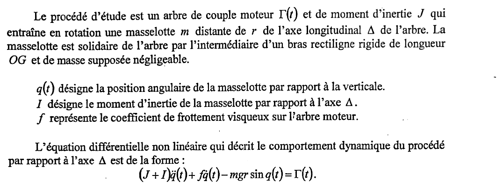{fig-alt="Énoncé : arbre de couple moteur Gamma(t) et de moment d'inertie J entraînant une masselotte m à la distance r de l'axe Delta, par un bras rigide OG de masse négligeable ; q(t) position angulaire de la masselotte par rapport à la verticale, I moment d'inertie de la masselotte par rapport à Delta, f coefficient de frottement visqueux ; équation (J + I) q''(t) + f q'(t) - m g r sin q(t) = Gamma(t)."}

## Partie A : linéarisation du procédé {#sec-ann1415cl-a}

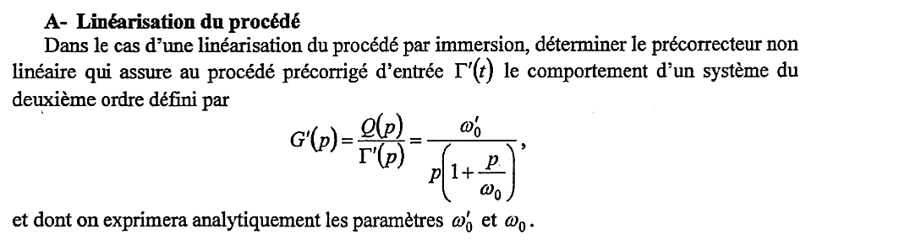{fig-alt="Partie A : par une linéarisation du procédé par immersion, déterminer le précorrecteur non linéaire qui donne au procédé précorrigé d'entrée Gamma'(t) le comportement du deuxième ordre G'(p) = Q(p)/Gamma'(p) = omega'0 / (p (1 + p/omega0)) ; exprimer analytiquement omega'0 et omega0."}

:::: {.complement}
::: {.solution}
Même question qu'en 2013-2014 : voir le [corrigé détaillé](2013-2014-partiel-commande-lineaire.qmd#sec-ann1314cl-a) (méthode, conditions de validité, variante). Résultat : on compense exactement le couple de pesanteur,
$$\boxed{\Gamma(t) = \Gamma'(t) - mgr\sin q(t)} \;\Longrightarrow\; (J+I)\,\ddot q + f\,\dot q = \Gamma' \;\Longrightarrow\; \frac{Q(p)}{\Gamma'(p)} = \frac{1/f}{p\left(1 + \dfrac{J+I}{f}\,p\right)},$$
$$\boxed{\omega_0' = \frac{1}{f}, \qquad \omega_0 = \frac{f}{J+I}}$$
valable si $m$, $g$, $r$ sont connus et $q$ mesuré.
:::
::::

## Partie B : commande du procédé linéarisé {#sec-ann1415cl-b}

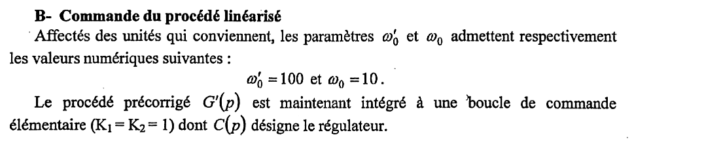{fig-alt="Partie B : on prend omega'0 = 100 et omega0 = 10 ; le procédé précorrigé G'(p) est placé dans une boucle de commande élémentaire (K1 = K2 = 1) de régulateur C(p)."}

:::: {.complement}
Boucle à retour unitaire ($K_1 = K_2 = 1$), de boucle ouverte $\beta(p) = C(p)\,G'(p)$ avec $G'(p) = \dfrac{100}{p\,(1 + p/10)}$.
::::

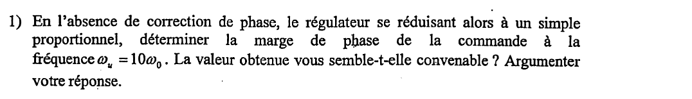{fig-alt="B-1 : sans correction de phase, avec un régulateur proportionnel, déterminer la marge de phase à la pulsation omega_u = 10 omega0 ; la valeur est-elle convenable ? Argumenter votre réponse."}

:::: {.complement}
::: {.solution}
Même question qu'en 2013-2014 ([corrigé détaillé](2013-2014-partiel-commande-lineaire.qmd#sec-ann1314cl-b)). En $\omega_u = 100$ rad/s :
$$\arg G'(j\omega_u) = -90° - \arctan 10 = -174{,}3° \quad\Longrightarrow\quad \boxed{M_\varphi = 5{,}7°},$$
obtenue avec $C_0 = \sqrt{101} \approx 10{,}05$. Marge **insuffisante** : boucle fermée très peu amortie ($\xi \approx 0{,}05$, premier dépassement $\approx 85\,\%$) et très sensible à la moindre erreur de modèle. Il faut une avance de phase autour de $\omega_u$.
:::
::::

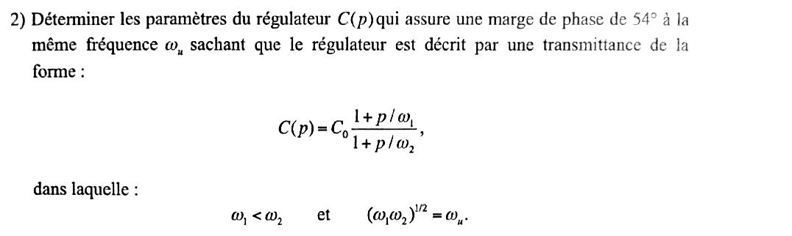{fig-alt="B-2 : déterminer les paramètres du régulateur C(p) = C0 (1 + p/omega1) / (1 + p/omega2) donnant une marge de phase de 54 degrés à la même pulsation omega_u, avec omega1 < omega2 et (omega1 omega2)^(1/2) = omega_u."}

:::: {.complement}
::: {.solution}
**Structure.** $\omega_1 < \omega_2$ : correcteur **à avance de phase**, centré sur $\omega_u$ ($\sqrt{\omega_1\omega_2} = \omega_u$), où son apport de phase est maximal. Avec $a = \omega_2/\omega_1$ :
$$\varphi_m = \arg C(j\omega_u) = \arctan\sqrt a - \arctan\frac{1}{\sqrt a} = \arcsin\frac{a-1}{a+1}, \qquad |C(j\omega_u)| = C_0\sqrt a .$$

**Phase.** Il faut $\varphi_m = 54° - 5{,}71° = 48{,}3°$, donc
$$a = \frac{1 + \sin\varphi_m}{1 - \sin\varphi_m} = \frac{1 + 0{,}7466}{1 - 0{,}7466} \approx 6{,}89 .$$
$$\omega_1 = \frac{\omega_u}{\sqrt a} \approx 38{,}1 \text{ rad/s}, \qquad \omega_2 = \omega_u\sqrt a \approx 262{,}5 \text{ rad/s}.$$

**Gain.** $|\beta(j\omega_u)| = C_0\sqrt a\,|G'(j\omega_u)| = 1$ avec $|G'(j\omega_u)| = 1/\sqrt{101}$ :
$$C_0 = \frac{\sqrt{101}}{\sqrt{6{,}89}} \approx 3{,}83 .$$
$$\boxed{C(p) \approx 3{,}83\;\frac{1 + p/38{,}1}{1 + p/262{,}5}}$$

**Vérification** (calcul numérique) : $\omega_u = 100{,}0$ rad/s, $M_\varphi = 54{,}0°$, marge de gain infinie ; en boucle fermée, premier dépassement $\approx 21\,\%$ et temps de réponse à 5 % $\approx 0{,}07$ s.

Remarque : $\varphi_m = 48{,}3°$ est proche de la limite raisonnable d'une seule avance de phase (au-delà de 55° à 60°, $a$ devient très grand et le gain haute fréquence aussi, voir la question 4).
:::
::::

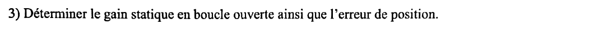{fig-alt="B-3 : déterminer le gain statique en boucle ouverte ainsi que l'erreur de position."}

:::: {.complement}
::: {.solution}
On écrit la boucle ouverte sous la forme de la note de cours [cours-v03, p. 18], $\beta(p) = \dfrac{\beta_0}{p^i}\times\dfrac{(1 + p/\omega_{cn1})\cdots}{(1 + p/\omega_{cd1})\cdots}$ :
$$\beta(p) = \frac{C_0\,\omega_0'}{p}\;\frac{1 + p/\omega_1}{(1 + p/\omega_0)(1 + p/\omega_2)}, \qquad i = 1 .$$
$$\boxed{\beta_0 = C_0\,\omega_0' \approx 3{,}83 \times 100 \approx 383\ \mathrm{s^{-1}}}$$
C'est ce que la note de cours appelle « gain statique de la boucle ouverte ». Au sens strict, $\beta(0)$ est **infini** à cause de l'intégration ; $\beta_0$ est le gain en vitesse.

**Erreur de position** (échelon $e_0/p$, retour unitaire) :
$$\varepsilon_p = \lim_{p\to 0} p\,\frac{1}{1 + \beta(p)}\,\frac{e_0}{p} = \lim_{p\to 0}\frac{e_0\,p}{p + \beta_0} = \boxed{0}$$
grâce à l'intégration du procédé (classe 1). Pour une rampe de pente $v_0$, l'erreur de traînage vaudrait $v_0/\beta_0 \approx 2{,}6\cdot 10^{-3}\,v_0$ (à comparer avec $2{,}1\cdot 10^{-5}\,v_0$ en 2013-2014, où un retard de phase relevait le gain basse fréquence).
:::
::::

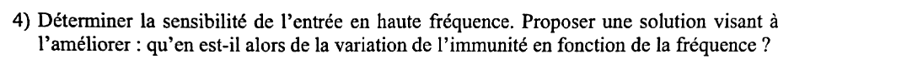{fig-alt="B-4 : déterminer la sensibilité de l'entrée en haute fréquence ; proposer une solution pour l'améliorer ; qu'en est-il alors de la variation de l'immunité en fonction de la fréquence ?"}

:::: {.complement}
::: {.solution}
**Sensibilité de l'entrée.** $\dfrac{U(p)}{E(p)} = \dfrac{C(p)}{1 + \beta(p)}$ [cours-v03, p. 17]. Pour $\omega \gg \omega_u$, $|\beta| \ll 1$ et
$$\frac{U(j\omega)}{E(j\omega)} \approx C(j\omega) \xrightarrow[\omega\to\infty]{} C_0\,\frac{\omega_2}{\omega_1} = C_0\,a$$
$$\boxed{\left.\frac{U}{E}\right|_{HF} \approx 3{,}83 \times 6{,}89 \approx 26{,}4 \quad (28{,}4 \text{ dB})}$$
Le régulateur à avance de phase est **propre mais non strictement propre** : tout signal haute fréquence (bruit sur la consigne ; au signe près, bruit de mesure ramené en sortie, puisque $U/P_s = -C/(1+\beta)$) arrive sur la commande avec un gain de 26 environ, quelle que soit sa fréquence. C'est aussi le pic de commande pour un échelon de consigne : $u(0^+) \approx 26{,}4\,e_0$ [cours-v03, p. 31].

**Amélioration.** Ajouter au régulateur un **pôle de filtrage** au-delà de $\omega_2$, $C_f(p) = \dfrac{C(p)}{1 + p/\omega_f}$, $\omega_f \gg \omega_2$ (ou un filtre d'ordre plus élevé). Avec $\omega_f = 10\,\omega_2 \approx 2\,625$ rad/s, le calcul donne une marge de phase de $51{,}8°$ (perte de $\arctan(\omega_u/\omega_f) \approx 2{,}2°$, que l'on peut rattraper en augmentant légèrement $a$).

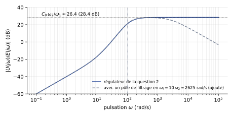{#fig-ann1415cl-sensibilite}

**Immunité.** L'immunité de la commande aux bruits varie en sens inverse de la sensibilité. Sans filtrage, la sensibilité reste à son plateau de 28,4 dB au-delà de $\omega_2$ : l'immunité est **constante** en haute fréquence (et médiocre). Avec un filtre d'ordre $n$, la sensibilité décroît de $20n$ dB par décade au-delà de $\omega_f$ : l'immunité **augmente avec la fréquence**, ce qui est le comportement souhaité puisque les bruits de mesure sont surtout haute fréquence.
:::
::::

## Partie C : bonus, grands principes de commande avancée {#sec-ann1415cl-c}

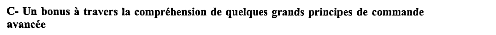{fig-alt="Partie C : un bonus à travers la compréhension de quelques grands principes de commande avancée."}

::: {.complement}
Ces trois questions portent sur des notions du cours AU201 de l'époque (commande à grand gain, commande à modèle interne, commande optimale à critère quadratique) qui **ne figurent pas dans les sources AUTO1 actuelles** (note de cours Melchior). Les réponses ci-dessous viennent des connaissances générales en automatique ; la réponse attendue par l'enseignant de l'époque peut différer dans sa formulation.
:::

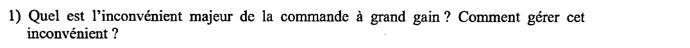{fig-alt="C-1 : quel est l'inconvénient majeur de la commande à grand gain ? Comment gérer cet inconvénient ?"}

:::: {.complement}
::: {.solution}
**Principe.** Avec un gain $K$ très grand dans la chaîne directe, $\dfrac{S}{E} = \dfrac{KG}{1 + KGR} \approx \dfrac{1}{R}$ : la boucle fermée ne dépend presque plus du procédé $G$ (robustesse aux variations de $G$, rejet des perturbations).

**Inconvénient majeur** : la **sensibilité de l'entrée** (de la commande) devient très grande. En haute fréquence, $U/E \approx K$ : bruits de consigne et de mesure sont amplifiés par $K$ sur la commande, l'actionneur sature et s'use, et l'hypothèse linéaire tombe. En outre, pour un procédé d'ordre élevé ou à retard, un grand gain réduit les marges de stabilité, voire déstabilise la boucle.

**Gestion** : limiter le grand gain à la bande de fréquences utile. On place dans la chaîne de réaction $R(p)$ une dynamique qui garantit la stabilité quel que soit $K$ (avance de phase, voir le partiel de 2016-2017), et on **filtre** en haute fréquence (pôles supplémentaires dans le régulateur ou dans $R$) pour borner la sensibilité de l'entrée au-delà de $\omega_u$. On choisit enfin $K$ comme compromis entre performances et amplitude de commande admissible.
:::
::::

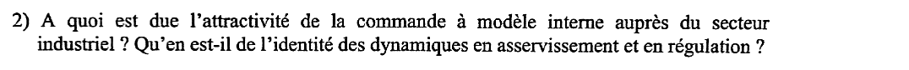{fig-alt="C-2 : à quoi est due l'attractivité de la commande à modèle interne auprès du secteur industriel ? Qu'en est-il de l'identité des dynamiques en asservissement et en régulation ?"}

:::: {.complement}
::: {.solution}
**Commande à modèle interne (CMI).** Un modèle $\tilde G$ du procédé est placé en parallèle du procédé ; seule la différence entre la sortie mesurée et la sortie du modèle est renvoyée sur le correcteur $Q(p) = \tilde G^{-1}(p)\,F(p)$, où $\tilde G^{-1}$ inverse la partie inversible du modèle et $F$ est un filtre passe-bas.

**Attractivité industrielle** :

- structure **intuitive** et réglage simple : un seul paramètre (la constante de temps de $F$), qui fixe directement la dynamique de la boucle fermée ;
- stabilité nominale garantie dès que le procédé et $Q$ sont stables ; erreur statique nulle si $F(0) = 1$, même avec un modèle imparfait ;
- prise en compte naturelle des **retards purs** (généralisation du prédicteur de Smith), fréquents dans les procédés industriels ;
- équivalence avec un régulateur classique, d'où des règles de réglage de PID « par modèle interne » faciles à appliquer.

**Identité des dynamiques.** Si le modèle est exact, $\dfrac{S}{E} = G\,Q = F$ et, pour une perturbation de sortie, $\dfrac{S}{P_s} = 1 - G\,Q = 1 - F$ : les deux dynamiques sont fixées par le **même** filtre $F$, donc identiques (même constante de temps). C'est simple, mais c'est aussi une limite : on ne peut pas régler séparément suivi de consigne et rejet de perturbation (il faut un second degré de liberté), et pour une perturbation **en entrée** d'un procédé lent, $S/P_u = G\,(1 - F)$ garde les pôles lents du procédé : le rejet est alors aussi lent que le procédé.
:::
::::

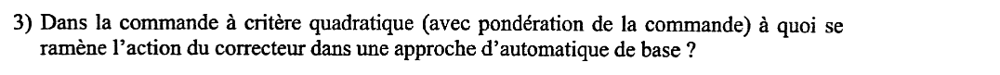{fig-alt="C-3 : dans la commande à critère quadratique (avec pondération de la commande), à quoi se ramène l'action du correcteur dans une approche d'automatique de base ?"}

:::: {.complement}
::: {.solution}
La commande à critère quadratique minimise
$$J = \int_0^{\infty}\big(x^{\mathsf T} Q\, x + \rho\, u^2\big)\,\mathrm{d}t ,$$
où $\rho > 0$ pondère la commande. La solution est un **retour d'état** $u = -K_x\,x$. Pour le procédé de ce sujet (état : position $q$ et vitesse $\dot q$), $u = -k_1\, q - k_2\,\dot q$ (plus un terme de consigne) : vu en automatique de base, c'est un **correcteur proportionnel-dérivé** (PD), ou une avance de phase si la dérivée est filtrée.

La pondération $\rho$ règle le compromis rapidité / énergie de commande : $\rho$ grand donne de petits gains, une commande modérée et une boucle lente ; $\rho \to 0$ donne de grands gains (on retrouve la commande à grand gain et sa forte sensibilité de l'entrée). Propriété classique de robustesse du retour d'état optimal (monovariable) : marge de phase d'au moins 60° et marge de gain infinie.
:::
::::
