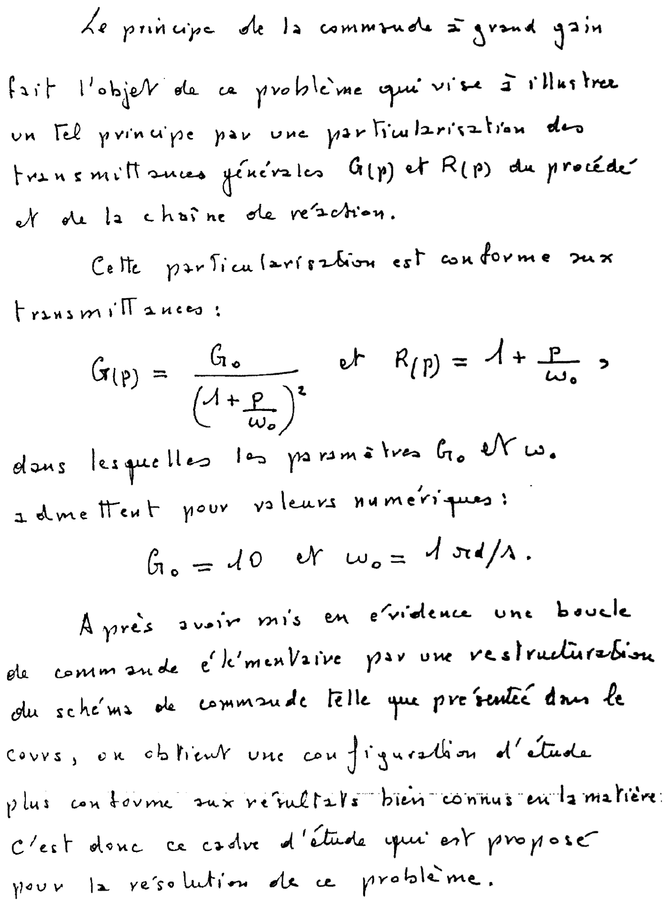
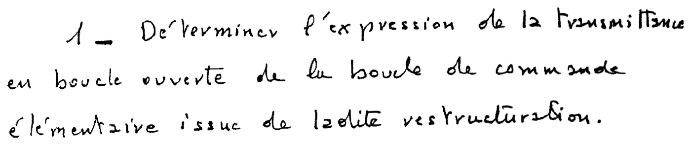
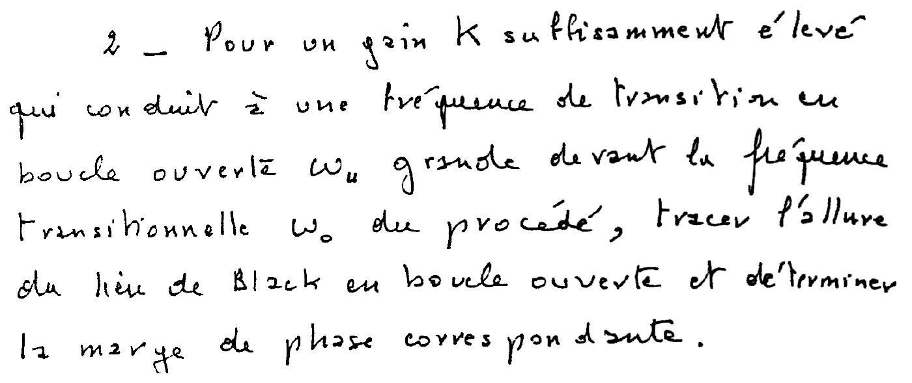
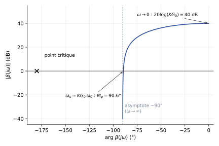
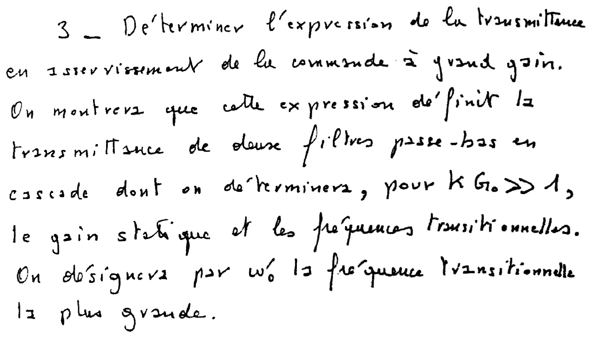
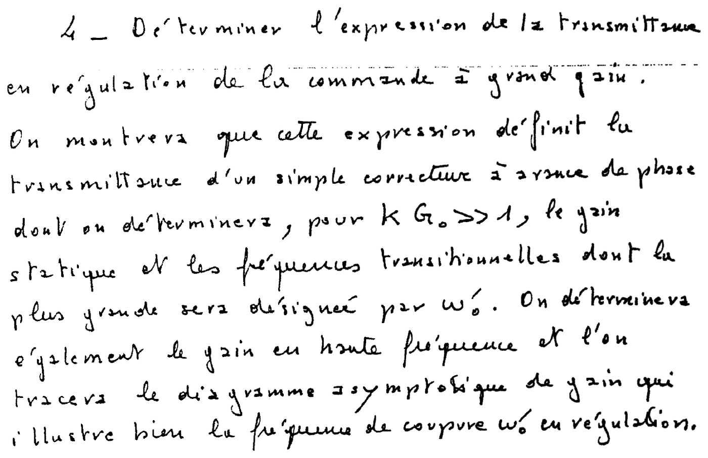
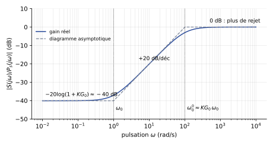
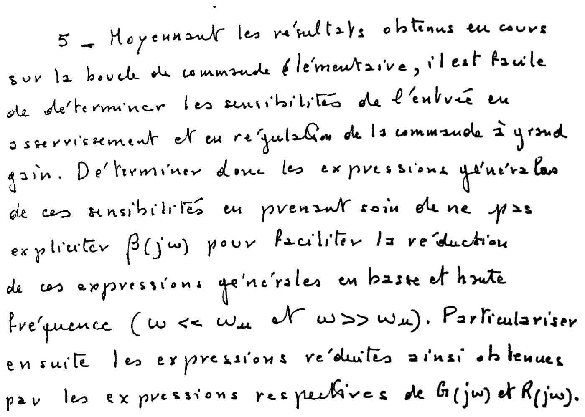



::: {.complement}
Aucun corrigé officiel ni corrigé d'élève pour ce sujet (le corrigé manuscrit `corriges/2023-partiel-2016-2017-session-1.pdf` porte sur un **autre** sujet, de commande à temps discret) : **toutes les solutions de cette page sont rédigées par Claude**, et les calculs ont été vérifiés par le calcul formel (Python, `sympy`). À relire avec un œil critique ; signaler toute erreur.

Le sujet, manuscrit, vient de l'ancien module AU201 (responsable A. Oustaloup), antérieur à la note de cours actuelle de P. Melchior. Il appelle « fréquence » une **pulsation** (rad/s) et « sensibilité de l'entrée » la **fonction de sensibilité** de la commande $u$ [cours-v03, p. 17]. Notations de la correction : procédé $G$, chaîne de réaction $R$, gain $K$, consigne $E$, sortie $S$, commande $U$, perturbation de sortie $P_s$, boucle ouverte $\beta$, pulsation au gain unité $\omega_u$, marge de phase $M_\varphi$. Le gain $K$ n'a pas de valeur numérique dans le sujet : les résultats sont donnés en fonction de $K$, et les figures prennent $K = 10$ pour l'exemple.

Le fichier `annales/2017-2018-partiel-commande-lineaire.pdf` [sujet-1718-cl] est une **photo du même sujet** (même date, mêmes feuilles) : voir la [page 2017-2018](2017-2018-partiel-commande-lineaire.qmd). La commande à grand gain était déjà l'objet de la question C-1 du [partiel de 2014-2015](2014-2015-partiel-commande-lineaire.qmd#sec-ann1415cl-c).
:::

## Problème : principe de la commande à grand gain {#sec-ann1617cl-pb}

{fig-alt="Énoncé manuscrit : le problème illustre le principe de la commande à grand gain en particularisant les transmittances G(p) du procédé et R(p) de la chaîne de réaction : G(p) = G0 / (1 + p/omega0)^2 et R(p) = 1 + p/omega0, avec G0 = 10 et omega0 = 1 rad/s. Après restructuration du schéma de commande présenté dans le cours, on obtient une boucle de commande élémentaire, cadre d'étude du problème."}

::: {.a-verifier #av-ann1617cl-schema-grand-gain}
**Source** [sujet-1617-cl, p. 1-2] : « Après avoir mis en évidence une boucle de commande élémentaire par une restructuration du schéma de commande telle que présentée dans le cours […] ».

**Problème** : le schéma de la commande à grand gain n'est pas reproduit dans le sujet, et le cours AU201 correspondant ne fait pas partie des sources AUTO1 (la note de cours Melchior ne traite pas la commande à grand gain). La place de $K$, $G$ et $R$ est donc supposée. De même, « en régulation » (questions 4 et 5) ne précise pas le point d'entrée de la perturbation.

**Proposition** : schéma classique de la commande à grand gain, gain $K$ dans la chaîne directe, procédé $G$, chaîne de réaction $R$ sur la mesure : $\varepsilon = E - R\,S$, $U = K\,\varepsilon$, $S = G\,U + P_s$, avec une perturbation $P_s$ **en sortie** du procédé. Ce schéma redonne exactement les formes annoncées par le sujet (deux passe-bas en cascade en asservissement, une avance de phase en régulation), ce qui le rend très probable. Toute la correction repose sur ce schéma.
:::

:::: {.complement}
**Restructuration** (sur le schéma supposé). La commande s'écrit $U = K\,(E - R\,S) = K R\,\left(\dfrac{E}{R} - S\right)$. Le schéma équivaut donc à :

- un **préfiltre** $\dfrac{1}{R(p)}$ sur la consigne, qui fournit la consigne équivalente $E' = E/R$ ;
- une **boucle élémentaire** à retour unitaire, de régulateur $C(p) = K\,R(p)$ et de procédé $G(p)$, dont l'écart est $\varepsilon' = E' - S$.

On peut alors appliquer tels quels les résultats du cours sur la boucle élémentaire [cours-v03, p. 17].
::::

{fig-alt="Question 1 : déterminer l'expression de la transmittance en boucle ouverte de la boucle de commande élémentaire issue de la restructuration."}

:::: {.complement}
::: {.solution}
$$\beta(p) = C(p)\,G(p) = K\,R(p)\,G(p) = K\left(1 + \frac{p}{\omega_0}\right)\frac{G_0}{\left(1 + \dfrac{p}{\omega_0}\right)^2}$$
$$\boxed{\beta(p) = \frac{K G_0}{1 + \dfrac{p}{\omega_0}}}$$
Le zéro de $R$ compense l'un des deux pôles du procédé : la boucle ouverte se réduit à un **premier ordre** de gain statique $K G_0$ (soit $10\,K$) et de pulsation de cassure $\omega_0 = 1$ rad/s.
:::
::::

{fig-alt="Question 2 : pour un gain K assez élevé, qui donne une pulsation de transition en boucle ouverte omega_u grande devant omega0, tracer l'allure du lieu de Black en boucle ouverte et déterminer la marge de phase correspondante."}

:::: {.complement}
::: {.solution}
**Lieu de Black.** $\beta(j\omega) = \dfrac{K G_0}{1 + j\omega/\omega_0}$ :
$$|\beta(j\omega)|_\mathrm{dB} = 20\log(K G_0) - 10\log\left(1 + \frac{\omega^2}{\omega_0^2}\right), \qquad \arg\beta(j\omega) = -\arctan\frac{\omega}{\omega_0}.$$
Le lieu part de $(0°,\ 20\log K G_0)$ pour $\omega \to 0$, passe par $(-45°,\ 20\log K G_0 - 3\text{ dB})$ en $\omega = \omega_0$ et tend vers l'asymptote verticale $-90°$ (gain $\to -\infty$) quand $\omega \to \infty$. Il reste toujours à droite de $-90°$ : il ne s'approche jamais du point critique $(-180°, 0\text{ dB})$.

**Pulsation au gain unité.** $|\beta(j\omega_u)| = 1$ donne $\omega_u = \omega_0\sqrt{(K G_0)^2 - 1} \approx K G_0\,\omega_0$ (si $K G_0 \gg 1$, ce qui est l'hypothèse $\omega_u \gg \omega_0$).

**Marge de phase.**
$$M_\varphi = 180° - \arctan\frac{\omega_u}{\omega_0} = 90° + \arctan\frac{\omega_0}{\omega_u} \;\xrightarrow{\ \omega_u \gg \omega_0\ }\; \boxed{M_\varphi \approx 90°}$$
(par exemple $90{,}6°$ pour $K G_0 = 100$), et la marge de gain est infinie : la boucle reste stable **quel que soit** $K$. C'est tout l'intérêt de la chaîne de réaction : seul, le procédé du deuxième ordre tendrait vers $-180°$ ; l'avance de phase de $R$ (+90° en haute fréquence) ramène la boucle à $-90°$.

{#fig-ann1617cl-black}
:::
::::

{fig-alt="Question 3 : déterminer la transmittance en asservissement de la commande à grand gain ; montrer qu'elle est celle de deux filtres passe-bas en cascade, dont on donnera, pour K G0 >> 1, le gain statique et les pulsations de cassure, la plus grande étant notée omega'0."}

:::: {.complement}
::: {.solution}
**Calcul.** Avec le préfiltre et la boucle élémentaire ($P_s = 0$) :
$$\frac{S(p)}{E(p)} = \frac{1}{R(p)}\cdot\frac{\beta(p)}{1 + \beta(p)} = \frac{K\,G(p)}{1 + K\,G(p)\,R(p)} .$$
En remplaçant $G$ et $R$ :
$$\frac{S(p)}{E(p)} = \frac{K G_0}{\left(1 + \dfrac{p}{\omega_0}\right)\left(1 + K G_0 + \dfrac{p}{\omega_0}\right)}$$
$$\boxed{\frac{S(p)}{E(p)} = \frac{K G_0}{1 + K G_0}\cdot\frac{1}{1 + \dfrac{p}{\omega_0}}\cdot\frac{1}{1 + \dfrac{p}{\omega_0'}}, \qquad \omega_0' = (1 + K G_0)\,\omega_0}$$
(forme vérifiée par calcul formel).

**Pour $K G_0 \gg 1$** :

- gain statique $\dfrac{K G_0}{1 + K G_0} \approx 1$ (erreur statique relative $\dfrac{1}{1 + K G_0} \approx \dfrac{1}{K G_0}$, d'autant plus faible que $K$ est grand) ;
- pulsations de cassure $\omega_0 = 1$ rad/s et $\omega_0' \approx K G_0\,\omega_0 = 10\,K$ rad/s, c'est-à-dire $\omega_0' \approx \omega_u$.

**Interprétation.** Le premier passe-bas, en $\omega_0$, vient du préfiltre $1/R$ : la boucle fermée garde le pôle lent du procédé. Le grand gain rend la boucle précise et insensible à $G$ (en basse fréquence, $S/E \approx 1/R$), mais il **n'accélère pas** l'asservissement : la constante de temps dominante reste $1/\omega_0 = 1$ s (temps de réponse à 5 % de l'ordre de $3/\omega_0 = 3$ s). Le second passe-bas, en $\omega_0' \approx \omega_u$, est la bande passante de la boucle élémentaire.
:::
::::

{fig-alt="Question 4 : déterminer la transmittance en régulation de la commande à grand gain ; montrer qu'elle est celle d'un simple correcteur à avance de phase dont on donnera, pour K G0 >> 1, le gain statique et les pulsations de cassure (la plus grande notée omega'0), ainsi que le gain en haute fréquence ; tracer le diagramme asymptotique de gain qui illustre la pulsation de coupure omega'0 en régulation."}

:::: {.complement}
::: {.solution}
**Calcul** (perturbation $P_s$ en sortie du procédé, $E = 0$, voir le bloc *À vérifier* ci-dessus). $S = G\,U + P_s$ et $U = -K R\,S$, d'où la fonction de régulation du cours [cours-v03, p. 17] :
$$\frac{S(p)}{P_s(p)} = \frac{1}{1 + \beta(p)} = \frac{1 + \dfrac{p}{\omega_0}}{1 + K G_0 + \dfrac{p}{\omega_0}}$$
$$\boxed{\frac{S(p)}{P_s(p)} = \frac{1}{1 + K G_0}\cdot\frac{1 + \dfrac{p}{\omega_0}}{1 + \dfrac{p}{\omega_0'}}, \qquad \omega_0' = (1 + K G_0)\,\omega_0}$$
C'est la forme d'un **correcteur à avance de phase** (zéro en $\omega_0$ avant le pôle en $\omega_0'$), de rapport $\omega_0'/\omega_0 = 1 + K G_0$.

**Pour $K G_0 \gg 1$** :

- gain statique $\dfrac{1}{1 + K G_0} \approx \dfrac{1}{K G_0}$ : une perturbation constante est divisée par $K G_0$ ;
- pulsations de cassure $\omega_0$ (zéro) et $\omega_0' \approx K G_0\,\omega_0$ (pôle) ;
- gain en haute fréquence : $\dfrac{1}{1 + K G_0}\cdot\dfrac{\omega_0'}{\omega_0} = 1$, soit **0 dB**.

**Diagramme asymptotique de gain** : palier à $-20\log(1 + K G_0)$ jusqu'à $\omega_0$, pente $+20$ dB/décade de $\omega_0$ à $\omega_0'$, puis palier à 0 dB.

{#fig-ann1617cl-regulation}

**Interprétation.** La perturbation est atténuée tant que $\omega < \omega_0'$, et ne l'est plus du tout au-delà : $\omega_0'$ est la **pulsation de coupure en régulation**. Comme $\omega_0' \approx K G_0\,\omega_0$, la régulation est d'autant plus rapide et efficace que $K$ est grand, contrairement à l'asservissement (question 3), limité par $\omega_0$ : c'est en régulation que le grand gain paie.
:::
::::

{fig-alt="Question 5 : à partir des résultats du cours sur la boucle élémentaire, déterminer les expressions générales des sensibilités de l'entrée en asservissement et en régulation de la commande à grand gain, sans expliciter beta(j omega), les réduire en basse et en haute fréquence (omega << omega_u et omega >> omega_u), puis les particulariser avec G(j omega) et R(j omega)."}

:::: {.complement}
::: {.solution}
**Expressions générales.** Résultats du cours pour la boucle élémentaire de régulateur $C$ [cours-v03, p. 17] : $\dfrac{U}{E'} = \dfrac{C}{1 + \beta}$ et $\dfrac{U}{P_s} = -\dfrac{C}{1 + \beta}$. Ici $C = K R = \dfrac{\beta}{G}$ et $E' = E/R$, donc :

- **en asservissement** : $\displaystyle \frac{U}{E} = \frac{1}{R}\cdot\frac{K R}{1 + \beta} = \frac{K}{1 + \beta} = \frac{\beta}{G\,R\,(1 + \beta)}$ ;
- **en régulation** : $\displaystyle \frac{U}{P_s} = -\frac{K R}{1 + \beta} = -\frac{\beta}{G\,(1 + \beta)}$.

**Basse fréquence** ($\omega \ll \omega_u$, $|\beta| \gg 1$, $\dfrac{\beta}{1 + \beta} \approx 1$) :
$$\frac{U}{E} \approx \frac{1}{G(j\omega)\,R(j\omega)}, \qquad \frac{U}{P_s} \approx -\frac{1}{G(j\omega)} .$$
La commande vaut ce qu'il faut pour « inverser » le procédé : elle ne dépend pas de $K$.

**Haute fréquence** ($\omega \gg \omega_u$, $|\beta| \ll 1$, $\dfrac{\beta}{1 + \beta} \approx \beta$) :
$$\frac{U}{E} \approx \frac{\beta}{G R} = K, \qquad \frac{U}{P_s} \approx -\frac{\beta}{G} = -K\,R(j\omega) .$$

**Particularisation** ($G = \dfrac{G_0}{(1 + j\omega/\omega_0)^2}$, $R = 1 + j\omega/\omega_0$) :

| | $\omega \ll \omega_u$ | $\omega \gg \omega_u$ |
|---|---|---|
| $U/E$ (asservissement) | $\dfrac{1 + j\omega/\omega_0}{G_0}$ | $K$ |
| $U/P_s$ (régulation) | $-\dfrac{(1 + j\omega/\omega_0)^2}{G_0}$ | $-K\left(1 + \dfrac{j\omega}{\omega_0}\right) \approx -K\,\dfrac{j\omega}{\omega_0}$ |

Contrôle par le calcul exact : $\dfrac{U}{E} = \dfrac{K}{1 + K G_0}\cdot\dfrac{1 + p/\omega_0}{1 + p/\omega_0'}$, qui va de $\dfrac{K}{1 + K G_0} \approx \dfrac{1}{G_0}$ en statique à $K$ en haute fréquence ; et $\dfrac{U}{P_s} = -\dfrac{K\,(1 + p/\omega_0)^2}{1 + K G_0 + p/\omega_0}$.

**Interprétation.** En haute fréquence, la sensibilité de l'entrée vaut le grand gain $K$ en asservissement, et **croît encore** de 20 dB par décade en régulation, à cause de l'action dérivée contenue dans $R$ : tout bruit de mesure est fortement amplifié sur la commande. C'est l'inconvénient majeur de la commande à grand gain (question C-1 du [partiel de 2014-2015](2014-2015-partiel-commande-lineaire.qmd#sec-ann1415cl-c)) ; en pratique, $R$ doit être complétée par un filtrage ($R$ seule, avec plus de zéros que de pôles, n'est d'ailleurs pas réalisable physiquement) et $K$ limité par l'amplitude de commande admissible.
:::
::::
