

::: {.complement}
**Origine des solutions.** Un corrigé manuscrit d'un ancien élève (promotion 2023) existe pour ce sujet [corrige-1617-td] : il traite les questions 1 à 4, commence la 5 (calcul de $G_0(w)$ inachevé) et la 6 (jusqu'au type de correcteur) ; les questions 7 et 8 ne sont pas traitées. Il est repris fidèlement dans les blocs *Notes externes*. **Les solutions détaillées sont rédigées par Claude**, et tous les résultats ont été vérifiés par le calcul numérique (Python : `control`, `sympy`), y compris en simulant la boucle échantillonnée réelle. Les écarts avec le corrigé d'élève sont dans le bloc *À vérifier* de la question 3. Le scan porte une annotation manuscrite d'étudiant (cadre « $\omega_u = 20$, $M_\varphi = 60°$ » à droite de $G(p)$), effacée des images ; les pages ont été redressées. À relire avec un œil critique ; signaler toute erreur.

**Le même problème revient trois années de suite** : [partiel 2015-2016](2015-2016-partiel-temps-discret.qmd) (parties inversées : W d'abord, $\Delta$ ensuite, sans le calcul de $G_0(w)$) et [partiel 2017-2018](2017-2018-partiel-temps-discret.qmd) (mêmes questions 1 à 8). Ici le procédé est écrit $G(p) = \dfrac{137}{p(6{,}25 + p)}$, soit $\dfrac{21{,}92}{p(1 + 0{,}16\,p)}$ : quasiment le $\dfrac{22}{p(1 + 0{,}16\,p)}$ des deux autres sujets.
:::

Aucun chapitre AUTO1 n'est encore rédigé. Méthodes utilisées : support « Synthèse fréquentielle d'un correcteur numérique à l'aide des transformations en $\Delta$, en W (bilinéaire) et de Tustin » [synthese-freq], synthèse d'un correcteur à avance de phase (PD) [cours-v03, p. 49-53] ; rappels de TSIG1 sur la [transformée en $z$](../../tsig1-traitement-numerique-signal/cours/04-implementation-equations-differences.qmd#sec-transformee-z) et les [équations aux différences](../../tsig1-traitement-numerique-signal/cours/04-implementation-equations-differences.qmd#sec-equations-differences).

## Énoncé commun {#sec-ann1617td-enonce}

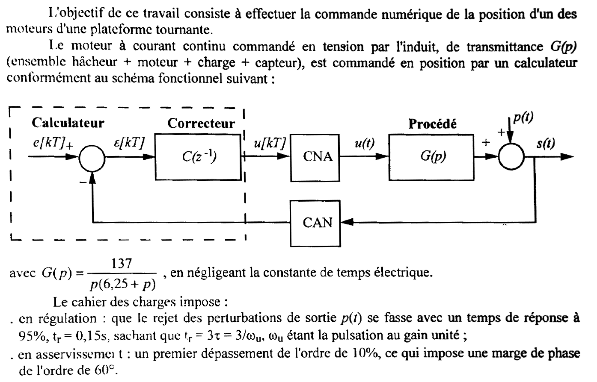{fig-alt="Énoncé : commande numérique de la position d'un des moteurs d'une plateforme tournante ; moteur à courant continu commandé en tension par l'induit, de transmittance G(p) = 137 / (p (6,25 + p)) (hacheur, moteur, charge et capteur), constante de temps électrique négligée ; schéma fonctionnel : calculateur (comparateur e[kT] - s, erreur epsilon[kT], correcteur C(z^-1), commande u[kT]), CNA, procédé G(p), perturbation p(t) ajoutée en sortie, sortie s(t), retour par un CAN. Cahier des charges : en régulation, rejet des perturbations de sortie p(t) avec un temps de réponse à 95 % tr = 0,15 s, sachant que tr = 3 tau = 3/omega_u, omega_u étant la pulsation au gain unité ; en asservissement, premier dépassement de l'ordre de 10 %, ce qui impose une marge de phase de l'ordre de 60°."}

:::: {.complement}
**Données et notations de la correction.** Procédé $G(p) = \dfrac{137}{p\,(p + 6{,}25)}$ (intégrateur, pôle en $6{,}25$ rad/s) ; calculateur avec CAN (échantillonneur de période $T$) et CNA (bloqueur d'ordre zéro $B_0(p)$) ; erreur $\varepsilon[kT] = e[kT] - s[kT]$, commande $u[kT]$, correcteur $C(z^{-1}) = U(z)/\varepsilon(z)$ [synthese-freq, p. 1]. Le cahier des charges se traduit, pour la boucle ouverte, par
$$\omega_u = \frac{3}{t_r} = 20\ \mathrm{rad/s}, \qquad M_\varphi = 60°,$$
soit $|\beta(j\omega_u)| = 1$ et $\arg[\beta(j\omega_u)] = -120°$.
::::

## Partie 1 : synthèse par transformation en $\Delta$ ($T = 1$ ms) {#sec-ann1617td-p1}

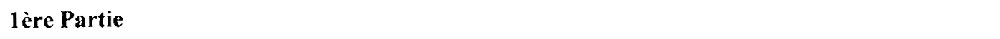{fig-alt="En-tête : 1ère Partie."}

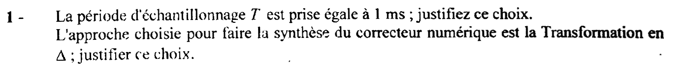{fig-alt="Question 1 : la période d'échantillonnage T est prise égale à 1 ms ; justifier ce choix. L'approche choisie pour faire la synthèse du correcteur numérique est la transformation en Delta ; justifier ce choix."}

::: {.notes-externes}
Règle de choix de la période d'échantillonnage, dans les pages manuscrites jointes à l'ancienne version de la note de cours [notes-ancien, p. 75 et 81] : « on choisit $10 \times (10 f_u) \leq f_e \leq 100 \times (10 f_u)$ », où $f_u$ est la fréquence au gain unité de la boucle ouverte (ou, variante, la plus haute fréquence de cassure significative). « Si $T_e$ petite : on peut utiliser l'approximation en $\Delta$. » [notes-ancien, p. 81]
:::

::: {.notes-externes}
Corrigé d'élève [corrige-1617-td, p. 1] : $\omega_u = 3/0{,}15 = 20$ rad/s, $f_u = \omega_u/2\pi = 10/\pi = 3{,}18$ Hz ; « on a $10 \times (10 f_u) < f_e < 100 \times 10 f_u$, soit $318$ Hz $< f_e < 3180$ Hz, soit $3{,}1$ ms $> T > 3{,}14 \cdot 10^{-4}$ s, donc 1 ms est cohérent. L'échantillonnage ne modifiera pas le signal. Comme $T$ est petite devant $t_r = 0{,}15$ s : approximation en $\Delta$. »
:::

:::: {.complement}
::: {.solution}
**Choix de $T$.** Le cahier des charges impose $t_r = 3/\omega_u = 0{,}15$ s, donc $\omega_u = 20$ rad/s, soit $f_u = \dfrac{\omega_u}{2\pi} = 3{,}18$ Hz : c'est la fréquence la plus haute que la boucle doit « voir » correctement. Avec la règle rappelée ci-dessus ($100 f_u \leq f_e \leq 1000 f_u$) :
$$318\ \mathrm{Hz} \leq f_e \leq 3{,}18\ \mathrm{kHz} \quad\Longleftrightarrow\quad 0{,}31\ \mathrm{ms} \leq T \leq 3{,}1\ \mathrm{ms}.$$
$T = 1$ ms ($f_e = 1$ kHz) est au milieu de la plage : l'échantillonnage ne déforme pas la réponse en fréquences de la boucle autour de $\omega_u$ (Shannon est très largement respecté, et le retard dû au bloqueur, $T/2$, ne coûte que $\omega_u T/2 = 0{,}01$ rad $= 0{,}57°$ de phase à $\omega_u$), sans imposer au calculateur une cadence inutilement élevée ni des coefficients trop proches de 1.

**Choix de la transformation en $\Delta$.** Elle consiste à synthétiser un correcteur **continu** $C(p)$ sur le procédé **continu** $G(p)$, puis à remplacer $p$ par $\Delta(z) = \dfrac{1 - z^{-1}}{T}$ (dérivée approchée par une différence arrière) [synthese-freq, p. 2-3]. Ce n'est qu'une approximation, à double titre : $C_\Delta(e^{j\omega T}) \approx C(j\omega)$ et $G_0(e^{j\omega T}) \approx G(j\omega)$ (on ignore le bloqueur). Elle est légitime ici parce que $T$ est très petite devant les constantes de temps en jeu : $\omega_u T = 0{,}02 \ll 1$. À $\omega_u$, $\Delta(e^{j\omega_u T}) = j\omega_u\,\dfrac{\sin(\omega_u T/2)}{\omega_u T/2}\,e^{-j\omega_u T/2}$ : erreur de module $< 0{,}01\ \%$ et erreur de phase $-\omega_u T/2 = -0{,}57°$. C'est la méthode la plus simple : outils du continu, calcul direct.
:::
::::

{fig-alt="Question 2 : appliquer cette approche ; pour cela, d'après le cahier des charges :"}

:::: {.complement}
::: {.solution}
Méthode de synthèse fréquentielle d'un régulateur [synthese-freq, p. 3], [cours-v03, p. 49-53] : on veut que la boucle ouverte $\beta(j\omega) = C(j\omega)\,G(j\omega)$ passe par 0 dB à la pulsation $\omega_u$ imposée, avec la marge de phase imposée :
$$|C(j\omega_u)\,G(j\omega_u)| = 1, \qquad \arg[C(j\omega_u)\,G(j\omega_u)] = -180° + M_\varphi = -120°.$$
On mesure ce que le procédé apporte seul à $\omega_u$ ; le correcteur apporte la différence (en module et en phase).
:::
::::

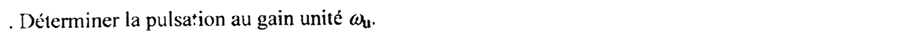{fig-alt="Question 2, premier point : déterminer la pulsation au gain unité omega_u."}

:::: {.complement}
::: {.solution}
La relation donnée par le cahier des charges, $t_r = 3\tau = 3/\omega_u$, avec $t_r = 0{,}15$ s :
$$\boxed{\omega_u = \frac{3}{t_r} = \frac{3}{0{,}15} = 20\ \mathrm{rad/s}}$$
C'est une règle d'ordre de grandeur (boucle fermée assimilée à un premier ordre de constante de temps $\tau = 1/\omega_u$).
:::
::::

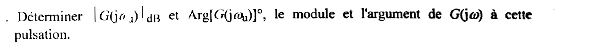{fig-alt="Question 2, deuxième point : déterminer |G(j omega_u)| en dB et Arg[G(j omega_u)] en degrés, le module et l'argument de G(j omega) à cette pulsation."}

::: {.notes-externes}
Corrigé d'élève [corrige-1617-td, p. 1] : $\omega_u = 20$ rad/s ; $|G(j\omega_u)|_\mathrm{dB} = -9{,}7$ dB ; $\arg(G(j\omega_u)) = -162{,}6°$.
:::

:::: {.complement}
::: {.solution}
$G(j\omega_u) = \dfrac{137}{p\,(6{,}25 + p)}$ avec $p = j\,20$ :
$$|G(j\omega_u)| = \dfrac{137}{20\sqrt{6{,}25^2 + 20^2}} = \dfrac{137}{20 \times 20{,}95} = 0{,}3269 \quad\Longrightarrow\quad \boxed{|G(j\omega_u)|_\mathrm{dB} = -9{,}71\ \mathrm{dB}}$$
$$\arg[G(j\omega_u)] = -90° - \arctan\!\left(\frac{\omega_u}{6{,}25}\right) = -90° - \arctan(3{,}2) \quad\Longrightarrow\quad \boxed{\arg[G(j\omega_u)] = -162{,}6°}$$
(l'intégrateur apporte $-90°$, le pôle en $6{,}25$ rad/s, bien en dessous de $\omega_u$, presque $-90°$ de plus.)
:::
::::

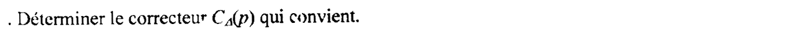{fig-alt="Question 2, troisième point : déterminer le correcteur C_Delta(p) qui convient."}

::: {.notes-externes}
Corrigé d'élève [corrige-1617-td, p. 1-2] : « on veut $M_\varphi = \arg(C(j\omega_u)G(j\omega_u)) + 180°$ $\Leftrightarrow$ $\arg(C(j\omega_u)) = 42{,}6°$ $\Rightarrow$ PD avance de phase ». $C_\Delta(p) = C_0\,\dfrac{1 + p/\omega_b}{1 + p/\omega_h}$ ; $|C_\Delta(p)G(p)| = 1$, $\arg|C_\Delta(p)G(p)| + 180° = 60°$ $\Rightarrow$ $\varphi_m = 42{,}6°$ ; $a = \dfrac{1 + \sin\varphi_m}{1 - \sin\varphi_m} = 5{,}2$ ; $\omega_b = \omega_u/\sqrt a = 8{,}8$ rad/s ; $\omega_h = \omega_u\sqrt a = 45{,}6$ rad/s ; $C_0\,\dfrac{\sqrt{1 + (\omega_u/\omega_b)^2}}{\sqrt{1 + (\omega_u/\omega_h)^2}} \times 0{,}326909 = 1$ $\Rightarrow$ $C_0 = 1{,}35$ ; $C_\Delta(p) = 1{,}35\,\dfrac{1 + p/8{,}8}{1 + p/45{,}6}$.
:::

:::: {.complement}
::: {.solution}
**Type de correcteur.** À $\omega_u$, le procédé seul donne $-162{,}6°$ ; il faut $-120°$ : le correcteur doit **avancer** la phase de
$$\varphi_m = -120° - (-162{,}6°) = 42{,}6°,$$
et **relever** le module de $9{,}71$ dB. L'intégrateur du procédé assure déjà une erreur statique nulle et le rejet d'une perturbation de sortie en échelon : pas besoin d'action intégrale. D'où un correcteur à avance de phase (« PD » filtré du cours, [cours-v03, p. 49-53]) :
$$C_\Delta(p) = C_0\,\frac{1 + p/\omega_b}{1 + p/\omega_h}, \qquad a = \frac{\omega_h}{\omega_b} > 1,$$
centré sur $\omega_u$ ($\omega_b = \omega_u/\sqrt{a}$, $\omega_h = \omega_u\sqrt{a}$), où il apporte sa phase maximale $\varphi_m$ et le module $C_0\sqrt{a}$.

**Calcul.**
$$a = \frac{1 + \sin\varphi_m}{1 - \sin\varphi_m} = \frac{1 + 0{,}677}{1 - 0{,}677} = 5{,}20, \qquad \sqrt{a} = 2{,}281,$$
$$\omega_b = \frac{\omega_u}{\sqrt a} = 8{,}77\ \mathrm{rad/s}, \qquad \omega_h = \omega_u\sqrt a = 45{,}6\ \mathrm{rad/s},$$
$$|C_\Delta(j\omega_u)|\,|G(j\omega_u)| = C_0\sqrt{a}\,|G(j\omega_u)| = 1 \quad\Longrightarrow\quad C_0 = \frac{1}{\sqrt a\,|G(j\omega_u)|} = \frac{1}{2{,}281 \times 0{,}3269} = 1{,}341.$$
$$\boxed{C_\Delta(p) = 1{,}341\,\frac{1 + p/8{,}77}{1 + p/45{,}6}}$$
Conditions de validité : la phase à apporter reste modérée ($\varphi_m < 60°$ environ pour une seule cellule, sinon $a$ devient très grand et le gain haute fréquence $C_0 a$ amplifie le bruit) ; ici $C_0 a = 6{,}976$, raisonnable.

Contrôle (calcul numérique, continu) : marge de phase $60{,}0°$ à $20$ rad/s, premier dépassement $10{,}8\ \%$ en asservissement. Le temps de réponse à $5\ \%$ du rejet d'une perturbation de sortie en échelon vaut en fait $0{,}22$ s : la règle $t_r = 3/\omega_u$ ne donne que l'ordre de grandeur.
:::
::::

{fig-alt="Question 3 : en déduire la fonction de transfert discrète du correcteur numérique C_Delta(z^-1)."}

::: {.notes-externes}
Corrigé d'élève [corrige-1617-td, p. 2] :
$$C_\Delta(z^{-1}) = \frac{U(z)}{\varepsilon(z)} = 1{,}35\,\frac{1 + \dfrac{1 - z^{-1}}{8{,}8 \times 10^{-3}}}{1 + \dfrac{1 - z^{-1}}{45{,}6 \times 10^{-3}}} = 1{,}35 \times \frac{10^{-3} + \frac{1}{8{,}8} - \frac{z^{-1}}{8{,}8}}{10^{-3} + \frac{1}{45{,}6} - \frac{z^{-1}}{45{,}6}} = \frac{0{,}15476 - 0{,}15343\,z^{-1}}{0{,}0229 - 0{,}0219\,z^{-1}} = \frac{6{,}7580 - 6{,}6987\,z^{-1}}{1 - 0{,}9563\,z^{-1}}$$
:::

:::: {.complement}
::: {.solution}
On remplace $p$ par $\Delta(z) = \dfrac{1 - z^{-1}}{T}$, $T = 10^{-3}$ s [synthese-freq, p. 2] :
$$C_\Delta(z^{-1}) = C_0\,\frac{1 + \dfrac{1 - z^{-1}}{\omega_b T}}{1 + \dfrac{1 - z^{-1}}{\omega_h T}} = C_0\,\frac{\omega_h}{\omega_b}\,\frac{(1 + \omega_b T) - z^{-1}}{(1 + \omega_h T) - z^{-1}},$$
avec $\omega_b T = 8{,}770 \cdot 10^{-3}$, $\omega_h T = 45{,}61 \cdot 10^{-3}$ et $C_0\,\omega_h/\omega_b = C_0\,a = 6{,}976$ :
$$C_\Delta(z^{-1}) = \frac{7{,}037 - 6{,}976\,z^{-1}}{1{,}04561 - z^{-1}} \quad\Longrightarrow\quad \boxed{C_\Delta(z^{-1}) = \frac{U(z)}{\varepsilon(z)} = \frac{6{,}730 - 6{,}672\,z^{-1}}{1 - 0{,}9564\,z^{-1}}}$$
(normalisation : coefficient de $z^0$ du dénominateur égal à 1). Contrôles : gain statique $C_\Delta(z = 1) = \dfrac{6{,}730 - 6{,}672}{1 - 0{,}9564} = C_0$ ✓ ; pôle $z = 0{,}9564 = 1/(1 + \omega_h T) \approx e^{-\omega_h T}$, zéro $z = 1/(1 + \omega_b T) = 0{,}9913 \approx e^{-\omega_b T}$ : ce sont les images (différence arrière) du pôle et du zéro de $C_\Delta(p)$, très près de 1 parce que $T$ est petite.

Vérification sur le vrai système échantillonné (bloqueur d'ordre 0 + $G(p)$, $T = 1$ ms, calcul numérique) : marge de phase $59{,}0°$ à $20$ rad/s (on perd environ $1°$ : le retard $T/2$ du bloqueur et l'erreur de l'approximation, $0{,}57°$ chacun), premier dépassement $11{,}4\ \%$, boucle fermée stable (pôles de module $0{,}99$ et $0{,}98$). L'approximation en $\Delta$ est donc justifiée à cette cadence.
:::
::::

::: {.a-verifier #av-ann1617td-coefficients-delta}
**Source** [corrige-1617-td, p. 2] : « $C_0 = 1{,}35$ » et « $C(z^{-1}) = \dfrac{6{,}7580 - 6{,}6987\,z^{-1}}{1 - 0{,}9563\,z^{-1}}$ ».

**Problème** : le calcul sans arrondi intermédiaire donne $C_0 = 1{,}341$ et $C_\Delta(z^{-1}) = \dfrac{6{,}730 - 6{,}672\,z^{-1}}{1 - 0{,}9564\,z^{-1}}$. La méthode du corrigé est la même ; les écarts (environ $0{,}4\ \%$ sur les coefficients du numérateur) viennent des arrondis $\omega_b = 8{,}8$ au lieu de $8{,}77$ rad/s et $0{,}0229$ au lieu de $0{,}02293$ pour le coefficient normalisant le dénominateur. Le gain statique du corrigé, $\frac{6{,}7580 - 6{,}6987}{1 - 0{,}9563} = 1{,}357$, reste proche de $C_0$ : l'effet sur la boucle est faible, mais il illustre la sensibilité de ces coefficients aux arrondis.

**Proposition** : retenir $C_0 = 1{,}341$ et $C_\Delta(z^{-1}) = \dfrac{6{,}730 - 6{,}672\,z^{-1}}{1 - 0{,}9564\,z^{-1}}$ (vérifié par le calcul numérique : marge de phase $59{,}0°$ sur le système échantillonné).
:::

{fig-alt="Question 4 : en déduire l'équation récurrente du correcteur numérique qui sera implantée."}

::: {.notes-externes}
Corrigé d'élève [corrige-1617-td, p. 2] : $U(z) = 0{,}9563\,z^{-1}U(z) + 6{,}7580\,\varepsilon(z) - 6{,}6987\,z^{-1}\varepsilon(z)$, d'où $u(kT) = 0{,}9563\,u[(k-1)T] + 6{,}7580\,\varepsilon[kT] - 6{,}6987\,\varepsilon[(k-1)T]$.
:::

:::: {.complement}
::: {.solution}
De $(1 - 0{,}9564\,z^{-1})\,U(z) = (6{,}730 - 6{,}672\,z^{-1})\,\varepsilon(z)$ et de $z^{-1} X(z) \leftrightarrow x[(k-1)T]$ ([équations aux différences](../../tsig1-traitement-numerique-signal/cours/04-implementation-equations-differences.qmd#sec-equations-differences)) :
$$\boxed{u[kT] = 0{,}9564\,u[(k-1)T] + 6{,}730\,\varepsilon[kT] - 6{,}672\,\varepsilon[(k-1)T]}$$
À chaque période $T$, le calculateur lit $\varepsilon[kT] = e[kT] - s[kT]$, calcule $u[kT]$ avec la valeur précédente de la commande et de l'erreur, l'envoie au CNA, puis mémorise $u[kT]$ et $\varepsilon[kT]$. L'équation est causale (seule $\varepsilon[kT]$ est prise à l'instant courant) et récursive (pôle en $0{,}9564$, stable).

Précision des coefficients : le pôle est proche de 1 et les deux coefficients du numérateur se compensent presque (leur différence, $0{,}058$, fixe le gain statique) ; il faut donc garder au moins 4 chiffres significatifs, sinon le gain statique et la position du pôle changent notablement.
:::
::::

## Partie 2 : synthèse par transformation en W ($T = 0{,}01$ s) {#sec-ann1617td-p2}

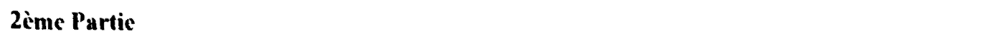{fig-alt="En-tête : 2ème Partie."}

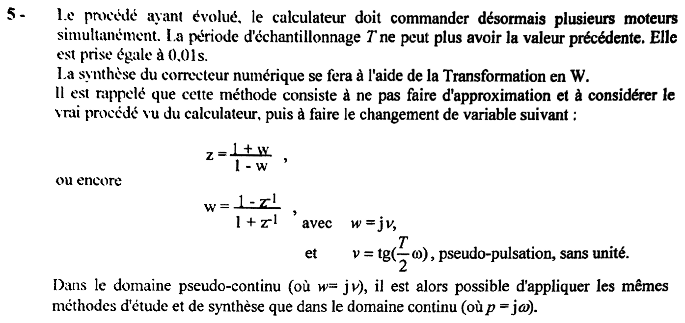{fig-alt="Question 5 : le procédé ayant évolué, le calculateur doit commander désormais plusieurs moteurs simultanément ; la période d'échantillonnage T ne peut plus avoir la valeur précédente, elle est prise égale à 0,01 s. La synthèse du correcteur numérique se fera à l'aide de la transformation en W. Rappel : cette méthode consiste à ne pas faire d'approximation et à considérer le vrai procédé vu du calculateur, puis à faire le changement de variable z = (1 + w)/(1 - w), ou encore w = (1 - z^-1)/(1 + z^-1), avec w = j nu et nu = tg(T omega / 2), pseudo-pulsation sans unité. Dans le domaine pseudo-continu (w = j nu), on peut appliquer les mêmes méthodes d'étude et de synthèse que dans le domaine continu (p = j omega)."}

:::: {.complement}
::: {.solution}
**Pourquoi $T$ change de méthode.** Avec $T = 0{,}01$ s, $f_e = 100$ Hz est **en dessous** de la plage $318\ \mathrm{Hz} \leq f_e \leq 3{,}18$ kHz : à $\omega_u$, $\omega_u T = 0{,}2$ et le bloqueur coûte déjà $\omega_u T/2 = 5{,}7°$ de phase. L'approximation en $\Delta$ n'est plus fiable : appliquée telle quelle (même $C(p)$ que pour $T = 1$ ms, discrétisé avec $T = 0{,}01$ s), elle donnerait sur le vrai système une marge de phase de $50{,}6°$ au lieu de $60°$ et un dépassement de $18{,}7\ \%$ (calcul numérique).

**Transformation en W** [synthese-freq, p. 3-5]. On travaille sur le **vrai** procédé vu du calculateur, $G_0(z) = \mathcal{Z}\{B_0(p)\,G(p)\}$, sans approximation, puis on pose
$$z = \frac{1 + w}{1 - w} \quad\Longleftrightarrow\quad w = \frac{1 - z^{-1}}{1 + z^{-1}} = \frac{z - 1}{z + 1}.$$
Sur le cercle unité ($z = e^{j\omega T}$), $w = j\,\tan(\omega T/2) = j\nu$ : la bande $0 \leq \omega < \omega_e/2$ est envoyée **exactement** sur $0 \leq \nu < \infty$. On peut alors appliquer à $G_0(w)$ les méthodes du continu (Bode, marges), le changement de variable étant exact. Pour $\omega T \ll 1$, $\nu \approx \omega T/2$.
:::
::::

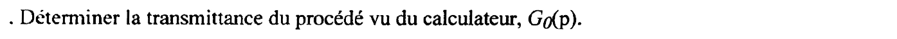{fig-alt="Question 5, premier point : déterminer la transmittance du procédé vu du calculateur, G0(p)."}

::: {.notes-externes}
Corrigé d'élève [corrige-1617-td, p. 3] : $G_0(p) = B_0(p)\,G(p)$.
:::

:::: {.complement}
::: {.solution}
Le CNA est un bloqueur d'ordre zéro $B_0(p) = \dfrac{1 - e^{-Tp}}{p}$ [synthese-freq, p. 8] ; le procédé vu du calculateur (entre $u[kT]$ et la mesure échantillonnée $s[kT]$) est donc
$$\boxed{G_0(p) = B_0(p)\,G(p) = \frac{1 - e^{-Tp}}{p}\,G(p)}$$
:::
::::

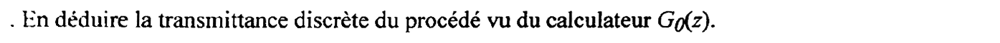{fig-alt="Question 5, deuxième point : en déduire la transmittance discrète du procédé vu du calculateur, G0(z)."}

::: {.notes-externes}
Corrigé d'élève [corrige-1617-td, p. 3] : $G_0(z) = \mathcal{Z}[G_0(p)] = \dfrac{z-1}{z}\,\mathcal{Z}\left[\dfrac{G(p)}{p}\right] = \dfrac{z-1}{z} \times 3{,}50722\,\mathcal{Z}\left[\dfrac{6{,}25^2}{p^2(p + 6{,}25)}\right]$, puis, avec la table, $G_0(z) = 3{,}5072\,\dfrac{(1 - e^{-aT})(1 - z) + aT(z - e^{-aT})}{(z-1)(z - e^{-aT})} = \dfrac{0{,}0065712 + 0{,}00671\,z}{(z-1)(z - 0{,}9394)}$.
:::

:::: {.complement}
::: {.solution}
$$G_0(z) = \mathcal{Z}\{B_0(p)\,G(p)\} = (1 - z^{-1})\,\mathcal{Z}\left\{\frac{G(p)}{p}\right\}, \qquad \frac{G(p)}{p} = \frac{K}{p^2\,(p + a)},\quad K = 137,\ a = 6{,}25\ \mathrm{s^{-1}}$$
(le facteur $e^{-Tp}$ est un retard d'une période, d'où $z^{-1}$ ; [transformée en $z$](../../tsig1-traitement-numerique-signal/cours/04-implementation-equations-differences.qmd#sec-transformee-z)). Par décomposition en éléments simples, $\dfrac{1}{p^2(p + a)} = \dfrac{1}{a p^2} - \dfrac{1}{a^2 p} + \dfrac{1}{a^2 (p + a)}$, et avec $\mathcal{Z}\{1/p\} = \dfrac{z}{z-1}$, $\mathcal{Z}\{1/p^2\} = \dfrac{Tz}{(z-1)^2}$, $\mathcal{Z}\{1/(p+a)\} = \dfrac{z}{z - e^{-aT}}$ :
$$G_0(z) = \frac{K}{a^2}\;\frac{(aT - 1 + e^{-aT})\,z + (1 - e^{-aT} - aT\,e^{-aT})}{(z - 1)(z - e^{-aT})}.$$
Application numérique : $T = 0{,}01$ s, $aT = 0{,}0625$, $e^{-aT} = 0{,}93941$, $K/a^2 = 3{,}507$ :
$$\boxed{G_0(z) = \frac{6{,}709 \cdot 10^{-3}\,z + 6{,}571 \cdot 10^{-3}}{(z - 1)(z - 0{,}93941)}}$$
Contrôles : pôle $z = 1$ (l'intégrateur, $p = 0 \mapsto z = e^{0}$) et pôle $z = e^{-aT}$ (image exacte du pôle $p = -a$) ; zéro $z = -0{,}979$, proche de $-1$, créé par l'échantillonnage-blocage (il n'a pas d'équivalent continu). Gain de vitesse : $\lim_{z\to1} \dfrac{z-1}{T}\,G_0(z) = K/a = 21{,}92$, celui de $G(p)$ ✓.
:::
::::

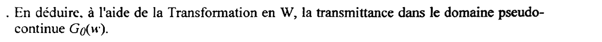{fig-alt="Question 5, troisième point : en déduire, à l'aide de la transformation en W, la transmittance dans le domaine pseudo-continu G0(w)."}

::: {.notes-externes}
Corrigé d'élève [corrige-1617-td, p. 3-4] : substitution $z = \frac{1+w}{1-w}$ dans $G_0(z)$, développement jusqu'à $\dfrac{(1-w)^2\,0{,}0065712 + 0{,}00671\,(1+w)}{2w\,(0{,}0606 + 1{,}9394\,w)}$, puis développement du numérateur ; calcul non terminé (l'expression n'est pas mise sous forme canonique).
:::

:::: {.complement}
::: {.solution}
On remplace $z$ par $\dfrac{1+w}{1-w}$ dans chaque facteur ($b_1$, $b_0$ coefficients du numérateur de $G_0(z)$, $e = e^{-aT}$) :
$$z - 1 = \frac{2w}{1 - w}, \qquad z - e = \frac{(1 - e) + (1 + e)\,w}{1 - w}, \qquad b_1 z + b_0 = \frac{(b_1 + b_0) + (b_1 - b_0)\,w}{1 - w},$$
d'où
$$G_0(w) = \frac{b_1 + b_0}{2\,(1 - e)}\;\frac{\left(1 + \dfrac{b_1 - b_0}{b_1 + b_0}\,w\right)(1 - w)}{w\left(1 + \dfrac{1 + e}{1 - e}\,w\right)}.$$
Valeurs : $\dfrac{b_1 + b_0}{2(1-e)} = 0{,}1096$, $\dfrac{b_1 + b_0}{b_1 - b_0} = 96{,}0$, $\dfrac{1 - e}{1 + e} = \tanh(aT/2) = 0{,}03124 \approx aT/2 = 31{,}25 \cdot 10^{-3}$ :
$$\boxed{G_0(w) = 0{,}1096\;\frac{(1 + w/96)(1 - w)}{w\,(1 + w/0{,}03124)}}$$
Avec $K = 137$, le gain exact est $\dfrac{K}{a}\cdot\dfrac{T}{2} = 21{,}92 \times 0{,}005 = 0{,}1096$, arrondi à $0{,}11$ dans l'expression donnée à la question 6 (écart de $0{,}4\ \%$, soit $0{,}03$ dB : sans effet sur la suite).

Le facteur $(1 - w)$ vient du degré : $G_0(z)$ a un pôle de plus que de zéros, et $z \to \infty$ correspond à $w = 1$. C'est un zéro **à partie réelle positive** (non minimum de phase) : il traduit, en pseudo-continu, le retard d'une demi-période du bloqueur ($e^{-pT/2} \approx 1 - pT/2$ et $w \approx pT/2$).
:::
::::

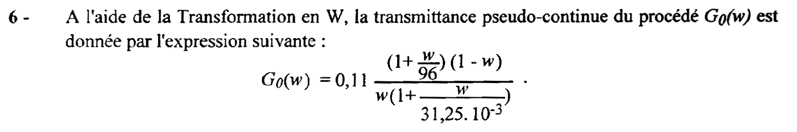{fig-alt="Question 6 : à l'aide de la transformation en W, la transmittance pseudo-continue du procédé est donnée par G0(w) = 0,11 (1 + w/96)(1 - w) / (w (1 + w / 31,25.10^-3))."}

:::: {.complement}
::: {.solution}
C'est l'expression obtenue à la question 5 (gain arrondi). On note $\nu_1 = 31{,}25 \cdot 10^{-3} = 1/32$ (pôle), $\nu_2 = 1$ (zéro instable) et $\nu_3 = 96$ (zéro stable).
:::
::::

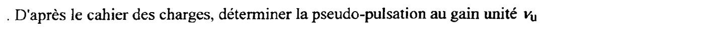{fig-alt="Question 6, premier point : d'après le cahier des charges, déterminer la pseudo-pulsation au gain unité nu_u."}

::: {.notes-externes}
Corrigé d'élève [corrige-1617-td, p. 4] : $w = j\nu$ ; $\nu_u = 0{,}1$.
:::

:::: {.complement}
::: {.solution}
La pulsation au gain unité imposée reste $\omega_u = 3/t_r = 20$ rad/s (le cahier des charges porte sur le vrai système). Son image en pseudo-pulsation [synthese-freq, p. 3] :
$$\boxed{\nu_u = \tan\!\left(\frac{\omega_u T}{2}\right) = \tan(0{,}1) = 0{,}1003 \approx 0{,}1}$$
($\omega_u T = 0{,}2 \ll \pi$ : on est dans la zone où $\nu \approx \omega T/2$, la tangente ne change presque rien.)
:::
::::

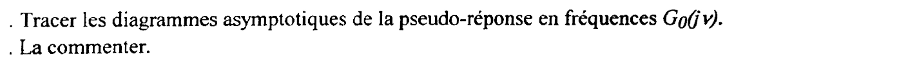{fig-alt="Question 6, deuxième point : tracer les diagrammes asymptotiques de la pseudo-réponse en fréquences G0(j nu) ; les commenter."}

:::: {.complement}
::: {.solution}
**Asymptotes** de $G_0(j\nu) = 0{,}11\,\dfrac{(1 + j\nu/96)(1 - j\nu)}{j\nu\,(1 + j\nu/0{,}03125)}$ :

| $\nu$ | $< 1/32$ | $1/32$ à $1$ | $1$ à $96$ | $> 96$ |
|---|---|---|---|---|
| pente du gain | $-20$ dB/déc | $-40$ dB/déc | $-20$ dB/déc | $0$ dB/déc |
| phase asymptotique | $-90°$ | $-180°$ | $-270°$ | $-180°$ |

Points de calcul : l'asymptote de départ $0{,}11/\nu$ vaut $0{,}11 \times 32 = 3{,}52$, soit $+10{,}9$ dB, à la cassure $\nu = 1/32$ ; sur le tronçon à $-40$ dB/déc, $|G_0| \approx 0{,}11 \times 0{,}03125/\nu^2$, qui coupe 0 dB en $\nu \approx 0{,}059$ et vaut $-49{,}3$ dB en $\nu = 1$ ; le palier final est à $-88{,}9$ dB (au-delà de $\nu = 96$). Phase réelle : $\arg G_0(j\nu) = -90° - \arctan(32\nu) - \arctan\nu + \arctan(\nu/96)$.

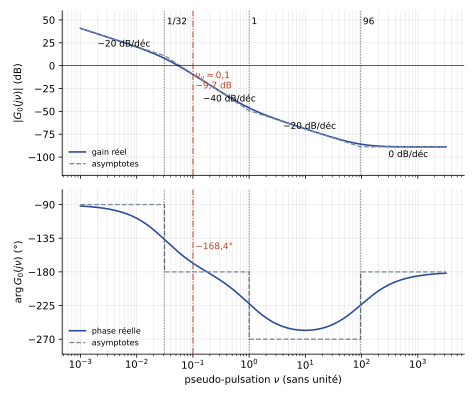{#fig-ann1617td-bode-g0w}

**Commentaire.**

- **Basses pseudo-pulsations** ($\nu \ll 1$, c'est-à-dire $\omega \ll 2/T = 200$ rad/s) : $\nu \approx \omega T/2$ et $G_0(j\nu)$ reproduit le procédé continu : intégrateur ($0{,}11/w$ correspond à $K/a \cdot 1/p$ avec $w \approx pT/2$) et pôle en $\nu = 1/32$, image de $\omega = 6{,}25$ rad/s (constante de temps de $0{,}16$ s du moteur).
- **Zéro instable en $\nu = 1$** (facteur $1 - w$) : le gain remonte d'une pente, mais la phase **continue de baisser** ($-90°$ de plus) : comportement à non minimum de phase, image du retard $T/2$ du bloqueur. $\nu = 1$ correspond à $\omega = \pi/(2T) = \omega_e/4 = 157$ rad/s. À $\nu_u = 0{,}1$, ce zéro coûte déjà $\arctan(0{,}1) = 5{,}7°$ : c'est exactement la phase supplémentaire à compenser par rapport à la synthèse en $\Delta$ ($-168{,}4°$ au lieu de $-162{,}6°$).
- **Zéro en $\nu = 96$** : zéro d'échantillonnage ($z = -0{,}979$), sans équivalent continu ; il ramène la phase vers $-180°$ à l'infini.
- Au-delà de $\nu = 1$ il n'y a plus de correspondance d'échelle simple avec $\omega$ : $\nu \to \infty$ correspond à $\omega \to \omega_e/2 = 314$ rad/s (Nyquist). La zone utile pour la synthèse ($\nu_u = 0{,}1$) est bien dans la zone « continue ».
- Sans correcteur, le gain passe par 0 dB vers $\nu \approx 0{,}055$ avec une phase d'environ $-153°$ : marge de phase de $27°$ seulement, et pulsation au gain unité trop basse ($\omega \approx 11$ rad/s) : il faut corriger.
:::
::::

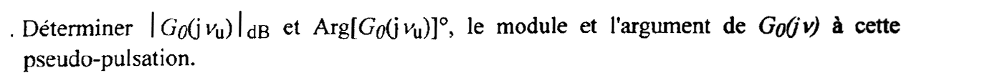{fig-alt="Question 6, troisième point : déterminer |G0(j nu_u)| en dB et Arg[G0(j nu_u)] en degrés, le module et l'argument de G0(j nu) à cette pseudo-pulsation."}

::: {.notes-externes}
Corrigé d'élève [corrige-1617-td, p. 4] : $|G_0(j\nu_u)| = -9{,}6$ dB ; $\arg(G_0(j\nu_u)) = -168{,}3°$.
:::

:::: {.complement}
::: {.solution}
Avec $\nu_u = 0{,}1003$ :
$$|G_0(j\nu_u)| = 0{,}11\,\frac{\sqrt{1 + (\nu_u/96)^2}\,\sqrt{1 + \nu_u^2}}{\nu_u\,\sqrt{1 + (32\,\nu_u)^2}} = 0{,}11\,\frac{1 \times 1{,}0050}{0{,}1003 \times 3{,}364} = 0{,}3277 \quad\Longrightarrow\quad \boxed{|G_0(j\nu_u)|_\mathrm{dB} = -9{,}69\ \mathrm{dB}}$$
$$\arg[G_0(j\nu_u)] = -90° - \arctan(3{,}211) - \arctan(0{,}1003) + \arctan(0{,}00105) = -90° - 72{,}70° - 5{,}73° + 0{,}06° \quad\Longrightarrow\quad \boxed{\arg[G_0(j\nu_u)] = -168{,}4°}$$
(avec l'arrondi $\nu_u = 0{,}1$ : $-9{,}64$ dB et $-168{,}3°$.)
:::
::::

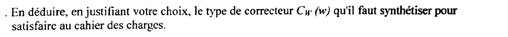{fig-alt="Question 6, quatrième point : en déduire, en justifiant le choix, le type de correcteur C_W(w) qu'il faut synthétiser pour satisfaire au cahier des charges."}

::: {.notes-externes}
Corrigé d'élève [corrige-1617-td, p. 4] : $\arg(C_W(w)\,G_0(j\nu_u)) + 180° = 60°$ $\Rightarrow$ $\arg(C_W(w)) = 48{,}3°$ $\Rightarrow$ PD. (Les valeurs $-9{,}6$ dB, $-168{,}3°$ et $48{,}3°$ correspondent à l'arrondi $\nu_u = 0{,}1$.)
:::

:::: {.complement}
::: {.solution}
**Type.** Il faut, à $\nu_u$, relever le module de $9{,}69$ dB et **avancer** la phase de
$$\varphi_m = -120° - (-168{,}4°) = 48{,}4°,$$
sans action intégrale (le procédé contient déjà l'intégrateur, pôle $w = 0$ ; la précision statique et le rejet d'une perturbation de sortie en échelon sont assurés). D'où, comme en continu, un correcteur à avance de phase (PD filtré) [cours-v03, p. 49-53] :
$$C_W(w) = C_0\,\frac{1 + w/\nu_b}{1 + w/\nu_h}, \qquad \nu_b = \frac{\nu_u}{\sqrt a}, \quad \nu_h = \nu_u\sqrt a .$$
**Calcul.**
$$a = \frac{1 + \sin 48{,}4°}{1 - \sin 48{,}4°} = 6{,}92, \quad \sqrt a = 2{,}631, \quad \nu_b = 0{,}03814, \quad \nu_h = 0{,}2639, \quad C_0 = \frac{1}{\sqrt a\,|G_0(j\nu_u)|} = \frac{1}{2{,}631 \times 0{,}3277} = 1{,}160$$
$$\boxed{C_W(w) = 1{,}160\,\frac{1 + w/0{,}03814}{1 + w/0{,}2639}}$$
L'avance de phase demandée est plus grande qu'en $\Delta$ ($48{,}4°$ contre $42{,}6°$) : c'est le prix du retard du bloqueur à $T = 0{,}01$ s, que la transformation en W prend en compte exactement.
:::
::::

{fig-alt="Question 7 : en déduire la fonction de transfert discrète du correcteur numérique C_W(z^-1)."}

:::: {.complement}
::: {.solution}
On revient en $z$ par $w = \dfrac{1 - z^{-1}}{1 + z^{-1}}$ [synthese-freq, p. 3] :
$$1 + \frac{w}{\nu_b} = \frac{(1 + \nu_b) - (1 - \nu_b)\,z^{-1}}{\nu_b\,(1 + z^{-1})} \quad\Longrightarrow\quad C_W(z^{-1}) = C_0\,\frac{\nu_h}{\nu_b}\;\frac{(1 + \nu_b) - (1 - \nu_b)\,z^{-1}}{(1 + \nu_h) - (1 - \nu_h)\,z^{-1}}$$
(les facteurs $1 + z^{-1}$ se simplifient). Avec $C_0\,\nu_h/\nu_b = C_0\,a = 8{,}028$ :
$$C_W(z^{-1}) = \frac{8{,}334 - 7{,}722\,z^{-1}}{1{,}2639 - 0{,}7361\,z^{-1}} \quad\Longrightarrow\quad \boxed{C_W(z^{-1}) = \frac{U(z)}{\varepsilon(z)} = \frac{6{,}594 - 6{,}110\,z^{-1}}{1 - 0{,}5824\,z^{-1}}}$$
Contrôles : gain statique $C_W(z = 1) = \dfrac{0{,}484}{0{,}4176} = 1{,}160 = C_0$ ✓ ; pôle $z = 0{,}5824$ et zéro $z = 0{,}9265$, images exactes de $w = -\nu_h$ et $w = -\nu_b$.

Vérification sur le vrai système échantillonné ($G_0(z)$ exact, $T = 0{,}01$ s, calcul numérique) : marge de phase $60{,}0°$ à $\omega = 20{,}0$ rad/s (la transformation est exacte), premier dépassement $8{,}9\ \%$, temps de réponse à $5\ \%$ en rejet de perturbation de sortie $0{,}19$ s (règle $3/\omega_u$ approchée, comme en $\Delta$), boucle fermée stable (pôles de module $0{,}92$ et $0{,}80$).
:::
::::

{fig-alt="Question 8 : en déduire l'équation récurrente du correcteur numérique qui sera implantée."}

:::: {.complement}
::: {.solution}
De $(1 - 0{,}5824\,z^{-1})\,U(z) = (6{,}594 - 6{,}110\,z^{-1})\,\varepsilon(z)$ ([équations aux différences](../../tsig1-traitement-numerique-signal/cours/04-implementation-equations-differences.qmd#sec-equations-differences)) :
$$\boxed{u[kT] = 0{,}5824\,u[(k-1)T] + 6{,}594\,\varepsilon[kT] - 6{,}110\,\varepsilon[(k-1)T]}$$
avec $T = 0{,}01$ s : à chaque période, lecture de $\varepsilon[kT]$, calcul, sortie de $u[kT]$ vers le CNA, mise en mémoire de $u[kT]$ et $\varepsilon[kT]$. Même structure qu'en $\Delta$ (un pôle, un zéro), mais coefficients différents : le pôle ($0{,}58$) est bien plus loin de 1, la cadence étant 10 fois plus lente. Garder 4 chiffres significatifs.
:::
::::
