

::: {.complement}
**Origine des solutions.** Le fichier `2021-2022-test.pdf` contient **le même sujet** (pages 1-2, identiques à [sujet-2122]) suivi d'une « Correction de l'épreuve » succincte (pages 3-4) [corrige-2122]. Ce corrigé est repris tel quel dans les blocs *Notes externes* ; les solutions détaillées qui suivent (blocs *Complément*) sont rédigées par Claude et vérifiées par le calcul (sympy, numpy). À relire avec un œil critique ; signaler toute erreur. Aucune page séparée n'est faite pour `2021-2022-test.pdf`.

**Correspondances.** Les exercices de moindres carrés et de KKT reprennent le même schéma que le [partiel 2022-2023](2022-2023-partiel.qmd) (forme $J = E^T E$, solution $\theta = (\varphi^T\varphi)^{-1}\varphi^T Y$, convexité par le hessien $2\varphi^T\varphi$) et que l'[épreuve 2023-2024](2023-2024-test.qmd) (lecture graphique du domaine admissible puis vérification des conditions KKT).
:::

**Conventions de la correction.** Problème de minimisation sous contraintes d'inégalité $g_i(x) \le 0$ : lagrangien $\mathscr{L}(x, \mu) = J(x) + \sum_i \mu_i\, g_i(x)$, conditions de Karush-Kuhn-Tucker (*KKT conditions*) : stationnarité $\nabla J + \sum_i \mu_i \nabla g_i = 0$, admissibilité $g_i \le 0$, multiplicateurs $\mu_i \ge 0$, complémentarité $\mu_i\, g_i = 0$.

## Exercice 1 : conditions d'optimalité (4 points) {#sec-ann2122p-ex1}

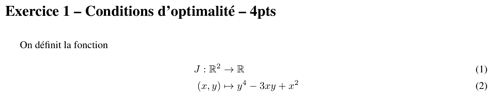{fig-alt="Exercice 1 – Conditions d'optimalité – 4 pts : on définit la fonction J de R² dans R, (x, y) ↦ y⁴ − 3xy + x²."}

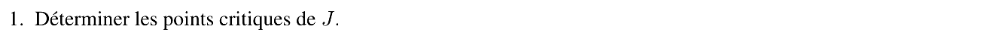{fig-alt="Q1 : déterminer les points critiques de J."}

::: {.notes-externes}
**Corrigé de l'épreuve** [corrige-2122, p. 3] : « il existe 3 points critiques : $\frac{dJ}{dx} = \begin{pmatrix} -3y + 2x \\ 4y^3 - 3x \end{pmatrix} = \begin{pmatrix} 0 \\ 0 \end{pmatrix} \Leftrightarrow \begin{cases} y = \frac{2}{3}x \\ 32x^3 - 81x = 0 \end{cases} \Leftrightarrow (x, y) \in \left\{(0,0), \left(\frac{9}{8}\sqrt{2}, \frac{3}{4}\sqrt{2}\right), \left(-\frac{9}{8}\sqrt{2}, -\frac{3}{4}\sqrt{2}\right)\right\}$ ».
:::

:::: {.complement}
::: {.solution}
Un point critique (*critical point*) annule le gradient (condition nécessaire d'optimalité du premier ordre, $J$ étant différentiable sur $\mathbb{R}^2$) :
$$\nabla J(x, y) = \begin{pmatrix} \partial J/\partial x \\ \partial J/\partial y \end{pmatrix} = \begin{pmatrix} 2x - 3y \\ 4y^3 - 3x \end{pmatrix} = \begin{pmatrix} 0 \\ 0 \end{pmatrix}.$$
La première équation donne $x = \frac{3}{2}y$ ; dans la seconde : $4y^3 - \frac{9}{2}y = 0$, soit $y\,(8y^2 - 9) = 0$, d'où $y = 0$ ou $y = \pm\frac{3}{2\sqrt{2}} = \pm\frac{3\sqrt{2}}{4}$, et $x = \frac{3}{2}y = \pm\frac{9\sqrt{2}}{8}$.
$$\boxed{(0, 0), \quad \left(\tfrac{9\sqrt{2}}{8}, \tfrac{3\sqrt{2}}{4}\right) \approx (1{,}591 ; 1{,}061), \quad \left(-\tfrac{9\sqrt{2}}{8}, -\tfrac{3\sqrt{2}}{4}\right)}$$
(Le corrigé élimine $y$ au lieu de $x$ : $y = \frac{2}{3}x$ puis $\frac{32}{27}x^3 - 3x = 0$, même résultat.)
:::
::::

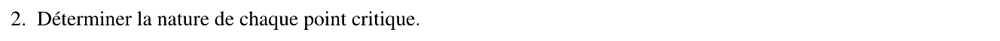{fig-alt="Q2 : déterminer la nature de chaque point critique."}

::: {.notes-externes}
**Corrigé de l'épreuve** [corrige-2122, p. 3] : « La matrice hessienne s'écrit : $\frac{d^2J}{dx\,dx^T} = \begin{pmatrix} 2 & -3 \\ -3 & 12y^2 \end{pmatrix}$. Le premier mineur principal est à 2, le second à $24y^2 - 9$. Ce dernier est négatif pour $y = 0$ et positif pour les 2 autres solutions. En conclusion, le point (0,0) est un point selle, les 2 autres points sont des minimums. »
:::

:::: {.complement}
::: {.solution}
Condition du second ordre : on étudie le signe de la matrice hessienne (*Hessian*) en chaque point critique.
$$\nabla^2 J(x, y) = \begin{pmatrix} 2 & -3 \\ -3 & 12y^2 \end{pmatrix}, \qquad \det \nabla^2 J = 24y^2 - 9 .$$
Critère des mineurs principaux (matrice $2\times 2$ symétrique) : premier mineur $2 > 0$ ; le signe du déterminant décide.

| Point | $\det \nabla^2 J$ | Nature | $J$ |
|---|---|---|---|
| $(0, 0)$ | $-9 < 0$ | valeurs propres de signes opposés : **point selle** (*saddle point*) | $0$ |
| $\pm\left(\frac{9\sqrt{2}}{8}, \frac{3\sqrt{2}}{4}\right)$ | $24 \cdot \frac{9}{8} - 9 = 18 > 0$ | hessien défini positif : **minimum local strict** | $-\frac{81}{64}$ |

Valeur aux minima : avec $y^2 = \frac{9}{8}$ et $xy = \frac{3}{2}y^2 = \frac{27}{16}$, $J = \frac{81}{64} - \frac{81}{16} + \frac{81}{32} = -\frac{81}{64} \approx -1{,}27$.

Ces deux minima sont même **globaux** : $J$ est continue et coercive ($y^4$ domine $3xy$ à l'infini, et $x^2 - 3xy \ge -\frac{9}{4}y^2$), donc atteint son minimum global en un point critique ; le seul point critique de valeur minimale est la paire symétrique ($J(x,y) = J(-x,-y)$), de valeur $-\frac{81}{64}$.
:::
::::

## Exercice 2 : moindres carrés (8 points) {#sec-ann2122p-ex2}

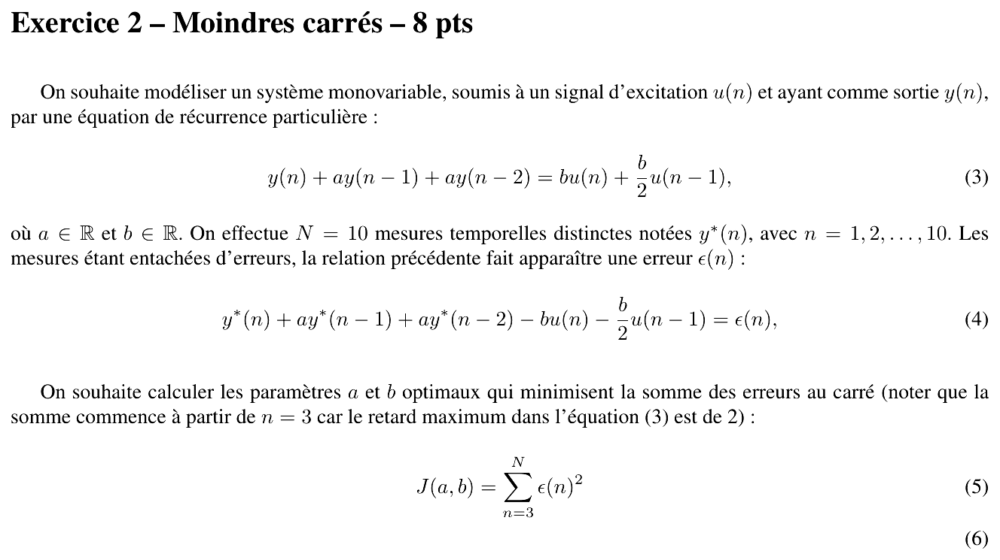{fig-alt="Exercice 2 – Moindres carrés – 8 pts : modèle y(n) + a y(n−1) + a y(n−2) = b u(n) + (b/2) u(n−1) ; N = 10 mesures y*(n), n = 1 à 10, erreur ε(n) = y*(n) + a y*(n−1) + a y*(n−2) − b u(n) − (b/2) u(n−1) ; critère J(a, b) = somme pour n de 3 à N de ε(n)²."}

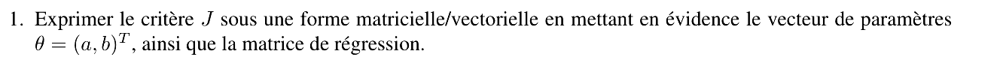{fig-alt="Q1 : exprimer le critère J sous forme matricielle/vectorielle en mettant en évidence le vecteur de paramètres θ = (a, b)ᵀ et la matrice de régression."}

::: {.notes-externes}
**Corrigé de l'épreuve** [corrige-2122, p. 3] : « On définit l'erreur sous la forme vectorielle :
$$E = Y_{3:N} - \underbrace{\begin{bmatrix} -Y_{2:N-1} - Y_{1:N-2} & U_{3:N} + \dfrac{U_{2:N-1}}{2} \end{bmatrix}}_{\varphi} \underbrace{\begin{bmatrix} a \\ b \end{bmatrix}}_{\theta}$$
où $\varphi$ représente la matrice de régression et $\theta$ le vecteur de paramètres. Le critère quadratique s'écrit alors : $J = E^T E$. »
:::

:::: {.complement}
::: {.solution}
L'erreur (4) est **affine en $(a, b)$** : on regroupe les termes en $a$ et en $b$.
$$\epsilon(n) = y^*(n) - \Big[\underbrace{-\big(y^*(n-1) + y^*(n-2)\big)}_{\text{coefficient de } a}\ \ \underbrace{u(n) + \tfrac{1}{2}u(n-1)}_{\text{coefficient de } b}\Big] \begin{pmatrix} a \\ b \end{pmatrix} = y^*(n) - \varphi^T(n)\,\theta .$$
On empile les $N - 2 = 8$ équations ($n = 3, \dots, 10$) :
$$E = \begin{pmatrix} \epsilon(3) \\ \vdots \\ \epsilon(10) \end{pmatrix} = Y - \Phi\,\theta, \qquad Y = \begin{pmatrix} y^*(3) \\ \vdots \\ y^*(10) \end{pmatrix}, \qquad \Phi = \begin{pmatrix} -y^*(2) - y^*(1) & u(3) + \frac{u(2)}{2} \\ \vdots & \vdots \\ -y^*(9) - y^*(8) & u(10) + \frac{u(9)}{2} \end{pmatrix},$$
avec $\theta = (a, b)^T$ et $\Phi \in \mathbb{R}^{8 \times 2}$ la matrice de régression (*regression matrix*). Alors
$$\boxed{J(\theta) = E^T E = (Y - \Phi\theta)^T (Y - \Phi\theta) = \|Y - \Phi\theta\|^2}$$
Particularité du modèle : $a$ multiplie **la somme** $y(n-1) + y(n-2)$ et $b$ **la combinaison** $u(n) + u(n-1)/2$ ; il n'y a donc que deux colonnes, et non quatre comme pour un modèle ARX d'ordre 2 général.
:::
::::

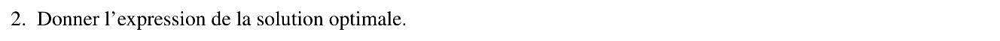{fig-alt="Q2 : donner l'expression de la solution optimale."}

::: {.notes-externes}
**Corrigé de l'épreuve** [corrige-2122, p. 3] : « La solution optimale est donnée par la formule des moindres carrés usuelle : $\theta = (\varphi^T\varphi)^{-1}(\varphi^T Y_{3:N})$ ».
:::

:::: {.complement}
::: {.solution}
On développe $J(\theta) = Y^TY - 2\theta^T\Phi^TY + \theta^T\Phi^T\Phi\,\theta$ et on annule le gradient (condition du premier ordre) :
$$\nabla_\theta J = -2\Phi^T Y + 2\Phi^T\Phi\,\theta = 0 \quad\Longleftrightarrow\quad \Phi^T\Phi\,\theta = \Phi^T Y \quad \text{(équations normales).}$$
Si $\Phi^T\Phi$ est inversible, c'est-à-dire si les deux colonnes de $\Phi$ sont linéairement indépendantes (excitation $u$ suffisamment riche) :
$$\boxed{\hat\theta = \begin{pmatrix} \hat a \\ \hat b \end{pmatrix} = (\Phi^T\Phi)^{-1}\Phi^T Y}$$
Le sujet ne donne pas les mesures : on s'arrête à l'expression littérale.
:::
::::

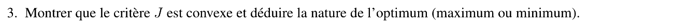{fig-alt="Q3 : montrer que le critère J est convexe et en déduire la nature de l'optimum (maximum ou minimum)."}

::: {.notes-externes}
**Corrigé de l'épreuve** [corrige-2122, p. 3] : « Le calcul de la 2e dérivée de $J$ par rapport à $\theta$ fait apparaitre la forme quadratique $\frac{d^2J}{d\theta^2} = 2\varphi^T\varphi$ qui est semi-définie positive. En conséquence, le critère $J$ est convexe et le point critique est un minimum. »
:::

:::: {.complement}
::: {.solution}
Le hessien de $J$ est constant :
$$\nabla^2_\theta J = 2\,\Phi^T\Phi, \qquad v^T(2\Phi^T\Phi)\,v = 2\,\|\Phi v\|^2 \ge 0 \quad \forall v \in \mathbb{R}^2 .$$
Il est semi-défini positif partout, donc $J$ est **convexe** sur $\mathbb{R}^2$. Pour une fonction convexe différentiable, la condition du premier ordre est **suffisante** : le point de la question 2 est un **minimum global**. Si de plus $\Phi$ est de rang plein, $\Phi v \neq 0$ pour $v \neq 0$ : le hessien est défini positif, $J$ est strictement convexe et ce minimum est **unique**.
:::
::::

## Exercice 3 : optimisation non linéaire sous contraintes (8 points) {#sec-ann2122p-ex3}

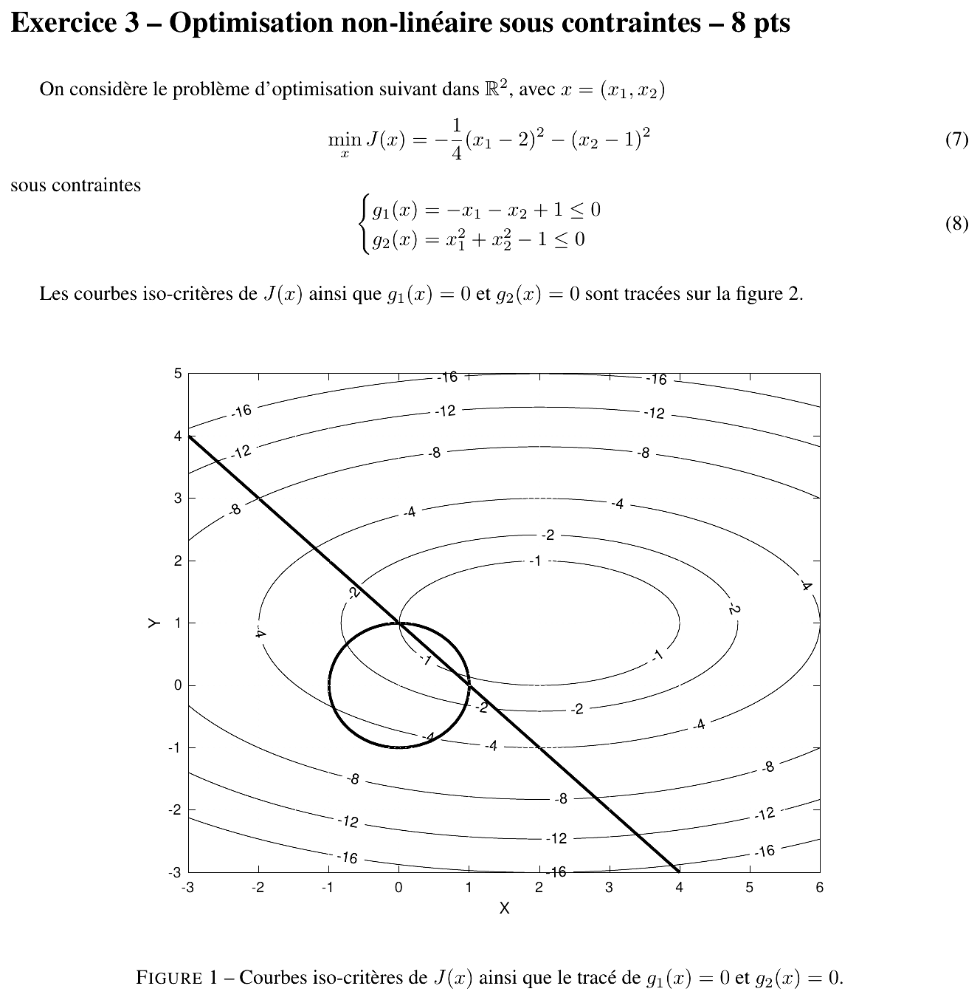{fig-alt="Exercice 3 – Optimisation non linéaire sous contraintes – 8 pts : min J(x) = −(1/4)(x1 − 2)² − (x2 − 1)² sous g1(x) = −x1 − x2 + 1 ≤ 0 et g2(x) = x1² + x2² − 1 ≤ 0 ; figure des courbes iso-critères (ellipses centrées en (2, 1), niveaux −1 à −16), de la droite g1 = 0 et du cercle unité g2 = 0, pour x1 de −3 à 6 et x2 de −3 à 5."}

::: {.a-verifier #av-ann2122p-numero-figure}
**Source** [sujet-2122, p. 2] : le texte et les questions 1 à 3 renvoient à « la figure 2 », mais la seule figure du sujet a pour légende « Figure 1 – Courbes iso-critères de $J(x)$ ainsi que le tracé de $g_1(x) = 0$ et $g_2(x) = 0$ ».

**Problème** : numérotation incohérente (la « Figure 2 » du corrigé [corrige-2122, p. 4] est la même figure, avec une légende sans rapport : « Solution du problème des moindres carrés avec les 3 points de la Table 1 »).

**Proposition** : lire « figure 1 » dans le sujet ; la figure de cette page (@fig-ann2122p-domaine) tient lieu de réponse graphique.
:::

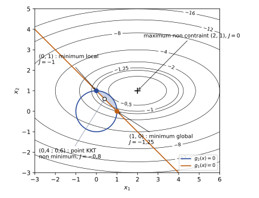{#fig-ann2122p-domaine}

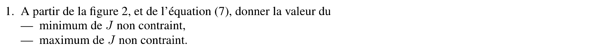{fig-alt="Q1 : à partir de la figure et de l'équation (7), donner la valeur du minimum de J non contraint et du maximum de J non contraint."}

::: {.notes-externes}
**Corrigé de l'épreuve** [corrige-2122, p. 3] : « Voir Fig.2. » (questions 1, 2 et 3 ; la figure 2 du corrigé reproduit la figure du sujet sans annotation visible).
:::

:::: {.complement}
::: {.solution}
$J(x) = -\frac{1}{4}(x_1 - 2)^2 - (x_2 - 1)^2$ est une somme de deux carrés **affectés d'un signe moins** : $J \le 0$, avec égalité seulement en $(2, 1)$, centre des ellipses de la figure.

- **Maximum non contraint** : $\boxed{J_{\max} = 0 \text{ en } (2, 1)}$ (hessien $\operatorname{diag}(-\frac{1}{2}, -2)$ défini négatif : $J$ est strictement concave).
- **Minimum non contraint** : il **n'existe pas** ; $J \to -\infty$ quand $\|x\| \to \infty$ (les niveaux $-4, -8, -12, -16, \dots$ s'éloignent sans fin du centre) : $\inf J = -\infty$.

Le problème posé est donc la minimisation d'une fonction **concave** : sans contraintes il n'a pas de solution ; ce sont les contraintes (domaine borné) qui en créent une, et elle sera sur la frontière.
:::
::::

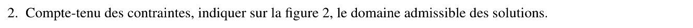{fig-alt="Q2 : compte tenu des contraintes, indiquer sur la figure le domaine admissible des solutions."}

:::: {.complement}
::: {.solution}
- $g_1(x) \le 0 \iff x_1 + x_2 \ge 1$ : demi-plan **au-dessus** de la droite passant par $(1, 0)$ et $(0, 1)$ (côté opposé à l'origine) ;
- $g_2(x) \le 0 \iff x_1^2 + x_2^2 \le 1$ : **disque unité** fermé.

Le domaine admissible est leur intersection : le **segment circulaire** (lentille) compris entre la corde $[(1, 0), (0, 1)]$ et l'arc du cercle unité dans le premier quadrant (grisé sur @fig-ann2122p-domaine). Il est fermé et borné (compact) : $J$, continue, y atteint son minimum (théorème de Weierstrass).
:::
::::

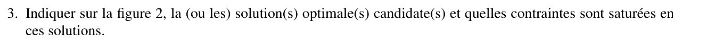{fig-alt="Q3 : indiquer sur la figure la ou les solutions optimales candidates et quelles contraintes sont saturées en ces solutions."}

:::: {.complement}
::: {.solution}
On cherche, dans la lentille, le point le plus **éloigné** du centre $(2, 1)$ au sens des ellipses (niveau le plus bas). La courbe de niveau qui touche le domaine en dernier en s'éloignant de $(2, 1)$ passe par un **coin** de la lentille. Candidats : les deux coins
$$(1, 0) \quad\text{et}\quad (0, 1),$$
où **les deux contraintes sont saturées** ($g_1 = g_2 = 0$). La lecture des niveaux le confirme : $(1, 0)$ est entre les niveaux $-1$ et $-2$, $(0, 1)$ sur le niveau $-1$.

Justification : $J$ est concave, et le minimum d'une fonction concave sur un convexe compact est atteint en un point **extrémal** du domaine ; ici les points extrémaux sont les points de l'arc. Sur la corde, $J$ restreinte est concave en le paramètre et n'a donc pas de minimum intérieur ; le long de l'arc ($x = (\cos t, \sin t)$, $t \in [0, \frac{\pi}{2}]$), $J$ croît de $-1{,}25$ à environ $-0{,}50$ puis redescend à $-1$ : les minima sur l'arc sont aux extrémités.
:::
::::

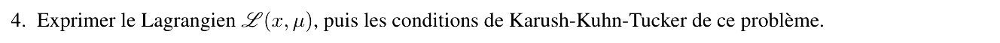{fig-alt="Q4 : exprimer le lagrangien L(x, μ), puis les conditions de Karush-Kuhn-Tucker du problème."}

::: {.notes-externes}
**Corrigé de l'épreuve** [corrige-2122, p. 4] : « Le Lagrangien : $L(x, \lambda) = -\frac{1}{4}(x_1 - 2)^2 - (x_2 - 1)^2 + \lambda_1(-x_1 - x_2 + 1) + \lambda_2(x_1^2 + x_2^2 - 1)$. Les conditions de KKT s'écrivent :
(a) $\frac{dL(x,\lambda)}{dx} = \begin{pmatrix} -\frac{1}{2}(x_1 - 2) - \lambda_1 + 2\lambda_2 x_1 \\ -2(x_2 - 1) - \lambda_1 + 2\lambda_2 x_2 \end{pmatrix} = \begin{pmatrix} 0 \\ 0 \end{pmatrix}$ ;
(b) $\frac{dL(x,\lambda)}{d\lambda} = \begin{pmatrix} -x_1 - x_2 + 1 \\ x_1^2 + x_2^2 - 1 \end{pmatrix} \le \begin{pmatrix} 0 \\ 0 \end{pmatrix}$ ;
(c) $\begin{pmatrix} \lambda_1 g_1(x) \\ \lambda_2 g_2(x) \end{pmatrix} = \begin{pmatrix} 0 \\ 0 \end{pmatrix}$ ;
(d) $\begin{pmatrix} \lambda_1 \\ \lambda_2 \end{pmatrix} \ge \begin{pmatrix} 0 \\ 0 \end{pmatrix}$. »
:::

:::: {.complement}
::: {.solution}
Avec la notation du sujet ($\mu$ au lieu de $\lambda$) :
$$\mathscr{L}(x, \mu) = -\tfrac{1}{4}(x_1 - 2)^2 - (x_2 - 1)^2 + \mu_1(-x_1 - x_2 + 1) + \mu_2(x_1^2 + x_2^2 - 1).$$
Conditions KKT :
$$\begin{cases}
-\frac{1}{2}(x_1 - 2) - \mu_1 + 2\mu_2 x_1 = 0 & \text{(stationnarité en } x_1) \\
-2(x_2 - 1) - \mu_1 + 2\mu_2 x_2 = 0 & \text{(stationnarité en } x_2) \\
-x_1 - x_2 + 1 \le 0, \quad x_1^2 + x_2^2 - 1 \le 0 & \text{(admissibilité)} \\
\mu_1 \ge 0, \quad \mu_2 \ge 0 & \\
\mu_1(-x_1 - x_2 + 1) = 0, \quad \mu_2(x_1^2 + x_2^2 - 1) = 0 & \text{(complémentarité)}
\end{cases}$$
Qualification des contraintes : aux points où les deux contraintes sont actives, $\nabla g_1 = (-1, -1)$ et $\nabla g_2 = (2x_1, 2x_2)$ sont indépendants en $(1, 0)$ et en $(0, 1)$ ; les conditions KKT sont donc bien nécessaires en tout minimum local.
:::
::::

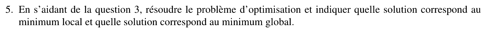{fig-alt="Q5 : en s'aidant de la question 3, résoudre le problème d'optimisation et indiquer quelle solution correspond au minimum local et quelle solution correspond au minimum global."}

::: {.notes-externes}
**Corrigé de l'épreuve** [corrige-2122, p. 4] : « La solution est, a priori, saturée ; elle touche les 2 contraintes. On trouve les 2 solutions $(x_1, x_2) \in \{(1, 0), (0, 1)\}$ qui vérifient les conditions de KKT. Or l'évaluation du critère montre que $J(0, 1) = -1$, $J(1, 0) = -1.25$. On retiendra dont le minimum global au point (1,0). »
:::

:::: {.complement}
::: {.solution}
**Deux contraintes actives** : $x_1 + x_2 = 1$ et $x_1^2 + x_2^2 = 1$ donnent $x_1 x_2 = 0$, soit $(1, 0)$ ou $(0, 1)$. On calcule les multiplicateurs par la stationnarité :

- en $(1, 0)$ : $\frac{1}{2} - \mu_1 + 2\mu_2 = 0$ et $2 - \mu_1 = 0$, d'où $\mu_1 = 2$, $\mu_2 = \frac{3}{4}$ : **tous deux positifs**, point KKT ;
- en $(0, 1)$ : $1 - \mu_1 = 0$ et $-\mu_1 + 2\mu_2 = 0$, d'où $\mu_1 = 1$, $\mu_2 = \frac{1}{2}$ : point KKT.

**Autres cas** (pour être complet) :

- aucune contrainte active : $(2, 1)$, non admissible ($4 + 1 > 1$) ;
- seule $g_1$ active ($\mu_2 = 0$) : $x_1 - 2 = -2\mu_1$, $x_2 - 1 = -\frac{\mu_1}{2}$, et $x_1 + x_2 = 1$ donne $\mu_1 = 0{,}8$, point $(0{,}4 ; 0{,}6)$, admissible ($g_2 = -0{,}48$) : c'est un **point KKT** de valeur $J = -0{,}8$, mais ce n'est pas un minimum (c'est le maximum de $J$ sur la corde ; $J$ diminue en allant vers les coins) ;
- seule $g_2$ active ($\mu_1 = 0$) : sur le cercle, les points stationnaires ont $\mu_2 \approx -0{,}44$ (point $(0{,}72 ; 0{,}69)$) ou violent $g_1$ (point $(-0{,}28 ; -0{,}96)$) : rejetés.

**Conclusion.**
$$J(1, 0) = -\tfrac{1}{4} - 1 = -1{,}25, \qquad J(0, 1) = -1 - 0 = -1 .$$
$$\boxed{\text{minimum global en } (1, 0),\ J^* = -1{,}25 ; \quad \text{minimum local en } (0, 1),\ J = -1}$$
$(0, 1)$ est bien un minimum **local** : depuis ce coin, $J$ augmente le long de la corde (vers $-0{,}8$) comme le long de l'arc (vers $-0{,}50$). Ce problème illustre que, pour un critère non convexe (ici concave), les conditions KKT sont seulement **nécessaires** : trois points les vérifient, et seule la comparaison des valeurs désigne le minimum global.
:::
::::
