

::: {.complement}
**Origine des solutions.** `2022-2023-partiel.pdf` [sujet-2223] est une photo (de travers) du sujet imprimé ; `2022-2023-test.pdf` [sujet-corrige-2223] contient **le même sujet** en PDF net (pages 1-2), suivi d'un début de corrigé (page 3 : questions 1 et 2 de l'exercice 1 seulement). Les images de l'énoncé sont tirées du PDF net. Le corrigé partiel est repris dans les blocs *Notes externes* ; toutes les autres solutions (blocs *Complément*) sont rédigées par Claude et vérifiées par le calcul (sympy, numpy). À relire avec un œil critique ; signaler toute erreur. Aucune page séparée n'est faite pour `2022-2023-test.pdf`.

**Correspondances.** L'exercice 1 suit le même plan que l'exercice 2 du [partiel 2021-2022](2021-2022-partiel.qmd) (forme $J = E^TE$, équations normales, convexité par $2\varphi^T\varphi$). L'exercice 2 (critère quadratique séparable, convexité, optimum, puis contrainte et KKT) a la même structure que l'exercice 2 de l'[épreuve 2023-2024](2023-2024-test.qmd).
:::

::: {.a-verifier #av-ann2223p-date}
**Source** [sujet-2223, p. 1] et [sujet-corrige-2223, p. 1] : « Jeudi 5 Mai 2022, 11h30 – 12h30 ».

**Problème** : le fichier est rangé en 2022-2023, mais la date imprimée tombe dans l'année universitaire 2021-2022 (le 5 mai 2022 est bien un jeudi), deux semaines avant l'épreuve du 19 mai 2022 rangée en [2021-2022](2021-2022-partiel.qmd). Soit l'année de rangement est fausse, soit l'en-tête n'a pas été mis à jour.

**Proposition** : garder le nom de fichier d'origine (aucun renommage) ; à confirmer par Armand.
:::

## Exercice 1 : moindres carrés (7 points) {#sec-ann2223p-ex1}

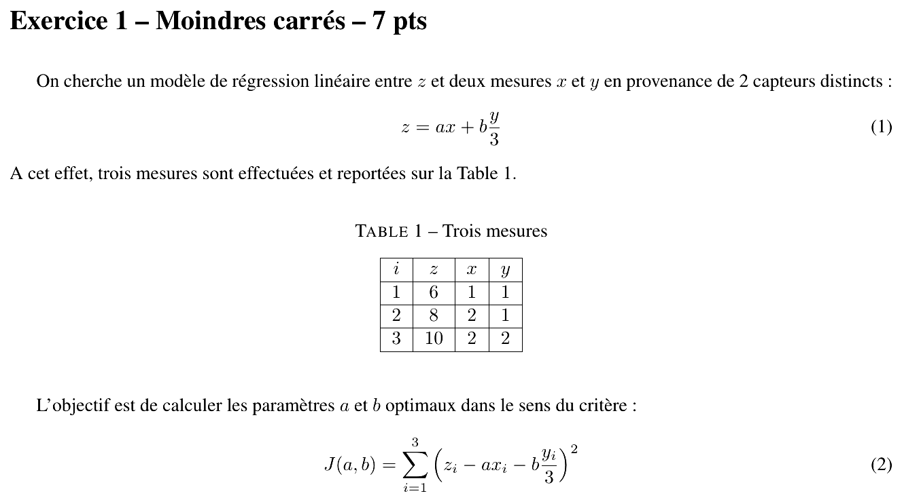{fig-alt="Exercice 1 – Moindres carrés – 7 pts : modèle z = a x + b y/3 entre z et deux mesures x et y ; table 1 de trois mesures (i, z, x, y) = (1, 6, 1, 1), (2, 8, 2, 1), (3, 10, 2, 2) ; critère J(a, b) = somme pour i de 1 à 3 de (z_i − a x_i − b y_i/3)²."}

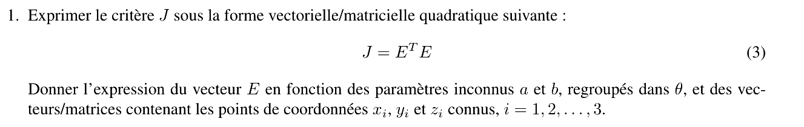{fig-alt="Q1 : exprimer le critère J sous la forme quadratique J = EᵀE ; donner l'expression du vecteur E en fonction des paramètres inconnus a et b regroupés dans θ et des vecteurs/matrices contenant les x_i, y_i et z_i connus, i = 1, 2, 3."}

::: {.notes-externes}
**Corrigé de l'épreuve** [sujet-corrige-2223, p. 3] : « $E(a, b) = Z - \varphi \times \theta$ où $\varphi = \begin{pmatrix} x_1 & \frac{y_1}{3} \\ x_2 & \frac{y_2}{3} \\ x_3 & \frac{y_3}{3} \end{pmatrix}$ et $\theta^T = \begin{pmatrix} a \\ b \end{pmatrix}$ ».
:::

::: {.a-verifier #av-ann2223p-theta-transpose}
**Source** [sujet-corrige-2223, p. 3] : « $\theta^T = \begin{pmatrix} a \\ b \end{pmatrix}$ ».

**Problème** : avec $E = Z - \varphi\,\theta$ et $\varphi \in \mathbb{R}^{3\times 2}$, $\theta$ doit être un vecteur **colonne** ; c'est $\theta$ (et non $\theta^T$) qui vaut $\begin{pmatrix} a \\ b \end{pmatrix}$.

**Proposition** : $\theta = \begin{pmatrix} a \\ b \end{pmatrix}$, soit $\theta^T = (a\ \ b)$.
:::

:::: {.complement}
::: {.solution}
Le résidu de la mesure $i$ est **linéaire** en $(a, b)$ : $e_i = z_i - \begin{pmatrix} x_i & \frac{y_i}{3} \end{pmatrix}\begin{pmatrix} a \\ b \end{pmatrix}$. On empile les trois mesures :
$$E = Z - \varphi\,\theta, \qquad Z = \begin{pmatrix} 6 \\ 8 \\ 10 \end{pmatrix}, \quad \varphi = \begin{pmatrix} x_1 & y_1/3 \\ x_2 & y_2/3 \\ x_3 & y_3/3 \end{pmatrix} = \begin{pmatrix} 1 & 1/3 \\ 2 & 1/3 \\ 2 & 2/3 \end{pmatrix}, \quad \theta = \begin{pmatrix} a \\ b \end{pmatrix},$$
$$\boxed{J(\theta) = E^TE = (Z - \varphi\theta)^T(Z - \varphi\theta)}$$
:::
::::

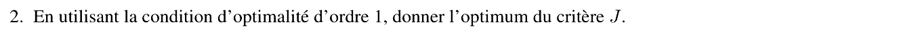{fig-alt="Q2 : en utilisant la condition d'optimalité d'ordre 1, donner l'optimum du critère J."}

::: {.notes-externes}
**Corrigé de l'épreuve** [sujet-corrige-2223, p. 3] : « $\frac{dJ(\theta)}{d\theta} = 2\frac{\partial E'}{\partial \theta}E \rightsquigarrow -\varphi'(Z - \varphi \times \theta) = 0 \rightsquigarrow \theta = (\varphi'\varphi)^{-1}\varphi' Z$ » (le prime désigne la transposée). Pas de valeur numérique.
:::

:::: {.complement}
::: {.solution}
$\nabla_\theta J = -2\varphi^T(Z - \varphi\theta) = 0$ donne les équations normales $\varphi^T\varphi\,\theta = \varphi^TZ$. Numériquement :
$$\varphi^T\varphi = \begin{pmatrix} 1 + 4 + 4 & \frac{1 + 2 + 4}{3} \\ \frac{7}{3} & \frac{1 + 1 + 4}{9} \end{pmatrix} = \begin{pmatrix} 9 & 7/3 \\ 7/3 & 2/3 \end{pmatrix}, \qquad \varphi^TZ = \begin{pmatrix} 6 + 16 + 20 \\ \frac{6 + 8 + 20}{3} \end{pmatrix} = \begin{pmatrix} 42 \\ 34/3 \end{pmatrix}.$$
$\det(\varphi^T\varphi) = 6 - \frac{49}{9} = \frac{5}{9} \neq 0$ : la matrice est inversible,
$$(\varphi^T\varphi)^{-1} = \frac{9}{5}\begin{pmatrix} 2/3 & -7/3 \\ -7/3 & 9 \end{pmatrix}, \qquad \boxed{\hat\theta = (\varphi^T\varphi)^{-1}\varphi^TZ = \begin{pmatrix} 14/5 \\ 36/5 \end{pmatrix} = \begin{pmatrix} 2{,}8 \\ 7{,}2 \end{pmatrix}}$$
Contrôle : résidus $E = Z - \varphi\hat\theta = (0{,}8 ;\ 0 ;\ -0{,}4)^T$, orthogonaux aux colonnes de $\varphi$ ($0{,}8 - 0{,}8 = 0$ et $\frac{0{,}8 - 0{,}8}{3} = 0$), et $J(\hat\theta) = 0{,}64 + 0{,}16 = 0{,}8$.
:::
::::

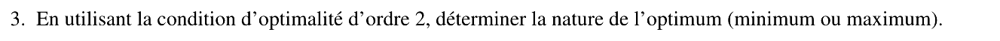{fig-alt="Q3 : en utilisant la condition d'optimalité d'ordre 2, déterminer la nature de l'optimum (minimum ou maximum)."}

:::: {.complement}
::: {.solution}
Hessien : $\nabla^2_\theta J = 2\varphi^T\varphi = \begin{pmatrix} 18 & 14/3 \\ 14/3 & 4/3 \end{pmatrix}$, constant. Premier mineur $18 > 0$, déterminant $4 \cdot \frac{5}{9} = \frac{20}{9} > 0$ : **défini positif**. La condition suffisante du second ordre est vérifiée : $\hat\theta$ est un **minimum** ; le hessien étant défini positif partout, $J$ est strictement convexe et ce minimum est **global et unique**.
:::
::::

## Exercice 2 : optimisation non linéaire (8 + 5 points) {#sec-ann2223p-ex2}

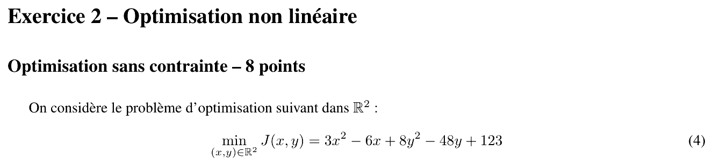{fig-alt="Exercice 2 – Optimisation non linéaire. Optimisation sans contrainte – 8 points : min sur R² de J(x, y) = 3x² − 6x + 8y² − 48y + 123."}

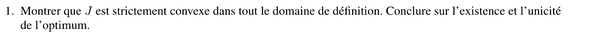{fig-alt="Q1 : montrer que J est strictement convexe dans tout le domaine de définition ; conclure sur l'existence et l'unicité de l'optimum."}

:::: {.complement}
::: {.solution}
$$\nabla J(x, y) = \begin{pmatrix} 6x - 6 \\ 16y - 48 \end{pmatrix}, \qquad \nabla^2 J = \begin{pmatrix} 6 & 0 \\ 0 & 16 \end{pmatrix}.$$
Le hessien est constant, de valeurs propres $6 > 0$ et $16 > 0$ : **défini positif sur tout $\mathbb{R}^2$**, donc $J$ est **strictement convexe**. Comme de plus $J \to +\infty$ à l'infini (fonction quadratique à hessien défini positif, donc coercive), le minimum **existe**, et la stricte convexité le rend **unique** ; tout point critique est ce minimum global.
:::
::::

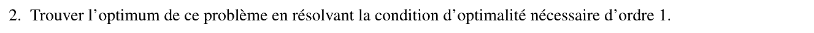{fig-alt="Q2 : trouver l'optimum de ce problème en résolvant la condition d'optimalité nécessaire d'ordre 1."}

:::: {.complement}
::: {.solution}
$\nabla J = 0 \iff 6x - 6 = 0$ et $16y - 48 = 0$ :
$$\boxed{(x^*, y^*) = (1, 3), \qquad J^* = 3 - 6 + 72 - 144 + 123 = 48}$$
Forme canonique (contrôle) : $J(x, y) = 3(x - 1)^2 + 8(y - 3)^2 + 48$.
:::
::::

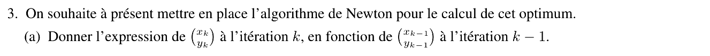{fig-alt="Q3 : mise en place de l'algorithme de Newton pour calculer cet optimum ; (a) donner l'expression de (x_k, y_k) à l'itération k en fonction de (x_{k−1}, y_{k−1})."}

:::: {.complement}
::: {.solution}
La méthode de Newton (*Newton's method*) remplace $J$ au voisinage de l'itéré courant par son développement de Taylor d'ordre 2 et va au minimum de ce modèle quadratique :
$$\boxed{\begin{pmatrix} x_k \\ y_k \end{pmatrix} = \begin{pmatrix} x_{k-1} \\ y_{k-1} \end{pmatrix} - \left[\nabla^2 J(x_{k-1}, y_{k-1})\right]^{-1} \nabla J(x_{k-1}, y_{k-1})}$$
(hessien supposé inversible).
:::
::::

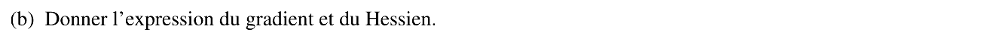{fig-alt="(b) Donner l'expression du gradient et du hessien."}

:::: {.complement}
::: {.solution}
$$\nabla J(x, y) = \begin{pmatrix} 6x - 6 \\ 16y - 48 \end{pmatrix}, \qquad \nabla^2 J(x, y) = \begin{pmatrix} 6 & 0 \\ 0 & 16 \end{pmatrix}, \qquad \left[\nabla^2 J\right]^{-1} = \begin{pmatrix} 1/6 & 0 \\ 0 & 1/16 \end{pmatrix}.$$
:::
::::

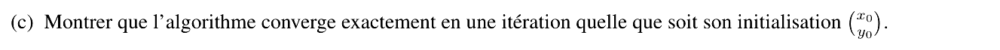{fig-alt="(c) Montrer que l'algorithme converge exactement en une itération quelle que soit son initialisation (x0, y0)."}

:::: {.complement}
::: {.solution}
Première itération depuis un $(x_0, y_0)$ quelconque :
$$\begin{pmatrix} x_1 \\ y_1 \end{pmatrix} = \begin{pmatrix} x_0 - \frac{6x_0 - 6}{6} \\ y_0 - \frac{16y_0 - 48}{16} \end{pmatrix} = \begin{pmatrix} 1 \\ 3 \end{pmatrix}.$$
L'itéré $x_1$ ne dépend plus de $(x_0, y_0)$ et vaut l'optimum $(1, 3)$ ; ensuite $\nabla J(1, 3) = 0$ et l'algorithme reste sur place. Raison : $J$ est **quadratique**, donc égale à son développement de Taylor d'ordre 2 ; le modèle minimisé par Newton est $J$ elle-même. (Exécution numérique depuis $(-7, 12)$ : $(1, 3)$ en une itération.)
:::
::::

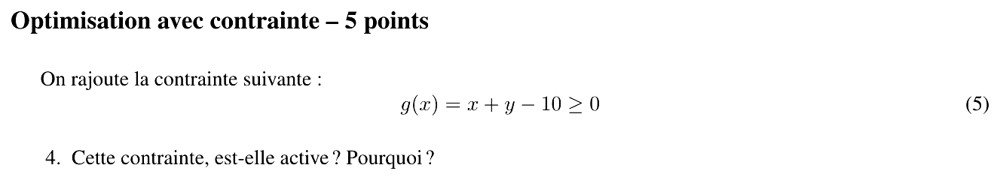{fig-alt="Optimisation avec contrainte – 5 points : on rajoute la contrainte g(x) = x + y − 10 ≥ 0. Q4 : cette contrainte est-elle active ? Pourquoi ?"}

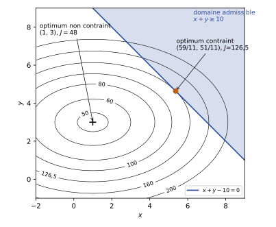{#fig-ann2223p-contrainte}

:::: {.complement}
::: {.solution}
L'optimum non contraint $(1, 3)$ donne $g(1, 3) = 1 + 3 - 10 = -6 < 0$ : il **viole** la contrainte $g \ge 0$. Le minimum contraint n'est donc pas $(1, 3)$ ; comme $J$ est convexe et que le domaine $\{x + y \ge 10\}$ est convexe, le minimum contraint se trouve sur la frontière : la contrainte est **active** ($x + y = 10$ à l'optimum). Sinon, ce serait un minimum local intérieur, donc un point critique de $J$, et le seul est $(1, 3)$, non admissible.
:::
::::

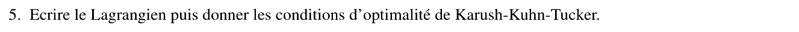{fig-alt="Q5 : écrire le lagrangien puis donner les conditions d'optimalité de Karush-Kuhn-Tucker."}

:::: {.complement}
::: {.solution}
La contrainte est écrite $g \ge 0$. Avec un multiplicateur $\mu \ge 0$, on écrit (forme équivalente à $-g \le 0$) :
$$\mathscr{L}(x, y, \mu) = 3x^2 - 6x + 8y^2 - 48y + 123 - \mu\,(x + y - 10).$$
Conditions KKT :
$$\begin{cases}
\partial_x \mathscr{L} = 6x - 6 - \mu = 0 \\
\partial_y \mathscr{L} = 16y - 48 - \mu = 0 \\
x + y - 10 \ge 0 \\
\mu \ge 0 \\
\mu\,(x + y - 10) = 0
\end{cases}$$
Problème convexe (critère convexe, contrainte affine) : ces conditions sont **nécessaires et suffisantes**.
:::
::::

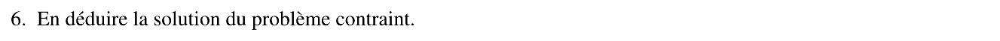{fig-alt="Q6 : en déduire la solution du problème contraint."}

:::: {.complement}
::: {.solution}
Cas $\mu = 0$ : on retrouve $(1, 3)$, non admissible. Donc $\mu > 0$ et $x + y = 10$. La stationnarité donne $x = 1 + \frac{\mu}{6}$, $y = 3 + \frac{\mu}{16}$ ; en reportant :
$$4 + \mu\left(\tfrac{1}{6} + \tfrac{1}{16}\right) = 10 \;\Longrightarrow\; \mu = \frac{6 \cdot 48}{11} = \frac{288}{11} \approx 26{,}2 > 0 \quad ✓$$
$$\boxed{(x^*, y^*) = \left(\tfrac{59}{11}, \tfrac{51}{11}\right) \approx (5{,}36 ; 4{,}64), \qquad J^* = \tfrac{1392}{11} \approx 126{,}5}$$
(Avec la forme canonique : $J^* = 3\left(\frac{48}{11}\right)^2 + 8\left(\frac{18}{11}\right)^2 + 48 = \frac{864}{11} + 48$.) Géométriquement, c'est le point où une ellipse de niveau est tangente à la droite $x + y = 10$ (@fig-ann2223p-contrainte) ; $\mu \approx 26{,}2$ mesure la sensibilité : relâcher la contrainte en $x + y \ge 10 - \delta$ abaisse le coût d'environ $26{,}2\,\delta$.
:::
::::
