

::: {.complement}
**Origine des solutions.** Le fichier contient le sujet à compléter (pages 1-7, cadres de réponse vides, non reproduits) puis une « Correction de l'épreuve » (pages 8-12) [corrige-2324], qui traite tout l'exercice 1 et les questions 1 à 8 de l'exercice 2 (la question 4 est traitée par une figure, la question 9 ne l'est pas). Ce corrigé est repris dans les blocs *Notes externes* ; les solutions détaillées (blocs *Complément*) sont rédigées par Claude et vérifiées par le calcul (numpy, sympy). Les désaccords sont dans des blocs *À vérifier*. À relire avec un œil critique ; signaler toute erreur.

**Correspondances.** L'exercice 2 a la même structure que l'exercice 2 du [partiel 2022-2023](2022-2023-partiel.qmd) (critère quadratique séparable, puis contrainte et KKT) et reprend la démarche graphique de l'exercice 3 du [partiel 2021-2022](2021-2022-partiel.qmd). L'exercice 1 généralise les moindres carrés des épreuves 2021-2022 et 2022-2023 à des données fréquentielles complexes.
:::

## Exercice 1 : moindres carrés (8 points) {#sec-ann2324t-ex1}

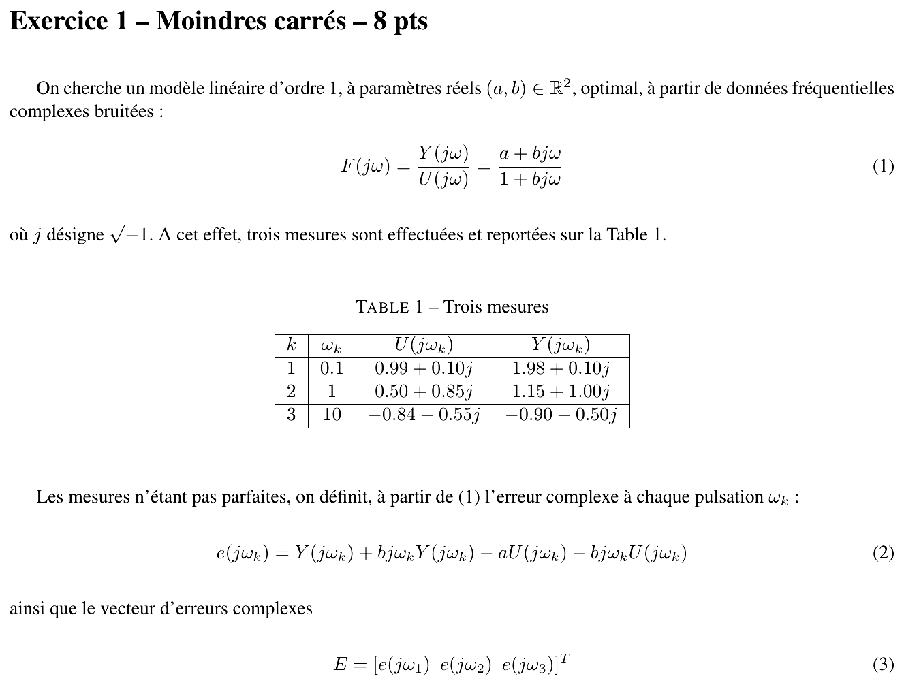{fig-alt="Exercice 1 – Moindres carrés – 8 pts : modèle d'ordre 1 F(jω) = Y(jω)/U(jω) = (a + bjω)/(1 + bjω), (a, b) réels ; table 1 de trois mesures : ω = 0.1, U = 0.99 + 0.10j, Y = 1.98 + 0.10j ; ω = 1, U = 0.50 + 0.85j, Y = 1.15 + 1.00j ; ω = 10, U = −0.84 − 0.55j, Y = −0.90 − 0.50j ; erreur e(jω_k) = Y + bjω_k Y − aU − bjω_k U ; vecteur E = [e(jω1) e(jω2) e(jω3)]ᵀ."}

**Remarque sur l'erreur.** L'erreur (2) n'est pas $Y - F\,U$ (qui serait non linéaire en $b$) mais l'erreur obtenue après multiplication par le dénominateur, $e = (1 + bj\omega)Y - (a + bj\omega)U$ : elle est **linéaire en $(a, b)$**, ce qui ramène le problème à des moindres carrés linéaires (méthode de Levy, *equation error*).

::: {.a-verifier #av-ann2324t-indice-somme}
**Source** [sujet-2324, p. 1-3], équations (4), (5) et (6) : « $J_{\mathscr{R}e}(a, b) = \sum_{i=1}^{3} [\mathscr{R}e(e(j\omega_k))]^2$ » (même indice $i$ sous la somme et $k$ dans le terme pour $J_{\mathscr{I}m}$ et $J$).

**Problème** : l'indice de sommation ($i$) n'est pas celui du terme sommé ($\omega_k$).

**Proposition** : lire $\sum_{k=1}^{3}$.
:::

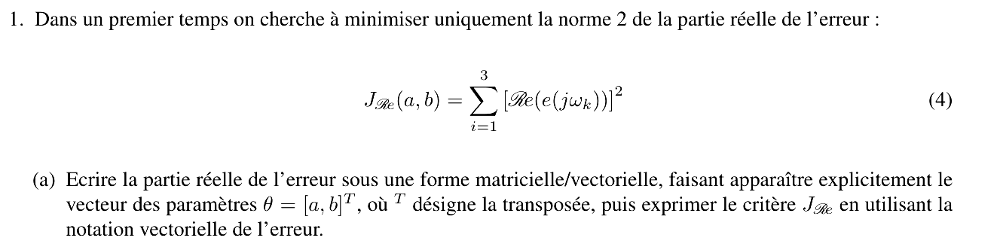{fig-alt="Q1 : minimiser uniquement la norme 2 de la partie réelle de l'erreur, J_Re(a, b) = somme des [Re(e(jω_k))]². (a) Écrire la partie réelle de l'erreur sous forme matricielle/vectorielle faisant apparaître θ = [a, b]ᵀ, puis exprimer J_Re avec la notation vectorielle de l'erreur."}

::: {.notes-externes}
**Corrigé de l'épreuve** [corrige-2324, p. 8] :
$$E_{\mathscr{R}e} = \underbrace{\begin{pmatrix} \mathscr{R}e(Y(j\omega_1)) \\ \mathscr{R}e(Y(j\omega_2)) \\ \mathscr{R}e(Y(j\omega_3)) \end{pmatrix}}_{\mathcal{Y}_{\mathscr{R}e}} - \underbrace{\begin{pmatrix} \mathscr{R}e(U(j\omega_1)) & \omega_1 \mathscr{I}m(Y(j\omega_1)) - \omega_1 \mathscr{I}m(U(j\omega_1)) \\ \vdots & \vdots \end{pmatrix}}_{\varphi_{\mathscr{R}e}} \underbrace{\begin{pmatrix} a \\ b \end{pmatrix}}_{\theta}$$
« $E_{\mathscr{R}e} = \begin{pmatrix} 1.98 \\ 1.15 \\ -0.9 \end{pmatrix} - \begin{pmatrix} 0.99 & 0.01 - 0.01 \\ 0.5 & 1 - 0.85 \\ -0.84 & -5 + 5.5 \end{pmatrix}\theta = \begin{pmatrix} 1.98 \\ 1.15 \\ -0.9 \end{pmatrix} - \begin{pmatrix} 0.99 & 0 \\ 0.50 & 0.15 \\ -0.84 & 0.50 \end{pmatrix}\theta$ », « $J_{\mathscr{R}e}(a, b) = E_{\mathscr{R}e}^T E_{\mathscr{R}e}$ ».
:::

:::: {.complement}
::: {.solution}
On note $U_k = U(j\omega_k) = U_k' + jU_k''$ et $Y_k = Y_k' + jY_k''$ (parties réelle et imaginaire). Avec $j \cdot jY_k'' = -Y_k''$ :
$$\mathscr{R}e\big(e(j\omega_k)\big) = Y_k' - \omega_k b\,Y_k'' - a\,U_k' + \omega_k b\,U_k'' = Y_k' - \begin{pmatrix} U_k' & \omega_k\,(Y_k'' - U_k'') \end{pmatrix}\begin{pmatrix} a \\ b \end{pmatrix}.$$
D'où, en empilant les trois pulsations :
$$E_{\mathscr{R}e} = \mathcal{Y}_{\mathscr{R}e} - \varphi_{\mathscr{R}e}\,\theta, \qquad \mathcal{Y}_{\mathscr{R}e} = \begin{pmatrix} 1{,}98 \\ 1{,}15 \\ -0{,}90 \end{pmatrix}, \quad \varphi_{\mathscr{R}e} = \begin{pmatrix} 0{,}99 & 0{,}1\,(0{,}10 - 0{,}10) \\ 0{,}50 & 1\,(1{,}00 - 0{,}85) \\ -0{,}84 & 10\,(-0{,}50 + 0{,}55) \end{pmatrix} = \begin{pmatrix} 0{,}99 & 0 \\ 0{,}50 & 0{,}15 \\ -0{,}84 & 0{,}50 \end{pmatrix},$$
$$\boxed{J_{\mathscr{R}e}(\theta) = E_{\mathscr{R}e}^T E_{\mathscr{R}e} = \|\mathcal{Y}_{\mathscr{R}e} - \varphi_{\mathscr{R}e}\theta\|^2}$$
:::
::::

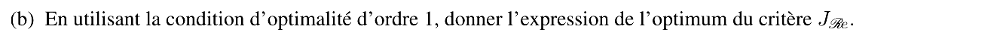{fig-alt="(b) En utilisant la condition d'optimalité d'ordre 1, donner l'expression de l'optimum du critère J_Re."}

::: {.notes-externes}
**Corrigé de l'épreuve** [corrige-2324, p. 8] : « Hence, $\theta_{\mathscr{R}e} = \left(\varphi_{\mathscr{R}e}^T\varphi_{\mathscr{R}e}\right)^{-1}\varphi_{\mathscr{R}e}^T\mathcal{Y}_{\mathscr{R}e}$, $\theta_{\mathscr{R}e} = (1.96, 1.46)^T$ ».
:::

:::: {.complement}
::: {.solution}
$\nabla_\theta J_{\mathscr{R}e} = -2\varphi_{\mathscr{R}e}^T(\mathcal{Y}_{\mathscr{R}e} - \varphi_{\mathscr{R}e}\theta) = 0$, d'où, $\varphi_{\mathscr{R}e}$ étant de rang 2 :
$$\theta_{\mathscr{R}e} = \left(\varphi_{\mathscr{R}e}^T\varphi_{\mathscr{R}e}\right)^{-1}\varphi_{\mathscr{R}e}^T\mathcal{Y}_{\mathscr{R}e}, \qquad \varphi_{\mathscr{R}e}^T\varphi_{\mathscr{R}e} = \begin{pmatrix} 1{,}9357 & -0{,}345 \\ -0{,}345 & 0{,}2725 \end{pmatrix}, \quad \varphi_{\mathscr{R}e}^T\mathcal{Y}_{\mathscr{R}e} = \begin{pmatrix} 3{,}2912 \\ -0{,}2775 \end{pmatrix},$$
$$\boxed{\theta_{\mathscr{R}e} \approx (1{,}961 ;\ 1{,}465)^T}$$
C'est un minimum global : hessien $2\varphi_{\mathscr{R}e}^T\varphi_{\mathscr{R}e}$ défini positif ($\det(\varphi_{\mathscr{R}e}^T\varphi_{\mathscr{R}e}) \approx 0{,}408 > 0$, trace positive).
:::
::::

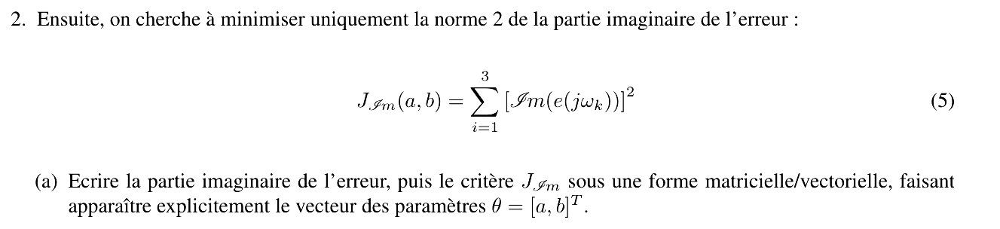{fig-alt="Q2 : minimiser uniquement la norme 2 de la partie imaginaire de l'erreur, J_Im(a, b) = somme des [Im(e(jω_k))]². (a) Écrire la partie imaginaire de l'erreur puis le critère J_Im sous forme matricielle/vectorielle faisant apparaître θ = [a, b]ᵀ."}

::: {.notes-externes}
**Corrigé de l'épreuve** [corrige-2324, p. 8-9] :
$$E_{\mathscr{I}m} = \underbrace{\begin{pmatrix} \mathscr{I}m(Y(j\omega_1)) \\ \vdots \end{pmatrix}}_{\mathcal{Y}_{\mathscr{I}m}} - \underbrace{\begin{pmatrix} \mathscr{I}m(U(j\omega_1)) & \omega_1\left(\mathscr{R}e(U(j\omega_1)) - \mathscr{R}e(Y(j\omega_1))\right) \\ \vdots & \vdots \end{pmatrix}}_{\varphi_{\mathscr{I}m}}\theta, \quad E_{\mathscr{I}m} = \begin{pmatrix} 0.10 \\ 1.00 \\ -0.5 \end{pmatrix} - \begin{pmatrix} 0.10 & -0.099 \\ 0.85 & -0.65 \\ -0.55 & 0.60 \end{pmatrix}\theta,$$
« $J_{\mathscr{I}m}(a, b) = E_{\mathscr{I}m}^T E_{\mathscr{I}m}$ ».
:::

:::: {.complement}
::: {.solution}
$$\mathscr{I}m\big(e(j\omega_k)\big) = Y_k'' + \omega_k b\,Y_k' - a\,U_k'' - \omega_k b\,U_k' = Y_k'' - \begin{pmatrix} U_k'' & \omega_k\,(U_k' - Y_k') \end{pmatrix}\begin{pmatrix} a \\ b \end{pmatrix},$$
$$E_{\mathscr{I}m} = \mathcal{Y}_{\mathscr{I}m} - \varphi_{\mathscr{I}m}\theta, \quad \mathcal{Y}_{\mathscr{I}m} = \begin{pmatrix} 0{,}10 \\ 1{,}00 \\ -0{,}50 \end{pmatrix}, \quad \varphi_{\mathscr{I}m} = \begin{pmatrix} 0{,}10 & 0{,}1\,(0{,}99 - 1{,}98) \\ 0{,}85 & 1\,(0{,}50 - 1{,}15) \\ -0{,}55 & 10\,(-0{,}84 + 0{,}90) \end{pmatrix} = \begin{pmatrix} 0{,}10 & -0{,}099 \\ 0{,}85 & -0{,}65 \\ -0{,}55 & 0{,}60 \end{pmatrix},$$
$$\boxed{J_{\mathscr{I}m}(\theta) = E_{\mathscr{I}m}^T E_{\mathscr{I}m} = \|\mathcal{Y}_{\mathscr{I}m} - \varphi_{\mathscr{I}m}\theta\|^2}$$
:::
::::

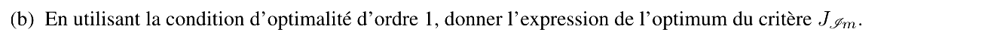{fig-alt="(b) En utilisant la condition d'optimalité d'ordre 1, donner l'expression de l'optimum du critère J_Im."}

::: {.notes-externes}
**Corrigé de l'épreuve** [corrige-2324, p. 9] : « Hence, $\theta_{\mathscr{I}m} = \left(\varphi_{\mathscr{I}m}^T\varphi_{\mathscr{I}m}\right)^{-1}\varphi_{\mathscr{I}m}^T\mathcal{Y}_{\mathscr{I}m}$, $\theta_{\mathscr{R}e} = (1.80, 0.82)^T$ ».
:::

:::: {.complement}
::: {.solution}
Même démarche :
$$\theta_{\mathscr{I}m} = \left(\varphi_{\mathscr{I}m}^T\varphi_{\mathscr{I}m}\right)^{-1}\varphi_{\mathscr{I}m}^T\mathcal{Y}_{\mathscr{I}m}, \qquad \varphi_{\mathscr{I}m}^T\varphi_{\mathscr{I}m} = \begin{pmatrix} 1{,}035 & -0{,}8924 \\ -0{,}8924 & 0{,}7923 \end{pmatrix}, \quad \varphi_{\mathscr{I}m}^T\mathcal{Y}_{\mathscr{I}m} = \begin{pmatrix} 1{,}135 \\ -0{,}9599 \end{pmatrix},$$
$$\boxed{\theta_{\mathscr{I}m} \approx (1{,}803 ;\ 0{,}819)^T}$$
Les deux estimations partielles diffèrent nettement (surtout sur $b$) : chacune n'utilise que la moitié de l'information.
:::
::::

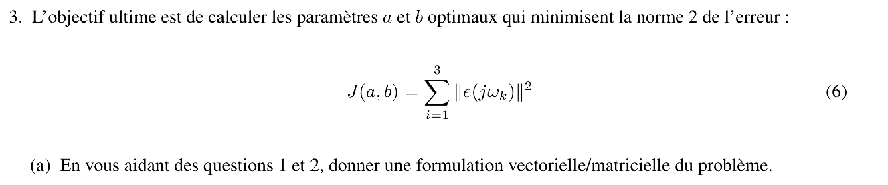{fig-alt="Q3 : calculer a et b minimisant la norme 2 de l'erreur, J(a, b) = somme des ‖e(jω_k)‖². (a) En s'aidant des questions 1 et 2, donner une formulation vectorielle/matricielle du problème."}

::: {.notes-externes}
**Corrigé de l'épreuve** [corrige-2324, p. 9] : « En adoptant l'écriture matricielle : $\underbrace{\begin{bmatrix} E_{\mathscr{R}e} \\ E_{\mathscr{I}m} \end{bmatrix}}_{E} = \underbrace{\begin{bmatrix} \mathcal{Y}_{\mathscr{R}e} \\ \mathcal{Y}_{\mathscr{I}m} \end{bmatrix}}_{\mathcal{Y}} - \underbrace{\begin{bmatrix} \varphi_{\mathscr{R}e} \\ \varphi_{\mathscr{I}m} \end{bmatrix}}_{\phi}\theta$, $J_{\mathscr{I}m}(a, b) = E^TE$ ».
:::

:::: {.complement}
::: {.solution}
Pour un complexe, $|e|^2 = (\mathscr{R}e\,e)^2 + (\mathscr{I}m\,e)^2$, donc
$$J(\theta) = \sum_k |e(j\omega_k)|^2 = J_{\mathscr{R}e}(\theta) + J_{\mathscr{I}m}(\theta) = \left\| \begin{pmatrix} \mathcal{Y}_{\mathscr{R}e} \\ \mathcal{Y}_{\mathscr{I}m} \end{pmatrix} - \begin{pmatrix} \varphi_{\mathscr{R}e} \\ \varphi_{\mathscr{I}m} \end{pmatrix}\theta \right\|^2 = \|\mathcal{Y} - \phi\,\theta\|^2,$$
avec $\mathcal{Y} \in \mathbb{R}^6$ et $\phi \in \mathbb{R}^{6\times 2}$ : **six équations réelles** pour deux inconnues réelles. Empiler parties réelles et imaginaires est la façon standard de traiter des moindres carrés complexes à paramètres réels.
:::
::::

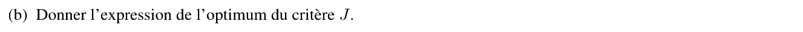{fig-alt="(b) Donner l'expression de l'optimum du critère J."}

::: {.notes-externes}
**Corrigé de l'épreuve** [corrige-2324, p. 9] : « Hence, $\theta = \left(\phi^T\phi\right)^{-1}\phi^T\mathcal{Y}$. Alternatively, $\theta = \left(\phi_{\mathscr{R}e}^T\phi_{\mathscr{R}e} + \phi_{\mathscr{I}m}^T\phi_{\mathscr{I}m}\right)^{-1}\left(\phi_{\mathscr{R}e}^T\mathcal{Y}_{\mathscr{R}e} + \phi_{\mathscr{I}m}^T\mathcal{Y}_{\mathscr{I}m}\right)$, $\theta_{\mathscr{R}e} = (1.95, 1.10)^T$ ».
:::

::: {.a-verifier #av-ann2324t-etiquettes-corrige}
**Source** [corrige-2324, p. 9], équations (21), (24) et (29) : « $\theta_{\mathscr{R}e} = (1.80, 0.82)^T$ » (résultat de la question 2), « $J_{\mathscr{I}m}(a, b) = E^TE$ » et « $\theta_{\mathscr{R}e} = (1.95, 1.10)^T$ » (résultat de la question 3).

**Problème** : étiquettes recopiées. Les valeurs sont justes (recalculées : $(1{,}803 ; 0{,}819)$ et $(1{,}950 ; 1{,}104)$), mais ce sont $\theta_{\mathscr{I}m}$, $J$ et $\theta$, pas $\theta_{\mathscr{R}e}$ ni $J_{\mathscr{I}m}$.

**Proposition** : lire $\theta_{\mathscr{I}m} = (1{,}80 ; 0{,}82)^T$, $J(a, b) = E^TE$ et $\theta = (1{,}95 ; 1{,}10)^T$.
:::

:::: {.complement}
::: {.solution}
$$\phi^T\phi = \varphi_{\mathscr{R}e}^T\varphi_{\mathscr{R}e} + \varphi_{\mathscr{I}m}^T\varphi_{\mathscr{I}m} = \begin{pmatrix} 2{,}9707 & -1{,}2374 \\ -1{,}2374 & 1{,}0648 \end{pmatrix}, \qquad \phi^T\mathcal{Y} = \begin{pmatrix} 4{,}4262 \\ -1{,}2374 \end{pmatrix},$$
$$\boxed{\hat\theta = (\phi^T\phi)^{-1}\phi^T\mathcal{Y} \approx (1{,}950 ;\ 1{,}104)^T}$$
Comparaison des trois estimations sur le critère total $J$ :

| Estimation | $a$ | $b$ | $J_{\mathscr{R}e}$ | $J_{\mathscr{I}m}$ | $J$ |
|---|---|---|---|---|---|
| $\theta_{\mathscr{R}e}$ (q. 1) | 1,961 | 1,465 | 0,004 | 0,174 | 0,178 |
| $\theta_{\mathscr{I}m}$ (q. 2) | 1,803 | 0,819 | 0,096 | 0,000 | 0,096 |
| $\hat\theta$ (q. 3) | 1,950 | 1,104 | 0,037 | 0,012 | **0,049** |

Chaque estimation partielle est la meilleure pour son propre critère, mais seule $\hat\theta$ minimise le critère complet. Interprétation : gain statique $F(0) = a \approx 1{,}95$ (cohérent avec $Y/U \approx 1{,}99$ à $\omega = 0{,}1$) et constante de temps $b \approx 1{,}1$ (dans l'unité inverse de celle de $\omega$, non précisée par le sujet).
:::
::::

## Exercice 2 : optimisation non linéaire (4 + 8 points) {#sec-ann2324t-ex2}

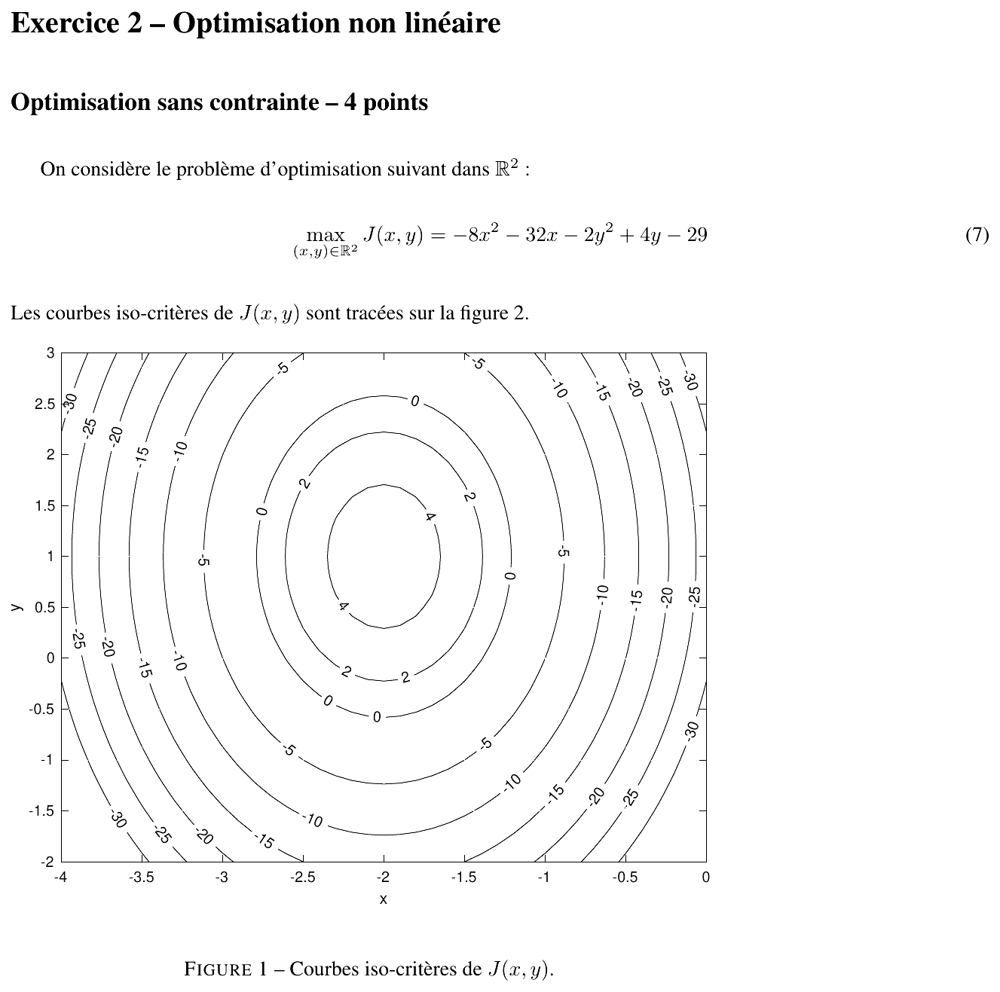{fig-alt="Exercice 2 – Optimisation non linéaire. Optimisation sans contrainte – 4 points : max sur R² de J(x, y) = −8x² − 32x − 2y² + 4y − 29 ; les courbes iso-critères de J sont tracées sur la figure (ellipses centrées en (−2, 1), niveaux 4, 2, 0, −5 à −30, pour x de −4 à 0 et y de −2 à 3), légende « Figure 1 – Courbes iso-critères de J(x, y) »."}

::: {.a-verifier #av-ann2324t-figure-bareme}
**Source** [sujet-2324, p. 3-5] : « Les courbes iso-critères de $J(x, y)$ sont tracées sur la figure 2 », alors que la figure a pour légende « Figure 1 » et que les questions 4 et 5 renvoient à « la Fig.1 ». Le sujet annonce « Optimisation avec contrainte – 8 points » [sujet-2324, p. 5], le corrigé « Optimisation avec contrainte – 5 points » [corrige-2324, p. 11].

**Problème** : numérotation de figure incohérente ; barème différent entre sujet et corrigé (8 + 8 + 4 = 20 points avec le sujet).

**Proposition** : lire « figure 1 » ; barème du sujet (8 points) retenu dans le titre de section.
:::

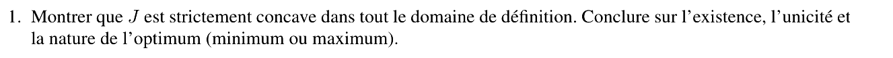{fig-alt="Q1 : montrer que J est strictement concave dans tout le domaine de définition ; conclure sur l'existence, l'unicité et la nature de l'optimum (minimum ou maximum)."}

::: {.notes-externes}
**Corrigé de l'épreuve** [corrige-2324, p. 10] : « $\frac{\partial J(x, y)}{\partial \binom{x}{y}} = \begin{pmatrix} -16x - 32 \\ -4y + 4 \end{pmatrix}$, $\frac{\partial^2 J(x, y)}{\partial \binom{x}{y}^2} = \begin{bmatrix} -16 & 0 \\ 0 & -8 \end{bmatrix}$. La matrice hesienne étant définie négative dans tout le domaine de définition de $J$, le critère $J$ est concave. »
:::

::: {.a-verifier #av-ann2324t-hessien}
**Source** [corrige-2324, p. 10], équation (32) : « $\begin{bmatrix} -16 & 0 \\ 0 & -8 \end{bmatrix}$ ».

**Problème** : $\partial J/\partial y = -4y + 4$ (équation (31) du même corrigé), donc $\partial^2 J/\partial y^2 = -4$, pas $-8$. La conclusion (défini négatif, $J$ strictement concave) est inchangée.

**Proposition** : $\nabla^2 J = \begin{bmatrix} -16 & 0 \\ 0 & -4 \end{bmatrix}$.
:::

:::: {.complement}
::: {.solution}
$$\nabla J(x, y) = \begin{pmatrix} -16x - 32 \\ -4y + 4 \end{pmatrix}, \qquad \nabla^2 J = \begin{pmatrix} -16 & 0 \\ 0 & -4 \end{pmatrix}.$$
Hessien constant à valeurs propres $-16 < 0$ et $-4 < 0$ : **défini négatif** sur tout $\mathbb{R}^2$, donc $J$ est **strictement concave**. Une fonction strictement concave a au plus un maximum, et tout point critique en est un ; $J \to -\infty$ à l'infini, donc ce maximum **existe**. Conclusion : l'optimum existe, est **unique**, et c'est un **maximum** global (il n'y a pas de minimum, $\inf J = -\infty$).
:::
::::

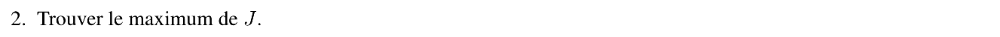{fig-alt="Q2 : trouver le maximum de J."}

::: {.notes-externes}
**Corrigé de l'épreuve** [corrige-2324, p. 10] : « A partir de la condition d'optimalité d'ordre 1, (31) : $x = -2$, $y = 1$. » (La valeur du maximum n'est pas donnée.)
:::

:::: {.complement}
::: {.solution}
$\nabla J = 0 \iff x = -2,\ y = 1$. Forme canonique : $J(x, y) = -8(x + 2)^2 - 2(y - 1)^2 + 5$, d'où
$$\boxed{(x^*, y^*) = (-2, 1), \qquad \max J = J(-2, 1) = -32 + 64 - 2 + 4 - 29 = 5}$$
cohérent avec la figure (centre des ellipses, à l'intérieur du niveau 4).
:::
::::

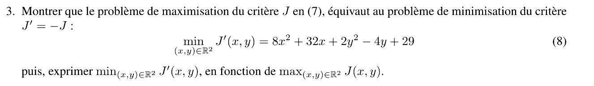{fig-alt="Q3 : montrer que le problème de maximisation de J en (7) équivaut au problème de minimisation de J′ = −J : min J′(x, y) = 8x² + 32x + 2y² − 4y + 29 (8), puis exprimer min J′ en fonction de max J."}

::: {.notes-externes}
**Corrigé de l'épreuve** [corrige-2324, p. 11] : « Soit $(x^*, y^*)$ le maximum du critère $J$. On peut alors écrire $\forall (x, y) \in \mathbb{R}^2$ : $J(x, y) \le J(x^*, y^*) \Leftrightarrow J'(x, y) = -J(x, y) \ge J'(x^*, y^*) = -J(x^*, y^*)$. En conséquence, $(x^*, y^*)$ est le minimum du critère $J' = -J$ et le minimum vaut $\min J'(x, y) = -\max J(x, y)$. »
:::

:::: {.complement}
::: {.solution}
Multiplier une inégalité par $-1$ en change le sens : $J(x, y) \le J(x^*, y^*)$ pour tout $(x, y)$ équivaut à $-J(x, y) \ge -J(x^*, y^*)$ pour tout $(x, y)$. Les deux problèmes ont donc **le même ensemble de solutions** (même argument), et
$$\boxed{\min_{(x,y)\in\mathbb{R}^2} J'(x, y) = -\max_{(x,y)\in\mathbb{R}^2} J(x, y) = -5}$$
atteint en $(-2, 1)$. L'équivalence vaut aussi sous contraintes (même domaine admissible) : c'est ce qui permet d'appliquer les conditions KKT, écrites pour une **minimisation**, à la suite de l'exercice. $J'$ est strictement convexe (hessien $\operatorname{diag}(16, 4)$).
:::
::::

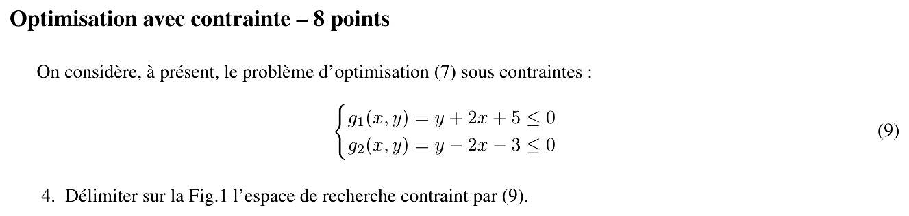{fig-alt="Optimisation avec contrainte – 8 points : problème (7) sous les contraintes g1(x, y) = y + 2x + 5 ≤ 0 et g2(x, y) = y − 2x − 3 ≤ 0 (9). Q4 : délimiter sur la figure l'espace de recherche contraint par (9)."}

::: {.notes-externes}
**Corrigé de l'épreuve** [corrige-2324, p. 11] : figure « Figure 2 – Courbes iso-critères de $J(x, y)$ » reprenant la figure du sujet, avec les deux droites $g_1 = 0$ et $g_2 = 0$ tracées ; elles se coupent en $(-2, -1)$.
:::

{#fig-ann2324t-domaine}

:::: {.complement}
::: {.solution}
- $g_1 \le 0 \iff y \le -2x - 5$ : sous la droite de pente $-2$ passant par $(-2, -1)$ et $(-2{,}5 ; 0)$ ;
- $g_2 \le 0 \iff y \le 2x + 3$ : sous la droite de pente $2$ passant par $(-2, -1)$ et $(-1{,}5 ; 0)$.

Le domaine admissible est l'intersection des deux demi-plans : un **cône** (secteur angulaire) de sommet $(-2, -1)$, ouvert vers le bas (@fig-ann2324t-domaine). Il est convexe (intersection de demi-plans) mais non borné. Le maximum non contraint $(-2, 1)$ n'y est pas : $g_1(-2, 1) = g_2(-2, 1) = 2 > 0$.
:::
::::

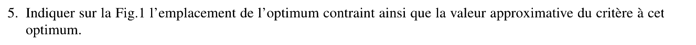{fig-alt="Q5 : indiquer sur la figure l'emplacement de l'optimum contraint ainsi que la valeur approximative du critère à cet optimum."}

::: {.notes-externes}
**Corrigé de l'épreuve** [corrige-2324, p. 11] : « L'optimum contraint se trouve à $(x, y) = (-2 - 1)$ et le critère vaut : $J(-2, -1) = -32 + 64 - 2 - 4 - 29 = -3$ ».
:::

:::: {.complement}
::: {.solution}
On cherche le point du cône situé sur la courbe de niveau **la plus haute** (la plus proche du centre $(-2, 1)$). Le cône est sous le centre et symétrique par rapport à la droite $x = -2$, comme les ellipses : le point du cône le plus proche du centre est son **sommet**.
$$\boxed{(x^*, y^*) = (-2, -1), \qquad J(-2, -1) = -2 \cdot 4 + 5 = -3}$$
Lecture graphique : le sommet est entre les niveaux $0$ et $-5$ ; le calcul donne exactement $-3$.
:::
::::

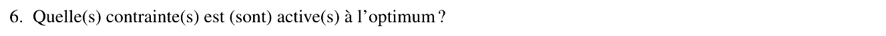{fig-alt="Q6 : quelle(s) contrainte(s) est (sont) active(s) à l'optimum ?"}

::: {.notes-externes}
**Corrigé de l'épreuve** [corrige-2324, p. 11] : « Les 2 contraintes sont actives à l'optimum. »
:::

:::: {.complement}
::: {.solution}
$g_1(-2, -1) = -1 - 4 + 5 = 0$ et $g_2(-2, -1) = -1 + 4 - 3 = 0$ : **les deux contraintes sont actives** (saturées) au sommet du cône.
:::
::::

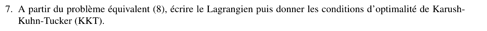{fig-alt="Q7 : à partir du problème équivalent (8), écrire le lagrangien puis donner les conditions d'optimalité de Karush-Kuhn-Tucker (KKT)."}

::: {.notes-externes}
**Corrigé de l'épreuve** [corrige-2324, p. 11-12] : « Le problème de maximisation du critère $J$ peut s'écrire comme un problème de minimisation de $-J$. On peut donc formuler le Lagrangien sous la forme suivante : $L(x, y, \lambda_1, \lambda_2) = 8x^2 + 32x + 2y^2 - 4y + 29 + \lambda_1(y + 2x + 5) + \lambda_2(y - 2x - 3)$. Les conditions d'optimalité sont données par : $\frac{\partial J(x, y)}{\partial \binom{x}{y}} = 0 \Rightarrow \begin{pmatrix} 16x + 32 + 2\lambda_1 - 2\lambda_2 \\ 4y - 4 + \lambda_1 + \lambda_2 \end{pmatrix} = 0$ ; $\lambda_1 \ge 0$, $\lambda_2 \ge 0$ ; $y + 2x + 5 \le 0$, $y - 2x - 3 \le 0$ ; $\lambda_1(y + 2x + 5) = 0$, $\lambda_2(y - 2x - 3) = 0$. »
:::

:::: {.complement}
::: {.solution}
Problème équivalent : $\min J'(x, y)$ sous $g_1 \le 0$, $g_2 \le 0$.
$$\mathscr{L}(x, y, \lambda_1, \lambda_2) = 8x^2 + 32x + 2y^2 - 4y + 29 + \lambda_1(y + 2x + 5) + \lambda_2(y - 2x - 3).$$
Conditions KKT :
$$\begin{cases}
\partial_x\mathscr{L} = 16x + 32 + 2\lambda_1 - 2\lambda_2 = 0 \\
\partial_y\mathscr{L} = 4y - 4 + \lambda_1 + \lambda_2 = 0 \\
y + 2x + 5 \le 0, \quad y - 2x - 3 \le 0 \\
\lambda_1 \ge 0, \quad \lambda_2 \ge 0 \\
\lambda_1(y + 2x + 5) = 0, \quad \lambda_2(y - 2x - 3) = 0
\end{cases}$$
(Le corrigé écrit $\partial J/\partial(x, y)$ pour la stationnarité : il s'agit de la dérivée du lagrangien $L$.) Le problème est **convexe** ($J'$ strictement convexe, contraintes affines) : tout point KKT est le minimum global de $J'$, donc le maximum global de $J$ sous contraintes.
:::
::::

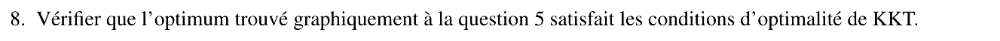{fig-alt="Q8 : vérifier que l'optimum trouvé graphiquement à la question 5 satisfait les conditions d'optimalité de KKT."}

::: {.notes-externes}
**Corrigé de l'épreuve** [corrige-2324, p. 12] : « On vérifie effectivement que le point $(x, y) = (-2, -1)$ vérifie les contraintes précédentes. En effet, d'après (39), on a : $\begin{cases} 2\lambda_1 - 2\lambda_2 = 0 \\ \lambda_1 + \lambda_2 = 8 \end{cases} \Rightarrow \begin{cases} \lambda_1 = 4 \\ \lambda_2 = 4 \end{cases}$ »
:::

:::: {.complement}
::: {.solution}
En $(-2, -1)$ : $16 \cdot (-2) + 32 = 0$ et $4 \cdot (-1) - 4 = -8$, donc la stationnarité donne
$$2\lambda_1 - 2\lambda_2 = 0, \qquad \lambda_1 + \lambda_2 = 8 \quad\Longrightarrow\quad \boxed{\lambda_1 = \lambda_2 = 4 \ge 0}$$
Admissibilité : $g_1 = g_2 = 0$ ✓ ; complémentarité : $\lambda_i\, g_i = 4 \cdot 0 = 0$ ✓ ; multiplicateurs positifs ✓. Le point vérifie toutes les conditions KKT ; les gradients $\nabla g_1 = (2, 1)$ et $\nabla g_2 = (-2, 1)$ sont indépendants (contraintes qualifiées). Interprétation géométrique : $-\nabla J'(-2, -1) = (0, 8)$ est combinaison à coefficients positifs des normales sortantes $\nabla g_1$ et $\nabla g_2$, avec $4(2, 1) + 4(-2, 1) = (0, 8)$.
:::
::::

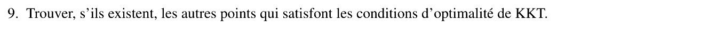{fig-alt="Q9 : trouver, s'ils existent, les autres points qui satisfont les conditions d'optimalité de KKT."}

:::: {.complement}
::: {.solution}
Le corrigé ne traite pas cette question. On examine les quatre combinaisons de contraintes actives :

| Contraintes actives | Résolution | Point | Admissible ? |
|---|---|---|---|
| aucune ($\lambda_1 = \lambda_2 = 0$) | $\nabla J' = 0$ | $(-2, 1)$ | non : $g_1 = g_2 = 2$ |
| $g_1$ seule ($\lambda_2 = 0$, $y = -2x - 5$) | $\lambda_1 = 4 - 4y$, $16x + 32 + 2\lambda_1 = 0$ | $(-2{,}5 ; 0)$, $\lambda_1 = 4$ | non : $g_2 = 2 > 0$ |
| $g_2$ seule ($\lambda_1 = 0$, $y = 2x + 3$) | $\lambda_2 = 4 - 4y$, $16x + 32 - 2\lambda_2 = 0$ | $(-1{,}5 ; 0)$, $\lambda_2 = 4$ | non : $g_1 = 2 > 0$ |
| $g_1$ et $g_2$ | question 8 | $(-2, -1)$, $\lambda_1 = \lambda_2 = 4$ | oui |

$$\boxed{\text{Aucun autre point KKT : } (-2, -1) \text{ est le seul.}}$$
C'était attendu : pour un problème strictement convexe, le minimum global est unique et les conditions KKT (suffisantes) ne peuvent être vérifiées qu'en ce point.
:::
::::
