

::: {.complement}
Aucun corrigé officiel : **les solutions de cette page sont rédigées par Claude** et vérifiées par le calcul. À relire avec un œil critique ; signaler toute erreur. Les énoncés sont des extraits du scan du sujet [sujet-2017] ; quelques traces d'encre d'un étudiant ont été effacées des images. Les références au cours renvoient au support 2026-2027 [cours] (pages du PDF), dont la numérotation des chapitres diffère peut-être de celle de 2016.

**Correspondances.** L'exercice 3 (circuit de commande, push-pull, $R_G = 10\ \Omega$, $C_{iss} = 1200$ pF) est repris dans la partie B du [partiel 2022-2023](2022-2023-partiel.qmd#sec-ann2223-ex3) (seul le seuil de courant change : 70 mA au lieu de 0,518 A). Un corrigé manuscrit d'un ancien élève (promotion 2023) intitulé « Circuit de commande du transistor de puissance » [corrige-2023-td03] traite les mêmes questions 1 et 2 : il est repris en bloc *Notes externes*. Le SEPIC figure dans la « Révision : convertisseurs Ćuk, SEPIC, Zeta » du poly de TD.
:::

## Exercice 1 : étude fonctionnelle d'un SEPIC (13 points) {#sec-ann1617-ex1}

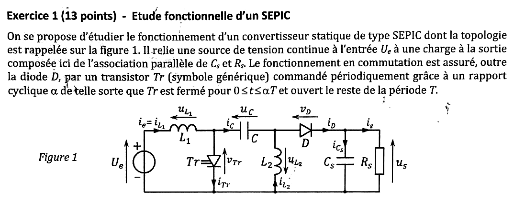{fig-alt="Exercice 1 : convertisseur SEPIC (figure 1) entre une source de tension continue Ue et une charge Cs parallèle à Rs ; transistor Tr fermé pour 0 ≤ t ≤ αT, ouvert le reste de la période T. Schéma : L1 en série avec l'entrée (courant ie = iL1, tension uL1), transistor Tr vers la masse (vTr, iTr), condensateur de liaison C (uC, iC), inductance L2 vers la masse (uL2, iL2), diode D (vD, iD) vers la sortie Cs // Rs (us, is)."}

**Conventions de la correction** (celles de la figure 1). Les flèches de tension désignent la borne positive : $u_C = V_\text{gauche} - V_\text{droite}$ aux bornes de $C$ ; $u_{L1}$ et $u_{L2}$ sont en convention récepteur avec $i_{L1}$ et $i_{L2}$ ($i_{L2}$ circule de la masse vers le nœud $A$ commun à $C$, $L_2$ et l'anode de $D$, d'où $u_{L2} = -V_A$) ; $v_D = V_A - u_s$. Le sujet note $v_{L1}$, $v_{L2}$ dans la question 9 les tensions notées $u_{L1}$, $u_{L2}$ sur la figure : ce sont les mêmes.

{fig-alt="Q1 : expliciter l'acronyme SEPIC en anglais."}

:::: {.complement}
::: {.solution}
**SEPIC** : *Single Ended Primary Inductor Converter* (convertisseur à inductance primaire référencée à la masse) [cours, p. 40].
:::
::::

{fig-alt="Q2 : parmi les convertisseurs DC/DC non isolés, quels sont les deux principaux avantages du SEPIC ?"}

:::: {.complement}
::: {.solution}
1. **Abaisseur ou élévateur, sans inversion de polarité** : $M = \frac{\alpha}{1-\alpha}$ couvre $]0, +\infty[$ (question 10), avec une sortie de même signe que l'entrée, contrairement au buck-boost et au Ćuk qui sont inverseurs [cours, p. 40 : « variantes non-inverseuses du convertisseur Ćuk »].
2. **Arrêt véritable (*shutdown*)** : le condensateur de liaison $C$ bloque toute composante continue entre l'entrée et la sortie ; quand le transistor reste ouvert, la sortie est totalement déconnectée de la source [cours, p. 40]. Avec un boost, au contraire, la source reste reliée à la sortie par $L$ et $D$ même transistor ouvert.

Avantage secondaire souvent cité : le courant d'entrée $i_e = i_{L1}$ est continu (non découpé), car $L_1$ est en série avec la source.
:::
::::

{fig-alt="Q3 : pour quelle application est-il majoritairement employé ?"}

:::: {.complement}
::: {.solution}
La **charge de batteries**, en particulier de cellules lithium-ion (2,5 V à 4,2 V) [cours, p. 40] : la tension de la cellule varie pendant la charge et peut être inférieure ou supérieure à celle de la source ; le SEPIC suit cette variation sans changer de structure, et l'arrêt véritable isole la batterie quand la charge est terminée.
:::
::::

{fig-alt="Q4 : fait-il partie des convertisseurs directs ou indirects ? Justifier."}

:::: {.complement}
::: {.solution}
**Indirect.** L'entrée ($U_e$, ou $U_e$ + $L_1$ vu comme source de courant) et la sortie ($C_s$, source de tension) ne sont jamais reliées directement par un interrupteur : l'énergie transite par des éléments de stockage intermédiaires ($C$, $L_1$, $L_2$). Le cours classe le SEPIC parmi les « hacheurs à stockage capacitif (indirect) » [cours, p. 40] ; un convertisseur direct relie la source au récepteur sans dipôle intermédiaire [cours, p. 14].
:::
::::

{fig-alt="Q5 : utilise-t-il un stockage intermédiaire ? Justifier."}

:::: {.complement}
::: {.solution}
**Oui, un stockage capacitif** (le condensateur de liaison $C$), complété par un stockage inductif dans $L_1$ et $L_2$ :

- séquence 1 ($T_r$ fermé) : $L_1$ et $L_2$ stockent de l'énergie, $C$ se décharge dans $L_2$ ;
- séquence 2 ($T_r$ ouvert) : $L_1$ et $L_2$ restituent leur énergie, $C$ se recharge par $L_1$ et la charge est alimentée par $D$ [cours, p. 40].

L'énergie prélevée à l'entrée pendant la séquence 2 transite par $C$ avant d'atteindre la sortie : c'est le principe même du convertisseur indirect.
:::
::::

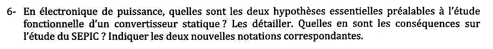{fig-alt="Q6 : quelles sont les deux hypothèses essentielles préalables à l'étude fonctionnelle d'un convertisseur statique ? Les détailler, conséquences sur l'étude du SEPIC, et deux nouvelles notations correspondantes."}

:::: {.complement}
::: {.solution}
Hypothèses du cours [cours, p. 19] :

1. **Interrupteurs parfaits** : chute de tension nulle à l'état passant, courant de fuite nul à l'état bloqué, commutations instantanées ; donc ni pertes par conduction ni pertes par commutation [cours, p. 13]. Le convertisseur a un rendement de 1.
2. **Sources parfaites** : les condensateurs sont assez gros pour que la tension à leurs bornes soit constante à l'échelle de la période de découpage, $u_C = \langle u_C \rangle$.

Conséquences pour le SEPIC : $T_r$ et $D$ se comportent en court-circuits ou circuits ouverts ; la tension de sortie et la tension du condensateur de liaison sont constantes. **Nouvelles notations** : $u_s(t) = U_s$ et $u_C(t) = U_C$ (majuscules = grandeurs constantes).

L'hypothèse de régime permanent (grandeurs périodiques, $\langle u_L \rangle = 0$ et $\langle i_C \rangle = 0$) est ajoutée par l'énoncé juste après.
:::
::::

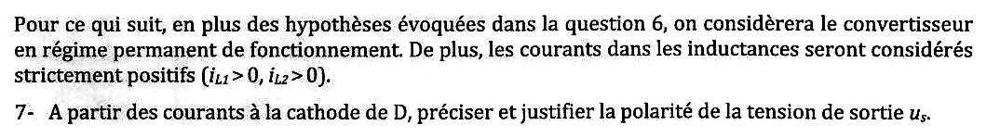{fig-alt="Paragraphe : en plus des hypothèses de la question 6, régime permanent et courants dans les inductances strictement positifs (iL1 > 0, iL2 > 0). Q7 : à partir des courants à la cathode de D, préciser et justifier la polarité de la tension de sortie us."}

:::: {.complement}
::: {.solution}
Loi des nœuds à la cathode de $D$ : $i_D = i_{Cs} + i_s$. En valeur moyenne, $\langle i_{Cs} \rangle = 0$ (régime permanent, tension de $C_s$ périodique), donc
$$I_D = I_s = \frac{U_s}{R_s}.$$
Une diode ne conduit que dans le sens direct : $i_D \geq 0$, donc $I_D > 0$ dès qu'elle conduit, et $\boxed{U_s > 0}$ avec l'orientation de la figure 1. Le SEPIC est **non inverseur**.
:::
::::

{fig-alt="Q8 : déterminer UC, la valeur moyenne de la tension uC aux bornes de C."}

:::: {.complement}
::: {.solution}
Maille passant par $U_e$, $L_1$, $C$ et $L_2$ : $U_e = u_{L1} + u_C + V_A$ avec $V_A = -u_{L2}$, soit
$$U_e = u_{L1} + u_C - u_{L2}.$$
En valeur moyenne, $\langle u_{L1} \rangle = \langle u_{L2} \rangle = 0$ (courants périodiques dans les inductances) :
$$\boxed{U_C = U_e}$$
La borne gauche de $C$ est en moyenne au potentiel $U_e$, la borne droite (nœud $A$) en moyenne à 0.
:::
::::

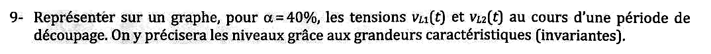{fig-alt="Q9 : représenter, pour α = 40 %, les tensions vL1(t) et vL2(t) sur une période de découpage, avec les niveaux exprimés à l'aide des grandeurs caractéristiques invariantes."}

:::: {.complement}
::: {.solution}
- **Séquence 1** ($0 < t < \alpha T$, $T_r$ fermé) : la borne gauche de $C$ est à la masse, donc $V_A = -U_C = -U_e$. Alors $u_{L1} = U_e - 0 = U_e$ et $u_{L2} = -V_A = U_e$.
- **Séquence 2** ($\alpha T < t < T$, $D$ passante) : $V_A = U_s$ et la borne gauche de $C$ est à $U_s + U_C = U_s + U_e$. Alors $u_{L1} = U_e - (U_e + U_s) = -U_s$ et $u_{L2} = -U_s$.

$$v_{L1}(t) = v_{L2}(t) = \begin{cases} U_e & 0 < t < \alpha T \\ -U_s & \alpha T < t < T \end{cases}$$

Les deux tensions sont **identiques** (c'est ce qui permet de coupler $L_1$ et $L_2$ sur un même noyau).

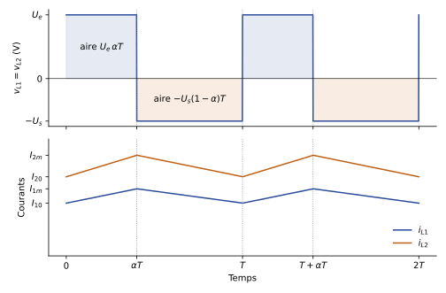{#fig-ann1617-sepic}
:::
::::

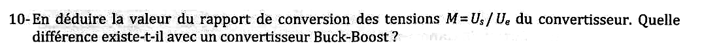{fig-alt="Q10 : en déduire le rapport de conversion des tensions M = Us/Ue. Quelle différence avec un convertisseur buck-boost ?"}

:::: {.complement}
::: {.solution}
$\langle v_{L1} \rangle = 0$ (aires égales sur @fig-ann1617-sepic) : $U_e\,\alpha T - U_s (1-\alpha) T = 0$, d'où
$$\boxed{M = \frac{U_s}{U_e} = \frac{\alpha}{1-\alpha}}$$
Pour $\alpha = 0{,}4$ : $M = 2/3$ (abaisseur) ; élévateur si $\alpha > 0{,}5$.

Même module que le buck-boost [cours, p. 36], mais **sans inversion de polarité** : la tension de sortie du buck-boost est de signe opposé à celle de l'entrée (d'où l'orientation inversée de $u_s$ sur le schéma du cours). Le SEPIC a en outre un courant d'entrée non découpé et un arrêt véritable (question 2), au prix de composants supplémentaires ($L_2$, $C$).
:::
::::

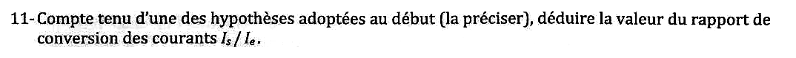{fig-alt="Q11 : compte tenu d'une des hypothèses adoptées au début (la préciser), déduire le rapport de conversion des courants Is/Ie."}

:::: {.complement}
::: {.solution}
Hypothèse des **interrupteurs parfaits** (et composants passifs sans pertes) : pas de pertes, donc conservation de la puissance moyenne, $U_e I_e = U_s I_s$ :
$$\boxed{\frac{I_s}{I_e} = \frac{U_e}{U_s} = \frac{1-\alpha}{\alpha}}$$
:::
::::

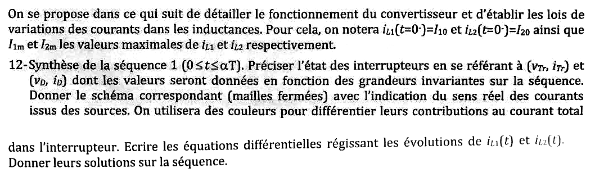{fig-alt="Notations : iL1(0−) = I10, iL2(0−) = I20, I1m et I2m valeurs maximales. Q12 : synthèse de la séquence 1 (0 ≤ t ≤ αT) : état des interrupteurs (vTr, iTr) et (vD, iD) en fonction des grandeurs invariantes, schéma (mailles fermées) avec le sens réel des courants issus des sources (couleurs pour leurs contributions au courant dans l'interrupteur), équations différentielles de iL1(t) et iL2(t) et leurs solutions."}

:::: {.complement}
::: {.solution}
**États** : $T_r$ fermé, $v_{Tr} = 0$, $i_{Tr} = i_{L1} + i_{L2}$ ; $D$ bloquée, $i_D = 0$, $v_D = V_A - U_s = -(U_e + U_s)$.

**Mailles fermées** (schéma équivalent : $T_r$ remplacé par un fil, $D$ par un circuit ouvert) :

- maille d'entrée $U_e \to L_1 \to T_r$ : la source $U_e$ charge $L_1$ ; contribution $i_{L1}$ au courant de $T_r$ ;
- maille $C \to T_r \to L_2$ : le condensateur $C$ (« source » de tension $U_C = U_e$) se décharge dans $L_2$ ; contribution $i_{L2}$ au courant de $T_r$ ($i_C = -i_{L2}$) ;
- côté sortie, $C_s$ seul alimente $R_s$ ($i_{Cs} = -i_s$).

**Équations et solutions** :
$$L_1 \frac{\mathrm{d}i_{L1}}{\mathrm{d}t} = U_e \;\Rightarrow\; i_{L1}(t) = \frac{U_e}{L_1}\, t + I_{10}, \qquad L_2 \frac{\mathrm{d}i_{L2}}{\mathrm{d}t} = U_C = U_e \;\Rightarrow\; i_{L2}(t) = \frac{U_e}{L_2}\, t + I_{20}.$$
En fin de séquence : $I_{1m} = I_{10} + \dfrac{U_e \alpha T}{L_1}$ et $I_{2m} = I_{20} + \dfrac{U_e \alpha T}{L_2}$.
:::
::::

{fig-alt="Q13 : même question pour la séquence 2 (αT ≤ t ≤ T)."}

:::: {.complement}
::: {.solution}
**États** : $T_r$ ouvert, $i_{Tr} = 0$, $v_{Tr} = U_C + U_s = U_e + U_s$ ; $D$ passante, $v_D = 0$, $i_D = i_{L1} + i_{L2}$.

**Mailles** : $U_e \to L_1 \to C \to D \to$ sortie (la source et $L_1$ rechargent $C$ et alimentent la charge, $i_C = i_{L1}$) ; $L_2 \to D \to$ sortie ($L_2$ restitue son énergie à la charge).

**Équations et solutions** ($u_{L1} = u_{L2} = -U_s$) :
$$i_{L1}(t) = -\frac{U_s}{L_1}(t - \alpha T) + I_{1m}, \qquad i_{L2}(t) = -\frac{U_s}{L_2}(t - \alpha T) + I_{2m}.$$
Régime permanent : $i_{L1}(T) = I_{10}$, donc $\dfrac{U_e \alpha T}{L_1} = \dfrac{U_s (1-\alpha) T}{L_1}$ : on retrouve $M = \frac{\alpha}{1-\alpha}$.
:::
::::

{fig-alt="Q14 : tracer sur le graphe précédent, en concordance des temps, les deux courants iL1(t) et iL2(t)."}

:::: {.complement}
::: {.solution}
Deux triangles de même rythme (@fig-ann1617-sepic, bas) : croissance de pente $U_e/L_k$ sur $[0, \alpha T]$, décroissance de pente $-U_s/L_k$ sur $[\alpha T, T]$, entre $I_{k0}$ et $I_{km}$. Ondulations $\Delta I_k = \dfrac{U_e \alpha T}{L_k}$. Valeurs moyennes (question 15) : $\langle i_{L1} \rangle = I_e$ et $\langle i_{L2} \rangle = I_s$ (loi des nœuds au nœud $A$ en moyenne : $\langle i_C \rangle + \langle i_{L2} \rangle = \langle i_D \rangle = I_s$ avec $\langle i_C \rangle = 0$).
:::
::::

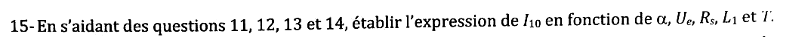{fig-alt="Q15 : en s'aidant des questions 11 à 14, établir l'expression de I10 en fonction de α, Ue, Rs, L1 et T."}

:::: {.complement}
::: {.solution}
$i_{L1}$ est triangulaire : sa valeur moyenne est le milieu de $[I_{10}, I_{1m}]$, et c'est le courant d'entrée :
$$I_e = I_{10} + \frac{\Delta I_1}{2} = I_{10} + \frac{U_e \alpha T}{2 L_1}.$$
Par la question 11 et $I_s = U_s / R_s = M U_e / R_s$ : $I_e = M I_s = M^2 \dfrac{U_e}{R_s}$. Donc
$$\boxed{I_{10} = \left(\frac{\alpha}{1-\alpha}\right)^2 \frac{U_e}{R_s} - \frac{\alpha\, U_e\, T}{2 L_1}}$$
Condition de validité (hypothèse $i_{L1} > 0$) : $I_{10} > 0$.
:::
::::

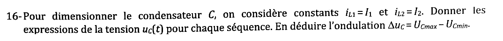{fig-alt="Q16 : pour dimensionner C, iL1 = I1 et iL2 = I2 sont supposés constants. Expressions de uC(t) pour chaque séquence ; en déduire l'ondulation ΔuC = UCmax − UCmin."}

:::: {.complement}
::: {.solution}
Courant dans $C$ (orienté de gauche à droite) : séquence 1, $i_C = -I_2$ ; séquence 2, $i_C = I_1$. Avec $i_C = C\,\dfrac{\mathrm{d}u_C}{\mathrm{d}t}$ :
$$u_C(t) = U_{C\max} - \frac{I_2}{C}\, t \quad (0 < t < \alpha T), \qquad u_C(t) = U_{C\min} + \frac{I_1}{C}(t - \alpha T) \quad (\alpha T < t < T).$$
$$\boxed{\Delta u_C = \frac{I_2\, \alpha T}{C} = \frac{I_1 (1-\alpha) T}{C}}$$
Les deux expressions sont égales car $\langle i_C \rangle = 0$. Avec $I_2 = I_s$ (question 14) : $\Delta u_C = \dfrac{\alpha I_s}{C f}$.
:::
::::

{fig-alt="Q17 : calculer la valeur minimale de C (ondulation maxi) avec Us = 12 V, Ue = 18 V, Is = 5 A et f = 20 kHz."}

:::: {.complement}
::: {.solution}
$M = 12/18 = 2/3$, d'où $\alpha = \dfrac{M}{1+M} = 0{,}4$. Alors
$$C\, \Delta u_C = \frac{\alpha I_s}{f} = \frac{0{,}4 \times 5}{20 \times 10^3} = 1{,}0 \times 10^{-4}\ \mathrm{C}, \qquad \boxed{C_{\min} = \frac{100\ \mu\mathrm{F}}{\Delta u_{C,\max}\ (\text{en V})}}$$
Par exemple, $\Delta u_{C,\max} = 1$ V donne $C_{\min} = 100\ \mu$F ; une ondulation de 5 % de $U_C = 18$ V (0,9 V) donne $111\ \mu$F.
:::
::::

::: {.a-verifier #av-ann1617-ondulation-c}
**Source** [sujet-2017, p. 2] : « Calculer la valeur minimale de $C$ (ondulation maxi) avec $U_s = 12$ V, $U_e = 18$ V, $I_s = 5$ A et $f = 20$ kHz ».

**Problème** : l'ondulation maximale admissible $\Delta u_{C,\max}$ n'est pas donnée ; sans elle, $C_{\min}$ ne peut pas être chiffré.

**Proposition** : donner $C_{\min} = \alpha I_s / (f\, \Delta u_{C,\max}) = 100\ \mu\mathrm{F}/\Delta u_{C,\max}$ (V), soit 100 µF pour 1 V ; valeur de $\Delta u_{C,\max}$ à confirmer (peut-être donnée oralement le jour de l'examen).
:::

## Exercice 2 : pertes et échauffement dans une diode en commutation (6 points) {#sec-ann1617-ex2}

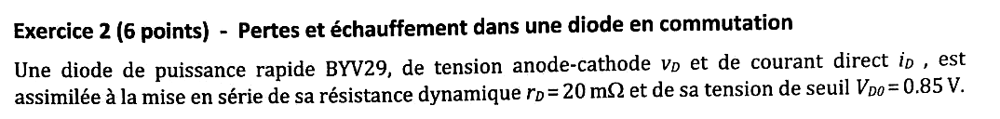{fig-alt="Exercice 2 : diode de puissance rapide BYV29 (tension vD, courant iD), modélisée par sa résistance dynamique rD = 20 mΩ en série avec sa tension de seuil VD0 = 0,85 V."}

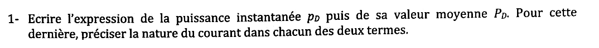{fig-alt="Q1 : expression de la puissance instantanée pD puis de sa valeur moyenne PD ; préciser la nature du courant dans chacun des deux termes."}

:::: {.complement}
::: {.solution}
Modèle $v_D = V_{D0} + r_D\, i_D$ :
$$p_D(t) = v_D\, i_D = V_{D0}\, i_D + r_D\, i_D^2, \qquad \boxed{P_D = V_{D0}\, I_{D,\text{moy}} + r_D\, I_{D,\text{eff}}^2}$$
Le terme en $V_{D0}$ fait intervenir le **courant moyen**, le terme en $r_D$ le **courant efficace** (au carré) [cours, p. 56].
:::
::::

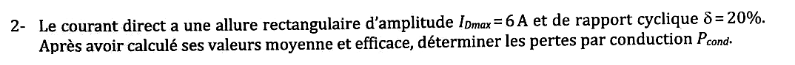{fig-alt="Q2 : courant direct rectangulaire d'amplitude IDmax = 6 A et de rapport cyclique δ = 20 % ; valeurs moyenne et efficace, puis pertes par conduction Pcond."}

:::: {.complement}
::: {.solution}
$$I_{D,\text{moy}} = \delta I_{D\max} = 1{,}2\ \mathrm{A}, \qquad I_{D,\text{eff}} = I_{D\max}\sqrt{\delta} = 6\sqrt{0{,}2} \approx 2{,}68\ \mathrm{A}$$
$$P_\text{cond} = 0{,}85 \times 1{,}2 + 0{,}020 \times 2{,}68^2 = 1{,}02 + 0{,}144 \approx \boxed{1{,}16\ \mathrm{W}}$$
Le terme de seuil domine largement.
:::
::::

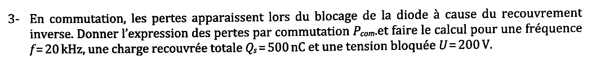{fig-alt="Q3 : pertes par commutation au blocage (recouvrement inverse) : expression de Pcom et calcul pour f = 20 kHz, charge recouvrée Qs = 500 nC et tension bloquée U = 200 V."}

:::: {.complement}
::: {.solution}
À chaque blocage, la charge recouvrée $Q_s$ est évacuée sous la tension inverse $U$ : énergie $\approx Q_s U$ par commutation [cours, p. 57 : $p_\text{com} = Q_{rr} E_c f$]. D'où
$$P_\text{com} = Q_s\, U\, f = 500 \times 10^{-9} \times 200 \times 20 \times 10^3 = \boxed{2{,}0\ \mathrm{W}}$$
Proportionnelles à $f$, ces pertes dépassent déjà les pertes par conduction à 20 kHz.
:::
::::

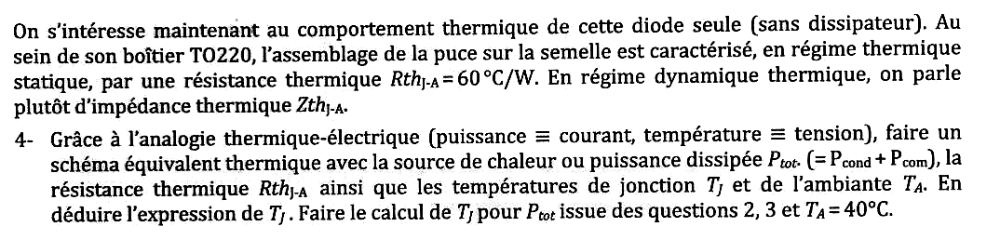{fig-alt="Comportement thermique de la diode seule (sans dissipateur), boîtier TO220, résistance thermique RthJ-A = 60 °C/W en statique, impédance thermique ZthJ-A en dynamique. Q4 : schéma équivalent thermique (source Ptot = Pcond + Pcom, RthJ-A, températures TJ et TA), expression et calcul de TJ avec TA = 40 °C."}

:::: {.complement}
::: {.solution}
Analogie [cours, p. 100] : la puissance $P_\text{tot}$ est une source de courant qui débite dans $R_{th\,J\text{-}A}$ ; la température ambiante $T_A$ est une source de tension (référence) ; la « tension » aux bornes de $R_{th}$ est l'échauffement $T_J - T_A$.
$$\boxed{T_J = T_A + R_{th\,J\text{-}A}\, P_\text{tot}}, \qquad P_\text{tot} = 1{,}16 + 2{,}0 = 3{,}16\ \mathrm{W}$$
$$T_J = 40 + 60 \times 3{,}16 \approx \boxed{230\ ^\circ\mathrm{C}}$$
Cette valeur dépasse la température de jonction maximale de la BYV29 (150 °C [byv29, p. 1]) : la diode seule ne peut pas dissiper 3,2 W, il faut un **dissipateur**.
:::
::::

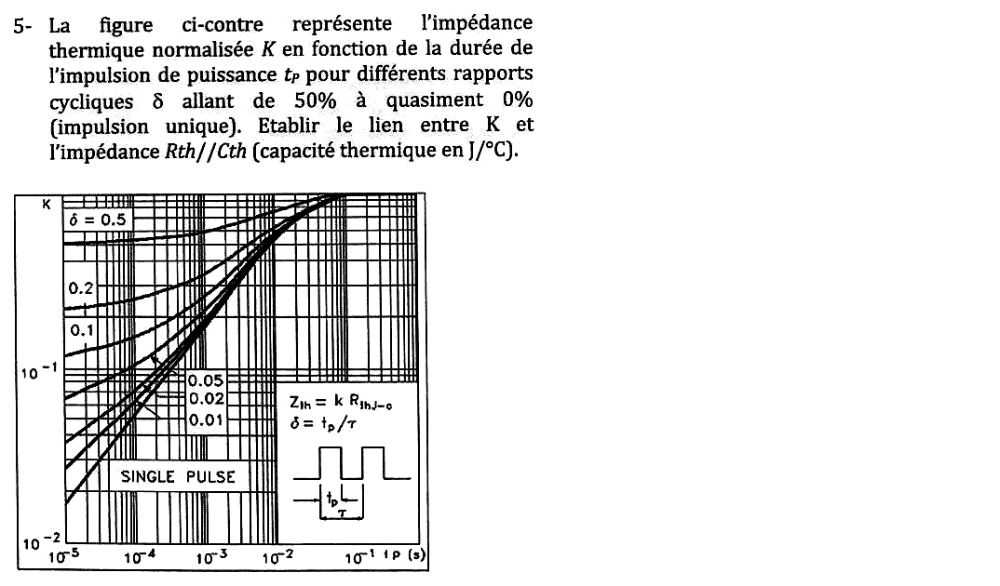{fig-alt="Q5 : la figure représente l'impédance thermique normalisée K en fonction de la durée tp de l'impulsion de puissance, pour des rapports cycliques δ de 50 % à presque 0 (impulsion unique). Établir le lien entre K et l'impédance Rth//Cth (Cth en J/°C). Figure : réseau de courbes K(tp) en échelles logarithmiques, tp de 10^-5 à 10^-1 s, K de 10^-2 à 1, courbes δ = 0,5 ; 0,2 ; 0,1 ; 0,05 ; 0,02 ; 0,01 et impulsion unique ; Zth = K·RthJ-c, δ = tp/τ."}

:::: {.complement}
::: {.solution}
$K$ est l'impédance thermique **normalisée** : $Z_{th}(t_p) = K\, R_{th}$, soit $K = Z_{th}/R_{th}$ (la figure l'écrit $Z_{th} = k\, R_{th\,J\text{-}c}$).

Pour une impulsion unique de puissance $P$ appliquée à $R_{th} \parallel C_{th}$ (premier ordre, $\tau_{th} = R_{th} C_{th}$), l'échauffement en fin d'impulsion vaut $P R_{th}\left(1 - e^{-t_p/\tau_{th}}\right)$, d'où
$$Z_{th}(t_p) = R_{th}\left(1 - e^{-t_p/\tau_{th}}\right), \qquad K = 1 - e^{-t_p/\tau_{th}}.$$
$K \approx t_p/\tau_{th}$ pour les impulsions courtes ($C_{th}$ absorbe la chaleur) et $K \to 1$ pour $t_p \gg \tau_{th}$ (régime statique, $Z_{th} \to R_{th}$). Les courbes réelles ne sont pas exactement celles d'un premier ordre (plusieurs couches en cascade, [cours, p. 102]).
:::
::::

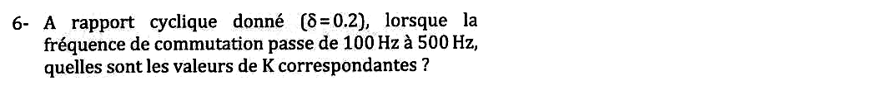{fig-alt="Q6 : à rapport cyclique δ = 0,2, quand la fréquence de commutation passe de 100 Hz à 500 Hz, quelles sont les valeurs de K correspondantes ?"}

:::: {.complement}
::: {.solution}
$t_p = \delta T = \delta / f$ :

- $f = 100$ Hz : $t_p = 0{,}2 \times 10\ \mathrm{ms} = 2$ ms, lecture sur la courbe $\delta = 0{,}2$ : $\boxed{K \approx 0{,}4}$ ;
- $f = 500$ Hz : $t_p = 0{,}4$ ms : $\boxed{K \approx 0{,}3}$.

(Lectures graphiques sur le scan, à $\pm 0{,}03$ environ.) La crête d'échauffement diminue quand la fréquence augmente, à puissance moyenne égale.
:::
::::

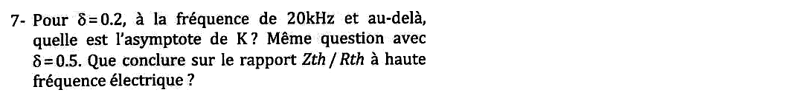{fig-alt="Q7 : pour δ = 0,2, à 20 kHz et au-delà, quelle est l'asymptote de K ? Même question pour δ = 0,5. Conclusion sur le rapport Zth/Rth à haute fréquence électrique ?"}

:::: {.complement}
::: {.solution}
À 20 kHz, $t_p = 0{,}2 \times 50\ \mu\mathrm{s} = 10\ \mu$s : on est à gauche du réseau, où les courbes deviennent horizontales. Asymptotes : $\boxed{K \to 0{,}2}$ pour $\delta = 0{,}2$ et $\boxed{K \to 0{,}5}$ pour $\delta = 0{,}5$.

**Conclusion** : à haute fréquence électrique, $Z_{th}/R_{th} \to \delta$. La période est très courte devant la constante de temps thermique, $C_{th}$ lisse les créneaux et la jonction ne « voit » que la **puissance moyenne** $\delta P$ : $T_J - T_\text{réf} = \delta P R_{th} = P_\text{moy} R_{th}$. Le calcul statique avec la puissance moyenne suffit.
:::
::::

## Exercice 3 : circuit de commande (3 points) {#sec-ann1617-ex3}

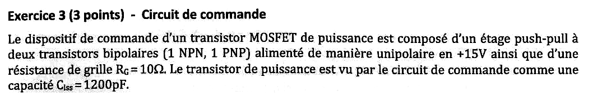{fig-alt="Exercice 3 : commande d'un MOSFET de puissance par un étage push-pull à deux transistors bipolaires (1 NPN, 1 PNP) alimenté en unipolaire sous +15 V, avec une résistance de grille RG = 10 Ω ; le MOSFET est vu par la commande comme une capacité Ciss = 1200 pF."}

{fig-alt="Q1 : faire le schéma du circuit. Peut-on inverser le NPN et le PNP ? Pourquoi ?"}

::: {.notes-externes}
Corrigé d'un ancien élève [corrige-2023-td03, p. 1] : schéma du push-pull, NPN en haut (collecteur à $V_{cc}$), PNP en bas (collecteur à la masse), émetteurs reliés, $R_g$ vers la grille. Montage inversé (PNP en haut, NPN en bas) barré, redessiné avec les jonctions en diodes : un chemin de $V_{cc}$ à la masse apparaît, « C.C (= court-circuit) interdit ». « (NPN en haut, PNP en bas) OK ; l'inverse NOK ⇒ C.C ».
:::

:::: {.complement}
::: {.solution}
**Schéma** : bases réunies (signal de commande 0/15 V) ; NPN : collecteur à $+15$ V, émetteur au point milieu ; PNP : émetteur au point milieu, collecteur à la masse ; point milieu $\to R_G \to$ grille, source du MOSFET à la masse. Ce sont deux **suiveurs d'émetteur** complémentaires : commande haute, le NPN conduit et charge $C_{iss}$ ; commande basse, le PNP conduit et la décharge [cours, p. 79].

**Inversion impossible** : en échangeant les deux transistors (PNP en haut, collecteur à $+15$ V ; NPN en bas, collecteur à la masse), les jonctions base-collecteur sont polarisées en direct : $+15\ \mathrm{V} \to$ collecteur P du PNP $\to$ base commune $\to$ collecteur N du NPN $\to$ masse. L'alimentation est mise en **court-circuit** à travers deux jonctions passantes, et le montage n'est plus un suiveur.
:::
::::

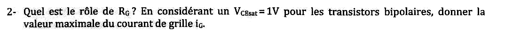{fig-alt="Q2 : rôle de RG ? Avec VCEsat = 1 V pour les bipolaires, valeur maximale du courant de grille iG."}

::: {.notes-externes}
[corrige-2023-td03, p. 2] : « $R_G$ permet de limiter l'appel en courant » (pour ne pas endommager l'alimentation) ; valeurs typiques $4{,}7\ \Omega < R_G < 47\ \Omega$ ; « $I_{C\max} = \dfrac{V_{cc} - V_{CEsat}}{R_G} \simeq \dfrac{V_{cc}}{R_G} = 1{,}5$ A ». La tension $V_{GS}$ monte avec la constante de temps $\tau = R_G C_{iss}$, qui ne doit pas être trop grande.
:::

:::: {.complement}
::: {.solution}
**Rôle de $R_G$** : la grille est une capacité ; sans résistance, l'appel de courant à chaque commutation ne serait limité que par les transistors et le câblage. $R_G$ **limite le courant de crête** et **fixe la vitesse de commutation** ($\tau = R_G C_{iss}$) : plus $R_G$ est petite, plus la commutation est rapide (pertes par commutation réduites) mais plus le courant et les perturbations sont forts.

À la mise en conduction, $C_{iss}$ est déchargée ($v_{GS} = 0$) et le NPN est saturé :
$$I_{G\max} = \frac{V_{cc} - V_{CEsat}}{R_G} = \frac{15 - 1}{10} = \boxed{1{,}4\ \mathrm{A}}$$
(Même valeur, de signe opposé, au blocage par le PNP.)
:::
::::

::: {.a-verifier #av-ann1617-ig-max}
**Source** [corrige-2023-td03, p. 2] : « $I_{C\max} = \frac{V_{cc} - V_{CEsat}}{R_G} \simeq \frac{V_{cc}}{R_G} = 1{,}5$ A ».

**Problème** : l'énoncé impose $V_{CEsat} = 1$ V ; le négliger donne 1,5 A au lieu de $(15 - 1)/10 = 1{,}4$ A. La question 3 confirme 1,4 A : $0{,}518\ \mathrm{A} \approx 1{,}4/e$, c'est-à-dire le courant à $t = \tau$.

**Proposition** : $I_{G\max} = 1{,}4$ A.
:::

{fig-alt="Q3 : tracer l'allure du courant de grille et calculer le temps au bout duquel il atteint 0,518 A."}

:::: {.complement}
::: {.solution}
Circuit $R_G C_{iss}$ attaqué par un échelon de $V_{cc} - V_{CEsat} = 14$ V :
$$v_{GS}(t) = 14\left(1 - e^{-t/\tau}\right), \qquad i_G(t) = I_{G\max}\, e^{-t/\tau}, \qquad \tau = R_G C_{iss} = 10 \times 1200 \times 10^{-12} = 12\ \mathrm{ns}.$$
$$t = \tau \ln\frac{I_{G\max}}{i_G} = 12\ \mathrm{ns} \times \ln\frac{1{,}4}{0{,}518} \approx \boxed{11{,}9\ \mathrm{ns} \approx \tau}$$
La valeur 0,518 A correspond à $I_{G\max}/e$ (0,515 A) : le temps cherché est la constante de temps.

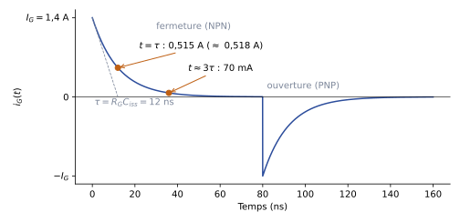{#fig-ann1617-courant-grille}

Modèle simplifié de l'énoncé : en réalité $C_{iss}$ n'est pas constante et le plateau de Miller allonge la commutation [cours, p. 69-70].
:::
::::
