

::: {.complement}
Aucun corrigé officiel : **les solutions de cette page sont rédigées par Claude** et vérifiées par le calcul. À relire avec un œil critique ; signaler toute erreur. Les énoncés sont des extraits du scan du sujet [sujet-2017-12] ; les annotations d'un étudiant à l'encre bleue (chronogramme de commande à droite de la figure 1, mot en marge, retouche d'un chiffre) ont été effacées des images. Dans la partie D, une tache d'encre masquait la première lettre de « (… = 1 kHz) » : elle est effacée avec la tache (voir [ce bloc *À vérifier*](#av-ann1718-frequence)).

**Correspondances.** Le même sujet est reproduit en tête du poly de TD 2022-2023 [td, p. 2-3]. Le boost en conductions continue, critique et discontinue est traité dans le cours [cours, p. 25-27] ; le hacheur buck-boost du [partiel 2022-2023](2022-2023-partiel.qmd#sec-ann2223-ex2) suit la même démarche.
:::

## Problème : étude fonctionnelle d'un hacheur parallèle survolteur (boost) {#sec-ann1718-ex1}

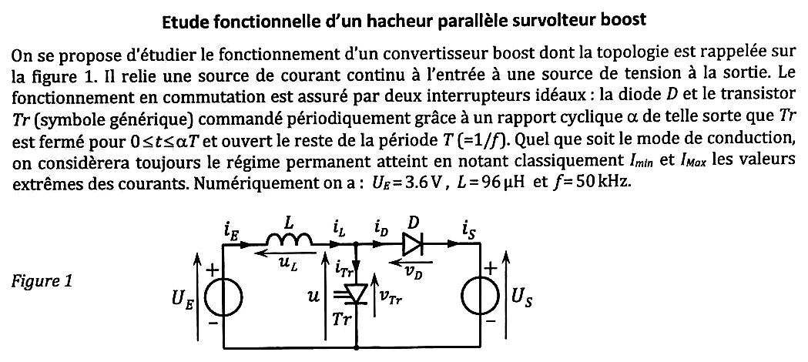{fig-alt="Énoncé : convertisseur boost reliant une source de courant continu en entrée à une source de tension en sortie. Interrupteurs idéaux : diode D et transistor Tr fermé pour 0 ≤ t ≤ αT, ouvert le reste de la période T = 1/f. Régime permanent, Imin et IMax valeurs extrêmes des courants. UE = 3,6 V, L = 96 µH, f = 50 kHz. Figure 1 : source UE (courant iE), inductance L (uL, iL), transistor Tr vers la masse (u, vTr, iTr), diode D (vD, iD) vers la source de tension US (iS)."}

**Notations.** $u$ est la tension aux bornes du transistor ($u = v_{Tr}$) ; $u_L$ est en convention récepteur avec $i_L$, de sorte que la maille d'entrée s'écrit $U_E = u_L + u$.

### Partie A : conduction continue {#sec-ann1718-a}

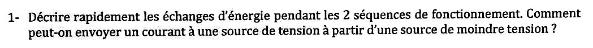{fig-alt="Q1 : décrire rapidement les échanges d'énergie pendant les deux séquences de fonctionnement. Comment peut-on envoyer un courant à une source de tension à partir d'une source de moindre tension ?"}

:::: {.complement}
::: {.solution}
- **Séquence 1** ($T_r$ fermé, $D$ bloquée) : $U_E$ fournit de l'énergie à $L$, qui la **stocke** ($i_L$ croît) ; la sortie $U_S$ est isolée.
- **Séquence 2** ($T_r$ ouvert, $D$ passante) : $U_E$ et $L$ fournissent **ensemble** de l'énergie à $U_S$ ($i_L$ décroît) [cours, p. 25].

Une source de tension ne peut pas débiter dans une source de tension plus élevée sans élément intermédiaire. L'inductance se comporte comme une **source de courant** : son courant ne peut pas varier brutalement, et quand $T_r$ s'ouvre sa tension s'inverse ($u_L = U_E - U_S < 0$) pour s'**ajouter** à $U_E$ et imposer le passage du courant dans $D$ vers $U_S > U_E$.
:::
::::

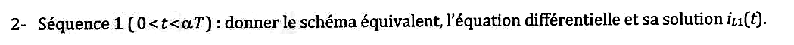{fig-alt="Q2 : séquence 1 (0 < t < αT) : schéma équivalent, équation différentielle et solution iL1(t)."}

:::: {.complement}
::: {.solution}
Schéma : $T_r$ remplacé par un fil, $D$ par un circuit ouvert ($v_D = -U_S$) ; $U_E$ est directement aux bornes de $L$, $u = 0$.
$$L\frac{\mathrm{d}i_L}{\mathrm{d}t} = U_E \quad\Longrightarrow\quad \boxed{i_{L1}(t) = \frac{U_E}{L}\, t + I_{min}}$$
:::
::::

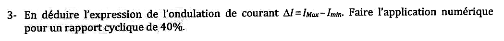{fig-alt="Q3 : en déduire l'ondulation de courant ΔI = IMax − Imin ; application numérique pour un rapport cyclique de 40 %."}

:::: {.complement}
::: {.solution}
$i_{L1}(\alpha T) = I_{Max}$ :
$$\boxed{\Delta I = \frac{U_E\, \alpha T}{L} = \frac{\alpha U_E}{L f}} = \frac{0{,}4 \times 3{,}6}{96 \times 10^{-6} \times 50 \times 10^3} = \boxed{0{,}30\ \mathrm{A}}$$
:::
::::

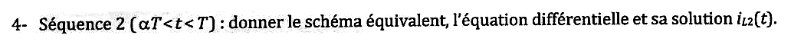{fig-alt="Q4 : séquence 2 (αT < t < T) : schéma équivalent, équation différentielle et solution iL2(t)."}

:::: {.complement}
::: {.solution}
Schéma : $T_r$ ouvert ($i_{Tr} = 0$), $D$ passante : $u = U_S$, $v_{Tr} = U_S$.
$$L\frac{\mathrm{d}i_L}{\mathrm{d}t} = U_E - U_S \quad\Longrightarrow\quad \boxed{i_{L2}(t) = \frac{U_E - U_S}{L}(t - \alpha T) + I_{Max}}$$
Décroissant puisque $U_S > U_E$.
:::
::::

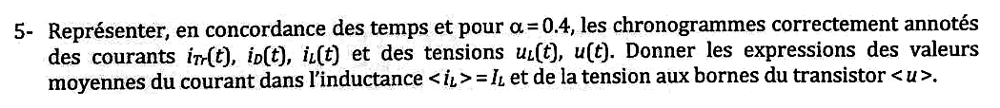{fig-alt="Q5 : pour α = 0,4, chronogrammes annotés de iTr(t), iD(t), iL(t), uL(t), u(t) en concordance des temps ; expressions des valeurs moyennes ⟨iL⟩ = IL et ⟨u⟩."}

:::: {.complement}
::: {.solution}
![Chronogrammes du boost en conduction continue, $\alpha = 0{,}4$ ($U_E = 3{,}6$ V, $U_S = 6$ V, $\Delta I = 0{,}3$ A ; $I_L = 1$ A arbitraire). Reconstruite (Claude) d'après le cours [cours, p. 25].](../figures/ann1718-boost-chronogrammes.svg){#fig-ann1718-boost}

$i_L$ est triangulaire, $i_{Tr} = i_L$ sur $[0, \alpha T]$, $i_D = i_L$ sur $[\alpha T, T]$ ; $u_L$ vaut $U_E$ puis $U_E - U_S$ ; $u$ vaut 0 puis $U_S$.
$$\boxed{I_L = \langle i_L \rangle = \frac{I_{Max} + I_{min}}{2}}, \qquad \boxed{\langle u \rangle = (1-\alpha)\, U_S}$$
:::
::::

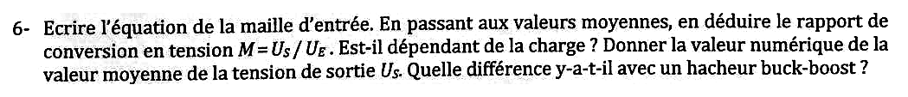{fig-alt="Q6 : équation de la maille d'entrée ; en valeurs moyennes, rapport de conversion M = US/UE. Dépend-il de la charge ? Valeur numérique de US. Différence avec un hacheur buck-boost ?"}

:::: {.complement}
::: {.solution}
Maille d'entrée : $U_E = u_L(t) + u(t)$. En moyenne, $\langle u_L \rangle = 0$ (régime permanent) :
$$U_E = (1-\alpha) U_S \quad\Longrightarrow\quad \boxed{M = \frac{U_S}{U_E} = \frac{1}{1-\alpha}}$$
**Indépendant de la charge** en conduction continue. Pour $\alpha = 0{,}4$ : $U_S = 3{,}6/0{,}6 = \boxed{6{,}0\ \mathrm{V}}$.

Buck-boost : $M = \frac{\alpha}{1-\alpha}$ [cours, p. 36], abaisseur ou élévateur et **inverseur** ; le boost est seulement **élévateur** ($M \geq 1$) et non inverseur, avec un courant d'entrée non découpé ($i_E = i_L$).
:::
::::

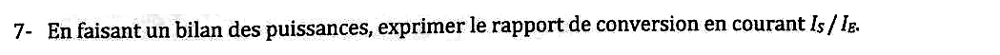{fig-alt="Q7 : par un bilan de puissances, exprimer le rapport de conversion en courant IS/IE."}

:::: {.complement}
::: {.solution}
Interrupteurs parfaits, pas de pertes : $U_E I_E = U_S I_S$, donc
$$\boxed{\frac{I_S}{I_E} = \frac{U_E}{U_S} = 1 - \alpha}$$
Cohérent avec $I_S = \langle i_D \rangle = (1-\alpha) I_L$ et $I_E = I_L$.
:::
::::

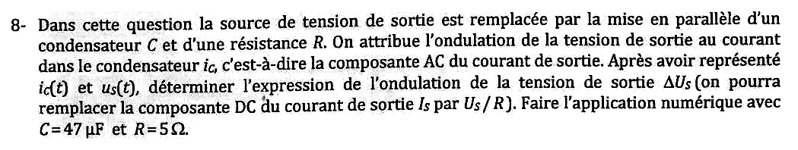{fig-alt="Q8 : la source de sortie est remplacée par un condensateur C en parallèle avec une résistance R ; l'ondulation de la tension de sortie est attribuée au courant iC (composante AC du courant de sortie). Représenter iC(t) et us(t), déterminer l'ondulation ΔUS (IS remplacé par US/R). Application numérique avec C = 47 µF et R = 5 Ω."}

:::: {.complement}
::: {.solution}
$i_C = i_D - I_S$ avec $I_S = U_S/R$ :

- séquence 1 : $i_D = 0$, $i_C = -I_S$ : $C$ seul alimente $R$, $u_s$ décroît linéairement ;
- séquence 2 : $i_C = i_L - I_S > 0$ : $C$ se recharge.

La chute pendant la séquence 1 vaut l'ondulation crête à crête :
$$\boxed{\Delta U_S = \frac{I_S\, \alpha T}{C} = \frac{\alpha\, U_S}{R C f}} = \frac{0{,}4 \times 6}{5 \times 47 \times 10^{-6} \times 50 \times 10^3} \approx \boxed{0{,}20\ \mathrm{V}}$$
soit 3,4 % de $U_S$ (on garde $U_S = 6$ V, $\alpha = 0{,}4$).
:::
::::

### Partie B : conduction critique {#sec-ann1718-b}

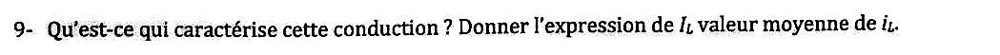{fig-alt="Q9 : qu'est-ce qui caractérise cette conduction ? Expression de IL, valeur moyenne de iL."}

:::: {.complement}
::: {.solution}
Le courant $i_L$ **s'annule exactement en fin de période** et repart aussitôt : $I_{min} = 0$ (limite entre conduction continue et discontinue) [cours, p. 26]. Alors $I_{Max} = \Delta I$ et
$$\boxed{I_L = \frac{I_{Max}}{2} = \frac{\alpha\, U_E\, T}{2 L}}$$
:::
::::

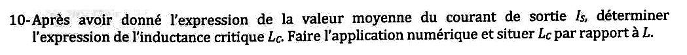{fig-alt="Q10 : expression de la valeur moyenne du courant de sortie IS, puis de l'inductance critique LC ; application numérique et position de LC par rapport à L."}

:::: {.complement}
::: {.solution}
$I_S = \langle i_D \rangle = (1-\alpha) I_L = \dfrac{\alpha(1-\alpha)\, U_E}{2 L f}$. Avec la charge $R$ : $I_S = \dfrac{U_S}{R} = \dfrac{U_E}{(1-\alpha) R}$. En égalant, l'inductance qui place le montage à la limite est
$$\boxed{L_C = \frac{\alpha (1-\alpha)^2 R}{2 f}}$$
(expression du cours [cours, p. 26]). Avec $\alpha = 0{,}4$, $R = 5\ \Omega$ et $f = 50$ kHz (valeurs des questions 3 et 8) :
$$L_C = \frac{0{,}4 \times 0{,}6^2 \times 5}{2 \times 50 \times 10^3} = \boxed{7{,}2\ \mu\mathrm{H}} \ll L = 96\ \mu\mathrm{H}.$$
$L > L_C$ : le montage fonctionne en **conduction continue**. $L_C$ est maximale pour $\alpha = 1/3$ ($7{,}4\ \mu$H) : avec 96 µH, la conduction reste continue quel que soit $\alpha$ pour $R = 5\ \Omega$.
:::
::::

### Partie C : conduction discontinue {#sec-ann1718-c}

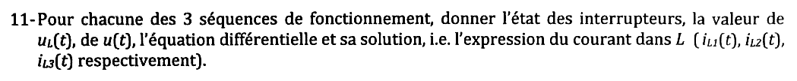{fig-alt="Partie C, conduction discontinue (le courant s'interrompt en t = βT). Q11 : pour chacune des trois séquences, état des interrupteurs, valeur de uL(t) et de u(t), équation différentielle et solution iL1(t), iL2(t), iL3(t)."}

:::: {.complement}
::: {.solution}
| Séquence | Interrupteurs | $u_L$ | $u$ | Courant |
|---|---|---|---|---|
| $0 < t < \alpha T$ | $T_r$ ON, $D$ OFF | $U_E$ | $0$ | $i_{L1}(t) = \dfrac{U_E}{L}\,t$ (part de 0) |
| $\alpha T < t < \beta T$ | $T_r$ OFF, $D$ ON | $U_E - U_S$ | $U_S$ | $i_{L2}(t) = \dfrac{U_E - U_S}{L}(t - \alpha T) + I_{Max}$ |
| $\beta T < t < T$ | $T_r$ OFF, $D$ OFF | $0$ | $U_E$ | $i_{L3}(t) = 0$ |

Équation commune : $L\,\dfrac{\mathrm{d}i_L}{\mathrm{d}t} = u_L$ ; $I_{Max} = \dfrac{U_E \alpha T}{L}$. Pendant la séquence 3, aucun courant ne circule : $u_L = 0$, donc $u = U_E$ (phase « sans énergie ni débit » [cours, p. 27]).
:::
::::

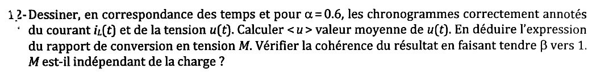{fig-alt="Q12 : pour α = 0,6, chronogrammes annotés de iL(t) et u(t) ; calculer ⟨u⟩, en déduire M ; vérifier la cohérence quand β tend vers 1 ; M est-il indépendant de la charge ?"}

:::: {.complement}
::: {.solution}
![Boost en conduction discontinue, $\alpha = 0{,}6$ (point de fonctionnement arbitraire $U_S = 4\,U_E$, d'où $\beta = 0{,}8$). Reconstruite (Claude) d'après le cours [cours, p. 27].](../figures/ann1718-boost-discontinu.svg){#fig-ann1718-discontinu}

$$\langle u \rangle = (\beta - \alpha)\, U_S + (1 - \beta)\, U_E.$$
Maille d'entrée en moyenne : $\langle u \rangle = U_E$, d'où $(\beta - \alpha) U_S = \beta U_E$ :
$$\boxed{M = \frac{U_S}{U_E} = \frac{\beta}{\beta - \alpha}}$$
Pour $\beta \to 1$ (plus de séquence 3) : $M \to \frac{1}{1-\alpha}$, la conduction continue ✓. $\beta$ dépend du courant débité : **$M$ dépend de la charge** en conduction discontinue.
:::
::::

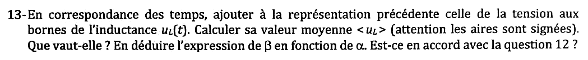{fig-alt="Q13 : ajouter uL(t) au tracé, calculer ⟨uL⟩ (aires signées), sa valeur, en déduire β en fonction de α ; accord avec la question 12 ?"}

:::: {.complement}
::: {.solution}
(Voir @fig-ann1718-discontinu, en bas.)
$$\langle u_L \rangle = \alpha\, U_E + (\beta - \alpha)(U_E - U_S) = 0$$
(régime permanent : courant périodique dans $L$). D'où
$$\boxed{\beta = \frac{\alpha\, U_S}{U_S - U_E} = \alpha\,\frac{M}{M-1}}$$
En reportant dans la question 12 : $\beta - \alpha = \frac{\alpha}{M-1}$ et $\frac{\beta}{\beta-\alpha} = M$ ✓. Les deux résultats sont la même relation.
:::
::::

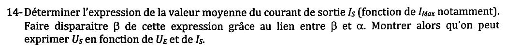{fig-alt="Q14 : valeur moyenne du courant de sortie IS (fonction de IMax notamment) ; éliminer β grâce au lien entre β et α ; montrer qu'on peut exprimer US en fonction de UE et IS."}

:::: {.complement}
::: {.solution}
$i_D$ est un triangle de hauteur $I_{Max}$ sur $[\alpha T, \beta T]$ :
$$I_S = \langle i_D \rangle = \frac{I_{Max}}{2}(\beta - \alpha), \qquad I_{Max} = \frac{\alpha U_E}{L f}, \qquad \beta - \alpha = \frac{\alpha U_E}{U_S - U_E}.$$
$$I_S = \frac{\alpha^2 U_E^2}{2 L f\,(U_S - U_E)} \quad\Longrightarrow\quad \boxed{U_S = U_E + \frac{\alpha^2 U_E^2}{2 L f\, I_S}}$$
:::
::::

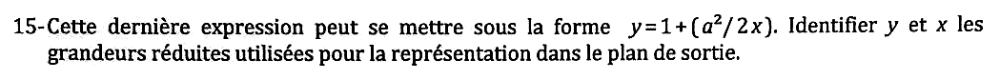{fig-alt="Q15 : cette expression peut se mettre sous la forme y = 1 + a²/(2x) ; identifier les grandeurs réduites y et x du plan de sortie."}

:::: {.complement}
::: {.solution}
En divisant par $U_E$ :
$$\frac{U_S}{U_E} = 1 + \frac{\alpha^2}{2\, \dfrac{L f I_S}{U_E}}, \qquad \boxed{y = \frac{U_S}{U_E} = M, \quad x = \frac{L f I_S}{U_E}, \quad a = \alpha}$$
$x$ est le courant de sortie réduit (axe $\frac{L F I_s}{U_e}$ du plan de sortie du cours [cours, p. 38]).
:::
::::

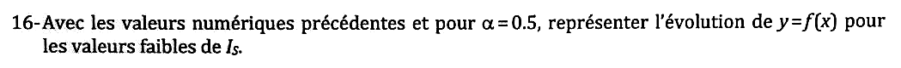{fig-alt="Q16 : avec les valeurs numériques précédentes et α = 0,5, représenter y = f(x) pour les faibles valeurs de IS."}

:::: {.complement}
::: {.solution}
$y = 1 + \dfrac{0{,}125}{x}$ : hyperbole, $y \to \infty$ quand $I_S \to 0$ (à vide, la tension de sortie monterait sans limite). La branche est valable tant que la conduction est discontinue, c'est-à-dire jusqu'à $y = \frac{1}{1-\alpha} = 2$, soit $x_c = 0{,}125$ ; au-delà, $y = 2$. Avec $L f / U_E = 96 \times 10^{-6} \times 50 \times 10^3 / 3{,}6 = 1{,}33\ \mathrm{A^{-1}}$ : $x = 1{,}33\, I_S$, et la conduction est discontinue pour $I_S < 94$ mA.

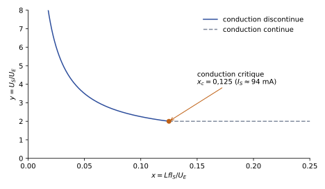{#fig-ann1718-plan-sortie}
:::
::::

### Partie D : comportement thermique {#sec-ann1718-d}

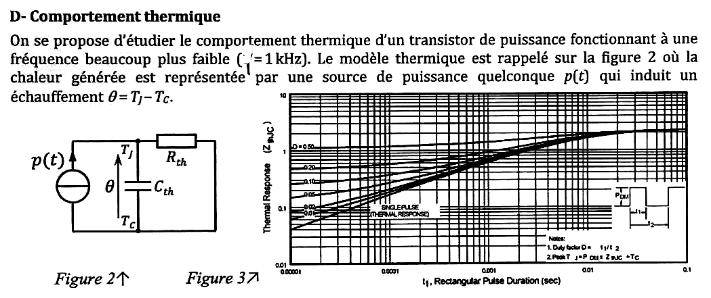{fig-alt="Partie D : transistor de puissance fonctionnant à une fréquence beaucoup plus faible (… = 1 kHz, première lettre masquée par une tache). Figure 2 : modèle thermique, source de puissance p(t) alimentant Rth en parallèle avec Cth, échauffement θ = TJ − TC. Figure 3 : réseau de courbes « Thermal Response (ZthJC) » en fonction de la durée t1 de l'impulsion rectangulaire (10^-5 à 0,1 s), pour D = 0,5 ; 0,2 ; 0,1 ; 0,05 ; 0,02 ; 0,01 et impulsion unique ; ordonnée de 0,01 à 10."}

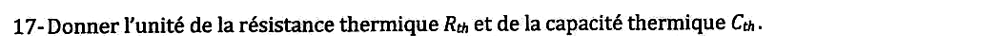{fig-alt="Q17 : unités de la résistance thermique Rth et de la capacité thermique Cth."}

:::: {.complement}
::: {.solution}
$R_{th}$ en **K/W** (ou °C/W) ; $C_{th}$ en **J/K** (ou J/°C, W·s/K) [cours, p. 100].
:::
::::

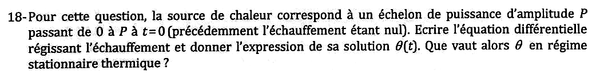{fig-alt="Q18 : échelon de puissance de 0 à P à t = 0 (échauffement initial nul) : équation différentielle de l'échauffement, solution θ(t), valeur en régime stationnaire."}

:::: {.complement}
::: {.solution}
Loi des nœuds thermique (figure 2) :
$$p(t) = \frac{\theta}{R_{th}} + C_{th}\,\frac{\mathrm{d}\theta}{\mathrm{d}t} \quad\Longrightarrow\quad R_{th}C_{th}\,\frac{\mathrm{d}\theta}{\mathrm{d}t} + \theta = R_{th} P.$$
$$\boxed{\theta(t) = R_{th} P\left(1 - e^{-t/\tau_{th}}\right)}, \quad \tau_{th} = R_{th} C_{th}, \qquad \theta_\infty = R_{th} P.$$
:::
::::

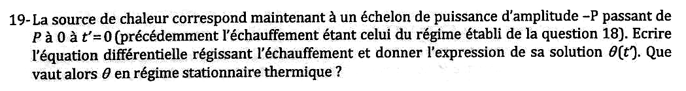{fig-alt="Q19 : échelon de puissance de P à 0 à t' = 0 (échauffement initial : régime établi de Q18) : équation différentielle, solution θ(t'), valeur en régime stationnaire."}

:::: {.complement}
::: {.solution}
$$R_{th}C_{th}\,\frac{\mathrm{d}\theta}{\mathrm{d}t'} + \theta = 0, \quad \theta(0) = R_{th}P \quad\Longrightarrow\quad \boxed{\theta(t') = R_{th} P\, e^{-t'/\tau_{th}}}, \qquad \theta_\infty = 0.$$
:::
::::

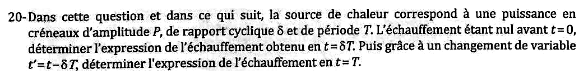{fig-alt="Q20 : puissance en créneaux d'amplitude P, de rapport cyclique δ et de période T, échauffement nul avant t = 0 : échauffement en t = δT, puis, avec t' = t − δT, échauffement en t = T."}

:::: {.complement}
::: {.solution}
Sur $[0, \delta T]$, réponse à l'échelon (question 18) :
$$\theta(\delta T) = R_{th} P\left(1 - e^{-\delta T/\tau_{th}}\right).$$
Sur $[\delta T, T]$, refroidissement libre à partir de $\theta(\delta T)$ (même équation qu'en question 19) : $\theta(t') = \theta(\delta T)\, e^{-t'/\tau_{th}}$, d'où
$$\boxed{\theta(T) = \theta(\delta T)\, e^{-(1-\delta) T/\tau_{th}}}$$
:::
::::

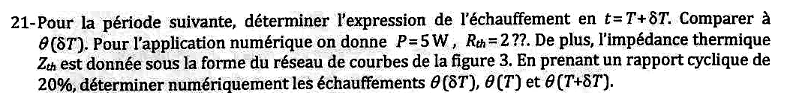{fig-alt="Q21 : échauffement en t = T + δT pour la période suivante, comparaison à θ(δT). Application numérique : P = 5 W, Rth = 2 ?? (unité illisible), Zth donnée par la figure 3 ; rapport cyclique 20 % ; calculer θ(δT), θ(T), θ(T + δT)."}

:::: {.complement}
::: {.solution}
Sur $[T, T + \delta T]$, échelon de $P$ à partir de $\theta(T)$ :
$$\theta(T + \delta T) = R_{th}P + \left(\theta(T) - R_{th}P\right) e^{-\delta T/\tau_{th}} = \boxed{\theta(\delta T) + \theta(T)\, e^{-\delta T/\tau_{th}}} > \theta(\delta T).$$
L'échauffement de crête **augmente d'une période à l'autre** jusqu'au régime établi.

**Application numérique** ($f = 1$ kHz, $T = 1$ ms, $\delta T = 0{,}2$ ms, $P = 5$ W, $R_{th} = 2$ °C/W) :

- la première impulsion est une impulsion unique : courbe « single pulse » de la figure 3 à $t_1 = 0{,}2$ ms, $Z_{th} \approx 0{,}29$ °C/W (lecture graphique), d'où $\theta(\delta T) = P\, Z_{th} \approx \boxed{1{,}45\ ^\circ\mathrm{C}}$ ;
- avec le modèle du premier ordre, $1 - e^{-\delta T/\tau_{th}} = Z_{th}/R_{th} = 0{,}145$, soit $e^{-\delta T/\tau_{th}} = 0{,}855$ et $\tau_{th} \approx 1{,}28$ ms ;
- $\theta(T) = 1{,}45\, e^{-0{,}8/1{,}28} \approx \boxed{0{,}77\ ^\circ\mathrm{C}}$ ;
- $\theta(T + \delta T) = 1{,}45 + 0{,}77 \times 0{,}855 \approx \boxed{2{,}11\ ^\circ\mathrm{C}}$.

(Le modèle à une seule cellule $R_{th}C_{th}$ est une approximation : la courbe réelle n'est pas une exponentielle unique, et sa limite vaut environ 2,2 °C/W et non 2, voir [ce bloc *À vérifier*](#av-ann1718-rth).)
:::
::::

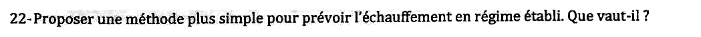{fig-alt="Q22 : proposer une méthode plus simple pour prévoir l'échauffement en régime établi. Que vaut-il ?"}

:::: {.complement}
::: {.solution}
Utiliser directement la courbe du réseau correspondant au rapport cyclique, $D = 0{,}2$, à $t_1 = 0{,}2$ ms : $Z_{th}(D = 0{,}2) \approx 0{,}6$ °C/W (lecture), d'où l'échauffement de crête en régime établi
$$\theta_\text{max} = P\, Z_{th}(D, t_1) \approx 5 \times 0{,}6 = \boxed{3\ ^\circ\mathrm{C}}$$
(c'est la note 2 de la figure : $T_J = P_{DM} Z_{thJC} + T_C$). Contrôles :

- modèle du premier ordre (série géométrique des questions 20 et 21) : $\theta_\text{max} = R_{th}P\,\dfrac{1 - e^{-\delta T/\tau_{th}}}{1 - e^{-T/\tau_{th}}} \approx 2{,}7$ °C ;
- la valeur moyenne vaut $\langle \theta \rangle = \delta P R_{th} = 2$ °C : l'échauffement oscille autour de 2 °C avec une crête d'environ 3 °C.
:::
::::

::: {.a-verifier #av-ann1718-rth}
**Source** [sujet-2017-12, p. 2] et [td, p. 3] : « $P = 5$ W, $R_{th} = 2$ ?? ».

**Problème** : l'unité de $R_{th}$ est remplacée par « ?? » (caractère perdu à l'impression, identique dans le poly de TD). De plus, la courbe de la figure 3 tend vers environ 2,2 °C/W aux temps longs (valeur de $R_{\theta JC}$ de l'IRFZ34N), et non vers 2.

**Proposition** : lire $R_{th} = 2$ °C/W (ou K/W) ; les applications numériques ci-dessus utilisent 2 °C/W.
:::

::: {.a-verifier #av-ann1718-frequence}
**Source** [td, p. 3] : « fréquence beaucoup plus faible ($T = 1$ kHz) » (sur le scan du sujet, la lettre est couverte d'encre).

**Problème** : une période ne s'exprime pas en kHz ; il s'agit de la fréquence.

**Proposition** : $f = 1$ kHz, soit $T = 1$ ms.
:::
