

::: {.complement}
Aucun corrigé officiel : **les solutions de cette page sont rédigées par Claude** et vérifiées par le calcul. À relire avec un œil critique ; signaler toute erreur. Les énoncés sont extraits de deux photos du sujet [sujet-2023], redressées ; les **soulignements au stylo d'un étudiant** n'ont pas pu être séparés de l'impression et restent visibles, ainsi qu'une rature manuscrite sur « et $I_o$ » à la question 9. Les références au cours renvoient au support 2026-2027 [cours] (pages du PDF).

**Correspondances.** La partie B (circuit de commande) reprend l'exercice 3 du [partiel 2016-2017](2016-2017-partiel.qmd#sec-ann1617-ex3) (seuil de 70 mA au lieu de 0,518 A) ; le corrigé manuscrit d'un ancien élève [corrige-2023-td03] qui traite ces questions est repris en bloc *Notes externes*. La partie A suit la démarche du boost du [partiel 2017-2018](2017-2018-partiel.qmd#sec-ann1718-ex1).
:::

## Exercice 1 : questions de cours {#sec-ann2223-ex1}

{fig-alt="Titre : Questions de cours."}

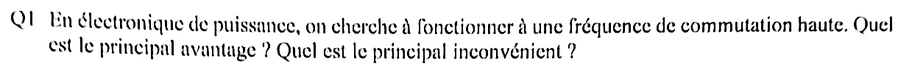{fig-alt="Q1 : en électronique de puissance, on cherche à fonctionner à une fréquence de commutation haute. Principal avantage ? Principal inconvénient ?"}

:::: {.complement}
::: {.solution}
- **Avantage** : réduction de la taille (et du coût) des composants passifs de stockage et de filtrage ($L$, $C$, transformateurs), dont les valeurs nécessaires diminuent avec $f$ : **compacité** (par exemple $\Delta I = \frac{\alpha U}{L f}$ : à ondulation donnée, $L \propto 1/f$).
- **Inconvénient** : les **pertes par commutation**, proportionnelles à $f$ ($P_\text{com} = f\,(E_{swON} + E_{swOFF})$ [cours, p. 98]), qui dégradent le rendement et l'échauffement ; s'y ajoutent les perturbations électromagnétiques (CEM) [cours, p. 12].
:::
::::

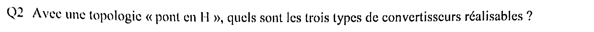{fig-alt="Q2 : avec une topologie « pont en H », quels sont les trois types de convertisseurs réalisables ?"}

:::: {.complement}
::: {.solution}
Le pont en H (deux bras de deux interrupteurs réversibles en courant) permet de réaliser :

1. un **hacheur réversible 4 quadrants** (DC/DC, par exemple variateur de machine à courant continu, tension et courant de charge des deux signes) ;
2. un **onduleur monophasé** (DC/AC) [cours, p. 135] ;
3. un **redresseur commandé** (AC/DC, fonctionnement réversible de l'onduleur, absorption sinusoïdale).

Le support cite le « bras de hacheur pont en H » et les bras d'onduleur [cours, p. 35] sans dresser cette liste : la réponse attendue n'a pas pu être confirmée. Autre lecture possible : buck, boost et buck-boost non inverseur (pont en H avec l'inductance entre les deux bras).
:::
::::

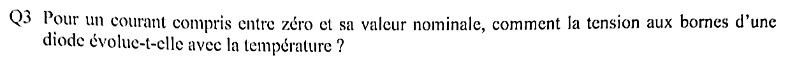{fig-alt="Q3 : pour un courant compris entre zéro et sa valeur nominale, comment la tension aux bornes d'une diode évolue-t-elle avec la température ?"}

:::: {.complement}
::: {.solution}
Elle **diminue** quand la température augmente : à faible et moyen courant, la tension de seuil $V_0$ a un coefficient de température négatif (de l'ordre de $-2$ mV/°C), qui l'emporte sur l'augmentation de la résistance dynamique. Les caractéristiques directes à deux températures se croisent : ce n'est qu'au-delà du point de croisement (forts courants) que la tension augmente avec $T$ [cours, p. 56].
:::
::::

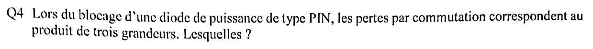{fig-alt="Q4 : lors du blocage d'une diode de puissance de type PIN, les pertes par commutation correspondent au produit de trois grandeurs. Lesquelles ?"}

:::: {.complement}
::: {.solution}
$$P_\text{com} = Q_{rr}\, E_c\, f$$
**charge recouvrée** $Q_{rr}$ × **tension bloquée** (inverse) $E_c$ × **fréquence de commutation** $f$ [cours, p. 57].
:::
::::

{fig-alt="Q5 : quels sont les deux avantages majeurs d'une diode Schottky ?"}

:::: {.complement}
::: {.solution}
1. **Chute de tension à l'état passant très faible** (moins de pertes par conduction) ;
2. **recouvrement inverse inexistant** (composant unipolaire, pas de charge stockée : pas de pertes au blocage) [cours, p. 59].

(Contrepartie : tenue en tension limitée et courant de fuite plus élevé.)
:::
::::

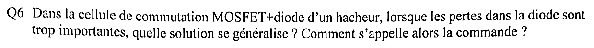{fig-alt="Q6 : dans la cellule de commutation MOSFET + diode d'un hacheur, lorsque les pertes dans la diode sont trop importantes, quelle solution se généralise ? Comment s'appelle alors la commande ?"}

:::: {.complement}
::: {.solution}
On remplace la diode par un **second MOSFET** qui conduit à sa place (conduction du MOSFET en inverse) : c'est le **redressement synchrone**. Les deux transistors reçoivent une **commande complémentaire** ($\alpha$ et $\bar\alpha$), avec des **temps morts** pour éviter qu'ils conduisent simultanément [cours, p. 35].
:::
::::

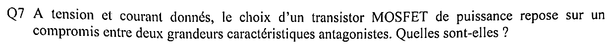{fig-alt="Q7 : à tension et courant donnés, le choix d'un MOSFET de puissance repose sur un compromis entre deux grandeurs caractéristiques antagonistes. Lesquelles ?"}

:::: {.complement}
::: {.solution}
La **charge de grille** $Q_G$ (vitesse de commutation, puissance de commande, pertes par commutation) et la **résistance à l'état passant** $R_{DS(on)}$ (pertes par conduction) : une puce plus grande abaisse $R_{DS(on)}$ mais augmente $Q_G$ ; le produit $R_{DS(on)} \cdot Q_G$ est un facteur de mérite d'une technologie [cours, p. 68].
:::
::::

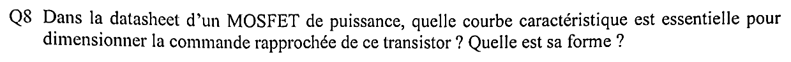{fig-alt="Q8 : dans la datasheet d'un MOSFET de puissance, quelle courbe est essentielle pour dimensionner la commande rapprochée ? Quelle est sa forme ?"}

:::: {.complement}
::: {.solution}
La courbe de **charge de grille** $V_{GS} = f(Q_G)$ (*gate charge*). Forme en trois segments : montée de $V_{GS}$ (charge de $C_{GS}$ jusqu'au seuil puis jusqu'à la tension du plateau), **plateau de Miller** horizontal (charge de $C_{GD}$ pendant la variation de $V_{DS}$), puis nouvelle montée, moins raide, jusqu'à la tension de commande. Elle donne la charge $Q_G$ à fournir, donc le courant de grille et la résistance $R_G$ pour un temps de commutation voulu [cours, p. 72-73].
:::
::::

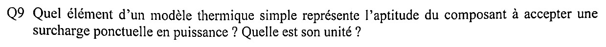{fig-alt="Q9 : quel élément d'un modèle thermique simple représente l'aptitude du composant à accepter une surcharge ponctuelle en puissance ? Quelle est son unité ?"}

:::: {.complement}
::: {.solution}
La **capacité thermique** $C_{th}$, en **J/K** (J/°C) : elle absorbe l'énergie d'une impulsion de puissance courte sans que la température monte jusqu'à $R_{th} P$ [cours, p. 100].
:::
::::

## Exercice 2 (partie A) : chargeur de batterie {#sec-ann2223-ex2}

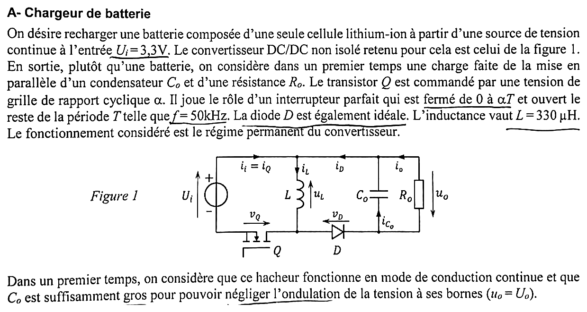{fig-alt="Partie A : recharge d'une batterie lithium-ion une cellule à partir d'une source continue Ui = 3,3 V ; convertisseur DC/DC non isolé de la figure 1 ; charge Co parallèle à Ro dans un premier temps. Transistor Q fermé de 0 à αT, f = 50 kHz, diode D idéale, L = 330 µH, régime permanent. Figure 1 : source Ui, transistor Q entre la borne négative et le nœud bas de L, inductance L (uL, iL) depuis la ligne haute, diode D vers Co // Ro (uo orientée vers le bas, io, iCo). Conduction continue et ondulation de Co négligée (uo = Uo)."}

**Conventions de la correction** (figure 1). $u_L$ est en convention récepteur avec $i_L$ (courant descendant dans $L$) ; $u_o$ est orientée de telle sorte que $U_o > 0$ (la sortie est inversée par rapport à l'entrée : c'est l'orientation du buck-boost du cours [cours, p. 36]).

{fig-alt="Q1 : sous quels noms ce convertisseur est-il connu ? Ses deux principales caractéristiques ?"}

:::: {.complement}
::: {.solution}
**Hacheur buck-boost**, hacheur à stockage inductif, hacheur abaisseur-élévateur (ou « inverseur ») [cours, p. 36]. Caractéristiques :

1. **abaisseur ou élévateur** : $M = \frac{\alpha}{1-\alpha}$ va de 0 à l'infini ;
2. **inverseur** de polarité, et **indirect** : toute l'énergie transite par $L$ (stockée en séquence 1, restituée en séquence 2).

Il convient ici : la cellule (2,7 V à 4,2 V) est tantôt sous, tantôt au-dessus de $U_i = 3{,}3$ V.
:::
::::

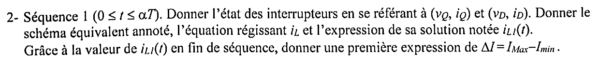{fig-alt="Q2 : séquence 1 (0 ≤ t ≤ αT) : état des interrupteurs (vQ, iQ) et (vD, iD), schéma équivalent annoté, équation de iL et solution iL1(t) ; première expression de ΔI = IMax − Imin."}

:::: {.complement}
::: {.solution}
**États** : $Q$ fermé, $v_Q = 0$, $i_Q = i_L$ ; $D$ bloquée, $i_D = 0$, $v_D = -(U_i + U_o)$.

Schéma : $U_i$ directement aux bornes de $L$ ; $C_o$ seul alimente $R_o$.
$$L\frac{\mathrm{d}i_L}{\mathrm{d}t} = U_i \;\Longrightarrow\; i_{L1}(t) = \frac{U_i}{L}\,t + I_{min}, \qquad \boxed{\Delta I = \frac{U_i\, \alpha T}{L}}$$
:::
::::

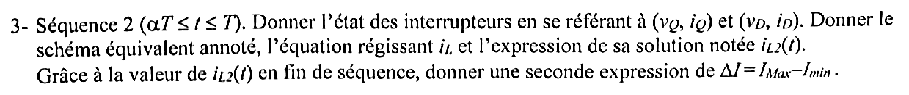{fig-alt="Q3 : séquence 2 (αT ≤ t ≤ T) : état des interrupteurs, schéma équivalent, équation de iL et solution iL2(t) ; seconde expression de ΔI."}

:::: {.complement}
::: {.solution}
**États** : $Q$ ouvert, $i_Q = 0$, $v_Q = U_i + U_o$ ; $D$ passante, $v_D = 0$, $i_D = i_L$.

Schéma : $L$ se décharge dans $C_o \parallel R_o$ ; $u_L = -U_o$.
$$i_{L2}(t) = -\frac{U_o}{L}(t - \alpha T) + I_{Max}, \qquad \boxed{\Delta I = \frac{U_o (1-\alpha) T}{L}}$$
:::
::::

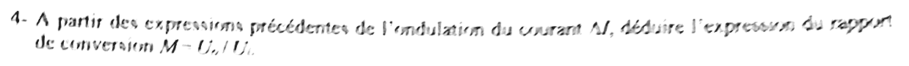{fig-alt="Q4 : à partir des deux expressions de ΔI, déduire le rapport de conversion M = Uo/Ui."}

:::: {.complement}
::: {.solution}
$U_i\, \alpha T = U_o (1-\alpha) T$ :
$$\boxed{M = \frac{U_o}{U_i} = \frac{\alpha}{1-\alpha}}$$
:::
::::

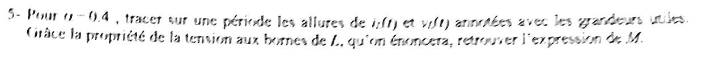{fig-alt="Q5 : pour α = 0,4, tracer sur une période iL(t) et vL(t) annotés ; énoncer la propriété de la tension aux bornes de L et retrouver M."}

:::: {.complement}
::: {.solution}
Pour $\alpha = 0{,}4$ : $U_o = 3{,}3 \times \frac{0{,}4}{0{,}6} = 2{,}2$ V et $\Delta I = \frac{0{,}4 \times 3{,}3}{330 \times 10^{-6} \times 50 \times 10^3} = 80$ mA.

![Chronogrammes du buck-boost, $\alpha = 0{,}4$ ($U_i = 3{,}3$ V, $U_o = 2{,}2$ V ; courants tracés pour $R_o = 6{,}6\ \Omega$, choisie pour l'illustration). Reconstruite (Claude) d'après le cours [cours, p. 36].](../figures/ann2223-buck-boost-chronogrammes.svg){#fig-ann2223-buck-boost}

**Propriété** : en régime permanent, le courant dans une inductance est périodique, donc la **valeur moyenne de la tension à ses bornes est nulle** [cours, p. 19]. Aires égales : $U_i\,\alpha T = U_o (1-\alpha) T$, d'où $M = \frac{\alpha}{1-\alpha}$.
:::
::::

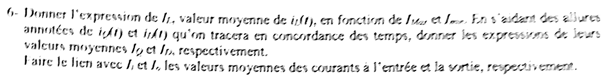{fig-alt="Q6 : expression de IL, valeur moyenne de iL(t), en fonction de IMax et Imin ; à l'aide des allures de iQ(t) et iD(t), expressions de leurs valeurs moyennes IQ et ID ; lien avec Ii et Io, valeurs moyennes des courants d'entrée et de sortie."}

:::: {.complement}
::: {.solution}
$$I_L = \frac{I_{Max} + I_{min}}{2}, \qquad I_Q = \alpha\, I_L, \qquad I_D = (1-\alpha)\, I_L$$
(@fig-ann2223-buck-boost : $i_Q$ et $i_D$ sont les morceaux du trapèze $i_L$ sur chaque séquence). Lien : $I_i = I_Q$ (le courant d'entrée est celui du transistor) et $I_o = I_D$ (le courant moyen dans $C_o$ est nul). On vérifie $\frac{I_o}{I_i} = \frac{1-\alpha}{\alpha} = \frac{U_i}{U_o}$ : conservation de la puissance.
:::
::::

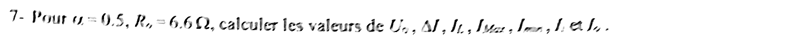{fig-alt="Q7 : pour α = 0,5 et Ro = 6,6 Ω, calculer Uo, ΔI, IL, IMax, Imin, Ii et Io."}

:::: {.complement}
::: {.solution}
| Grandeur | Expression | Valeur |
|---|---|---|
| $U_o$ | $\frac{\alpha}{1-\alpha} U_i$ | **3,3 V** |
| $\Delta I$ | $\frac{\alpha U_i}{L f}$ | **0,10 A** |
| $I_o$ | $U_o / R_o$ | **0,50 A** |
| $I_L$ | $I_o / (1-\alpha)$ | **1,0 A** |
| $I_{Max}$ | $I_L + \Delta I/2$ | **1,05 A** |
| $I_{min}$ | $I_L - \Delta I/2$ | **0,95 A** |
| $I_i$ | $\alpha I_L$ | **0,50 A** |

Contrôle : $U_i I_i = U_o I_o = 1{,}65$ W ; $I_{min} > 0$, la conduction est bien continue.
:::
::::

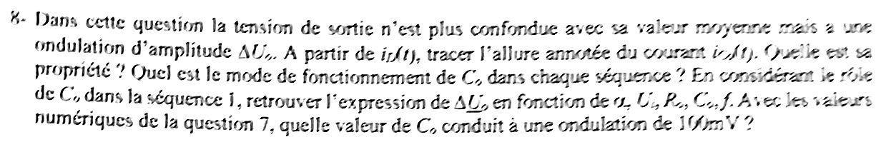{fig-alt="Q8 : la tension de sortie présente une ondulation ΔUo. À partir de iD(t), tracer l'allure annotée de iCo(t). Quelle est sa propriété ? Mode de fonctionnement de Co dans chaque séquence ? En considérant le rôle de Co dans la séquence 1, retrouver ΔUo en fonction de α, Ui, Ro, Co, f. Avec les valeurs de la question 7, quelle valeur de Co donne une ondulation de 100 mV ?"}

:::: {.complement}
::: {.solution}
$i_{Co} = i_D - I_o$ (@fig-ann2223-buck-boost, en bas). **Propriété** : $\langle i_{Co} \rangle = 0$ (tension périodique aux bornes de $C_o$).

- Séquence 1 : $i_{Co} = -I_o$, $C_o$ **se décharge** et alimente seul la charge ;
- séquence 2 : $i_{Co} = i_L - I_o > 0$, $C_o$ **se recharge**.

Chute de tension pendant la séquence 1, à courant constant :
$$\Delta U_o = \frac{I_o\, \alpha T}{C_o} = \frac{\alpha\, U_o}{R_o C_o f} = \boxed{\frac{\alpha^2\, U_i}{(1-\alpha)\, R_o C_o f}}$$
(expression du cours [cours, p. 38]). Pour 100 mV avec les valeurs de la question 7 :
$$C_o = \frac{\alpha U_o}{R_o f\, \Delta U_o} = \frac{0{,}5 \times 3{,}3}{6{,}6 \times 50 \times 10^3 \times 0{,}1} = \boxed{50\ \mu\mathrm{F}}$$
:::
::::

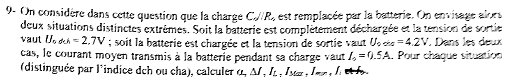{fig-alt="Q9 : la charge Co // Ro est remplacée par la batterie. Deux situations extrêmes : batterie déchargée, Uo dch = 2,7 V ; batterie chargée, Uo cha = 4,2 V ; courant moyen transmis Io = 0,5 A dans les deux cas. Pour chaque situation (indices dch ou cha), calculer α, ΔI, IL, IMax, Imin, Ii (« et Io » raturé à la main sur la copie)."}

:::: {.complement}
::: {.solution}
$\alpha = \dfrac{M}{1+M} = \dfrac{U_o}{U_i + U_o}$, $\Delta I = \dfrac{\alpha U_i}{L f}$, $I_L = \dfrac{I_o}{1-\alpha}$, $I_i = \alpha I_L = \dfrac{U_o I_o}{U_i}$.

| Situation | $\alpha$ | $\Delta I$ | $I_L$ | $I_{Max}$ | $I_{min}$ | $I_i$ |
|---|---|---|---|---|---|---|
| déchargée, $U_o = 2{,}7$ V | **0,45** | **90 mA** | **0,909 A** | **0,954 A** | **0,864 A** | **0,409 A** |
| chargée, $U_o = 4{,}2$ V | **0,56** | **112 mA** | **1,136 A** | **1,192 A** | **1,080 A** | **0,636 A** |

Le rapport cyclique doit varier de 0,45 à 0,56 au cours de la charge pour maintenir $I_o = 0{,}5$ A : c'est le rôle de la régulation.
:::
::::

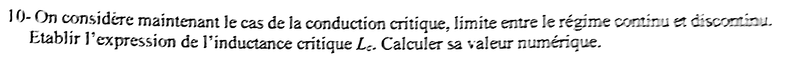{fig-alt="Q10 : conduction critique, limite entre régimes continu et discontinu : expression de l'inductance critique Lc et valeur numérique."}

:::: {.complement}
::: {.solution}
Conduction critique : $I_{min} = 0$, donc $I_L = \frac{\Delta I}{2} = \frac{\alpha U_i}{2 L f}$. Avec $I_L = \frac{I_o}{1-\alpha} = \frac{U_o}{(1-\alpha) R_o}$ et $\alpha U_i = (1-\alpha) U_o$ :
$$\boxed{L_c = \frac{(1-\alpha)^2 R_o}{2 f}}$$
Valeurs de la question 7 ($\alpha = 0{,}5$, $R_o = 6{,}6\ \Omega$) : $L_c = \frac{0{,}25 \times 6{,}6}{10^5} = \boxed{16{,}5\ \mu\mathrm{H}}$. Pour la batterie ($R_\text{éq} = U_o/I_o$) : 16,3 µH dans les deux situations. $L = 330\ \mu\mathrm{H} \gg L_c$ : la conduction reste continue.

(Choix des valeurs : la question ne précise pas le point de fonctionnement ; on a pris celui de la question 7.)
:::
::::

## Exercice 3 (partie B) : circuit de commande {#sec-ann2223-ex3}

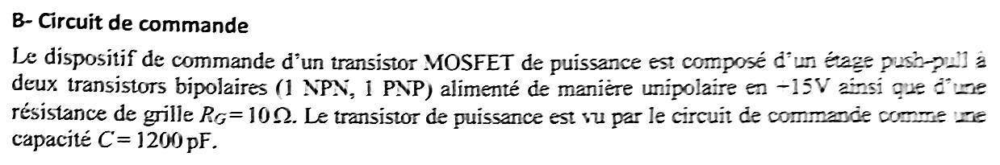{fig-alt="Partie B : commande d'un MOSFET de puissance par un étage push-pull à deux bipolaires (1 NPN, 1 PNP) alimenté en unipolaire sous +15 V, résistance de grille RG = 10 Ω ; le MOSFET est vu comme une capacité C = 1200 pF."}

{fig-alt="Q11 : faire le schéma du circuit. Peut-on inverser le NPN et le PNP ? Pourquoi ?"}

::: {.notes-externes}
Corrigé d'un ancien élève [corrige-2023-td03, p. 1] : NPN en haut (collecteur à $V_{cc}$), PNP en bas, émetteurs reliés vers $R_g$. Montage inversé barré, redessiné avec les jonctions en diodes : chemin de $V_{cc}$ à la masse, « C.C (= court-circuit) interdit ». « (NPN en haut, PNP en bas) OK ; l'inverse NOK ⇒ C.C ».
:::

:::: {.complement}
::: {.solution}
Même réponse qu'au [partiel 2016-2017, exercice 3](2016-2017-partiel.qmd#sec-ann1617-ex3) : deux suiveurs d'émetteur complémentaires, NPN côté $+15$ V, PNP côté masse, point milieu vers $R_G$ puis la grille [cours, p. 79]. Inverser les transistors met en direct leurs jonctions base-collecteur entre $+15$ V et la masse : **court-circuit** de l'alimentation.
:::
::::

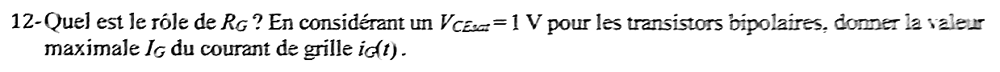{fig-alt="Q12 : rôle de RG ? Avec VCEsat = 1 V, valeur maximale IG du courant de grille iG(t)."}

::: {.notes-externes}
[corrige-2023-td03, p. 2] : « $R_G$ permet de limiter l'appel en courant » ; valeurs typiques $4{,}7\ \Omega < R_G < 47\ \Omega$ ; « $I_{C\max} = \dfrac{V_{cc} - V_{CEsat}}{R_G} \simeq \dfrac{V_{cc}}{R_G} = 1{,}5$ A ».
:::

:::: {.complement}
::: {.solution}
$R_G$ limite le courant de crête dans la commande et fixe la vitesse de commutation ($\tau = R_G C$).
$$I_G = \frac{V_{cc} - V_{CEsat}}{R_G} = \frac{15 - 1}{10} = \boxed{1{,}4\ \mathrm{A}}$$
:::
::::

::: {.a-verifier #av-ann2223-ig-max}
**Source** [corrige-2023-td03, p. 2] : « $I_{C\max} \simeq \frac{V_{cc}}{R_G} = 1{,}5$ A ».

**Problème** : l'énoncé donne $V_{CEsat} = 1$ V ; le négliger donne 1,5 A au lieu de 1,4 A (même désaccord qu'au [partiel 2016-2017](2016-2017-partiel.qmd#av-ann1617-ig-max)).

**Proposition** : $I_G = 1{,}4$ A.
:::

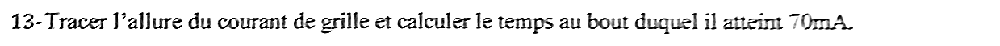{fig-alt="Q13 : tracer l'allure du courant de grille et calculer le temps au bout duquel il atteint 70 mA."}

:::: {.complement}
::: {.solution}
$i_G(t) = I_G\, e^{-t/\tau}$ avec $\tau = R_G C = 10 \times 1200 \times 10^{-12} = 12$ ns (allure : @fig-ann2223-courant-grille).
$$t = \tau \ln\frac{I_G}{i_G} = 12\ \mathrm{ns} \times \ln\frac{1{,}4}{0{,}070} = 12 \times \ln 20 \approx \boxed{36\ \mathrm{ns} \approx 3\tau}$$
70 mA = 5 % de $I_G$ : la charge de la grille est pratiquement terminée après $3\tau$.

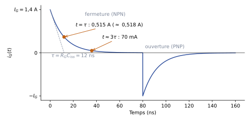{#fig-ann2223-courant-grille}
:::
::::

## Exercice 4 (partie C) : comportement thermique {#sec-ann2223-ex4}

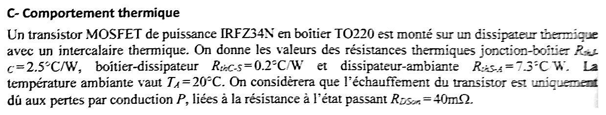{fig-alt="Partie C : MOSFET IRFZ34N en boîtier TO220 monté sur dissipateur avec intercalaire thermique. RthJ-C = 2,5 °C/W, RthC-S = 0,2 °C/W, RthS-A = 7,3 °C/W, TA = 20 °C ; échauffement dû uniquement aux pertes par conduction P liées à RDSon = 40 mΩ."}

{fig-alt="Q14 : faire le schéma équivalent thermique en précisant chaque élément."}

:::: {.complement}
::: {.solution}
Analogie thermique-électrique [cours, p. 100-101] : une **source de courant** $P$ (puissance dissipée dans la puce) injecte la chaleur au nœud $T_J$ ; elle traverse en série $R_{thJ\text{-}C}$ (jonction-boîtier) → nœud $T_C$ → $R_{thC\text{-}S}$ (intercalaire, boîtier-dissipateur) → nœud $T_S$ → $R_{thS\text{-}A}$ (dissipateur-ambiante) → nœud $T_A$, fixé par une **source de tension** $T_A = 20$ °C. En régime dynamique, des capacités thermiques $C_{th}$ se placent entre chaque nœud et la référence [cours, p. 102].

$$T_J = T_A + P\,(R_{thJ\text{-}C} + R_{thC\text{-}S} + R_{thS\text{-}A}) = T_A + 10\ (^\circ\mathrm{C/W})\times P.$$
:::
::::

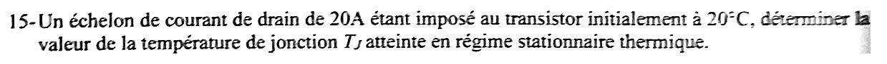{fig-alt="Q15 : un échelon de courant de drain de 20 A est imposé au transistor initialement à 20 °C ; température de jonction TJ atteinte en régime stationnaire thermique."}

:::: {.complement}
::: {.solution}
$$P = R_{DSon}\, I_D^2 = 0{,}040 \times 20^2 = 16\ \mathrm{W}, \qquad T_J = 20 + 10 \times 16 = \boxed{180\ ^\circ\mathrm{C}}$$
Au-delà de la température de jonction maximale de l'IRFZ34N (175 °C [irfz34n, p. 1]) ; de plus $R_{DSon}$ augmente avec la température, ce qui aggraverait encore l'échauffement.
:::
::::

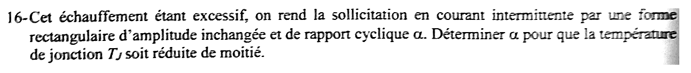{fig-alt="Q16 : l'échauffement étant excessif, la sollicitation en courant devient intermittente, rectangulaire, de même amplitude et de rapport cyclique α. Déterminer α pour que la température de jonction TJ soit réduite de moitié."}

:::: {.complement}
::: {.solution}
Si la période des créneaux est courte devant les constantes de temps thermiques, la jonction ne voit que la puissance moyenne $\alpha P$ :
$$T_J = T_A + \alpha P R_{th,\text{tot}} = 20 + 160\,\alpha.$$
- **$T_J$ réduite de moitié** (90 °C) : $160\,\alpha = 70$, $\boxed{\alpha \approx 0{,}44}$ ;
- **échauffement réduit de moitié** ($T_J - T_A = 80$ °C, $T_J = 100$ °C) : $\alpha = 0{,}5$.
:::
::::

::: {.a-verifier #av-ann2223-tj-moitie}
**Source** [sujet-2023, p. 2] : « Déterminer $\alpha$ pour que la température de jonction $T_J$ soit réduite de moitié. »

**Problème** : réduire de moitié la température (en °C) de 180 °C à 90 °C n'a pas de sens physique simple (la température en °C dépend de l'origine choisie) ; l'intention est peut-être de réduire de moitié l'**échauffement** $T_J - T_A$. Les deux lectures donnent $\alpha = 0{,}4375$ ou $\alpha = 0{,}5$. La période des créneaux n'est pas donnée (calcul en puissance moyenne supposé valable).

**Proposition** : donner les deux résultats ; à trancher.
:::
