

::: {.complement}
Aucun corrigé officiel : **les solutions de cette page sont rédigées par Claude** et vérifiées par le calcul, à relire (et à compléter par la correction faite en séance). Énoncé découpé question par question [td-sepic] ; références au support de cours 2026-2027 [cours] (pages du PDF).

**Correspondances.** Le même SEPIC, avec la même figure et presque les mêmes questions, est l'exercice 1 du [partiel 2016-2017](../annales/2016-2017-partiel.qmd#sec-ann1617-ex1) (corrigé) ; le poly de TD 2022-2023 le cite dans sa « Révision : convertisseurs Ćuk, SEPIC, Zeta ».

**Conventions lues sur la figure 1** (toutes en convention récepteur). On note $A$ le nœud commun à $L_1$, $T_r$ et $C$, et $B$ le nœud commun à $C$, $L_2$ et $D$ ; la masse est le fil du bas.

- $u_{L1} = U_e - v_A$, $u_C = v_A - v_B$, $v_{Tr} = v_A$, $v_D = v_B - u_s$ ;
- $u_{L2} = -v_B$ : la flèche de $u_{L2}$ pointe vers la masse et $i_{L2}$ monte de la masse vers $B$.
:::

## Énoncé {#sec-td-sepic-enonce}

::: {#exr-td-sepic}
## Étude fonctionnelle du convertisseur SEPIC

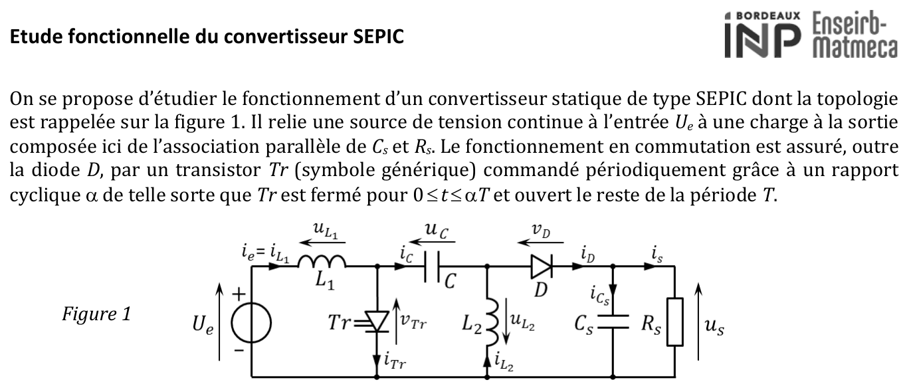{fig-alt="Énoncé : étude d'un convertisseur SEPIC (figure 1) entre une source de tension continue Ue et une charge Cs parallèle à Rs. Le transistor Tr est fermé pour 0 ≤ t ≤ αT et ouvert le reste de la période T. Schéma : L1 en série avec l'entrée (ie = iL1, uL1), Tr vers la masse (vTr, iTr), condensateur de liaison C (uC, iC), L2 vers la masse (uL2, iL2), diode D (vD, iD) vers la sortie Cs // Rs (us, is)."}
:::

## Hypothèses et premières propriétés {#sec-td-sepic-hypotheses}

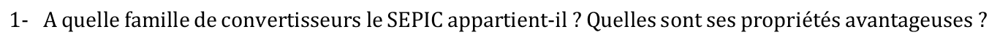{fig-alt="Q1 : à quelle famille de convertisseurs le SEPIC appartient-il ? Quelles sont ses propriétés avantageuses ?"}

:::: {.complement}
::: {.solution}
**Famille.** Convertisseur DC/DC **non isolé**, **hacheur à stockage capacitif (indirect)** : l'énergie passe de l'entrée à la sortie par le condensateur de liaison $C$. C'est une **variante non inverseuse du Ćuk** [cours, p. 39-40] (SEPIC : *Single Ended Primary Inductor Converter*).

**Propriétés avantageuses** [cours, p. 40] :

- abaisseur **ou** élévateur ($M = \frac{\alpha}{1-\alpha}$, question 7) ;
- sortie **de même polarité** que l'entrée (contrairement au buck-boost et au Ćuk) ;
- **courant d'entrée non découpé** ($L_1$ en série avec la source) : faible ondulation absorbée à la source ;
- transistor référencé à la masse : commande simple, comme pour le boost ;
- **liaison capacitive sécuritaire** : la sortie supporte un court-circuit et l'ouverture du transistor donne un **arrêt véritable** (*shutdown*) ;
- $L_1$ et $L_2$ ont la même tension (question 8) : **inductances couplables** sur un même noyau ;
- application typique : charge de cellules Li-ion (2,5-4,2 V).
:::
::::

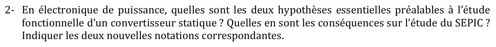{fig-alt="Q2 : en électronique de puissance, quelles sont les deux hypothèses essentielles préalables à l'étude fonctionnelle d'un convertisseur statique ? Conséquences sur l'étude du SEPIC ? Indiquer les deux nouvelles notations correspondantes."}

:::: {.complement}
::: {.solution}
Hypothèses du cours [cours, p. 19] :

1. **Interrupteurs parfaits** : pas de pertes par conduction ni par commutation ; avec des composants passifs idéaux, le convertisseur a un rendement de 1.
2. **Sources parfaites** : les condensateurs sont assez grands pour que leur tension soit constante à l'échelle de la période de découpage, $u_C = \langle u_C \rangle$.

Conséquences pour le SEPIC : $T_r$ et $D$ sont des courts-circuits ou des circuits ouverts ; $C$ et $C_s$ se comportent comme des sources de tension. **Nouvelles notations** : $u_C(t) = U_C$ et $u_s(t) = U_s$ (majuscules = grandeurs constantes).
:::
::::

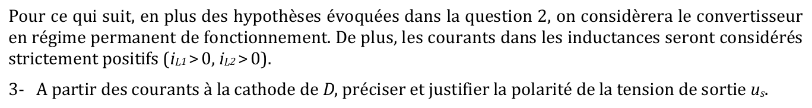{fig-alt="Paragraphe : en plus des hypothèses de la question 2, régime permanent et courants dans les inductances strictement positifs (iL1 > 0, iL2 > 0). Q3 : à partir des courants à la cathode de D, préciser et justifier la polarité de la tension de sortie us."}

:::: {.complement}
::: {.solution}
Loi des nœuds à la cathode de $D$ : $i_D = i_{Cs} + i_s$. En régime permanent, $\langle i_{Cs} \rangle = 0$, donc
$$\langle i_D \rangle = I_s = \frac{U_s}{R_s}.$$
Une diode ne conduit que dans le sens direct : $i_D \geq 0$, donc $I_s > 0$ et $\boxed{U_s > 0}$ avec l'orientation de la figure 1. Le SEPIC est **non inverseur**.
:::
::::

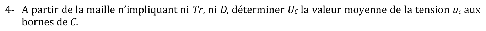{fig-alt="Q4 : à partir de la maille n'impliquant ni Tr ni D, déterminer UC, la valeur moyenne de la tension uC aux bornes de C."}

:::: {.complement}
::: {.solution}
Maille $U_e \to L_1 \to C \to L_2 \to$ masse : $v_B = U_e - u_{L1} - u_C$ et $v_B = -u_{L2}$, d'où
$$u_C = U_e - u_{L1} + u_{L2}.$$
En valeur moyenne, $\langle u_{L1} \rangle = \langle u_{L2} \rangle = 0$ (courants périodiques dans les inductances) :
$$\boxed{U_C = U_e}$$
:::
::::

## Séquences de fonctionnement {#sec-td-sepic-sequences}

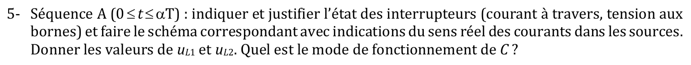{fig-alt="Q5 : séquence A (0 ≤ t ≤ αT) : état des interrupteurs (courant, tension), schéma correspondant avec le sens réel des courants dans les sources ; valeurs de uL1 et uL2 ; mode de fonctionnement de C."}

:::: {.complement}
::: {.solution}
**$T_r$ fermé** (commandé) : $v_{Tr} = 0$, donc $v_A = 0$ et $v_B = v_A - U_C = -U_e$.

**$D$ bloquée** : elle verrait $v_D = v_B - U_s = -(U_e + U_s) < 0$ ; $i_D = 0$.

Courants : au nœud $B$, $i_C + i_{L2} = i_D = 0$, donc $i_C = -i_{L2}$ ; au nœud $A$, $i_{Tr} = i_{L1} - i_C = i_{L1} + i_{L2} > 0$ (cohérent avec un transistor passant).

**Schéma équivalent** ($T_r$ = fil, $D$ = circuit ouvert), sens réels :

- maille $U_e \to L_1 \to T_r$ : $U_e$ est **générateur**, elle débite $i_{L1}$ ;
- maille $C \to T_r \to L_2$ : $C$ est **générateur**, il débite $i_{L2}$ dans $L_2$ ;
- sortie isolée : $C_s$ seul alimente $R_s$ ($i_{Cs} = -I_s$).

$$\boxed{u_{L1} = U_e, \qquad u_{L2} = -v_B = U_e}$$

Les deux inductances stockent de l'énergie ; **$C$ se décharge** dans $L_2$ [cours, p. 40].
:::
::::

{fig-alt="Q6 : séquence B (αT ≤ t ≤ T) : mêmes demandes qu'à la question précédente."}

:::: {.complement}
::: {.solution}
**$T_r$ ouvert** (commandé) : $i_{Tr} = 0$. Au nœud $A$, $i_C = i_{L1} > 0$ ; au nœud $B$, $i_D = i_C + i_{L2} = i_{L1} + i_{L2} > 0$.

**$D$ passante** (le courant des inductances doit continuer à circuler) : $v_D = 0$, donc $v_B = U_s$, et $v_A = v_B + U_C = U_e + U_s = v_{Tr}$ (tension bloquée par le transistor).

**Schéma équivalent** ($T_r$ = circuit ouvert, $D$ = fil), sens réels :

- maille $U_e \to L_1 \to C \to D \to$ sortie : $U_e$ **générateur** (débite $i_{L1}$), $C$ **récepteur** (il se recharge) ;
- maille $L_2 \to D \to$ sortie : $L_2$ restitue son énergie à la charge ;
- $C_s$ reçoit $i_D - I_s$ (il se recharge).

$$\boxed{u_{L1} = U_e - v_A = -U_s, \qquad u_{L2} = -v_B = -U_s}$$

**$C$ se recharge** ($i_C = i_{L1}$) [cours, p. 40].
:::
::::

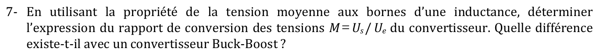{fig-alt="Q7 : à l'aide de la propriété de la tension moyenne aux bornes d'une inductance, déterminer le rapport de conversion des tensions M = Us/Ue. Différence avec un convertisseur buck-boost ?"}

:::: {.complement}
::: {.solution}
$\langle u_{L1} \rangle = 0$ : $U_e\,\alpha T - U_s(1-\alpha)T = 0$ (même résultat avec $L_2$), d'où
$$\boxed{M = \frac{U_s}{U_e} = \frac{\alpha}{1-\alpha}}$$
Abaisseur pour $\alpha < 0{,}5$, élévateur pour $\alpha > 0{,}5$.

Même module que le **buck-boost** [cours, p. 36], mais **sans inversion de polarité** : le buck-boost donne une sortie de signe opposé à l'entrée. Le SEPIC y ajoute un courant d'entrée non découpé et l'arrêt véritable (question 1), au prix de $L_2$ et $C$.
:::
::::

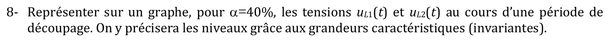{fig-alt="Q8 : représenter sur un graphe, pour α = 40 %, les tensions uL1(t) et uL2(t) sur une période de découpage, avec les niveaux exprimés par les grandeurs caractéristiques invariantes."}

:::: {.complement}
::: {.solution}
$$u_{L1}(t) = u_{L2}(t) = \begin{cases} U_e & 0 < t < \alpha T \\ -U_s & \alpha T < t < T \end{cases}$$

Les deux tensions sont **identiques** (d'où la possibilité de coupler $L_1$ et $L_2$). Pour $\alpha = 0{,}4$ : $U_s = \frac{2}{3}U_e$ ; les aires $U_e\,\alpha T$ et $U_s(1-\alpha)T$ sont égales (@fig-td-sepic, haut, tracé avec les valeurs de la question 13).

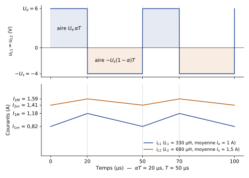{#fig-td-sepic}
:::
::::

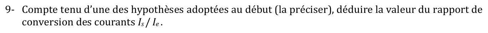{fig-alt="Q9 : compte tenu d'une des hypothèses adoptées au début (la préciser), déduire le rapport de conversion des courants Is/Ie."}

:::: {.complement}
::: {.solution}
Hypothèse des **interrupteurs parfaits** (composants sans pertes) : conservation de la puissance moyenne, $U_e I_e = U_s I_s$, d'où
$$\boxed{\frac{I_s}{I_e} = \frac{U_e}{U_s} = \frac{1-\alpha}{\alpha}}$$
:::
::::

## Courants dans les inductances {#sec-td-sepic-courants}

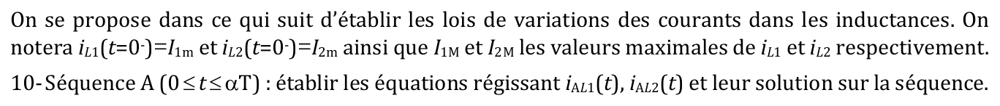{fig-alt="Paragraphe : on établit les lois de variation des courants dans les inductances ; notations iL1(0−) = I1m, iL2(0−) = I2m, I1M et I2M valeurs maximales. Q10 : séquence A (0 ≤ t ≤ αT) : équations régissant iAL1(t), iAL2(t) et leur solution sur la séquence."}

:::: {.complement}
::: {.solution}
$$L_1 \frac{\mathrm{d}i^A_{L1}}{\mathrm{d}t} = U_e \;\Rightarrow\; i^A_{L1}(t) = I_{1m} + \frac{U_e}{L_1}\,t, \qquad L_2 \frac{\mathrm{d}i^A_{L2}}{\mathrm{d}t} = U_e \;\Rightarrow\; i^A_{L2}(t) = I_{2m} + \frac{U_e}{L_2}\,t.$$
En fin de séquence : $I_{1M} = I_{1m} + \dfrac{U_e\,\alpha T}{L_1}$ et $I_{2M} = I_{2m} + \dfrac{U_e\,\alpha T}{L_2}$.
:::
::::

{fig-alt="Q11 : même question pour la séquence B (αT ≤ t ≤ T) avec iBL1(t), iBL2(t)."}

:::: {.complement}
::: {.solution}
$$L_k \frac{\mathrm{d}i^B_{Lk}}{\mathrm{d}t} = -U_s \;\Rightarrow\; i^B_{L1}(t) = I_{1M} - \frac{U_s}{L_1}(t - \alpha T), \qquad i^B_{L2}(t) = I_{2M} - \frac{U_s}{L_2}(t - \alpha T).$$
Régime permanent : $i^B_{L1}(T) = I_{1m}$, donc $\dfrac{U_e\,\alpha T}{L_1} = \dfrac{U_s(1-\alpha)T}{L_1}$ : on retrouve $M = \frac{\alpha}{1-\alpha}$.
:::
::::

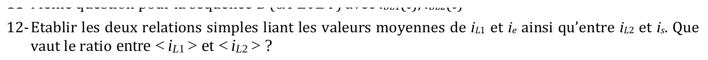{fig-alt="Q12 : établir les deux relations simples liant les valeurs moyennes de iL1 et ie, et de iL2 et is. Que vaut le ratio entre <iL1> et <iL2> ?"}

:::: {.complement}
::: {.solution}
- $i_e = i_{L1}$ à chaque instant : $\boxed{\langle i_{L1} \rangle = I_e}$.
- Nœud $B$ : $i_D = i_C + i_{L2}$ avec $\langle i_C \rangle = 0$ ; cathode : $\langle i_D \rangle = I_s$ (question 3). Donc $\boxed{\langle i_{L2} \rangle = I_s}$.

$$\frac{\langle i_{L1} \rangle}{\langle i_{L2} \rangle} = \frac{I_e}{I_s} = \frac{\alpha}{1-\alpha} = M$$
:::
::::

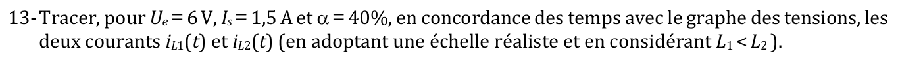{fig-alt="Q13 : tracer, pour Ue = 6 V, Is = 1,5 A et α = 40 %, en concordance des temps avec le graphe des tensions, les courants iL1(t) et iL2(t), avec une échelle réaliste et L1 < L2."}

:::: {.complement}
::: {.solution}
Valeurs : $U_s = \frac{0{,}4}{0{,}6} \times 6 = 4$ V ; $\langle i_{L1} \rangle = I_e = \frac{0{,}4}{0{,}6} \times 1{,}5 = 1$ A ; $\langle i_{L2} \rangle = I_s = 1{,}5$ A.

Deux triangles de même rythme (@fig-td-sepic, bas) : pente $U_e/L_k$ sur $[0, \alpha T]$, pente $-U_s/L_k$ sur $[\alpha T, T]$, ondulations $\Delta I_k = \dfrac{U_e\,\alpha T}{L_k}$. Comme $L_1 < L_2$, **l'ondulation de $i_{L1}$ est la plus grande**.
:::
::::

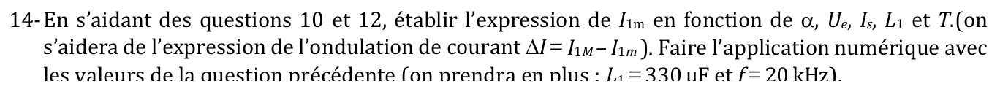{fig-alt="Q14 : à l'aide des questions 10 et 12, établir l'expression de I1m en fonction de α, Ue, Is, L1 et T (avec l'ondulation ΔI = I1M − I1m). Application numérique avec les valeurs de la question précédente, L1 = 330 µF et f = 20 kHz."}

:::: {.complement}
::: {.solution}
Courant triangulaire : $\langle i_{L1} \rangle = \dfrac{I_{1m} + I_{1M}}{2} = I_{1m} + \dfrac{\Delta I}{2}$, avec $\Delta I = \dfrac{U_e\,\alpha T}{L_1}$ (question 10) et $\langle i_{L1} \rangle = \dfrac{\alpha}{1-\alpha} I_s$ (questions 9 et 12) :
$$\boxed{I_{1m} = \frac{\alpha}{1-\alpha}\,I_s - \frac{\alpha\, U_e\, T}{2 L_1}}$$

Application numérique ($T = 50$ µs, $\alpha T = 20$ µs, $L_1 = 330$ µH) : $\Delta I = \dfrac{6 \times 20 \cdot 10^{-6}}{330 \cdot 10^{-6}} \approx 0{,}364$ A, d'où
$$I_{1m} \approx 1 - 0{,}182 = 0{,}82\ \mathrm{A}, \qquad I_{1M} \approx 1{,}18\ \mathrm{A}.$$
$I_{1m} > 0$ : l'hypothèse $i_{L1} > 0$ (conduction continue) est vérifiée.
:::
::::

::: {.a-verifier #av-td-sepic-unite-l1}
**Source** [td-sepic, p. 1, q. 14] : « on prendra en plus : $L_1$ = 330 µF ».

**Problème** : une inductance s'exprime en henrys ; « µF » est une unité de capacité.

**Proposition** : $L_1 = 330$ µH (valeur utilisée ci-dessus).
:::

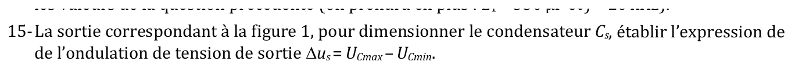{fig-alt="Q15 : la sortie correspondant à la figure 1, pour dimensionner le condensateur Cs, établir l'expression de l'ondulation de tension de sortie Δus = UCmax − UCmin."}

:::: {.complement}
::: {.solution}
Pendant la séquence A, $D$ est bloquée : $C_s$ fournit seul le courant de charge, $i_{Cs} = -I_s$ (courant de charge supposé constant, faible ondulation de $u_s$, comme dans le cours pour le boost [cours, p. 29]). $u_s$ décroît donc linéairement pendant $\alpha T$ :
$$C_s \frac{\Delta u_s}{\alpha T} = I_s \;\Rightarrow\; \boxed{\Delta u_s = \frac{\alpha\, I_s\, T}{C_s} = \frac{\alpha\, I_s}{C_s\, f}}$$
Pendant la séquence B, $C_s$ récupère exactement cette charge ($\langle i_{Cs} \rangle = 0$). Pour dimensionner : $C_s \geq \dfrac{\alpha I_s}{f\, \Delta u_{s,\max}}$. Exemple avec les valeurs de la question 13 : $\Delta u_s = \dfrac{30 \cdot 10^{-6}}{C_s}$, soit 0,3 V pour $C_s = 100$ µF (valeur de $C_s$ choisie pour l'exemple).
:::
::::

::: {.a-verifier #av-td-sepic-notation-ondulation}
**Source** [td-sepic, p. 1, q. 15] : « $\Delta u_s = U_{C\max} - U_{C\min}$ ».

**Problème** : la question porte sur la tension de sortie $u_s$ (aux bornes de $C_s$), alors que $U_C$ désigne dans tout l'énoncé la tension du condensateur de liaison $C$.

**Proposition** : $\Delta u_s = u_{s,\max} - u_{s,\min}$ (indice $C$ pour $C_s$ probablement).
:::
