

::: {.complement}
Aucun corrigé disponible : **les solutions de cette page sont rédigées par Claude** et vérifiées par le calcul (SymPy, simulation numérique pas à pas pour le transistor). À relire avec un œil critique ; signaler toute erreur. Les énoncés sont des extraits du scan du sujet [sujet-2013-2014] ; aucune annotation d'étudiant n'y figure.

**Correspondances.** L'exercice I est repris presque à l'identique dans le [partiel 2017-2018](2017-2018-partiel.qmd#sec-ann1718-ex3) (avec $R_D = 10\ \Omega$ au lieu de $50\ \Omega$). L'exercice II est repris dans les partiels [2014-2015](2014-2015-partiel.qmd#sec-ann1415-ex1) et [2015-2016](2015-2016-partiel.qmd#sec-ann1516-ex1) avec $\beta = 100$ au lieu de 50 (les résultats sont les mêmes, le transistor restant saturé). Le monostable de l'exercice III est à rapprocher du monostable à portes NOR du [partiel 2017-2018](2017-2018-partiel.qmd#sec-ann1718-ex4).
:::

## Exercice I : diodes en commutation {#sec-ann1314-ex1}

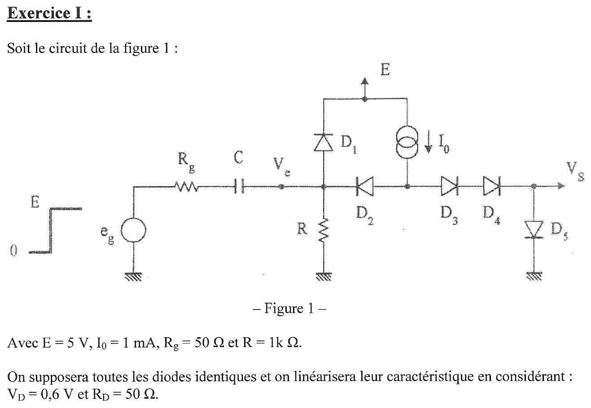{fig-alt="Exercice I, figure 1 : générateur eg (échelon de 0 à E) en série avec Rg et le condensateur C, aboutissant au nœud Ve. Au nœud Ve : résistance R vers la masse, diode D1 (anode côté Ve, cathode vers E) et diode D2 (cathode côté Ve). L'anode de D2 est reliée à une source de courant I0 alimentée par E, puis aux diodes D3 et D4 en série (sens passant vers la sortie Vs) ; D5 relie Vs à la masse (anode côté Vs). Données : E = 5 V, I0 = 1 mA, Rg = 50 Ω, R = 1 kΩ ; diodes identiques, caractéristique linéarisée VD = 0,6 V et RD = 50 Ω."}

**Notations.** $A$ désigne le nœud commun à $D_2$, $D_3$ et à la source $I_0$ ; $u_C = V_e - V_g$ est la tension aux bornes de $C$ ($V_g$ : potentiel de l'armature côté générateur, $V_g = e_g - R_g\, i_g$).

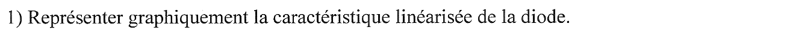{fig-alt="Question 1 : représenter graphiquement la caractéristique linéarisée de la diode."}

:::: {.complement}
::: {.solution}
Modèle linéarisé à seuil : la diode est **bloquée** ($I_D = 0$) tant que $V < V_D$, **passante** au-delà, où elle équivaut à une f.é.m. $V_D$ en série avec une résistance $R_D$ :
$$V = V_D + R_D\, I_D \quad (I_D > 0), \qquad V_D = 0{,}6\ \text{V},\ R_D = 50\ \Omega .$$

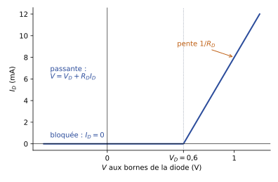{#fig-ann1314-diode}

Pour tester l'état d'une diode, on fait une hypothèse (passante ou bloquée), on calcule le circuit, puis on vérifie la cohérence : $I_D > 0$ si elle est supposée passante, $V < V_D$ si elle est supposée bloquée.
:::
::::

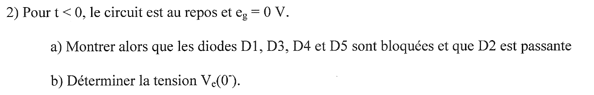{fig-alt="Question 2 : pour t < 0, le circuit est au repos et eg = 0 V. a) Montrer que les diodes D1, D3, D4 et D5 sont bloquées et que D2 est passante. b) Déterminer la tension Ve(0−)."}

:::: {.complement}
::: {.solution}
**Hypothèses** : régime permanent, donc aucun courant dans $C$ (circuit ouvert en continu) ; $D_2$ passante, $D_1$, $D_3$, $D_4$, $D_5$ bloquées.

Tout le courant $I_0$ passe alors par $D_2$ puis par $R$ :
$$V_e(0^-) = R\, I_0 = 1\ \text{k}\Omega \times 1\ \text{mA} = 1\ \text{V}, \qquad V_A = V_e + V_D + R_D I_0 = 1 + 0{,}6 + 0{,}05 = 1{,}65\ \text{V}.$$

**Vérifications.**

- $D_2$ : $I_{D2} = I_0 = 1$ mA $> 0$ : passante, cohérent.
- $D_3$, $D_4$, $D_5$ en série : il faudrait $V_A > 3 V_D = 1{,}8$ V pour qu'elles conduisent ; $V_A = 1{,}65$ V $< 1{,}8$ V : bloquées.
- $D_1$ : $V_e - E = 1 - 5 = -4$ V $< V_D$ : bloquée.
- Réciproquement, si $D_2$ était bloquée, $I_0$ passerait par $D_3$-$D_4$-$D_5$ : $V_A = 3 \times 0{,}6 + 3 \times 0{,}05 = 1{,}95$ V avec $V_e = 0$, soit $1{,}95$ V aux bornes de $D_2$ : elle conduirait. L'hypothèse est donc la seule possible.

$$\boxed{V_e(0^-) = 1\ \text{V}}$$

Aucun courant dans $R_g$ : $V_g = e_g = 0$, d'où $u_C(0^-) = V_e - V_g = 1$ V. La sortie $V_s$ n'est reliée à rien de conducteur (diodes $D_3$ à $D_5$ bloquées) : son potentiel n'est pas défini par le circuit au repos.
:::
::::

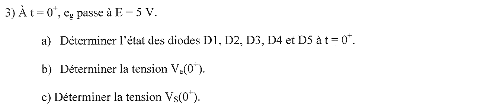{fig-alt="Question 3 : à t = 0+, eg passe à E = 5 V. a) Déterminer l'état des diodes D1, D2, D3, D4 et D5 à t = 0+. b) Déterminer la tension Ve(0+). c) Déterminer la tension Vs(0+)."}

:::: {.complement}
::: {.solution}
**Continuité** : la tension aux bornes de $C$ ne peut pas varier instantanément, $u_C(0^+) = u_C(0^-) = 1$ V. Vu du nœud $V_e$, le générateur et le condensateur équivalent à une f.é.m. $e_g + u_C = 6$ V en série avec $R_g = 50\ \Omega$.

**a) États des diodes.** $V_e$ est poussé vers le haut, ce qui bloque $D_2$ (sa cathode monte) et peut rendre $D_1$ passante.

- Si $D_1$ était bloquée : $V_e = 6 \times \frac{1000}{1050} = 5{,}71$ V $> E + V_D = 5{,}6$ V, contradiction : **$D_1$ est passante**.
- $D_2$ bloquée : $I_0$ ne peut alors passer que par **$D_3$, $D_4$, $D_5$, passantes** : $V_A = 3V_D + 3R_D I_0 = 1{,}95$ V.

**b)** Loi des nœuds en $V_e$, avec $D_1$ passante ($V_e = E + V_D + R_D\, i_{D1}$) :
$$\frac{6 - V_e}{R_g} = \frac{V_e - (E + V_D)}{R_D} + \frac{V_e}{R} \quad\Longrightarrow\quad \frac{6 - V_e}{50} = \frac{V_e - 5{,}6}{50} + \frac{V_e}{1000}$$
$$\Longrightarrow\quad 2{,}05\, V_e = 11{,}6 \quad\Longrightarrow\quad \boxed{V_e(0^+) = 5{,}66\ \text{V}}$$

Vérifications : $i_{D1} = \frac{5{,}659 - 5{,}6}{50} = 1{,}17$ mA $> 0$ ($D_1$ passante) ; tension aux bornes de $D_2$ : $V_A - V_e = 1{,}95 - 5{,}66 < 0$ ($D_2$ bloquée). Le générateur débite $i_g = \frac{6 - 5{,}66}{50} = 6{,}83$ mA.

**c)** $D_5$ est parcourue par $I_0$ :
$$\boxed{V_s(0^+) = V_D + R_D I_0 = 0{,}6 + 0{,}05 = 0{,}65\ \text{V}}$$

**Interprétation.** $D_1$ limite $V_e$ à environ $E + V_D$ (diode d'écrêtage vers l'alimentation). Le front positif de $e_g$ « aiguille » le courant $I_0$ : au repos il part dans $D_2$ (sortie non alimentée), après le front il part vers la sortie.
:::
::::

## Exercice II : transistor bipolaire commandé à travers un condensateur {#sec-ann1314-ex2}

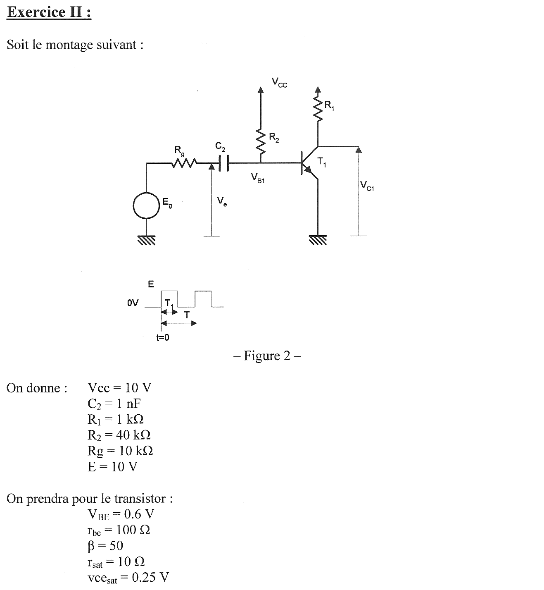{fig-alt="Exercice II, figure 2 : générateur Eg en série avec Rg puis le condensateur C2 ; Ve est la tension entre le nœud Rg-C2 et la masse ; l'autre armature de C2 est reliée à la base du transistor NPN T1 (tension VB1), à R2 vers Vcc ; collecteur relié à Vcc par R1 (tension VC1), émetteur à la masse. Signal Eg : 0 V avant t = 0, puis créneaux de hauteur E, durée haute T1, période T. Données : Vcc = 10 V, C2 = 1 nF, R1 = 1 kΩ, R2 = 40 kΩ, Rg = 10 kΩ, E = 10 V. Transistor : VBE = 0,6 V, rbe = 100 Ω, β = 50, rsat = 10 Ω, vcesat = 0,25 V."}

:::: {.complement}
::: {.solution}
**Modèle retenu pour le transistor** (lecture des données) :

- jonction base-émetteur : bloquée si $V_{B1} < 0{,}6$ V, sinon $V_{B1} = V_{BE} + r_{be}\, I_B$ ;
- saturation : $V_{CE} = v_{CEsat} + r_{sat}\, I_C$, d'où le courant de saturation $I_{Csat} = \frac{V_{cc} - v_{CEsat}}{R_1 + r_{sat}} = \frac{9{,}75}{1010} = 9{,}65$ mA et $V_{C1,sat} = 0{,}25 + 10 \times 9{,}65 \cdot 10^{-3} = 0{,}35$ V ;
- le transistor est saturé si $\beta I_B \geq I_{Csat}$, soit $I_B \geq 0{,}193$ mA pour $\beta = 50$.

Notations : $u = V_{B1} - V_e$ est la tension aux bornes de $C_2$, $i$ le courant dans $R_g$ (compté du générateur vers $C_2$). Quand la jonction conduit, le nœud de base vu par $C_2$ a pour modèle de Thévenin
$$V_{th} = \frac{V_{cc}\, r_{be} + V_{BE}\, R_2}{R_2 + r_{be}} = 0{,}623\ \text{V}, \qquad R_{th} = R_2 \parallel r_{be} = 99{,}75\ \Omega .$$
Le signal $E_g$ a une fréquence de 50 kHz et un rapport cyclique de 0,5 : $T = 20$ µs, $T_1 = 10$ µs.
:::
::::

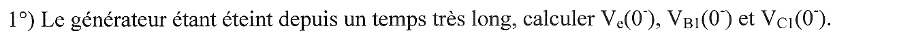{fig-alt="Question 1 : le générateur étant éteint depuis un temps très long, calculer Ve(0−), VB1(0−) et VC1(0−)."}

:::: {.complement}
::: {.solution}
Régime permanent : $C_2$ est un circuit ouvert, aucun courant dans $R_g$, donc $V_e = E_g = 0$.

La base est alimentée par $R_2$ seule ; en supposant la jonction passante :
$$I_B = \frac{V_{cc} - V_{BE}}{R_2 + r_{be}} = \frac{9{,}4}{40\,100} = 0{,}234\ \text{mA}, \qquad V_{B1} = V_{BE} + r_{be} I_B = 0{,}623\ \text{V}.$$
$\beta I_B = 11{,}7$ mA $> I_{Csat} = 9{,}65$ mA : **transistor saturé**.
$$\boxed{V_e(0^-) = 0, \quad V_{B1}(0^-) = 0{,}623\ \text{V}, \quad V_{C1}(0^-) = 0{,}35\ \text{V}}$$
Le condensateur est chargé sous $u(0^-) = V_{B1} - V_e = 0{,}623$ V. Avec $\beta = 50$, la saturation est peu marquée ($\beta I_B / I_{Csat} = 1{,}2$).
:::
::::

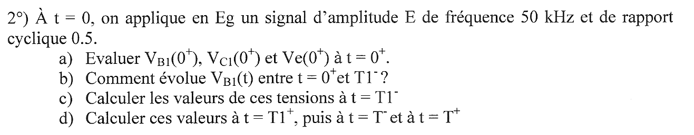{fig-alt="Question 2 : à t = 0, on applique en Eg un signal d'amplitude E de fréquence 50 kHz et de rapport cyclique 0,5. a) Évaluer VB1(0+), VC1(0+) et Ve(0+) à t = 0+. b) Comment évolue VB1(t) entre t = 0+ et T1− ? c) Calculer les valeurs de ces tensions à t = T1−. d) Calculer ces valeurs à t = T1+, puis à t = T− et à t = T+."}

:::: {.complement}
::: {.solution}
**a) $t = 0^+$.** $E_g$ passe à 10 V ; $u(0^+) = u(0^-) = 0{,}623$ V. La jonction reste passante (on le vérifie), le circuit vu par $C_2$ est une maille $E_g$, $R_g$, $C_2$, $(V_{th}, R_{th})$ :
$$i(0^+) = \frac{E + u(0^+) - V_{th}}{R_g + R_{th}} = \frac{10}{10\,099{,}75} = 0{,}990\ \text{mA}$$
$$V_{B1}(0^+) = V_{th} + R_{th}\, i = 0{,}722\ \text{V}, \qquad V_e(0^+) = E - R_g\, i = 0{,}099\ \text{V}.$$
$I_B = \frac{0{,}722 - 0{,}6}{100} = 1{,}22$ mA : le transistor est encore plus saturé, $V_{C1}(0^+) = 0{,}35$ V.
$$\boxed{V_{B1}(0^+) = 0{,}72\ \text{V}, \quad V_{C1}(0^+) = 0{,}35\ \text{V}, \quad V_e(0^+) \approx 0{,}1\ \text{V}}$$
Presque tout l'échelon de 10 V tombe dans $R_g$ : la jonction base-émetteur maintient $V_{B1}$ près de 0,6 V et le condensateur transmet le saut à $V_e$ seulement par sa différence $u$.

**b) Entre $0^+$ et $T_1^-$.** $C_2$ se charge à travers $R_g + R_{th}$, de constante de temps
$$\tau_1 = C_2 (R_g + R_{th}) = 1\ \text{nF} \times 10{,}1\ \text{k}\Omega = 10{,}1\ \text{µs}, \qquad i(t) = i(0^+)\, e^{-t/\tau_1}.$$
D'où $V_{B1}(t) = V_{th} + R_{th}\, i(0^+)\, e^{-t/\tau_1} = 0{,}623 + 0{,}099\, e^{-t/\tau_1}$ (V) : $V_{B1}$ **décroît exponentiellement de 0,72 V vers 0,62 V**, quasi constant (jonction passante). Pendant ce temps $V_e(t) = 10 - 9{,}90\, e^{-t/\tau_1}$ monte vers 10 V et le courant de base, toujours $\geq 0{,}234$ mA, garde le transistor saturé.

**c) $t = T_1^- = 10$ µs.** $e^{-T_1/\tau_1} = 0{,}372$, $i = 0{,}368$ mA :
$$\boxed{V_{B1}(T_1^-) = 0{,}66\ \text{V}, \quad V_e(T_1^-) = 6{,}32\ \text{V}, \quad V_{C1}(T_1^-) = 0{,}35\ \text{V}}$$
et $u(T_1^-) = 0{,}660 - 6{,}322 = -5{,}66$ V ($I_B = 0{,}60$ mA : saturé).

**d) $t = T_1^+$.** $E_g$ retombe à 0 ; $u = -5{,}66$ V est conservé, la base est tirée vers le bas : **hypothèse jonction bloquée**. La maille $V_{cc}$, $R_2$, $C_2$, $R_g$, masse est parcourue par
$$i' = \frac{V_{cc} - u}{R_2 + R_g} = \frac{15{,}66}{50\ \text{k}\Omega} = 0{,}313\ \text{mA} ,$$
$$\boxed{V_{B1}(T_1^+) = V_{cc} - R_2 i' = -2{,}53\ \text{V}, \quad V_e(T_1^+) = R_g\, i' = 3{,}13\ \text{V}, \quad V_{C1}(T_1^+) = V_{cc} = 10\ \text{V}}$$
$V_{B1} < 0{,}6$ V : jonction bloquée, transistor bloqué, cohérent.

**$t = T^-$.** $C_2$ se charge à travers $R_2 + R_g$, $\tau_2 = C_2 (R_2 + R_g) = 50$ µs, $u \to V_{cc}$ ; $V_{B1}$ remonte vers $V_{cc}$ mais n'atteindrait 0,6 V qu'au bout de $\tau_2 \ln\frac{10 + 2{,}53}{10 - 0{,}6} = 14{,}4$ µs $> T - T_1 = 10$ µs : le transistor reste bloqué jusqu'à $T$. Avec $e^{-10/50} = 0{,}819$ :
$$u(T^-) = 10 - 15{,}66 \times 0{,}819 = -2{,}82\ \text{V}, \qquad i' = \frac{10 + 2{,}82}{50\ \text{k}\Omega} = 0{,}256\ \text{mA},$$
$$\boxed{V_{B1}(T^-) = -0{,}26\ \text{V}, \quad V_e(T^-) = 2{,}56\ \text{V}, \quad V_{C1}(T^-) = 10\ \text{V}}$$

**$t = T^+$.** $E_g$ remonte à 10 V, jonction de nouveau passante :
$$i = \frac{E + u - V_{th}}{R_g + R_{th}} = \frac{10 - 2{,}82 - 0{,}62}{10\,099{,}75} = 0{,}649\ \text{mA},$$
$$\boxed{V_{B1}(T^+) = 0{,}69\ \text{V}, \quad V_e(T^+) = 3{,}51\ \text{V}, \quad V_{C1}(T^+) = 0{,}35\ \text{V}}$$
($I_B = 0{,}88$ mA : saturé). Toutes ces valeurs coïncident avec une simulation pas à pas du modèle (figure ci-dessous).
:::
::::

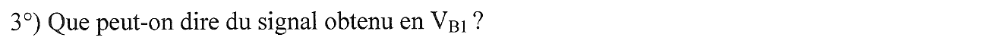{fig-alt="Question 3 : que peut-on dire du signal obtenu en VB1 ?"}

:::: {.complement}
::: {.solution}
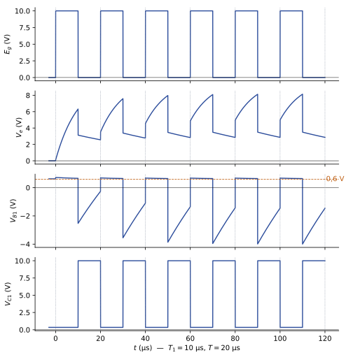{#fig-ann1314-transistor}

- **Alternances positives écrêtées** : quand $E_g = E$, la jonction base-émetteur conduit et fixe $V_{B1} \approx 0{,}6$ à 0,7 V. Elle joue le rôle d'une diode de « clamp » : le condensateur $C_2$ se charge à travers elle.
- **Alternances négatives** : à chaque front descendant, $C_2$ reporte sur la base une impulsion négative (quelques volts), puis $V_{B1}$ remonte exponentiellement avec $\tau_2 = 50$ µs, constante de temps longue devant $T - T_1 = 10$ µs : la remontée n'est jamais achevée et $V_{B1}$ reste sous 0,6 V pendant toute l'alternance.
- **Régime transitoire puis régime établi** : la valeur moyenne de $u$ dérive pendant quelques périodes ; en régime établi (calcul de la solution périodique), $V_{B1}$ vaut environ 0,64 à 0,67 V à l'état haut et passe de $-4{,}0$ V à $-1{,}5$ V à l'état bas. Le signal $V_{B1}$ n'est donc **pas** une copie de $E_g$ : c'est un signal écrêté en haut et « dérivé » en bas.
- **Conséquence pour la commutation** : $V_{C1}$ est un créneau inversé entre 0,35 V et 10 V. Le pic de courant de base à la mise en conduction et la tension de base négative au blocage accélèrent les deux commutations ; c'est le rôle classique d'un condensateur d'accélération. La tension inverse de base (4 V) reste inférieure à la tension de claquage usuelle d'une jonction base-émetteur (environ 5 à 6 V, ordre de grandeur général).
:::
::::

## Exercice III : circuit LM555 {#sec-ann1314-ex3}

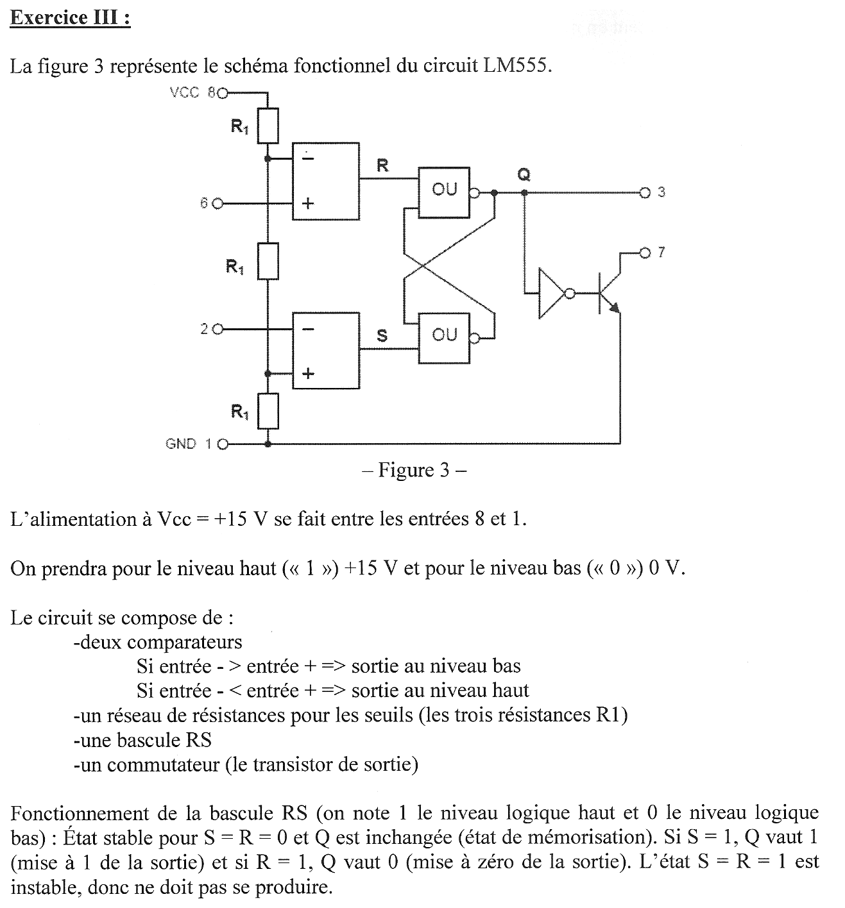{fig-alt="Exercice III, figure 3 : schéma fonctionnel du LM555. Pont de trois résistances R1 entre Vcc (patte 8) et GND (patte 1). Comparateur du haut : entrée moins au point 2Vcc/3 du pont, entrée plus reliée à la patte 6, sortie R. Comparateur du bas : entrée moins reliée à la patte 2, entrée plus au point Vcc/3, sortie S. Bascule RS formée de deux portes OU à sortie inversée croisées ; la sortie Q attaque la patte 3 et, à travers un inverseur, la base d'un transistor de décharge dont le collecteur est la patte 7 et l'émetteur la masse. Texte : alimentation Vcc = +15 V entre les pattes 8 et 1 ; niveau haut 15 V, niveau bas 0 V ; comparateurs : entrée moins supérieure à entrée plus donne une sortie basse, inférieure donne une sortie haute ; bascule RS : S = R = 0 mémorisation, S = 1 met Q à 1, R = 1 met Q à 0, S = R = 1 interdit."}

:::: {.complement}
::: {.solution}
**Seuils.** Les trois résistances égales divisent $V_{cc}$ en trois : $\frac{2V_{cc}}{3} = 10$ V sur l'entrée moins du comparateur $R$, $\frac{V_{cc}}{3} = 5$ V sur l'entrée plus du comparateur $S$. Avec la règle de l'énoncé :
$$R = 1 \iff V_6 > 10\ \text{V}, \qquad S = 1 \iff V_2 < 5\ \text{V}.$$
**Transistor de décharge** : commandé par $\overline{Q}$ ; $Q = 1$ le bloque (patte 7 en l'air), $Q = 0$ le sature (patte 7 à la masse).
:::
::::

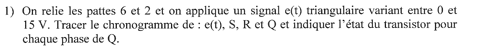{fig-alt="Question 1 : on relie les pattes 6 et 2 et on applique un signal e(t) triangulaire variant entre 0 et 15 V. Tracer le chronogramme de e(t), S, R et Q et indiquer l'état du transistor pour chaque phase de Q."}

:::: {.complement}
::: {.solution}
Avec $V_2 = V_6 = e$ :

| $e(t)$ | $S$ | $R$ | $Q$ | transistor |
|---|---|---|---|---|
| $e < 5$ V | 1 | 0 | 1 (mise à 1) | bloqué |
| $5 < e < 10$ V | 0 | 0 | inchangé (mémoire) | inchangé |
| $e > 10$ V | 0 | 1 | 0 (mise à 0) | saturé |

L'état interdit $S = R = 1$ ne peut pas se produire ($e$ ne peut pas être à la fois sous 5 V et au-dessus de 10 V). Sur la rampe montante, $Q$ reste à 1 jusqu'à $e = 10$ V ; sur la rampe descendante, il reste à 0 jusqu'à $e = 5$ V.

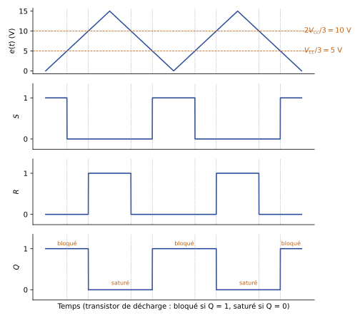{#fig-ann1314-555-comparateurs}

Le montage est un **comparateur à hystérésis inverseur** (trigger de Schmitt) : seuils haut 10 V et bas 5 V, hystérésis de 5 V.
:::
::::

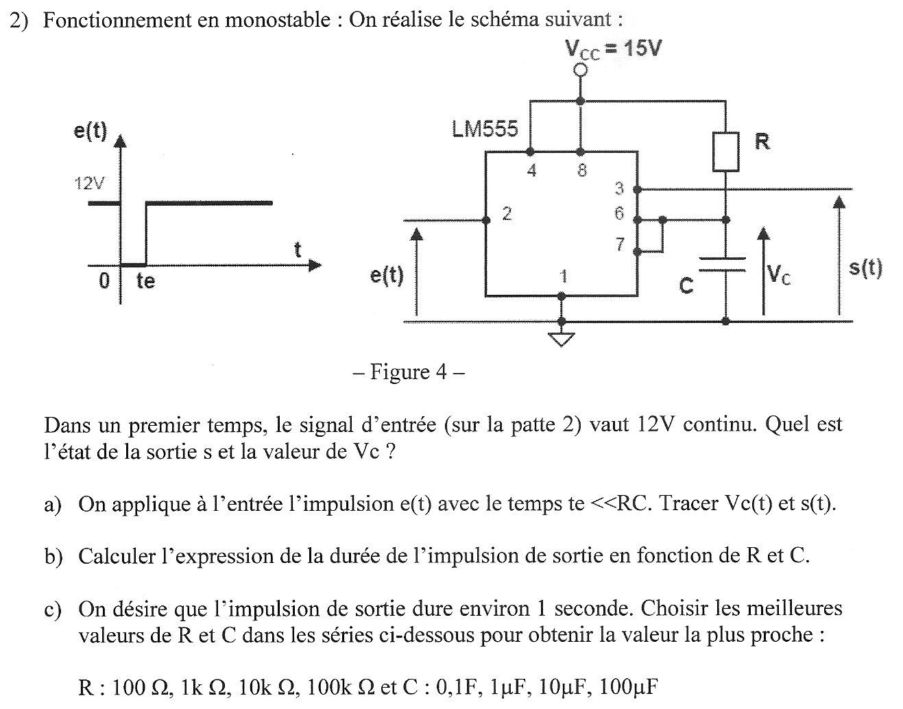{fig-alt="Question 2 : fonctionnement en monostable, figure 4 : LM555 alimenté sous Vcc = 15 V (pattes 4 et 8 à Vcc, patte 1 à la masse), entrée e(t) sur la patte 2, résistance R de Vcc au nœud des pattes 6 et 7, condensateur C de ce nœud à la masse (tension Vc), sortie s(t) sur la patte 3. e(t) vaut 12 V, sauf une impulsion à 0 V entre 0 et te. Dans un premier temps, e vaut 12 V continu : quel est l'état de la sortie s et la valeur de Vc ? a) On applique l'impulsion e(t) avec te très petit devant RC : tracer Vc(t) et s(t). b) Calculer l'expression de la durée de l'impulsion de sortie en fonction de R et C. c) On désire une impulsion de sortie d'environ 1 seconde : choisir les meilleures valeurs de R et C dans les séries R : 100 Ω, 1 kΩ, 10 kΩ, 100 kΩ et C : 0,1F, 1 µF, 10 µF, 100 µF."}

:::: {.complement}
::: {.solution}
**État de repos ($e = 12$ V).** $e > 5$ V : $S = 0$. Si $Q$ valait 1, le transistor serait bloqué et $C$ se chargerait par $R$ jusqu'à 10 V, ce qui donnerait $R = 1$ puis $Q = 0$ : le seul état stable est $Q = 0$. Le transistor saturé court-circuite $C$ :
$$\boxed{s = 0\ \text{V}, \qquad V_C \approx 0\ \text{V}}$$
(au $v_{CEsat}$ du transistor près).

**a) Impulsion de déclenchement.** À $t = 0$, $e = 0 < 5$ V : $S = 1$, $Q = 1$, $s = 15$ V, le transistor se bloque et $C$ se charge à travers $R$ :
$$V_C(t) = V_{cc}\left(1 - e^{-t/RC}\right).$$
À $t = t_e \ll RC$, $e$ remonte à 12 V : $S = 0$, la bascule mémorise $Q = 1$. Quand $V_C$ atteint $\frac{2V_{cc}}{3} = 10$ V, $R = 1$ : $Q = 0$, $s$ retombe à 0 et le transistor décharge $C$ très rapidement. La condition $t_e \ll RC$ garantit que $S$ est revenu à 0 avant que $R$ passe à 1 (sinon on tomberait dans l'état interdit).

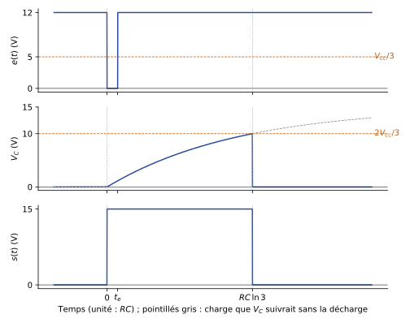{#fig-ann1314-555-monostable}

**b) Durée de l'impulsion.** $V_C(\Delta t) = \frac{2V_{cc}}{3}$ donne $e^{-\Delta t/RC} = \frac13$ :
$$\boxed{\Delta t = RC \ln 3 \approx 1{,}1\, RC}$$
indépendante de $V_{cc}$ (les seuils lui sont proportionnels).

**c) Choix de $R$ et $C$.** Il faut $RC = \frac{1}{\ln 3} = 0{,}91$ s. Deux couples des séries donnent $RC = 1$ s, soit $\Delta t = 1{,}10$ s, la valeur la plus proche :
$$\boxed{R = 100\ \text{k}\Omega,\ C = 10\ \text{µF}} \qquad\text{ou}\qquad R = 10\ \text{k}\Omega,\ C = 100\ \text{µF}.$$
On préfère le premier couple : condensateur plus petit (encombrement, courant de décharge plus faible dans le transistor de la patte 7) ; le courant de fuite d'un condensateur de 10 µF reste en général faible devant le courant de charge $V_{cc}/R \approx 150$ µA (critère général, l'énoncé ne donne pas de fuite). Les autres combinaisons donnent au mieux 0,11 s ou 11 s.
:::
::::

::: {.a-verifier #av-ann1314-serie-condensateurs}
**Source** [sujet-2013-2014, p. 4] : « C : 0,1F, 1µF, 10µF, 100µF ».

**Problème** : la série des condensateurs saute de 0,1 F à 1 µF ; « 0,1F » est sans doute une coquille pour 0,1 µF (série décade 0,1 µF, 1 µF, 10 µF, 100 µF). Cela ne change pas la réponse : avec 0,1 F il faudrait $R \approx 9\ \Omega$, absent de la série (le plus proche, 100 Ω, donne 11 s).

**Proposition** : lire « 0,1 µF » ; réponse inchangée ($R = 100$ kΩ, $C = 10$ µF).
:::
