

::: {.complement}
Aucun corrigé disponible : **les solutions de cette page sont rédigées par Claude** et vérifiées par le calcul (simulation numérique pas à pas pour le transistor et l'astable). À relire avec un œil critique ; signaler toute erreur. Les énoncés sont des extraits de photos d'un tirage papier [sujet-2014-2015] ; deux lettres manuscrites d'un étudiant (« a » et « b » près de la sortie de l'AOP, exercice II) ont été effacées des images.

**Correspondances.** L'exercice I est l'exercice II du [partiel 2013-2014](2013-2014-partiel.qmd#sec-ann1314-ex2) avec $\beta = 100$ au lieu de 50, et l'exercice I du [partiel 2015-2016](2015-2016-partiel.qmd#sec-ann1516-ex1) à l'identique. Le trigger de l'exercice II est un comparateur à hystérésis, comme le LM555 monté en trigger du [partiel 2013-2014](2013-2014-partiel.qmd#sec-ann1314-ex3).
:::

## Exercice I : transistor bipolaire commandé à travers un condensateur {#sec-ann1415-ex1}

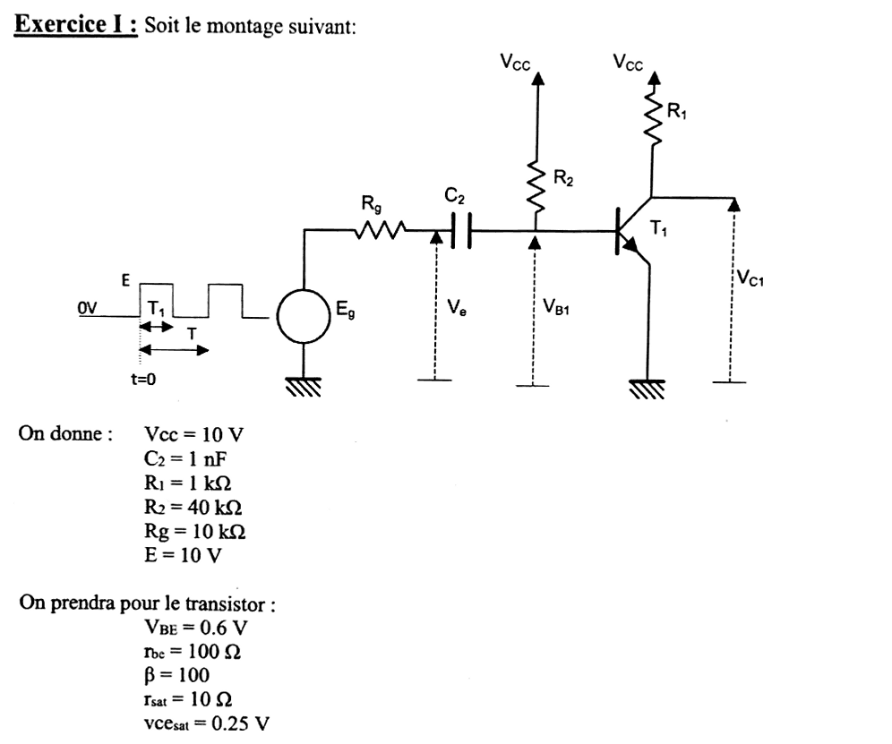{fig-alt="Exercice I : générateur Eg (créneaux de 0 à E, durée haute T1, période T, à partir de t = 0) en série avec Rg puis le condensateur C2 ; Ve est la tension entre le nœud Rg-C2 et la masse ; l'autre armature de C2 est reliée à la base du transistor NPN T1 (tension VB1) et à R2 vers Vcc ; collecteur relié à Vcc par R1 (tension VC1), émetteur à la masse. Données : Vcc = 10 V, C2 = 1 nF, R1 = 1 kΩ, R2 = 40 kΩ, Rg = 10 kΩ, E = 10 V. Transistor : VBE = 0,6 V, rbe = 100 Ω (lu « rbc » sur la photo), β = 100, rsat = 10 Ω, vcesat = 0,25 V."}

::: {.a-verifier #av-ann1415-rbe}
**Source** [sujet-2014-2015, p. 1] : la photo se lit « r~bc~ = 100 Ω ».

**Problème** : lecture douteuse (« c » ou « e » mal imprimé) ; une résistance base-collecteur n'aurait pas de sens dans ce modèle, et les sujets 2013-2014 et 2015-2016, identiques par ailleurs, écrivent « r~be~ = 100 Ω ».

**Proposition** : lire $r_{be} = 100\ \Omega$ (résistance dynamique de la jonction base-émetteur), comme dans la suite de cette page.
:::

:::: {.complement}
::: {.solution}
**Modèle retenu pour le transistor** (lecture des données) :

- jonction base-émetteur : bloquée si $V_{B1} < 0{,}6$ V, sinon $V_{B1} = V_{BE} + r_{be}\, I_B$ ;
- saturation : $V_{CE} = v_{CEsat} + r_{sat}\, I_C$, d'où $I_{Csat} = \frac{V_{cc} - v_{CEsat}}{R_1 + r_{sat}} = \frac{9{,}75}{1010} = 9{,}65$ mA et $V_{C1,sat} = 0{,}25 + 10 \times 9{,}65 \cdot 10^{-3} = 0{,}35$ V ;
- saturé si $\beta I_B \geq I_{Csat}$, soit $I_B \geq 0{,}097$ mA pour $\beta = 100$.

Notations : $u = V_{B1} - V_e$ (tension aux bornes de $C_2$), $i$ courant dans $R_g$ compté du générateur vers $C_2$. Jonction passante, le nœud de base vu par $C_2$ a pour modèle de Thévenin $V_{th} = \frac{V_{cc}\, r_{be} + V_{BE}\, R_2}{R_2 + r_{be}} = 0{,}623$ V, $R_{th} = R_2 \parallel r_{be} = 99{,}75\ \Omega$. Signal : 50 kHz, rapport cyclique 0,5, donc $T = 20$ µs et $T_1 = 10$ µs.
:::
::::

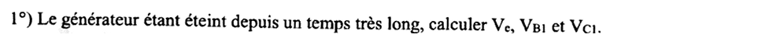{fig-alt="Question 1 : le générateur étant éteint depuis un temps très long, calculer Ve, VB1 et VC1."}

:::: {.complement}
::: {.solution}
Régime permanent : $C_2$ ouvert, aucun courant dans $R_g$, $V_e = 0$. Base alimentée par $R_2$, jonction supposée passante :
$$I_B = \frac{V_{cc} - V_{BE}}{R_2 + r_{be}} = \frac{9{,}4}{40\,100} = 0{,}234\ \text{mA}, \qquad V_{B1} = V_{BE} + r_{be} I_B = 0{,}623\ \text{V}.$$
$\beta I_B = 23{,}4$ mA $\gg I_{Csat} = 9{,}65$ mA : **transistor saturé** (nettement, contrairement au cas $\beta = 50$ de 2013-2014).
$$\boxed{V_e = 0, \quad V_{B1} = 0{,}623\ \text{V}, \quad V_{C1} = 0{,}35\ \text{V}}$$
Le condensateur est chargé sous $u = 0{,}623$ V.
:::
::::

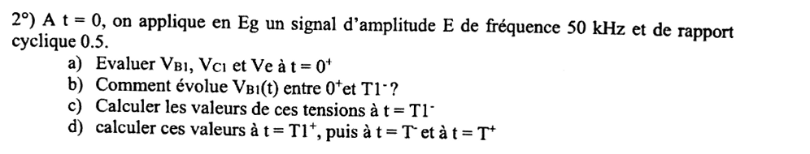{fig-alt="Question 2 : à t = 0, on applique en Eg un signal d'amplitude E de fréquence 50 kHz et de rapport cyclique 0,5. a) Évaluer VB1, VC1 et Ve à t = 0+. b) Comment évolue VB1(t) entre 0+ et T1− ? c) Calculer les valeurs de ces tensions à t = T1−. d) Calculer ces valeurs à t = T1+, puis à t = T− et à t = T+."}

:::: {.complement}
::: {.solution}
Le transistor étant saturé dès que la jonction conduit, $\beta$ n'intervient pas dans les tensions : les résultats sont ceux du [partiel 2013-2014](2013-2014-partiel.qmd#sec-ann1314-ex2).

**a) $t = 0^+$.** $u(0^+) = 0{,}623$ V (continuité). Jonction passante :
$$i(0^+) = \frac{E + u - V_{th}}{R_g + R_{th}} = \frac{10}{10\,099{,}75} = 0{,}990\ \text{mA}, \quad V_{B1} = V_{th} + R_{th} i = 0{,}722\ \text{V}, \quad V_e = E - R_g i = 0{,}099\ \text{V}.$$
$$\boxed{V_{B1}(0^+) = 0{,}72\ \text{V}, \quad V_{C1}(0^+) = 0{,}35\ \text{V}, \quad V_e(0^+) \approx 0{,}1\ \text{V}}$$
($I_B = 1{,}22$ mA : saturé).

**b)** $C_2$ se charge à travers $R_g + R_{th}$ : $\tau_1 = C_2(R_g + R_{th}) = 10{,}1$ µs,
$$V_{B1}(t) = 0{,}623 + 0{,}099\, e^{-t/\tau_1}\ \text{(V)} :$$
décroissance exponentielle de 0,72 V vers 0,62 V, quasi constante ; $V_e(t) = 10 - 9{,}90\, e^{-t/\tau_1}$ monte vers 10 V.

**c) $t = T_1^-$** ($e^{-T_1/\tau_1} = 0{,}372$, $i = 0{,}368$ mA) :
$$\boxed{V_{B1}(T_1^-) = 0{,}66\ \text{V}, \quad V_e(T_1^-) = 6{,}32\ \text{V}, \quad V_{C1}(T_1^-) = 0{,}35\ \text{V}}, \qquad u(T_1^-) = -5{,}66\ \text{V}.$$

**d) $t = T_1^+$.** $E_g = 0$, jonction bloquée (à vérifier) ; maille $V_{cc}$, $R_2$, $C_2$, $R_g$ : $i' = \frac{V_{cc} - u}{R_2 + R_g} = 0{,}313$ mA,
$$\boxed{V_{B1}(T_1^+) = V_{cc} - R_2 i' = -2{,}53\ \text{V}, \quad V_e(T_1^+) = R_g i' = 3{,}13\ \text{V}, \quad V_{C1}(T_1^+) = 10\ \text{V}}$$
**$t = T^-$.** Charge à travers $R_2 + R_g$, $\tau_2 = 50$ µs ; $V_{B1}$ n'atteindrait 0,6 V qu'après 14,4 µs $> 10$ µs, le transistor reste bloqué. $u(T^-) = 10 - 15{,}66\, e^{-0{,}2} = -2{,}82$ V, $i' = 0{,}256$ mA :
$$\boxed{V_{B1}(T^-) = -0{,}26\ \text{V}, \quad V_e(T^-) = 2{,}56\ \text{V}, \quad V_{C1}(T^-) = 10\ \text{V}}$$
**$t = T^+$.** $i = \frac{10 - 2{,}82 - 0{,}62}{10\,099{,}75} = 0{,}649$ mA :
$$\boxed{V_{B1}(T^+) = 0{,}69\ \text{V}, \quad V_e(T^+) = 3{,}51\ \text{V}, \quad V_{C1}(T^+) = 0{,}35\ \text{V}}$$
:::
::::

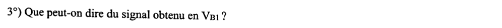{fig-alt="Question 3 : que peut-on dire du signal obtenu en VB1 ?"}

:::: {.complement}
::: {.solution}
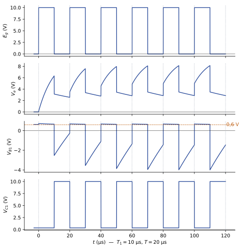{#fig-ann1415-transistor}

- Alternances positives **écrêtées** vers 0,6 à 0,7 V par la jonction base-émetteur, qui joue le rôle de diode de « clamp » ;
- alternances négatives « **dérivées** » : impulsion négative à chaque front descendant, puis remontée exponentielle ($\tau_2 = 50$ µs) jamais achevée en 10 µs ;
- **régime transitoire** de quelques périodes, puis régime établi : $V_{B1}$ entre 0,64 et 0,67 V à l'état haut, de $-4{,}0$ V à $-1{,}5$ V à l'état bas ;
- $V_{C1}$ est un créneau inversé (0,35 V / 10 V) : le montage est un inverseur ; le condensateur accélère la mise en conduction (pic de courant de base) et le blocage (base portée à une tension négative).
:::
::::

## Exercice II : multivibrateur astable à AOP {#sec-ann1415-ex2}

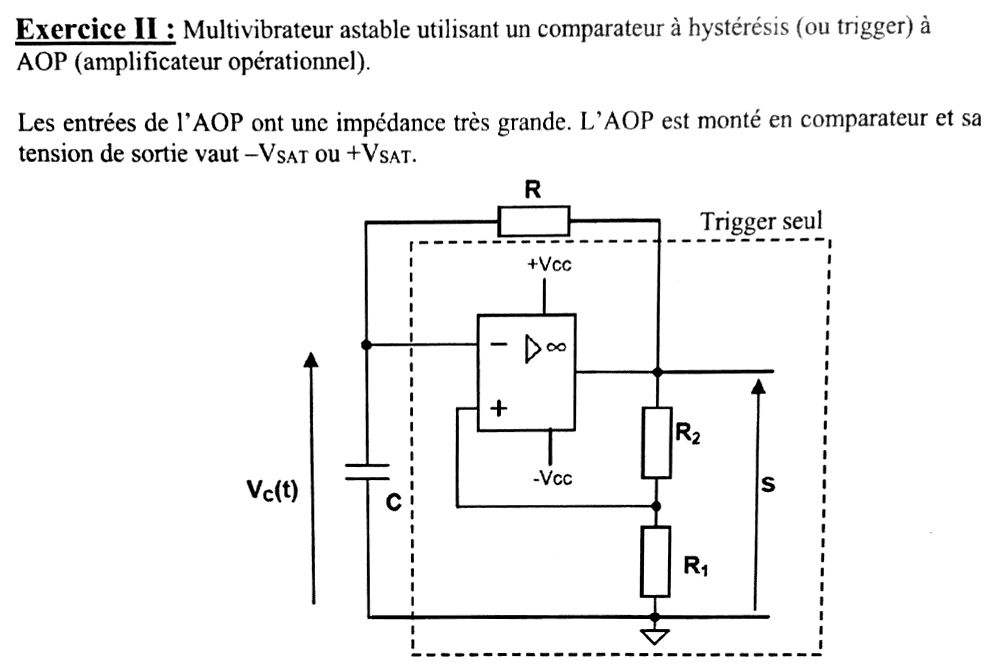{fig-alt="Exercice II : multivibrateur astable utilisant un comparateur à hystérésis (trigger) à AOP ; entrées de l'AOP d'impédance très grande, sortie égale à −VSAT ou +VSAT. Schéma : AOP alimenté en +Vcc et −Vcc ; sortie S reliée à l'entrée moins par la résistance R ; condensateur C entre l'entrée moins et la masse (tension Vc(t)) ; pont R2 (côté sortie) et R1 (côté masse) dont le point milieu attaque l'entrée plus. Un cadre en tirets délimite le « trigger seul » (AOP, R1, R2)."}

:::: {.complement}
::: {.solution}
L'entrée plus reçoit une fraction de la sortie (réaction positive) :
$$V^+ = k\, S, \qquad k = \frac{R_1}{R_1 + R_2}.$$
L'AOP en comparateur donne $S = +V_{SAT}$ si $V^+ > V^- = V_C$, $S = -V_{SAT}$ si $V^+ < V_C$.
:::
::::

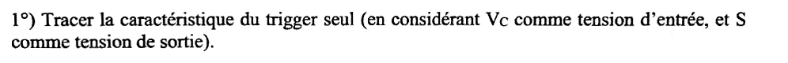{fig-alt="Question 1 : tracer la caractéristique du trigger seul, en considérant Vc comme tension d'entrée et S comme tension de sortie."}

:::: {.complement}
::: {.solution}
- Si $S = +V_{SAT}$, $V^+ = +kV_{SAT}$ : la sortie reste haute tant que $V_C < kV_{SAT}$ et bascule à $-V_{SAT}$ quand $V_C$ dépasse $+kV_{SAT}$.
- Si $S = -V_{SAT}$, $V^+ = -kV_{SAT}$ : la sortie reste basse tant que $V_C > -kV_{SAT}$ et rebascule quand $V_C$ passe sous $-kV_{SAT}$.

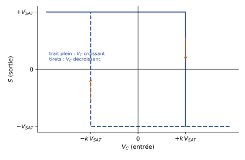{#fig-ann1415-trigger}

C'est un **comparateur à hystérésis inverseur**, de largeur de cycle $2kV_{SAT}$. Entre les seuils, la sortie dépend du passé (mémoire).
:::
::::

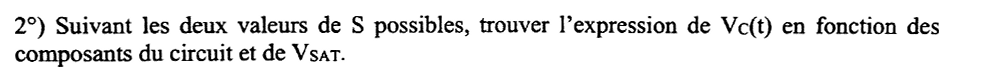{fig-alt="Question 2 : suivant les deux valeurs de S possibles, trouver l'expression de Vc(t) en fonction des composants du circuit et de VSAT."}

:::: {.complement}
::: {.solution}
L'entrée moins ne consomme pas de courant : $C$ se charge à travers $R$ depuis $S$ :
$$RC\,\frac{\mathrm{d}V_C}{\mathrm{d}t} + V_C = S .$$
Pour $S$ constant, à partir de $V_C(t_0)$ :
$$\boxed{S = +V_{SAT} :\ V_C(t) = V_{SAT} + \left(V_C(t_0) - V_{SAT}\right) e^{-(t - t_0)/RC}}$$
$$\boxed{S = -V_{SAT} :\ V_C(t) = -V_{SAT} + \left(V_C(t_0) + V_{SAT}\right) e^{-(t - t_0)/RC}}$$
$V_C$ tend vers la valeur de $S$, mais le trigger bascule avant de l'atteindre (seuils $\pm kV_{SAT}$, $k < 1$).
:::
::::

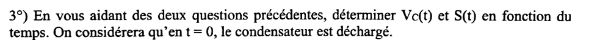{fig-alt="Question 3 : en vous aidant des deux questions précédentes, déterminer Vc(t) et S(t) en fonction du temps ; on considère qu'en t = 0 le condensateur est déchargé."}

:::: {.complement}
::: {.solution}
**État initial.** Avec $V_C(0) = 0$, les deux états de sortie sont compatibles avec la caractéristique ($-kV_{SAT} < 0 < kV_{SAT}$) : l'énoncé ne fixe pas lequel. On suppose $S(0) = +V_{SAT}$ (le cas $-V_{SAT}$ s'en déduit en changeant tous les signes).

**Première phase** ($0 < t < t_1$) : $V_C(t) = V_{SAT}\left(1 - e^{-t/RC}\right)$, jusqu'à $V_C = kV_{SAT}$ :
$$t_1 = RC \ln\frac{1}{1 - k} = RC \ln\frac{R_1 + R_2}{R_2}.$$
**Phases suivantes.** $S$ alterne entre $-V_{SAT}$ et $+V_{SAT}$ ; $V_C$ va d'un seuil à l'autre. De $+kV_{SAT}$ vers $-V_{SAT}$ :
$$V_C(t) = -V_{SAT} + (1 + k)V_{SAT}\, e^{-(t - t_1)/RC},$$
jusqu'à $V_C = -kV_{SAT}$, atteint au bout de
$$\Delta t = RC \ln\frac{1 + k}{1 - k} = RC \ln\left(1 + \frac{2R_1}{R_2}\right).$$
La phase montante suivante ($S = +V_{SAT}$, de $-kV_{SAT}$ à $+kV_{SAT}$) dure le même $\Delta t$ par symétrie. $S(t)$ est donc un créneau symétrique $\pm V_{SAT}$ (première alternance raccourcie à $t_1$), et $V_C(t)$ une suite d'arcs d'exponentielles entre $\pm kV_{SAT}$.
:::
::::

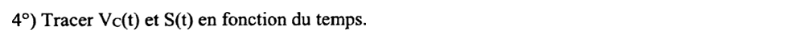{fig-alt="Question 4 : tracer Vc(t) et S(t) en fonction du temps."}

:::: {.complement}
::: {.solution}
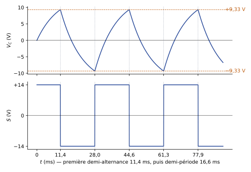{#fig-ann1415-astable}

Sur le tracé : première montée de 0 à $+kV_{SAT}$ en $t_1$, puis oscillation entre $\pm kV_{SAT}$ ; $S$ bascule à chaque fois que $V_C$ touche un seuil.
:::
::::

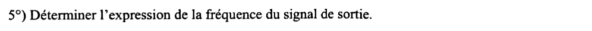{fig-alt="Question 5 : déterminer l'expression de la fréquence du signal de sortie."}

:::: {.complement}
::: {.solution}
Période en régime établi : deux demi-périodes $\Delta t$,
$$T = 2RC \ln\frac{1 + k}{1 - k} = 2RC\ln\left(1 + \frac{2R_1}{R_2}\right) \quad\Longrightarrow\quad \boxed{f = \frac{1}{2RC\ln\left(1 + \dfrac{2R_1}{R_2}\right)}}$$
Elle ne dépend pas de $V_{SAT}$ (les seuils lui sont proportionnels) : seulement de $RC$ et du rapport $R_1/R_2$.
:::
::::

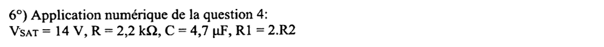{fig-alt="Question 6 : application numérique de la question 4 : VSAT = 14 V, R = 2,2 kΩ, C = 4,7 µF, R1 = 2.R2."}

:::: {.complement}
::: {.solution}
$k = \frac{2R_2}{3R_2} = \frac23$, $RC = 2{,}2 \cdot 10^3 \times 4{,}7 \cdot 10^{-6} = 10{,}34$ ms.

- Seuils : $\pm kV_{SAT} = \pm 9{,}33$ V.
- Première alternance : $t_1 = RC\ln 3 = 11{,}4$ ms.
- Demi-période : $\Delta t = RC \ln 5 = 16{,}6$ ms.
$$\boxed{T = 2RC\ln 5 = 33{,}3\ \text{ms}, \qquad f = 30{,}0\ \text{Hz}}$$
Ce sont les valeurs reportées sur la [figure de la question 4](#fig-ann1415-astable). L'énoncé demande « l'application numérique de la question 4 » (le tracé) ; la fréquence de la question 5 est donnée en plus.
:::
::::

## Exercice III : QCM {#sec-ann1415-ex3}

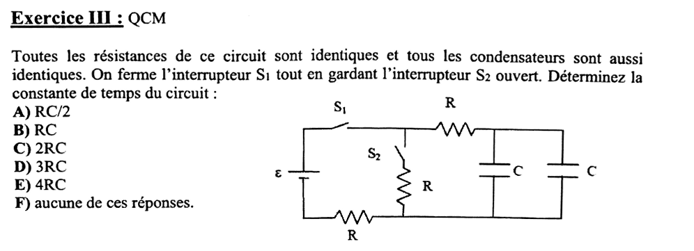{fig-alt="Exercice III, QCM : toutes les résistances sont identiques (R) et tous les condensateurs identiques (C). On ferme l'interrupteur S1 en gardant S2 ouvert ; déterminer la constante de temps du circuit. Réponses : A) RC/2, B) RC, C) 2RC, D) 3RC, E) 4RC, F) aucune de ces réponses. Schéma : source ε, interrupteur S1 puis résistance R en haut vers deux condensateurs C en parallèle ; branche verticale S2 en série avec une résistance R entre le fil du haut (après S1) et le fil du bas ; résistance R sur le fil du bas, entre la source et cette branche."}

:::: {.complement}
::: {.solution}
$S_2$ ouvert : la branche verticale ($S_2$ et sa résistance) n'est parcourue par aucun courant, elle disparaît. Il reste une seule maille : $\varepsilon$, $S_1$, la résistance du haut, les deux condensateurs en parallèle, la résistance du bas.

- Résistances en série : $R + R = 2R$ ;
- condensateurs en parallèle : $C + C = 2C$.
$$\tau = 2R \times 2C \quad\Longrightarrow\quad \boxed{\text{réponse E : } \tau = 4RC}$$
(Avec $S_2$ fermé, la résistance de la branche verticale se mettrait en parallèle avec celle du bas, source éteinte : $R + R/2$ en série avec $2C$, soit $\tau = 3RC$.)
:::
::::
