

::: {.complement}
Aucun corrigé disponible : **les solutions de cette page sont rédigées par Claude** et vérifiées par le calcul (simulation numérique pas à pas). À relire avec un œil critique ; signaler toute erreur. Les énoncés sont des extraits du scan du sujet [sujet-2015-2016] ; les annotations manuscrites d'un étudiant ont été effacées des images : table de vérité en marge des questions de l'exercice I, niveaux logiques « 0 » et « 1 » et flèche au-dessus de C1 sur le schéma de l'exercice II, lettres « c » et « e » sur le schéma de l'exercice I. L'en-tête de l'exercice II, à cheval sur les pages 2 et 3, est recomposé en une image.

**Correspondances.** L'exercice I est identique à l'exercice I du [partiel 2014-2015](2014-2015-partiel.qmd#sec-ann1415-ex1) et à l'exercice II du [partiel 2013-2014](2013-2014-partiel.qmd#sec-ann1314-ex2) ($\beta = 50$). L'exercice II utilise les mêmes ingrédients (portes CMOS, seuil $V_{DD}/2$, saut de tension transmis par un condensateur) que le monostable à portes NOR du [partiel 2017-2018](2017-2018-partiel.qmd#sec-ann1718-ex4).
:::

## Exercice I : transistor bipolaire commandé à travers un condensateur {#sec-ann1516-ex1}

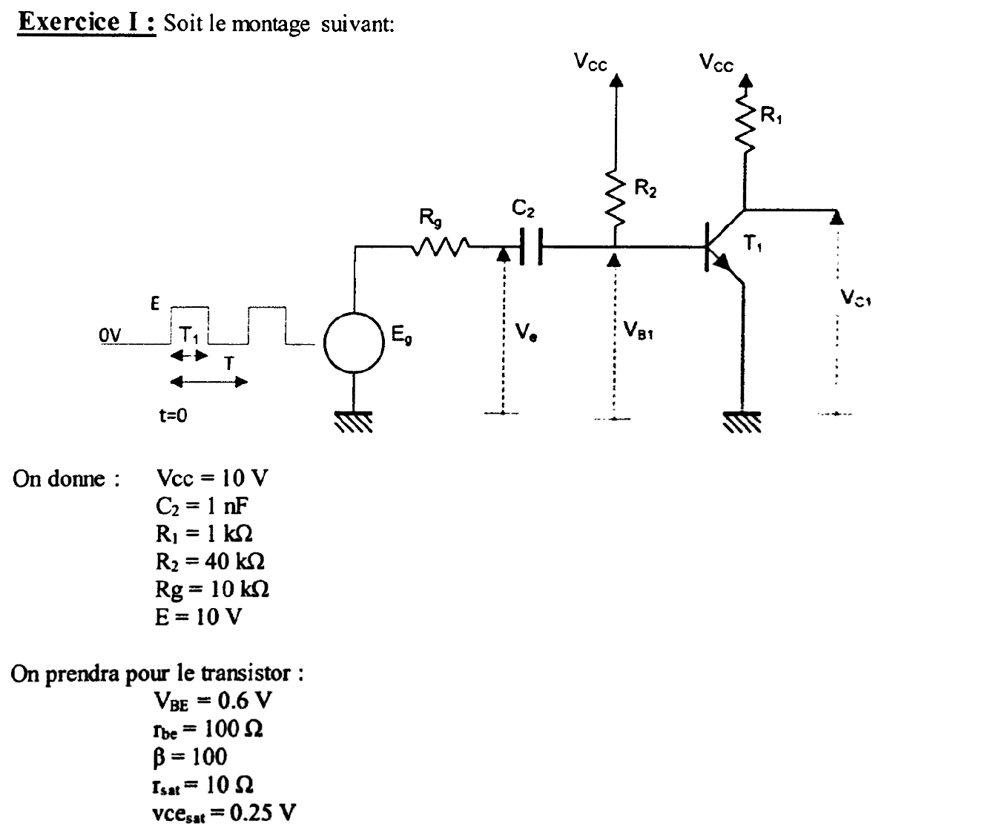{fig-alt="Exercice I : générateur Eg (créneaux de 0 à E, durée haute T1, période T, à partir de t = 0) en série avec Rg puis le condensateur C2 ; Ve est la tension entre le nœud Rg-C2 et la masse ; l'autre armature de C2 est reliée à la base du transistor NPN T1 (tension VB1) et à R2 vers Vcc ; collecteur relié à Vcc par R1 (tension VC1), émetteur à la masse. Données : Vcc = 10 V, C2 = 1 nF, R1 = 1 kΩ, R2 = 40 kΩ, Rg = 10 kΩ, E = 10 V. Transistor : VBE = 0,6 V, rbe = 100 Ω, β = 100, rsat = 10 Ω, vcesat = 0,25 V."}

:::: {.complement}
::: {.solution}
**Modèle retenu pour le transistor** (lecture des données) :

- jonction base-émetteur : bloquée si $V_{B1} < 0{,}6$ V, sinon $V_{B1} = V_{BE} + r_{be}\, I_B$ ;
- saturation : $V_{CE} = v_{CEsat} + r_{sat}\, I_C$, d'où $I_{Csat} = \frac{V_{cc} - v_{CEsat}}{R_1 + r_{sat}} = \frac{9{,}75}{1010} = 9{,}65$ mA et $V_{C1,sat} = 0{,}25 + 10 \times 9{,}65 \cdot 10^{-3} = 0{,}35$ V ;
- saturé si $\beta I_B \geq I_{Csat}$, soit $I_B \geq 0{,}097$ mA pour $\beta = 100$.

Notations : $u = V_{B1} - V_e$ (tension aux bornes de $C_2$), $i$ courant dans $R_g$ compté du générateur vers $C_2$. Jonction passante, le nœud de base vu par $C_2$ a pour modèle de Thévenin $V_{th} = \frac{V_{cc}\, r_{be} + V_{BE}\, R_2}{R_2 + r_{be}} = 0{,}623$ V, $R_{th} = R_2 \parallel r_{be} = 99{,}75\ \Omega$. Signal : 50 kHz, rapport cyclique 0,5, donc $T = 20$ µs et $T_1 = 10$ µs.
:::
::::

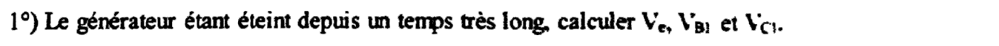{fig-alt="Question 1 : le générateur étant éteint depuis un temps très long, calculer Ve, VB1 et VC1."}

:::: {.complement}
::: {.solution}
Régime permanent : $C_2$ ouvert, aucun courant dans $R_g$, $V_e = 0$. Base alimentée par $R_2$, jonction supposée passante :
$$I_B = \frac{V_{cc} - V_{BE}}{R_2 + r_{be}} = \frac{9{,}4}{40\,100} = 0{,}234\ \text{mA}, \qquad V_{B1} = V_{BE} + r_{be} I_B = 0{,}623\ \text{V}.$$
$\beta I_B = 23{,}4$ mA $\gg I_{Csat} = 9{,}65$ mA : **transistor saturé** (nettement, contrairement au cas $\beta = 50$ du [partiel 2013-2014](2013-2014-partiel.qmd#sec-ann1314-ex2)).
$$\boxed{V_e = 0, \quad V_{B1} = 0{,}623\ \text{V}, \quad V_{C1} = 0{,}35\ \text{V}}$$
Le condensateur est chargé sous $u = 0{,}623$ V.
:::
::::

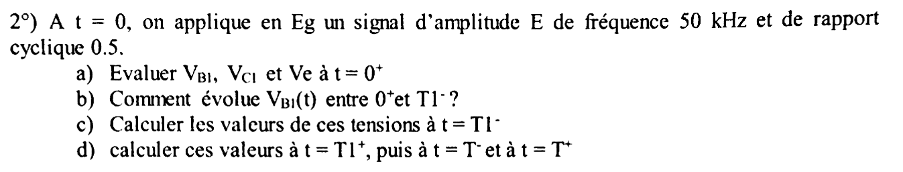{fig-alt="Question 2 : à t = 0, on applique en Eg un signal d'amplitude E de fréquence 50 kHz et de rapport cyclique 0,5. a) Évaluer VB1, VC1 et Ve à t = 0+. b) Comment évolue VB1(t) entre 0+ et T1− ? c) Calculer les valeurs de ces tensions à t = T1−. d) Calculer ces valeurs à t = T1+, puis à t = T− et à t = T+."}

:::: {.complement}
::: {.solution}
Le transistor étant saturé dès que la jonction conduit, $\beta$ n'intervient pas dans les tensions : les résultats sont ceux du [partiel 2013-2014](2013-2014-partiel.qmd#sec-ann1314-ex2).

**a) $t = 0^+$.** $u(0^+) = 0{,}623$ V (continuité). Jonction passante :
$$i(0^+) = \frac{E + u - V_{th}}{R_g + R_{th}} = \frac{10}{10\,099{,}75} = 0{,}990\ \text{mA}, \quad V_{B1} = V_{th} + R_{th} i = 0{,}722\ \text{V}, \quad V_e = E - R_g i = 0{,}099\ \text{V}.$$
$$\boxed{V_{B1}(0^+) = 0{,}72\ \text{V}, \quad V_{C1}(0^+) = 0{,}35\ \text{V}, \quad V_e(0^+) \approx 0{,}1\ \text{V}}$$
($I_B = 1{,}22$ mA : saturé).

**b)** $C_2$ se charge à travers $R_g + R_{th}$ : $\tau_1 = C_2(R_g + R_{th}) = 10{,}1$ µs,
$$V_{B1}(t) = 0{,}623 + 0{,}099\, e^{-t/\tau_1}\ \text{(V)} :$$
décroissance exponentielle de 0,72 V vers 0,62 V, quasi constante ; $V_e(t) = 10 - 9{,}90\, e^{-t/\tau_1}$ monte vers 10 V.

**c) $t = T_1^-$** ($e^{-T_1/\tau_1} = 0{,}372$, $i = 0{,}368$ mA) :
$$\boxed{V_{B1}(T_1^-) = 0{,}66\ \text{V}, \quad V_e(T_1^-) = 6{,}32\ \text{V}, \quad V_{C1}(T_1^-) = 0{,}35\ \text{V}}, \qquad u(T_1^-) = -5{,}66\ \text{V}.$$

**d) $t = T_1^+$.** $E_g = 0$, jonction bloquée (à vérifier) ; maille $V_{cc}$, $R_2$, $C_2$, $R_g$ : $i' = \frac{V_{cc} - u}{R_2 + R_g} = 0{,}313$ mA,
$$\boxed{V_{B1}(T_1^+) = V_{cc} - R_2 i' = -2{,}53\ \text{V}, \quad V_e(T_1^+) = R_g i' = 3{,}13\ \text{V}, \quad V_{C1}(T_1^+) = 10\ \text{V}}$$
**$t = T^-$.** Charge à travers $R_2 + R_g$, $\tau_2 = 50$ µs ; $V_{B1}$ n'atteindrait 0,6 V qu'après 14,4 µs $> 10$ µs, le transistor reste bloqué. $u(T^-) = 10 - 15{,}66\, e^{-0{,}2} = -2{,}82$ V, $i' = 0{,}256$ mA :
$$\boxed{V_{B1}(T^-) = -0{,}26\ \text{V}, \quad V_e(T^-) = 2{,}56\ \text{V}, \quad V_{C1}(T^-) = 10\ \text{V}}$$
**$t = T^+$.** $i = \frac{10 - 2{,}82 - 0{,}62}{10\,099{,}75} = 0{,}649$ mA :
$$\boxed{V_{B1}(T^+) = 0{,}69\ \text{V}, \quad V_e(T^+) = 3{,}51\ \text{V}, \quad V_{C1}(T^+) = 0{,}35\ \text{V}}$$
:::
::::

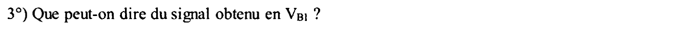{fig-alt="Question 3 : que peut-on dire du signal obtenu en VB1 ?"}

:::: {.complement}
::: {.solution}
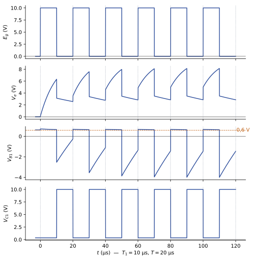{#fig-ann1516-transistor}

- Alternances positives **écrêtées** vers 0,6 à 0,7 V par la jonction base-émetteur, qui joue le rôle de diode de « clamp » ;
- alternances négatives « **dérivées** » : impulsion négative à chaque front descendant, puis remontée exponentielle ($\tau_2 = 50$ µs) jamais achevée en 10 µs ;
- **régime transitoire** de quelques périodes, puis régime établi : $V_{B1}$ entre 0,64 et 0,67 V à l'état haut, de $-4{,}0$ V à $-1{,}5$ V à l'état bas ;
- $V_{C1}$ est un créneau inversé (0,35 V / 10 V) : le montage est un inverseur ; le condensateur accélère la mise en conduction (pic de courant de base) et le blocage (base portée à une tension négative).
:::
::::

## Exercice II : oscillateur à portes CMOS {#sec-ann1516-ex2}

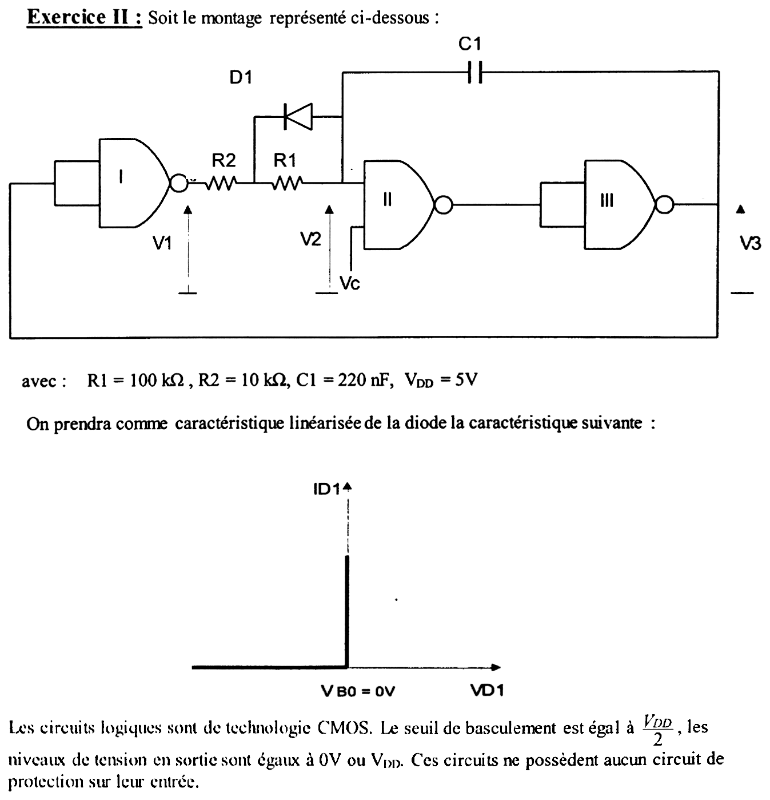{fig-alt="Exercice II : trois portes NAND I, II, III. La porte I, entrées reliées (inverseur), reçoit V3 et délivre V1 ; V1 traverse R2 puis R1 pour arriver au nœud V2, entrée de la porte II ; la diode D1 est en parallèle sur R1, cathode côté R2, anode côté V2 ; le condensateur C1 relie le nœud V2 à la sortie V3 de la porte III. La porte II reçoit V2 et la commande Vc ; sa sortie attaque la porte III, entrées reliées (inverseur), dont la sortie est V3, rebouclée sur l'entrée de la porte I. Données : R1 = 100 kΩ, R2 = 10 kΩ, C1 = 220 nF, VDD = 5 V. Caractéristique linéarisée de D1 : courant nul pour VD1 < 0, segment vertical en VB0 = 0 V (diode idéale). Texte : portes CMOS, seuil de basculement VDD/2, sorties à 0 V ou VDD, aucun circuit de protection sur les entrées."}

:::: {.complement}
::: {.solution}
**Fonctions logiques.** Les portes I et III, entrées reliées, sont des inverseurs : $V_1 = \overline{V_3}$, $V_3 = \overline{\text{sortie de II}}$. La porte II est un NAND de $V_2$ et $V_c$ : si $V_c = 0$, sa sortie est à 1 quelle que soit $V_2$ (oscillateur bloqué) ; si $V_c = V_{DD}$, elle inverse $V_2$, et $V_3$ est alors au niveau logique de $V_2$.

**Rôle de $D_1$** (idéale, seuil 0 V, anode côté $V_2$) : elle conduit quand le courant va de $V_2$ vers $V_1$ ($V_2 > V_1$) et court-circuite alors $R_1$ : le condensateur se décharge par $R_2$ seule ($\tau_1 = R_2 C_1$). Quand le courant va de $V_1$ vers $V_2$, elle est bloquée et la charge se fait par $R_1 + R_2$ ($\tau_2 = (R_1 + R_2) C_1$).

**Entrées sans protection** : rien n'empêche $V_2$ de sortir de $[0, V_{DD}]$, et l'entrée de la porte II ne consomme aucun courant.
:::
::::

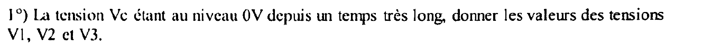{fig-alt="Question 1 : la tension Vc étant au niveau 0 V depuis un temps très long, donner les valeurs des tensions V1, V2 et V3."}

:::: {.complement}
::: {.solution}
$V_c = 0$ : la sortie de II est à $V_{DD}$, donc $V_3 = 0$ et $V_1 = V_{DD}$. Régime permanent : aucun courant dans $C_1$ ni dans l'entrée de II, donc aucun courant dans $R_2$ et $R_1$ (ni dans $D_1$) : pas de chute de tension, $V_2 = V_1$.
$$\boxed{V_1 = 5\ \text{V}, \quad V_2 = 5\ \text{V}, \quad V_3 = 0\ \text{V}}$$
Le condensateur est chargé sous $V_2 - V_3 = 5$ V.
:::
::::

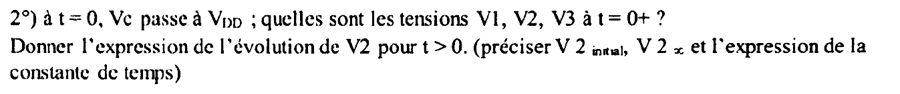{fig-alt="Question 2 : à t = 0, Vc passe à VDD ; quelles sont les tensions V1, V2, V3 à t = 0+ ? Donner l'expression de l'évolution de V2 pour t > 0 en précisant V2 initial, V2 infini et l'expression de la constante de temps."}

:::: {.complement}
::: {.solution}
**$t = 0^+$.** $V_2 = 5$ V $> V_{DD}/2$ et $V_c = V_{DD}$ : la sortie de II passe à 0, $V_3$ passe à $V_{DD}$, donc $V_1$ passe à 0. La tension du condensateur est continue : $V_2$ subit le même saut que $V_3$ (+5 V).
$$\boxed{V_1(0^+) = 0, \quad V_2(0^+) = V_3 + 5 = 10\ \text{V}, \quad V_3(0^+) = 5\ \text{V}}$$
**Évolution pour $t > 0$.** $V_2 > V_1$ : le courant va de $V_2$ vers $V_1 = 0$, $D_1$ conduit et court-circuite $R_1$ ; $C_1$ se décharge à travers $R_2$ (la sortie de III, à $V_{DD}$ fixe, ferme la maille) :
$$V_2(t) = V_{2\,\infty} + \left(V_{2\,\text{initial}} - V_{2\,\infty}\right) e^{-t/\tau_1}, \qquad V_{2\,\text{initial}} = 2V_{DD} = 10\ \text{V}, \quad V_{2\,\infty} = V_1 = 0,$$
$$\boxed{V_2(t) = 2V_{DD}\, e^{-t/\tau_1}, \qquad \tau_1 = R_2 C_1 = 10\ \text{k}\Omega \times 220\ \text{nF} = 2{,}2\ \text{ms}}$$
La diode reste passante tant que $V_2 > V_1 = 0$, ce qui est le cas jusqu'à la commutation suivante.
:::
::::

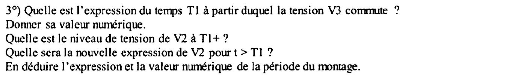{fig-alt="Question 3 : quelle est l'expression du temps T1 à partir duquel la tension V3 commute ? Donner sa valeur numérique. Quel est le niveau de tension de V2 à T1+ ? Quelle sera la nouvelle expression de V2 pour t > T1 ? En déduire l'expression et la valeur numérique de la période du montage."}

:::: {.complement}
::: {.solution}
**Instant $T_1$.** $V_3$ commute quand $V_2$ passe sous le seuil $V_{DD}/2$ :
$$2V_{DD}\, e^{-T_1/\tau_1} = \frac{V_{DD}}{2} \quad\Longrightarrow\quad \boxed{T_1 = R_2 C_1 \ln 4 = 3{,}05\ \text{ms}}$$
**$t = T_1^+$.** La sortie de II remonte, $V_3$ retombe à 0 (saut de $-5$ V), $V_1$ remonte à $V_{DD}$. $V_2$ suit le saut de $V_3$ :
$$\boxed{V_2(T_1^+) = \frac{V_{DD}}{2} - V_{DD} = -2{,}5\ \text{V}}$$
**Pour $t > T_1$.** Le courant va maintenant de $V_1 = V_{DD}$ vers $V_2$ : $D_1$ est bloquée, la charge se fait à travers $R_1 + R_2$, vers $V_{2\,\infty} = V_{DD}$ :
$$\boxed{V_2(t) = V_{DD} - \frac{3V_{DD}}{2}\, e^{-(t - T_1)/\tau_2}, \qquad \tau_2 = (R_1 + R_2) C_1 = 24{,}2\ \text{ms}}$$
**Période.** $V_2$ remonte à $V_{DD}/2$ au bout de $\tau_2 \ln\frac{3V_{DD}/2}{V_{DD}/2} = \tau_2 \ln 3 = 26{,}6$ ms. $V_3$ repasse alors à $V_{DD}$ et $V_2$ saute à $\frac{V_{DD}}{2} + V_{DD} = 7{,}5$ V, puis se décharge par $R_2$ jusqu'à $V_{DD}/2$ en $\tau_1 \ln\frac{7{,}5}{2{,}5} = \tau_1 \ln 3 = 2{,}42$ ms. Le régime établi alterne ces deux phases (la toute première, partie de 10 V, est plus longue : 3,05 ms) :
$$\boxed{T = (\tau_1 + \tau_2)\ln 3 = (R_1 + 2R_2)\, C_1 \ln 3 = 29{,}0\ \text{ms}}, \qquad f = 34{,}5\ \text{Hz}.$$
$V_3$ est un signal rectangulaire dissymétrique : à $V_{DD}$ pendant 2,42 ms, à 0 pendant 26,6 ms (rapport cyclique 8,3 %) ; $D_1$ sert précisément à rendre les deux phases inégales.

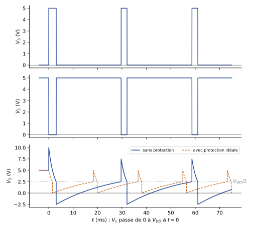{#fig-ann1516-oscillateur}
:::
::::

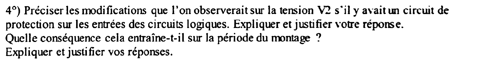{fig-alt="Question 4 : préciser les modifications que l'on observerait sur la tension V2 s'il y avait un circuit de protection sur les entrées des circuits logiques ; expliquer et justifier. Quelle conséquence cela entraîne-t-il sur la période du montage ? Expliquer et justifier."}

:::: {.complement}
::: {.solution}
**Protection d'entrée CMOS** (connaissance générale) : deux diodes, de l'entrée vers $V_{DD}$ et de la masse vers l'entrée. Elles conduisent dès que l'entrée dépasse $V_{DD}$ ou descend sous 0 (au seuil des diodes près, environ 0,6 V).

**Effet sur $V_2$.** Aux commutations, le saut de $\pm V_{DD}$ transmis par $C_1$ amènerait $V_2$ à 10 V puis 7,5 V (au-dessus de $V_{DD}$) et à $-2{,}5$ V (sous la masse). La diode de protection conduit et relie $V_2$ au rail : le courant, limité seulement par l'impédance de sortie de la porte III, charge ou décharge $C_1$ presque instantanément. $V_2$ est **écrêté** à $V_{DD}$ (ou $V_{DD} + 0{,}6$ V) et à 0 (ou $-0{,}6$ V), et la tension du condensateur est modifiée à chaque commutation.

**Effet sur la période.** Chaque phase part d'un rail et s'arrête au seuil $V_{DD}/2$, à mi-chemin de son asymptote :

- décharge de $V_{DD}$ vers 0 jusqu'à $V_{DD}/2$ : $\tau_1 \ln 2$ ;
- charge de 0 vers $V_{DD}$ jusqu'à $V_{DD}/2$ : $\tau_2 \ln 2$.
$$\boxed{T' = (R_1 + 2R_2)\, C_1 \ln 2 = 18{,}3\ \text{ms}} \quad (f' = 54{,}6\ \text{Hz})$$
avec des diodes idéales, soit $(R_1 + 2R_2) C_1 \ln\frac{V_{DD} + 0{,}6}{V_{DD}/2} = 21{,}3$ ms avec des diodes de seuil 0,6 V. **La période diminue** (de 29,0 ms à environ 18 à 21 ms) parce que les excursions de $V_2$ au-delà des rails, qu'il fallait « rattraper » par la charge exponentielle, sont supprimées ; elle dépend en plus du seuil des diodes de protection, donc devient moins bien maîtrisée. Le rapport cyclique ($\tau_1 / (\tau_1 + \tau_2) = 8{,}3$ %) est inchangé.
:::
::::
