

::: {.complement}
Aucun corrigé disponible : **les solutions de cette page sont rédigées par Claude** et vérifiées par le calcul (SymPy). À relire avec un œil critique ; signaler toute erreur. Les énoncés sont des extraits de photos d'un tirage papier [sujet-2017-2018] (éclairage corrigé, page redressée) ; aucune annotation d'étudiant n'y figure. Les sous-questions a), b)… sont découpées une par une.

**Correspondances.** L'exercice III reprend l'exercice I du [partiel 2013-2014](2013-2014-partiel.qmd#sec-ann1314-ex1) avec $R_D = 10\ \Omega$ au lieu de $50\ \Omega$. Les exercices I et II (schéma aux variations, schéma instantané) ont la même structure que les exercices I et II du [partiel 2022-2023](2022-2023-partiel.qmd#sec-ann2223-ex1). Le monostable de l'exercice IV rappelle le LM555 du [partiel 2013-2014](2013-2014-partiel.qmd#sec-ann1314-ex3) et l'oscillateur à portes CMOS du [partiel 2015-2016](2015-2016-partiel.qmd#sec-ann1516-ex2).

**Méthode commune aux exercices I et II.** Au repos (régime continu établi), un condensateur est un circuit ouvert et une inductance un court-circuit. Juste après une discontinuité, la **tension** d'un condensateur et le **courant** d'une inductance sont continus : dans le schéma aux variations (superposition, sources continues éteintes) qui donne le saut $\Delta V$ à $t = 0^+$, un condensateur est un court-circuit et une inductance un circuit ouvert ; dans le schéma instantané, le condensateur est remplacé par une source de tension égale à sa tension à $0^-$.
:::

## Exercice I : échelon et schéma aux variations (5 pts) {#sec-ann1718-ex1}

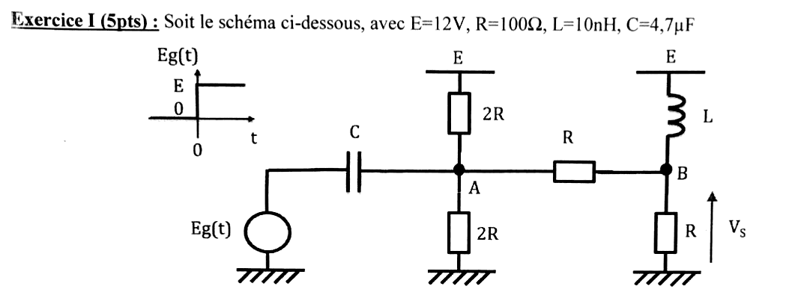{fig-alt="Exercice I, avec E = 12 V, R = 100 Ω, L = 10 nH, C = 4,7 µF. Eg(t) est un échelon de 0 à E à t = 0. Schéma : générateur Eg relié par le condensateur C au nœud A ; en A, une résistance 2R vers E et une résistance 2R vers la masse ; A relié par une résistance R au nœud B ; en B, l'inductance L vers E et une résistance R vers la masse ; Vs est la tension de B."}

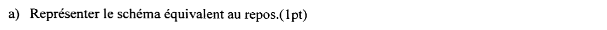{fig-alt="Question a : représenter le schéma équivalent au repos (1 pt)."}

:::: {.complement}
::: {.solution}
Au repos ($t < 0$, $E_g = 0$, régime établi) :

- $E_g = 0$ : le générateur est un fil vers la masse ;
- $C$ : circuit ouvert, la branche du générateur est déconnectée de $A$ ;
- $L$ : court-circuit, $B$ est relié directement à $E$.

Il reste $A$, relié à $E$ par $2R$, à la masse par $2R$ et à $B = E$ par $R$ ; $B$ relié à $E$ (fil) et à la masse par $R$.
:::
::::

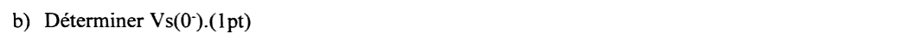{fig-alt="Question b : déterminer Vs(0−) (1 pt)."}

:::: {.complement}
::: {.solution}
$B$ est relié à $E$ par l'inductance court-circuitée :
$$\boxed{V_s(0^-) = E = 12\ \text{V}}$$
Pour la suite : loi des nœuds en $A$, $\frac{E - V_A}{2R} + \frac{E - V_A}{R} = \frac{V_A}{2R}$, d'où $V_A(0^-) = \frac{3E}{4} = 9$ V ; tension du condensateur $V_A - E_g = 9$ V. Courant dans l'inductance : $i_L = \frac{V_s}{R} + \frac{V_s - V_A}{R} = 0{,}12 + 0{,}03 = 0{,}15$ A.
:::
::::

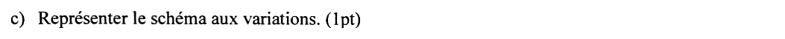{fig-alt="Question c : représenter le schéma aux variations (1 pt)."}

:::: {.complement}
::: {.solution}
Schéma aux variations à $t = 0^+$ (seule la variation $\Delta E_g = E = 12$ V agit) :

- la source continue $E$ est éteinte : les résistances « vers $E$ » vont à la masse ;
- $C$ : court-circuit (sa tension ne varie pas instantanément) : $\Delta E_g$ est appliqué directement en $A$ ;
- $L$ : circuit ouvert (son courant ne varie pas instantanément).

Il reste : $\Delta E_g$ en $A$, les deux $2R$ de $A$ à la masse (sans effet, la source étant idéale), et le diviseur $R$ (de $A$ à $B$), $R$ (de $B$ à la masse).
:::
::::

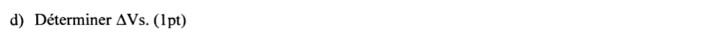{fig-alt="Question d : déterminer ΔVs (1 pt)."}

:::: {.complement}
::: {.solution}
$\Delta V_A = \Delta E_g = E$ ; le pont diviseur $R$-$R$ donne
$$\boxed{\Delta V_s = \Delta V_A \frac{R}{R + R} = \frac{E}{2} = 6\ \text{V}}$$
:::
::::

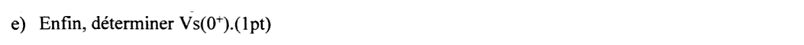{fig-alt="Question e : enfin, déterminer Vs(0+) (1 pt)."}

:::: {.complement}
::: {.solution}
Superposition :
$$\boxed{V_s(0^+) = V_s(0^-) + \Delta V_s = 12 + 6 = 18\ \text{V}}$$
**Vérification directe** : à $0^+$, $V_A = 9 + 12 = 21$ V (condensateur), $i_L = 0{,}15$ A (inductance) ; loi des nœuds en $B$ : $0{,}15 + \frac{21 - V_s}{100} = \frac{V_s}{100}$ donne bien $V_s = 18$ V. La sortie dépasse $E$ : l'inductance impose son courant et le condensateur transmet tout l'échelon. Les valeurs de $L$ et $C$ ne servent pas ici (elles fixeraient la suite du régime transitoire).
:::
::::

## Exercice II : fermeture d'interrupteurs et schéma instantané (5 pts) {#sec-ann1718-ex2}

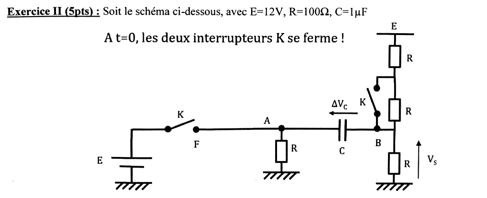{fig-alt="Exercice II, avec E = 12 V, R = 100 Ω, C = 1 µF. À t = 0, les deux interrupteurs K se ferment. Schéma : source E, interrupteur K vers le point F relié au nœud A ; en A, une résistance R vers la masse et le condensateur C vers le nœud B (tension ΔVc fléchée de B vers A) ; en B, une résistance R vers la masse (tension Vs) et deux résistances R en série vers E ; le second interrupteur K court-circuite la résistance R reliée à B."}

::: {.complement}
**Convention.** La flèche de $\Delta V_C$ est dessinée de $B$ vers $A$ ; avec la convention usuelle (la pointe désigne le premier potentiel), $\Delta V_C = V_A - V_B$. Le titre « les deux interrupteurs K se ferme » est lu « se ferment ».
:::

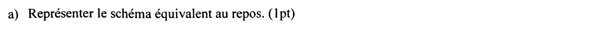{fig-alt="Question a : représenter le schéma équivalent au repos (1 pt)."}

:::: {.complement}
::: {.solution}
Au repos ($t < 0$) : les deux $K$ sont ouverts, $C$ est un circuit ouvert.

- $A$ n'est relié qu'à la masse par $R$ : aucun courant, $V_A = 0$ ;
- $B$ est le point bas d'un pont de trois résistances $R$ en série entre $E$ et la masse (deux au-dessus, une en dessous).
:::
::::

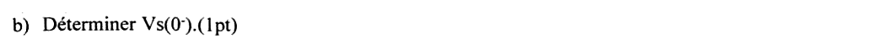{fig-alt="Question b : déterminer Vs(0−) (1 pt)."}

:::: {.complement}
::: {.solution}
$$\boxed{V_s(0^-) = E\,\frac{R}{3R} = \frac{E}{3} = 4\ \text{V}}$$
:::
::::

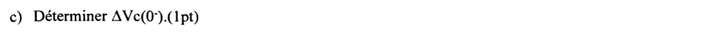{fig-alt="Question c : déterminer ΔVc(0−) (1 pt)."}

:::: {.complement}
::: {.solution}
$$\boxed{\Delta V_C(0^-) = V_A - V_B = 0 - 4 = -4\ \text{V}}$$
(l'armature côté $B$ est à 4 V au-dessus de l'armature côté $A$).
:::
::::

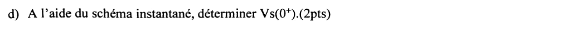{fig-alt="Question d : à l'aide du schéma instantané, déterminer Vs(0+) (2 pts)."}

:::: {.complement}
::: {.solution}
**Schéma instantané à $t = 0^+$** : les deux $K$ sont fermés ; $C$ est remplacé par une source de tension $\Delta V_C = -4$ V ($V_B = V_A + 4$ V).

- $K$ relie $A$ à la source idéale : $V_A(0^+) = E = 12$ V ;
- le condensateur impose alors $V_B = V_A - \Delta V_C = 12 + 4 = 16$ V, quelles que soient les résistances reliées à $B$ (elles ne fixent que les courants).
$$\boxed{V_s(0^+) = 16\ \text{V}}$$
Courants à $0^+$ (vérification) : $\frac{16}{100} = 160$ mA dans la résistance du bas, $\frac{16 - 12}{100} = 40$ mA remontant vers $E$ par la résistance du haut (celle du milieu est court-circuitée par le second $K$), soit 200 mA fournis par $E$ à travers $C$. Le second interrupteur n'intervient que dans l'évolution ultérieure (asymptote $V_s(\infty) = E/2 = 6$ V, constante de temps $C\,(R \parallel R) = 50$ µs ; hors question).
:::
::::

## Exercice III : diodes en commutation (7 pts) {#sec-ann1718-ex3}

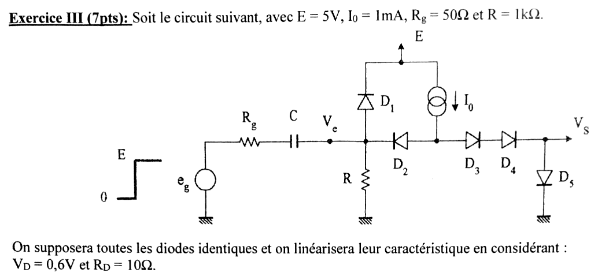{fig-alt="Exercice III, avec E = 5 V, I0 = 1 mA, Rg = 50 Ω et R = 1 kΩ. Schéma : générateur eg (échelon de 0 à E) en série avec Rg et C jusqu'au nœud Ve ; en Ve, R vers la masse, D1 vers E (anode côté Ve) et D2 (cathode côté Ve) ; l'anode de D2 est reliée à la source de courant I0 alimentée par E et aux diodes D3 et D4 en série vers la sortie Vs ; D5 de Vs vers la masse. Diodes identiques, caractéristique linéarisée VD = 0,6 V et RD = 10 Ω."}

**Notations.** $A$ : nœud commun à $D_2$, $D_3$ et $I_0$ ; $u_C = V_e - V_g$, tension aux bornes de $C$ ($V_g$ : armature côté générateur).

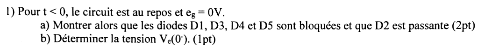{fig-alt="Question 1 : pour t < 0, le circuit est au repos et eg = 0 V. a) Montrer que les diodes D1, D3, D4 et D5 sont bloquées et que D2 est passante (2 pt). b) Déterminer la tension Ve(0−) (1 pt)."}

:::: {.complement}
::: {.solution}
**a)** Régime permanent : aucun courant dans $C$. Hypothèse : $D_2$ passante, les autres bloquées. $I_0$ traverse $D_2$ puis $R$ :
$$V_e = R I_0 = 1\ \text{V}, \qquad V_A = V_e + V_D + R_D I_0 = 1 + 0{,}6 + 0{,}01 = 1{,}61\ \text{V}.$$
- $D_3$-$D_4$-$D_5$ : il faudrait $V_A > 3V_D = 1{,}8$ V ; $1{,}61 < 1{,}8$ : bloquées.
- $D_1$ : $V_e - E = -4$ V : bloquée.
- $D_2$ : courant $I_0 > 0$ : passante. (Si elle était bloquée, $V_A = 3 \times 0{,}6 + 3 \times 0{,}01 = 1{,}83$ V avec $V_e = 0$ : elle conduirait, contradiction.)

**b)**
$$\boxed{V_e(0^-) = R I_0 = 1\ \text{V}}$$
et $u_C(0^-) = 1$ V (aucun courant dans $R_g$, $V_g = e_g = 0$).
:::
::::

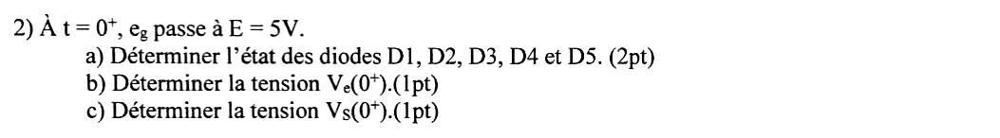{fig-alt="Question 2 : à t = 0+, eg passe à E = 5 V. a) Déterminer l'état des diodes D1, D2, D3, D4 et D5 (2 pt). b) Déterminer la tension Ve(0+) (1 pt). c) Déterminer la tension Vs(0+) (1 pt)."}

:::: {.complement}
::: {.solution}
$u_C(0^+) = 1$ V : vu de $V_e$, f.é.m. $e_g + u_C = 6$ V derrière $R_g = 50\ \Omega$.

**a)** Si $D_1$ était bloquée (et $D_2$ bloquée), $V_e = 6 \times \frac{1000}{1050} = 5{,}71$ V $> E + V_D = 5{,}6$ V : contradiction, **$D_1$ passante**. $V_e$ monte au-dessus de $V_A$ : **$D_2$ bloquée**, et $I_0$ passe par **$D_3$, $D_4$, $D_5$, passantes** ($V_A = 3V_D + 3R_D I_0 = 1{,}83$ V).

**b)** Loi des nœuds en $V_e$ :
$$\frac{6 - V_e}{50} = \frac{V_e - 5{,}6}{10} + \frac{V_e}{1000} \quad\Longrightarrow\quad 121\, V_e = 680 \quad\Longrightarrow\quad \boxed{V_e(0^+) = 5{,}62\ \text{V}}$$
Vérifications : $i_{D1} = \frac{5{,}620 - 5{,}6}{10} = 1{,}98$ mA $> 0$ ; $V_A - V_e = 1{,}83 - 5{,}62 < 0$ ($D_2$ bloquée).

**c)**
$$\boxed{V_s(0^+) = V_D + R_D I_0 = 0{,}6 + 0{,}01 = 0{,}61\ \text{V}}$$
Avec $R_D = 10\ \Omega$ au lieu de $50\ \Omega$ ([2013-2014](2013-2014-partiel.qmd#sec-ann1314-ex1)), $V_e(0^+)$ passe de 5,66 à 5,62 V et $V_s(0^+)$ de 0,65 à 0,61 V : la diode $D_1$ écrête plus franchement.
:::
::::

## Exercice IV : monostable à portes NOR CMOS (8 pts) {#sec-ann1718-ex4}

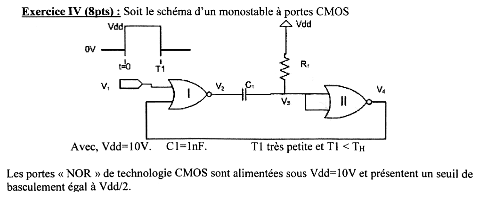{fig-alt="Exercice IV : schéma d'un monostable à portes CMOS. L'entrée V1 (impulsion de 0 V à Vdd entre t = 0 et T1) attaque la porte NOR I, dont l'autre entrée est rebouclée depuis la sortie V4 ; la sortie V2 de la porte I est reliée par le condensateur C1 au nœud V3 ; R1 relie V3 à Vdd ; V3 attaque la porte NOR II, entrées reliées, dont la sortie est V4. Avec Vdd = 10 V, C1 = 1 nF, T1 très petite et T1 < TH. Les portes NOR CMOS sont alimentées sous Vdd = 10 V et ont un seuil de basculement égal à Vdd/2."}

:::: {.complement}
::: {.solution}
La porte II, entrées reliées, est un inverseur : $V_4 = \overline{V_3}$. La porte I donne $V_2 = \overline{V_1 + V_4}$ : $V_2 = V_{dd}$ seulement si $V_1$ et $V_4$ sont tous deux bas.

**Information manquante** : l'énoncé ne dit pas si les entrées ont des diodes de protection. On suppose, comme dans le [sujet 2015-2016](2015-2016-partiel.qmd#sec-ann1516-ex2), qu'elles n'en ont pas ; cela ne change que la valeur de $V_3$ juste après $T_H$ (question 5).
:::
::::

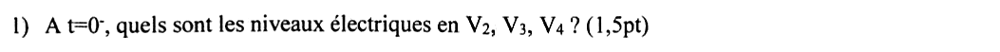{fig-alt="Question 1 : à t = 0−, quels sont les niveaux électriques en V2, V3, V4 ? (1,5 pt)"}

:::: {.complement}
::: {.solution}
Régime établi : aucun courant dans $C_1$ ni dans l'entrée de la porte II, donc aucun courant dans $R_1$ : $V_3 = V_{dd}$. Alors $V_4 = 0$ ; avec $V_1 = 0$, $V_2 = V_{dd}$.
$$\boxed{V_2(0^-) = 10\ \text{V}, \quad V_3(0^-) = 10\ \text{V}, \quad V_4(0^-) = 0}$$
Le condensateur est déchargé ($V_2 - V_3 = 0$). C'est l'état stable du monostable.
:::
::::

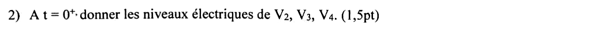{fig-alt="Question 2 : à t = 0+, donner les niveaux électriques de V2, V3, V4 (1,5 pt)."}

:::: {.complement}
::: {.solution}
$V_1$ passe à $V_{dd}$ : $V_2$ tombe à 0. La tension de $C_1$ est continue (nulle) : $V_3$ suit le saut de $-V_{dd}$ et tombe à 0, sous le seuil, donc $V_4$ passe à $V_{dd}$.
$$\boxed{V_2(0^+) = 0, \quad V_3(0^+) = 0, \quad V_4(0^+) = 10\ \text{V}}$$
$V_4 = V_{dd}$ maintient $V_2 = 0$ même quand $V_1$ redescend à $T_1$ : la porte I est verrouillée par la réaction, d'où la condition $T_1 < T_H$ (et la durée de sortie indépendante de $T_1$).
:::
::::

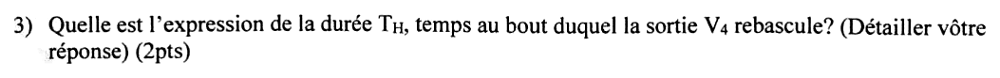{fig-alt="Question 3 : quelle est l'expression de la durée TH, temps au bout duquel la sortie V4 rebascule ? Détailler votre réponse (2 pts)."}

:::: {.complement}
::: {.solution}
Pour $0 < t < T_H$, $V_2 = 0$ est fixe ; $C_1$ se charge à travers $R_1$ depuis $V_{dd}$ :
$$V_3(t) = V_{dd}\left(1 - e^{-t/R_1C_1}\right) \qquad (V_3(0^+) = 0,\ V_3(\infty) = V_{dd},\ \tau = R_1 C_1).$$
$V_4$ rebascule quand $V_3$ atteint le seuil $V_{dd}/2$ :
$$1 - e^{-T_H/R_1C_1} = \frac12 \quad\Longrightarrow\quad \boxed{T_H = R_1 C_1 \ln 2 \approx 0{,}69\, R_1 C_1}$$
indépendant de $V_{dd}$, le seuil étant une fraction fixe de l'alimentation.
:::
::::

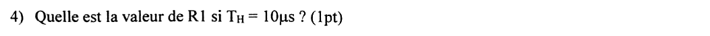{fig-alt="Question 4 : quelle est la valeur de R1 si TH = 10 µs ? (1 pt)"}

:::: {.complement}
::: {.solution}
$$R_1 = \frac{T_H}{C_1 \ln 2} = \frac{10 \cdot 10^{-6}}{10^{-9} \times 0{,}693} \quad\Longrightarrow\quad \boxed{R_1 \approx 14{,}4\ \text{k}\Omega}$$
(valeur normalisée la plus proche en série E12 : 15 kΩ, soit $T_H = 10{,}4$ µs).
:::
::::

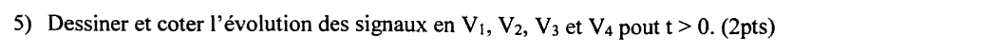{fig-alt="Question 5 : dessiner et coter l'évolution des signaux en V1, V2, V3 et V4 pour t > 0 (2 pts)."}

:::: {.complement}
::: {.solution}
- $V_1$ : impulsion de $V_{dd}$ entre 0 et $T_1$ ;
- $V_2$ : 0 de 0 à $T_H$, puis $V_{dd}$ ;
- $V_3$ : saute de 10 V à 0 en $t = 0$, remonte en exponentielle vers 10 V et atteint 5 V en $T_H$ ; à $T_H$, $V_2$ remonte de 10 V et $V_3$ saute de 5 V à **15 V**, puis redescend vers 10 V avec la même constante de temps : $V_3 = V_{dd} + \frac{V_{dd}}{2}\, e^{-(t - T_H)/R_1C_1}$ (avec des diodes de protection, ce pic serait écrêté vers 10,6 V) ;
- $V_4$ : $V_{dd}$ de 0 à $T_H$ (impulsion de sortie de durée $T_H = 10$ µs), 0 ensuite.

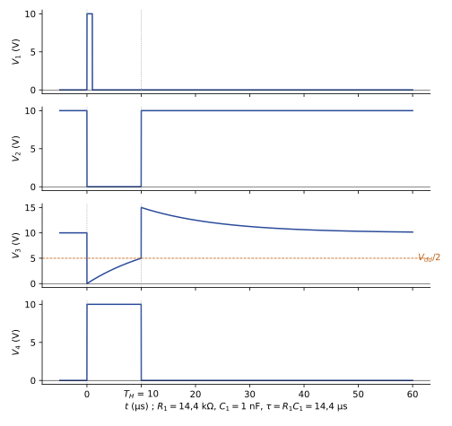{#fig-ann1718-monostable}

Le retour à l'état stable n'est complet qu'après quelques $R_1 C_1$ (le condensateur doit se décharger) : une nouvelle impulsion trop rapprochée donnerait une durée de sortie plus courte.
:::
::::
