

::: {.complement}
Aucun corrigé disponible : **les solutions de cette page sont rédigées par Claude** et vérifiées par le calcul (SymPy, simulation numérique pas à pas de la pompe de charge). À relire avec un œil critique ; signaler toute erreur. Les énoncés sont des extraits de deux photos du sujet [sujet-2022-2023], redressées (perspective) et à l'éclairage corrigé ; aucune annotation d'étudiant n'y figure (le soulignement ondulé de « Vout(t) », à l'exercice I, est imprimé et conservé). Les lignes des questions étant très serrées, les bas de caractères de la ligne précédente ont été effacés en haut de certaines découpes.

**Correspondances.** Les exercices I et II reprennent la démarche des exercices I et II du [partiel 2017-2018](2017-2018-partiel.qmd#sec-ann1718-ex1) (schéma aux variations, schéma instantané). L'exercice III fait aussi intervenir des diodes linéarisées ($V_D = 0{,}6$ V, $R_D$) comme l'exercice I du [partiel 2013-2014](2013-2014-partiel.qmd#sec-ann1314-ex1).

**Méthode commune aux exercices I et II.** Au repos (régime continu établi), un condensateur est un circuit ouvert et une inductance un court-circuit. Juste après une discontinuité, la tension d'un condensateur et le courant d'une inductance sont continus : dans le schéma aux variations à $0^+$ (sources continues éteintes), un condensateur est un court-circuit et une inductance un circuit ouvert ; dans le schéma instantané, le condensateur devient une source de tension égale à sa tension à $0^-$.
:::

## Exercice I : schéma aux variations (5 pts) {#sec-ann2223-ex1}

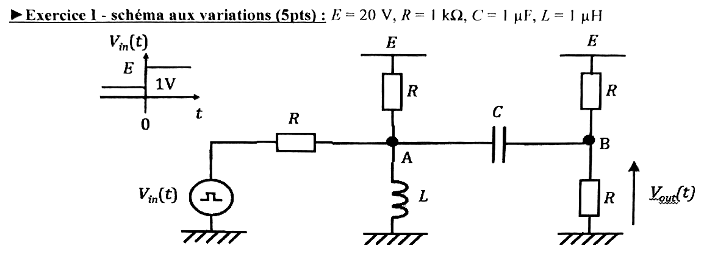{fig-alt="Exercice I, schéma aux variations, avec E = 20 V, R = 1 kΩ, C = 1 µF, L = 1 µH. Vin(t) vaut E avant t = 0 puis augmente de 1 V. Schéma : générateur Vin(t) relié par une résistance R au nœud A ; en A, une résistance R vers E et l'inductance L vers la masse ; A relié par le condensateur C au nœud B ; en B, une résistance R vers E et une résistance R vers la masse ; Vout(t) est la tension de B."}

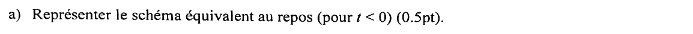{fig-alt="Question a : représenter le schéma équivalent au repos, pour t < 0 (0,5 pt)."}

:::: {.complement}
::: {.solution}
Au repos ($t < 0$, $V_{in} = E$) : $L$ est un court-circuit, donc $A$ est à la masse ; $C$ est un circuit ouvert, donc $B$ n'est relié qu'au pont $R$-$R$ entre $E$ et la masse. La partie gauche ($V_{in}$, $R$, $R$ vers $E$, $L$) et la partie droite (pont de $B$) sont indépendantes.
:::
::::

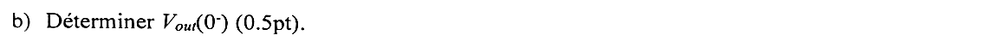{fig-alt="Question b : déterminer Vout(0−) (0,5 pt)."}

:::: {.complement}
::: {.solution}
$$\boxed{V_{out}(0^-) = E\,\frac{R}{R + R} = \frac{E}{2} = 10\ \text{V}}$$
avec $V_A(0^-) = 0$ (inductance), d'où une tension $V_A - V_B = -10$ V aux bornes de $C$.
:::
::::

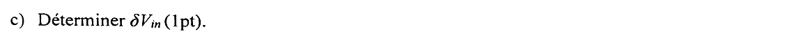{fig-alt="Question c : déterminer δVin (1 pt)."}

:::: {.complement}
::: {.solution}
D'après le chronogramme, $V_{in}$ passe de $E$ à $E + 1$ V à $t = 0$ :
$$\boxed{\delta V_{in} = 1\ \text{V}}$$
:::
::::

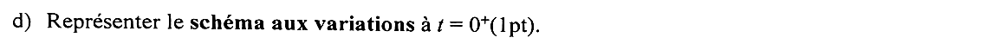{fig-alt="Question d : représenter le schéma aux variations à t = 0+ (1 pt)."}

:::: {.complement}
::: {.solution}
Schéma aux variations à $0^+$ :

- source continue $E$ éteinte : les deux résistances « vers $E$ » vont à la masse ;
- $L$ : circuit ouvert ; $C$ : court-circuit ($A$ et $B$ confondus) ;
- générateur : $\delta V_{in} = 1$ V.

Il reste $\delta V_{in}$, puis $R$ en série, aboutissant au nœud $A = B$, chargé par trois résistances $R$ en parallèle vers la masse ($R$ de $A$, et les deux $R$ de $B$).
:::
::::

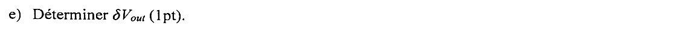{fig-alt="Question e : déterminer δVout (1 pt)."}

:::: {.complement}
::: {.solution}
Charge du nœud : $R \parallel R \parallel R = R/3$. Diviseur de tension :
$$\delta V_{out} = \delta V_A = \delta V_{in}\,\frac{R/3}{R + R/3} = \frac{\delta V_{in}}{4} \quad\Longrightarrow\quad \boxed{\delta V_{out} = 0{,}25\ \text{V}}$$
:::
::::

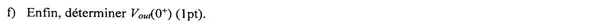{fig-alt="Question f : enfin, déterminer Vout(0+) (1 pt)."}

:::: {.complement}
::: {.solution}
$$\boxed{V_{out}(0^+) = V_{out}(0^-) + \delta V_{out} = 10{,}25\ \text{V}}$$
**Vérification directe** à $0^+$ : $i_L = 40$ mA (valeur de repos, $\frac{E}{R} + \frac{E}{R}$), $V_B = V_A + 10$ V ; loi des nœuds sur l'ensemble $\{A, B\}$ : $\frac{21 - V_A}{R} + \frac{20 - V_A}{R} - 0{,}04 + \frac{20 - V_B}{R} - \frac{V_B}{R} = 0$ donne $V_A = 0{,}25$ V et $V_B = 10{,}25$ V. Les valeurs de $L$ et $C$ ne servent pas à cette question.
:::
::::

## Exercice II : schéma instantané (5 pts) {#sec-ann2223-ex2}

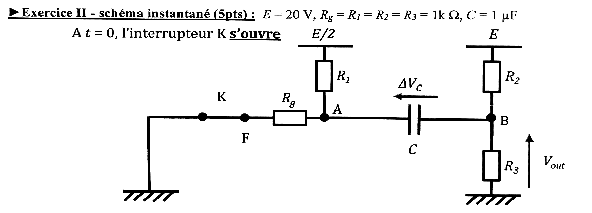{fig-alt="Exercice II, schéma instantané, avec E = 20 V, Rg = R1 = R2 = R3 = 1 kΩ, C = 1 µF. À t = 0, l'interrupteur K s'ouvre. Schéma : la masse, l'interrupteur K jusqu'au point F, puis Rg jusqu'au nœud A ; en A, R1 vers E/2 ; A relié par le condensateur C au nœud B (tension ΔVC fléchée de B vers A) ; en B, R2 vers E et R3 vers la masse ; Vout est la tension de B."}

::: {.complement}
**Convention.** La flèche de $\Delta V_C$ est dessinée de $B$ vers $A$ : avec la convention usuelle (la pointe désigne le premier potentiel), $\Delta V_C = V_A - V_B$.
:::

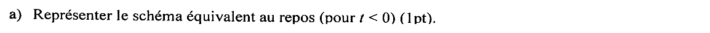{fig-alt="Question a : représenter le schéma équivalent au repos, pour t < 0 (1 pt)."}

:::: {.complement}
::: {.solution}
Au repos ($t < 0$) : $K$ fermé relie $R_g$ à la masse ; $C$ est un circuit ouvert. Deux ponts indépendants : $A$ entre $R_1$ (vers $E/2$) et $R_g$ (vers la masse) ; $B$ entre $R_2$ (vers $E$) et $R_3$ (vers la masse).
:::
::::

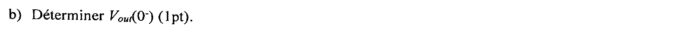{fig-alt="Question b : déterminer Vout(0−) (1 pt)."}

:::: {.complement}
::: {.solution}
$$\boxed{V_{out}(0^-) = E\,\frac{R_3}{R_2 + R_3} = 10\ \text{V}}$$
et $V_A(0^-) = \frac{E}{2}\,\frac{R_g}{R_1 + R_g} = 5$ V.
:::
::::

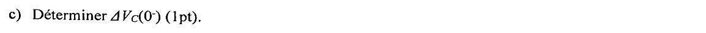{fig-alt="Question c : déterminer ΔVC(0−) (1 pt)."}

:::: {.complement}
::: {.solution}
$$\boxed{\Delta V_C(0^-) = V_A - V_B = 5 - 10 = -5\ \text{V}}$$
:::
::::

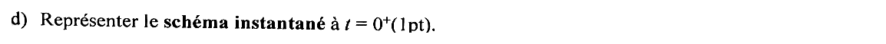{fig-alt="Question d : représenter le schéma instantané à t = 0+ (1 pt)."}

:::: {.complement}
::: {.solution}
À $0^+$ : $K$ ouvert, $R_g$ ne porte plus de courant (branche en l'air) ; $C$ est remplacé par une source de tension $\Delta V_C = -5$ V, soit $V_A = V_B - 5$ V. Il reste $R_1$ (de $E/2$ à $A$), la source $-5$ V entre $A$ et $B$, $R_2$ (de $E$ à $B$) et $R_3$ (de $B$ à la masse).
:::
::::

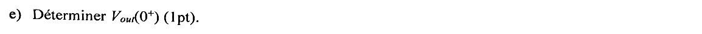{fig-alt="Question e : déterminer Vout(0+) (1 pt)."}

:::: {.complement}
::: {.solution}
Loi des nœuds sur le super-nœud $\{A, B\}$ (le courant de $R_1$ traverse le condensateur), avec $V_A = V_{out} - 5$ :
$$\frac{E/2 - V_A}{R_1} + \frac{E - V_{out}}{R_2} = \frac{V_{out}}{R_3} \quad\Longrightarrow\quad (10 - V_{out} + 5) + (20 - V_{out}) = V_{out}$$
$$\Longrightarrow\quad \boxed{V_{out}(0^+) = \frac{35}{3} \approx 11{,}7\ \text{V}}, \qquad V_A(0^+) = 6{,}67\ \text{V}.$$
L'ouverture de $K$ supprime le courant qui partait de $A$ vers la masse par $R_g$ ; $A$ et donc $B$ (relié par la tension fixe du condensateur) montent instantanément de 1,67 V.
:::
::::

## Exercice III : pompe de charge à diodes (10 pts) {#sec-ann2223-ex3}

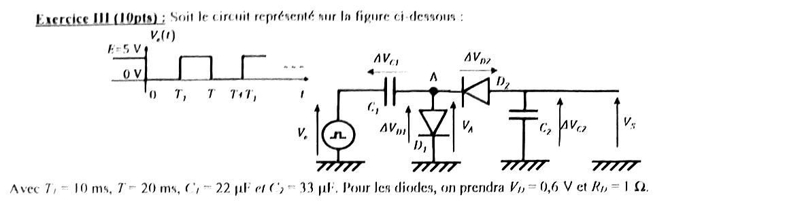{fig-alt="Exercice III : Ve(t) vaut E = 5 V avant t = 0, 0 V de 0 à T1, 5 V de T1 à T, 0 V de T à T + T1, et ainsi de suite. Schéma : générateur Ve relié par le condensateur C1 (tension ΔVC1 fléchée vers le générateur) au nœud A (potentiel VA) ; diode D1 de A vers la masse (anode côté A, tension ΔVD1) ; diode D2 entre A et la sortie (cathode côté A, anode côté sortie, tension ΔVD2 fléchée vers la sortie) ; condensateur C2 de la sortie vers la masse (tension ΔVC2) ; tension de sortie VS. Avec T1 = 10 ms, T = 20 ms, C1 = 22 µF et C2 = 33 µF ; diodes VD = 0,6 V et RD = 1 Ω."}

:::: {.complement}
::: {.solution}
**Conventions** (d'après les flèches) : $\Delta V_{C1} = V_e - V_A$, $\Delta V_{D1} = V_A$, $\Delta V_{D2} = V_S - V_A$ (tension anode-cathode de $D_2$), $\Delta V_{C2} = V_S$. Charges : $Q_1 = C_1 \Delta V_{C1}$ (armature côté $V_e$), $Q_2 = C_2 \Delta V_{C2}$ (armature côté sortie).

**Principe** : $D_1$ conduit quand $V_A > 0{,}6$ V, $D_2$ quand $V_A < V_S - 0{,}6$ V. Quand $V_e$ monte, $C_1$ se recharge par $D_1$ ; quand $V_e$ descend, $V_A$ devient très négatif et $C_1$ « pompe » des charges de $C_2$ à travers $D_2$ : $V_S$ devient de plus en plus négatif (inverseur de tension à pompe de charge).
:::
::::

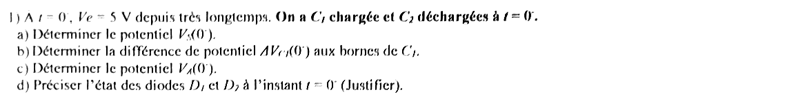{fig-alt="Question 1 : à t = 0−, Ve = 5 V depuis très longtemps ; on a C1 chargée et C2 déchargée à t = 0−. a) Déterminer le potentiel VS(0−). b) Déterminer la différence de potentiel ΔVC1(0−) aux bornes de C1. c) Déterminer le potentiel VA(0−). d) Préciser l'état des diodes D1 et D2 à l'instant t = 0− (justifier)."}

::: {.a-verifier #av-ann2223-charge-c1}
**Source** [sujet-2022-2023, p. 2] : « À t = 0⁻, Ve = 5 V depuis très longtemps. On a C1 chargée et C2 déchargées à t = 0⁻ ».

**Problème** : la tension de charge de $C_1$ n'est pas donnée. En régime continu, aucun courant ne traverse $C_1$ ; avec le modèle linéarisé, toute valeur de $V_A$ entre $-0{,}6$ V et $+0{,}6$ V annule les courants des deux diodes, donc $\Delta V_{C1}(0^-)$ n'est pas déterminé par le seul régime permanent.

**Proposition** : interpréter « chargée » comme « chargée par $V_e = 5$ V à travers $D_1$ » (charge achevée quand le courant de $D_1$ s'annule) : $V_A(0^-) = V_D = 0{,}6$ V et $\Delta V_{C1}(0^-) = E - V_D = 4{,}4$ V. C'est la seule lecture cohérente avec la suite (même état qu'à $T^-$, question 5) ; elle est retenue dans tout le corrigé.
:::

:::: {.complement}
::: {.solution}
**a)** $C_2$ déchargé : $\boxed{V_S(0^-) = 0}$.

**b)** $C_1$ s'est chargé à travers $D_1$ jusqu'à l'annulation du courant, $V_A = V_D$ (voir le bloc ci-dessus) :
$$\boxed{\Delta V_{C1}(0^-) = E - V_D = 4{,}4\ \text{V}}$$

**c)** $\boxed{V_A(0^-) = V_e - \Delta V_{C1} = 0{,}6\ \text{V}}$

**d)** $D_1$ : $\Delta V_{D1} = 0{,}6$ V $= V_D$ avec un courant nul, à la limite de la conduction (bloquée en pratique, aucun courant). $D_2$ : $\Delta V_{D2} = V_S - V_A = -0{,}6$ V $< V_D$ : **bloquée**.
:::
::::

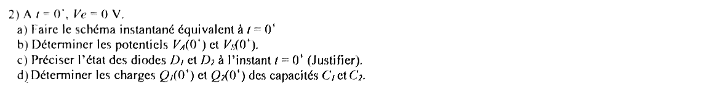{fig-alt="Question 2 : à t = 0+, Ve = 0 V. a) Faire le schéma instantané équivalent à t = 0+. b) Déterminer les potentiels VA(0+) et VS(0+). c) Préciser l'état des diodes D1 et D2 à l'instant t = 0+ (justifier). d) Déterminer les charges Q1(0+) et Q2(0+) des capacités C1 et C2."}

:::: {.complement}
::: {.solution}
**a)** Schéma instantané : $V_e = 0$ (générateur relié à la masse), $C_1$ remplacé par une source de 4,4 V ($V_A = V_e - 4{,}4$ V), $C_2$ par une source de 0 V ; diodes remplacées selon leur état.

**b)** Les tensions des condensateurs sont continues :
$$\boxed{V_A(0^+) = 0 - 4{,}4 = -4{,}4\ \text{V}, \qquad V_S(0^+) = 0}$$

**c)** $D_1$ : $\Delta V_{D1} = -4{,}4$ V : **bloquée**. $D_2$ : $\Delta V_{D2} = 0 - (-4{,}4) = 4{,}4$ V $> V_D$ : **passante**, avec un fort courant initial $\frac{4{,}4 - 0{,}6}{R_D} = 3{,}8$ A (limité seulement par $R_D = 1\ \Omega$).

**d)**
$$\boxed{Q_1(0^+) = C_1 \Delta V_{C1} = 22\ \text{µF} \times 4{,}4\ \text{V} = 96{,}8\ \text{µC}, \qquad Q_2(0^+) = 0}$$
:::
::::

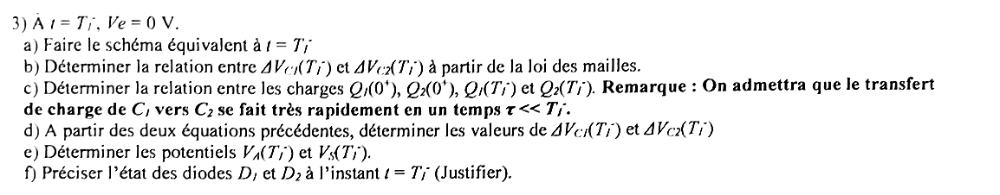{fig-alt="Question 3 : à t = T1−, Ve = 0 V. a) Faire le schéma équivalent à t = T1−. b) Déterminer la relation entre ΔVC1(T1−) et ΔVC2(T1−) à partir de la loi des mailles. c) Déterminer la relation entre les charges Q1(0+), Q2(0+), Q1(T1−) et Q2(T1−) ; remarque : on admettra que le transfert de charge de C1 vers C2 se fait très rapidement en un temps τ très petit devant T1−. d) À partir des deux équations précédentes, déterminer les valeurs de ΔVC1(T1−) et ΔVC2(T1−). e) Déterminer les potentiels VA(T1−) et VS(T1−). f) Préciser l'état des diodes D1 et D2 à l'instant t = T1− (justifier)."}

:::: {.complement}
::: {.solution}
**Durée du transfert** : $C_1$ et $C_2$ se déchargent l'un dans l'autre à travers $R_D$ (en série, $C_1$ et $C_2$ vus de la diode) : $\tau = R_D \frac{C_1 C_2}{C_1 + C_2} = 1 \times 13{,}2$ µF $= 13{,}2$ µs $\ll T_1 = 10$ ms. À $T_1^-$ le transfert est terminé.

**a)** Schéma à $T_1^-$ : $V_e = 0$, $D_1$ bloquée, $D_2$ en fin de conduction (courant nul) ; maille $V_e$, $C_1$, $D_2$, $C_2$, masse.

**b) Loi des mailles.** $V_A = V_e - \Delta V_{C1}$ et $V_S = \Delta V_{C2} = V_A + \Delta V_{D2}$. Le courant de $D_2$ s'annulant, $\Delta V_{D2} = V_D$ :
$$\boxed{\Delta V_{C1}(T_1^-) + \Delta V_{C2}(T_1^-) = V_D = 0{,}6\ \text{V}}$$

**c) Conservation de la charge.** L'armature de $C_1$ côté $A$ (charge $-Q_1$) et l'armature de $C_2$ côté sortie (charge $+Q_2$) ne sont reliées qu'entre elles, par $D_2$ ($D_1$ bloquée) : leur charge totale se conserve.
$$\boxed{Q_2(T_1^-) - Q_1(T_1^-) = Q_2(0^+) - Q_1(0^+) = -96{,}8\ \text{µC}}$$

**d)** Avec $Q_i = C_i \Delta V_{Ci}$ et $\Delta V_{C1} = 0{,}6 - \Delta V_{C2}$ :
$$33\,\Delta V_{C2} - 22\,(0{,}6 - \Delta V_{C2}) = -96{,}8 \quad\Longrightarrow\quad 55\,\Delta V_{C2} = -83{,}6$$
$$\boxed{\Delta V_{C2}(T_1^-) = -1{,}52\ \text{V}, \qquad \Delta V_{C1}(T_1^-) = 2{,}12\ \text{V}}$$
Forme générale : $\Delta V_{C2} = \frac{C_1 (V_D - (E - V_D))}{C_1 + C_2} = -\frac{C_1}{C_1 + C_2}(E - 2V_D)$.

**e)**
$$\boxed{V_A(T_1^-) = 0 - 2{,}12 = -2{,}12\ \text{V}, \qquad V_S(T_1^-) = -1{,}52\ \text{V}}$$

**f)** $D_1$ : $V_A = -2{,}12$ V : **bloquée**. $D_2$ : $\Delta V_{D2} = -1{,}52 + 2{,}12 = 0{,}6$ V avec un courant nul : à la limite de la conduction, le transfert est fini.
:::
::::

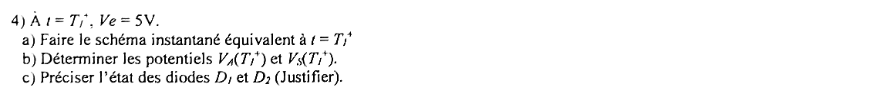{fig-alt="Question 4 : à t = T1+, Ve = 5 V. a) Faire le schéma instantané équivalent à t = T1+. b) Déterminer les potentiels VA(T1+) et VS(T1+). c) Préciser l'état des diodes D1 et D2 (justifier)."}

:::: {.complement}
::: {.solution}
**a)** $V_e = 5$ V ; $C_1$ : source de 2,12 V ; $C_2$ : source de $-1{,}52$ V.

**b)**
$$\boxed{V_A(T_1^+) = 5 - 2{,}12 = 2{,}88\ \text{V}, \qquad V_S(T_1^+) = -1{,}52\ \text{V}}$$

**c)** $D_1$ : $V_A = 2{,}88$ V $> 0{,}6$ V : **passante** (courant initial $\frac{2{,}88 - 0{,}6}{1} = 2{,}28$ A). $D_2$ : $\Delta V_{D2} = -1{,}52 - 2{,}88 = -4{,}4$ V : **bloquée** ; $C_2$ est isolé et garde sa charge.
:::
::::

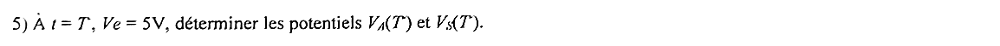{fig-alt="Question 5 : à t = T−, Ve = 5 V, déterminer les potentiels VA(T−) et VS(T−)."}

:::: {.complement}
::: {.solution}
Entre $T_1$ et $T$, $C_1$ se recharge par $D_1$ avec $\tau = R_D C_1 = 22$ µs $\ll T - T_1$ : la charge s'achève quand le courant de $D_1$ s'annule, $V_A = V_D$, $\Delta V_{C1} = 4{,}4$ V (même état qu'à $0^-$). $C_2$ n'a pas bougé ($D_2$ bloquée, pas de charge en sortie).
$$\boxed{V_A(T^-) = 0{,}6\ \text{V}, \qquad V_S(T^-) = -1{,}52\ \text{V}}$$
:::
::::

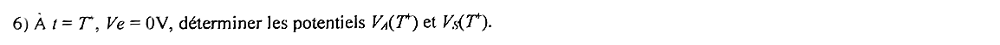{fig-alt="Question 6 : à t = T+, Ve = 0 V, déterminer les potentiels VA(T+) et VS(T+)."}

:::: {.complement}
::: {.solution}
$$\boxed{V_A(T^+) = 0 - 4{,}4 = -4{,}4\ \text{V}, \qquad V_S(T^+) = -1{,}52\ \text{V}}$$
$\Delta V_{D2} = -1{,}52 + 4{,}4 = 2{,}88$ V $> V_D$ : $D_2$ conduit, un nouveau transfert commence ($D_1$ bloquée).
:::
::::

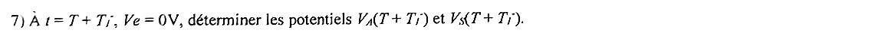{fig-alt="Question 7 : à t = T + T1−, Ve = 0 V, déterminer les potentiels VA(T + T1−) et VS(T + T1−)."}

:::: {.complement}
::: {.solution}
Mêmes relations qu'à la question 3, à partir de $Q_1(T^+) = 96{,}8$ µC et $Q_2(T^+) = 33 \times (-1{,}52) = -50{,}16$ µC :
$$\Delta V_{C1} + \Delta V_{C2} = 0{,}6, \qquad 33\,\Delta V_{C2} - 22\,\Delta V_{C1} = -50{,}16 - 96{,}8 = -146{,}96\ \text{µC}$$
$$\Longrightarrow\quad 55\,\Delta V_{C2} = -133{,}76 \quad\Longrightarrow\quad \boxed{V_S(T + T_1^-) = -2{,}43\ \text{V}, \qquad V_A(T + T_1^-) = V_S - V_D = -3{,}03\ \text{V}}$$
(valeurs confirmées par simulation : $-2{,}432$ V et $-3{,}032$ V).
:::
::::

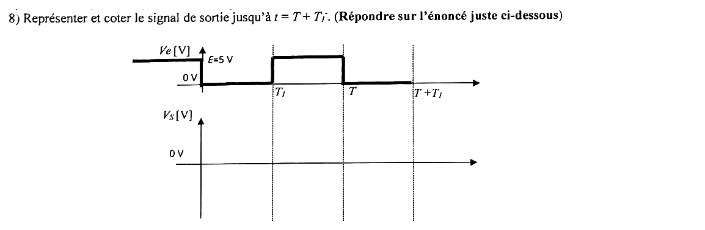{fig-alt="Question 8 : représenter et coter le signal de sortie jusqu'à t = T + T1− (répondre sur l'énoncé, juste en dessous). Chronogramme fourni : Ve vaut 5 V avant 0, 0 V de 0 à T1, 5 V de T1 à T, 0 V de T à T + T1 ; axe VS vierge avec le niveau 0 V et des repères verticaux en T1, T et T + T1."}

:::: {.complement}
::: {.solution}
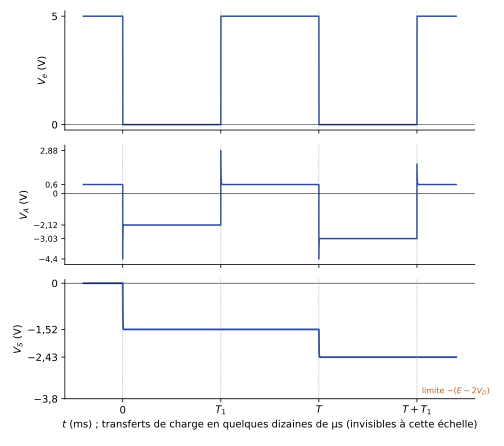{#fig-ann2223-pompe}

À coter : $V_S = 0$ pour $t < 0$ ; chute quasi instantanée ($\tau = 13{,}2$ µs) à $-1{,}52$ V en $t = 0^+$, palier jusqu'à $T$ (pas d'évolution pendant $T_1 < t < T$, $D_2$ bloquée) ; nouvelle marche à $-2{,}43$ V juste après $T$, palier jusqu'à $T + T_1$.
:::
::::

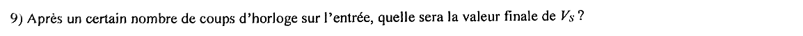{fig-alt="Question 9 : après un certain nombre de coups d'horloge sur l'entrée, quelle sera la valeur finale de VS ?"}

:::: {.complement}
::: {.solution}
À chaque front descendant $n$, la conservation de la charge donne la récurrence
$$V_{S,n+1} = \frac{C_2\, V_{S,n} - C_1 (E - 2V_D)}{C_1 + C_2} = 0{,}6\, V_{S,n} - 1{,}52\ \text{V},$$
qui redonne $-1{,}52$ V puis $-2{,}43$ V, et converge (raison $0{,}6 < 1$) vers le point fixe
$$\boxed{V_{S,\infty} = -(E - 2V_D) = -3{,}8\ \text{V}}$$
Interprétation : le transfert s'arrête quand $D_2$ ne conduit plus du tout, c'est-à-dire quand le point le plus bas de $V_A$, $-(E - V_D) = -4{,}4$ V, ne descend plus sous $V_S - V_D$. Sans charge en sortie, le montage est un **inverseur de tension** : $V_S \approx -E$ aux deux seuils de diode près. Avec une charge résistive, $V_S$ se stabiliserait un peu au-dessus (moins négatif), avec une ondulation.
:::
::::

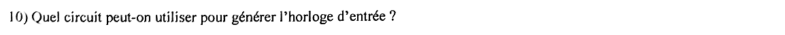{fig-alt="Question 10 : quel circuit peut-on utiliser pour générer l'horloge d'entrée ?"}

:::: {.complement}
::: {.solution}
Un **multivibrateur astable** produisant un créneau 0 / 5 V de période 20 ms et de rapport cyclique 0,5, par exemple :

- un **NE555 en astable** (voir le fonctionnement du LM555 au [partiel 2013-2014](2013-2014-partiel.qmd#sec-ann1314-ex3)) ;
- un astable à **comparateur à hystérésis** (trigger à AOP, [partiel 2014-2015](2014-2015-partiel.qmd#sec-ann1415-ex2)) ou à **portes logiques CMOS** ([partiel 2015-2016](2015-2016-partiel.qmd#sec-ann1516-ex2)) ;
- ou une horloge numérique (quartz et diviseur, microcontrôleur).
:::
::::
