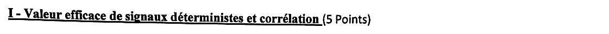
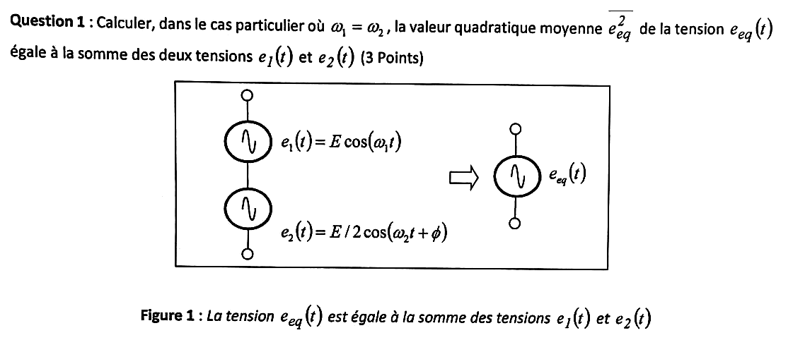
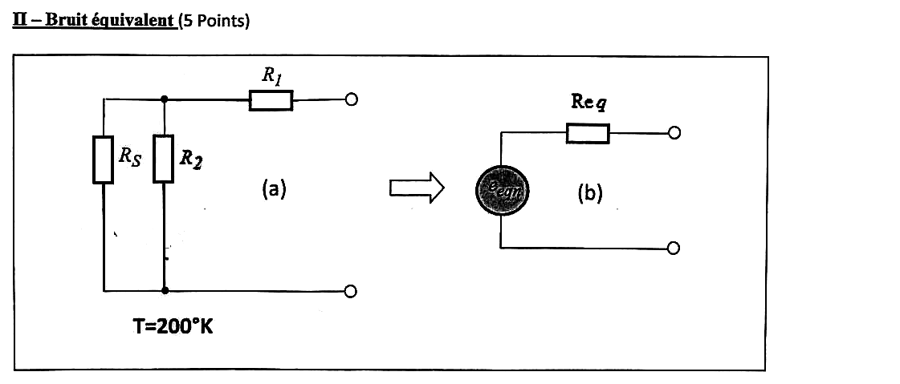
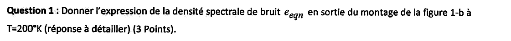
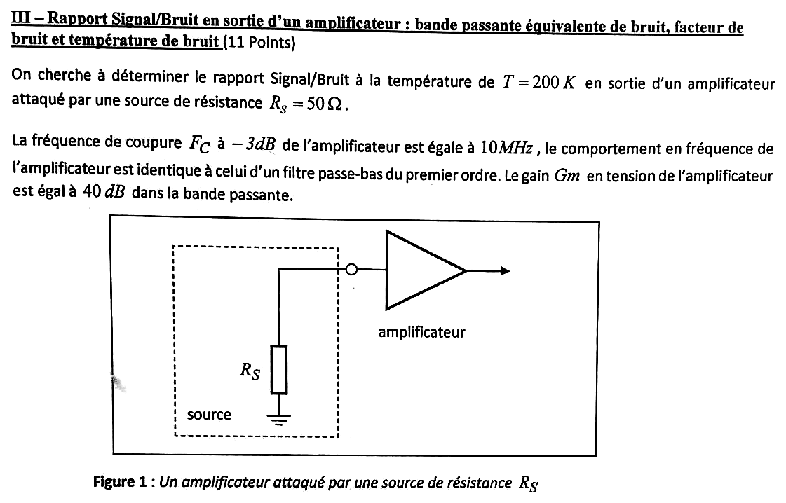
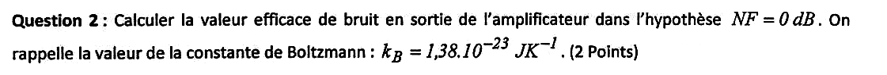
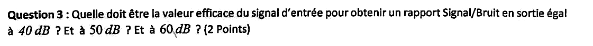
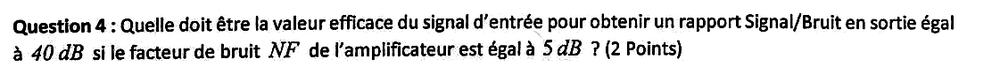
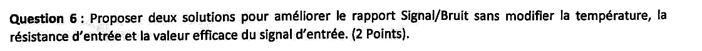



::: {.complement}
Aucun corrigé officiel : **les solutions de cette page sont rédigées par Claude** et vérifiées par le calcul. À relire avec un œil critique ; signaler toute erreur. Les énoncés sont des extraits du scan du sujet [sujet-bruit-2015] (date de l'épreuve non indiquée) ; les annotations d'un étudiant à l'encre bleue ont été effacées des images : sources de bruit « $e_1$ », « $e_S$ », « $e_2$ » entourées sur la figure de l'exercice II (les fils qu'elles recouvraient ont été retracés à l'identique) et calcul en marge de l'exercice III.

Le sujet vient de l'ancien module EA222 « Initiation aux bruits en électronique », **rangé par défaut avec EANA2** (rattachement à confirmer) : il correspond à la partie « bruit » de la matière, support de T. Taris [bruit].

**Correspondances.** Le [partiel 2016-2017](2016-2017-partiel-initiation-bruit.qmd) reprend les trois exercices presque à l'identique : déphasage fixé à $\pi/4$ (exercice I), source de courant de bruit à la place de $R_2$ (exercice II), $T = 300$ K, $R_S = 100\ \Omega$ et gain de 20 dB (exercice III).
:::

Donnée du sujet : $k_B = 1{,}38 \times 10^{-23}\ \mathrm{J\,K^{-1}}$.

## Exercice I : valeur efficace de signaux déterministes et corrélation (5 points) {#sec-ann1516-ex1}

{fig-alt="Titre de l'exercice I : valeur efficace de signaux déterministes et corrélation (5 points)."}

{fig-alt="Question 1 (3 points) : dans le cas ω1 = ω2, calculer la valeur quadratique moyenne de eeq(t), somme de e1(t) = E cos(ω1 t) et e2(t) = E/2 cos(ω2 t + φ) (figure 1 : deux générateurs en série équivalents à un générateur eeq(t))."}

:::: {.complement}
::: {.solution}
Avec $\omega_1 = \omega_2 = \omega$ et $e_{eq} = e_1 + e_2$ :
$$\overline{e_{eq}^2} = \overline{e_1^2} + \overline{e_2^2} + 2\,\overline{e_1 e_2}.$$
- $\overline{e_1^2} = \dfrac{E^2}{2}$, $\overline{e_2^2} = \dfrac{(E/2)^2}{2} = \dfrac{E^2}{8}$ ;
- terme croisé, avec $2\cos A \cos B = \cos(A+B) + \cos(A-B)$ : $\overline{\cos(\omega t)\cos(\omega t + \phi)} = \dfrac{\cos\phi}{2}$ (le terme en $2\omega t$ est de moyenne nulle), d'où $2\,\overline{e_1 e_2} = 2 \cdot E \cdot \dfrac{E}{2} \cdot \dfrac{\cos\phi}{2} = \dfrac{E^2}{2}\cos\phi$.

$$\boxed{\overline{e_{eq}^2} = \frac{5E^2}{8} + \frac{E^2}{2}\cos\phi}$$

**Lien avec le bruit** : les deux signaux, de même fréquence, sont **corrélés** ; les valeurs quadratiques moyennes ne s'additionnent pas simplement. Si $\omega_1 \neq \omega_2$, le terme croisé est de moyenne nulle et $\overline{e_{eq}^2} = \overline{e_1^2} + \overline{e_2^2} = \frac{5E^2}{8}$ : c'est le cas des sources de bruit non corrélées, dont les VQM (et les DSP) s'ajoutent [bruit, p. 15].
:::
::::

{fig-alt="Question 2 (2 points) : pour quelles valeurs de φ la valeur quadratique moyenne de eeq est-elle maximale ? minimale ?"}

:::: {.complement}
::: {.solution}
- **Maximale** pour $\cos\phi = 1$, soit $\phi = 0 \pmod{2\pi}$ (signaux en phase, amplitudes qui s'ajoutent : $\frac{3E}{2}$) : $\overline{e_{eq}^2}_{\max} = \dfrac{9E^2}{8}$.
- **Minimale** pour $\cos\phi = -1$, soit $\phi = \pi \pmod{2\pi}$ (opposition de phase, amplitude $\frac{E}{2}$) : $\overline{e_{eq}^2}_{\min} = \dfrac{E^2}{8}$.
:::
::::

## Exercice II : bruit équivalent (5 points) {#sec-ann1516-ex2}

{fig-alt="Exercice II : bruit équivalent. Figure : (a) résistances RS et R2 en parallèle entre un nœud et la masse, résistance R1 en série vers la sortie, température T = 200 K ; (b) schéma équivalent : générateur de bruit eeqn en série avec une résistance Req."}

{fig-alt="Question 1 (3 points) : expression de la densité spectrale de bruit eeqn en sortie du montage de la figure 1-b à T = 200 K (réponse à détailler)."}

:::: {.complement}
::: {.solution}
Chaque résistance est modélisée par une source de tension de bruit thermique en série, de DSP $\overline{v_n^2}(f) = 4kTR$ [bruit, p. 23 et 31] ; les trois sources sont **non corrélées** : on additionne les DSP après les avoir ramenées en sortie (sortie à vide).

- $e_S$ (de $R_S$) vue en sortie à travers le diviseur $R_S$, $R_2$ : facteur $\dfrac{R_2}{R_S + R_2}$ ;
- $e_2$ (de $R_2$) : facteur $\dfrac{R_S}{R_S + R_2}$ ;
- $e_1$ (de $R_1$) : facteur 1 (aucun courant dans $R_1$ à vide).

$$\overline{e_{eqn}^2} = 4kT R_S\left(\frac{R_2}{R_S + R_2}\right)^2 + 4kT R_2\left(\frac{R_S}{R_S + R_2}\right)^2 + 4kT R_1 = 4kT\,\frac{R_S R_2 (R_2 + R_S)}{(R_S + R_2)^2} + 4kTR_1$$
$$\boxed{\overline{e_{eqn}^2}(f) = 4kT\left(R_1 + \frac{R_S R_2}{R_S + R_2}\right)}\ \ [\mathrm{V^2/Hz}], \qquad 4kT = 1{,}104 \times 10^{-20}\ \mathrm{J}\ \text{à 200 K}.$$
Bruit blanc : DSP indépendante de $f$. Les valeurs des résistances ne sont pas données : le résultat reste littéral.
:::
::::

{fig-alt="Question 2 (1 + 1 points) : expression de Req en sortie du montage de la figure 1-b, et vérification de la réponse à la question 1 à partir de cette réponse."}

:::: {.complement}
::: {.solution}
Sources éteintes, la résistance vue de la sortie est
$$\boxed{R_{eq} = R_1 + R_S \parallel R_2 = R_1 + \frac{R_S R_2}{R_S + R_2}}$$
**Vérification** : un dipôle passif composé uniquement de résistances à la même température $T$ produit le bruit thermique de sa résistance équivalente (théorème de Nyquist) : $\overline{e_{eqn}^2} = 4kT R_{eq}$, ce qui est bien le résultat de la question 1. (Résultats du cours pour les associations série et parallèle [bruit, p. 33].)
:::
::::

## Exercice III : rapport signal sur bruit en sortie d'un amplificateur (11 points) {#sec-ann1516-ex3}

{fig-alt="Exercice III : rapport signal sur bruit en sortie d'un amplificateur à T = 200 K, attaqué par une source de résistance RS = 50 Ω. Fréquence de coupure à −3 dB FC = 10 MHz, comportement passe-bas du premier ordre, gain en tension Gm = 40 dB dans la bande passante. Figure 1 : source (RS reliée à la masse) en entrée d'un amplificateur."}

**Hypothèses de la correction** (non précisées par l'énoncé) : impédance d'entrée de l'amplificateur infinie (toute la f.é.m. de la source et tout son bruit sont appliqués à l'entrée) ; facteur de bruit $F$ défini par rapport à la source à la température $T$ de l'énoncé, $F = \mathrm{SNR}_e / \mathrm{SNR}_s$ [bruit, p. 41].

{fig-alt="Question 1 (1 point) : calculer la bande passante équivalente de bruit BENBW de l'amplificateur."}

:::: {.complement}
::: {.solution}
Pour un premier ordre, $B_{ENBW} = \int_0^\infty \frac{\mathrm{d}f}{1 + (f/F_C)^2} = \frac{\pi}{2} F_C$ [bruit, p. 18] :
$$B_{ENBW} = \frac{\pi}{2} \times 10\ \mathrm{MHz} \approx \boxed{15{,}7\ \mathrm{MHz}}$$
:::
::::

{fig-alt="Question 2 (2 points) : valeur efficace du bruit en sortie de l'amplificateur dans l'hypothèse NF = 0 dB (kB = 1,38·10^-23 J/K)."}

:::: {.complement}
::: {.solution}
$NF = 0$ dB : amplificateur non bruyant, seul le bruit thermique de $R_S$ est amplifié.
$$\overline{v_{ne}^2} = 4kT R_S\, B_{ENBW} = 4 \times 1{,}38 \times 10^{-23} \times 200 \times 50 \times 15{,}7 \times 10^6 \approx 8{,}67 \times 10^{-12}\ \mathrm{V^2}, \quad v_{ne,\text{eff}} \approx 2{,}94\ \mu\mathrm{V}.$$
Gain $G_m = 40$ dB, soit 100 en tension :
$$v_{ns,\text{eff}} = G_m\, v_{ne,\text{eff}} \approx \boxed{294\ \mu\mathrm{V}}$$
:::
::::

{fig-alt="Question 3 (2 points) : valeur efficace du signal d'entrée pour un rapport signal sur bruit en sortie de 40 dB ? 50 dB ? 60 dB ?"}

:::: {.complement}
::: {.solution}
Amplificateur non bruyant : $\mathrm{SNR}_s = \mathrm{SNR}_e = \dfrac{V_{e,\text{eff}}^2}{\overline{v_{ne}^2}}$, donc $V_{e,\text{eff}} = v_{ne,\text{eff}} \times 10^{\mathrm{SNR}_\mathrm{dB}/20}$ :

| $\mathrm{SNR}_s$ | 40 dB | 50 dB | 60 dB |
|---|---|---|---|
| $V_{e,\text{eff}}$ | **294 µV** | **931 µV** | **2,94 mV** |
:::
::::

{fig-alt="Question 4 (2 points) : valeur efficace du signal d'entrée pour un rapport signal sur bruit en sortie de 40 dB si le facteur de bruit NF de l'amplificateur vaut 5 dB."}

:::: {.complement}
::: {.solution}
$NF = \mathrm{SNR}_{e,\mathrm{dB}} - \mathrm{SNR}_{s,\mathrm{dB}}$ : il faut $\mathrm{SNR}_e = 40 + 5 = 45$ dB.
$$V_{e,\text{eff}} = 2{,}94\ \mu\mathrm{V} \times 10^{45/20} \approx \boxed{524\ \mu\mathrm{V}}$$
(soit $\sqrt{F} = 1{,}78$ fois la valeur de la question 3).
:::
::::

{fig-alt="Question 5 (2 points) : quelle est la température équivalente Teq de la source ?"}

:::: {.complement}
::: {.solution}
C'est la température à laquelle il faudrait porter $R_S$ pour que, avec un amplificateur **non bruyant**, on obtienne le même bruit en sortie que la source réelle (à $T$) avec l'amplificateur réel. Le bruit total ramené à l'entrée vaut $F \cdot 4kTR_S B$, d'où
$$\boxed{T_{eq} = T\,F = T \cdot 10^{NF/10}} = 200 \times 10^{0{,}5} \approx \boxed{632\ \mathrm{K}}$$
C'est la formule fournie avec le [sujet 2016-2017](2016-2017-partiel-initiation-bruit.qmd). L'amplificateur seul contribue $T_e = T(F - 1) \approx 432$ K (température de bruit de l'amplificateur, ici rapportée à $T = 200$ K et non à la référence habituelle de 290 K).
:::
::::

{fig-alt="Question 6 (2 points) : proposer deux solutions pour améliorer le rapport signal sur bruit sans modifier la température, la résistance d'entrée et la valeur efficace du signal d'entrée."}

:::: {.complement}
::: {.solution}
1. **Réduire la bande équivalente de bruit** : filtrer à la seule bande utile du signal (un sinus n'a besoin que d'une bande étroite) ; le bruit blanc est proportionnel à $B_{ENBW}$, le signal n'est pas atténué.
2. **Réduire le facteur de bruit de l'amplificateur** : choisir un amplificateur faible bruit (LNA), en particulier pour le premier étage d'une chaîne, qui fixe le facteur de bruit global (formule de Friis [bruit, p. 43]).

(Augmenter le gain ne sert à rien : signal et bruit sont amplifiés de la même façon.)
:::
::::
