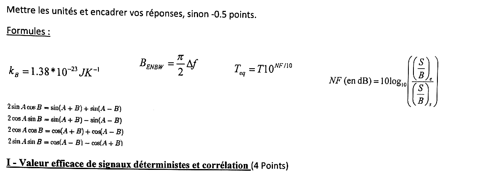
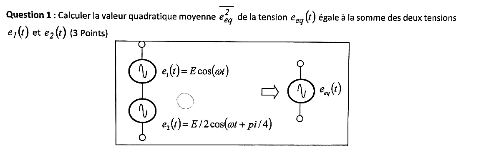
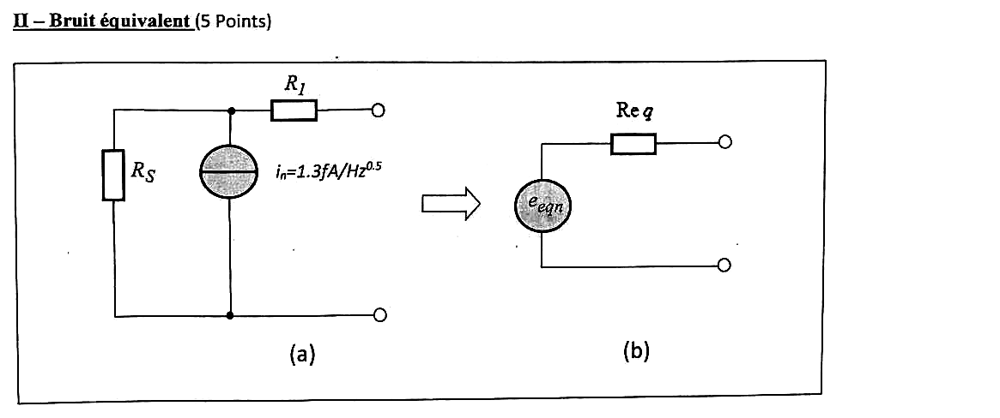
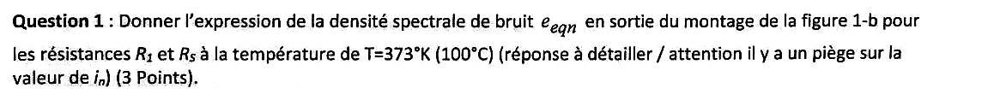
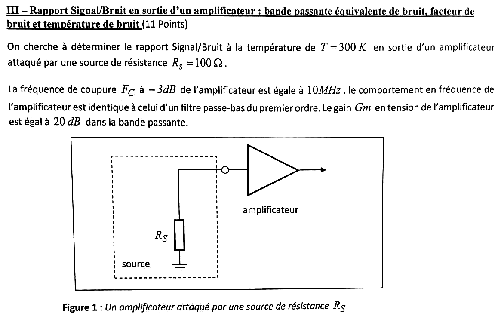
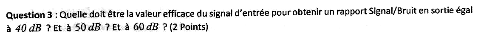
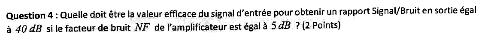
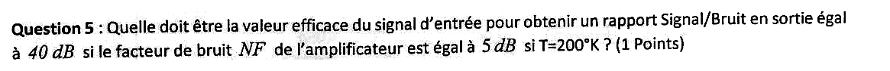
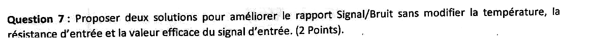



::: {.complement}
Aucun corrigé officiel : **les solutions de cette page sont rédigées par Claude** et vérifiées par le calcul. À relire avec un œil critique ; signaler toute erreur. Les énoncés sont des extraits du scan du sujet [sujet-bruit-2016] (date de l'épreuve non indiquée).

Le sujet vient de l'ancien module EA222 « Initiation aux bruits en électronique », **rangé par défaut avec EANA2** (rattachement à confirmer) : il correspond à la partie « bruit » de la matière, support de T. Taris [bruit].

**Correspondances.** Les trois exercices reprennent ceux du [partiel 2015-2016](2015-2016-partiel-initiation-bruit.qmd) avec d'autres valeurs. L'exercice II du sujet passe de la question 1 à la question 3 (pas de question 2) : la numérotation du sujet est conservée.
:::

## Exercice I : valeur efficace de signaux déterministes et corrélation (4 points) {#sec-ann1617-ex1}

{fig-alt="Consigne : mettre les unités et encadrer les réponses, sinon −0,5 point. Formules fournies : kB = 1,38·10^-23 J/K ; BENBW = (π/2)·Δf ; Teq = T·10^(NF/10) ; NF (en dB) = 10 log10((S/B)e / (S/B)s) ; formules de trigonométrie 2 sin A cos B = sin(A+B) + sin(A−B), 2 cos A sin B = sin(A+B) − sin(A−B), 2 cos A cos B = cos(A+B) + cos(A−B), 2 sin A sin B = cos(A−B) − cos(A+B). Titre de l'exercice I (4 points)."}

{fig-alt="Question 1 (3 points) : calculer la valeur quadratique moyenne de eeq(t), somme de e1(t) = E cos(ωt) et e2(t) = E/2 cos(ωt + pi/4)."}

:::: {.complement}
::: {.solution}
Même calcul qu'en [2015-2016](2015-2016-partiel-initiation-bruit.qmd#sec-ann1516-ex1), avec $\phi = \pi/4$ :
$$\overline{e_{eq}^2} = \underbrace{\frac{E^2}{2}}_{\overline{e_1^2}} + \underbrace{\frac{E^2}{8}}_{\overline{e_2^2}} + \underbrace{2 \cdot E \cdot \frac{E}{2} \cdot \frac{\cos(\pi/4)}{2}}_{2\overline{e_1 e_2}} = \frac{5E^2}{8} + \frac{E^2}{2\sqrt{2}}$$
(terme croisé par $2\cos A\cos B = \cos(A+B) + \cos(A-B)$, le terme en $2\omega t$ étant de moyenne nulle).
$$\boxed{\overline{e_{eq}^2} = \left(\frac{5}{8} + \frac{\sqrt{2}}{4}\right)E^2 \approx 0{,}979\,E^2}\ \ [\mathrm{V^2}]$$
Les deux tensions sont **corrélées** (même fréquence) : le terme croisé, $0{,}354\,E^2$, n'est pas nul. Des sources non corrélées donneraient $\frac{5}{8}E^2$.
:::
::::

## Exercice II : bruit équivalent (5 points) {#sec-ann1617-ex2}

{fig-alt="Exercice II : bruit équivalent. Figure : (a) résistance RS et source de courant de bruit in = 1,3 fA/Hz^0,5 en parallèle entre un nœud et la masse, résistance R1 en série vers la sortie ; (b) schéma équivalent : générateur eeqn en série avec Req."}

{fig-alt="Question 1 (3 points) : expression de la densité spectrale de bruit eeqn en sortie du montage de la figure 1-b, pour les résistances R1 et RS à T = 373 K (100 °C) ; réponse à détailler ; « attention il y a un piège sur la valeur de in »."}

:::: {.complement}
::: {.solution}
Trois sources non corrélées, dont on additionne les DSP ramenées en sortie (sortie à vide) :

- bruit thermique de $R_S$ : $4kTR_S$ (en sortie directement, $R_1$ ne portant aucun courant) ;
- bruit thermique de $R_1$ : $4kTR_1$ ;
- source de courant $i_n$ : elle débite dans $R_S$ et crée la tension $R_S\, i_n$, d'où $R_S^2\,\overline{i_n^2}$.

$$\boxed{\overline{e_{eqn}^2}(f) = 4kT\,(R_1 + R_S) + R_S^2\,\overline{i_n^2}}\ \ [\mathrm{V^2/Hz}]$$

**Le piège** : la valeur donnée, $i_n = 1{,}3\ \mathrm{fA/\sqrt{Hz}}$, est une **racine de DSP** ; dans une somme de DSP, il faut l'élever au carré : $\overline{i_n^2} = (1{,}3 \times 10^{-15})^2 = 1{,}69 \times 10^{-30}\ \mathrm{A^2/Hz}$ [bruit, p. 19]. Elle n'est pas non plus à recalculer pour $T = 373$ K : la consigne de température ne vise que les résistances. À 373 K, $4kT = 2{,}06 \times 10^{-20}$ J.

Ordre de grandeur : $\overline{i_n^2}$ équivaut au bruit thermique d'une résistance de 12 GΩ à 373 K ; pour des résistances usuelles, sa contribution est négligeable.
:::
::::

::: {.a-verifier #av-ann1617-piege-in}
**Source** [sujet-bruit-2016, p. 1] : « (réponse à détailler / attention il y a un piège sur la valeur de $i_n$) », avec $i_n = 1{,}3\ \mathrm{fA/Hz^{0{,}5}}$ sur la figure.

**Problème** : l'énoncé ne dit pas en quoi consiste le piège, et les valeurs de $R_1$ et $R_S$ ne sont pas données.

**Proposition** : piège interprété comme l'unité (racine de DSP à élever au carré, valeur indépendante de la température) ; résultat littéral. À confirmer.
:::

{fig-alt="Question 3 (2 points) : expression de Req en sortie du montage de la figure 1-b."}

:::: {.complement}
::: {.solution}
Source de courant éteinte (circuit ouvert) :
$$\boxed{R_{eq} = R_1 + R_S}$$
Ici, contrairement à 2015-2016, $\overline{e_{eqn}^2} \neq 4kT R_{eq}$ : la source $i_n$ n'est pas un bruit thermique de résistance, elle s'ajoute au bruit de Nyquist de $R_{eq}$.
:::
::::

## Exercice III : rapport signal sur bruit en sortie d'un amplificateur (11 points) {#sec-ann1617-ex3}

{fig-alt="Exercice III : rapport signal sur bruit en sortie d'un amplificateur à T = 300 K, attaqué par une source de résistance RS = 100 Ω. FC = 10 MHz à −3 dB, passe-bas du premier ordre, gain en tension Gm = 20 dB dans la bande passante. Figure 1 : source (RS reliée à la masse) en entrée d'un amplificateur."}

**Hypothèses de la correction** : impédance d'entrée de l'amplificateur infinie ; facteur de bruit défini par rapport à la source à la température $T$ de l'énoncé, $NF = 10\log_{10}\frac{(S/B)_e}{(S/B)_s}$ (formule fournie).

{fig-alt="Question 1 (1 point) : calculer la bande passante équivalente de bruit BENBW de l'amplificateur."}

:::: {.complement}
::: {.solution}
$$B_{ENBW} = \frac{\pi}{2}\, F_C = \frac{\pi}{2} \times 10\ \mathrm{MHz} \approx \boxed{15{,}7\ \mathrm{MHz}}$$
(premier ordre [bruit, p. 18] ; formule fournie avec $\Delta f = F_C$.)
:::
::::

{fig-alt="Question 2 (2 points) : valeur efficace du bruit en sortie de l'amplificateur dans l'hypothèse NF = 0 dB."}

:::: {.complement}
::: {.solution}
$$\overline{v_{ne}^2} = 4kTR_S B_{ENBW} = 1{,}656 \times 10^{-20} \times 100 \times 15{,}7 \times 10^6 \approx 2{,}60 \times 10^{-11}\ \mathrm{V^2}, \qquad v_{ne,\text{eff}} \approx 5{,}10\ \mu\mathrm{V}.$$
Gain 20 dB, soit 10 :
$$v_{ns,\text{eff}} \approx \boxed{51\ \mu\mathrm{V}}$$
:::
::::

{fig-alt="Question 3 (2 points) : valeur efficace du signal d'entrée pour un rapport signal sur bruit en sortie de 40 dB ? 50 dB ? 60 dB ?"}

:::: {.complement}
::: {.solution}
$NF = 0$ dB : $\mathrm{SNR}_s = \mathrm{SNR}_e$, $V_{e,\text{eff}} = v_{ne,\text{eff}} \times 10^{\mathrm{SNR}_\mathrm{dB}/20}$ :

| $\mathrm{SNR}_s$ | 40 dB | 50 dB | 60 dB |
|---|---|---|---|
| $V_{e,\text{eff}}$ | **510 µV** | **1,61 mV** | **5,10 mV** |
:::
::::

{fig-alt="Question 4 (2 points) : valeur efficace du signal d'entrée pour un SNR en sortie de 40 dB si NF = 5 dB."}

:::: {.complement}
::: {.solution}
Il faut $\mathrm{SNR}_e = 45$ dB :
$$V_{e,\text{eff}} = 5{,}10\ \mu\mathrm{V} \times 10^{45/20} \approx \boxed{907\ \mu\mathrm{V}}$$
:::
::::

{fig-alt="Question 5 (1 point) : même question (SNR de 40 dB, NF = 5 dB) si T = 200 K."}

:::: {.complement}
::: {.solution}
Le bruit de la source est proportionnel à $T$ : $v_{ne,\text{eff}} = 5{,}10\ \mu\mathrm{V} \times \sqrt{200/300} \approx 4{,}16\ \mu$V, d'où
$$V_{e,\text{eff}} = 4{,}16\ \mu\mathrm{V} \times 10^{45/20} \approx \boxed{741\ \mu\mathrm{V}}$$
(en supposant que $NF$ reste égal à 5 dB, c'est-à-dire que le bruit de l'amplificateur diminue dans le même rapport).
:::
::::

{fig-alt="Question 6 (1 point) : quelle est la température équivalente Teq de la source ?"}

:::: {.complement}
::: {.solution}
Formule fournie : $T_{eq} = T \cdot 10^{NF/10}$. Avec $T = 300$ K et $NF = 5$ dB :
$$T_{eq} = 300 \times 10^{0{,}5} \approx \boxed{949\ \mathrm{K}}$$
(632 K dans la situation $T = 200$ K de la question 5.) Interprétation : température à laquelle il faudrait porter $R_S$ pour obtenir, avec un amplificateur non bruyant, le même bruit en sortie ; la part due à l'amplificateur est $T(F-1) \approx 649$ K.
:::
::::

{fig-alt="Question 7 (2 points) : proposer deux solutions pour améliorer le rapport signal sur bruit sans modifier la température, la résistance d'entrée et la valeur efficace du signal d'entrée."}

:::: {.complement}
::: {.solution}
1. **Réduire la bande équivalente de bruit** au strict nécessaire pour le signal (filtrage) : le bruit blanc est proportionnel à $B_{ENBW}$.
2. **Réduire le facteur de bruit** : amplificateur faible bruit, surtout en premier étage (formule de Friis [bruit, p. 43]).
:::
::::
