

::: {.complement}
Aucun corrigé officiel de ce partiel. Les énoncés sont des extraits du scan du sujet [sujet-2013-hf] ; des flèches tracées au stylo par un étudiant sur les figures 4 et 5 ont été effacées des images.

**Correspondances avec d'autres sujets.**

- La **partie I** (charges actives) est l'exercice II du [partiel 2016-2017](2016-2017-partiel-circuits-hf.qmd#sec-ann16hf-ex2), corrigé en détail : ses questions 1, 2, 3 et 3+ sont les questions 1, 2, 7 et 10 de 2016-2017. Seules des solutions courtes sont données ici.
- Les **parties II et III** (oscillateur en anneau, inverseur à retard paramétrable) sont le TD additionnel « Oscillateur en anneau » du cours [support, p. 26-28], traité au [chapitre 4](../cours/04-oscillateurs.qmd#sec-td-anneau) avec le corrigé d'un étudiant de 2023 [corr-2023-td05-anneau]. Ce corrigé est repris ci-dessous en *notes externes* sous les questions correspondantes ; les solutions détaillées sont de Claude. Seules les questions 4 et 5 (lecture de la figure 3) et 6.3 (application numérique) n'existent pas dans le TD.

Attention aux notations : dans ce sujet, $N$ désigne le nombre d'inverseurs de l'anneau à la question 6 (le TD écrit $M$), puis le rapport des surfaces d'émetteurs de $Q_{101}$ et $Q_{102}$ à partir de la question 8.
:::

Chapitres du cours : [oscillateur à résistance négative](../cours/04-oscillateurs.qmd#sec-resistance-negative) (partie I), [oscillateurs en anneau](../cours/04-oscillateurs.qmd#sec-anneau) et [TD additionnel](../cours/04-oscillateurs.qmd#sec-td-anneau) (parties II et III).

## Partie I : étude de charges actives {#sec-ann1314hf-ex1}

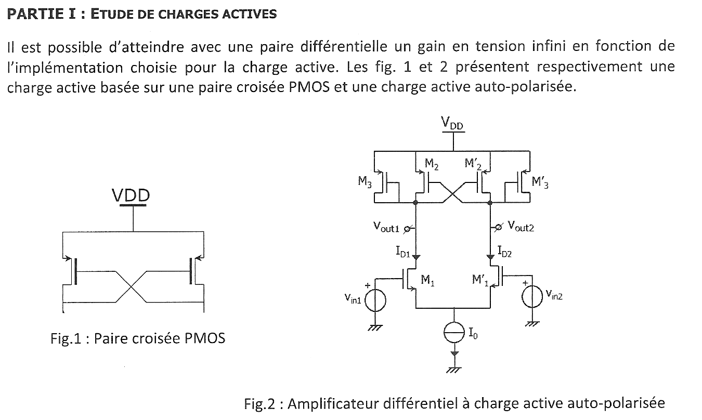{fig-alt="Partie I : paire croisée PMOS (fig. 1) et amplificateur différentiel NMOS M1, M'1 à charge active auto-polarisée : PMOS en diode M3, M'3 et paire croisée M2, M'2 (fig. 2), courant de queue I0."}

{fig-alt="Q1 : rappeler l'expression de la résistance dynamique équivalente d'un transistor NMOS ou PMOS dont la grille est reliée au drain (comme M3 dans la figure 2)."}

:::: {.complement}
::: {.solution}
Transistor monté en diode : $v_{gs} = v_{ds}$, donc
$$\boxed{r_\text{diode} = \frac{1}{g_m + g_{ds}} = \frac{1}{g_m} \parallel r_{ds} \approx \frac{1}{g_m}}$$
Détail : [2016-2017, exercice II, question 1](2016-2017-partiel-circuits-hf.qmd#sec-ann16hf-ex2).
:::
::::

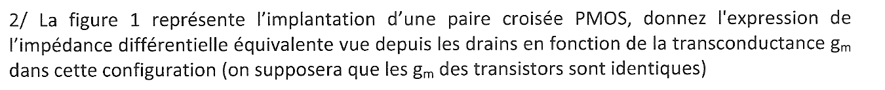{fig-alt="Q2 : impédance différentielle équivalente vue depuis les drains de la paire croisée PMOS de la figure 1, en fonction de gm (gm identiques)."}

:::: {.complement}
::: {.solution}
Chaque drain commande la grille de l'autre transistor : la paire réalise une réaction positive. En injectant $i_x$ dans un drain et en le récupérant à l'autre ($g_{ds}$ négligé) :
$$\boxed{Z_{diff} = -\frac{2}{g_m}}$$
Résistance **négative** ([chapitre 4](../cours/04-oscillateurs.qmd#eq-resistance-paire-croisee)). Détail : [2016-2017, exercice II, question 2](2016-2017-partiel-circuits-hf.qmd#sec-ann16hf-ex2).
:::
::::

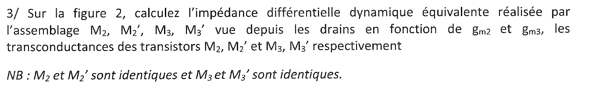{fig-alt="Q3 : sur la figure 2, impédance différentielle dynamique équivalente de l'assemblage M2, M'2, M3, M'3 vue depuis les drains, en fonction de gm2 et gm3 ; M2 et M'2 identiques, M3 et M'3 identiques."}

:::: {.complement}
::: {.solution}
Entre les deux drains, les diodes $M_3$, $M_3'$ sont en série ($\frac{2}{g_{m3}}$) et en parallèle avec la paire croisée ($-\frac{2}{g_{m2}}$) ; les admittances s'ajoutent :
$$\boxed{Z_{diff} = \frac{2}{g_{m3} - g_{m2}}}$$
Détail (schéma équivalent et lecture directe) : [2016-2017, exercice II, questions 7 et 8](2016-2017-partiel-circuits-hf.qmd#sec-ann16hf-ex2).
:::
::::

{fig-alt="Question bonus 3+ : sur la figure 2, à quelle condition peut-on obtenir un gain en tension infini ?"}

:::: {.complement}
::: {.solution}
Le gain différentiel vaut $A_v = -\frac{g_{m1}}{g_{m3} - g_{m2}}$ ($r_{ds}$ négligées) ; il est infini si
$$\boxed{g_{m2} = g_{m3}} \quad\Longleftrightarrow\quad \left(\frac{W}{L}\right)_2 = \left(\frac{W}{L}\right)_3$$
($M_2$ et $M_3$ ont la même $V_{SG}$ au repos). En pratique, les $r_{ds}$ limitent le gain à $g_{m1}(r_{ds1} \parallel r_{ds2} \parallel r_{ds3})$, et on garde $g_{m2}$ un peu inférieur à $g_{m3}$ pour ne pas basculer en bistable. Détail : [2016-2017, exercice II, questions 9 et 10](2016-2017-partiel-circuits-hf.qmd#sec-ann16hf-ex2).
:::
::::

## Partie II : oscillateur en anneau {#sec-ann1314hf-ex2}

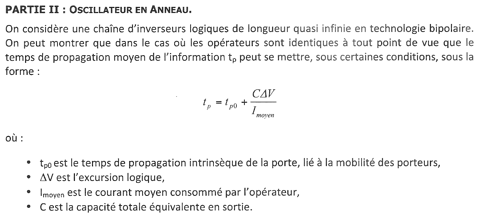{fig-alt="Partie II : chaîne d'inverseurs logiques bipolaires de longueur quasi infinie ; temps de propagation moyen tp = tp0 + C ΔV / Imoyen, avec tp0 temps intrinsèque de la porte (mobilité des porteurs), ΔV excursion logique, Imoyen courant moyen consommé, C capacité totale équivalente en sortie."}

Chapitre du cours : [oscillateurs en anneau](../cours/04-oscillateurs.qmd#sec-anneau).

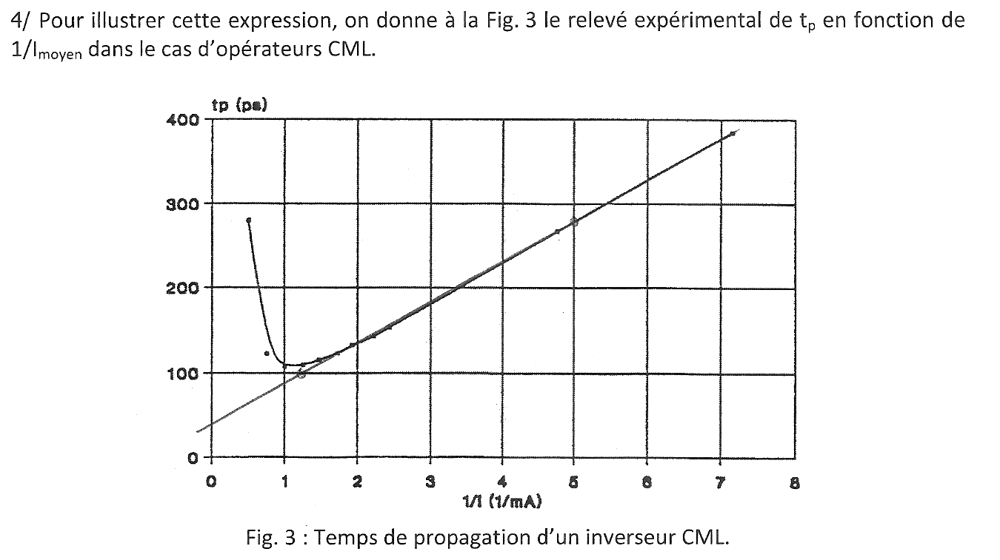{fig-alt="Q4 : figure 3, relevé expérimental de tp (ps, de 0 à 400) en fonction de 1/Imoyen (1/mA, de 0 à 8) pour un inverseur CML : points proches d'une droite pour 1/I supérieur à environ 1,5, remontée brutale de tp pour 1/I inférieur à 1 (fort courant) ; une droite d'ajustement est tracée."}

:::: {.complement}
::: {.solution}
Pas de question à proprement parler : la figure illustre l'expression de $t_p$. En fonction de $x = 1/I_{moyen}$, $t_p = t_{p0} + C\Delta V\, x$ est une **droite** d'ordonnée à l'origine $t_{p0}$ et de pente $C\Delta V$ (charge à déplacer pour faire basculer la sortie). Les mesures suivent cette droite aux courants faibles et moyens ; aux forts courants (à gauche), $t_p$ remonte (voir la question 5).
:::
::::

{fig-alt="Q5 : déterminer approximativement tp0 en précisant la zone de validité."}

:::: {.complement}
::: {.solution}
**Lecture de la figure 3** (relevé des pixels de la droite tracée sur le sujet, Claude) : la droite passe par $t_p \approx 158$ ps à $1/I = 2{,}5\ \mathrm{mA^{-1}}$ et $t_p \approx 352$ ps à $1/I = 6{,}5\ \mathrm{mA^{-1}}$. Pente :
$$C\Delta V \approx \frac{352 - 158}{6{,}5 - 2{,}5} \approx 48{,}5\ \mathrm{ps \cdot mA} = 48{,}5\ \mathrm{fC},$$
et ordonnée à l'origine (extrapolation à $1/I = 0$) :
$$\boxed{t_{p0} \approx 158 - 2{,}5 \times 48{,}5 \approx 37\ \mathrm{ps}} \quad (\text{de l'ordre de } 35 \text{ à } 40 \text{ ps}).$$

**Zone de validité** : le modèle linéaire n'est valable que là où les mesures suivent la droite, soit $1/I \gtrsim 1{,}5\ \mathrm{mA^{-1}}$ ($I_{moyen} \lesssim 0{,}7$ mA). Aux forts courants ($1/I < 1\ \mathrm{mA^{-1}}$), $t_p$ passe par un minimum (environ 110 ps) puis remonte fortement : les transistors bipolaires entrent en forte injection (chute de $f_T$, effet Kirk), et le temps intrinsèque n'est plus constant. $t_{p0}$ est donc une valeur extrapolée, jamais atteinte : le temps de propagation minimal réel est d'environ 110 ps, vers $I \approx 1$ mA.
:::
::::

{fig-alt="Q6 : on reboucle une chaîne d'un nombre N impair d'inverseurs CML tels que ceux étudiés précédemment."}

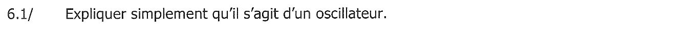{fig-alt="Q6.1 : expliquer simplement qu'il s'agit d'un oscillateur."}

::: {.notes-externes}
Corrigé du TD [corr-2023-td05-anneau, p. 1] : rebouclage avec un nombre impair d'inverseurs, donc « signe négatif au niveau de la boucle, donc oscillation ».
:::

:::: {.complement}
::: {.solution}
Un nombre impair d'inversions donne une boucle globalement **inverseuse** : aucun état logique n'est stable. Si l'entrée du premier inverseur vaut 1, l'information fait le tour de la boucle et revient au même point sous la forme d'un 0 après $N t_p$, ce qui provoque un nouveau basculement, et ainsi de suite indéfiniment : le circuit oscille sans signal d'entrée. Vu comme une boucle de Barkhausen, chaque étage apporte un déphasage de $\pi/N$ en plus de son inversion à la fréquence d'oscillation ([cours](../cours/04-oscillateurs.qmd#sec-anneau)).
:::
::::

{fig-alt="Q6.2 : exprimer la fréquence d'oscillation Fosc en fonction de tp."}

::: {.notes-externes}
Corrigé du TD [corr-2023-td05-anneau, p. 1] : la sortie reste $M t_p$ à chaque niveau, $T = 2Mt_p$, $f_{osc} = \frac{1}{2Mt_p}$ ($M$ : nombre d'inverseurs, noté $N$ dans ce sujet).
:::

:::: {.complement}
::: {.solution}
Une transition met $N t_p$ pour faire le tour de l'anneau ; il faut deux tours (un front montant puis un front descendant) pour une période :
$$\boxed{F_{osc} = \frac{1}{2N t_p}}$$
même résultat que le cours ([fréquence d'un anneau](../cours/04-oscillateurs.qmd#eq-frequence-anneau)).
:::
::::

{fig-alt="Q6.3 : calculer Fosc pour N = 5 et I = 500 µA."}

:::: {.complement}
::: {.solution}
$I = 500$ µA, soit $1/I = 2\ \mathrm{mA^{-1}}$ : la mesure est sur la droite, dans la zone de validité. Lecture de la figure 3 (ou droite de la question 5) :
$$t_p \approx 37 + 2 \times 48{,}5 \approx 134\ \mathrm{ps} .$$
Avec $N = 5$ :
$$\boxed{F_{osc} = \frac{1}{2 \times 5 \times 134\ \mathrm{ps}} \approx 0{,}75\ \mathrm{GHz}}$$
(lecture graphique : précision de quelques pour cent).
:::
::::

{fig-alt="Q7 : si on veut faire varier la fréquence d'oscillation Fosc, sur quel paramètre peut-on agir ?"}

::: {.notes-externes}
Corrigé du TD [corr-2023-td05-anneau, p. 1] : « Nous pouvons agir sur le courant moyen » ; « capacité variable ».
:::

:::: {.complement}
::: {.solution}
$F_{osc} = \frac{1}{2N\left(t_{p0} + \frac{C\Delta V}{I_{moyen}}\right)}$ : $t_{p0}$ est fixé par la technologie et $N$ par le circuit ; on agit donc sur

- le **courant moyen** $I_{moyen}$ de chaque inverseur (le plus simple : une source de courant commandée en tension, c'est l'objet de la partie III) ;
- la **capacité** $C$ (capacité variable, varactor) ;
- éventuellement l'**excursion logique** $\Delta V$.

Avec la figure 3, en restant dans la zone linéaire, $F_{osc}$ est presque proportionnelle à $I_{moyen}$ quand $\frac{C\Delta V}{I} \gg t_{p0}$.
:::
::::

## Partie III : inverseur à retard paramétrable {#sec-ann1314hf-ex3}

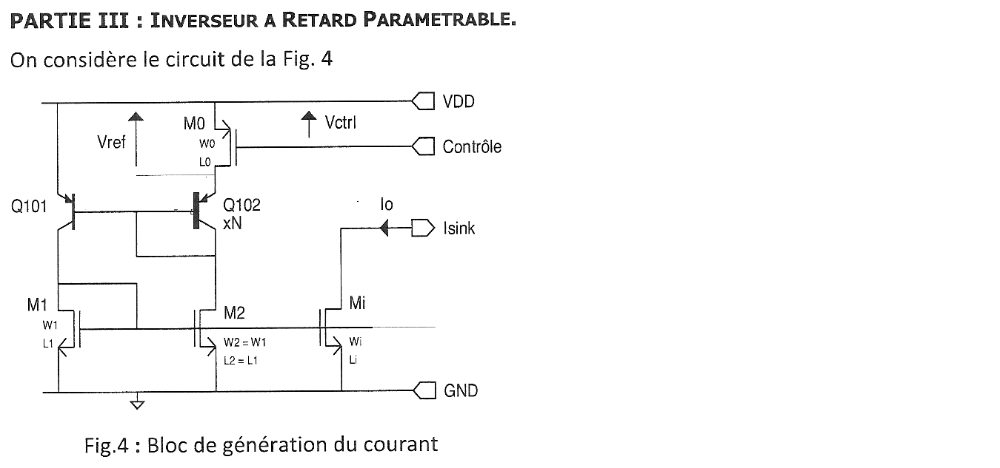{fig-alt="Partie III, figure 4 (bloc de génération du courant) : PNP Q101 (émetteur à VDD) et Q102 (×N, diode, émetteur relié au drain du PMOS M0), bases communes ; Vref aux bornes de M0 (source à VDD, grille commandée par Contrôle, Vctrl entre VDD et Contrôle) ; miroirs NMOS M1 (diode), M2 (W2 = W1, L2 = L1) et Mi (Wi, Li) dont le drain fournit Io à Isink."}

Chapitre du cours : [TD additionnel, partie II](../cours/04-oscillateurs.qmd#sec-td-anneau).

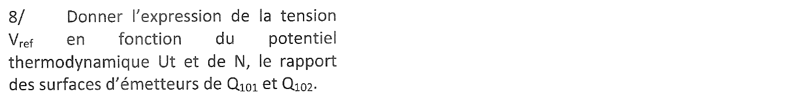{fig-alt="Q8 : expression de la tension Vref en fonction du potentiel thermodynamique Ut et de N, rapport des surfaces d'émetteurs de Q101 et Q102."}

::: {.notes-externes}
Corrigé du TD [corr-2023-td05-anneau, p. 1] : $V_{EB} = U_T\ln\left|\frac{I_C}{I_S}\right|$ ; $V_{ref} = V_{EB101} - V_{EB102} = U_T\ln\left|\frac{N I_{C1}}{I_{C2}}\right|$ ; $M_1$ et $M_2$ forment un miroir, donc $I_{C1} = I_{C2}$ et $V_{ref} = U_T\ln N$.
:::

:::: {.complement}
::: {.solution}
Les bases de $Q_{101}$ et $Q_{102}$ sont communes ; l'émetteur de $Q_{101}$ est à $V_{DD}$, celui de $Q_{102}$ à $V_{DD} - V_{ref}$. La maille donne
$$V_{ref} = V_{EB101} - V_{EB102} = U_T \ln\frac{I_{C101}}{I_S} - U_T\ln\frac{I_{C102}}{N I_S} = U_T \ln\left(N\,\frac{I_{C101}}{I_{C102}}\right).$$
Les collecteurs débitent dans le miroir $M_1$ (diode), $M_2$ ($W_2 = W_1$, $L_2 = L_1$) : $I_{C101} = I_{C102}$, d'où
$$\boxed{V_{ref} = U_T \ln N}$$
Tension **PTAT** (proportionnelle à la température absolue), indépendante de l'alimentation : c'est le principe du [miroir de Widlar](../cours/05-references-de-tension.qmd#sec-ptat). Courants de base négligés.
:::
::::

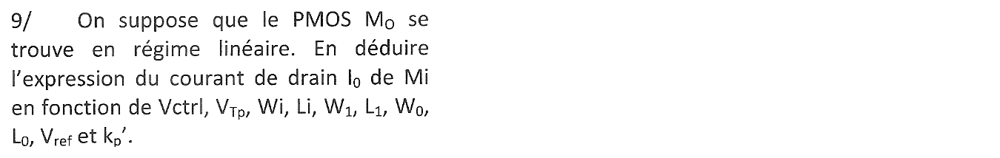{fig-alt="Q9 : le PMOS M0 est en régime linéaire ; en déduire le courant de drain I0 de Mi en fonction de Vctrl, VTp, Wi, Li, W1, L1, W0, L0, Vref et k'p."}

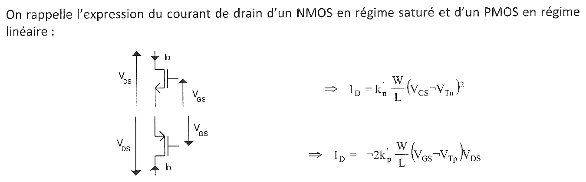{fig-alt="Rappels : NMOS saturé, ID = k'n (W/L)(VGS − VTn)² ; PMOS en régime linéaire, ID = −2 k'p (W/L)(VGS − VTp) VDS."}

::: {.notes-externes}
Corrigé du TD [corr-2023-td05-anneau, p. 2] : $I_{DS0} = -2k'_p\frac{W_0}{L_0}(V_{ctrl} + V_{Tp})V_{ref}$ avec $V_{DS0} = V_{ref}$ ; « il y a 2 miroirs », $I_{Di} = I_{D1}\frac{W_i L_1}{W_1 L_i}$, $I_{D2} = -I_{D0} = I_{D1}$, d'où
$I_0 = 2k'_p\frac{W_i W_0}{W_1}\frac{L_1}{L_i L_0}(V_{ctrl} + V_{Tp})V_{ref}$.
:::

:::: {.complement}
::: {.solution}
**Courant de $M_0$.** Sa source est à $V_{DD}$, sa grille à $V_{DD} - V_{ctrl}$ : $V_{GS0} = -V_{ctrl}$, et $V_{DS0} = -V_{ref}$. Avec la formule rappelée (courant compté entrant dans le drain) :
$$I_{D0} = -2k'_p\frac{W_0}{L_0}\left(-V_{ctrl} - V_{Tp}\right)\left(-V_{ref}\right) = -2k'_p\frac{W_0}{L_0}\left(V_{ctrl} + V_{Tp}\right)V_{ref} ,$$
négatif comme attendu pour un PMOS (le courant sort du drain). $V_{ctrl} + V_{Tp} = V_{SG0} - |V_{Tp}|$ est la tension de commande effective ; il faut $V_{ctrl} > |V_{Tp}|$.

**Recopie.** Ce courant traverse $Q_{102}$, donc $M_2$ ; le miroir $M_1$-$M_2$ impose le même courant dans $M_1$, que $M_i$ recopie dans le rapport de ses dimensions ($V_{GSi} = V_{GS1}$, NMOS saturés) :
$$I_{D1} = |I_{D0}|, \qquad I_0 = I_{Di} = I_{D1}\,\frac{W_i/L_i}{W_1/L_1} .$$
$$\boxed{I_0 = 2k'_p\,\frac{W_0}{L_0}\,\frac{W_i}{L_i}\,\frac{L_1}{W_1}\,\left(V_{ctrl} + V_{Tp}\right)V_{ref}}$$
Même résultat que le corrigé. $I_0$ est proportionnel à $V_{ctrl} + V_{Tp}$ : c'est une source de courant commandée en tension.
:::
::::

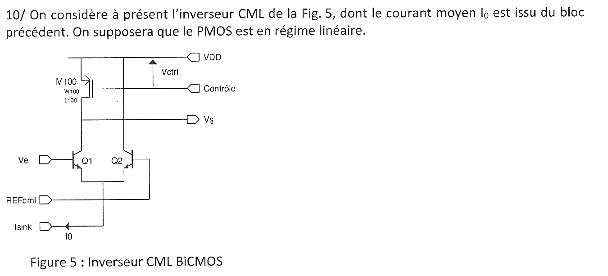{fig-alt="Q10 et figure 5 : inverseur CML BiCMOS ; paire différentielle Q1 (base Ve), Q2 (base REFcml), émetteurs communs polarisés par I0 (Isink) ; charge PMOS M100 (W100, L100) entre VDD et le collecteur de Q1, grille commandée par Contrôle (Vctrl) ; sortie Vs au collecteur de Q1 ; collecteur de Q2 à VDD. On suppose le PMOS en régime linéaire."}

:::: {.complement}
::: {.solution}
Énoncé sans question : il présente l'inverseur CML (*current mode logic*) étudié aux questions 11 à 15. La paire $Q_1$, $Q_2$ aiguille tout le courant $I_0$ vers l'une ou l'autre branche selon le signe de $V_e - V_{REFcml}$ ; $M_{100}$, en régime linéaire, se comporte comme une résistance commandée par $V_{ctrl}$.
:::
::::

{fig-alt="Q11 : calculer l'excursion logique de cet inverseur en fonction de I0, k'p, W100, L100, Vctrl et VTp."}

::: {.notes-externes}
Corrigé du TD [corr-2023-td05-anneau, p. 2-3] : $V_S = V_{DD} - |V_{DS100}|$ ; si $I_{CQ2} = I_0$, $I_{CQ1} = 0$ et $V_S = V_{DD}$ (niveau haut) ; si $I_{CQ1} = I_0$, $V_S = V_{DD} - |V_{DS100}|$ (niveau bas) ; $\Delta V = |V_{DS100}| = \frac{L_{100}\, I_0}{2k'_p W_{100}(V_{ctrl} + V_{Tp})}$.
:::

:::: {.complement}
::: {.solution}
- $V_e$ haut : $Q_1$ conduit tout $I_0$, qui traverse $M_{100}$ : $V_S = V_{DD} - |V_{DS100}|$ (niveau bas).
- $V_e$ bas : $Q_1$ bloqué, aucun courant dans $M_{100}$ : $V_{DS100} = 0$ et $V_S = V_{DD}$ (niveau haut).

L'excursion logique est la chute de tension dans $M_{100}$ parcouru par $I_0$. En régime linéaire ($V_{SG100} = V_{ctrl}$) : $I_0 = 2k'_p\frac{W_{100}}{L_{100}}(V_{ctrl} + V_{Tp})\,|V_{DS100}|$, d'où
$$\boxed{\Delta V = \frac{L_{100}\, I_0}{2k'_p\, W_{100}\,\left(V_{ctrl} + V_{Tp}\right)}}$$
$M_{100}$ se comporte comme une résistance $R_{100} = \frac{L_{100}}{2k'_p W_{100}(V_{ctrl} + V_{Tp})}$ ; hypothèse valable tant que $\Delta V \ll V_{ctrl} - |V_{Tp}|$ (régime linéaire profond).
:::
::::

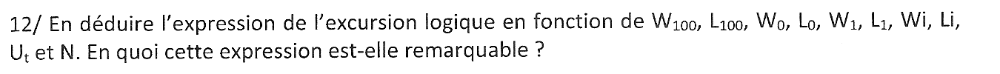{fig-alt="Q12 : en déduire l'excursion logique en fonction de W100, L100, W0, L0, W1, L1, Wi, Li, Ut et N ; en quoi cette expression est-elle remarquable ?"}

::: {.notes-externes}
Corrigé du TD [corr-2023-td05-anneau, p. 3] : $\Delta V = \frac{L_{100}}{W_{100}}\frac{W_0}{L_0}\frac{L_1}{W_1}\frac{W_i}{L_i}U_T\ln N$ (le caractère remarquable n'est pas commenté).
:::

:::: {.complement}
::: {.solution}
En reportant $I_0$ (question 9) et $V_{ref} = U_T\ln N$ (question 8) dans la question 11, le facteur $2k'_p(V_{ctrl} + V_{Tp})$ se simplifie :
$$\boxed{\Delta V = \frac{L_{100}}{W_{100}}\,\frac{W_0}{L_0}\,\frac{L_1}{W_1}\,\frac{W_i}{L_i}\;U_T \ln N}$$
**Remarquable** : l'excursion logique ne dépend que de **rapports de dimensions** et de $U_T\ln N$. Elle est indépendante de $V_{ctrl}$, de $k'_p$ et de $V_{Tp}$ : $V_{ctrl}$ règle le courant, donc le retard (question 14), sans changer l'amplitude des signaux, et la valeur est insensible aux dispersions du procédé (les rapports de dimensions sont bien reproduits). Elle reste proportionnelle à la température absolue (par $U_T$).
:::
::::

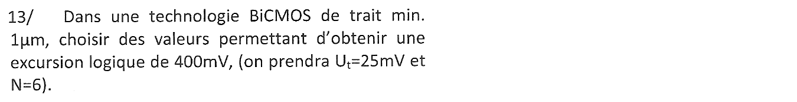{fig-alt="Q13 : dans une technologie BiCMOS de trait minimal 1 µm, choisir des valeurs donnant une excursion logique de 400 mV (Ut = 25 mV, N = 6)."}

::: {.notes-externes}
Corrigé du TD [corr-2023-td05-anneau, p. 3] : « $\frac{W_1}{W_i}\frac{W_{100}}{W_0} = \frac{U_T\ln(N)}{\Delta V} = 9$ » ; « $W_1 = W_i = W_{100} = 30$ µm, $W_0 = 3{,}3$ µm ».
:::

::: {.a-verifier .tranche #av-ann1314hf-dimensionnement}
**Source** [corr-2023-td05-anneau, p. 3] (corrigé du TD identique) : « $\frac{W_1}{W_i}\frac{W_{100}}{W_0} = \frac{U_T\ln(N)}{\Delta V} = 9$ », d'où « $W_1 = W_i = W_{100} = 30$ µm, $W_0 = 3{,}3$ µm ».

**Problème** : $\frac{U_T\ln N}{\Delta V} = \frac{25 \times 1{,}79}{400} \approx 0{,}11$ ; c'est l'inverse qui vaut 8,9. Avec les valeurs du corrigé, la question 12 donne $\Delta V \approx 5$ mV au lieu de 400 mV. Même erreur déjà relevée et tranchée au chapitre 4 (bloc [`av-anneau-dimensionnement`](../cours/04-oscillateurs.qmd#av-anneau-dimensionnement)).

**Proposition** : $\frac{W_0 W_i}{W_{100} W_1} \approx 8{,}9$ avec toutes les longueurs à 1 µm, par exemple $W_0 = W_i = W_{100} = 30$ µm et $W_1 = 3{,}3$ µm (voir la solution ci-dessous).

**Décision** : même correction que le bloc `av-anneau-dimensionnement` du chapitre 4, retenu le 2026-10-14 (même corrigé, même question) ; reprise ici par Claude, 2026-10-27.
:::

:::: {.complement}
::: {.solution}
On fixe toutes les longueurs au minimum, $L_0 = L_1 = L_i = L_{100} = 1$ µm (vitesse, encombrement). La question 12 impose alors
$$\frac{W_0\, W_i}{W_{100}\, W_1} = \frac{\Delta V}{U_T\ln N} = \frac{0{,}4}{0{,}025 \times \ln 6} = \frac{0{,}4}{0{,}0448} \approx 8{,}9 .$$
Un choix possible : $W_0 = W_i = W_{100} = 30$ µm et $W_1 = 3{,}3$ µm (rapport 9,1, $\Delta V \approx 407$ mV). Toute autre combinaison de rapport 8,9 convient ; on évite les largeurs inférieures au trait minimal et on garde $W_{100}/L_{100}$ grand pour un retard faible (question 14).
:::
::::

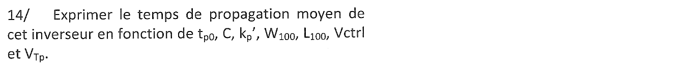{fig-alt="Q14 : exprimer le temps de propagation moyen de cet inverseur en fonction de tp0, C, k'p, W100, L100, Vctrl et VTp."}

::: {.notes-externes}
Corrigé du TD [corr-2023-td05-anneau, p. 3] : $t_p = t_{p0} + \frac{C\Delta V}{I_{moyen}} = t_{p0} + \frac{C L_{100}}{2k'_p(V_{ctrl} + V_{Tp})W_{100}}$.
:::

:::: {.complement}
::: {.solution}
Le courant moyen de l'inverseur est $I_0$ (toujours consommé, quel que soit l'état). Avec la question 11, $\frac{\Delta V}{I_0} = R_{100}$, et $I_0$ disparaît :
$$\boxed{t_p = t_{p0} + \frac{C\,L_{100}}{2k'_p\,W_{100}\,\left(V_{ctrl} + V_{Tp}\right)}}$$
Le retard est la constante de temps $R_{100}C$ de la charge, ajoutée au temps intrinsèque ; il diminue quand $V_{ctrl}$ augmente.
:::
::::

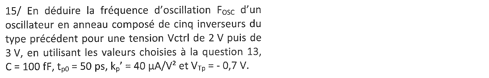{fig-alt="Q15 : fréquence d'oscillation d'un anneau de cinq inverseurs de ce type pour Vctrl = 2 V puis 3 V, avec les valeurs de la question 13, C = 100 fF, tp0 = 50 ps, k'p = 40 µA/V² et VTp = −0,7 V."}

::: {.notes-externes}
Corrigé du TD [corr-2023-td05-anneau, p. 3] : « $f = \frac{1}{2Nt_p}$ » ; $V_{ctrl} = 2$ V : $f = 1{,}22$ GHz ; $V_{ctrl} = 3$ V : $f = 1{,}47$ GHz.
:::

:::: {.complement}
::: {.solution}
Seul $W_{100}/L_{100} = 30$ intervient (question 14). $2k'_pW_{100}/L_{100} = 2 \times 40 \times 30 = 2400$ µA/V².

- $V_{ctrl} = 2$ V : $V_{ctrl} + V_{Tp} = 1{,}3$ V, $R_{100} = \frac{1}{2{,}4 \cdot 10^{-3} \times 1{,}3} \approx 321\ \Omega$, $R_{100}C \approx 32$ ps, $t_p \approx 82$ ps ;
- $V_{ctrl} = 3$ V : $V_{ctrl} + V_{Tp} = 2{,}3$ V, $R_{100} \approx 181\ \Omega$, $R_{100}C \approx 18$ ps, $t_p \approx 68$ ps.

Avec cinq inverseurs, $F_{osc} = \frac{1}{2 \times 5 \times t_p}$ :
$$\boxed{F_{osc} \approx 1{,}22\ \mathrm{GHz}\ (V_{ctrl} = 2\ \mathrm{V}), \qquad F_{osc} \approx 1{,}47\ \mathrm{GHz}\ (V_{ctrl} = 3\ \mathrm{V})}$$
Mêmes valeurs que le corrigé (qui écrit $N$ pour le nombre d'inverseurs). Vérifications : $I_0 = \Delta V/R_{100} \approx 1{,}2$ mA à 2 V et 2,2 mA à 3 V ; $\Delta V = 0{,}4$ V reste petit devant $V_{ctrl} - |V_{Tp}|$, ce qui justifie le régime linéaire de $M_{100}$. L'oscillateur est commandé en tension (VCO), d'environ 1,2 à 1,5 GHz pour $V_{ctrl}$ de 2 à 3 V, à amplitude constante (question 12).
:::
::::
