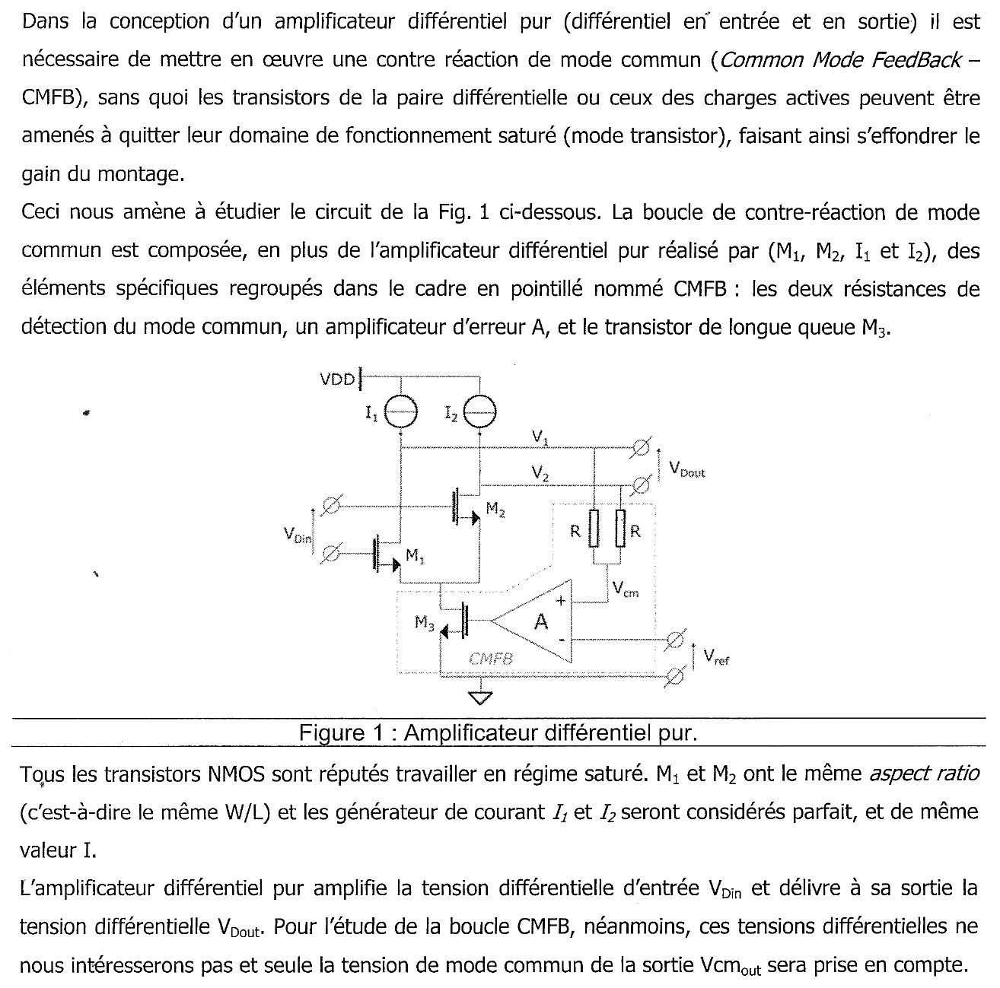
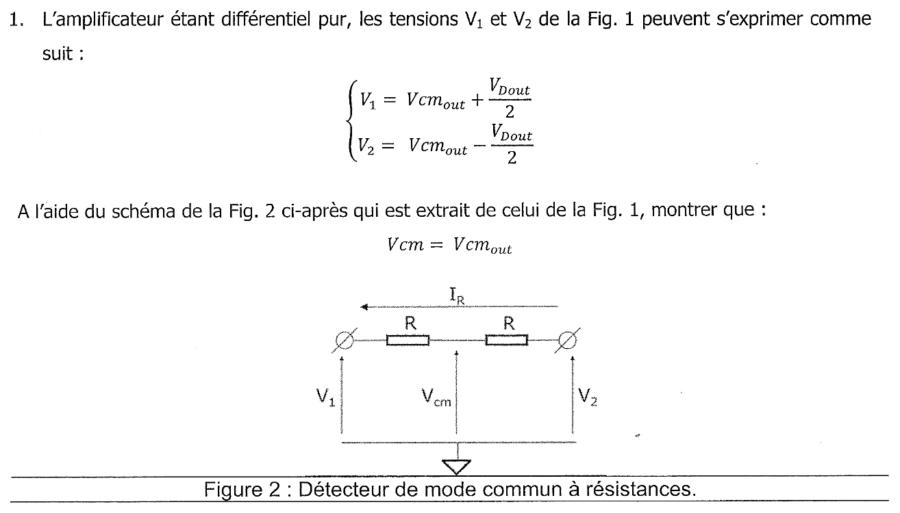
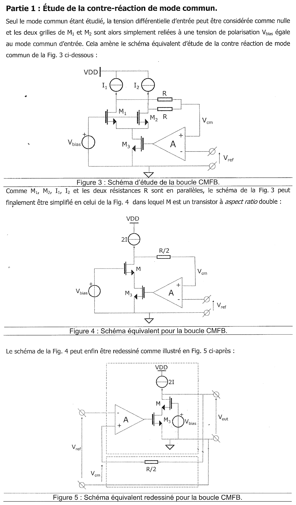
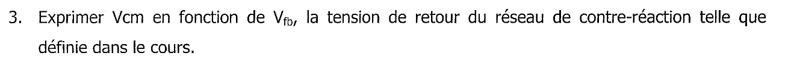
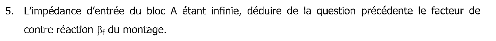
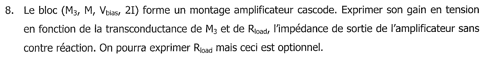
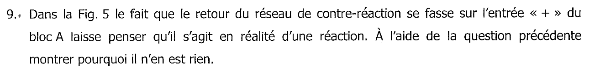
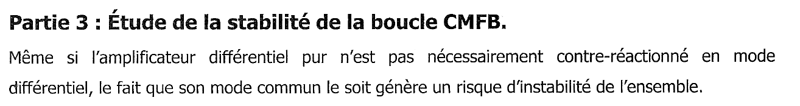
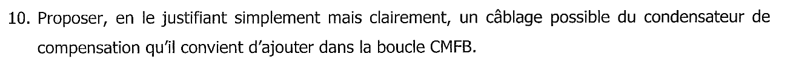



::: {.complement}
**Origine des solutions.** Deux corrigés manuscrits existent, tous deux repris en *Notes externes* sous chaque question :

- [corrige-2015] : corrigé manuscrit intitulé « Contre-réaction, partiel 2015/2016 » (2 pages scannées). Son auteur n'est pas indiqué ; écriture et présentation font penser à une copie d'étudiant : il est classé `externe` **par prudence** (à reclasser `officielle` s'il vient de l'enseignant) ;
- [corr-2023-td02-mc] : corrigé « TD 2 : Contre-réaction de mode commun » des notes de 2023 (un tiers), dont l'énoncé manquait (`ETAT_PROJET.md`, problème 20) : **c'est ce sujet**, repris en TD en 2023, questions 1 à 10 identiques.

Les solutions détaillées en *Complément* sont rédigées par Claude ; les désaccords avec les corrigés sont signalés en *À vérifier*. Les annotations au crayon d'un étudiant sur la figure 5 (« Av = gm rds », « Av = -gm rds », traits autour de M et M3) ont été effacées des images. À relire avec un œil critique ; signaler toute erreur.
:::

Chapitres du cours : [contre-réaction de tension-série](../cours/02-amplificateurs-contre-reaction.qmd#sec-cr-tension-serie), [synthèse des quatre contre-réactions](../cours/02-amplificateurs-contre-reaction.qmd#sec-synthese-cr), [stabilité](../cours/01-generalites-contre-reaction.qmd#sec-stabilite).

{fig-alt="Énoncé commun : un amplificateur différentiel pur (entrée et sortie différentielles) a besoin d'une contre-réaction de mode commun (CMFB), sinon ses transistors peuvent quitter la saturation. Figure 1 : paire NMOS M1, M2 chargée par les sources de courant I1, I2 ; sorties V1, V2 (tension différentielle VDout) ; dans le cadre CMFB, deux résistances R de détection donnent Vcm, un amplificateur d'erreur A compare Vcm (entrée +) à Vref (entrée −) et commande le transistor de queue M3. Tous les NMOS sont saturés, M1 et M2 ont le même W/L, I1 = I2 = I parfaites ; seul le mode commun de sortie Vcm_out est étudié."}

## Préambule : détection du mode commun de sortie {#sec-ann1516cr-preambule}

{fig-alt="Titre : Préambule, détection du mode commun de sortie."}

{fig-alt="Q1 : avec V1 = Vcm_out + VDout/2 et V2 = Vcm_out − VDout/2, montrer à l'aide de la figure 2 (deux résistances R en série entre V1 et V2, point milieu Vcm, courant IR) que Vcm = Vcm_out."}

::: {.notes-externes}
[corrige-2015, p. 1] : $V_{Dout} = V_1 - V_2$ ; diviseur de tension : $V_{cm} - V_2 = V_{D,out}\,\frac{R}{2R} = \frac{V_{D,out}}{2}$, d'où $V_2 = V_{cm} - \frac{V_{D,out}}{2}$ ; or $V_2 = V_{cm,out} - \frac{V_{Dout}}{2}$, d'où $V_{cm} = V_{cm,out}$.

[corr-2023-td02-mc, p. 1] : $V_{cm} = V_1 - R I_R$ (1) et $V_{cm} = V_2 + R I_R$ (2) ; (1) + (2) : $2V_{cm} = V_1 + V_2 = 2V_{cm,out}$, d'où $V_{cm} = V_{cm,out}$.
:::

:::: {.complement}
::: {.solution}
Le point milieu n'alimente aucune charge (il attaque l'entrée de $A$, d'impédance infinie) : le même courant $I_R$ traverse les deux résistances. Avec $I_R$ compté de $V_1$ vers $V_2$ :
$$V_1 - V_{cm} = R I_R = V_{cm} - V_2 \quad\Longrightarrow\quad V_{cm} = \frac{V_1 + V_2}{2} .$$
En remplaçant $V_1$ et $V_2$ par leurs expressions, les termes $\pm V_{Dout}/2$ s'annulent :
$$\boxed{V_{cm} = V_{cm,out}}$$
Le pont fait la **moyenne** des deux sorties : il extrait le mode commun et rejette le mode différentiel, à condition que les deux résistances soient égales (un écart $\Delta R$ laisse passer une fraction $\Delta R/(4R)$ environ de $V_{Dout}$) et que le pont ne soit pas chargé. En contrepartie, il charge les sorties par $2R$ en mode différentiel : $R$ doit être grande devant l'impédance de sortie de l'amplificateur pour ne pas réduire son gain différentiel.
:::
::::

## Partie 1 : étude de la contre-réaction de mode commun {#sec-ann1516cr-partie1}

{fig-alt="Partie 1 : en mode commun seul, les grilles de M1 et M2 sont reliées à Vbias (figure 3). M1, M2, I1, I2 et les deux R étant en parallèle, on obtient la figure 4 : un transistor M de W/L double, une source 2I, une résistance R/2 entre le drain de M et l'entrée + de A, M3 en série sous M. Figure 5 : même circuit redessiné ; le bloc A suivi du cascode M3, M (polarisé par Vbias, chargé par 2I) forme l'amplificateur entre Vref et Vout ; la résistance R/2, dans un second cadre, ramène Vout sur l'entrée + de A ; Vcm est la tension de cette entrée."}

{fig-alt="Q2 : à l'aide de la figure 5, définir le type de contre-réaction mis en œuvre pour la boucle CMFB."}

::: {.notes-externes}
[corrige-2015, p. 1] : la figure 5 se redessine en un bloc $A$ (entrée $V_{ref}$, sortie $V_{out}$) et un bloc $\beta_F$ branché sur la sortie, qui ramène $V_{cm}$ dans la maille d'entrée : contre-réaction de **tension-série**. [corr-2023-td02-mc, p. 1] : « contre réaction du type tension série ».
:::

:::: {.complement}
::: {.solution}
On applique la méthode du cours ([topologies](../cours/02-amplificateurs-contre-reaction.qmd#sec-topologies-quadripoles)) :

- **en sortie**, la résistance $R/2$ est branchée sur le nœud $V_{out}$ : elle **prélève une tension** (port de $\beta_F$ en parallèle sur la sortie) ;
- **en entrée**, elle aboutit à l'entrée $+$ de $A$, l'autre entrée recevant $V_{ref}$ : la tension ramenée $V_{cm}$ s'ajoute **en série** dans la maille d'entrée ($\varepsilon = V_{cm} - V_{ref}$ à un signe près).

$$\boxed{\text{contre-réaction de tension-série}}$$
C'est cohérent avec le but : on veut **imposer une tension** (le mode commun de sortie), donc rendre la sortie de mode commun « source de tension » (impédance de sortie divisée par $1 + A\beta_F$).
:::
::::

{fig-alt="Q3 : exprimer Vcm en fonction de Vfb, la tension de retour du réseau de contre-réaction telle que définie dans le cours."}

::: {.notes-externes}
[corrige-2015, p. 1] : d'après les schémas du cours, $V_{cm} = V_{fb}$. [corr-2023-td02-mc, p. 1] : $V_{cm} = V_{fb}$.
:::

:::: {.complement}
::: {.solution}
Dans le cours, $V_{fb}$ est la tension délivrée par le port d'entrée de $\beta_F$ dans la maille d'entrée ([tension-série](../cours/02-amplificateurs-contre-reaction.qmd#sec-cr-tension-serie)). Ici ce port est l'extrémité de $R/2$ reliée à l'entrée $+$ de $A$, par rapport à la masse :
$$\boxed{V_{cm} = V_{fb}}$$
:::
::::

{fig-alt="Q4 : exprimer Vfb en fonction de Vout, de R/2 et du courant qui la traverse."}

::: {.notes-externes}
[corrige-2015, p. 1] : loi des mailles, $V_{out} - V_{cm} = \frac{I_R R}{2}$, donc $V_{cm} = V_{fb} = V_{out} - \frac{I_R R}{2}$. [corr-2023-td02-mc, p. 1] : $V_{fb} = V_{out} - \frac{R}{2} I$.
:::

:::: {.complement}
::: {.solution}
Avec $I_R$ le courant qui traverse $R/2$ de la sortie vers l'entrée $+$ de $A$ (loi d'Ohm) :
$$\boxed{V_{fb} = V_{out} - \frac{R}{2}\, I_R}$$
:::
::::

{fig-alt="Q5 : l'impédance d'entrée du bloc A étant infinie, déduire de la question précédente le facteur de contre-réaction βf du montage."}

::: {.notes-externes}
[corrige-2015, p. 1] : aucun courant ne circule dans les entrées de $A$, donc $I_R = 0$ et $V_{cm} = V_{out}$, d'où $\beta_F = 1$. [corr-2023-td02-mc, p. 1] : même raisonnement, $\beta_F = 1$.
:::

:::: {.complement}
::: {.solution}
Entrée de $A$ infinie : $I_R = 0$, aucune chute dans $R/2$, donc $V_{fb} = V_{out}$ et
$$\boxed{\beta_F = \frac{V_{fb}}{V_{out}} = 1}$$
$\beta_F$ est sans dimension, comme attendu pour une tension-série ([tableau des natures de $A$ et $\beta_F$](../cours/02-amplificateurs-contre-reaction.qmd#sec-synthese-cr)). La valeur de $R$ n'intervient pas en continu ; elle compte en dynamique (pôle avec la capacité d'entrée de $A$, question 10).
:::
::::

{fig-alt="Q6 : le bloc A ayant un gain très grand, en déduire le gain global de l'amplificateur contre-réactionné."}

::: {.notes-externes}
[corrige-2015, p. 1] : $A_F = \frac{A}{1 + \beta_F A} \simeq \frac{1}{\beta_F} = 1$. [corr-2023-td02-mc, p. 1] : $\frac{V_{out}}{V_{ref}} = \frac{A}{1 + A\beta_F} \simeq 1$.
:::

:::: {.complement}
::: {.solution}
Avec $A_\text{tot}$ le gain de la chaîne directe (amplificateur d'erreur suivi du cascode, question 8) :
$$\frac{V_{out}}{V_{ref}} = \frac{A_\text{tot}}{1 + A_\text{tot}\beta_F} \xrightarrow{A_\text{tot}\beta_F \gg 1} \frac{1}{\beta_F} = 1 .$$
$$\boxed{\frac{V_{out}}{V_{ref}} \approx 1}$$
La boucle est un **suiveur** : l'erreur statique relative vaut $\frac{1}{1 + A_\text{tot}}$, négligeable puisque $A_\text{tot}$ est le produit de deux grands gains.
:::
::::

{fig-alt="Q7 : en déduire la valeur de Vcm_out en fonction de Vref."}

::: {.notes-externes}
[corrige-2015, p. 2] : $V_{cm,out} = V_{cm}$ ; le gain étant de 1, $V_{cm,out} = V_{ref}$. [corr-2023-td02-mc, p. 1] : $V_{cm,out} = V_{cm} = V_{fb} = V_{out} = V_{ref}$.
:::

:::: {.complement}
::: {.solution}
$V_{out}$ de la figure 5 est la tension de mode commun des sorties (figures 3 et 4 : les deux sorties sont confondues en mode commun), et $V_{cm} = V_{cm,out}$ (question 1). Donc
$$\boxed{V_{cm,out} = V_{ref}}$$
Le mode commun de sortie est fixé par une tension que le concepteur choisit (en général au milieu de la dynamique de sortie, pour que les transistors restent saturés quel que soit le signe de $V_{Dout}$), indépendamment des dispersions de $I_1$, $I_2$ et du courant de $M_3$ : c'est l'intérêt de la CMFB.
:::
::::

## Partie 2 : contre-réaction ou réaction ? {#sec-ann1516cr-partie2}

{fig-alt="Titre : Partie 2, contre-réaction versus réaction."}

{fig-alt="Q8 : le bloc (M3, M, Vbias, 2I) forme un montage cascode ; exprimer son gain en tension en fonction de la transconductance de M3 et de Rload, l'impédance de sortie de l'amplificateur sans contre-réaction (exprimer Rload est optionnel)."}

::: {.notes-externes}
[corrige-2015, p. 2] : M est monté en grille commune, $A_M = g_m R_D = \frac{V_{out}}{V_{e,M}}$, avec $R_D = R_{load}$ ; M3 est monté en source commune, $A_{M3} = -g_{m3} R_D = \frac{V_{e,M}}{V_e}$ où $R_D$ est la résistance vue sur le drain de M3, c'est-à-dire la résistance de source de M, $\frac{1}{g_m}$. Gain du cascode : $\frac{V_{out}}{V_e} = A_M A_{M3} = -\frac{g_{m3}}{g_m}\, g_m R_{load} = -g_{m3} R_{load}$.

[corr-2023-td02-mc, p. 2] : « Source commune : $G = -g_m R_{load} = -g_m \times \frac{1}{g_m} = -1$ ».
:::

:::: {.complement}
::: {.solution}
**Méthode.** $M_3$ (source à la masse) convertit sa tension de grille $v_e$ en courant $i = g_{m3}\, v_e$ ; $M$ (grille à $V_{bias}$, fixe) laisse passer ce courant de sa source à son drain (grille commune, gain en courant 1) ; le courant arrive au nœud de sortie, où il voit l'impédance $R_{load}$ :
$$\boxed{\frac{v_{out}}{v_e} = -g_{m3}\, R_{load}}$$
Le signe $-$ vient de ce qu'un courant de drain croissant fait baisser la tension du nœud de sortie (source $2I$ vers $V_{DD}$ au-dessus).

**Expression de $R_{load}$ (optionnelle).** Sans contre-réaction, le nœud de sortie voit la source $2I$ (idéale : impédance infinie), la résistance $R/2$ qui aboutit à l'entrée de $A$ (impédance infinie : pas de charge) et la résistance de sortie du cascode, $r_{ds,M}$ « multipliée » par le gain de $M$ :
$$R_{load} = r_{ds,M} + r_{ds3} + g_{m,M}\, r_{ds,M}\, r_{ds3} \approx g_{m,M}\, r_{ds,M}\, r_{ds3} .$$
D'où $\frac{v_{out}}{v_e} \approx -g_{m3}\, g_{m,M}\, r_{ds,M}\, r_{ds3}$, de l'ordre de $(g_m r_{ds})^2$ : plusieurs milliers. C'est l'intérêt du cascode : un très grand gain en un seul étage.

Le raisonnement de [corrige-2015] (grille commune × source commune chargée par $1/g_m$) donne le même résultat.
:::
::::

::: {.a-verifier #av-ann1516cr-gain-cascode}
**Source** [corr-2023-td02-mc, p. 2] : « Source commune : $G = -g_m R_{load} = -g_m \times \frac{1}{g_m} = -1$ ».

**Problème** : $R_{load}$ est, d'après l'énoncé, l'impédance de sortie de l'amplificateur (nœud $V_{out}$), pas l'impédance $1/g_m$ vue sur le drain de $M_3$ ; avec $1/g_m$ on obtient le gain de $M_3$ seul jusqu'à la source de $M$, pas celui du cascode. Le corrigé [corrige-2015, p. 2] et le calcul ci-dessus donnent $-g_{m3} R_{load}$, très grand en valeur absolue. Le signe négatif, seul utile pour la question 9, est le même.

**Proposition** : $\frac{v_{out}}{v_e} = -g_{m3} R_{load}$, avec $R_{load} \approx g_{m,M}\, r_{ds,M}\, r_{ds3}$.
:::

{fig-alt="Q9 : sur la figure 5, le retour du réseau de contre-réaction se fait sur l'entrée + du bloc A, ce qui laisse penser à une réaction ; à l'aide de la question précédente, montrer qu'il n'en est rien."}

::: {.notes-externes}
[corrige-2015, p. 2] : $-g_{m3} R_{load} < 0$, donc il s'agit bien d'une contre-réaction. [corr-2023-td02-mc, p. 2] : « le gain est négatif donc on ramène un moins sur le + ».
:::

:::: {.complement}
::: {.solution}
Suivons le signe autour de la boucle. La sortie de $A$ vaut $A\,(v_{cm} - v_{ref})$ (retour sur $+$). Le cascode inverse (question 8) :
$$v_{out} = -g_{m3} R_{load}\, A\,(v_{cm} - v_{ref}) = \underbrace{A\, g_{m3} R_{load}}_{A_\text{tot} \,>\, 0}\,(v_{ref} - v_{fb}) .$$
Vue de $v_{ref}$, la chaîne directe est **non inverseuse** de gain $A_\text{tot} > 0$, et la tension ramenée $v_{fb}$ est **soustraite** : gain de boucle $A_\text{tot}\beta_F > 0$, c'est bien une **contre-réaction**.

Raisonnement physique : si le mode commun de sortie monte, $v_{cm}$ monte, la sortie de $A$ monte, $M_3$ conduit davantage et tire les sorties vers le bas : l'écart est corrigé. Règle générale : ce qui compte est le **nombre total d'inversions** dans la boucle (ici une, celle du cascode, compensée par l'entrée $+$), pas la borne de l'amplificateur d'erreur prise isolément. Un retour sur l'entrée $-$ aurait donné deux inversions, donc une réaction positive : la sortie de mode commun partirait en butée.
:::
::::

## Partie 3 : stabilité de la boucle CMFB {#sec-ann1516cr-partie3}

{fig-alt="Partie 3 : même si l'amplificateur différentiel n'est pas contre-réactionné en mode différentiel, la contre-réaction de son mode commun crée un risque d'instabilité."}

{fig-alt="Q10 : proposer, en le justifiant simplement mais clairement, un câblage possible du condensateur de compensation à ajouter dans la boucle CMFB."}

::: {.notes-externes}
[corrige-2015, p. 2] : la sortie étant $V_{cm}$, afin de lisser les éventuelles oscillations, on place le condensateur en parallèle de $V_{cm}$.

[corr-2023-td02-mc, p. 2] : schéma de la figure 5 redessiné avec un condensateur (en rouge) entre l'entrée $+$ de l'amplificateur (côté gauche de $R/2$) et la masse ; mention « Boucle de retour — au plus proche de l'AOP ».
:::

:::: {.complement}
::: {.solution}
**Pourquoi la boucle peut osciller.** La chaîne directe a un gain très grand ($A$ × cascode) et au moins **deux pôles** : celui de l'amplificateur d'erreur $A$ et celui du nœud de sortie, où $R_{load}$ (très grande) charge les capacités des drains et la charge. Le pont de détection en ajoute un troisième ($R/2$ avec la capacité d'entrée de $A$). Avec $\beta_F = 1$, le gain de boucle est maximal : c'est le cas le plus défavorable pour la [marge de phase](../cours/01-generalites-contre-reaction.qmd#sec-marges).

**Câblage proposé : un pôle dominant au nœud de sortie.** Un condensateur $C_c$ entre chaque sortie ($V_1$, $V_2$) et la masse (sur la figure 5 : entre $V_{out}$ et la masse). Justification :

- ce nœud a la plus grande résistance du circuit ($R_{load} \approx g_m r_{ds}^2$) : le pôle $p_1 = \frac{1}{R_{load} C_c}$ y est le plus bas pour une capacité donnée, et l'on repousse les autres pôles loin au-dessus de la fréquence de transition de la boucle ([stabiliser un système](../cours/01-generalites-contre-reaction.qmd#sec-stabiliser)) ;
- il agit aussi en mode différentiel (c'est la compensation habituelle d'un amplificateur à un seul étage à sortie haute impédance) : la même capacité stabilise les deux boucles ;
- sa réalisation est simple (capacité de charge, éventuellement complétée).

**Complément souvent associé** : une capacité en parallèle sur chaque résistance $R$ du pont de détection ; elle crée un zéro qui compense le pôle formé par $R$ et la capacité d'entrée de $A$ (le pont n'introduit alors plus de retard de phase).

**À propos des corrigés** (capacité entre l'entrée $+$ de $A$ et la masse) : cette capacité forme avec $R/2$ un pôle $\frac{2}{R C}$ **supplémentaire** dans la boucle ; elle ne stabilise que si ce pôle devient nettement dominant, donc inférieur même au pôle déjà très bas du nœud de sortie, ce qui demande une grande capacité et ralentit fortement la boucle. Voir le bloc ci-dessous.
:::
::::

::: {.a-verifier #av-ann1516cr-condensateur-cmfb}
**Source** [corrige-2015, p. 2] : « La sortie étant $V_{cm}$, afin de lisser les éventuelles oscillations on place le condensateur en parallèle de $V_{cm}$. » [corr-2023-td02-mc, p. 2] : condensateur entre l'entrée $+$ de l'amplificateur et la masse.

**Problème** : $V_{cm}$ n'est pas la sortie de la boucle (c'est la tension ramenée $V_{fb}$) ; un condensateur à cet endroit ajoute un pôle $2/(RC)$ dans une boucle qui possède déjà un pôle très bas au nœud de sortie haute impédance : sans dimensionnement soigné, la marge de phase **diminue**. La question est ouverte (« proposer ») ; d'autres câblages sont recevables, mais la justification donnée (« lisser les oscillations ») ne suffit pas.

**Proposition** : compensation par pôle dominant au nœud de sortie (capacité entre chaque sortie et la masse), éventuellement complétée par une capacité en parallèle sur chaque résistance de détection (voir la solution). À confirmer avec l'enseignant.
:::
