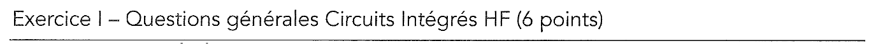
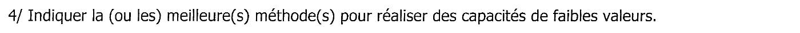
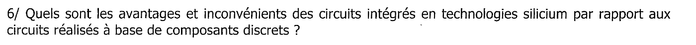



::: {.complement}
Aucun corrigé officiel : **toutes les solutions de cette page sont rédigées par Claude**. À relire avec un œil critique ; signaler toute erreur.

Le sujet vient de l'ancien module EA210 « Circuits HF et oscillateurs », rangé avec EANA3. Il comporte deux exercices : questions générales sur les circuits intégrés HF (exercice I : pôle dominant, capacités intégrées, varactor MOS) et charge active à paire croisée PMOS (exercice II). Le corrigé manuscrit `2016-2017-corrige-manuscrit.pdf` rangé avec les annales porte sur le partiel « Contre-réaction » de la même année, pas sur ce sujet.

L'exercice I est un questionnaire de cours : les réponses données sont des réponses types, sans corrigé de l'enseignante. Des questions voisines reviennent en 2022-2023 ([exercice I](2022-2023-partiel-circuits-hf.qmd#sec-ann2223hf-ex1) : capacité MOS, Miller).

**L'exercice II est tombé en 2013-2014** (Partie I « Étude de charges actives ») [sujet-2013-hf, p. 1] : ses questions 1 et 2 sont les questions 1 et 2 de l'exercice II ci-dessous, sa question 3 est la question 7, sa question bonus 3+ est la question 10 (voir le [partiel 2013-2014](2013-2014-partiel-circuits-hf.qmd#sec-ann1314hf-ex1)).
:::

## Exercice I : questions générales sur les circuits intégrés HF (6 points) {#sec-ann16hf-ex1}

{fig-alt="Exercice I : questions générales sur les circuits intégrés HF (6 points)."}

Questions de cours. Chapitres liés : [pôles d'un étage source commune](../cours/01-generalites-contre-reaction.qmd#sec-poles-source-commune), [effet Miller](../cours/01-generalites-contre-reaction.qmd#sec-effet-miller) et [capacité variable](../cours/04-oscillateurs.qmd#sec-capacite-variable).

{fig-alt="Q1 : dans un circuit intégré HF, qu'est-ce qu'un pôle dominant ?"}

:::: {.complement}
::: {.solution}
La fonction de transfert d'un circuit a autant de pôles que de nœuds « capacitifs » indépendants. Le **pôle dominant** est le pôle de plus basse fréquence, nettement séparé des autres (en pratique d'un facteur 4 à 10 au moins). Jusqu'au voisinage des pôles suivants, le circuit se comporte alors comme un premier ordre :
$$H(j\omega) \approx \frac{H_0}{1 + j\omega/\omega_1}, \qquad f_{-3\,\mathrm{dB}} \approx \frac{\omega_1}{2\pi} .$$
Il est associé au nœud de plus forte constante de temps $R_{nœud} C_{nœud}$ (résistance vue du nœud, capacités qui y sont reliées, capacités ramenées par effet Miller comprises) ; méthode et exemple : [pôle dominant d'un étage source commune](../cours/01-generalites-contre-reaction.qmd#eq-pole-dominant).
:::
::::

{fig-alt="Q2 : les pôles dominants doivent-ils être à basse ou à haute fréquence ?"}

:::: {.complement}
::: {.solution}
Par définition, le pôle dominant est le **plus bas** en fréquence ; la question porte sur l'endroit où on le place. Dans un circuit HF (amplificateur, LNA, étage de mélangeur), il doit être à **haute fréquence**, au-delà de la bande utile : le gain doit encore être disponible à la fréquence de travail, et la bande passante est fixée par ce pôle. On cherche donc des nœuds de faible impédance (de l'ordre de $1/g_m$) et peu de capacités, en évitant l'effet Miller.

Nuance : dans un amplificateur bouclé (amplificateur opérationnel), on **abaisse** volontairement le pôle dominant (compensation) pour garantir la marge de phase ([stabilité](../cours/01-generalites-contre-reaction.qmd#sec-stabiliser)) ; c'est l'inverse de ce qu'on recherche dans une chaîne HF en boucle ouverte, d'où le compromis gain-bande ([cours](../cours/01-generalites-contre-reaction.qmd#sec-gain-bande)).
:::
::::

{fig-alt="Q3 : proposer plusieurs méthodes pour réaliser des capacités intégrées en technologies silicium."}

:::: {.complement}
::: {.solution}
- **Capacité MOS** : l'oxyde de grille sert de diélectrique ($C = C_{ox} W L$, avec $C_{ox} = \varepsilon_{ox}/t_{ox}$) ; la plus forte densité, mais non linéaire (dépend de la tension) et fuyante si l'oxyde est mince.
- **Capacité de jonction** : jonction PN polarisée en inverse (diode, jonction drain-substrat) ; capacité variable avec la tension inverse (varicap), faible densité, non linéaire.
- **Capacité MIM** (*metal-insulator-metal*) : deux armatures métalliques séparées par un diélectrique mince dédié ; linéaire, précise, bon facteur de qualité, mais demande des étapes de fabrication supplémentaires.
- **Capacités entre niveaux de métal** : plan-plan entre deux couches d'interconnexion, ou **MOM / interdigitées** (*metal-oxide-metal*, doigts imbriqués exploitant les capacités latérales entre lignes d'un même niveau et entre niveaux) ; disponibles dans tout procédé CMOS standard.
- **Capacité poly-poly** (PIP) : deux couches de polysilicium, procédés analogiques.
:::
::::

{fig-alt="Q4 : indiquer la ou les meilleures méthodes pour réaliser des capacités de faibles valeurs."}

:::: {.complement}
::: {.solution}
Pour quelques femtofarads à quelques centaines de femtofarads, les capacités **métal-métal** : MOM interdigitées et MIM. Elles sont linéaires (indépendantes de la tension), peu sensibles à la température, précises en valeur relative (appariement), avec peu de pertes (bon $Q$ en HF) et une faible capacité parasite vers le substrat si on utilise les niveaux de métal hauts. La capacité MOS, très dense, convient au contraire aux **fortes** valeurs (découplage) ; pour une faible valeur, sa non-linéarité et ses parasites (capacité vers le substrat, résistance du canal) dominent.
:::
::::

{fig-alt="Q5 : à l'aide d'un schéma équivalent petit signal, donner une méthode (différente de celle du poly de cours) pour réaliser une capacité variable à l'aide d'un transistor MOS ; comment contrôler cette capacité ?"}

:::: {.complement}
::: {.solution}
Le poly de 2016 n'est pas disponible ; la méthode vue dans le cours de Bristol est la **jonction drain-substrat** bloquée ([capacité variable](../cours/04-oscillateurs.qmd#sec-capacite-variable)). Autre méthode : le **varactor MOS**, qui utilise la capacité de **grille**.

- **Montage** : source, drain et substrat (ou caisson) reliés ensemble ; la capacité est vue entre la grille et ce nœud commun. Variante courante : NMOS dans un caisson N (varactor à accumulation).
- **Schéma petit signal** : la capacité d'oxyde $C_{ox}WL$ en série avec la capacité de la zone de charge d'espace sous la grille $C_{dep}$ (qui dépend de la tension), plus la résistance série du canal ou du caisson :
$$C(V_{GB}) = \frac{C_{ox}\, C_{dep}(V_{GB})}{C_{ox} + C_{dep}(V_{GB})} .$$
- **Comportement** : en accumulation ou en forte inversion, $C \approx C_{ox}WL$ (maximum) ; en déplétion, la zone de charge d'espace s'élargit et $C$ diminue jusqu'à un minimum.
- **Contrôle** : par la tension continue $V_{GB}$ appliquée entre la grille et le nœud source-drain-substrat (tension de commande d'un VCO), le signal HF se superposant à cette polarisation. La plage $C_{max}/C_{min}$ (typiquement 2 à 3) fixe la plage d'accord de l'oscillateur ($f \propto 1/\sqrt{C}$).
:::
::::

{fig-alt="Q6 : avantages et inconvénients des circuits intégrés en technologies silicium par rapport aux circuits à composants discrets."}

:::: {.complement}
::: {.solution}
**Avantages** :

- encombrement et masse très réduits, grand nombre de transistors ;
- interconnexions courtes : peu de parasites (inductances et capacités de câblage), donc fonctionnement à plus haute fréquence ;
- **appariement** des composants voisins (mêmes procédé et température) : montages différentiels, miroirs, rapports de résistances ou de capacités précis ;
- coût unitaire faible en grande série, fiabilité, consommation réduite.

**Inconvénients** :

- composants passifs médiocres : inductances de faible facteur de qualité (pertes dans le substrat conducteur), valeurs de capacités et de résistances limitées, tolérance absolue large (de l'ordre de ± 10 à 20 %) ;
- substrat silicium conducteur : pertes et couplages entre blocs (bruit numérique ramené sur l'analogique) ;
- faibles tensions de claquage : puissance et dynamique limitées ;
- coûts fixes élevés (masques, conception) et pas de réglage possible après fabrication.
:::
::::

## Exercice II : étude d'un amplificateur HF (14 points) {#sec-ann16hf-ex2}

Chapitre du cours : [Oscillateur à résistance négative](../cours/04-oscillateurs.qmd#sec-resistance-negative) et [TD 4](../cours/04-oscillateurs.qmd#sec-td-resistance-negative).

{fig-alt="Exercice II : paire croisée PMOS (fig. 1) et amplificateur différentiel NMOS M1, M1' à charge active auto-polarisée : PMOS montés en diode M3, M3' et paire croisée M2, M2' (fig. 2), courant de queue I0."}

**Conventions de la correction.** PMOS de source à $V_{DD}$ (masse dynamique) ; on note $v_1$, $v_2$ les variations de $V_{out1}$, $V_{out2}$, et $v_{id} = v_{in1} - v_{in2}$. Le courant de drain petit signal d'un PMOS dont la source est à la masse dynamique s'écrit, compté **du drain vers la source** (c'est-à-dire « sortant » du nœud de drain vers le transistor) : $i = g_m v_g + g_{ds} v_d$, où $v_g$ et $v_d$ sont les variations de grille et de drain. Même forme pour un NMOS de source à la masse dynamique.

{fig-alt="Q1 : résistance dynamique équivalente d'un transistor NMOS ou PMOS dont la grille est reliée au drain."}

:::: {.complement}
::: {.solution}
Transistor monté en diode : $v_g = v_d = v$, donc $i = (g_m + g_{ds})\, v$ :
$$r_\text{diode} = \frac{1}{g_m + g_{ds}} = \frac{1}{g_m} \parallel r_{ds} \approx \frac{1}{g_m} \quad (g_m \gg g_{ds}).$$
Résistance **faible et positive**, réglée par le courant de polarisation (à travers $g_m$). Valable en régime saturé (toujours vrai pour un MOS en diode : $V_{DS} = V_{GS} > V_{GS} - V_{T}$).
:::
::::

{fig-alt="Q2 : impédance différentielle vue depuis les drains d'une paire croisée PMOS, en fonction de gm (gm identiques)."}

:::: {.complement}
::: {.solution}
On note $M_a$ le transistor dont le drain est au nœud 1 et $M_b$ celui dont le drain est au nœud 2. On injecte un courant $i_x$ dans le drain 1 et on le récupère au drain 2 ; $v_x = v_1 - v_2$. Le drain de chaque transistor est relié à la grille de l'autre (on néglige $g_{ds}$) :

- nœud 1 (drain de $M_a$, grille à $v_2$) : $i_x = g_m v_2$ ;
- nœud 2 (drain de $M_b$, grille à $v_1$) : $-i_x = g_m v_1$.

Donc $v_x = v_1 - v_2 = -\dfrac{i_x}{g_m} - \dfrac{i_x}{g_m}$ :
$$\boxed{Z_{diff} = \frac{v_x}{i_x} = -\frac{2}{g_m}}$$
C'est la **résistance négative** du cours ([chapitre 4](../cours/04-oscillateurs.qmd#eq-resistance-paire-croisee)). Interprétation : si $v_1$ monte, la grille de $M_b$ monte, $M_b$ (PMOS) conduit moins et $v_2$ descend ; la grille de $M_a$ descend, $M_a$ conduit plus et $v_1$ monte encore. La paire accentue l'écart au lieu de s'y opposer : réaction positive. Avec $g_{ds}$ : $Z_{diff} = -\dfrac{2}{g_m - g_{ds}}$.
:::
::::

{fig-alt="Q3 : commenter le schéma de la figure 2 (polarisation, fonction réalisée, entrées, sorties)."}

:::: {.complement}
::: {.solution}
- **Fonction** : amplificateur différentiel. Entrées : grilles de $M_1$ et $M_1'$ ($V_{in1}$, $V_{in2}$) ; sorties : drains ($V_{out1}$, $V_{out2}$), lues en **différentiel** ($A_v = \frac{v_{out1} - v_{out2}}{v_{in1} - v_{in2}}$).
- **Polarisation** : la source de courant $I_0$ fixe le courant total ; au repos, symétrie : $I_{D1} = I_{D2} = I_0/2$. Dans chaque branche, ce courant se partage entre le PMOS en diode ($M_3$) et le PMOS de la paire croisée ($M_2$).
- **Charge active** : quatre PMOS. Les diodes $M_3$, $M_3'$ fixent le potentiel continu des drains (d'où « auto-polarisée » : pas de circuit de contre-réaction de mode commun) ; la paire croisée $M_2$, $M_2'$ apporte une résistance différentielle négative qui **compense** celle, positive, des diodes, pour augmenter la résistance de charge différentielle, donc le gain.
- **En mode commun** ($v_1 = v_2 = v_c$), la paire croisée se comporte au contraire comme deux diodes : chaque nœud voit $\frac{1}{g_{m2} + g_{m3}}$, faible. Le mode commun de sortie reste donc bien défini même quand la charge différentielle devient très grande.
:::
::::

{fig-alt="Q4 : lien entre les transconductances de M1 et M1', de M2 et M2', de M3 et M3'."}

:::: {.complement}
::: {.solution}
Transistors identiques deux à deux et, au repos, mêmes courants par symétrie ($I_0/2$ par branche) :
$$g_{m1} = g_{m1'}, \qquad g_{m2} = g_{m2'}, \qquad g_{m3} = g_{m3'} .$$
De plus, au repos $V_{out1} = V_{out2}$ : $M_2$ (grille à $V_{out2}$) et $M_3$ (grille à $V_{out1}$) ont **la même $V_{SG}$** et la même $V_{SD}$. Ils ont donc la même tension de saturation $V_{SG} - |V_{Tp}|$ ; leurs courants sont dans le rapport de leurs $W/L$, et comme $g_m = \frac{2 I_D}{V_{SG} - |V_{Tp}|}$ :
$$\frac{g_{m2}}{g_{m3}} = \frac{I_{D2}}{I_{D3}} = \frac{(W/L)_2}{(W/L)_3}, \qquad I_{D2} + I_{D3} = \frac{I_0}{2} .$$
Ce rapport de géométries est le paramètre de conception de la question 10.
:::
::::

{fig-alt="Q5 : schéma équivalent dynamique HF de l'amplificateur de la figure 2, résistances d'accès négligées, bulks reliés aux sources."}

:::: {.complement}
::: {.solution}
Chaque transistor est remplacé par son modèle petit signal HF : source de courant $g_m v_{gs}$ et $r_{ds}$ entre drain et source, capacités $C_{gs}$, $C_{gd}$ et $C_{db}$. Bulk relié à la source : $C_{sb}$ est court-circuitée et $C_{db}$ se retrouve entre drain et source. Résistances d'accès (grille, source, drain) négligées.

- Les sources des PMOS sont à $V_{DD}$ : **masse dynamique**.
- $I_0$ idéale : circuit ouvert en dynamique. En mode différentiel, par symétrie, le nœud des sources de $M_1$, $M_1'$ ne bouge pas : **masse virtuelle**.
- Nœud $V_{out1}$ : drains de $M_1$, $M_2$, $M_3$, grille de $M_3$ et grille de $M_2'$. On y trouve, vers la masse : $g_{m1} v_{gs1}$ (avec $v_{gs1} = v_{id}/2$), $r_{ds1} \parallel r_{ds2} \parallel r_{ds3}$, la source $g_{m3} v_1$ (diode), la source $g_{m2} v_2$ commandée par l'**autre** sortie, et les capacités $C_{db1} + C_{db2} + C_{db3} + C_{gs3} + C_{gs2'}$ ; $C_{gd1}$ relie l'entrée $v_{in1}$ à $v_1$, $C_{gd2}$ et $C_{gd2'}$ relient les deux sorties ($C_{gd3}$ est court-circuitée par la liaison grille-drain).
- Nœud $V_{out2}$ : symétrique.
:::
::::

{fig-alt="Q6 : simplifier ce schéma en considérant que les capacités présentent des impédances très élevées et en négligeant la modulation de longueur de canal."}

:::: {.complement}
::: {.solution}
Capacités ouvertes (basse fréquence devant les pôles parasites), $\lambda = 0$ donc $r_{ds} \to \infty$. Il ne reste, au nœud 1 (le nœud 2 est symétrique) :

- $M_1$ : source de courant $g_{m1}\,\frac{v_{id}}{2}$ ;
- $M_3$ : résistance $\frac{1}{g_{m3}}$ vers la masse ;
- $M_2$ : source de courant $g_{m2}\, v_2$ commandée par la tension de l'autre sortie.

Équation du nœud 1 (courants sortant du nœud) :
$$g_{m1}\frac{v_{id}}{2} + g_{m3}\, v_1 + g_{m2}\, v_2 = 0 .$$
:::
::::

{fig-alt="Q7 : impédance différentielle dynamique équivalente de l'assemblage M2, M2', M3, M3' vue depuis les drains, en fonction de gm2 et gm3."}

:::: {.complement}
::: {.solution}
On isole la charge (sans $M_1$, $M_1'$) et on injecte $i_x$ au nœud 1, récupéré au nœud 2 :
$$i_x = g_{m3} v_1 + g_{m2} v_2, \qquad -i_x = g_{m3} v_2 + g_{m2} v_1 .$$
Par différence : $2 i_x = (g_{m3} - g_{m2})(v_1 - v_2)$, d'où
$$\boxed{Z_{diff} = \frac{v_1 - v_2}{i_x} = \frac{2}{g_{m3} - g_{m2}}}$$
Positive si $g_{m3} > g_{m2}$, infinie si $g_{m3} = g_{m2}$, négative si $g_{m2} > g_{m3}$.
:::
::::

{fig-alt="Q8 : montrer que cette impédance pouvait être déterminée a priori, sans schéma équivalent."}

:::: {.complement}
::: {.solution}
La charge est l'association de deux dipôles connus, branchés entre les **mêmes** deux drains :

- les diodes $M_3$ et $M_3'$ : $\frac{1}{g_{m3}}$ chacune entre un drain et la masse dynamique, soit **en série** entre les drains : $\frac{2}{g_{m3}}$ (question 1) ;
- la paire croisée $M_2$, $M_2'$ : $-\frac{2}{g_{m2}}$ (question 2).

Les deux sont **en parallèle** : les admittances s'ajoutent,
$$\frac{1}{Z_{diff}} = \frac{g_{m3}}{2} - \frac{g_{m2}}{2} \quad\Longrightarrow\quad Z_{diff} = \frac{2}{g_{m3} - g_{m2}} .$$
:::
::::

{fig-alt="Q9 : gain en tension Av = (Vout1 - Vout2)/(Vin1 - Vin2) en fonction des transconductances."}

:::: {.complement}
::: {.solution}
Par symétrie, en mode différentiel $v_2 = -v_1$. L'équation du nœud 1 (question 6) devient :
$$g_{m1}\frac{v_{id}}{2} + (g_{m3} - g_{m2})\, v_1 = 0 \quad\Longrightarrow\quad v_1 = -\frac{g_{m1}}{2\,(g_{m3} - g_{m2})}\, v_{id} .$$
Avec $v_{out1} - v_{out2} = 2 v_1$ :
$$\boxed{A_v = \frac{v_{out1} - v_{out2}}{v_{in1} - v_{in2}} = -\frac{g_{m1}}{g_{m3} - g_{m2}}}$$
Contrôle par la question 7 : la paire différentielle injecte un courant différentiel $g_{m1} v_{id}/2$ dans la charge $Z_{diff}$, soit $A_v = -g_{m1}\frac{Z_{diff}}{2}$, même résultat. Sans la paire croisée ($g_{m2} = 0$), on retrouve le gain classique d'une paire à charges diodes, $-\frac{g_{m1}}{g_{m3}}$.
:::
::::

{fig-alt="Q10 : à quelle condition ce gain est-il infini ?"}

:::: {.complement}
::: {.solution}
$A_v \to \infty$ si
$$\boxed{g_{m2} = g_{m3}} \quad\Longleftrightarrow\quad \left(\frac{W}{L}\right)_2 = \left(\frac{W}{L}\right)_3$$
(question 4 : même $V_{SG}$, donc même rapport $g_m$ que $W/L$). La résistance négative de la paire croisée annule exactement la résistance des diodes : la charge différentielle devient infinie.

En pratique, le gain reste fini : en gardant les $r_{ds}$ (modulation de longueur de canal), l'équation du nœud donne
$$A_v = -\frac{g_{m1}}{g_{m3} - g_{m2} + g_{ds1} + g_{ds2} + g_{ds3}} \;\xrightarrow{g_{m2} = g_{m3}}\; -g_{m1}\,(r_{ds1} \parallel r_{ds2} \parallel r_{ds3}),$$
et l'égalité $g_{m2} = g_{m3}$ n'est jamais exacte (dispersions technologiques). On choisit donc $g_{m2}$ un peu inférieur à $g_{m3}$.

Mise en garde : si $g_{m2} > g_{m3}$, la résistance différentielle totale est **négative** ; le circuit bascule (bascule bistable, *latch*), ce qui sert dans les comparateurs. Avec un résonateur $LC$ entre les drains au lieu des diodes, la même résistance négative compense les pertes du résonateur : c'est l'**oscillateur à résistance négative** du chapitre 4.
:::
::::
