

::: {.complement}
**Origine des solutions.** Le corrigé manuscrit [annale-2016-2017] (écriture d'un tiers, sur tablette ; il s'arrête à la question 8) est repris en *Notes externes* sous chaque question ; les solutions détaillées en *Complément* sont rédigées par Claude. À relire avec un œil critique ; signaler toute erreur.

**Ce sujet est l'exercice guidé du cours 8** (« Adaptation d'impédance par dégénérescence inductive », support 2025, p. 6-7), déjà traité dans le [chapitre 3](../cours/03-applications-contre-reaction.qmd#sec-degenerescence-inductive) avec le même corrigé. Seule différence d'énoncé : la question 10 prend ici $R_L = 707{,}1\ \Omega$, le support 2025 $R_L = 700\ \Omega$.
:::

Chapitres du cours : [exercice guidé du chapitre 3](../cours/03-applications-contre-reaction.qmd#sec-degenerescence-inductive), [contre-réaction de courant-série](../cours/02-amplificateurs-contre-reaction.qmd#sec-cr-courant-serie).

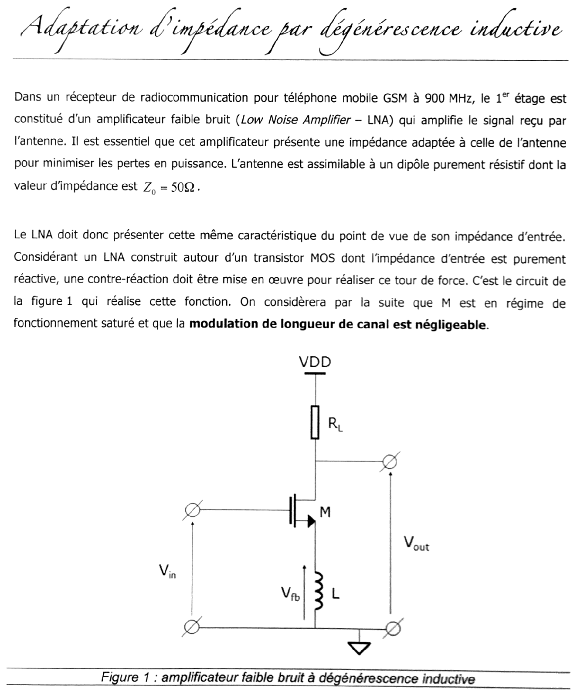{fig-alt="Énoncé commun : premier étage d'un récepteur GSM à 900 MHz, un amplificateur faible bruit (LNA) doit présenter une impédance d'entrée adaptée à l'antenne, dipôle résistif Z0 = 50 Ω ; l'impédance d'entrée d'un MOS étant purement réactive, on utilise une contre-réaction. Figure 1 : transistor M en source commune, charge RL vers VDD sur le drain (sortie Vout), inductance L entre la source et la masse (tension Vfb), entrée Vin sur la grille. M saturé, modulation de longueur de canal négligeable."}

## Partie 1 : étude de la contre-réaction {#sec-ann1617cr-partie1}

{fig-alt="Titre : Partie 1, étude de la contre-réaction."}

**Conventions.** $v_{gs}$, $i_e$ (courant de grille), $i_o$ (courant de drain, compté entrant dans le drain depuis $R_L$), $v_{fb}$ (tension aux bornes de $L$, source par rapport à la masse) ; régime sinusoïdal à la pulsation $\omega$.

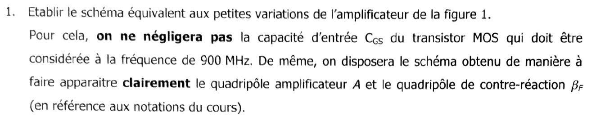{fig-alt="Q1 : établir le schéma équivalent aux petites variations de l'amplificateur de la figure 1 sans négliger la capacité CGS à 900 MHz, disposé pour faire apparaître le quadripôle amplificateur A et le quadripôle de contre-réaction βF."}

::: {.notes-externes}
[annale-2016-2017, p. 1] : schéma dessiné ; le bloc $A$ (cadre en pointillés) contient $C_{gs}$ entre grille et source (courant $i_e$, tension $v_{gs}$) et la source commandée $g_m v_{gs}$ entre drain et source (courant $i_o$ entrant au drain, tension $V_{out}$) ; sous le bloc $A$, le bloc $\beta_F$ contient l'inductance $L$ entre la source et la masse, parcourue par $i_L$, tension $v_{fb}$ ; $V_{in}$ entre grille et masse.
:::

:::: {.complement}
::: {.solution}
Modèle petit signal du MOS saturé, $r_{ds}$ infinie (modulation de longueur de canal négligée) : $C_{gs}$ entre grille et source, source de courant $g_m v_{gs}$ entre drain et source. $V_{DD}$ est une masse dynamique : $R_L$ va du drain à la masse.

- **Quadripôle $A$** : entrée $(v_{gs}, i_e)$ sur $C_{gs}$, sortie $i_o = g_m v_{gs}$ (sortie Norton, idéale) ;
- **quadripôle $\beta_F$** : l'inductance $L$, commune aux mailles d'entrée et de sortie, parcourue par $i_L$ ;
- maille d'entrée : $v_{in} = v_{gs} + v_{fb}$ ; maille de sortie : $i_o$ traverse $R_L$ puis $L$.

Voir la [figure du chapitre 3](../cours/03-applications-contre-reaction.qmd#fig-lna-degenerescence) (b), redessinée d'après ce corrigé.
:::
::::

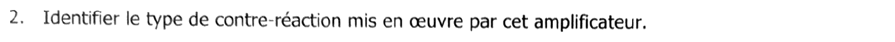{fig-alt="Q2 : identifier le type de contre-réaction mis en œuvre par cet amplificateur."}

::: {.notes-externes}
[annale-2016-2017, p. 1] : « On identifie un montage courant série. »
:::

:::: {.complement}
::: {.solution}
$L$ est **en série** dans la maille de sortie (parcourue par le courant de sortie $i_o$) : on **prélève un courant**. La tension $v_{fb}$ qu'elle développe se retranche de $v_{in}$ dans la maille d'entrée ($v_{gs} = v_{in} - v_{fb}$) : réinjection **série**.
$$\boxed{\text{contre-réaction de courant-série}}$$
Conséquence attendue ([courant-série](../cours/02-amplificateurs-contre-reaction.qmd#sec-cr-courant-serie)) : impédance d'entrée multipliée par $1 + A\beta_F$, ce qui va permettre de faire apparaître une partie réelle.
:::
::::

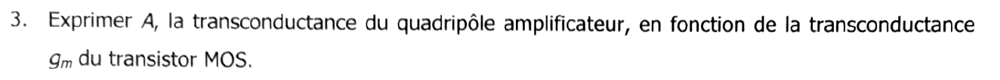{fig-alt="Q3 : exprimer A, la transconductance du quadripôle amplificateur, en fonction de la transconductance gm du transistor."}

::: {.notes-externes}
[annale-2016-2017, p. 1] : $g_m v_{gs} = A\, v_{gs}$, donc $A = g_m$.
:::

:::: {.complement}
::: {.solution}
$A = \frac{i_o}{v_{gs}}$ et $i_o = g_m v_{gs}$ :
$$\boxed{A = g_m}$$
:::
::::

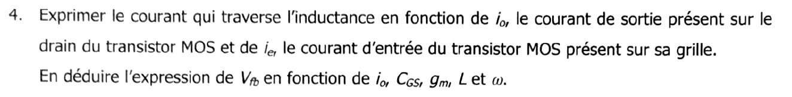{fig-alt="Q4 : exprimer le courant dans l'inductance en fonction de io et ie, puis Vfb en fonction de io, CGS, gm, L et ω."}

::: {.notes-externes}
[annale-2016-2017, p. 1] : $i_L = i_o + i_e$ ; $v_{gs} = \frac{i_e}{j\omega C_{gs}}$, donc $i_e = j\omega C_{gs}\, v_{gs}$ ; $v_{fb} = jL\omega\, i_o - \omega^2 L C_{gs}\, v_{gs}$, or $\frac{i_o}{v_{gs}} = g_m$, d'où $v_{fb} = i_o\left(jL\omega - \frac{\omega^2 L C_{gs}}{g_m}\right)$.
:::

:::: {.complement}
::: {.solution}
Loi des nœuds à la source : les courants de grille et de drain ressortent tous deux par l'inductance,
$$i_L = i_o + i_e .$$
Avec $i_e = j\omega C_{gs}\, v_{gs}$ et $v_{gs} = i_o/g_m$ : $i_e = \frac{j\omega C_{gs}}{g_m}\, i_o$. D'où
$$v_{fb} = jL\omega\, i_L = jL\omega\left(1 + \frac{j\omega C_{gs}}{g_m}\right) i_o \quad\Longrightarrow\quad \boxed{v_{fb} = \left(jL\omega - \frac{L C_{gs}\,\omega^2}{g_m}\right) i_o}$$
Contrôle d'unités : $\frac{LC_{gs}\omega^2}{g_m}$ est sans dimension divisé par des siemens, donc en ohms, comme $L\omega$.
:::
::::

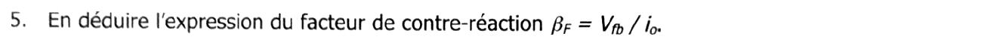{fig-alt="Q5 : en déduire le facteur de contre-réaction βF = Vfb / io."}

::: {.notes-externes}
[annale-2016-2017, p. 1] : $\beta_F = jL\omega - \frac{\omega^2 L C_{gs}}{g_m}$.
:::

:::: {.complement}
::: {.solution}
$$\boxed{\beta_F = \frac{v_{fb}}{i_o} = jL\omega - \frac{L C_{gs}\,\omega^2}{g_m}}$$
Une impédance (en Ω), comme il se doit pour une courant-série ; $A\beta_F = jg_m L\omega - LC_{gs}\omega^2$ est bien sans dimension. Le terme réel négatif vient du courant de grille, qui traverse aussi $L$ : $\beta_F$ n'est donc pas « idéal » (il dépend de $A$), ce que la suite exploite.
:::
::::

## Partie 2 : étude de l'adaptation d'impédance {#sec-ann1617cr-partie2}

{fig-alt="Titre : Partie 2, étude de l'adaptation d'impédance."}

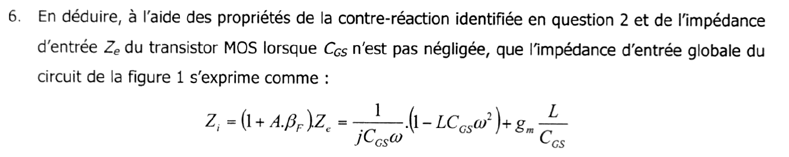{fig-alt="Q6 : à l'aide des propriétés de la contre-réaction identifiée et de l'impédance d'entrée Ze du MOS avec CGS, montrer que Zi = (1 + A.βF).Ze = (1 − L.CGS.ω²)/(j.CGS.ω) + gm.L/CGS."}

::: {.notes-externes}
[annale-2016-2017, p. 2] : $Z_i = (1 + A\beta_F)\, Z_e = \left(1 + jLg_m\omega - \omega^2 LC_{gs}\right)\frac{1}{jC_{gs}\omega} = \left(1 - \omega^2 LC_{gs}\right)\frac{1}{jC_{gs}\omega} + \frac{jLg_m\omega}{jC_{gs}\omega}$, soit $Z_i = \frac{1}{jC_{gs}\omega}\left(1 - \omega^2 LC_{gs}\right) + g_m\frac{L}{C_{gs}}$.
:::

:::: {.complement}
::: {.solution}
Pour une courant-série, $Z_i = Z_e(1 + A\beta_F)$ ([cours](../cours/02-amplificateurs-contre-reaction.qmd#sec-cr-courant-serie)), avec $Z_e = \frac{1}{jC_{gs}\omega}$ :
$$Z_i = \frac{1 + jg_m L\omega - LC_{gs}\omega^2}{jC_{gs}\omega} \quad\Longrightarrow\quad \boxed{Z_i = \frac{1 - LC_{gs}\omega^2}{jC_{gs}\omega} + g_m\frac{L}{C_{gs}}}$$
**Vérification directe** (sans la théorie de la contre-réaction) : $v_{in} = v_{gs} + jL\omega\,(i_e + g_m v_{gs})$ avec $v_{gs} = \frac{i_e}{jC_{gs}\omega}$ donne $Z_i = \frac{1}{jC_{gs}\omega} + jL\omega + \frac{g_m L}{C_{gs}}$, même expression (calcul vérifié avec SymPy). On lit : $C_{gs}$ et $L$ **en série**, plus une **résistance** $\frac{g_m L}{C_{gs}} = \omega_T L$ ($\omega_T = g_m/C_{gs}$, pulsation de transition du transistor) qui ne dissipe rien et n'ajoute donc pas de bruit thermique.
:::
::::

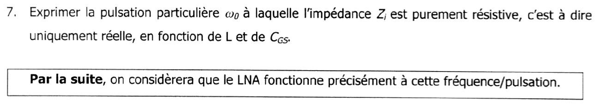{fig-alt="Q7 : exprimer la pulsation ω0 à laquelle Zi est purement résistive, en fonction de L et CGS. Encadré : par la suite, le LNA fonctionne précisément à cette pulsation."}

::: {.notes-externes}
[annale-2016-2017, p. 2] : lorsque $\omega = \frac{1}{\sqrt{LC_{gs}}}$, $Z_i$ est purement résistive ; dans la suite $Z_i = \frac{g_m L}{C_{gs}}$.
:::

:::: {.complement}
::: {.solution}
La partie imaginaire s'annule pour $LC_{gs}\omega^2 = 1$ (résonance série de $L$ et $C_{gs}$) :
$$\boxed{\omega_0 = \frac{1}{\sqrt{LC_{gs}}}}, \qquad Z_i(\omega_0) = \frac{g_m L}{C_{gs}} .$$
L'adaptation n'est exacte qu'à $\omega_0$ : le LNA est un circuit **à bande étroite**, centré sur la bande GSM.
:::
::::

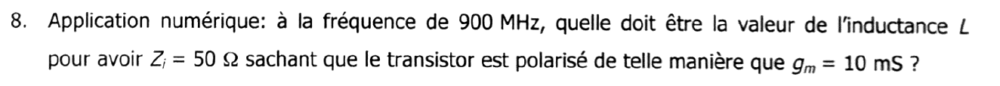{fig-alt="Q8 : application numérique, à 900 MHz, valeur de L pour Zi = 50 Ω avec gm = 10 mS."}

::: {.notes-externes}
[annale-2016-2017, p. 2] : $\omega = 2\pi f = 900\ \text{MHz} = \frac{1}{\sqrt{LC_{gs}}}$, $\omega^2 = \frac{1}{LC_{gs}}$ ; $Z_i = \frac{g_m L}{C_{gs}}$, d'où $\frac{Z_i}{\omega^2} = g_m L^2$ et $L = \sqrt{\frac{Z}{g_m}}\,\frac{1}{\omega}$. A.N. : $L = 12{,}5$ (unité de lecture ambiguë, voir le bloc ci-dessous).
:::

:::: {.complement}
::: {.solution}
Deux équations, deux inconnues ($L$, $C_{gs}$) : $\omega_0^2 = \frac{1}{LC_{gs}}$ et $Z_i = \frac{g_m L}{C_{gs}}$. En éliminant $C_{gs}$ : $Z_i = g_m L^2 \omega_0^2$, donc
$$L = \frac{1}{\omega_0}\sqrt{\frac{Z_i}{g_m}} = \frac{\sqrt{50 / 0{,}01}}{2\pi \times 900 \cdot 10^6} = \frac{70{,}7\ \Omega}{5{,}655 \cdot 10^9\ \text{rad/s}} \quad\Longrightarrow\quad \boxed{L \approx 12{,}5\ \text{nH}}$$
et $C_{gs} = \frac{1}{L\omega_0^2} \approx 2{,}5$ pF (à obtenir par la taille du transistor). Valeurs réalistes pour une inductance intégrée ou de boîtier. Attention : 900 MHz est la **fréquence** ; $\omega_0 = 2\pi f$.
:::
::::

::: {.a-verifier .tranche #av-ann1617cr-unite-inductance}
**Source** [annale-2016-2017, p. 2] : « $\omega = 2\pi f = 900$ MHz », puis « A.N. : $L = 12{,}5$ » suivi d'une unité dont la première lettre se lit « n » ou « m ».

**Problème** : 900 MHz est la fréquence $f$, pas la pulsation ; l'unité de $L$ est ambiguë (« mH » serait faux de six ordres de grandeur).

**Proposition** : $\omega_0 = 2\pi \times 900$ MHz $\approx 5{,}65 \cdot 10^9$ rad/s, $L \approx 12{,}5$ nH.

**Décision** : même point que le bloc [`av-application-numerique-lna`](../cours/03-applications-contre-reaction.qmd#av-application-numerique-lna) du chapitre 3, tranché le 2026-10-14 (proposition retenue).
:::

## Partie 3 : étude de l'amplification à 900 MHz {#sec-ann1617cr-partie3}

{fig-alt="Titre : Partie 3, étude de l'amplification à 900 MHz."}

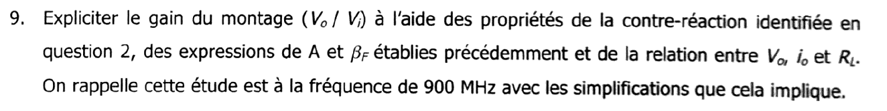{fig-alt="Q9 : expliciter le gain Vo/Vi à l'aide des propriétés de la contre-réaction, des expressions de A et βF et de la relation entre Vo, io et RL, à 900 MHz avec les simplifications que cela implique."}

Le corrigé [annale-2016-2017] s'arrête avant la partie 3.

:::: {.complement}
::: {.solution}
Courant-série : $\frac{i_o}{v_i} = \frac{A}{1 + A\beta_F}$ ([cours](../cours/02-amplificateurs-contre-reaction.qmd#eq-ft-courant-serie)). À $\omega_0$, $LC_{gs}\omega_0^2 = 1$ :
$$1 + A\beta_F = 1 + jg_m L\omega_0 - LC_{gs}\omega_0^2 = jg_m L\omega_0 \quad\Longrightarrow\quad \frac{i_o}{v_i} = \frac{g_m}{jg_m L\omega_0} = \frac{1}{jL\omega_0} .$$
Le courant $i_o$ entre dans le drain depuis $R_L$ : $v_o = -R_L\, i_o$. D'où
$$\boxed{\frac{V_o}{V_i} = -\frac{R_L}{jL\omega_0} = j\,\frac{R_L}{L\omega_0}}$$
Remarques : le gain ne dépend plus de $g_m$, mais **pas** parce que le gain de boucle serait grand : ici $|A\beta_F| = g_m L\omega_0 \approx 0{,}71$. C'est la résonance qui annule le « 1 » et le terme $-LC_{gs}\omega_0^2$ de $1 + A\beta_F$ ; l'approximation habituelle $\frac{A}{1 + A\beta_F} \approx \frac{1}{\beta_F}$ ne s'applique pas. Le gain est purement imaginaire : déphasage de $+90°$ dû à la résonance de $C_{gs}$.
:::
::::

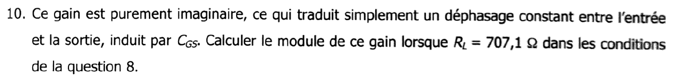{fig-alt="Q10 : ce gain purement imaginaire traduit un déphasage constant induit par CGS ; calculer son module pour RL = 707,1 Ω dans les conditions de la question 8."}

:::: {.complement}
::: {.solution}
D'après la question 8, $L\omega_0 = \sqrt{Z_i/g_m} = \sqrt{5000} \approx 70{,}71\ \Omega$ :
$$\left|\frac{V_o}{V_i}\right| = \frac{R_L}{L\omega_0} = \frac{707{,}1}{70{,}71} \quad\Longrightarrow\quad \boxed{\left|\frac{V_o}{V_i}\right| \approx 10 \quad (20\ \text{dB})}$$
La valeur $R_L = 707{,}1\ \Omega = 10\sqrt{5000}\ \Omega$ est choisie pour un résultat rond. Avec $R_L = 700\ \Omega$ (support 2025, [chapitre 3](../cours/03-applications-contre-reaction.qmd#sec-degenerescence-inductive)), on trouve 9,9.

Ce gain est celui vu de la grille ($v_i$ est la tension d'entrée du LNA adapté). Vu de la source de l'antenne (f.é.m. $e$, $Z_0 = 50\ \Omega$, adaptée : $v_i = e/2$), le gain est deux fois plus faible.
:::
::::
