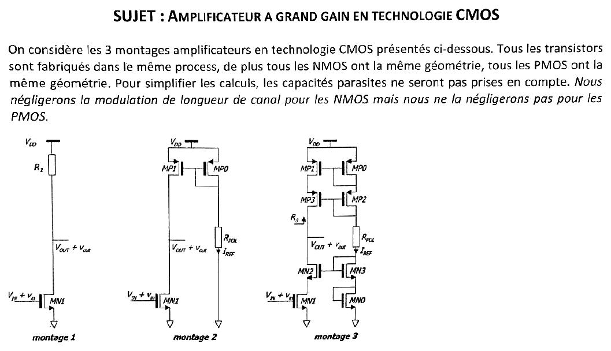
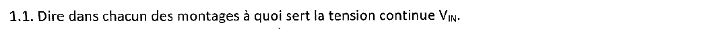
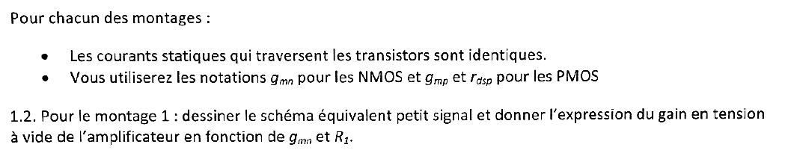
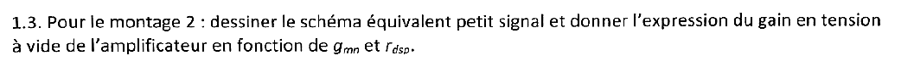
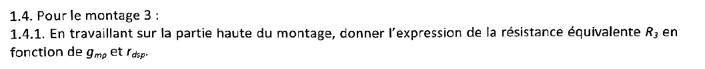
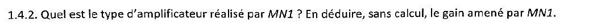
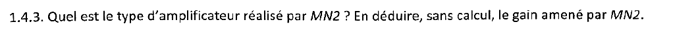
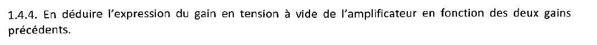
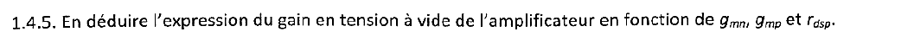
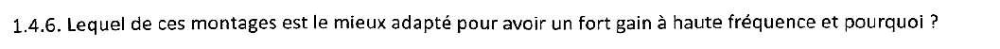



::: {.complement}
Aucun corrigé officiel : **toutes les solutions de cette page sont rédigées par Claude**. Le sujet est une photo d'une feuille [sujet-2017-hf] ; l'éclairage a été égalisé et un soulignement au stylo d'un étudiant (« mais nous ne la négligerons pas pour les PMOS ») a été effacé des images. À relire avec un œil critique ; signaler toute erreur.

Le corrigé manuscrit `2017-2018-corrige-manuscrit.pdf` rangé avec les annales porte sur le partiel « Contre-réaction » de la même année, pas sur ce sujet.

Le sujet n'est pas découpé en exercices : il est traité ici comme un exercice unique, en suivant sa numérotation (1.1 à 1.4.6).
:::

Chapitres du cours : [pôles d'un étage source commune](../cours/01-generalites-contre-reaction.qmd#sec-poles-source-commune) et [effet Miller](../cours/01-generalites-contre-reaction.qmd#sec-effet-miller).

## Amplificateur à grand gain en technologie CMOS {#sec-ann1718hf-ex1}

{fig-alt="Énoncé et figure des trois montages amplificateurs CMOS. Mêmes géométries pour tous les NMOS et pour tous les PMOS ; capacités parasites ignorées ; modulation de longueur de canal négligée pour les NMOS mais pas pour les PMOS. Montage 1 : NMOS MN1 (grille VIN + vin) chargé par R1 vers VDD. Montage 2 : MN1 chargé par le PMOS MP1, en miroir avec MP0 monté en diode, polarisé par RPOL (courant IREF). Montage 3 : MN1 surmonté du NMOS cascode MN2 (grille reliée à MN3 en diode, sur MN0 en diode), charge PMOS cascode MP1, MP3 en miroir avec MP0, MP2 en diode, branche de référence RPOL, IREF ; R3 est la résistance vue depuis la sortie vers le haut."}

**Conventions de la correction.** Petits signaux ; un MOS est modélisé par $g_m v_{gs}$ en parallèle avec $r_{ds}$ (drain-source), avec $r_{dsn} \to \infty$ pour les NMOS (énoncé) et $r_{dsp}$ finie pour les PMOS ; effet de substrat négligé. Le « gain à vide » est le gain sans charge en sortie. Tous les transistors portent le même courant statique, d'où les mêmes $g_{mn}$ pour les NMOS et $g_{mp}$, $r_{dsp}$ pour les PMOS.

{fig-alt="1.1 : dire dans chacun des montages à quoi sert la tension continue VIN."}

:::: {.complement}
::: {.solution}
$V_{IN}$ est la composante continue de la grille de $MN_1$ : elle fixe son **point de polarisation** (point de repos), le signal $v_{in}$ s'y superposant. Il faut dans tous les cas $V_{IN} > V_{Tn}$ et $MN_1$ saturé.

- **Montage 1** : $V_{IN}$ fixe le courant $I_D = k'_n\frac{W}{L}(V_{IN} - V_{Tn})^2$, donc $g_{mn}$, et la tension de sortie $V_{OUT} = V_{DD} - R_1 I_D$ (à garder supérieure à $V_{IN} - V_{Tn}$).
- **Montages 2 et 3** : le courant est imposé par le miroir PMOS ($I_{REF}$ recopié par $MP_1$). $V_{IN}$ doit être la tension pour laquelle $MN_1$ absorbe ce courant ; comme la sortie est un nœud de très forte impédance, un petit écart de $V_{IN}$ est compensé par une grande variation de $V_{OUT}$ (par la modulation de longueur de canal des PMOS). $V_{IN}$ fixe donc en pratique la **tension de repos de la sortie** ; dans un vrai circuit, elle est imposée par une boucle de contre-réaction (mode commun). Dans le montage 3, la grille du cascode $MN_2$ est polarisée à part (diodes $MN_3$, $MN_0$).
:::
::::

{fig-alt="Pour chacun des montages : courants statiques identiques dans les transistors, notations gmn pour les NMOS, gmp et rdsp pour les PMOS. 1.2 : pour le montage 1, schéma équivalent petit signal et gain en tension à vide en fonction de gmn et R1."}

:::: {.complement}
::: {.solution}
**Schéma** : $V_{DD}$ est une masse dynamique. Entre la sortie et la masse : la source de courant $g_{mn} v_{in}$ de $MN_1$ (de la sortie vers la masse ; $v_{gs1} = v_{in}$, source à la masse) et $R_1$ (vers $V_{DD}$, donc vers la masse dynamique) ; $r_{dsn}$ infinie. Loi des nœuds en sortie :
$$g_{mn} v_{in} + \frac{v_{out}}{R_1} = 0 \quad\Longrightarrow\quad \boxed{A_1 = \frac{v_{out}}{v_{in}} = -g_{mn} R_1}$$
Montage source commune classique ([cours](../cours/01-generalites-contre-reaction.qmd#sec-poles-source-commune)). Le gain est limité : augmenter $R_1$ à courant donné fait baisser $V_{OUT}$ et sortir $MN_1$ de la saturation.
:::
::::

{fig-alt="1.3 : pour le montage 2, schéma équivalent petit signal et gain en tension à vide en fonction de gmn et rdsp."}

:::: {.complement}
::: {.solution}
La branche $MP_0$, $R_{POL}$ ne porte aucun signal : la grille commune de $MP_0$ et $MP_1$ est une masse dynamique. $MP_1$ (source à $V_{DD}$, $v_{gs} = 0$) se réduit donc à sa résistance $r_{dsp}$ : c'est une **charge active** (source de courant). Schéma : $g_{mn} v_{in}$ et $r_{dsp}$ en parallèle entre la sortie et la masse.
$$\boxed{A_2 = -g_{mn}\, r_{dsp}}$$
C'est le gain intrinsèque d'un transistor : bien plus grand que $g_{mn}R_1$ sans contrainte de chute de tension continue, puisque $MP_1$ fournit le courant sous une faible $V_{SD}$ tout en présentant une forte résistance dynamique.
:::
::::

{fig-alt="1.4 : pour le montage 3. 1.4.1 : en travaillant sur la partie haute du montage, expression de la résistance équivalente R3 en fonction de gmp et rdsp."}

:::: {.complement}
::: {.solution}
Les grilles de $MP_1$ et $MP_3$ sont fixées par les diodes $MP_0$, $MP_2$ de la branche de référence : masses dynamiques. On injecte un courant $i_x$ dans le drain de $MP_3$ (nœud de sortie) et on note $v_x$ la tension obtenue, $v_s$ celle du nœud entre $MP_3$ et $MP_1$.

- $MP_1$ ($v_{gs} = 0$) : simple résistance $r_{dsp}$ vers la masse dynamique, traversée par $i_x$ : $v_s = r_{dsp}\, i_x$.
- $MP_3$ : grille à la masse, source à $v_s$, donc $v_{gs3} = -v_s$ ; le courant entrant dans son drain vaut $i_x = g_{mp}(-v_s) + \frac{v_x - v_s}{r_{dsp}}$.

D'où $v_x = r_{dsp}\, i_x + (1 + g_{mp} r_{dsp})\, v_s$, et
$$\boxed{R_3 = \frac{v_x}{i_x} = 2r_{dsp} + g_{mp}\, r_{dsp}^2 \approx g_{mp}\, r_{dsp}^2} \quad (g_{mp} r_{dsp} \gg 1).$$
Le cascode multiplie la résistance de sortie par le gain intrinsèque $g_{mp} r_{dsp}$ : la contre-réaction de courant série introduite par $r_{dsp}$ de $MP_1$ sous la source de $MP_3$ ([chapitre 2](../cours/02-amplificateurs-contre-reaction.qmd#sec-cr-courant-serie)) augmente l'impédance vue du drain.
:::
::::

{fig-alt="1.4.2 : type d'amplificateur réalisé par MN1 ; en déduire, sans calcul, le gain amené par MN1."}

:::: {.complement}
::: {.solution}
$MN_1$ est en **source commune** (entrée sur la grille, sortie sur le drain, source à la masse). Sa charge est la résistance vue dans la source de $MN_2$, monté en grille commune : avec $r_{dsn}$ infinie, cette résistance vaut $\frac{1}{g_{mn}}$, quelle que soit la charge de $MN_2$. D'où
$$\boxed{A_{MN1} = -g_{mn}\cdot\frac{1}{g_{mn}} = -1}$$
Le gain de l'étage d'entrée est faible (en module 1) : c'est ce qui limite l'effet Miller (question 1.4.6).
:::
::::

{fig-alt="1.4.3 : type d'amplificateur réalisé par MN2 ; en déduire, sans calcul, le gain amené par MN2."}

:::: {.complement}
::: {.solution}
$MN_2$ est en **grille commune** (grille à une tension fixe, entrée sur la source, sortie sur le drain). Il recopie sur son drain le courant reçu en source (gain en courant 1, $r_{dsn}$ infinie) et le fait passer dans la charge $R_3$ ; vu de sa source, il présente $\frac{1}{g_{mn}}$. Gain en tension, non inverseur :
$$\boxed{A_{MN2} = \frac{v_{out}}{v_{s2}} = +g_{mn} R_3}$$
:::
::::

{fig-alt="1.4.4 : en déduire le gain en tension à vide de l'amplificateur en fonction des deux gains précédents."}

:::: {.complement}
::: {.solution}
Les deux étages sont en cascade (le gain de $MN_1$ a été calculé avec la charge réelle que présente $MN_2$) :
$$\boxed{A_3 = A_{MN1} \cdot A_{MN2} = -g_{mn} R_3}$$
Lecture directe : le courant $g_{mn} v_{in}$ de $MN_1$ traverse $MN_2$ sans perte et se referme dans $R_3$.
:::
::::

{fig-alt="1.4.5 : en déduire le gain en tension à vide en fonction de gmn, gmp et rdsp."}

:::: {.complement}
::: {.solution}
Avec la question 1.4.1 :
$$\boxed{A_3 = -g_{mn}\left(2r_{dsp} + g_{mp}\, r_{dsp}^2\right) \approx -g_{mn}\, g_{mp}\, r_{dsp}^2}$$
Soit $g_{mp} r_{dsp}$ fois (typiquement 20 à 100 fois) le gain du montage 2. L'hypothèse $r_{dsn}$ infinie est ici essentielle : avec $r_{dsn}$ finie, le cascode NMOS présenterait $\approx g_{mn} r_{dsn}^2$ vers le bas, en parallèle sur $R_3$, et le gain serait de l'ordre de $g_m^2 r_{ds}^2/2$ (cascode télescopique).
:::
::::

{fig-alt="1.4.6 : lequel de ces montages est le mieux adapté pour avoir un fort gain à haute fréquence, et pourquoi ?"}

:::: {.complement}
::: {.solution}
Le **montage 3** (cascode).

- **Gain** : le plus élevé des trois ($\approx g_{mn} g_{mp} r_{dsp}^2$ contre $g_{mn} r_{dsp}$ et $g_{mn} R_1$).
- **Effet Miller réduit** : dans les montages 1 et 2, la capacité grille-drain $C_{gd}$ de $MN_1$ relie l'entrée à une sortie de gain élevé ; elle est vue en entrée comme $(1 + |A|)\,C_{gd}$ ([effet Miller](../cours/01-generalites-contre-reaction.qmd#eq-capacite-miller)), ce qui crée un pôle d'entrée basse fréquence avec la résistance de la source qui attaque l'amplificateur. Dans le montage 3, le drain de $MN_1$ est un nœud de faible impédance ($\frac{1}{g_{mn}}$) et de gain $-1$ : $C_{gd1}$ n'est multipliée que par 2. Le pôle de ce nœud intermédiaire, $\approx g_{mn}/C$, est très haut.
- **Isolation** entre sortie et entrée (faible transmission inverse), utile en HF pour la stabilité.

Contrepartie : la sortie est un nœud de très forte impédance ; avec une capacité de charge $C_L$, le pôle de sortie $\frac{1}{R_3 C_L}$ est bas, mais le produit gain-bande $\frac{g_{mn}}{C_L}$ est conservé, et c'est lui qui fixe le gain disponible à une fréquence donnée. La dynamique de sortie est aussi réduite (quatre transistors à maintenir saturés entre $V_{DD}$ et la masse).
:::
::::
