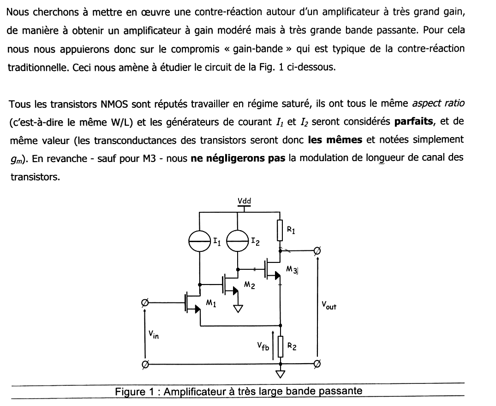
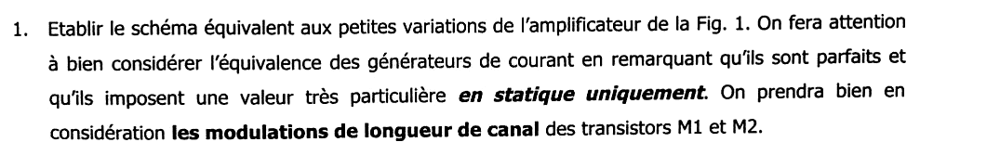
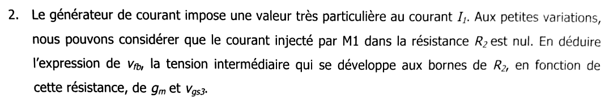
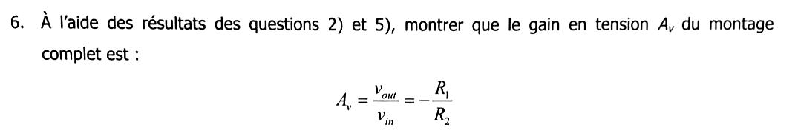
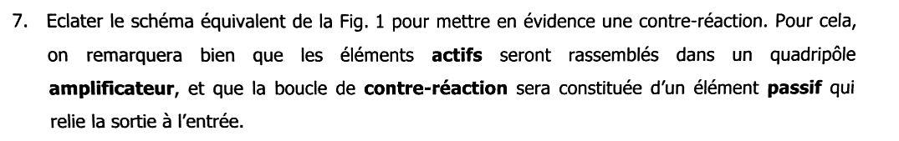
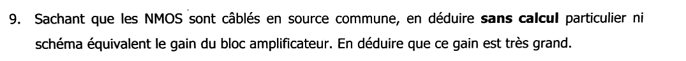
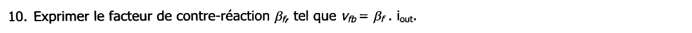
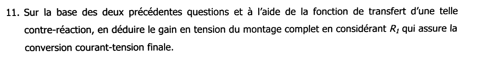



::: {.complement}
**Origine des solutions.** Le corrigé manuscrit [annale-2017-2018] (écriture d'un tiers, sur tablette), dont l'énoncé était réputé absent (`ETAT_PROJET.md`, problème 20), corrige **ce sujet** (« Amplificateur large bande », questions 1 à 11). Il est repris en *Notes externes* sous chaque question ; les solutions détaillées en *Complément* sont rédigées par Claude ; les erreurs relevées dans le corrigé sont signalées en *À vérifier*. Le soulignement et le cercle autour de $M_3$ tracés au stylo par un étudiant ont été effacés des images. À relire avec un œil critique ; signaler toute erreur.
:::

Chapitres du cours : [contre-réaction de courant-série](../cours/02-amplificateurs-contre-reaction.qmd#sec-cr-courant-serie), [compromis gain-bande passante](../cours/01-generalites-contre-reaction.qmd#sec-gain-bande), [robustesse](../cours/01-generalites-contre-reaction.qmd#sec-robustesse).

{fig-alt="Énoncé commun : contre-réaction autour d'un amplificateur à très grand gain pour obtenir un gain modéré et une très grande bande passante (compromis gain-bande). Figure 1 : NMOS M1 (grille Vin, drain chargé par la source I1 et relié à la grille de M2), M2 (source à la masse, drain chargé par I2 et relié à la grille de M3), M3 (drain chargé par R1 vers Vdd, sortie Vout) ; les sources de M1 et M3 sont reliées et vont à la masse par R2 (tension Vfb). NMOS saturés, même W/L, I1 = I2 parfaites, même gm ; modulation de longueur de canal prise en compte sauf pour M3."}

## Partie 1 : étude classique {#sec-ann1718cr-partie1}

{fig-alt="Titre : Partie 1, étude classique."}

{fig-alt="Q1 : établir le schéma équivalent aux petites variations, en notant que les générateurs de courant parfaits n'imposent une valeur qu'en statique, et en prenant en compte la modulation de longueur de canal de M1 et M2."}

::: {.notes-externes}
[annale-2017-2018, p. 1] : schéma dessiné. $M_1$ : source $g_{m1} v_{gs1}$ et $r_{ds1}$ en parallèle entre $D_1$ et $S_1$ ; $D_1$ relié à $G_2$ ; $S_1$ relié au nœud A (courant $i_{M1}$). $M_2$ : $g_{m2} v_{gs2}$ et $r_{ds2}$ entre $D_2$ et la masse ; $D_2$ relié à $G_3$. $M_3$ : $g_m v_{gs3}$ seule (sans $r_{ds}$) entre le drain (sortie, $R_1$ vers la masse) et le nœud A ; $R_2$ entre A et la masse, tension $v_{fb}$. En tête : « Même $W/L$, même $g_m$, $I_1 = I_2$ ; $M_3$ : on néglige $r_{ds}$. »
:::

:::: {.complement}
::: {.solution}
En petits signaux, $V_{DD}$ est une masse et les sources de courant **parfaites** deviennent des **circuits ouverts** : elles fixent les courants de repos, mais aucune variation ne les traverse. Il reste :

- $M_1$ : $g_m v_{gs1}$ et $r_{ds1}$ entre $D_1$ et $S_1$ ; $D_1$ n'est relié qu'à la grille de $M_2$ ;
- $M_2$ : $g_m v_{gs2}$ et $r_{ds2}$ entre $D_2$ et la masse ; $D_2$ n'est relié qu'à la grille de $M_3$ ;
- $M_3$ : $g_m v_{gs3}$ seule entre $D_3$ et $S_3$ ; $R_1$ entre $D_3$ (sortie) et la masse ;
- nœud A ($S_1 = S_3$) : $R_2$ vers la masse, $v_{fb} = v_A$.

Tensions de commande : $v_{gs1} = v_{in} - v_{fb}$, $v_{gs2} = v_{D1}$, $v_{gs3} = v_{D2} - v_{fb}$.
:::
::::

{fig-alt="Q2 : le générateur de courant impose une valeur particulière à I1 ; aux petites variations, le courant injecté par M1 dans R2 est nul. En déduire vfb en fonction de R2, gm et vgs3."}

::: {.notes-externes}
[annale-2017-2018, p. 1] : loi des nœuds en A, $i_{R2} = i_{M1} + g_m v_{gs3}$ avec $i_{M1} = 0$, donc $v_{fb} = R_2\, i_{R2} = R_2\, g_m v_{gs3}$ (1).
:::

:::: {.complement}
::: {.solution}
Le drain de $M_1$ n'est relié qu'à une source de courant idéale et à une grille : la loi des nœuds en $D_1$ impose que la **variation du courant de drain de $M_1$ est nulle**, $i_{d1} = 0$. Au nœud A n'arrive donc que le courant de $M_3$, $g_m v_{gs3}$ ($r_{ds3}$ négligée) :
$$\boxed{v_{fb} = R_2\, g_m\, v_{gs3}} \qquad (1)$$
:::
::::

{fig-alt="Q3 : en se focalisant sur M1 et M2, exprimer vgs2 en fonction de gm, rds1, vgs1 et vfb."}

::: {.notes-externes}
[annale-2017-2018, p. 1] : $v_{gs2} = v_{fb} - r_{ds1}\, g_m v_{gs1}$ (2).
:::

:::: {.complement}
::: {.solution}
$i_{d1} = g_m v_{gs1} + \frac{v_{D1} - v_{fb}}{r_{ds1}} = 0$, donc $v_{D1} = v_{fb} - g_m r_{ds1} v_{gs1}$. La source de $M_2$ est à la masse : $v_{gs2} = v_{D1}$,
$$\boxed{v_{gs2} = v_{fb} - g_m r_{ds1}\, v_{gs1}} \qquad (2)$$
$M_1$, dont le courant ne peut pas varier, se comporte en amplificateur de gain intrinsèque $-g_m r_{ds1}$ entre sa grille et son drain (référencés à sa source).
:::
::::

{fig-alt="Q4 : en se focalisant sur M2 et M3, exprimer vfb en fonction de gm, rds2, vgs2 et vgs3."}

::: {.notes-externes}
[annale-2017-2018, p. 1] : $v_{fb} = -r_{ds2}\, g_m v_{gs2} - v_{gs3}$ (3).
:::

:::: {.complement}
::: {.solution}
Même raisonnement en $D_2$ : $i_{d2} = g_m v_{gs2} + \frac{v_{D2}}{r_{ds2}} = 0$, donc $v_{D2} = -g_m r_{ds2}\, v_{gs2}$. Avec $v_{gs3} = v_{D2} - v_{fb}$ :
$$\boxed{v_{fb} = -g_m r_{ds2}\, v_{gs2} - v_{gs3}} \qquad (3)$$
:::
::::

{fig-alt="Q5 : en combinant les expressions précédentes, montrer que vfb ≈ vin."}

::: {.notes-externes}
[annale-2017-2018, p. 2] : $v_{fb} = r_{ds2} g_m\left(v_{fb} - r_{ds1} g_m v_{gs1}\right) - v_{fb}\frac{1}{R_2 g_m}$ ; $v_{fb}\left(1 + \frac{1}{R_2 g_m} - r_{ds2} g_m\right) = -r_{ds1} r_{ds2} g_m^2 v_{gs1}$ ; $v_{fb} = \frac{-R_2 r_{ds1} r_{ds2} g_m^3}{1 + R_2 g_m - r_{ds2} R_2 g_m^2}\, v_{gs1}$, dénominateur noté $\alpha$ ; « $\alpha \simeq r_{ds1} g_m$, d'où $\frac{v_{fb}}{v_{gs1}} = \alpha \gg 1$ », donc $v_{gs1}$ négligeable devant $v_{fb}$ ; $v_{in} = v_{fb} + v_{gs1}$, d'où $v_{fb} \simeq v_{in}$.
:::

:::: {.complement}
::: {.solution}
On reporte (2) dans (3), puis $v_{gs3} = \frac{v_{fb}}{g_m R_2}$ tiré de (1) :
$$v_{fb} = -g_m r_{ds2}\left(v_{fb} - g_m r_{ds1} v_{gs1}\right) - \frac{v_{fb}}{g_m R_2}$$
$$v_{fb}\left(1 + g_m r_{ds2} + \frac{1}{g_m R_2}\right) = g_m^2 r_{ds1} r_{ds2}\, v_{gs1} \quad\Longrightarrow\quad \frac{v_{fb}}{v_{gs1}} = \frac{g_m^3 R_2\, r_{ds1} r_{ds2}}{1 + g_m R_2 + g_m^2 R_2\, r_{ds2}} \approx g_m r_{ds1}$$
(si $g_m r_{ds2} \gg 1$). Ce rapport est **positif et grand** (gain intrinsèque, quelques dizaines à quelques centaines). Avec $v_{in} = v_{gs1} + v_{fb}$ :
$$v_{fb} = \frac{v_{fb}/v_{gs1}}{1 + v_{fb}/v_{gs1}}\, v_{in} \quad\Longrightarrow\quad \boxed{v_{fb} \approx v_{in}}$$
à $\frac{1}{g_m r_{ds1}}$ près : la source de $M_1$ « suit » sa grille, comme un suiveur dont le gain serait renforcé par la boucle. Le résultat final du corrigé est juste ; une étape intermédiaire contient une erreur de signe (bloc ci-dessous).
:::
::::

::: {.a-verifier #av-ann1718cr-signe-q5}
**Source** [annale-2017-2018, p. 2] : « $v_{fb} = r_{ds2} g_m (v_{fb} - r_{ds1} g_m v_{gs1}) - v_{fb}\frac{1}{R_2 g_m}$ », puis $v_{fb} = \frac{-R_2 r_{ds1} r_{ds2} g_m^3}{1 + R_2 g_m - r_{ds2} R_2 g_m^2}\, v_{gs1}$, le dénominateur étant appelé $\alpha$, puis « $\alpha \simeq r_{ds1} g_m$, d'où $\frac{v_{fb}}{v_{gs1}} = \alpha$ ».

**Problème** : en reportant (2) dans (3), il manque le signe $-$ devant $r_{ds2} g_m(\ldots)$ ; les deux erreurs de signe (numérateur et dénominateur) se compensent et le rapport final $\approx g_m r_{ds1}$ est juste. Par ailleurs $\alpha$ désigne d'abord le dénominateur, puis le rapport $v_{fb}/v_{gs1}$.

**Proposition** : $\frac{v_{fb}}{v_{gs1}} = \frac{g_m^3 R_2\, r_{ds1} r_{ds2}}{1 + g_m R_2 + g_m^2 R_2\, r_{ds2}} \approx g_m r_{ds1}$ (calcul vérifié avec SymPy).
:::

{fig-alt="Q6 : à l'aide des questions 2 et 5, montrer que le gain en tension du montage complet est Av = vout/vin = −R1/R2."}

::: {.notes-externes}
[annale-2017-2018, p. 2] : $v_{out} = -R_1 g_m v_{gs3} = -\frac{R_1 g_m}{R_2 g_m} v_{fb} = -\frac{R_1}{R_2} v_{fb}$, d'où $A_v = -\frac{R_1}{R_2}$.
:::

:::: {.complement}
::: {.solution}
Le courant de drain de $M_3$, $g_m v_{gs3}$, traverse $R_1$ en faisant baisser la sortie : $v_{out} = -R_1 g_m v_{gs3}$. Avec (1), $g_m v_{gs3} = \frac{v_{fb}}{R_2}$, puis $v_{fb} \approx v_{in}$ (question 5) :
$$\boxed{A_v = \frac{v_{out}}{v_{in}} = -\frac{R_1}{R_2}}$$
Lecture : la boucle recopie $v_{in}$ aux bornes de $R_2$, d'où un courant $v_{in}/R_2$ que $M_3$ renvoie dans $R_1$. Le gain ne dépend que d'un **rapport de résistances** (robuste aux dispersions des transistors). Expression exacte (SymPy) :
$$A_v = -\frac{R_1\, g_m^3 r_{ds1} r_{ds2}}{1 + g_m R_2 + g_m^2 R_2\, r_{ds2} + g_m^3 R_2\, r_{ds1} r_{ds2}} \xrightarrow{g_m r_{ds} \gg 1} -\frac{R_1}{R_2} .$$
:::
::::

## Partie 2 : étude par la contre-réaction {#sec-ann1718cr-partie2}

{fig-alt="Titre : Partie 2, étude par la contre-réaction."}

{fig-alt="Q7 : éclater le schéma équivalent de la figure 1 pour mettre en évidence une contre-réaction : les éléments actifs dans un quadripôle amplificateur, la boucle de contre-réaction constituée d'un élément passif reliant la sortie à l'entrée."}

::: {.notes-externes}
[annale-2017-2018, p. 3] : même schéma redessiné ; un grand cadre $A$ englobe les trois transistors (de $G_1$ à $D_3$, courant de sortie $i_o$ entrant en $D_3$, $R_1$ et $v_{out}$ à droite) ; le cadre $\beta_F$, en dessous, contient $R_2$, reliée aux sources de $M_1$ et $M_3$, tension $v_{fb}$.
:::

:::: {.complement}
::: {.solution}
- **Quadripôle $A$** (actif) : $M_1$, $M_2$, $M_3$. Entrée : $v_{gs1}$ (entre la grille de $M_1$ et le nœud A) ; sortie : le courant $i_o = g_m v_{gs3}$ qui entre dans le drain de $M_3$ (sortie Norton, $r_{ds3}$ infinie).
- **Quadripôle $\beta_F$** (passif) : $R_2$, traversée par $i_o$ (puisque $i_{d1} = 0$) et qui présente $v_{fb}$ dans la maille d'entrée.
- $R_1$ est la **charge** : elle convertit $i_o$ en $v_{out}$, hors de la boucle.
:::
::::

{fig-alt="Q8 : identifier le type de contre-réaction."}

::: {.notes-externes}
[annale-2017-2018, p. 3] : « On identifie un courant série. »
:::

:::: {.complement}
::: {.solution}
$R_2$ est en série dans le chemin du courant de sortie : on **prélève un courant** ; $v_{fb}$ se retranche de $v_{in}$ dans la maille d'entrée ($v_{gs1} = v_{in} - v_{fb}$) : réinjection **série**.
$$\boxed{\text{contre-réaction de courant-série}}$$
C'est la même topologie que la [dégénérescence d'émetteur ou de source](../cours/02-amplificateurs-contre-reaction.qmd#sec-cr-courant-serie), mais avec une boucle à trois transistors : gain de boucle beaucoup plus grand.
:::
::::

{fig-alt="Q9 : les NMOS étant câblés en source commune, en déduire sans calcul ni schéma équivalent le gain du bloc amplificateur, et en déduire que ce gain est très grand."}

::: {.notes-externes}
[annale-2017-2018, p. 3] : gain d'un source commune : $(-g_m R_D)$ ; $A = -g_m^3 R_1\, r_{ds1} r_{ds2}$.
:::

:::: {.complement}
::: {.solution}
Pour une courant-série, $A$ est une **transconductance** $\frac{i_o}{v_{gs1}}$ ([tableau](../cours/02-amplificateurs-contre-reaction.qmd#sec-synthese-cr)). On enchaîne trois étages, sources à la masse dynamique (« sans calcul ») :

- $M_1$, chargé par la source $I_1$ (circuit ouvert) : gain intrinsèque $-g_m r_{ds1}$ ;
- $M_2$, chargé par $I_2$ : $-g_m r_{ds2}$ ;
- $M_3$ convertit $v_{gs3}$ en courant : $i_o = g_m v_{gs3}$.

$$\boxed{A = \frac{i_o}{v_{gs1}} = (-g_m r_{ds1})(-g_m r_{ds2})\, g_m = g_m^3\, r_{ds1} r_{ds2}}$$
Positif (deux inversions) et très grand : $g_m (g_m r_{ds})^2$, car chaque étage a la charge la plus grande possible (une source de courant idéale). Ordre de grandeur (valeurs d'illustration) : $g_m = 1$ mS et $g_m r_{ds} = 100$ donnent $A \approx 10$ S, soit $A\beta_F \approx 10^4$ avec $R_2 = 1$ kΩ. Le prix est une forte sensibilité aux paramètres des transistors, que la contre-réaction va gommer.

*Remarque* : le calcul exact de la partie 1 donne $\frac{i_o}{v_{in}} = \frac{g_m^3 r_{ds1} r_{ds2}}{1 + g_m R_2 + g_m^2 R_2\, r_{ds2} + g_m^3 R_2\, r_{ds1} r_{ds2}}$ : par rapport à $\frac{A}{1 + A\beta_F}$, les termes $g_m R_2 + g_m^2 R_2 r_{ds2}$ traduisent les effets de charge de $R_2$ (sources de $M_1$ et $M_3$ non exactement à la masse) négligés « sans calcul » ; ils restent petits devant $A\beta_F$.
:::
::::

::: {.a-verifier #av-ann1718cr-gain-boucle}
**Source** [annale-2017-2018, p. 3] : « $A = -g_m^3 R_1 r_{ds1} r_{ds2}$ » (q. 9), puis (q. 11) « $\frac{A}{1 + A\beta_F} = \frac{-g_m^3 R_1 r_{ds1} r_{ds2}}{1 - g_m^3 R_1 R_2 r_{ds1} r_{ds2}} \simeq \frac{1}{R_2} = \frac{i_o}{v_i}$ ».

**Problème** : (1) $A$ doit être une transconductance $i_o/v_{gs1}$ ; y mettre $R_1$ (la charge, hors de la boucle) donne un gain en tension, et $A\beta_F$ n'est plus sans dimension ; (2) le signe : deux étages inverseurs suivis de $M_3$ donnent un $A$ **positif** ; avec $A < 0$ le dénominateur $1 - \ldots$ serait celui d'une réaction positive et la limite vaudrait $-\frac{1}{R_2}$, pas $\frac{1}{R_2}$. Le résultat final $A_v = -R_1/R_2$ est néanmoins juste.

**Proposition** : $A = g_m^3 r_{ds1} r_{ds2}$ (en S), $\beta_F = R_2$, $A\beta_F = g_m^3 R_2\, r_{ds1} r_{ds2} \gg 1$, $\frac{i_o}{v_{in}} = \frac{A}{1 + A\beta_F} \approx \frac{1}{R_2}$.
:::

{fig-alt="Q10 : exprimer le facteur de contre-réaction βf tel que vfb = βf . iout."}

::: {.notes-externes}
[annale-2017-2018, p. 3] : $v_{fb} = \beta_F\, i_o$ ; or $i_o = g_m v_{gs3} = g_m \frac{1}{R_2 g_m} v_{fb}$, donc $v_{fb} = \beta_F \frac{1}{R_2} v_{fb}$ et $\beta_F = R_2$.
:::

:::: {.complement}
::: {.solution}
$R_2$ est traversée par le seul courant $i_o$ ($i_{d1} = 0$) : $v_{fb} = R_2\, i_o$,
$$\boxed{\beta_F = R_2}$$
une résistance, comme attendu pour une courant-série.
:::
::::

{fig-alt="Q11 : à partir des deux questions précédentes et de la fonction de transfert de cette contre-réaction, en déduire le gain en tension du montage complet, R1 assurant la conversion courant-tension finale."}

::: {.notes-externes}
[annale-2017-2018, p. 3] : $\frac{A}{1 + A\beta_F} = \frac{-g_m^3 R_1 r_{ds1} r_{ds2}}{1 - g_m^3 R_1 R_2 r_{ds1} r_{ds2}} \simeq \frac{1}{R_2} = \frac{i_o}{v_i}$ ; $\frac{v_o}{v_i} = \frac{v_o}{i_o}\times\frac{i_o}{v_i} = -\frac{R_1}{R_2}$.
:::

:::: {.complement}
::: {.solution}
[Fonction de transfert de la courant-série](../cours/02-amplificateurs-contre-reaction.qmd#eq-ft-courant-serie) :
$$\frac{i_o}{v_{in}} = \frac{A}{1 + A\beta_F} = \frac{g_m^3 r_{ds1} r_{ds2}}{1 + g_m^3 R_2\, r_{ds1} r_{ds2}} \approx \frac{1}{R_2} .$$
$R_1$ convertit le courant : $v_{out} = -R_1\, i_o$. D'où
$$\boxed{A_v = \frac{v_{out}}{v_{in}} \approx -\frac{R_1}{R_2}}$$
même résultat qu'en partie 1, obtenu sans résoudre le circuit.

**Pourquoi « large bande ».** Le gain direct $A$ est énorme et sa bande passante faible (nœuds $D_1$, $D_2$ très résistifs). La contre-réaction échange ce gain contre de la bande : pour un système du premier ordre, la bande est multipliée par $1 + A\beta_F$ et le produit gain × bande se conserve ([compromis gain-bande](../cours/01-generalites-contre-reaction.qmd#sec-gain-bande)). Avec trois étages (au moins trois pôles), il faudra cependant vérifier la [stabilité](../cours/01-generalites-contre-reaction.qmd#sec-marges) : la marge de phase est le point délicat de ce montage.
:::
::::
