

::: {.complement}
Aucun corrigé officiel : **toutes les solutions de cette page sont rédigées par Claude**. Le sujet est photographié [sujet-2022-hf] ; les images ont été redressées et leur éclairage égalisé, mais certaines lignes restent pâles. À relire avec un œil critique ; signaler toute erreur.

L'exercice I est un questionnaire de cours (réponses types). Des questions voisines figurent au [partiel 2016-2017](2016-2017-partiel-circuits-hf.qmd#sec-ann16hf-ex1) (capacités intégrées, varactor MOS).
:::

## Exercice I : questions générales (8 points) {#sec-ann2223hf-ex1}

{fig-alt="Exercice I : questions générales (8 points)."}

Chapitres liés : [effet Miller](../cours/01-generalites-contre-reaction.qmd#sec-effet-miller), [capacité variable](../cours/04-oscillateurs.qmd#sec-capacite-variable), [oscillateurs en anneau](../cours/04-oscillateurs.qmd#sec-anneau).

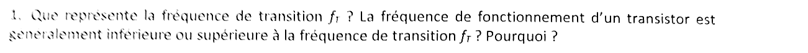{fig-alt="Q1 : que représente la fréquence de transition fT ? La fréquence de fonctionnement d'un transistor est-elle généralement inférieure ou supérieure à fT ? Pourquoi ?"}

:::: {.complement}
::: {.solution}
$f_T$ est la fréquence à laquelle le **gain en courant** du transistor, sortie en court-circuit, tombe à 1 ($|i_d/i_g| = 1$ pour un MOS, $|i_c/i_b| = 1$ pour un bipolaire). Pour un MOS, le courant de grille charge $C_{gs} + C_{gd}$ :
$$\left|\frac{i_d}{i_g}\right| = \frac{g_m}{\omega\,(C_{gs} + C_{gd})} = 1 \quad\Longrightarrow\quad f_T = \frac{g_m}{2\pi\,(C_{gs} + C_{gd})} .$$
C'est une mesure de la rapidité intrinsèque de la technologie.

La fréquence de fonctionnement est **inférieure** à $f_T$, typiquement $f_T/5$ à $f_T/10$ : au-delà de $f_T$ le transistor n'a plus de gain en courant (ni de gain en puissance utile), et il faut une marge pour obtenir un gain suffisant malgré les parasites du circuit (capacités de charge, effet Miller, résistances d'accès).
:::
::::

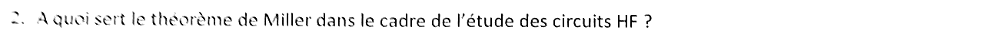{fig-alt="Q2 : à quoi sert le théorème de Miller dans le cadre de l'étude des circuits HF ?"}

:::: {.complement}
::: {.solution}
Le théorème de Miller remplace une impédance $Z$ placée entre l'entrée et la sortie d'un étage de gain $A$ par deux impédances à la masse : $\frac{Z}{1 - A}$ côté entrée et $\frac{Z A}{A - 1} \approx Z$ côté sortie ([cours](../cours/01-generalites-contre-reaction.qmd#eq-impedance-entree-miller)). Pour une capacité $C_{gd}$ et un étage inverseur, la capacité vue en entrée vaut $(1 + |A|)\,C_{gd}$ ([cours](../cours/01-generalites-contre-reaction.qmd#eq-capacite-miller)).

En HF, il sert à :

- **découpler** les nœuds, et estimer simplement les pôles (chaque nœud devient un $RC$ à la masse) ;
- montrer que la petite capacité $C_{gd}$, multipliée par le gain, crée souvent le **pôle dominant** à l'entrée et limite la bande passante ; d'où les montages qui réduisent le gain vu par $C_{gd}$ (cascode, voir le [partiel 2017-2018](2017-2018-partiel-circuits-hf.qmd#sec-ann1718hf-ex1)) ;
- à l'inverse, créer volontairement une grande capacité équivalente avec une petite capacité intégrée (compensation Miller).
:::
::::

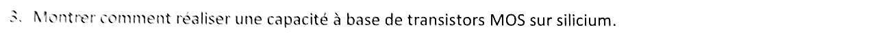{fig-alt="Q3 : montrer comment réaliser une capacité à base de transistors MOS sur silicium."}

:::: {.complement}
::: {.solution}
On utilise la **capacité de grille** : l'oxyde de grille est le diélectrique, la grille une armature, le canal (ou le caisson) l'autre. Montage : source, drain et substrat reliés ensemble ; la capacité est vue entre la grille et ce nœud commun.

Schéma équivalent : $C_{ox}WL$ en série avec la capacité de la zone de charge d'espace $C_{dep}$, plus une résistance série (canal ou caisson). En forte inversion (ou en accumulation), le canal est conducteur et $C \approx C_{ox}WL$, avec $C_{ox} = \varepsilon_{ox}/t_{ox}$ ; en déplétion, $C = \frac{C_{ox}C_{dep}}{C_{ox} + C_{dep}}$ diminue. La valeur dépend donc de la tension continue appliquée $V_{GB}$ : c'est aussi le principe du **varactor MOS** ([partiel 2016-2017, question I.5](2016-2017-partiel-circuits-hf.qmd#sec-ann16hf-ex1)).
:::
::::

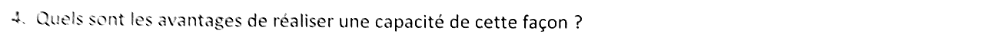{fig-alt="Q4 : quels sont les avantages de réaliser une capacité de cette façon ?"}

:::: {.complement}
::: {.solution}
- **Forte densité** : l'oxyde de grille est le diélectrique le plus mince du procédé, d'où plusieurs fF/µm² ; une grande capacité (découplage, filtrage) occupe peu de surface.
- **Aucune étape de fabrication supplémentaire** : disponible dans tout procédé CMOS standard, contrairement aux capacités MIM.
- **Réglable** par la tension de polarisation : sert de capacité variable (varactor) pour accorder un VCO.
:::
::::

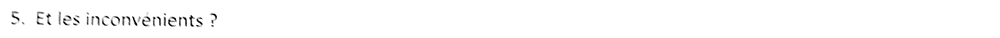{fig-alt="Q5 : et les inconvénients ?"}

:::: {.complement}
::: {.solution}
- **Non linéaire** : la valeur dépend de la tension ; il faut polariser au-delà du seuil (forte inversion ou accumulation) pour une valeur à peu près constante, ce qui interdit une tension nulle à ses bornes.
- **Parasites** : capacité de l'armature inférieure vers le substrat, résistance série du canal ou du caisson ; le facteur de qualité est médiocre en HF.
- **Fuites** à travers l'oxyde mince (courant de grille) et **tension limitée** par le claquage de l'oxyde.
- **Précision** et stabilité en température moins bonnes que celles d'une capacité métal-métal.
:::
::::

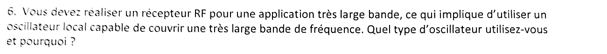{fig-alt="Q6 : pour un récepteur RF très large bande, l'oscillateur local doit couvrir une très large bande de fréquence : quel type d'oscillateur utiliser et pourquoi ?"}

:::: {.complement}
::: {.solution}
Un **oscillateur en anneau** (ou, plus généralement, un oscillateur à relaxation) ([cours](../cours/04-oscillateurs.qmd#sec-anneau)).

Un oscillateur $LC$ s'accorde par une capacité variable ; comme $f \propto 1/\sqrt{C}$ et que $C_{max}/C_{min}$ reste de 2 à 3, sa plage d'accord est limitée (de l'ordre de ± 10 à 20 %). La fréquence d'un anneau, $f = \frac{1}{2Nt_p}$, se règle par le **courant** des inverseurs, sur une très large plage (plus d'une décade), sans inductance (compact). Contrepartie : un bruit de phase nettement plus élevé que celui d'un $LC$ (pas de résonateur sélectif, [bruit de phase](../cours/04-oscillateurs.qmd#sec-bruit-phase)) ; on peut aussi couvrir une large bande avec plusieurs VCO $LC$ commutés ou avec des diviseurs de fréquence.
:::
::::

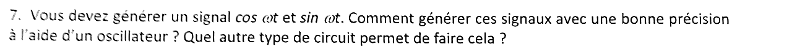{fig-alt="Q7 : comment générer cos ωt et sin ωt avec une bonne précision à l'aide d'un oscillateur ? Quel autre type de circuit permet de faire cela ?"}

:::: {.complement}
::: {.solution}
**Avec un oscillateur** : un **anneau différentiel à nombre pair d'étages** (quatre étages, rebouclage croisé) fournit des sorties régulièrement déphasées, dont deux sont en quadrature ([cours](../cours/04-oscillateurs.qmd#av-phases-anneau-differentiel)) ; ou deux VCO $LC$ identiques couplés (oscillateur en quadrature). La précision de la quadrature repose sur l'identité des étages (appariement).

**Autre circuit** : un **diviseur de fréquence par 2** (deux bascules maître-esclave) attaqué par un oscillateur à $2f$ donne directement deux sorties en quadrature, très précises si le rapport cyclique d'entrée vaut 50 % ; ou un **filtre polyphasé** ($RC$-$CR$), qui déphase de 90° les deux voies.
:::
::::

{fig-alt="Q8 : donner deux exemples de défauts des composants haute fréquence mis à profit pour réaliser des circuits ou composants fonctionnant en HF."}

:::: {.complement}
::: {.solution}
Exemples :

- la **capacité de jonction** (ou de grille) qui varie avec la tension, défaut d'un transistor ou d'une diode, devient la **capacité variable** (varicap, varactor) qui accorde un VCO ([cours](../cours/04-oscillateurs.qmd#sec-capacite-variable)) ;
- la **non-linéarité** des transistors (caractéristique quadratique du MOS, exponentielle du bipolaire) sert à réaliser des **mélangeurs** (produit de deux signaux) et des multiplicateurs de fréquence ;
- l'**inductance parasite** des fils de câblage (*bonding*) sert d'inductance de bonne qualité, par exemple pour la dégénérescence inductive d'un LNA ;
- la réaction parasite d'une paire croisée, résistance négative, compense les pertes d'un résonateur (oscillateur, [cours](../cours/04-oscillateurs.qmd#sec-resistance-negative)).
:::
::::

## Exercice II : amplificateur à transimpédance, localisation du pôle dominant (12 points) {#sec-ann2223hf-ex2}

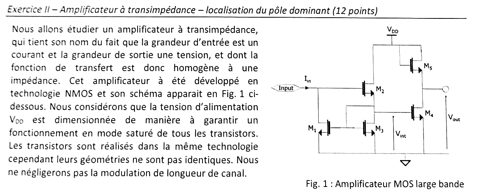{fig-alt="Exercice II : amplificateur à transimpédance NMOS (fig. 1). Le courant d'entrée Iin arrive sur la grille de M2 et le drain de M1 ; M2 (drain à VDD) a sa source au nœud intermédiaire Vint, où se trouvent le drain et la grille de M3 (monté en diode) et les grilles de M1 et M4 ; M1, M3 et M4 ont leur source à la masse ; M4 (source commune) est chargé par M5 monté en diode (grille et drain à VDD, source en sortie) ; sortie Vout au drain de M4. Tous les transistors saturés, géométries différentes, modulation de longueur de canal non négligée."}

**Conventions de la correction.** Petits signaux ; $i_{in}$ entre dans le nœud d'entrée ; $v_{in}$, $v_{int}$, $v_{out}$ sont les variations des tensions d'entrée, intermédiaire et de sortie ; $g_{dsk} = 1/r_{dsk}$. $V_{DD}$ est une masse dynamique ; effet de substrat négligé (sources de $M_2$ et $M_5$ hors de la masse).

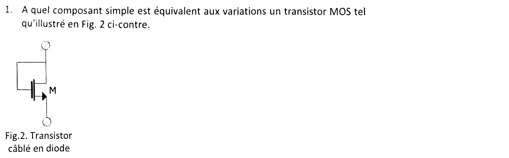{fig-alt="Q1 et figure 2 : à quel composant simple est équivalent aux variations un transistor MOS câblé en diode (grille reliée au drain) ?"}

:::: {.complement}
::: {.solution}
À une **résistance** (dipôle linéaire) : $v_{gs} = v_{ds} = v$, donc le courant vaut $i = g_m v + g_{ds} v$, proportionnel à $v$.
:::
::::

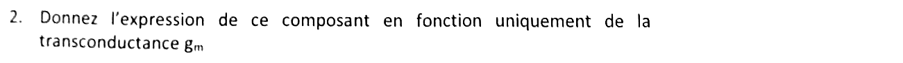{fig-alt="Q2 : expression de ce composant en fonction uniquement de la transconductance gm."}

:::: {.complement}
::: {.solution}
$$\boxed{r_\text{diode} = \frac{1}{g_m + g_{ds}} \approx \frac{1}{g_m}} \qquad (r_{ds} \gg 1/g_m)$$
:::
::::

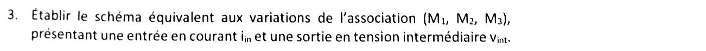{fig-alt="Q3 : schéma équivalent aux variations de l'association (M1, M2, M3), avec une entrée en courant iin et une sortie en tension intermédiaire vint."}

:::: {.complement}
::: {.solution}
Deux nœuds :

- **nœud d'entrée** ($v_{in}$) : source $i_{in}$ entrante ; source de courant $g_{m1} v_{gs1}$ de $M_1$ vers la masse, en parallèle avec $r_{ds1}$ ; la grille de $M_2$ (aucun courant) ;
- **nœud intermédiaire** ($v_{int}$) : $M_3$ en diode, soit $\frac{1}{g_{m3}} \parallel r_{ds3}$ vers la masse (question 2) ; la source de $M_2$ : source de courant $g_{m2} v_{gs2}$ du drain ($V_{DD}$, masse dynamique) vers $v_{int}$, avec $v_{gs2} = v_{in} - v_{int}$, et $r_{ds2}$ entre $v_{int}$ et la masse dynamique ; les grilles de $M_1$ et $M_4$ (aucun courant).

La grille de $M_1$ est au nœud intermédiaire : $M_1$ et $M_3$ forment un **miroir de courant**, et $M_2$ un suiveur (drain commun). Le schéma est une boucle : l'entrée commande $M_2$, qui commande $M_3$ et $M_1$, et $M_1$ absorbe le courant d'entrée (contre-réaction tension-parallèle, [chapitre 2](../cours/02-amplificateurs-contre-reaction.qmd#sec-cr-tension-parallele)).
:::
::::

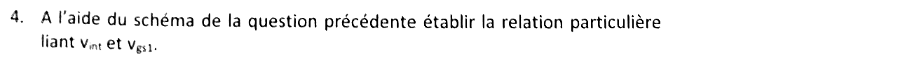{fig-alt="Q4 : à l'aide du schéma, relation particulière liant vint et vgs1."}

:::: {.complement}
::: {.solution}
La grille de $M_1$ est reliée au nœud intermédiaire et sa source à la masse :
$$\boxed{v_{gs1} = v_{int}}$$
:::
::::

{fig-alt="Q5 : relation liant vint, gm2, gm3 et vgs2."}

:::: {.complement}
::: {.solution}
Loi des nœuds au nœud intermédiaire : le courant de $M_2$ traverse $M_3$ (diode) et les $r_{ds}$,
$$g_{m2}\, v_{gs2} = \left(g_{m3} + g_{ds2} + g_{ds3}\right) v_{int} \quad\Longrightarrow\quad \boxed{g_{m2}\, v_{gs2} \approx g_{m3}\, v_{int}} \quad (g_{ds2}, g_{ds3} \ll g_{m3}).$$
:::
::::

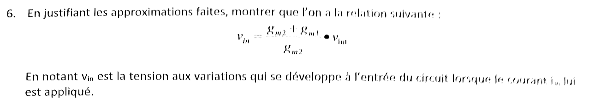{fig-alt="Q6 : en justifiant les approximations, montrer que vin = (gm2 + gm3)/gm2 · vint, vin étant la tension aux variations qui se développe à l'entrée lorsque le courant iin est appliqué."}

:::: {.complement}
::: {.solution}
$v_{gs2} = v_{in} - v_{int}$. Avec la question 5 (exacte) :
$$v_{in} = v_{int} + v_{gs2} = v_{int}\left(1 + \frac{g_{m3} + g_{ds2} + g_{ds3}}{g_{m2}}\right) = \frac{g_{m2} + g_{m3} + g_{ds2} + g_{ds3}}{g_{m2}}\, v_{int} .$$
**Approximation** : transistors saturés, donc $r_{ds} \gg \frac{1}{g_m}$ ; on néglige $g_{ds2} + g_{ds3}$ devant $g_{m2} + g_{m3}$ :
$$\boxed{v_{in} = \frac{g_{m2} + g_{m3}}{g_{m2}}\, v_{int}}$$
:::
::::

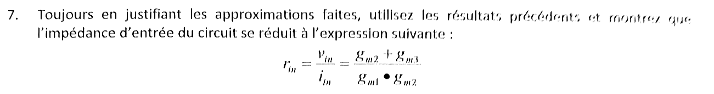{fig-alt="Q7 : en justifiant les approximations, montrer que l'impédance d'entrée se réduit à rin = vin/iin = (gm2 + gm3)/(gm1 gm2)."}

:::: {.complement}
::: {.solution}
Loi des nœuds à l'entrée : le courant $i_{in}$ entre dans le drain de $M_1$,
$$i_{in} = g_{m1}\, v_{gs1} + g_{ds1}\, v_{in} = g_{m1}\, v_{int} + g_{ds1}\, v_{in} .$$
Avec $v_{int} = \frac{g_{m2}}{g_{m2} + g_{m3}}\, v_{in}$ (question 6) :
$$\frac{i_{in}}{v_{in}} = \frac{g_{m1}\, g_{m2}}{g_{m2} + g_{m3}} + g_{ds1}, \qquad r_{in} = r_{ds1} \parallel \frac{g_{m2} + g_{m3}}{g_{m1}\, g_{m2}} .$$
**Approximation** : $r_{ds1} \gg \frac{g_{m2} + g_{m3}}{g_{m1} g_{m2}}$ (de l'ordre de $\frac{2}{g_m}$ si les $g_m$ sont voisins), donc
$$\boxed{r_{in} = \frac{v_{in}}{i_{in}} = \frac{g_{m2} + g_{m3}}{g_{m1}\, g_{m2}}}$$
Impédance d'entrée **faible**, de l'ordre de $1/g_m$ : la boucle (contre-réaction parallèle en entrée) abaisse l'impédance du nœud d'entrée, qui serait sinon $r_{ds1}$. C'est ce qu'on recherche pour un amplificateur attaqué en courant (photodiode par exemple). Expression vérifiée par un calcul symbolique (sympy) sur le schéma complet.
:::
::::

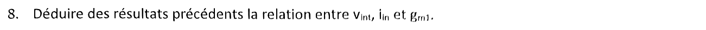{fig-alt="Q8 : relation entre vint, iin et gm1."}
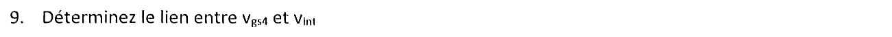{fig-alt="Q9 : lien entre vgs4 et vint."}

:::: {.complement}
::: {.solution}
**Question 8.** $v_{int} = \frac{g_{m2}}{g_{m2} + g_{m3}}\, v_{in} = \frac{g_{m2}}{g_{m2} + g_{m3}}\, r_{in}\, i_{in}$, soit
$$\boxed{v_{int} = \frac{i_{in}}{g_{m1}}}$$
Lecture directe (en négligeant $g_{ds1}$) : tout le courant d'entrée est absorbé par $M_1$, dont la grille est à $v_{int}$ ; $M_1$ est un convertisseur courant-tension « inverse ».

**Question 9.** La grille de $M_4$ est au nœud intermédiaire et sa source à la masse :
$$\boxed{v_{gs4} = v_{int}}$$
:::
::::

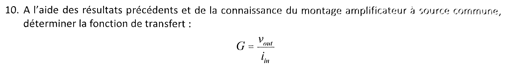{fig-alt="Q10 : à l'aide des résultats précédents et de la connaissance du montage source commune, déterminer la fonction de transfert G = vout/iin."}

:::: {.complement}
::: {.solution}
$M_4$ est en **source commune**, chargé par $M_5$ monté en diode (grille et drain à $V_{DD}$, source en sortie), soit $\frac{1}{g_{m5}}$ en parallèle avec $r_{ds4}$ et $r_{ds5}$ :
$$v_{out} = -\frac{g_{m4}}{g_{m5} + g_{ds4} + g_{ds5}}\, v_{gs4} \approx -\frac{g_{m4}}{g_{m5}}\, v_{int} .$$
Avec $v_{int} = i_{in}/g_{m1}$ :
$$\boxed{G = \frac{v_{out}}{i_{in}} \approx -\frac{g_{m4}}{g_{m1}\, g_{m5}}}$$
Homogène à une résistance (transimpédance). Le gain se règle par des **rapports** de transconductances, donc de géométries ; il est faible ($\sim 1/g_m$ fois $g_{m4}/g_{m5}$), au profit de la bande passante. Le signe dépend de l'orientation choisie pour $i_{in}$ (entrant). Expression exacte vérifiée par sympy ; elle se réduit à celle-ci quand on néglige les $g_{ds}$.
:::
::::

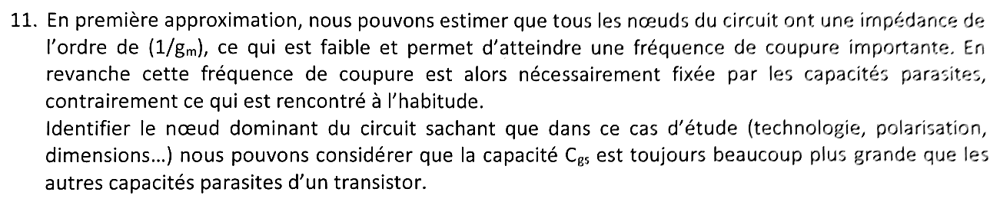{fig-alt="Q11 : tous les nœuds ont une impédance de l'ordre de 1/gm, la fréquence de coupure est donc fixée par les capacités parasites ; identifier le nœud dominant sachant que Cgs est toujours beaucoup plus grande que les autres capacités parasites d'un transistor."}

:::: {.complement}
::: {.solution}
Toutes les résistances de nœud étant comparables ($\sim 1/g_m$), le nœud dominant est celui qui porte la **plus grande capacité**. On ne garde que les $C_{gs}$ :

| Nœud | Capacités $C_{gs}$ reliées |
|---|---|
| entrée ($v_{in}$) | $C_{gs2}$ (vers $v_{int}$) |
| intermédiaire ($v_{int}$) | $C_{gs1}$, $C_{gs3}$, $C_{gs4}$ vers la masse, et $C_{gs2}$ |
| sortie ($v_{out}$) | $C_{gs5}$ (grille de $M_5$ à $V_{DD}$) |

Le **nœud intermédiaire $V_{int}$** est le nœud dominant : il relie trois grilles ($M_1$, $M_3$, $M_4$) et la source de $M_2$. S'y ajoute la capacité de Miller de $C_{gd4}$, multipliée par $1 + g_{m4}/g_{m5}$. $C_{gs2}$ n'est pas pénalisante côté entrée : la source de $M_2$ suit sa grille (suiveur), la tension à ses bornes $v_{in} - v_{int}$ ne vaut qu'une fraction $\frac{g_{m3}}{g_{m2} + g_{m3}}$ de $v_{in}$.

**Calcul plus fin** (Claude, $r_{ds}$ négligées). Avec $C_{int} = C_{gs1} + C_{gs3} + C_{gs4}$ au nœud intermédiaire et $C_{gs2}$ entre entrée et nœud intermédiaire, les deux lois des nœuds donnent
$$\frac{v_{int}}{i_{in}} = \frac{g_{m2} + p\,C_{gs2}}{g_{m1}g_{m2} + p\,C_{gs2}\left(g_{m1} + g_{m3}\right) + p^2\,C_{gs2}\,C_{int}} ,$$
dont la valeur en continu est bien $\frac{1}{g_{m1}}$. À cause de la boucle $M_2$, $M_3$, $M_1$, la réponse est du **second ordre** : pulsation propre $\omega_0 = \sqrt{\frac{g_{m1} g_{m2}}{C_{gs2}\,C_{int}}}$, amortissement $\zeta = \frac{g_{m1} + g_{m3}}{2}\sqrt{\frac{C_{gs2}}{g_{m1} g_{m2}\, C_{int}}}$. Pour des transistors identiques ($C_{int} = 3C_{gs}$), $\omega_0 = \frac{g_m}{\sqrt{3}\,C_{gs}}$ et $\zeta \approx 0{,}58$ : la bande passante est bien fixée par la capacité du nœud intermédiaire ($\omega_0 \propto 1/\sqrt{C_{int}}$), ce qui confirme la réponse. Le pôle de sortie, $\approx \frac{g_{m5}}{C_{gs5}}$, est plus haut. En pratique, la capacité de la source de courant d'entrée (photodiode) s'ajoute au nœud d'entrée et peut devenir prépondérante.
:::
::::
