

::: {.complement}
**Origine des solutions.** Le corrigé manuscrit « TD3 – Un circuit immunisé » des notes de 2023 (un tiers) [corr-2023-td03-immunise] corrige **ce sujet**, repris en TD en 2023 (même circuit à deux résistances $R_1$, $R_2$, mêmes questions 1 à 10) ; le [chapitre 3](../cours/03-applications-contre-reaction.qmd#sec-td-circuit-espace) l'avait écarté faute d'énoncé. Il est repris en *Notes externes* sous chaque question ; les solutions détaillées en *Complément* sont rédigées par Claude ; les désaccords sont signalés en *À vérifier*. Sujet photographié : images tournées et contrastées, perspective non corrigée. À relire avec un œil critique ; signaler toute erreur.

Le TD « Un circuit pour l'espace » du support 2025 (chapitre 3) étudie une autre version du même thème (référence immunisée aux variations, deux NMOS à seuils différents).
:::

Chapitres du cours : [contre-réaction de courant-parallèle](../cours/02-amplificateurs-contre-reaction.qmd#sec-cr-courant-parallele), [synthèse](../cours/02-amplificateurs-contre-reaction.qmd#sec-synthese-cr), [« Un circuit pour l'espace »](../cours/03-applications-contre-reaction.qmd#sec-td-circuit-espace).

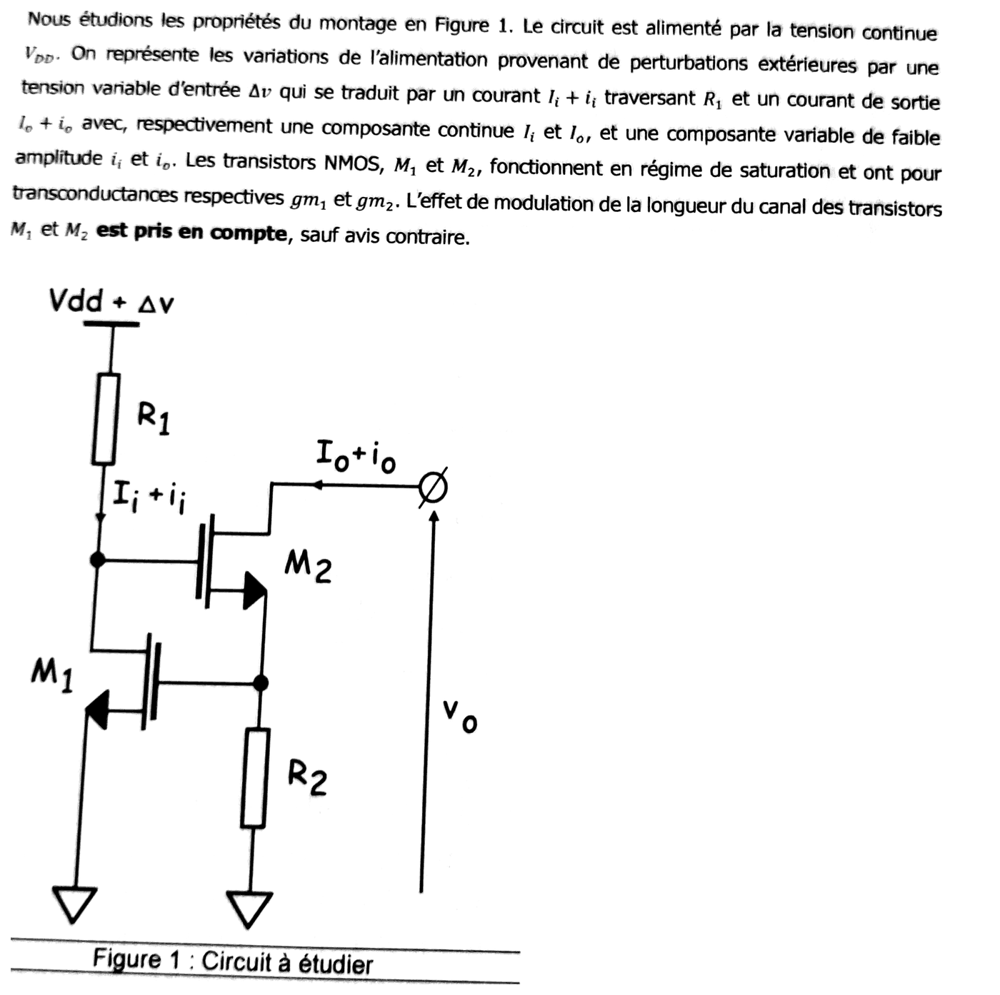{fig-alt="Énoncé commun : circuit alimenté par VDD ; les perturbations de l'alimentation sont une tension variable d'entrée Δv, qui produit un courant Ii + ii dans R1, et un courant de sortie Io + io. M1 et M2 NMOS saturés, transconductances gm1 et gm2, modulation de longueur de canal prise en compte sauf avis contraire. Figure 1 : R1 entre Vdd + Δv et un nœud relié au drain de M1 et à la grille de M2 ; M2 a son drain à la sortie (courant Io + io, tension vo) et sa source reliée à la grille de M1 et à R2 vers la masse ; source de M1 à la masse."}

**Notations.** $X$ : nœud drain de $M_1$ / grille de $M_2$ (tension $v_x$) ; $Y$ : nœud source de $M_2$ / grille de $M_1$ (tension $v_y$). On a donc $v_{GS1} = v_y$ et $v_{GS2} = v_x - v_y$. $i_i$ entre en $X$ par $R_1$ ; $i_o$ entre dans le drain de $M_2$.

## Partie I : identification d'une contre-réaction {#sec-ann2223cr-partie1}

{fig-alt="Titre : Partie I, identification d'une contre-réaction."}

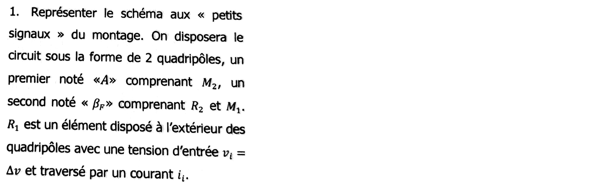{fig-alt="Q1 : représenter le schéma petits signaux sous la forme de 2 quadripôles, A comprenant M2 et βF comprenant R2 et M1 ; R1 est à l'extérieur, avec une tension d'entrée vi = Δv et traversée par ii."}

::: {.notes-externes}
[corr-2023-td03-immunise, p. 1] : schéma équivalent dessiné ; $R_1$ (courant $i_i$) arrive au nœud « $D_1$, $G_2$ » ; $M_1$ : source $g_{m1} v_{gs}$ et $r_{ds1}$ entre $D_1$ et la masse ($S_1$) ; $M_2$ : $g_{m2} v_{gs2}$ et $r_{ds2}$ entre $D_2$ (courant $i_o$ entrant, tension $v_o$) et sa source, reliée à $G_1$ et à $R_2$ vers la masse. Cadre rouge « $A$ » autour de $M_2$, cadre vert « $\beta_F$ » autour de $M_1$ et $R_2$. Annotation : « $r_{ds2} \sim$ MΩ / 100 kΩ ».
:::

:::: {.complement}
::: {.solution}
$V_{DD}$ et la masse sont confondues en petits signaux, sauf la perturbation $\Delta v = v_i$ qui attaque $R_1$. Modèle de chaque MOS : $g_m v_{gs}$ en parallèle avec $r_{ds}$ entre drain et source.

- **Hors quadripôles** : $v_i$ en série avec $R_1$, qui injecte $i_i$ dans le nœud $X$.
- **Quadripôle $A$** ($M_2$) : entrée entre $X$ et la masse ; sortie : le courant $i_o$ du drain de $M_2$ ; $g_{m2} v_{gs2}$ et $r_{ds2}$ entre $D_2$ et $Y$.
- **Quadripôle $\beta_F$** ($R_2$, $M_1$) : $R_2$ entre $Y$ et la masse, parcourue par $i_o$ (la grille de $M_1$ ne consomme rien) ; elle commande $M_1$ ($v_{GS1} = v_y$), dont le courant $g_{m1} v_{GS1}$ est tiré du nœud $X$ ; $r_{ds1}$ entre $X$ et la masse.
:::
::::

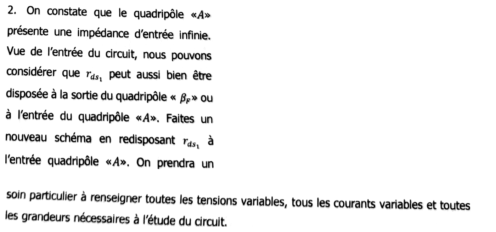{fig-alt="Q2 : le quadripôle A a une impédance d'entrée infinie ; vu de l'entrée, rds1 peut être placée à la sortie de βF ou à l'entrée de A ; refaire le schéma avec rds1 à l'entrée de A, en indiquant toutes les tensions et tous les courants variables."}

::: {.notes-externes}
[corr-2023-td03-immunise, p. 1] : schéma redessiné : $v_i$, $R_1$ ($i_i$) jusqu'au nœud $G_2$ ; courant $i_e$ et tension $v_e$ à l'entrée du cadre $A$, qui contient $r_{ds1}$, $v_{gs2}$ et $M_2$ ($g_{m2} v_{gs2}$, $r_{ds2}$, $i_o$) ; cadre $\beta_F$ : $D_1$, $g_{m1} v_{gs1}$, $R_2$ ; $v_{gs1} = R_2\, i_o$ aux bornes de $R_2$.
:::

:::: {.complement}
::: {.solution}
$r_{ds1}$ relie $X$ à la masse : elle est en parallèle sur l'entrée de $A$ (grille de $M_2$, impédance infinie) comme sur la sortie de $\beta_F$ (source $g_{m1} v_{GS1}$). En la rattachant à $A$ (figure 2 du sujet) :

- $A$ : entrée $(v_e = v_x,\ i_e)$, $Z_e = r_{ds1}$ ; sortie Norton $g_{m2} v_{GS2}$ avec $Z_s = r_{ds2}$ ;
- $\beta_F$ (figure 3 du sujet) : entrée parcourue par $i_o$ à travers $R_2$, sortie : source de courant **idéale** $i_{fb} = g_{m1} v_{GS1}$ tirée du nœud $X$ ;
- nœud $X$ : $i_i = i_e + i_{fb}$.
:::
::::

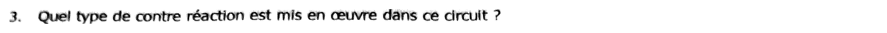{fig-alt="Q3 : quel type de contre-réaction est mis en œuvre dans ce circuit ?"}

::: {.notes-externes}
[corr-2023-td03-immunise, p. 2] : « On identifie un courant parallèle. »
:::

:::: {.complement}
::: {.solution}
$R_2$ est en série dans le chemin de $i_o$ : on **prélève un courant**. $M_1$ ramène un courant $i_{fb}$ au nœud d'entrée $X$, qui se retranche de $i_i$ : réinjection **parallèle**.
$$\boxed{\text{contre-réaction de courant-parallèle}}$$
La fonction de transfert naturelle est un gain en courant $\frac{i_o}{i_i}$, et l'impédance de sortie est multipliée par $1 + A\beta_F$ ([courant-parallèle](../cours/02-amplificateurs-contre-reaction.qmd#sec-cr-courant-parallele)) : le montage tend vers une **source de courant**.
:::
::::

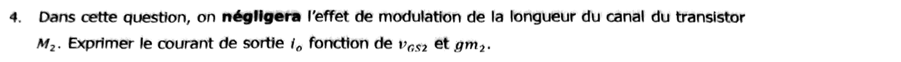{fig-alt="Q4 : en négligeant la modulation de longueur de canal de M2, exprimer le courant de sortie io en fonction de vGS2 et gm2."}

::: {.notes-externes}
[corr-2023-td03-immunise, p. 2] : $i_o = g_{m2}\, v_{gs2}$.
:::

:::: {.complement}
::: {.solution}
$r_{ds2} \to \infty$ : tout le courant de drain vient de la source commandée,
$$\boxed{i_o = g_{m2}\, v_{GS2}}$$
:::
::::

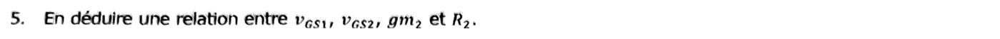{fig-alt="Q5 : en déduire une relation entre vGS1, vGS2, gm2 et R2."}

::: {.notes-externes}
[corr-2023-td03-immunise, p. 2] : $v_{gs1} = R_2\, i_o = R_2\, g_{m2}\, v_{gs2}$.
:::

:::: {.complement}
::: {.solution}
La grille de $M_1$ est au nœud $Y$ et ne prend aucun courant : $i_o$ traverse $R_2$ entière, $v_{GS1} = v_y = R_2\, i_o$, d'où
$$\boxed{v_{GS1} = g_{m2} R_2\, v_{GS2}}$$
:::
::::

## Partie II : étude des quadripôles {#sec-ann2223cr-partie2}

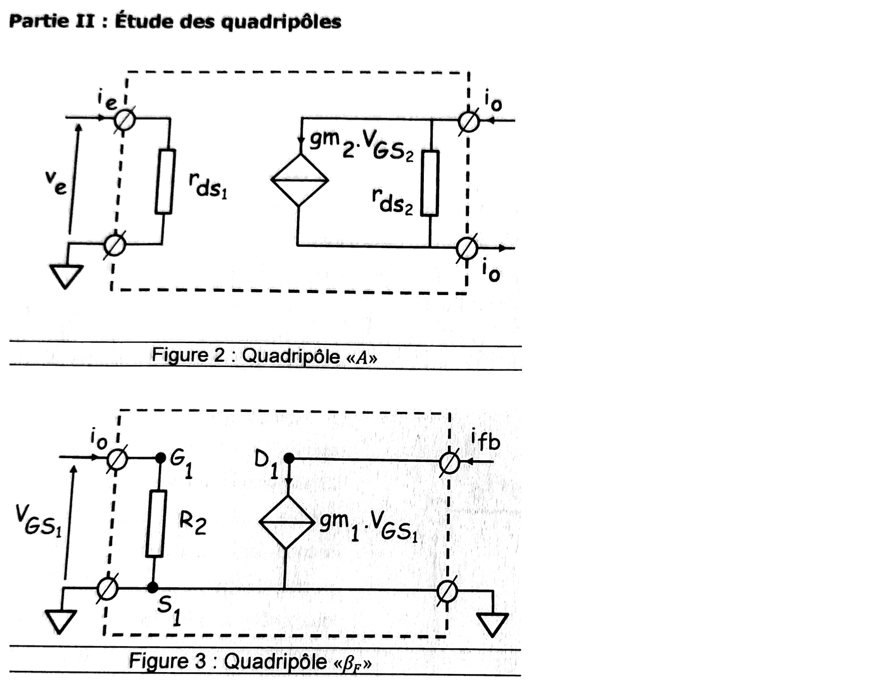{fig-alt="Partie II. Figure 2, quadripôle A : entrée ve, ie sur rds1 ; sortie : source gm2.VGS2 en parallèle avec rds2 entre les deux bornes de sortie parcourues par io. Figure 3, quadripôle βF : entrée io entre G1 et S1, VGS1 aux bornes de R2 ; sortie : source gm1.VGS1 de D1 vers S1, courant ifb entrant par la borne de sortie, S1 à la masse."}

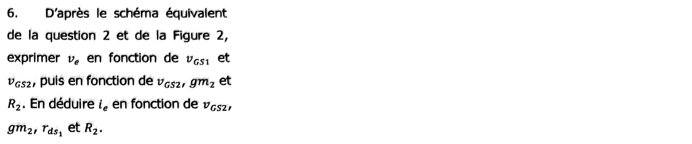{fig-alt="Q6 : d'après le schéma de la question 2 et la figure 2, exprimer ve en fonction de vGS1 et vGS2, puis de vGS2, gm2 et R2 ; en déduire ie en fonction de vGS2, gm2, rds1 et R2."}

::: {.notes-externes}
[corr-2023-td03-immunise, p. 2] : $v_e = v_{gs1} + v_{gs2} = v_{gs2} + R_2 i_o = v_{gs2}(1 + R_2 g_{m2})$ ; $i_e = \frac{v_e}{r_{ds1}} \simeq \frac{v_{gs2}(1 + R_2 g_{m2})}{r_{ds1}} \simeq \frac{v_{gs2} R_2 g_{m2}}{r_{ds1}}$.
:::

:::: {.complement}
::: {.solution}
Maille grille de $M_2$ → source de $M_2$ → $R_2$ → masse : $v_e = v_{GS2} + v_{GS1}$, et avec la question 5,
$$v_e = v_{GS2}\,(1 + g_{m2} R_2) .$$
Le courant $i_e$ ne peut passer que dans $r_{ds1}$ (grille de $M_2$ isolante) :
$$\boxed{i_e = \frac{v_e}{r_{ds1}} = \frac{(1 + g_{m2} R_2)\, v_{GS2}}{r_{ds1}}}$$
$R_2$, qui appartient à $\beta_F$, apparaît ici : c'est l'**effet de charge** de $\beta_F$ sur $A$ (la source de $M_2$ n'est pas à la masse).
:::
::::

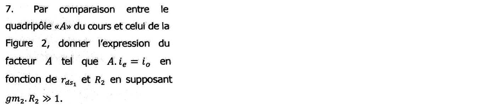{fig-alt="Q7 : par comparaison avec le quadripôle A du cours, donner A tel que A.ie = io en fonction de rds1 et R2, en supposant gm2.R2 ≫ 1."}

::: {.notes-externes}
[corr-2023-td03-immunise, p. 2] : $A = \frac{i_o}{i_e} = \frac{g_{m2} v_{gs2}}{\frac{v_{gs2} R_2 g_{m2}}{r_{ds1}}} = \frac{r_{ds1}}{R_2}$.
:::

:::: {.complement}
::: {.solution}
$$A = \frac{i_o}{i_e} = \frac{g_{m2}\, r_{ds1}}{1 + g_{m2} R_2} \xrightarrow{g_{m2} R_2 \gg 1} \boxed{A \approx \frac{r_{ds1}}{R_2}}$$
Un gain en courant, sans dimension (comme le veut la [courant-parallèle](../cours/02-amplificateurs-contre-reaction.qmd#sec-synthese-cr)), grand si $r_{ds1} \gg R_2$ : $M_2$ dégénéré par $R_2$ se comporte en convertisseur tension-courant de transconductance $\approx 1/R_2$, attaqué par la tension $r_{ds1} i_e$.
:::
::::

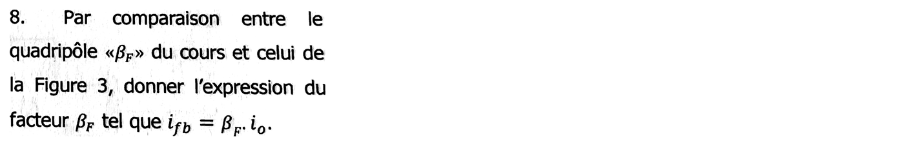{fig-alt="Q8 : par comparaison avec le quadripôle βF du cours et la figure 3, donner βF tel que ifb = βF.io."}

::: {.notes-externes}
[corr-2023-td03-immunise, p. 2] : $\beta_F = \frac{i_{fb}}{i_o} = \frac{g_{m1} v_{gs1}}{g_{m2} v_{gs2}} = \frac{g_{m1} R_2 g_{m2} v_{gs2}}{g_{m2} v_{gs2}} = R_2\, g_{m1}$.
:::

:::: {.complement}
::: {.solution}
$i_{fb} = g_{m1} v_{GS1} = g_{m1} R_2\, i_o$ :
$$\boxed{\beta_F = g_{m1} R_2}$$
sans dimension ; d'où le gain de boucle $A\beta_F \approx \frac{r_{ds1}}{R_2}\, g_{m1} R_2 = g_{m1} r_{ds1}$, le gain intrinsèque de $M_1$ (quelques dizaines à quelques centaines).
:::
::::

## Partie III : propriétés du circuit {#sec-ann2223cr-partie3}

{fig-alt="Titre : Partie III, propriétés du circuit."}

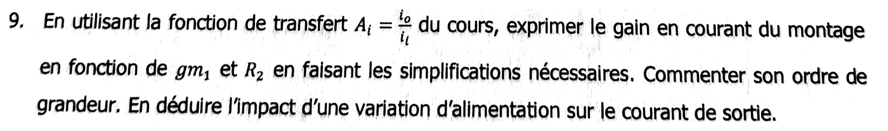{fig-alt="Q9 : à l'aide de la fonction de transfert Ai = io/ii du cours, exprimer le gain en courant en fonction de gm1 et R2 en faisant les simplifications nécessaires ; commenter son ordre de grandeur ; en déduire l'impact d'une variation d'alimentation sur le courant de sortie."}

::: {.notes-externes}
[corr-2023-td03-immunise, p. 2] : $A_i = \frac{i_o}{i_i} = \frac{A}{1 + A\beta_F} = \frac{r_{ds1}}{R_2\left(1 + r_{ds1} g_{m1}\right)} = \frac{1}{g_{m1} R_2} \ll 1$ ; $i_o \ll i_i$.
:::

:::: {.complement}
::: {.solution}
[Courant-parallèle](../cours/02-amplificateurs-contre-reaction.qmd#eq-ft-courant-parallele) :
$$A_i = \frac{A}{1 + A\beta_F} = \frac{r_{ds1}/R_2}{1 + g_{m1} r_{ds1}} \xrightarrow{g_{m1} r_{ds1} \gg 1} \boxed{A_i \approx \frac{1}{\beta_F} = \frac{1}{g_{m1} R_2}}$$
(Le calcul direct des nœuds $X$ et $Y$ donne exactement $A_i = \frac{1}{g_{m1} R_2 + \frac{1 + g_{m2} R_2}{g_{m2} r_{ds1}}}$, identique à $\frac{A}{1 + A\beta_F}$ avant approximation ; vérifié avec SymPy.)

**Ordre de grandeur.** $g_{m1} R_2$ est le gain d'un étage dégénéré : avec par exemple $g_{m1} = 1$ mS et $R_2 = 10$ kΩ, $A_i \approx 0{,}1$ ; il suffit de $g_{m1} R_2 \gg 1$ pour que $A_i \ll 1$.

**Impact de l'alimentation.** La perturbation $\Delta v$ produit dans $R_1$ un courant $i_i \approx \frac{\Delta v}{R_1}$ (le nœud $X$ varie peu : impédance d'entrée divisée par $1 + A\beta_F$). Elle n'atteint la sortie qu'atténuée :
$$i_o \approx \frac{i_i}{g_{m1} R_2} \approx \frac{\Delta v}{g_{m1} R_1 R_2} .$$
Le courant de sortie est **insensible** (« immunisé ») aux variations de $V_{DD}$, d'autant plus que $g_{m1} R_2$ et $R_1$ sont grands.
:::
::::

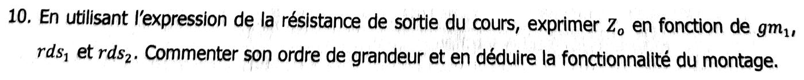{fig-alt="Q10 : à l'aide de l'expression de la résistance de sortie du cours, exprimer Zo en fonction de gm1, rds1 et rds2 ; commenter son ordre de grandeur et en déduire la fonctionnalité du montage."}

::: {.notes-externes}
[corr-2023-td03-immunise, p. 2] : $Z_o = Z_s(1 + A\beta_F) = r_{ds2}\left(1 + \frac{r_{ds1}}{R_2}\, g_{m1} R_2\right)$, $Z_o = g_{m1} r_{ds1} r_{ds2}$, « très très grand », « $\sim 100$ GΩ ».
:::

:::: {.complement}
::: {.solution}
**Réponse attendue (formule du cours).** Courant-parallèle : $Z_o = Z_s(1 + A\beta_F)$ avec, d'après la figure 2, $Z_s = r_{ds2}$ :
$$Z_o = r_{ds2}\,(1 + g_{m1} r_{ds1}) \approx \boxed{g_{m1}\, r_{ds1}\, r_{ds2}}$$
Avec $g_{m1} r_{ds1} = 100$ et $r_{ds2} = 100$ kΩ (valeurs d'illustration), $Z_o \approx 10$ MΩ ; avec $g_{m1} r_{ds1} = 1000$ et $r_{ds2} = 1$ MΩ, $Z_o \approx 1$ GΩ.

**Calcul exact** (nœuds $X$, $Y$ et drain de $M_2$, source $v_i$ éteinte ; vérifié avec SymPy) :
$$Z_o = r_{ds2} + R_2 + g_{m2} R_2\, r_{ds2}\left[1 + g_{m1}\,(R_1 \parallel r_{ds1})\right] \approx g_{m1} g_{m2} R_2\, (R_1 \parallel r_{ds1})\, r_{ds2} .$$
Il est plus grand que la réponse attendue d'un facteur $g_{m2} R_2$ (si $R_1 \gg r_{ds1}$) : la dégénérescence de $M_2$ par $R_2$, qui est une charge de $\beta_F$ sur $A$, multiplie déjà $r_{ds2}$ avant la boucle. Voir le bloc ci-dessous.

**Fonctionnalité.** Impédance de sortie très grande et courant de sortie insensible à $V_{DD}$ (question 9) : le montage est une **source de courant** (référence de courant) immunisée contre les variations de l'alimentation et de la tension de sortie, utilisable pour polariser d'autres circuits.
:::
::::

::: {.a-verifier #av-ann2223cr-impedance-sortie}
**Source** [sujet-2022-cr, p. 2, q. 10] : « exprimer $Z_o$ en fonction de $g_{m1}$, $r_{ds1}$ et $r_{ds2}$ » ; [corr-2023-td03-immunise, p. 2] : « $Z_o = g_{m1} r_{ds1} r_{ds2}$ — très très grand — $\sim 100$ GΩ ».

**Problème** : (1) la formule attendue prend $Z_s = r_{ds2}$ (figure 2), alors que l'impédance de sortie de $A$ chargé par $R_2$ (la même charge qui intervient dans $A$ aux questions 6 et 7) vaut $r_{ds2} + R_2 + g_{m2} R_2 r_{ds2} \approx g_{m2} R_2 r_{ds2}$ ; le calcul exact du circuit donne $Z_o \approx g_{m1} g_{m2} R_2 (R_1 \parallel r_{ds1}) r_{ds2}$, plus grand d'un facteur $\approx g_{m2} R_2$. (2) La valeur « $\sim 100$ GΩ » n'est appuyée sur aucune valeur numérique ($g_{m1} r_{ds1} r_{ds2}$ donne plutôt 10 MΩ à 1 GΩ avec des valeurs courantes).

**Proposition** : garder $Z_o \approx g_{m1} r_{ds1} r_{ds2}$ comme réponse à la question posée, en signalant qu'elle sous-estime $Z_o$ ; retirer ou justifier l'ordre de grandeur de 100 GΩ. À confirmer avec l'enseignant.
:::
