

::: {.complement}
Aucun corrigé officiel : **toutes les solutions de cette page sont rédigées par Claude**. Les énoncés sont des extraits du scan du sujet [sujet-2025] ; les annotations manuscrites d'un étudiant (« vbe2 », « vbe1 » au crayon sur la figure 1 de Y. Deval, cercles autour des questions 9 et 10, une ligne en haut de la page de F. Rivet) ont été effacées ou laissées hors des images.

Le sujet réunit deux épreuves sur le même circuit, le **bandgap de Brokaw** : stabilité en température (Y. Deval, exercice 1) et lecture en contre-réaction (F. Rivet, exercice 2). Les deux parties ont été redistribuées en TD en 2026 et sont **déjà résolues dans le cours** :

- exercice 1 : [chapitre 5, sujet 2025 (partie Deval)](../cours/05-references-de-tension.qmd#sec-td-brokaw-deval) ;
- exercice 2 : [chapitre 3, sujet 2025](../cours/03-applications-contre-reaction.qmd#sec-td-brokaw).

Cette page donne donc, sous chaque question, une solution courte et renvoie au cours pour le détail.
:::

## Exercice 1 : référence de tension bipolaire stable en température (Y. Deval) {#sec-ann2526-ex1}

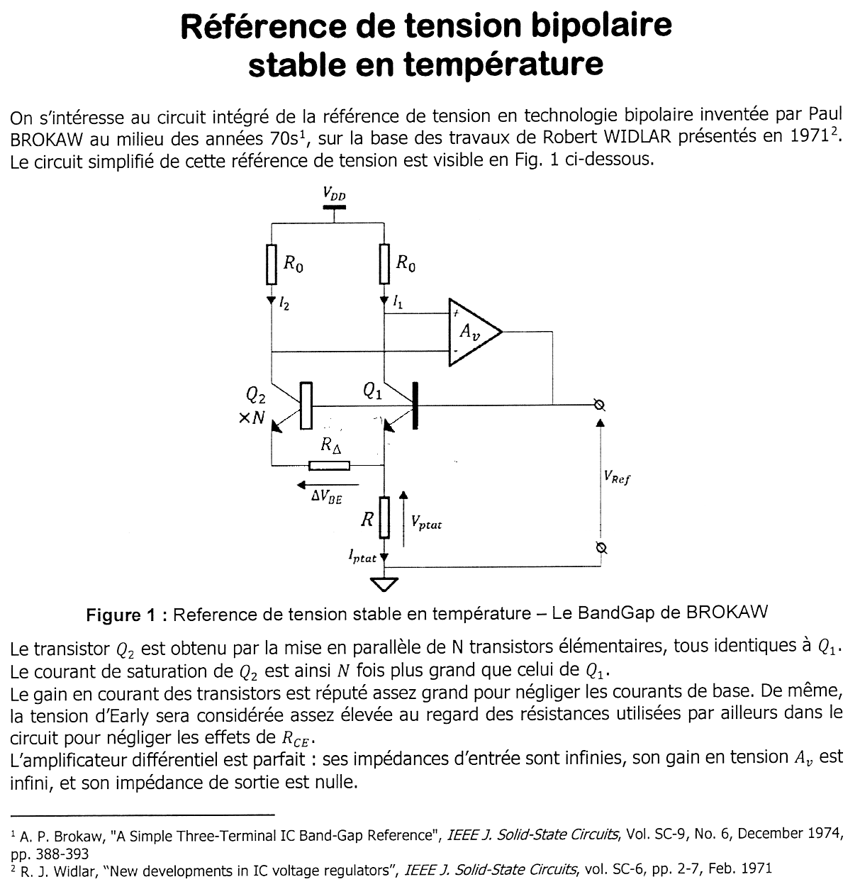{fig-alt="Exercice 1 : bandgap de Brokaw. Q2 (N transistors en parallèle) et Q1, chargés par deux résistances R0 depuis VDD (courants I2 et I1) ; un amplificateur différentiel Av compare les collecteurs et commande les bases communes, à VRef ; l'émetteur de Q2 rejoint celui de Q1 par RΔ (tension ΔVBE) ; R, parcourue par Iptat, relie les émetteurs à la masse (tension Vptat). Courants de base et effet Early négligés, amplificateur parfait. Références : Brokaw 1974, Widlar 1971."}

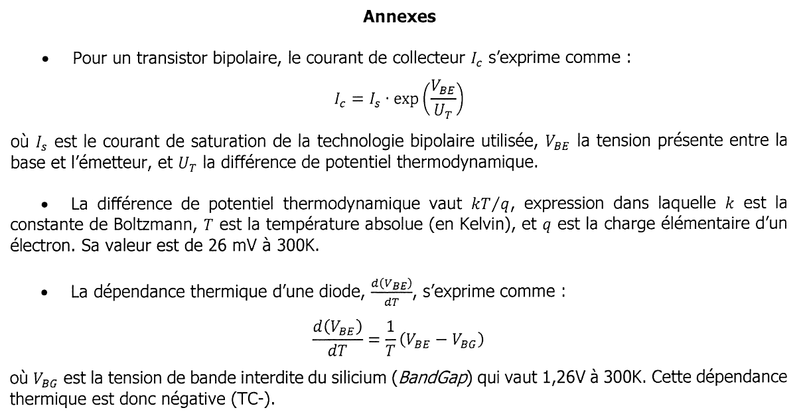{fig-alt="Annexes : Ic = Is exp(VBE/UT) ; UT = kT/q, 26 mV à 300 K ; dVBE/dT = (VBE − VBG)/T, avec VBG = 1,26 V à 300 K (TC−)."}

Chapitre du cours : [références de tension](../cours/05-references-de-tension.qmd#sec-td-brokaw-deval) ; principe du [miroir de Widlar](../cours/05-references-de-tension.qmd#sec-ptat).

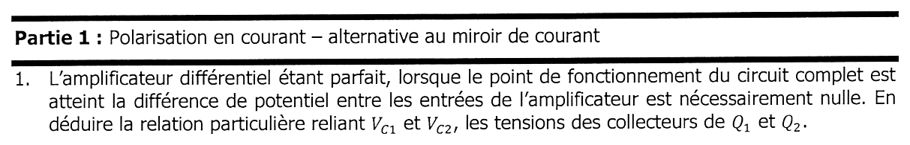{fig-alt="Partie 1 : polarisation en courant, alternative au miroir de courant. Q1 : l'amplificateur étant parfait, la différence de potentiel entre ses entrées est nulle au point de fonctionnement ; en déduire la relation entre VC1 et VC2."}

:::: {.complement}
::: {.solution}
Gain infini et sortie finie : $V_+ - V_- = 0$, donc $\boxed{V_{C1} = V_{C2}}$. Détail : [cours](../cours/05-references-de-tension.qmd#sec-td-brokaw-deval).
:::
::::

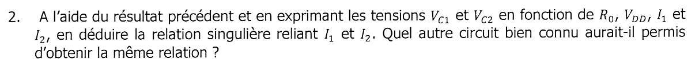{fig-alt="Q2 : en exprimant VC1 et VC2 en fonction de R0, VDD, I1 et I2, en déduire la relation entre I1 et I2 ; quel autre circuit aurait permis la même relation ?"}

:::: {.complement}
::: {.solution}
$V_{C1} = V_{DD} - R_0 I_1$ et $V_{C2} = V_{DD} - R_0 I_2$, d'où $\boxed{I_1 = I_2}$ : c'est ce qu'imposerait un **miroir de courant** (PNP ou PMOS) en charge des deux collecteurs.
:::
::::

{fig-alt="Q3 : expression de Iptat en fonction de I2."}

:::: {.complement}
::: {.solution}
Les deux courants d'émetteur se rejoignent dans $R$ (courants de base négligés) : $\boxed{I_{ptat} = I_1 + I_2 = 2I_2}$.
:::
::::

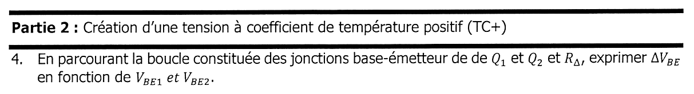{fig-alt="Partie 2 : création d'une tension à coefficient de température positif (TC+). Q4 : en parcourant la boucle formée des jonctions base-émetteur de Q1 et Q2 et de RΔ, exprimer ΔVBE en fonction de VBE1 et VBE2."}

:::: {.complement}
::: {.solution}
Bases communes ; l'émetteur de $Q_2$ rejoint celui de $Q_1$ à travers $R_\Delta$ : $V_{BE1} = V_{BE2} + R_\Delta I_2$, soit $\boxed{\Delta V_{BE} = V_{BE1} - V_{BE2} = R_\Delta I_2}$ (positive : $Q_2$, $N$ fois plus grand, conduit le même courant sous une $V_{BE}$ plus faible).
:::
::::

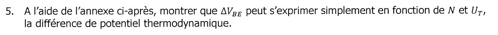{fig-alt="Q5 : à l'aide de l'annexe, montrer que ΔVBE s'exprime simplement en fonction de N et de UT."}

:::: {.complement}
::: {.solution}
$V_{BE1} = U_T\ln\frac{I_1}{I_S}$, $V_{BE2} = U_T\ln\frac{I_2}{N I_S}$ et $I_1 = I_2$ :
$$\boxed{\Delta V_{BE} = U_T \ln N}$$
Par exemple, pour $N = 8$ : $26 \times 2{,}08 \approx 54$ mV à 300 K.
:::
::::

{fig-alt="Q6 : montrer que d(ΔVBE)/dT est une constante positive (TC+), d'où le nom PTAT (Proportional to Absolute Temperature)."}

:::: {.complement}
::: {.solution}
$U_T = kT/q$ : $\boxed{\frac{\mathrm{d}(\Delta V_{BE})}{\mathrm{d}T} = \frac{k}{q}\ln N}$, constante, positive pour $N > 1$ ($\approx 0{,}18$ mV/K pour $N = 8$). $\Delta V_{BE}$ est proportionnelle à $T$ : PTAT.
:::
::::

{fig-alt="Q7 : exprimer Vptat, la tension aux bornes de R, en fonction de N, UT, RΔ et R."}

:::: {.complement}
::: {.solution}
$I_2 = \frac{\Delta V_{BE}}{R_\Delta} = \frac{U_T\ln N}{R_\Delta}$ et $I_{ptat} = 2I_2$ :
$$\boxed{V_{ptat} = R\, I_{ptat} = 2\,\frac{R}{R_\Delta}\, U_T \ln N}$$
:::
::::

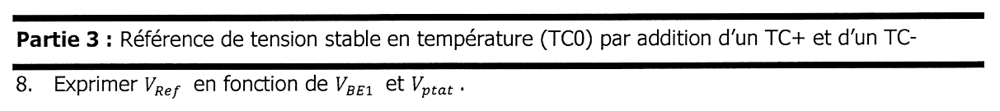{fig-alt="Partie 3 : référence de tension stable en température (TC0) par addition d'un TC+ et d'un TC−. Q8 : exprimer VRef en fonction de VBE1 et Vptat."}

:::: {.complement}
::: {.solution}
La base de $Q_1$ est à $V_{Ref}$ et son émetteur au haut de $R$ : $\boxed{V_{Ref} = V_{BE1} + V_{ptat}}$, somme d'un terme TC− ($V_{BE1}$) et d'un terme TC+ ($V_{ptat}$).
:::
::::

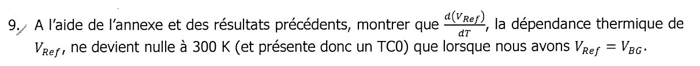{fig-alt="Q9 : à l'aide de l'annexe et des résultats précédents, montrer que dVRef/dT ne s'annule à 300 K (TC0) que lorsque VRef = VBG."}

:::: {.complement}
::: {.solution}
$V_{ptat}$ est proportionnelle à $T$, donc $\frac{\mathrm{d}V_{ptat}}{\mathrm{d}T} = \frac{V_{ptat}}{T}$ ; avec l'annexe :
$$\frac{\mathrm{d}V_{Ref}}{\mathrm{d}T} = \frac{V_{BE1} - V_{BG}}{T} + \frac{V_{ptat}}{T} = \boxed{\frac{V_{Ref} - V_{BG}}{T}}$$
nulle si et seulement si $V_{Ref} = V_{BG} = 1{,}26$ V. On règle $R/R_\Delta$ pour atteindre cette valeur ; le TC0 n'est obtenu qu'à une température (ici 300 K). Détail : [cours](../cours/05-references-de-tension.qmd#sec-td-brokaw-deval).
:::
::::

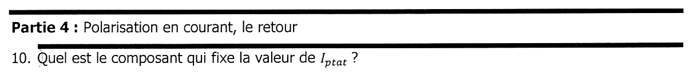{fig-alt="Partie 4 : polarisation en courant, le retour. Q10 : quel est le composant qui fixe la valeur de Iptat ?"}

:::: {.complement}
::: {.solution}
$I_{ptat} = \frac{2U_T\ln N}{R_\Delta}$ : c'est **$R_\Delta$** (avec le rapport $N$) qui fixe le courant ; $R$ ne fait que doser $V_{ptat}$. Le circuit fournit donc aussi un courant PTAT de polarisation, indépendant de $V_{DD}$.
:::
::::

## Exercice 2 : une référence des circuits intégrés (F. Rivet) {#sec-ann2526-ex2}

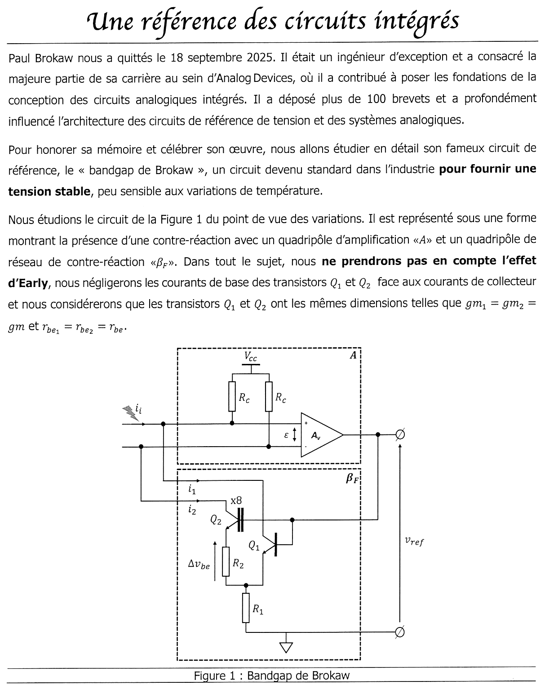{fig-alt="Exercice 2 : bandgap de Brokaw découpé en quadripôle d'amplification A (deux résistances Rc depuis Vcc, amplificateur Av, tension d'entrée ε, courant parasite ii injecté à l'entrée) et réseau de contre-réaction βF (Q2 ×8 avec R2 dans l'émetteur, tension Δvbe, Q1, R1 commune vers la masse, courants de collecteur i1 et i2 renvoyés vers A, bases à vref). Effet Early ignoré, courants de base négligés, gm1 = gm2 = gm, rbe1 = rbe2 = rbe."}

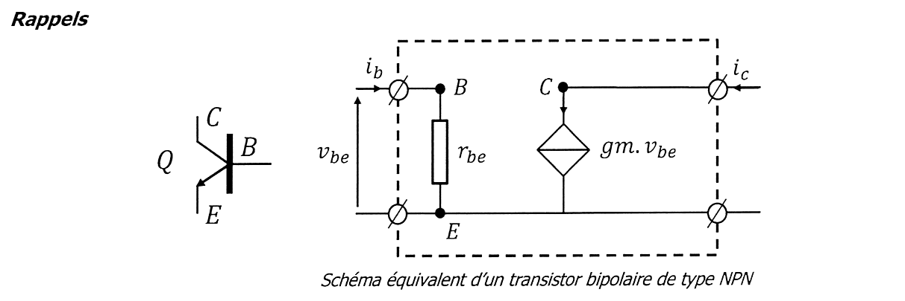{fig-alt="Rappels : schéma équivalent petits signaux d'un transistor NPN : rbe entre base et émetteur (tension vbe), source de courant gm·vbe entre collecteur et émetteur."}

Chapitre du cours : [applications de la contre-réaction, sujet 2025](../cours/03-applications-contre-reaction.qmd#sec-td-brokaw) ; méthode : [contre-réaction tension-parallèle](../cours/02-amplificateurs-contre-reaction.qmd#sec-cr-tension-parallele).

::: {.complement}
**Écart avec l'énoncé recopié au chapitre 3.** L'énoncé du chapitre 3 (issu du TD 3 de 2026, identique à ce sujet) écrit « $i_F = \beta_F\, v_{ref}$ » à la question 1, « $A_v$ très grand ($> 10^3$) » et « $Z_{sortie}$ » avant la question 7 ; le sujet et le TD portent « $i_1 = \beta_F . v_{ref}$ », « $> 10^5$ » et « $Z_{ampli}$ ». Ces écarts sont des erreurs de recopie dans Bristol, sans effet sur les solutions ; ils sont signalés pour correction du chapitre 3.
:::

{fig-alt="Q1 : quel type de contre-réaction est mis en œuvre ? D'après le cours, βF est obtenu suivant i1 = βF · vref ; on va identifier βF."}

:::: {.complement}
::: {.solution}
On prélève la **tension** $v_{ref}$ (bases de $Q_1$, $Q_2$ reliées à la sortie) et on réinjecte des **courants** (collecteurs) aux nœuds d'entrée de « $A$ » : contre-réaction **tension-parallèle**. $A$ est une transimpédance, $\beta_F$ une conductance. Détail : [cours](../cours/03-applications-contre-reaction.qmd#sec-td-brokaw).
:::
::::

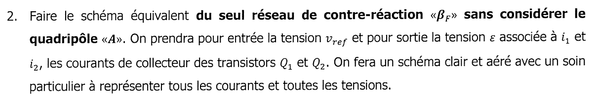{fig-alt="Q2 : schéma équivalent du seul réseau de contre-réaction βF, sans le quadripôle A ; entrée vref, sortie la tension ε associée à i1 et i2, courants de collecteur de Q1 et Q2 ; schéma clair avec tous les courants et toutes les tensions."}

:::: {.complement}
::: {.solution}
Chaque transistor est remplacé par $r_{be}$ (base-émetteur) et $g_m v_{be}$ (collecteur-émetteur). Les deux bases sont à $v_{ref}$ ; l'émetteur de $Q_1$ est au nœud commun, celui de $Q_2$ y est relié par $R_2$ ; $R_1$ relie le nœud commun à la masse et porte $i_1 + i_2$ (courants de base négligés) ; les collecteurs fournissent $i_1 = g_m v_{be_1}$ et $i_2 = g_m v_{be_2}$, renvoyés vers les entrées de « $A$ ».
:::
::::

{fig-alt="Q3 : relation entre Δvbe, tension aux bornes de R2, R2 et i2."}

:::: {.complement}
::: {.solution}
$R_2$ est parcourue par le courant d'émetteur de $Q_2$, égal à $i_2$ : $\boxed{\Delta v_{be} = R_2\, i_2}$.
:::
::::

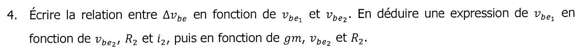{fig-alt="Q4 : relation entre Δvbe, vbe1 et vbe2 ; en déduire vbe1 en fonction de vbe2, R2 et i2, puis de gm, vbe2 et R2."}

:::: {.complement}
::: {.solution}
Bases communes : $\Delta v_{be} = v_{be_1} - v_{be_2}$, d'où $v_{be_1} = v_{be_2} + R_2\, i_2$, et avec $i_2 = g_m v_{be_2}$ :
$$\boxed{v_{be_1} = v_{be_2}\left(1 + g_m R_2\right)}$$
:::
::::

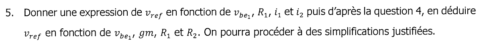{fig-alt="Q5 : expression de vref en fonction de vbe1, R1, i1 et i2, puis en fonction de vbe1, gm, R1 et R2, avec des simplifications justifiées."}

:::: {.complement}
::: {.solution}
$v_{ref} = v_{be_1} + R_1(i_1 + i_2)$, avec $i_1 = g_m v_{be_1}$ et $i_2 = \frac{g_m v_{be_1}}{1 + g_m R_2}$ :
$$v_{ref} = v_{be_1}\left[1 + g_m R_1\left(1 + \frac{1}{1 + g_m R_2}\right)\right] \approx g_m R_1\left(1 + \frac{1}{1 + g_m R_2}\right) v_{be_1} \quad (g_m R_1 \gg 1).$$
:::
::::

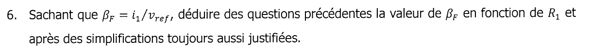{fig-alt="Q6 : sachant que βF = i1/vref, déduire la valeur de βF en fonction de R1, après des simplifications justifiées."}

:::: {.complement}
::: {.solution}
$$\beta_F = \frac{g_m v_{be_1}}{v_{ref}} \approx \frac{1}{R_1\left(1 + \frac{1}{1 + g_m R_2}\right)} \;\approx\; \boxed{\frac{1}{R_1}}$$
la dernière forme supposant $g_m R_2 \gg 1$. Le cours signale que cette hypothèse est discutable : au repos, $g_m R_2 = \frac{\Delta V_{BE}}{V_T} = \ln 8 \approx 2{,}1$, et le facteur correctif vaut environ 1,3 ([cours](../cours/03-applications-contre-reaction.qmd#sec-td-brokaw)).
:::
::::

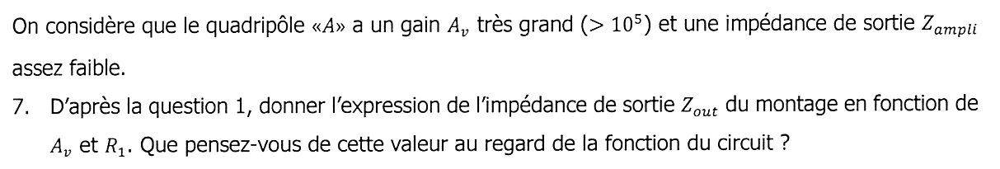{fig-alt="Le quadripôle A a un gain Av très grand (> 10^5) et une impédance de sortie Zampli assez faible. Q7 : d'après la question 1, expression de l'impédance de sortie Zout du montage en fonction de Av et R1 ; que penser de cette valeur au regard de la fonction du circuit ?"}

:::: {.complement}
::: {.solution}
Contre-réaction tension-parallèle : l'impédance de sortie est divisée par $1 + A\beta_F$,
$$Z_{out} = \frac{Z_{ampli}}{1 + A\beta_F} \approx \frac{Z_{ampli}}{A_v / R_1} ,$$
en écrivant, comme le demande l'énoncé, $A\beta_F \approx A_v/R_1$ (le cours précise que $A$ est en réalité une transimpédance, de l'ordre de $A_v$ fois la résistance $R_c$ qui convertit les courants en $\varepsilon$, pour que $A\beta_F$ soit sans dimension). Avec $A_v > 10^5$, $Z_{out}$ est **très faible** : c'est ce qu'on attend d'une **référence de tension**, dont la valeur ne doit pas dépendre du courant débité.
:::
::::

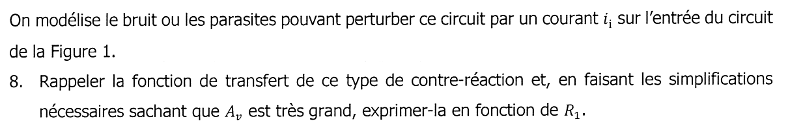{fig-alt="Le bruit ou les parasites sont modélisés par un courant ii à l'entrée du circuit de la figure 1. Q8 : rappeler la fonction de transfert de ce type de contre-réaction et, Av étant très grand, l'exprimer en fonction de R1."}

:::: {.complement}
::: {.solution}
$$\frac{v_{ref}}{i_i} = \frac{A}{1 + A\beta_F} \approx \frac{1}{\beta_F} \approx \boxed{R_1}$$
([formule de la contre-réaction tension-parallèle](../cours/02-amplificateurs-contre-reaction.qmd#eq-ft-tension-parallele)).
:::
::::

{fig-alt="Q9 : commenter l'impact du bruit représenté par ii sur les variations de la tension de référence."}

:::: {.complement}
::: {.solution}
Un courant parasite $i_i$ produit une variation $v_{ref} \approx R_1\, i_i$, fixée par le réseau de contre-réaction et **indépendante du gain** $A_v$ : augmenter le gain de l'amplificateur ne réduit pas cette perturbation.
:::
::::

{fig-alt="Q10 : comment dimensionner R1 pour limiter cet impact ?"}

:::: {.complement}
::: {.solution}
Choisir $R_1$ **faible**. Contrepartie : $R_1$ fixe aussi, avec $R_2$, le courant de polarisation et la valeur de $V_{ref}$ (exercice 1 : $V_{ptat} = 2\frac{R}{R_\Delta}U_T\ln N$, avec $R = R_1$ et $R_\Delta = R_2$) ; à $V_{ref} = V_{BG}$ imposée, réduire $R_1$ impose de réduire $R_2$ dans le même rapport, donc d'augmenter les courants et la consommation. C'est un compromis bruit-consommation.
:::
::::
