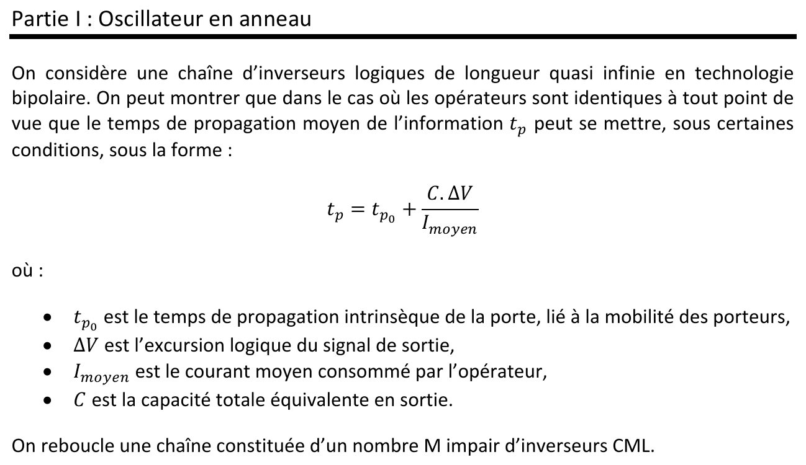
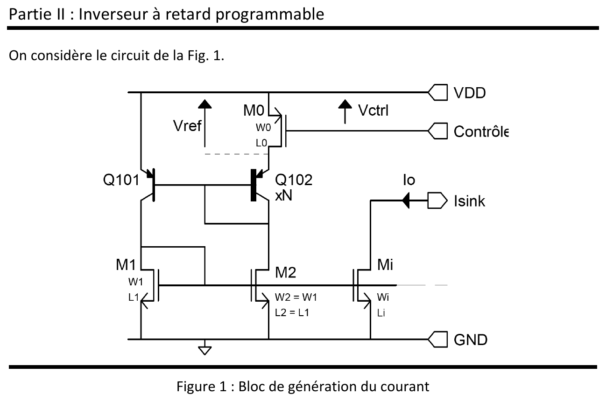
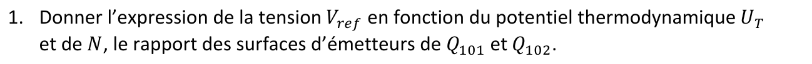
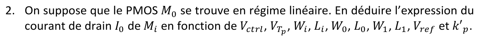
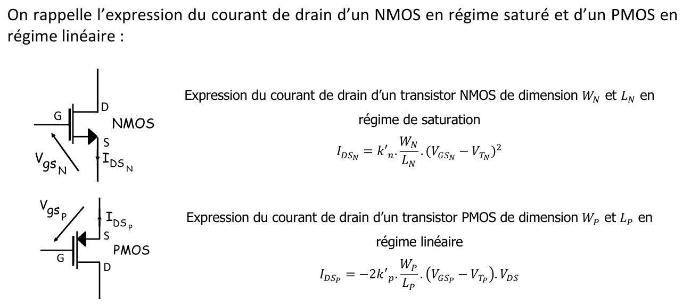
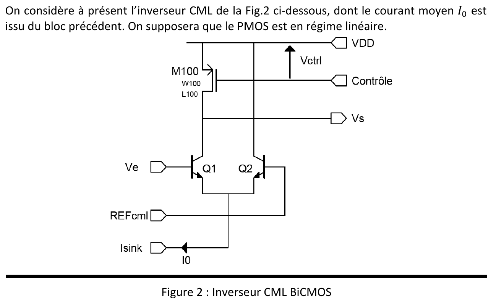
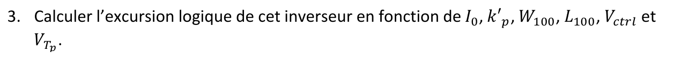
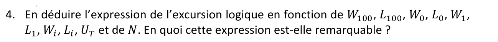
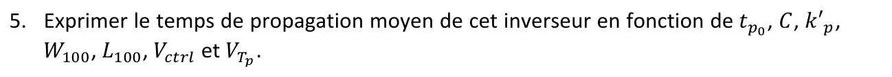
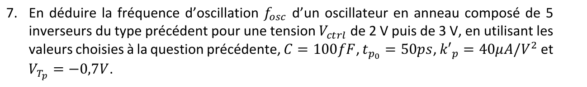



::: {.complement}
Énoncé découpé question par question [td-add-anneau] ; sous chaque question, le corrigé d'un ancien élève (*Notes externes*, [corr-2023-td05-anneau]), puis les explications et contrôles ajoutés par Claude (*Complément*, bloc tranché sur le dimensionnement). Il n'y a pas de notes d'Armand pour ce TD. Les parties II et III du partiel de 2013-2014 reprennent ce TD.

Cours associé : [chapitre 4, oscillateurs en anneau](../cours/04-oscillateurs.qmd#sec-anneau).
:::

## Exercice 1 : oscillateur en anneau {#sec-td-anneau}

::: {#exr-oscillateur-anneau}
## Oscillateur en anneau [support, p. 26-28]

{fig-alt="Partie I : oscillateur en anneau. On considère une chaîne d'inverseurs logiques de longueur quasi infinie en technologie bipolaire. On peut montrer que dans le cas où les opérateurs sont identiques à tout point de vue, le temps de propagation moyen de l'information tp peut se mettre, sous certaines conditions, sous la forme tp = tp0 + C·ΔV/Imoyen, où tp0 est le temps de propagation intrinsèque de la porte, lié à la mobilité des porteurs, ΔV l'excursion logique du signal de sortie, Imoyen le courant moyen consommé par l'opérateur et C la capacité totale équivalente en sortie. On reboucle une chaîne constituée d'un nombre M impair d'inverseurs CML."}
:::

::: {.notes-externes}
D'après le corrigé externe [corr-2023-td05-anneau, p. 1-3].
:::

### Partie I : oscillateur en anneau

{fig-alt="1. Expliquer simplement qu'il s'agit d'un oscillateur."}

::: {.notes-externes}
Un nombre $M$ impair d'inverseurs donne un signe négatif sur la boucle : aucun état n'est stable, le circuit oscille.
:::

{fig-alt="2. Exprimer la fréquence d'oscillation fosc en fonction de tp."}

::: {.notes-externes}
Chaque front est retardé de $t_p$ par étage ; le niveau haut dure $M t_p$, la période $T = 2Mt_p$ :
$$
f_{osc} = \frac{1}{2Mt_p} .
$$
:::

{fig-alt="3. Lorsque l'oscillateur est implanté sur silicium, si on veut faire varier la fréquence d'oscillation fosc, sur quel paramètre pouvons-nous agir ?"}

::: {.notes-externes}
On peut agir sur le courant moyen, ou sur une capacité variable.
:::

### Partie II : inverseur à retard programmable

{fig-alt="Partie II : inverseur à retard programmable. On considère le circuit de la figure 1. Figure 1 : bloc de génération du courant ; PNP Q101 et Q102 (Q102 de surface N fois plus grande) produisant la tension Vref appliquée entre drain et source du PMOS M0 (W0, L0), dont la grille est commandée par Vctrl (entrée Contrôle) ; miroirs NMOS M1 (W1, L1), M2 (W2 = W1, L2 = L1) et Mi (Wi, Li), courant Io en sortie Isink ; alimentations VDD et GND."}

{fig-alt="1. Donner l'expression de la tension Vref en fonction du potentiel thermodynamique UT et de N, le rapport des surfaces d'émetteurs de Q101 et Q102."}

::: {.notes-externes}
$V_{EB} = U_T \ln\left|\frac{I_C}{I_S}\right|$ ; la maille donne $V_{ref} = V_{EB101} - V_{EB102} = U_T \ln\left|\frac{N I_{C1}}{I_{C2}}\right|$ ; $M_1$ et $M_2$ forment un miroir, donc $I_{C1} = I_{C2}$ et
$$
V_{ref} = U_T \ln N .
$$
:::

{fig-alt="2. On suppose que le PMOS M0 se trouve en régime linéaire. En déduire l'expression du courant de drain I0 de Mi en fonction de Vctrl, VTp, Wi, Li, W0, L0, W1, L1, Vref et k'p."}

::: {.notes-externes}
$M_0$ linéaire avec $V_{DS0} = V_{ref}$ : $I_{DS0} = -2k'_p\frac{W_0}{L_0}(V_{ctrl} + V_{Tp})\,V_{ref}$. Les miroirs ($I_{D2} = -I_{D0} = I_{D1}$, $I_{Di} = I_{D1}\frac{W_i}{W_1}\frac{L_1}{L_i}$) donnent
$$
I_0 = 2k'_p\,\frac{W_i W_0}{W_1}\,\frac{L_1}{L_i L_0}\,(V_{ctrl} + V_{Tp})\,V_{ref} .
$$
:::

{fig-alt="On rappelle l'expression du courant de drain d'un NMOS en régime saturé et d'un PMOS en régime linéaire : NMOS de dimensions WN et LN en saturation, IDSN = k'n · WN/LN · (VGSN − VTN)² ; PMOS de dimensions WP et LP en régime linéaire, IDSP = −2k'p · WP/LP · (VGSP − VTP) · VDS."}

{fig-alt="On considère à présent l'inverseur CML de la figure 2, dont le courant moyen I0 est issu du bloc précédent. On supposera que le PMOS est en régime linéaire. Figure 2 : inverseur CML BiCMOS ; paire différentielle Q1 (entrée Ve) et Q2 (entrée REFcml), émetteurs communs vers la source de courant I0 (Isink) ; charge PMOS M100 (W100, L100) entre VDD et le collecteur de Q1, grille commandée par Vctrl (Contrôle) ; sortie Vs."}

{fig-alt="3. Calculer l'excursion logique de cet inverseur en fonction de I0, k'p, W100, L100, Vctrl et VTp."}

::: {.notes-externes}
Dans la paire, tout $I_0$ passe soit dans $Q_1$, soit dans $Q_2$. Si $I_{CQ1} = 0$, $V_{DS100} = 0$ et $V_S = V_{DD}$ (niveau haut) ; si $I_{CQ1} = I_0$, $V_S = V_{DD} - |V_{DS100}|$ (niveau bas). Avec $M_{100}$ linéaire :
$$
\Delta V = |V_{DS100}| = \frac{L_{100}\, I_0}{2k'_p\, W_{100}\,(V_{ctrl} + V_{Tp})} .
$$
:::

{fig-alt="4. En déduire l'expression de l'excursion logique en fonction de W100, L100, W0, L0, W1, L1, Wi, Li, UT et de N. En quoi cette expression est-elle remarquable ?"}

::: {.notes-externes}
$\Delta V = \frac{L_{100}}{W_{100}}\,\frac{W_0}{L_0}\,\frac{L_1}{W_1}\,\frac{W_i}{L_i}\,U_T \ln N$.
:::

::: {.complement}
**Question 4, « en quoi est-ce remarquable ? »** (sans réponse dans le corrigé) : l'excursion logique ne dépend que de **rapports de dimensions** et de $U_T \ln N$. Elle est indépendante de $V_{ctrl}$, de $k'_p$ et de $V_{Tp}$ : $V_{ctrl}$ règle le courant, donc le temps de propagation et la fréquence (question 5), sans changer l'amplitude des signaux ; elle est aussi insensible aux dispersions du procédé (les rapports de dimensions sont bien reproduits). Elle reste proportionnelle à $U_T = kT/q$, donc à la température absolue.
:::

{fig-alt="5. Exprimer le temps de propagation moyen de cet inverseur en fonction de tp0, C, k'p, W100, L100, Vctrl et VTp."}

::: {.notes-externes}
$t_p = t_{p0} + \frac{C\,\Delta V}{I_0} = t_{p0} + \frac{C\,L_{100}}{2k'_p\,(V_{ctrl} + V_{Tp})\,W_{100}}$.
:::

{fig-alt="6. Dans une technologie BiCMOS de taille minimale 1 µm, choisir des valeurs permettant d'obtenir une excursion logique de 400 mV (on prendra UT = 25 mV et N = 6)."}

::: {.notes-externes}
$\frac{W_1}{W_i}\,\frac{W_{100}}{W_0} = \frac{U_T \ln N}{\Delta V} = 9$, d'où $W_1 = W_i = W_{100} = 30$ µm et $W_0 = 3{,}3$ µm (voir le bloc ci-dessous).
:::

{fig-alt="7. En déduire la fréquence d'oscillation fosc d'un oscillateur en anneau composé de 5 inverseurs du type précédent pour une tension Vctrl de 2 V puis de 3 V, en utilisant les valeurs choisies à la question précédente, C = 100 fF, tp0 = 50 ps, k'p = 40 µA/V² et VTp = −0,7 V."}

::: {.notes-externes}
$f = 1{,}22$ GHz pour $V_{ctrl} = 2$ V et $f = 1{,}47$ GHz pour $V_{ctrl} = 3$ V, avec « $f = \frac{1}{2Nt_p}$ » (voir le bloc ci-dessous).
:::

::: {.a-verifier .tranche #av-anneau-dimensionnement}
**Source** [corr-2023-td05-anneau, p. 3], questions 6 et 7 : « $\frac{W_1}{W_i}\frac{W_{100}}{W_0} = \frac{U_T\ln(N)}{\Delta V} = 9$ » ; « $W_1 = W_i = W_{100} = 30$ µm, $W_0 = 3{,}3$ µm » ; « $f = \frac{1}{2Nt_p}$ ».

**Problème** :

- $\frac{U_T \ln N}{\Delta V} = \frac{25 \times 1{,}79}{400} \approx 0{,}11$, et non 9 : c'est l'inverse, $\frac{\Delta V}{U_T \ln N} \approx 8{,}9$ ;
- d'après la question 4 (toutes les longueurs à 1 µm), c'est $\frac{W_0 W_i}{W_{100} W_1}$ qui doit valoir 8,9 ; les valeurs choisies donnent 0,11, soit $\Delta V \approx 5$ mV au lieu de 400 mV ;
- à la question 7, $N$ (rapport d'émetteurs, 6) est écrit à la place de $M$ (nombre d'inverseurs, 5).

**Proposition** (recalculée par Claude) : toutes les longueurs à 1 µm et $\frac{W_0 W_i}{W_{100} W_1} = \frac{\Delta V}{U_T \ln N} \approx 8{,}9$, par exemple $W_0 = W_i = W_{100} = 30$ µm et $W_1 = 3{,}3$ µm (rapport 9,1, $\Delta V \approx 407$ mV). Question 7 : seul $W_{100}/L_{100} = 30$ intervient. Pour $V_{ctrl} = 2$ V, $V_{ctrl} + V_{Tp} = 1{,}3$ V, $t_p = 50 + \frac{100 \cdot 10^{-15} \times 10^{-6}}{2 \times 40 \cdot 10^{-6} \times 1{,}3 \times 30 \cdot 10^{-6}} \approx 50 + 32 = 82$ ps et $f_{osc} = \frac{1}{2 \times 5 \times 82\ \mathrm{ps}} \approx 1{,}22$ GHz ; pour 3 V, $t_p \approx 50 + 18 = 68$ ps et $f_{osc} \approx 1{,}47$ GHz. Les valeurs numériques du corrigé sont donc justes avec $M = 5$.

**Décision** : proposition retenue (Armand a délégué la décision ; calcul vérifié par Claude), 2026-10-14.
:::

::: {.complement}
**Plage d'accord.** La fréquence ne dépend de $V_{ctrl}$ que par $V_{ctrl} + V_{Tp}$ : l'oscillateur est commandé en tension, de 1,22 à 1,47 GHz pour $V_{ctrl}$ de 2 à 3 V.
:::
