

::: {.complement}
Énoncé découpé question par question [td-add-vdd] ; sous chaque question, la solution proposée par Claude (*Complément*) : il n'y a ni notes d'Armand ni corrigé pour ce TD. À relire avec un œil critique ; signaler toute erreur. **Attention** : les questions 6 et 7 avaient été résolues avec une valeur de gain mal recopiée (bloc *À vérifier* `av-vdd-gain-recopie`).

Cours associé : [chapitre 2, contre-réaction de tension-série](../cours/02-amplificateurs-contre-reaction.qmd#sec-cr-tension-serie), [chapitre 1, marges de stabilité](../cours/01-generalites-contre-reaction.qmd#sec-marges).
:::

## Exercice 1 : VDD is not your BFF {#sec-td-vdd}

::: {#exr-vdd-bff}
## VDD is not your BFF [support, p. 29-30]

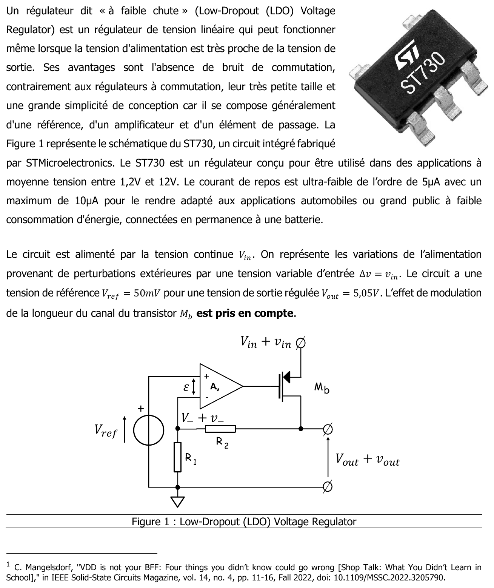{fig-alt="VDD is not your BFF (note 1 : C. Mangelsdorf, « VDD is not your BFF: Four things you didn't know could go wrong », IEEE Solid-State Circuits Magazine, vol. 14, no. 4, p. 11-16, automne 2022). Un régulateur dit « à faible chute » (Low-Dropout (LDO) Voltage Regulator) est un régulateur de tension linéaire qui peut fonctionner même lorsque la tension d'alimentation est très proche de la tension de sortie. Ses avantages : absence de bruit de commutation, très petite taille, grande simplicité de conception (une référence, un amplificateur et un élément de passage). La figure 1 représente le schéma du ST730 de STMicroelectronics, régulateur pour des applications entre 1,2 V et 12 V, de courant de repos ultra-faible (5 µA, au maximum 10 µA), adapté aux applications automobiles ou grand public connectées en permanence à une batterie. Le circuit est alimenté par Vin ; les variations de l'alimentation dues aux perturbations extérieures sont représentées par une tension variable Δv = vin. Tension de référence Vref = 50 mV pour une tension de sortie régulée Vout = 5,05 V. L'effet de modulation de la longueur du canal du transistor Mb est pris en compte. Figure 1 : LDO ; amplificateur Av (entrée + sur Vref, entrée − sur V− + v−) commandant la grille du PMOS Mb, source à Vin + vin, drain en sortie Vout + vout ; pont R2 (sortie vers V−) et R1 (V− vers la masse)."}
:::

Énoncé : [support, p. 29-30] (sujet EA234 du 6 novembre 2023, F. Rivet ; fichier séparé identique : `td/td-add-vdd-is-not-your-bff.pdf`). Aucun corrigé.

![Régulateur de tension à faible chute (LDO) du TD « VDD is not your BFF ». D'après le support [support, p. 29, figure 1], redessiné.](../figures/03-ldo.svg){#fig-ldo}

::: {.complement}
**Proposition de solution (aucun corrigé).**
:::

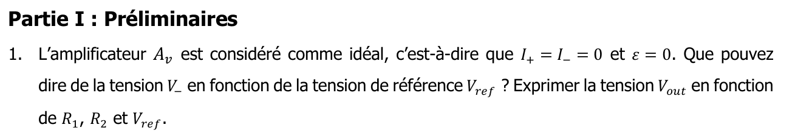{fig-alt="Partie I : préliminaires. 1. L'amplificateur Av est considéré comme idéal : I+ = I− = 0 et ε = 0. Que pouvez-vous dire de la tension V− en fonction de la tension de référence Vref ? Exprimer la tension Vout en fonction de R1, R2 et Vref."}

::: {.complement}
$\varepsilon = 0$ : $V_- = V_{ref}$. $R_1$ et $R_2$ forment un diviseur (aucun courant dans l'entrée $-$) : $V_- = \frac{R_1}{R_1 + R_2} V_{out}$, d'où $V_{out} = V_{ref}\left(1 + \frac{R_2}{R_1}\right)$.
:::

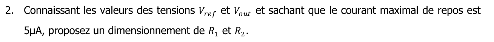{fig-alt="2. Connaissant les valeurs des tensions Vref et Vout et sachant que le courant maximal de repos est 5 µA, proposez un dimensionnement de R1 et R2."}

::: {.complement}
$\frac{V_{out}}{V_{ref}} = 101$, donc $R_2 = 100\,R_1$ ; le courant de repos dans le pont, $\frac{V_{out}}{R_1 + R_2}$, doit rester inférieur à 5 µA : $R_1 + R_2 \geq \frac{5{,}05\ \mathrm{V}}{5\ \mu\mathrm{A}} = 1{,}01\ \mathrm{M\Omega}$, par exemple $R_1 = 10\ \mathrm{k\Omega}$ et $R_2 = 1\ \mathrm{M\Omega}$.
:::

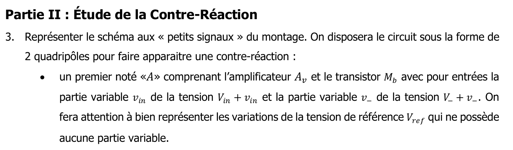{fig-alt="Partie II : étude de la contre-réaction. 3. Représenter le schéma aux « petits signaux » du montage, sous la forme de 2 quadripôles pour faire apparaître une contre-réaction : un premier noté « A » comprenant l'amplificateur Av et le transistor Mb, avec pour entrées la partie variable vin de la tension Vin + vin et la partie variable v− de la tension V− + v− (on fera attention à bien représenter les variations de la tension de référence Vref, qui ne possède aucune partie variable) ; un second noté « βF » comprenant R1 et R2."}

::: {.complement}
Petits signaux : $V_{ref}$ devient un court-circuit (borne $+$ à la masse) ; « $A$ » reçoit $v_-$ et $v_{in}$ et fournit $v_{out}$ ; « $\beta_F$ » est le pont $R_1$-$R_2$ branché sur la sortie.
:::

{fig-alt="4. Quel type de contre-réaction est mis en œuvre dans ce circuit ?"}

::: {.complement}
On prélève la tension de sortie (pont en parallèle sur la sortie) et on réinjecte une tension en série à l'entrée de $A_v$ ($\varepsilon = v_{ref} - v_-$) : contre-réaction **tension-série**.
:::

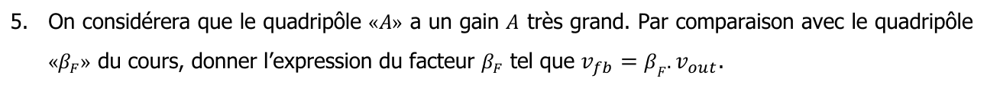{fig-alt="5. On considérera que le quadripôle « A » a un gain A très grand. Par comparaison avec le quadripôle « βF » du cours, donner l'expression du facteur βF tel que vfb = βF · vout."}

::: {.complement}
$\beta_F = \frac{R_1}{R_1 + R_2} = \frac{1}{101} \approx 0{,}01$.
:::

{fig-alt="Dans la suite de l'énoncé, on prendra A ~ 10⁶ et R2 = 100 · R1."}

::: {.a-verifier #av-vdd-gain-recopie}
**Source** : l'énoncé recopié dans le chapitre 3 jusqu'au 31 octobre 2026 indiquait « Dans la suite, on prend $A \sim 100$ et $R_2 = 100\, R_1$ » ; le sujet [td-add-vdd, p. 2] (image ci-dessus) donne « $A \sim 10^6$ et $R_2 = 100.R_1$ ».

**Problème** : les solutions des questions 6 et 7 ci-dessous (*Complément*) ont été calculées avec $A \sim 100$, soit un gain de boucle $A\beta_F \approx 1$. Avec la valeur du sujet, $A\beta_F \approx 10^6/101 \approx 10^4$ : les valeurs numériques et les conclusions de ces deux questions changent.

**Proposition** (Claude, à confirmer) : avec $A \sim 10^6$ et $\beta_F = 1/101$, $\frac{A}{1 + A\beta_F} \approx \frac{1}{\beta_F} = 101$ pour le signal appliqué à l'entrée de la boucle ; une variation $v_{in}$ de l'alimentation, qui agit à l'intérieur de la boucle (par la source de $M_b$), voit son effet en sortie divisé par $1 + A\beta_F \approx 10^4$ : l'alimentation est bien rejetée aux basses fréquences. Question 7 : $Z_{out} = \frac{r_{ds}}{1 + A\beta_F} \approx 10^{-4}\, r_{ds}$, très faible : le régulateur se comporte en source de tension. Les questions 8 à 10 (dégradation quand $A(j\omega)$ chute) restent valables. Le titre du sujet viserait alors surtout le comportement aux hautes fréquences.
:::

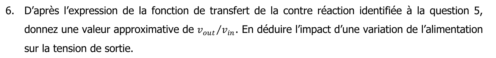{fig-alt="6. D'après l'expression de la fonction de transfert de la contre-réaction identifiée à la question 5, donnez une valeur approximative de vout/vin. En déduire l'impact d'une variation de l'alimentation sur la tension de sortie."}

::: {.complement}
$\frac{A}{1 + A\beta_F} = \frac{100}{1 + 100/101} \approx 50$ : avec un gain de boucle $A\beta_F \approx 1$ seulement, la contre-réaction atténue mal les variations ; une perturbation de l'alimentation se retrouve fortement en sortie. *Lecture proposée, à confirmer* : l'énoncé ne précise pas comment $v_{in}$ entre dans le quadripôle $A$ (par la source de $M_b$) ; le titre du sujet (« VDD is not your BFF ») va dans le sens d'un rejet insuffisant de l'alimentation.
:::

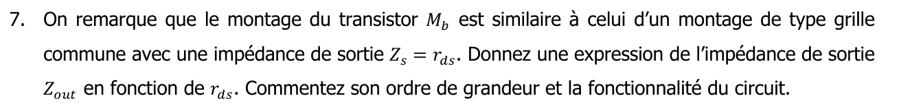{fig-alt="7. On remarque que le montage du transistor Mb est similaire à celui d'un montage de type grille commune avec une impédance de sortie Zs = rds. Donnez une expression de l'impédance de sortie Zout en fonction de rds. Commentez son ordre de grandeur et la fonctionnalité du circuit."}

::: {.complement}
Pour une tension-série, $Z_{out} = \frac{Z_s}{1 + A\beta_F} = \frac{r_{ds}}{1 + 100/101} \approx \frac{r_{ds}}{2}$ : l'impédance de sortie n'est divisée que par 2 et reste de l'ordre de $r_{ds}$, grande pour un régulateur, qui devrait se comporter comme une source de tension (impédance faible).
:::

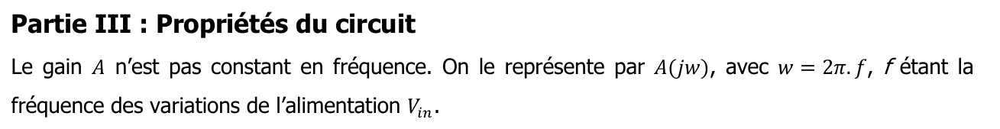{fig-alt="Partie III : propriétés du circuit. Le gain A n'est pas constant en fréquence. On le représente par A(jw), avec w = 2π·f, f étant la fréquence des variations de l'alimentation Vin."}

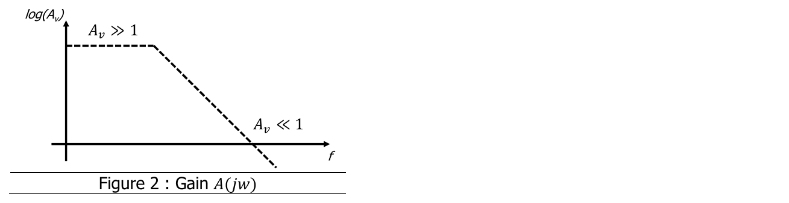{fig-alt="Figure 2 : gain A(jw) ; log(Av) en fonction de f, palier Av ≫ 1 aux basses fréquences puis décroissance jusqu'à Av ≪ 1."}

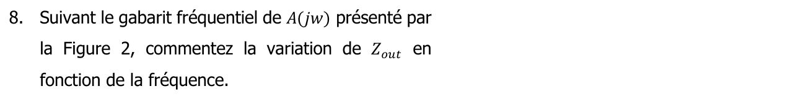{fig-alt="8. Suivant le gabarit fréquentiel de A(jw) présenté par la figure 2, commentez la variation de Zout en fonction de la fréquence."}

::: {.complement}
Quand $A(j\omega)$ diminue avec la fréquence, $A\beta_F$ diminue et $Z_{out}$ remonte vers $r_{ds}$ : la régulation se dégrade aux hautes fréquences.
:::

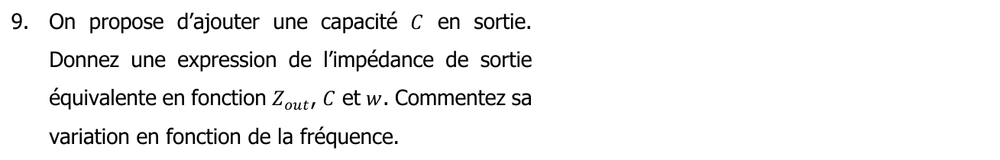{fig-alt="9. On propose d'ajouter une capacité C en sortie. Donnez une expression de l'impédance de sortie équivalente en fonction de Zout, C et w. Commentez sa variation en fonction de la fréquence."}

::: {.complement}
$Z_{eq} = Z_{out} \parallel \frac{1}{jC\omega} = \frac{Z_{out}}{1 + jC\omega Z_{out}}$ : la capacité réduit l'impédance de sortie aux hautes fréquences (elle « prend le relais » de la boucle).
:::

{fig-alt="10. Le montage présenterait-il alors un risque d'instabilité, et si oui pour quelle raison ?"}

::: {.complement}
Oui : la capacité de sortie, avec l'impédance de sortie, crée un pôle supplémentaire dans la boucle, qui s'ajoute à celui de $A(j\omega)$ ; deux pôles réduisent la marge de phase, d'où un risque d'instabilité ([stabilité](../cours/01-generalites-contre-reaction.qmd#sec-marges)).
:::
