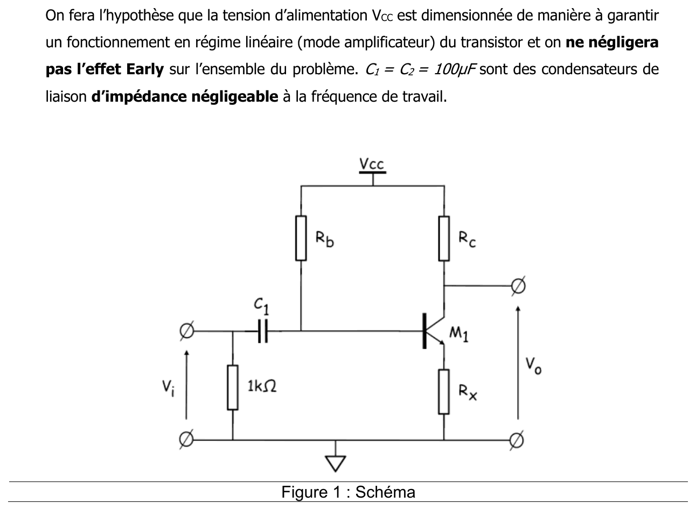
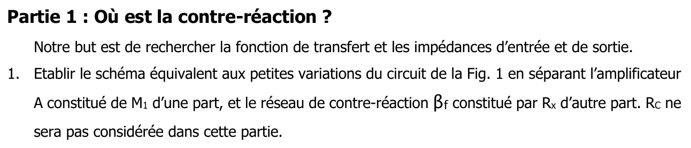
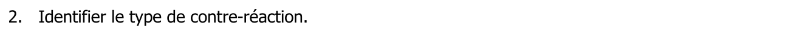
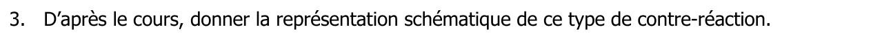
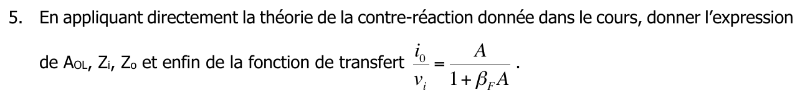
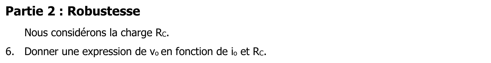
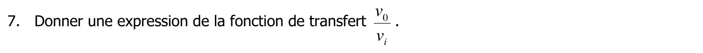
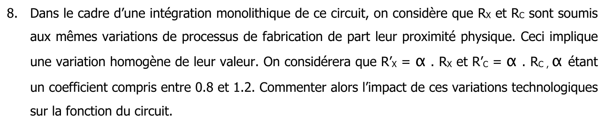



::: {.complement}
Énoncé découpé question par question [td01] ; sous chaque question, le corrigé d'un ancien élève (*Notes externes* : notes du cours 8 de 2023 [notes-2023-c08] et recueil de corrigés de 2023 [corr-2023-recueil]), puis les précisions ajoutées par Claude (*Complément*). Il n'y a pas de notes d'Armand pour ce TD.

Cours associé : [chapitre 2, contre-réaction de courant-série](../cours/02-amplificateurs-contre-reaction.qmd#sec-cr-courant-serie).
:::

## Exercice 1 : où est la contre-réaction ? {#sec-td-ou-est-la-contre-reaction}

::: {#exr-ou-est-la-contre-reaction}
## Où est la contre-réaction ? [support, p. 11-12]

{fig-alt="On fera l'hypothèse que la tension d'alimentation VCC est dimensionnée de manière à garantir un fonctionnement en régime linéaire (mode amplificateur) du transistor et on ne négligera pas l'effet Early sur l'ensemble du problème. C1 = C2 = 100 µF sont des condensateurs de liaison d'impédance négligeable à la fréquence de travail. Figure 1 : schéma ; transistor bipolaire M1 en émetteur commun, Rb entre VCC et la base, Rc entre VCC et le collecteur, Rx entre l'émetteur et la masse ; entrée vi par C1 avec une résistance de 1 kΩ vers la masse ; sortie vo sur le collecteur."}
:::

Cet exercice est le TD 1 du support 2025 [support, p. 11-12] (sujet EA234 de F. Rivet ; fichier séparé identique : `td/td01-ou-est-la-contre-reaction.pdf`). En 2023, il a été traité en cours (cours 8) [notes-2023-c08, p. 1].

![Exercice « Où est la contre-réaction ? » : montage (a) et schéma équivalent aux petites variations découpé en quadripôles $A$ et $\beta_F$, sans $R_C$ (b). (a) D'après le support [support, p. 11, figure 1], redessiné. (b) D'après les notes externes [notes-2023-c08, p. 2-3] et le corrigé externe [corr-2023-recueil, p. 3], redessiné.](../figures/02-ou-est-la-contre-reaction.svg){#fig-ou-est-la-contre-reaction}

::: {.notes-externes}
Montage « source commune » (émetteur commun, voir le complément ci-dessous) : gain $-g_m R_C$. La capacité ne laisse passer que les petites variations ; la résistance de polarisation ne se dessine pas [notes-2023-c08, p. 1].
:::

{fig-alt="Partie 1 : où est la contre-réaction ? Notre but est de rechercher la fonction de transfert et les impédances d'entrée et de sortie. 1. Établir le schéma équivalent aux petites variations du circuit de la figure 1 en séparant l'amplificateur A constitué de M1 d'une part, et le réseau de contre-réaction βf constitué par Rx d'autre part. RC ne sera pas considérée dans cette partie."}

::: {.notes-externes}
Schéma équivalent du transistor bipolaire : $r_{be}$ entre base et émetteur, source $\beta i_b = g_m v_{be}$ et $r_{ce}$ entre collecteur et émetteur. Le transistor amplifie : c'est le bloc $A$ ; $R_x$ est le bloc $\beta_F$ (@fig-ou-est-la-contre-reaction b) [notes-2023-c08, p. 1-3]. On néglige $i_b$ devant $\beta i_b$ : $R_x$ est parcourue par $i_o$ [notes-2023-c08, p. 3].
:::

{fig-alt="2. Identifier le type de contre-réaction."}

::: {.notes-externes}
Contre-réaction du type **courant-série** [notes-2023-c08, p. 3] ; [corr-2023-recueil, p. 3].
:::

{fig-alt="3. D'après le cours, donner la représentation schématique de ce type de contre-réaction."}

::: {.notes-externes}
Représentation : [figure du chapitre 2](../cours/02-amplificateurs-contre-reaction.qmd#fig-cr-courant-serie).
:::

{fig-alt="4. Identifier directement paramètre par paramètre les valeurs de A, βf, Ze, Zs."}

::: {.notes-externes}
Par identification avec le cours [notes-2023-c08, p. 4] ; [corr-2023-recueil, p. 3] :
$$
A = g_m, \qquad \beta_F = R_x, \qquad Z_e = r_{be}, \qquad Z_s = r_{ce} .
$$
:::

{fig-alt="5. En appliquant directement la théorie de la contre-réaction donnée dans le cours, donner l'expression de AOL, Zi, Zo et enfin de la fonction de transfert i0/vi = A/(1 + βF A)."}

::: {.notes-externes}
$A_{OL} = g_m R_x$, « c'est grand, on veut du gain » ; $Z_i = r_{be}(1 + g_m R_x)$ et $Z_o = r_{ce}(1 + g_m R_x)$, grandes aussi [corr-2023-recueil, p. 3] ; les notes écrivent directement $Z_i = g_m r_{be} R_x$ et $Z_{out} = g_m r_{ce} R_x$ [notes-2023-c08, p. 4]. Enfin
$$
\frac{i_o}{v_i} = \frac{g_m}{1 + g_m R_x} \approx \frac{1}{R_x} .
$$ {#eq-td1-transconductance}
:::

{fig-alt="Partie 2 : robustesse. Nous considérons la charge RC. 6. Donner une expression de vo en fonction de io et RC."}

::: {.notes-externes}
$v_o = -R_C\, i_o$ [notes-2023-c08, p. 4].
:::

{fig-alt="7. Donner une expression de la fonction de transfert v0/vi."}

::: {.notes-externes}
$\frac{v_o}{v_i} = \frac{v_o}{i_o} \times \frac{i_o}{v_i} = -\frac{R_C}{R_x}$ [notes-2023-c08, p. 4] ; [corr-2023-recueil, p. 3].
:::

{fig-alt="8. Dans le cadre d'une intégration monolithique de ce circuit, on considère que RX et RC sont soumis aux mêmes variations de processus de fabrication de part leur proximité physique. Ceci implique une variation homogène de leur valeur. On considérera que R'X = α·RX et R'C = α·RC, α étant un coefficient compris entre 0,8 et 1,2. Commenter alors l'impact de ces variations technologiques sur la fonction du circuit."}

::: {.notes-externes}
PVT : *Process, Voltage, Temperature* ; la valeur d'une résistance fabriquée varie de l'ordre de 20 %. Mais
$$
-\frac{R'_C}{R'_X} = -\frac{\alpha R_C}{\alpha R_X} = -\frac{R_C}{R_X} :
$$
le gain ne dépend pas de $\alpha$ [notes-2023-c08, p. 4].
:::

::: {.complement}
**Précisions.**

- Le transistor $M_1$ de la figure est **bipolaire** (NPN) : le montage est un **émetteur commun** à résistance d'émetteur $R_x$ (« source commune » dans les notes, terme du transistor MOS). L'« effet Early » de l'énoncé est modélisé par $r_{ce}$.
- Les expressions $Z_i \approx g_m r_{be} R_x$ et $Z_o \approx g_m r_{ce} R_x$ des notes supposent $g_m R_x \gg 1$ ; de même $i_o/v_i \approx 1/R_x$ (@eq-td1-transconductance) et $v_o/v_i \approx -R_C/R_x$.
- Le résultat de la question 8 illustre la [robustesse](../cours/01-generalites-contre-reaction.qmd#sec-robustesse-beta) : le gain ne dépend plus que d'un **rapport** de résistances voisines sur la puce, insensible à une dispersion commune. Il ne dépend plus de $g_m$, qui varie avec la température et la polarisation.
- Le modèle des quadripôles est approché : il néglige le courant $i_b$ dans $R_x$, et $r_{ce}$ relie en réalité la sortie au nœud d'émetteur, donc au réseau $\beta_F$. Le calcul direct sur le schéma complet donne des résultats très proches quand $\beta = g_m r_{be} \gg 1$ et $r_{ce} \gg R_x$.
:::
