

::: {.complement}
Énoncé découpé question par question [td02] ; sous chaque question, la solution proposée par Claude (*Complément*) : il n'y a ni notes d'Armand ni corrigé de cette version du sujet. À relire avec un œil critique ; signaler toute erreur.

La question 5 de l'énoncé désigne $v_{DS_2}$ comme tension de sortie ; la question 7 ($A_r = v_{DS_1}/i_1$) montre que la sortie du quadripôle est $v_{DS_1}$ : la solution suit la question 7.

Cours associé : [chapitre 2, contre-réaction de tension-parallèle](../cours/02-amplificateurs-contre-reaction.qmd#sec-cr-tension-parallele) et [chapitre 3](../cours/03-applications-contre-reaction.qmd#sec-exercices-td-ch03).
:::

## Exercice 1 : un circuit pour l'espace {#sec-td-circuit-espace}

::: {#exr-circuit-espace}
## Un circuit pour l'espace [support, p. 13-16]

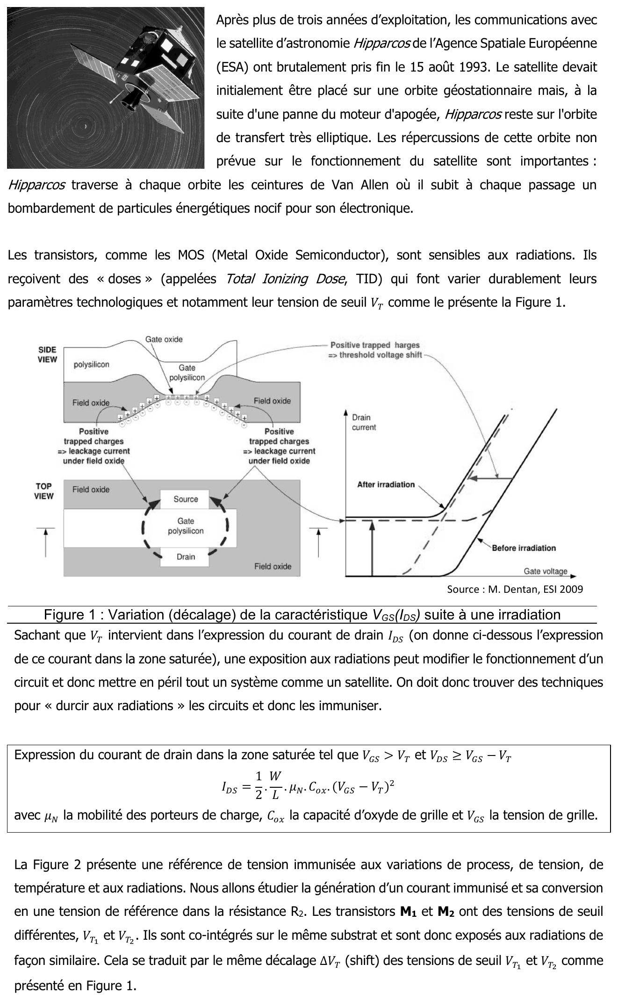{fig-alt="Après plus de trois années d'exploitation, les communications avec le satellite d'astronomie Hipparcos de l'Agence spatiale européenne (ESA) ont brutalement pris fin le 15 août 1993. Le satellite devait initialement être placé sur une orbite géostationnaire mais, à la suite d'une panne du moteur d'apogée, Hipparcos reste sur l'orbite de transfert très elliptique : il traverse à chaque orbite les ceintures de Van Allen où il subit un bombardement de particules énergétiques nocif pour son électronique. Les transistors MOS sont sensibles aux radiations : ils reçoivent des « doses » (Total Ionizing Dose, TID) qui font varier durablement leur tension de seuil VT (figure 1 : décalage de la caractéristique VGS(IDS) suite à une irradiation, charges positives piégées dans l'oxyde ; source M. Dentan, ESI 2009). Une exposition aux radiations peut donc mettre en péril tout un système ; il faut « durcir aux radiations » les circuits. Encadré : en zone saturée (VGS > VT et VDS ≥ VGS − VT), IDS = ½ · W/L · µN · Cox · (VGS − VT)², µN mobilité des porteurs, Cox capacité d'oxyde de grille, VGS tension de grille. La figure 2 présente une référence de tension immunisée aux variations de process, de tension, de température et aux radiations : génération d'un courant immunisé et conversion en tension de référence dans la résistance R2. M1 et M2 ont des tensions de seuil différentes VT1 et VT2 ; co-intégrés sur le même substrat, ils subissent le même décalage ΔVT."}

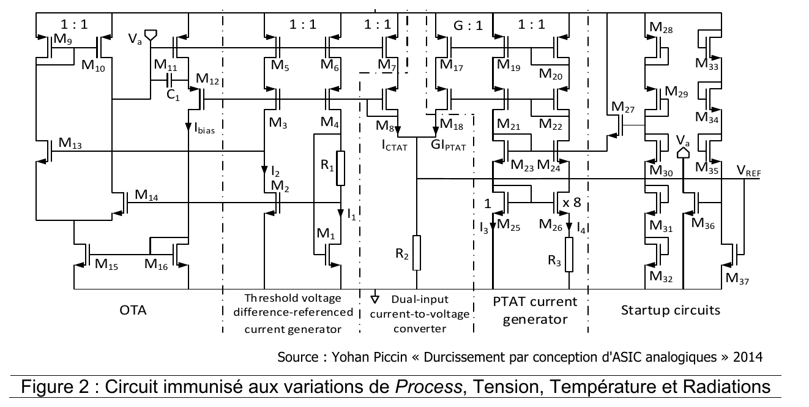{fig-alt="Figure 2 : circuit immunisé aux variations de process, tension, température et radiations (source : Yohan Piccin, « Durcissement par conception d'ASIC analogiques », 2014) : OTA, générateur de courant référencé sur une différence de tensions de seuil (M1, M2, R1), convertisseur courant-tension à deux entrées (R2), générateur de courant PTAT, circuits de démarrage, sortie VREF."}
:::

Énoncé : [support, p. 13-16] (sujet EA234 de F. Rivet ; fichier séparé identique : `td/td02-circuit-pour-l-espace.pdf`). Le corrigé manuscrit « TD3 – Un circuit immunisé » de 2023 porte sur une **autre version** du sujet (deux résistances $R_1$ et $R_2$, autre plan) : il n'est pas utilisé.

::: {.complement}
**Proposition de solution (aucun corrigé de cette version).**
:::

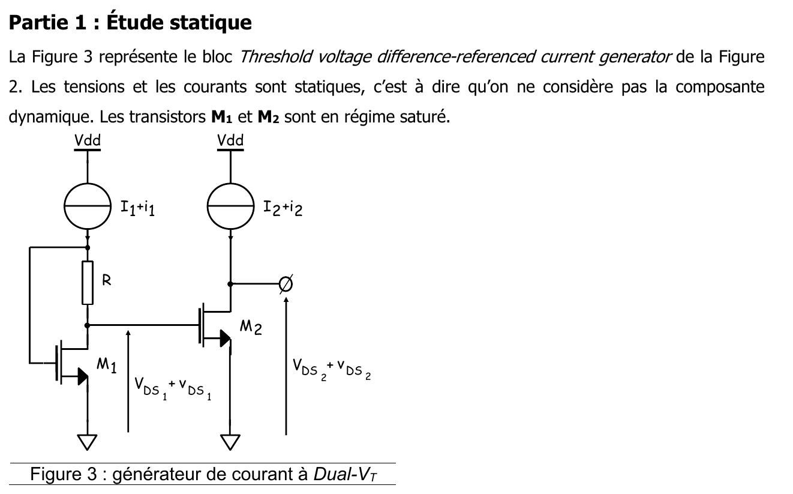{fig-alt="Partie 1 : étude statique. La figure 3 représente le bloc « Threshold voltage difference-referenced current generator » de la figure 2. Les tensions et les courants sont statiques. Les transistors M1 et M2 sont en régime saturé. Figure 3 : générateur de courant à dual-VT ; sources de courant I1 + i1 et I2 + i2 depuis Vdd ; R entre la grille et le drain de M1 ; grille de M2 reliée au drain de M1 ; tensions VDS1 + vDS1 et VDS2 + vDS2."}

![Générateur de courant à double tension de seuil (dual-$V_T$) du TD 2. D'après le support [support, p. 15, figure 3], redessiné.](../figures/03-dual-vt.svg){#fig-dual-vt}

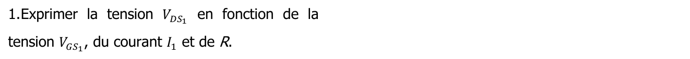{fig-alt="1. Exprimer la tension VDS1 en fonction de la tension VGS1, du courant I1 et de R."}

::: {.complement}
Le courant $I_1$ traverse $R$ de haut en bas, de la grille de $M_1$ vers son drain : $V_{DS_1} = V_{GS_1} - R I_1$.
:::

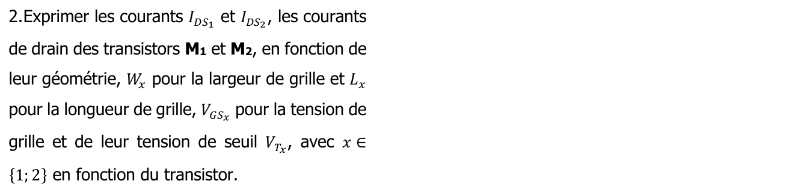{fig-alt="2. Exprimer les courants IDS1 et IDS2, les courants de drain des transistors M1 et M2, en fonction de leur géométrie, Wx pour la largeur de grille et Lx pour la longueur de grille, VGSx pour la tension de grille et de leur tension de seuil VTx, avec x ∈ {1 ; 2} en fonction du transistor."}

::: {.complement}
$I_{DS_x} = \frac{1}{2}\,\frac{W_x}{L_x}\,\mu_n C_{ox}\,(V_{GS_x} - V_{T_x})^2$.
:::

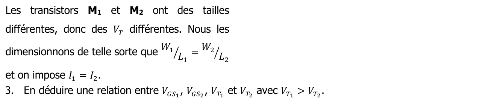{fig-alt="Les transistors M1 et M2 ont des tailles différentes, donc des VT différentes. Nous les dimensionnons de telle sorte que W1/L1 = W2/L2 et on impose I1 = I2. 3. En déduire une relation entre VGS1, VGS2, VT1 et VT2 avec VT1 > VT2."}

::: {.complement}
Mêmes rapports $W/L$ et mêmes courants : $V_{GS_1} - V_{T_1} = V_{GS_2} - V_{T_2}$, soit $V_{GS_1} - V_{GS_2} = V_{T_1} - V_{T_2}$.
:::

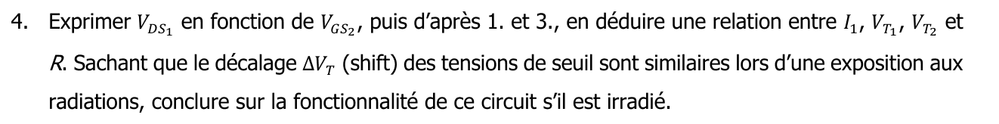{fig-alt="4. Exprimer VDS1 en fonction de VGS2, puis d'après 1. et 3., en déduire une relation entre I1, VT1, VT2 et R. Sachant que les décalages ΔVT (shift) des tensions de seuil sont similaires lors d'une exposition aux radiations, conclure sur la fonctionnalité de ce circuit s'il est irradié."}

::: {.complement}
La grille de $M_2$ est reliée au drain de $M_1$ : $V_{DS_1} = V_{GS_2}$. Avec 1 et 3 : $R I_1 = V_{GS_1} - V_{GS_2}$, d'où
$$
I_1 = \frac{V_{T_1} - V_{T_2}}{R} .
$$
Sous irradiation, $V_{T_1}$ et $V_{T_2}$ se décalent du même $\Delta V_T$ : leur différence, donc $I_1$, ne change pas. Le courant est immunisé (tant que $R$ et $\mu_n C_{ox}$ ne varient pas et que les deux transistors restent saturés).
:::

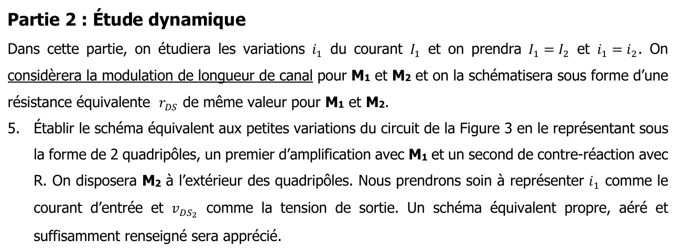{fig-alt="Partie 2 : étude dynamique. On étudiera les variations i1 du courant I1 et on prendra I1 = I2 et i1 = i2. On considèrera la modulation de longueur de canal pour M1 et M2, schématisée par une résistance équivalente rDS de même valeur pour M1 et M2. 5. Établir le schéma équivalent aux petites variations du circuit de la figure 3 sous la forme de 2 quadripôles, un premier d'amplification avec M1 et un second de contre-réaction avec R. On disposera M2 à l'extérieur des quadripôles. Nous prendrons soin à représenter i1 comme le courant d'entrée et vDS2 comme la tension de sortie. Un schéma équivalent propre, aéré et suffisamment renseigné sera apprécié."}

::: {.complement}
Schéma : la source $i_1$ arrive au nœud de grille de $M_1$ ; $R$ relie ce nœud au drain de $M_1$ ; entre le drain et la masse, la source $g_m v_{GS_1}$ et $r_{DS}$ ; le drain de $M_1$ commande la grille de $M_2$ (source $g_m v_{GS_2}$ et $r_{DS}$ entre drain de $M_2$ et masse).
:::

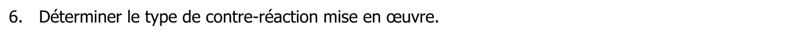{fig-alt="6. Déterminer le type de contre-réaction mise en œuvre."}

::: {.complement}
On prélève la tension $v_{DS_1}$ et on réinjecte, par $R$, un courant au nœud d'entrée : contre-réaction **tension-parallèle** ($A_r$ est une transimpédance).
:::

{fig-alt="7. Démontrer que la fonction de transfert Ar = vDS1/i1 est telle que Ar = rDS (1 − gm·R)/(1 + gm·rDS)."}

::: {.complement}
La grille n'absorbe pas de courant : $i_1$ traverse $R$, et $v_{GS_1} = v_{DS_1} + R\,i_1$. Au drain : $i_1 = g_m v_{GS_1} + \frac{v_{DS_1}}{r_{DS}} = g_m(v_{DS_1} + R i_1) + \frac{v_{DS_1}}{r_{DS}}$, d'où $i_1(1 - g_m R) = v_{DS_1}\,\frac{1 + g_m r_{DS}}{r_{DS}}$ et
$$
A_r = \frac{v_{DS_1}}{i_1} = r_{DS}\,\frac{1 - g_m R}{1 + g_m r_{DS}} .
$$
:::

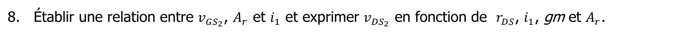{fig-alt="8. Établir une relation entre vGS2, Ar et i1 et exprimer vDS2 en fonction de rDS, i1, gm et Ar."}

::: {.complement}
$v_{GS_2} = v_{DS_1} = A_r\, i_1$. Le courant de drain de $M_2$ est fixé par la source ($i_2 = 0$) : $0 = g_m v_{GS_2} + \frac{v_{DS_2}}{r_{DS}}$, donc $v_{DS_2} = -g_m r_{DS} A_r\, i_1$.
:::

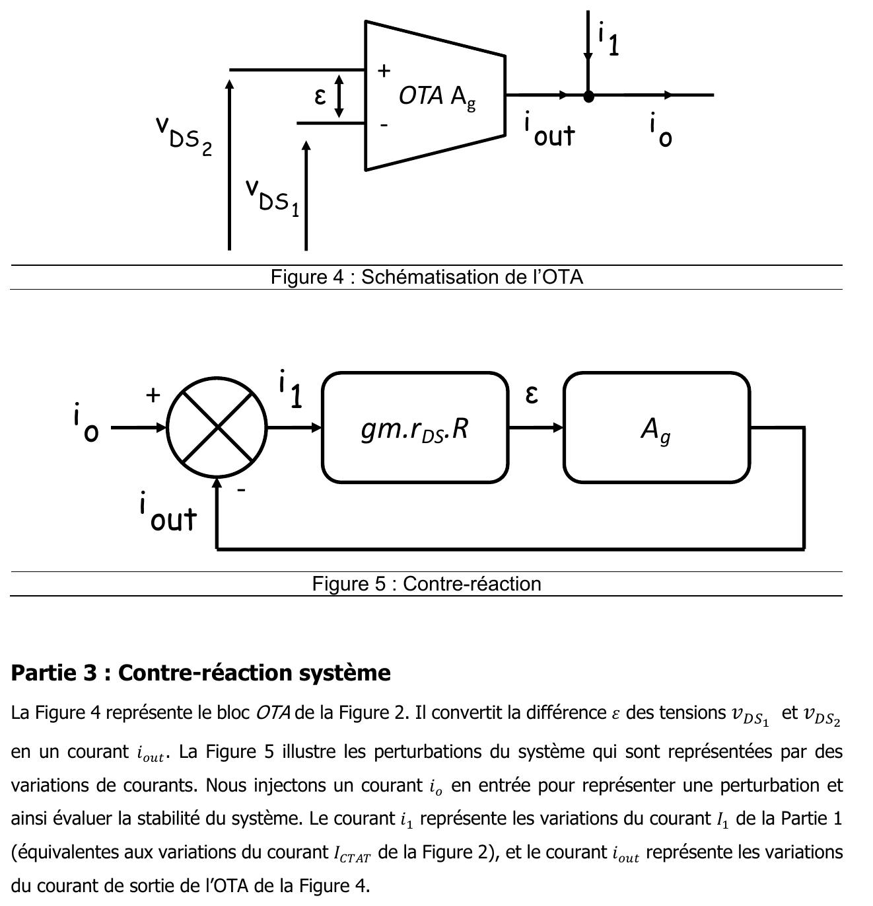{fig-alt="Figure 4 : schématisation de l'OTA (entrées vDS2 en + et vDS1 en −, différence ε, gain Ag, sortie iout ; au nœud de sortie arrivent i1 et io). Figure 5 : contre-réaction ; comparateur io (+) et iout (−), sortie i1 vers le bloc gm·rDS·R, puis ε vers le bloc Ag qui donne iout. Partie 3 : contre-réaction système. La figure 4 représente le bloc OTA de la figure 2 : il convertit la différence ε des tensions vDS1 et vDS2 en un courant iout. La figure 5 illustre les perturbations du système, représentées par des variations de courants : on injecte un courant io en entrée pour représenter une perturbation et évaluer la stabilité du système. Le courant i1 représente les variations du courant I1 de la partie 1 (équivalentes aux variations du courant ICTAT de la figure 2), et iout les variations du courant de sortie de l'OTA."}

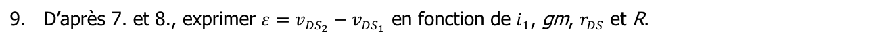{fig-alt="9. D'après 7. et 8., exprimer ε = vDS2 − vDS1 en fonction de i1, gm, rDS et R."}

::: {.complement}
$\varepsilon = v_{DS_2} - v_{DS_1} = -(1 + g_m r_{DS})\,A_r\, i_1 = r_{DS}\,(g_m R - 1)\, i_1 \approx g_m r_{DS} R\, i_1$ si $g_m R \gg 1$ (gain du bloc de la figure 5).
:::

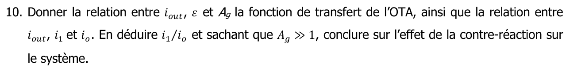{fig-alt="10. Donner la relation entre iout, ε et Ag, la fonction de transfert de l'OTA, ainsi que la relation entre iout, i1 et io. En déduire i1/io et, sachant que Ag ≫ 1, conclure sur l'effet de la contre-réaction sur le système."}

::: {.complement}
$i_{out} = A_g\,\varepsilon$ et $i_1 = i_o - i_{out}$, d'où $i_1 = i_o - A_g\, g_m r_{DS} R\, i_1$ et
$$
\frac{i_1}{i_o} = \frac{1}{1 + A_g\, g_m r_{DS} R} \xrightarrow[A_g \gg 1]{} 0 :
$$
la boucle de l'OTA absorbe presque toute la perturbation ; les variations du courant $I_1$, donc de la tension de référence, sont divisées par le gain de boucle $A_g\, g_m r_{DS} R$.
:::
