

::: {.complement}
Énoncé découpé question par question [td03-2026] ; sous chaque question, la solution proposée par Claude (*Complément*) : il n'y a ni notes d'Armand ni corrigé pour ce sujet. À relire avec un œil critique ; signaler toute erreur.

Cours associé : [chapitre 2, contre-réaction de tension-parallèle](../cours/02-amplificateurs-contre-reaction.qmd#sec-cr-tension-parallele) ; la partie de Y. Deval du même examen (stabilité en température) est corrigée dans le [recueil de sujets de Y. Deval](td04-2026-recueil-sujets-deval.qmd#sec-td-brokaw-deval).
:::

## Exercice 1 : une référence des circuits intégrés {#sec-td-brokaw}

::: {#exr-bandgap-brokaw}
## Une référence des circuits intégrés [td03-2026, p. 1-2]

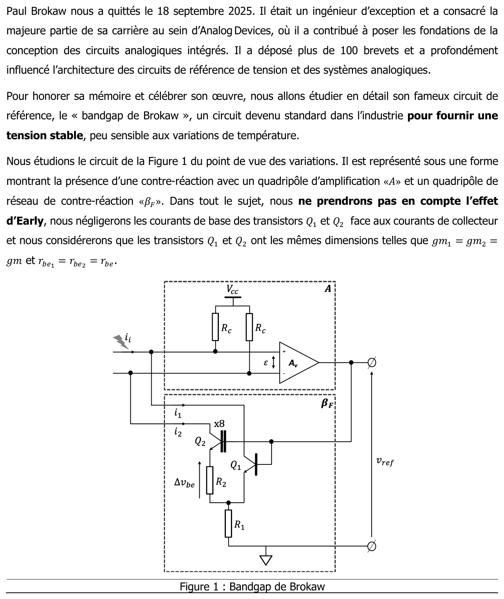{fig-alt="Paul Brokaw nous a quittés le 18 septembre 2025. Il était un ingénieur d'exception et a consacré la majeure partie de sa carrière au sein d'Analog Devices, où il a contribué à poser les fondations de la conception des circuits analogiques intégrés. Il a déposé plus de 100 brevets et a profondément influencé l'architecture des circuits de référence de tension et des systèmes analogiques. Pour honorer sa mémoire, nous allons étudier son fameux circuit de référence, le « bandgap de Brokaw », devenu standard dans l'industrie pour fournir une tension stable, peu sensible aux variations de température. Nous étudions le circuit de la figure 1 du point de vue des variations. Il est représenté sous une forme montrant une contre-réaction avec un quadripôle d'amplification « A » et un quadripôle de réseau de contre-réaction « βF ». Dans tout le sujet, nous ne prendrons pas en compte l'effet Early, nous négligerons les courants de base des transistors Q1 et Q2 face aux courants de collecteur et nous considérerons que Q1 et Q2 ont les mêmes dimensions, telles que gm1 = gm2 = gm et rbe1 = rbe2 = rbe. Figure 1 : bandgap de Brokaw ; quadripôle A (deux résistances Rc vers Vcc, amplificateur Av d'entrée ε), courant d'entrée ii ; quadripôle βF : Q2 (×8) avec R2 en série dans son émetteur (tension Δvbe), Q1, R1 commune vers la masse, courants de collecteur i1 et i2, bases reliées à la sortie vref."}

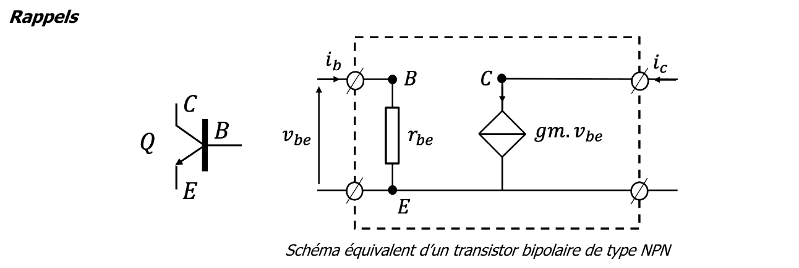{fig-alt="Rappels : schéma équivalent d'un transistor bipolaire de type NPN ; rbe entre base et émetteur (courant ib, tension vbe), source de courant gm·vbe entre collecteur et émetteur (courant ic)."}
:::

Énoncé : sujet EANA3 du 24 octobre 2025, F. Rivet [td03-2026, p. 1-2], distribué comme TD 3 en 2026 (fichier `td/td03-2026-bandgap-brokaw.pdf`). Aucun corrigé. La partie du même examen rédigée par Y. Deval, sur la stabilité en température de ce circuit, relève du chapitre 5.

![Bandgap de Brokaw découpé en quadripôles $A$ et $\beta_F$. D'après le sujet [td03-2026, p. 1, figure 1], redessiné.](../figures/03-bandgap-brokaw.svg){#fig-bandgap-brokaw}

::: {.a-verifier .tranche #av-brokaw-enonce-recopie}
**Source** : l'énoncé recopié en texte dans le chapitre 3 jusqu'au 31 octobre 2026 écrivait « $\beta_F$ est obtenu suivant $i_F = \beta_F\, v_{ref}$ » (question 1), « un gain $A_v$ très grand ($> 10^3$) » et « une impédance de sortie $Z_{sortie}$ ». Le sujet [td03-2026, p. 2] écrit « $i_1 = \beta_F . v_{ref}$ », « $(> 10^5)$ » et « $Z_{ampli}$ ».

**Problème** : trois écarts de recopie. Aucune des solutions ci-dessous ne dépend de la valeur numérique du gain (seul « $A_v$ très grand » sert) ; la question 6 utilise $\beta_F = i_1/v_{ref}$, conforme au sujet ; la solution de la question 7 garde la notation $Z_{sortie}$, qui désigne l'impédance de sortie $Z_{ampli}$ du quadripôle « $A$ » du sujet.

**Proposition** : énoncé désormais donné en images du sujet (plus de recopie) ; lire $Z_{sortie} = Z_{ampli}$ dans la solution de la question 7 ; aucune autre correction.

**Décision** : proposition retenue (Claude, 2026-10-31, lors du déplacement des TD dans des pages à part ; décisions de ce type déléguées par Armand).
:::

::: {.complement}
**Proposition de solution (aucun corrigé).**
:::

{fig-alt="1. Quel type de contre-réaction est mis en œuvre dans ce circuit ? D'après le cours, nous pouvons constater que βF est obtenu suivant i1 = βF · vref. Nous allons identifier βF."}

::: {.complement}
On prélève la tension $v_{ref}$ (les bases de $Q_1$ et $Q_2$ sont reliées à la sortie) et on réinjecte des **courants** de collecteur aux nœuds d'entrée de « $A$ » : contre-réaction **tension-parallèle**.
:::

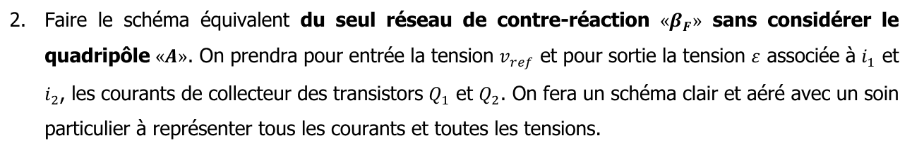{fig-alt="2. Faire le schéma équivalent du seul réseau de contre-réaction « βF » sans considérer le quadripôle « A ». On prendra pour entrée la tension vref et pour sortie la tension ε associée à i1 et i2, les courants de collecteur des transistors Q1 et Q2. On fera un schéma clair et aéré, avec un soin particulier à représenter tous les courants et toutes les tensions."}

{fig-alt="3. Écrire la relation entre Δvbe, la tension aux bornes de R2, en fonction de R2 et i2."}

::: {.complement}
**Questions 2 et 3.** Dans le réseau $\beta_F$ : bases à $v_{ref}$ ; émetteur de $Q_2$ relié par $R_2$ au nœud commun, émetteur de $Q_1$ directement au nœud commun ; $R_1$ du nœud commun à la masse, parcourue par $i_1 + i_2$. Aux bornes de $R_2$ : $\Delta v_{be} = R_2\, i_2$.
:::

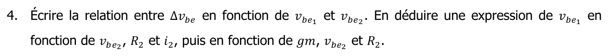{fig-alt="4. Écrire la relation entre Δvbe en fonction de vbe1 et vbe2. En déduire une expression de vbe1 en fonction de vbe2, R2 et i2, puis en fonction de gm, vbe2 et R2."}

::: {.complement}
$\Delta v_{be} = v_{be_1} - v_{be_2}$, donc $v_{be_1} = v_{be_2} + R_2\, i_2$ ; avec $i_2 = g_m v_{be_2}$ : $v_{be_1} = v_{be_2}\,(1 + g_m R_2)$.
:::

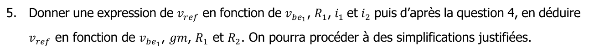{fig-alt="5. Donner une expression de vref en fonction de vbe1, R1, i1 et i2 puis, d'après la question 4, en déduire vref en fonction de vbe1, gm, R1 et R2. On pourra procéder à des simplifications justifiées."}

::: {.complement}
$v_{ref} = v_{be_1} + R_1\,(i_1 + i_2)$, avec $i_1 = g_m v_{be_1}$ et $i_2 = g_m v_{be_2} = \frac{g_m v_{be_1}}{1 + g_m R_2}$ :
$$
v_{ref} = v_{be_1}\left[1 + g_m R_1\left(1 + \frac{1}{1 + g_m R_2}\right)\right] \approx g_m R_1\, v_{be_1}\left(1 + \frac{1}{1 + g_m R_2}\right) \quad (g_m R_1 \gg 1) .
$$
:::

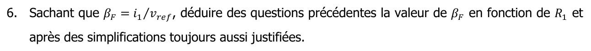{fig-alt="6. Sachant que βF = i1/vref, déduire des questions précédentes la valeur de βF en fonction de R1, après des simplifications toujours aussi justifiées."}

::: {.complement}
$\beta_F = \frac{i_1}{v_{ref}} = \frac{g_m v_{be_1}}{v_{ref}} \approx \frac{1}{R_1\left(1 + \frac{1}{1 + g_m R_2}\right)}$, et $\beta_F \approx \frac{1}{R_1}$ si l'on néglige aussi $\frac{1}{1 + g_m R_2}$ devant 1. *Attention* : au point de repos du circuit de Brokaw, $g_m R_2 = \frac{I_2 R_2}{V_T} = \frac{\Delta V_{be}}{V_T} = \ln 8 \approx 2{,}1$ ; le facteur $1 + \frac{1}{1 + g_m R_2} \approx 1{,}3$ n'est donc pas négligeable en toute rigueur (simplification à discuter avec l'enseignant).
:::

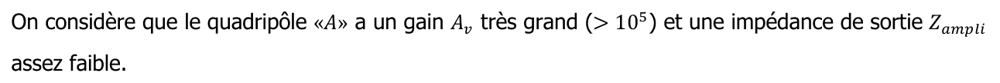{fig-alt="On considère que le quadripôle « A » a un gain Av très grand (> 10⁵) et une impédance de sortie Zampli assez faible."}

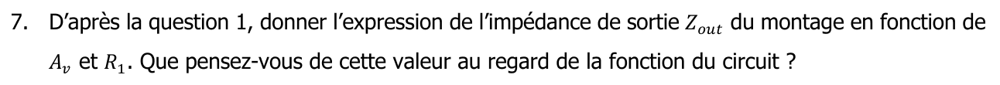{fig-alt="7. D'après la question 1, donner l'expression de l'impédance de sortie Zout du montage en fonction de Av et R1. Que pensez-vous de cette valeur au regard de la fonction du circuit ?"}

::: {.complement}
Contre-réaction tension-parallèle : $Z_{out} = \frac{Z_{sortie}}{1 + A\beta_F}$, soit, avec la notation de l'énoncé, $Z_{out} \approx \frac{Z_{sortie}}{A_v/R_1}$ (le produit $A\beta_F$ doit être sans dimension : $A$ est ici une transimpédance, de l'ordre de $A_v$ fois la résistance $R_c$ qui convertit les courants de collecteur en tension $\varepsilon$). L'impédance de sortie est très faible : c'est ce qu'on attend d'une référence de **tension**.
:::

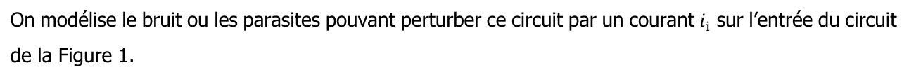{fig-alt="On modélise le bruit ou les parasites pouvant perturber ce circuit par un courant ii sur l'entrée du circuit de la figure 1."}

{fig-alt="8. Rappeler la fonction de transfert de ce type de contre-réaction et, en faisant les simplifications nécessaires sachant que Av est très grand, l'exprimer en fonction de R1."}

::: {.complement}
$\frac{v_{ref}}{i_i} = \frac{A}{1 + A\beta_F} \approx \frac{1}{\beta_F} \approx R_1$.
:::

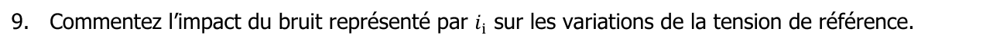{fig-alt="9. Commentez l'impact du bruit représenté par ii sur les variations de la tension de référence."}

::: {.complement}
Un courant parasite $i_i$ produit une variation $v_{ref} \approx R_1\, i_i$, indépendante du gain $A_v$.
:::

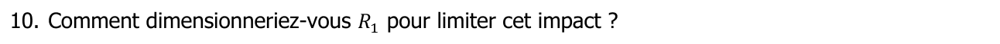{fig-alt="10. Comment dimensionneriez-vous R1 pour limiter cet impact ?"}

::: {.complement}
Choisir $R_1$ **petite** limite cet impact. En contrepartie, $R_1$ fixe aussi, avec $R_2$, la valeur de $V_{ref}$ et sa compensation en température (chapitre 5) : le choix est un compromis.
:::
