

::: {.complement}
Énoncé découpé question par question [td03] ; sous chaque question, la solution proposée par Claude (*Complément*) : il n'y a ni notes d'Armand ni corrigé pour ce TD. À relire avec un œil critique ; signaler toute erreur.

Cours associé : [chapitre 1, compromis gain-bande](../cours/01-generalites-contre-reaction.qmd#sec-gain-bande), [chapitre 2, contre-réaction de courant-série](../cours/02-amplificateurs-contre-reaction.qmd#sec-cr-courant-serie).
:::

## Exercice 1 : analyse d'un circuit de modulation d'amplitude {#sec-td-modulation-amplitude}

::: {#exr-modulation-amplitude}
## Analyse d'un circuit de modulation d'amplitude [support, p. 17-19]

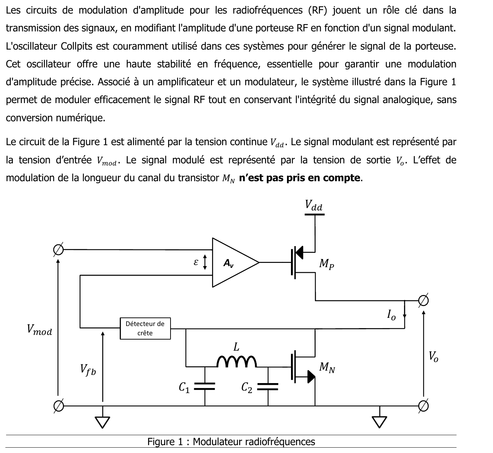{fig-alt="Les circuits de modulation d'amplitude pour les radiofréquences (RF) jouent un rôle clé dans la transmission des signaux, en modifiant l'amplitude d'une porteuse RF en fonction d'un signal modulant. L'oscillateur Colpitts est couramment utilisé dans ces systèmes pour générer le signal de la porteuse ; il offre une haute stabilité en fréquence. Associé à un amplificateur et un modulateur, le système de la figure 1 permet de moduler le signal RF sans conversion numérique. Le circuit est alimenté par la tension continue Vdd. Le signal modulant est la tension d'entrée Vmod, le signal modulé la tension de sortie Vo. L'effet de modulation de la longueur du canal du transistor MN n'est pas pris en compte. Figure 1 : modulateur radiofréquences ; amplificateur Av (entrées Vmod et Vfb, différence ε) commandant la grille du PMOS MP alimenté par Vdd ; le courant Io de MP traverse le NMOS MN ; réseau L, C1, C2 ; détecteur de crête fournissant Vfb ; sortie Vo."}

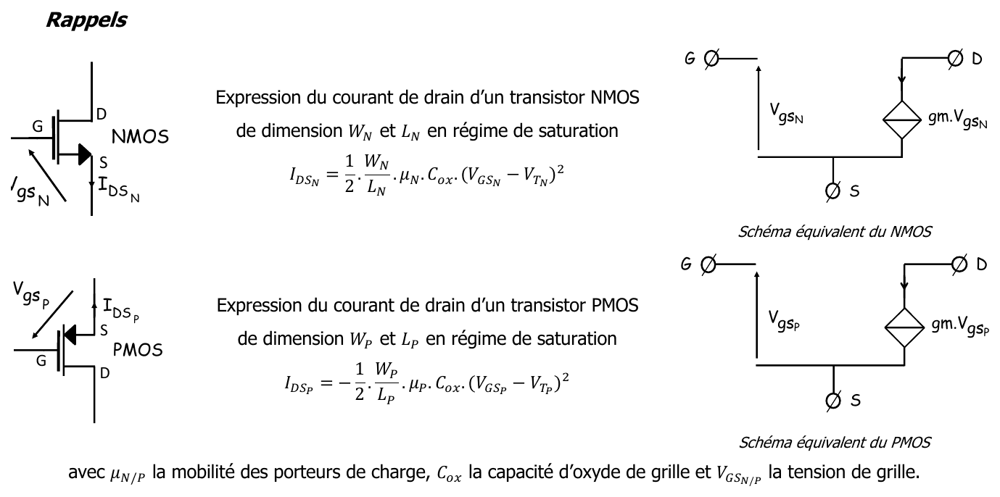{fig-alt="Rappels : courant de drain d'un NMOS de dimensions WN et LN en régime de saturation, IDSN = ½ · WN/LN · µN · Cox · (VGSN − VTN)² ; d'un PMOS de dimensions WP et LP, IDSP = −½ · WP/LP · µP · Cox · (VGSP − VTP)² ; µN/P mobilité des porteurs, Cox capacité d'oxyde de grille, VGSN/P tension de grille. Schémas équivalents du NMOS et du PMOS : source gm·Vgs entre drain et source, grille ouverte."}
:::

Énoncé : [support, p. 17-19] (sujet EA234 du 25 octobre 2024, F. Rivet ; fichier séparé identique : `td/td03-modulation-amplitude.pdf`). Aucun corrigé.

![Modulateur d'amplitude radiofréquence du TD 3. D'après le support [support, p. 17, figure 1], redessiné.](../figures/03-modulateur-am.svg){#fig-modulateur-am}

::: {.complement}
**Proposition de solution (aucun corrigé).**
:::

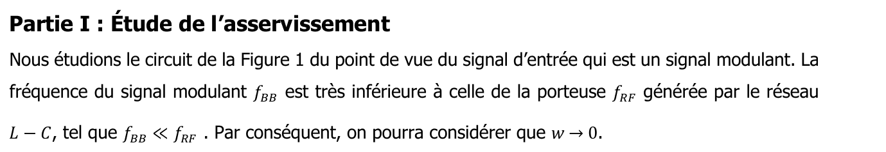{fig-alt="Partie I : étude de l'asservissement. Nous étudions le circuit de la figure 1 du point de vue du signal d'entrée, qui est un signal modulant. La fréquence du signal modulant fBB est très inférieure à celle de la porteuse fRF générée par le réseau L − C : fBB ≪ fRF. Par conséquent, on pourra considérer que w → 0."}

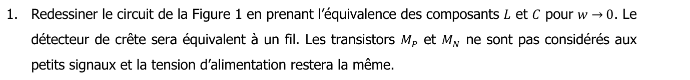{fig-alt="1. Redessiner le circuit de la figure 1 en prenant l'équivalence des composants L et C pour w → 0. Le détecteur de crête sera équivalent à un fil. Les transistors MP et MN ne sont pas considérés aux petits signaux et la tension d'alimentation restera la même."}

::: {.complement}
Pour $\omega \to 0$, l'inductance est un court-circuit et les capacités des circuits ouverts : la grille de $M_N$ est reliée à son drain, $M_N$ est **monté en diode** ; le détecteur de crête étant un fil, $V_{fb} = V_o$.
:::

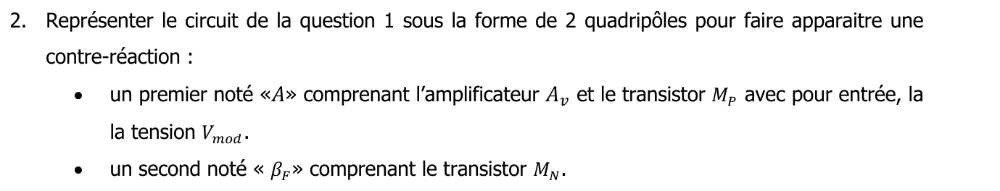{fig-alt="2. Représenter le circuit de la question 1 sous la forme de 2 quadripôles pour faire apparaître une contre-réaction : un premier noté « A » comprenant l'amplificateur Av et le transistor MP avec pour entrée la tension Vmod ; un second noté « βF » comprenant le transistor MN."}

::: {.complement}
« $A$ » : $A_v$ commande la grille de $M_P$, dont le courant de drain $I_o$ est la sortie ; « $\beta_F$ » : la diode $M_N$, traversée par $I_o$, qui fournit $V_{fb}$.
:::

{fig-alt="3. Quel type de contre-réaction est mis en œuvre dans ce circuit ?"}

::: {.complement}
On prélève le **courant** $I_o$ (la diode est en série sur le trajet de $I_o$) et on réinjecte une **tension** $V_{fb}$ en série avec $V_{mod}$ à l'entrée de $A_v$ : contre-réaction **courant-série**.
:::

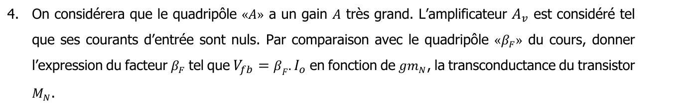{fig-alt="4. On considérera que le quadripôle « A » a un gain A très grand. L'amplificateur Av est considéré tel que ses courants d'entrée sont nuls. Par comparaison avec le quadripôle « βF » du cours, donner l'expression du facteur βF tel que Vfb = βF · Io en fonction de gmN, la transconductance du transistor MN."}

::: {.complement}
Un MOS monté en diode est équivalent à une résistance $1/g_{m_N}$ : $V_{fb} = I_o/g_{m_N}$, donc $\beta_F = \frac{1}{g_{m_N}}$ (c'est la valeur donnée à la question 9).
:::

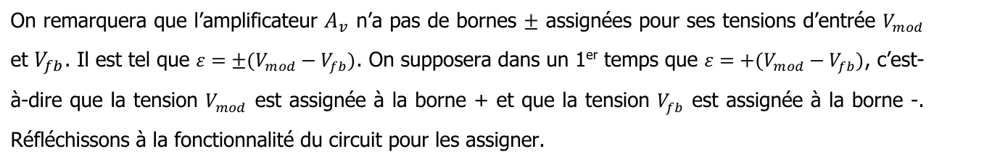{fig-alt="On remarquera que l'amplificateur Av n'a pas de bornes ± assignées pour ses tensions d'entrée Vmod et Vfb. Il est tel que ε = ±(Vmod − Vfb). On supposera dans un premier temps que ε = +(Vmod − Vfb), c'est-à-dire que Vmod est assignée à la borne + et Vfb à la borne −. Réfléchissons à la fonctionnalité du circuit pour les assigner."}

{fig-alt="5. Quel est le montage de base du transistor MP ? Rappeler son gain sachant que la charge vue de la sortie, donc de son drain, est 1/gmN."}

::: {.complement}
$M_P$ est en **source commune** ; avec la charge $1/g_{m_N}$, son gain vaut $-\frac{g_{m_P}}{g_{m_N}}$.
:::

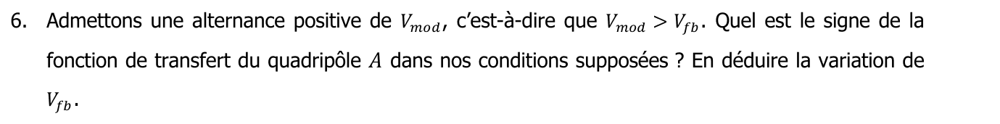{fig-alt="6. Admettons une alternance positive de Vmod, c'est-à-dire que Vmod > Vfb. Quel est le signe de la fonction de transfert du quadripôle A dans nos conditions supposées ? En déduire la variation de Vfb."}

::: {.complement}
Avec $\varepsilon = +(V_{mod} - V_{fb})$ et $A_v > 0$, une alternance positive de $V_{mod}$ fait monter la grille de $M_P$ : $|V_{GS_P}|$ diminue, donc $I_o$ diminue et $V_{fb}$ **diminue**. La fonction de transfert de « $A$ » ($I_o/\varepsilon$) est **négative**.
:::

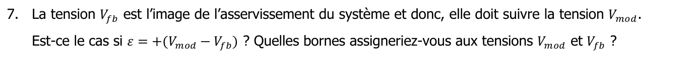{fig-alt="7. La tension Vfb est l'image de l'asservissement du système et donc elle doit suivre la tension Vmod. Est-ce le cas si ε = +(Vmod − Vfb) ? Quelles bornes assigneriez-vous aux tensions Vmod et Vfb ?"}

::: {.complement}
Non : $V_{fb}$ varie en sens inverse de $V_{mod}$, et le produit $A\beta_F$ est négatif (réaction positive). Il faut assigner $V_{fb}$ à la borne $+$ et $V_{mod}$ à la borne $-$ : $\varepsilon = V_{fb} - V_{mod}$ ; alors une hausse de $V_{mod}$ fait baisser la grille de $M_P$, augmente $I_o$ et fait monter $V_{fb}$.
:::

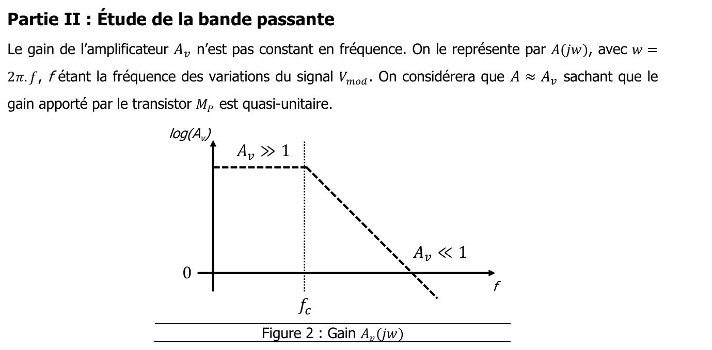{fig-alt="Partie II : étude de la bande passante. Le gain de l'amplificateur Av n'est pas constant en fréquence : on le représente par A(jw), avec w = 2π·f, f étant la fréquence des variations du signal Vmod. On considérera que A ≈ Av, le gain apporté par le transistor MP étant quasi unitaire. Figure 2 : gain Av(jw), log(Av) en fonction de f ; palier Av ≫ 1 jusqu'à la fréquence fc, puis décroissance jusqu'à Av ≪ 1."}

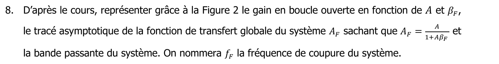{fig-alt="8. D'après le cours, représenter grâce à la figure 2 le gain en boucle ouverte en fonction de A et βF, le tracé asymptotique de la fonction de transfert globale du système AF sachant que AF = A/(1 + AβF), et la bande passante du système. On nommera fF la fréquence de coupure du système."}

::: {.complement}
Sur le gabarit, la droite $\log(1/\beta_F) = \log(g_{m_N})$ sert d'axe 0 dB pour le gain en boucle ouverte $A\beta_F$ ; $A_F$ suit cette droite ($A_F \approx 1/\beta_F = g_{m_N}$) tant que $A\beta_F \gg 1$, puis la courbe de $A$ au-delà de leur intersection, à la fréquence $f_F$ ([compromis gain-bande](../cours/01-generalites-contre-reaction.qmd#sec-gain-bande)).
:::

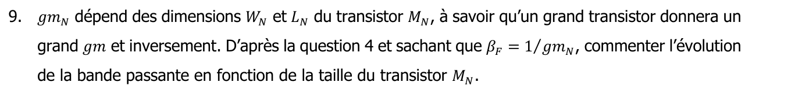{fig-alt="9. gmN dépend des dimensions WN et LN du transistor MN : un grand transistor donnera un grand gm et inversement. D'après la question 4 et sachant que βF = 1/gmN, commenter l'évolution de la bande passante en fonction de la taille du transistor MN."}

::: {.complement}
Un grand $M_N$ donne un grand $g_{m_N}$ : la droite $\log(g_{m_N})$ monte, l'intersection avec la pente de $A$ se fait plus tôt, la **bande passante diminue**. Un petit transistor donne une bande passante plus large mais un gain $A_F$ plus faible.
:::

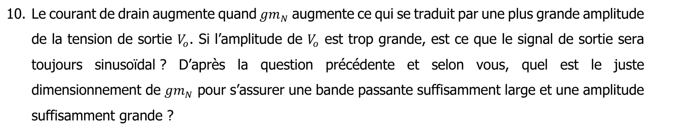{fig-alt="10. Le courant de drain augmente quand gmN augmente, ce qui se traduit par une plus grande amplitude de la tension de sortie Vo. Si l'amplitude de Vo est trop grande, le signal de sortie sera-t-il toujours sinusoïdal ? D'après la question précédente et selon vous, quel est le juste dimensionnement de gmN pour s'assurer une bande passante suffisamment large et une amplitude suffisamment grande ?"}

::: {.complement}
Si l'amplitude de $V_o$ est trop grande, les transistors sortent de leur régime de fonctionnement (saturation des MOS, écrêtage par l'alimentation) : le signal n'est plus sinusoïdal (distorsion). Le juste dimensionnement est un compromis : $g_{m_N}$ assez grand pour l'amplitude, assez petit pour garder $f_F$ au-dessus des fréquences du signal modulant.
:::

::: {.complement}
*Remarque d'unités* : ici $A$ (de $\varepsilon$ à $I_o$) est une transconductance et $\beta_F$ une résistance, comme dans le chapitre 2 ; l'énoncé assimile $A$ au gain en tension $A_v$ en considérant le gain de $M_P$ comme quasi unitaire.
:::
