

::: {.complement}
Recueil de quatre sujets d'examen de Y. Deval, distribué comme TD 4 en 2026 [td04-2026]. Énoncés découpés question par question ; sous chaque question, la solution proposée par Claude (*Complément*) : il n'y a ni notes d'Armand ni corrigé pour ces sujets. Le sujet de 2022 n'est traité que par différence avec celui de 2021. À relire avec un œil critique ; signaler toute erreur.

Cours associé : [chapitre 4, oscillateur à déphasage](../cours/04-oscillateurs.qmd#sec-oscillateur-dephasage) (exercices 1 et 2), [chapitre 5, références de tension](../cours/05-references-de-tension.qmd#sec-reference-bipolaire) (exercices 3 et 4).
:::

## Exercice 1 : oscillateur à déphasage (2021) {#sec-td-dephasage}

::: {#exr-oscillateur-dephasage}
## Oscillateur à déphasage [td04-2026, p. 1-2]

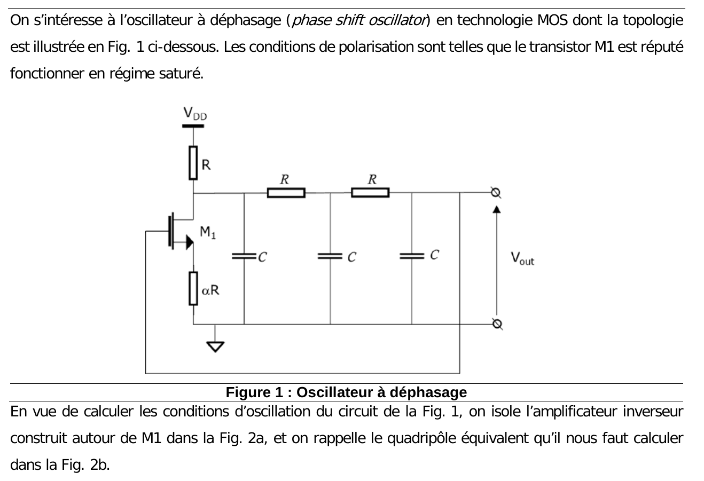{fig-alt="Oscillateur à déphasage (sujet du 22 novembre 2021, EA210 Circuits HF & Oscillateurs, Y. Deval). On s'intéresse à l'oscillateur à déphasage (phase shift oscillator) en technologie MOS dont la topologie est illustrée en figure 1. Les conditions de polarisation sont telles que le transistor M1 est réputé fonctionner en régime saturé. Figure 1 : oscillateur à déphasage ; M1 avec R au drain (vers VDD) et αR à la source, sortie Vout du drain rebouclée sur la grille par trois cellules R série, C vers la masse. En vue de calculer les conditions d'oscillation, on isole l'amplificateur inverseur construit autour de M1 dans la figure 2a, et on rappelle le quadripôle équivalent qu'il nous faut calculer dans la figure 2b."}

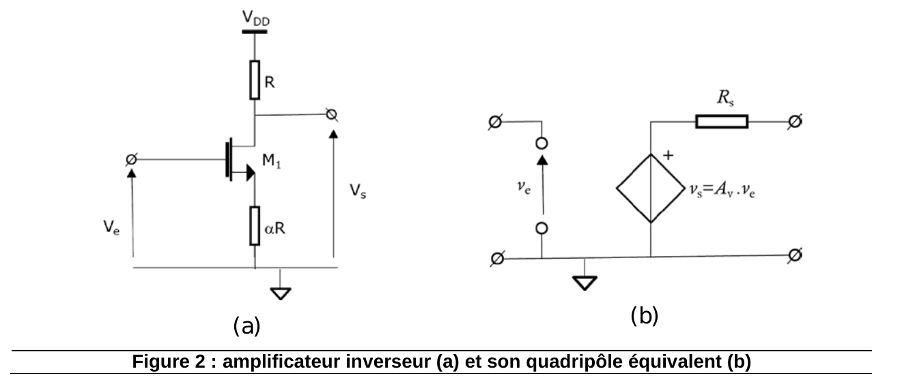{fig-alt="Figure 2 : amplificateur inverseur (a) : M1, R au drain, αR à la source, entrée Ve sur la grille, sortie Vs ; et son quadripôle équivalent (b) : entrée ve ouverte, source de tension vs = Av·ve en série avec Rs en sortie."}
:::

![Oscillateur à déphasage en technologie MOS du sujet de 2021 : amplificateur inverseur $M_1$ (résistance $R$ au drain, $\alpha R$ à la source) rebouclé par trois cellules $RC$. D'après le sujet [td04-2026, p. 1, figure 1], redessiné.](../figures/04-dephasage.svg){#fig-dephasage}

::: {.complement}
**Proposition de solution (aucun corrigé).**
:::

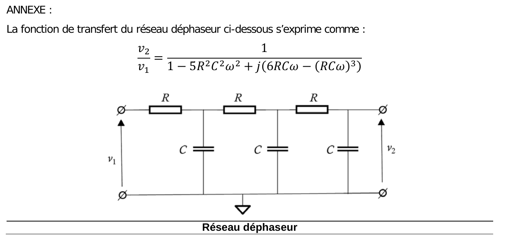{fig-alt="Annexe : la fonction de transfert du réseau déphaseur s'exprime v2/v1 = 1/(1 − 5R²C²ω² + j(6RCω − (RCω)³)). Réseau déphaseur : trois cellules, R en série et C vers la masse, entrée v1, sortie v2."}

{fig-alt="1. Établir le schéma équivalent aux petites variations du circuit de la figure 2a."}

::: {.complement}
Grille ouverte ; $g_m v_{gs}$ du drain vers la source ; $R$ du drain à la masse (alimentation à la masse aux variations) ; $\alpha R$ de la source à la masse ; $r_{ds}$ négligée.
:::

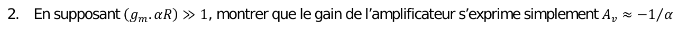{fig-alt="2. En supposant (gm·αR) ≫ 1, montrer que le gain de l'amplificateur s'exprime simplement Av ≈ −1/α."}

::: {.complement}
Le courant $g_m v_{gs}$ traverse $\alpha R$ : $v_e = v_{gs} + \alpha R\, g_m v_{gs}$, et $v_{out} = -R\, g_m v_{gs}$, donc
$$
A_v = -\frac{g_m R}{1 + g_m \alpha R} \approx -\frac{1}{\alpha} \quad (g_m \alpha R \gg 1) .
$$
La dégénérescence de source rend le gain indépendant de $g_m$ (contre-réaction courant-série, [chapitre 2](../cours/02-amplificateurs-contre-reaction.qmd#sec-cr-courant-serie)).
:::

{fig-alt="3. Déterminer Rs en fonction de R."}

::: {.complement}
Vue du drain, on voit $R$ en parallèle avec la résistance de sortie du transistor dégénéré, très grande ($r_{ds}(1 + g_m\alpha R)$) : $R_s \approx R$.
:::

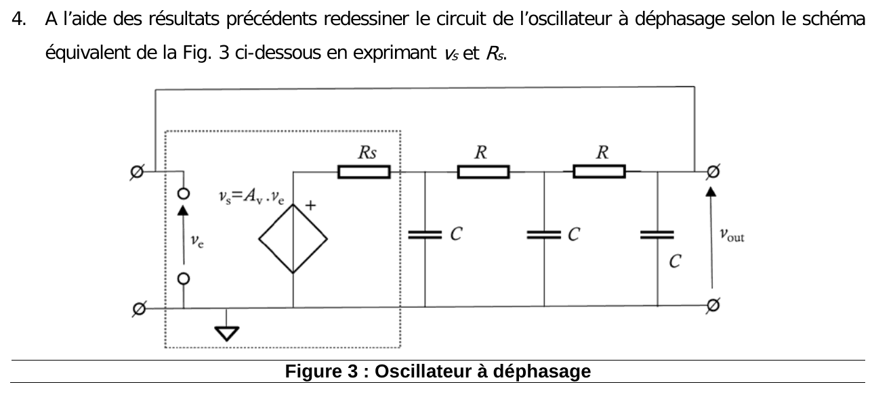{fig-alt="4. À l'aide des résultats précédents, redessiner le circuit de l'oscillateur à déphasage selon le schéma équivalent de la figure 3 en exprimant vs et Rs. Figure 3 : oscillateur à déphasage ; quadripôle de l'amplificateur (entrée ve, source vs = Av·ve, résistance Rs) suivi de deux résistances R et de trois capacités C vers la masse, sortie vout ramenée sur ve."}

::: {.complement}
Sortie de l'amplificateur : source $v_s = -\frac{v_e}{\alpha}$ en série avec $R_s = R$. Cette résistance joue le rôle de la **première** résistance série du réseau : l'oscillateur est un réseau à trois cellules $R$, $C$ exactement conforme à l'annexe, avec $v_1 = v_s$, et $v_2$ ramenée sur la grille ($v_e = v_2$, grille ouverte : le réseau n'est pas chargé).
:::

{fig-alt="5. À l'aide de l'annexe, montrez que la condition de fréquence du critère de Barkhausen est vérifiée lorsque ω0 = √6/(RC)."}

::: {.complement}
Condition de fréquence : le gain de boucle $A_v \frac{v_2}{v_1}$ doit être réel positif ; $A_v$ est réel négatif, donc $\frac{v_2}{v_1}$ doit être réel négatif. Partie imaginaire nulle : $6RC\omega_0 = (RC\omega_0)^3$, soit
$$
\omega_0 = \frac{\sqrt{6}}{RC} .
$$
:::

{fig-alt="6. Calculer l'atténuation observée entre v2 et v1 du fait du réseau déphaseur lorsque ω = ω0."}

::: {.complement}
À $\omega_0$, $5R^2C^2\omega_0^2 = 30$ : $\frac{v_2}{v_1} = \frac{1}{1 - 30} = -\frac{1}{29}$. Le réseau atténue d'un facteur 29 et déphase de 180°.
:::

{fig-alt="7. En déduire la valeur de α nécessaire à la réalisation de la condition d'entretien du critère de Barkhausen."}

::: {.complement}
Condition d'entretien : $A_v \cdot \left(-\frac{1}{29}\right) = \frac{1}{29\alpha} \geqslant 1$, soit
$$
\alpha \leqslant \frac{1}{29}, \qquad |A_v| \geqslant 29 ;
$$
« juste oscillant » pour $\alpha = \frac{1}{29}$.
:::

{fig-alt="8. Un couple RC assurant un déphasage de 90°, expliquez pourquoi il est nécessaire d'en mettre trois en série dans cet oscillateur à déphasage pour garantir la rotation de phase de 180° qui compense celle de l'amplificateur inverseur."}

::: {.complement}
Une cellule $RC$ ne déphase de 90° qu'**asymptotiquement** (quand $\omega \to \infty$, où son gain tend vers 0) : deux cellules n'atteignent 180° qu'à fréquence infinie, avec un gain nul. Avec trois cellules, le déphasage maximal tend vers 270°, et 180° est atteint à une fréquence finie, $\omega_0$, avec une atténuation finie (1/29) qu'un amplificateur peut compenser. C'est la même raison qui impose $C_1'$ dans l'oscillateur Colpitts ([section du chapitre 4](../cours/04-oscillateurs.qmd#sec-colpitts)).
:::

## Exercice 2 : oscillateur à déphasage, variante de 2022 {#sec-td-dephasage-2022}

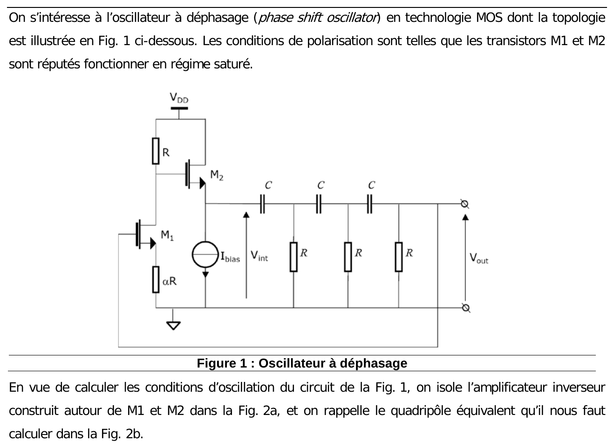{fig-alt="Oscillateur à déphasage (sujet du 8 avril 2022, EA210 Circuits HF & Oscillateurs, Y. Deval). On s'intéresse à l'oscillateur à déphasage (phase shift oscillator) en technologie MOS de la figure 1. Les conditions de polarisation sont telles que les transistors M1 et M2 sont réputés fonctionner en régime saturé. Figure 1 : M1 (R au drain, αR à la source) suivi du suiveur M2 polarisé par Ibias, tension Vint, réseau de trois cellules C série et R vers la masse, sortie Vout rebouclée sur la grille de M1. En vue de calculer les conditions d'oscillation, on isole l'amplificateur inverseur construit autour de M1 et M2 dans la figure 2a, et on rappelle le quadripôle équivalent qu'il nous faut calculer dans la figure 2b."}

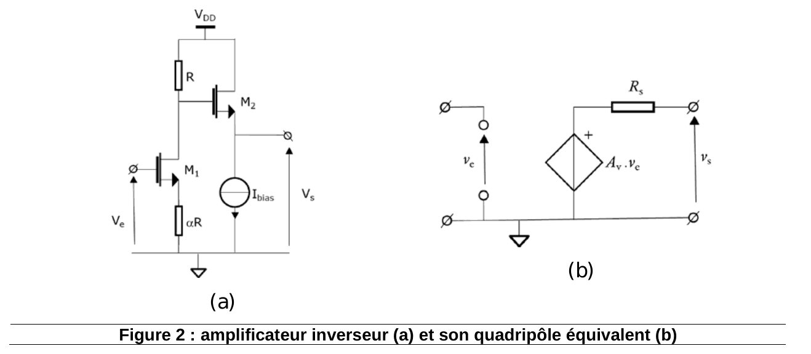{fig-alt="Figure 2 : amplificateur inverseur (a) : M1 et M2, R, αR, Ibias, entrée Ve, sortie Vs ; et son quadripôle équivalent (b) : entrée ve, source Av·ve en série avec Rs, sortie vs."}

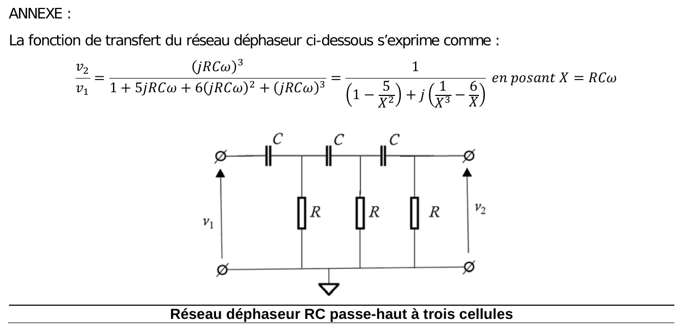{fig-alt="Annexe : la fonction de transfert du réseau déphaseur s'exprime v2/v1 = (jRCω)³/(1 + 5jRCω + 6(jRCω)² + (jRCω)³) = 1/((1 − 5/X²) + j(1/X³ − 6/X)) en posant X = RCω. Réseau déphaseur RC passe-haut à trois cellules : C en série, R vers la masse, entrée v1, sortie v2."}

{fig-alt="1. Établir le schéma équivalent aux petites variations du circuit de la figure 2a."}

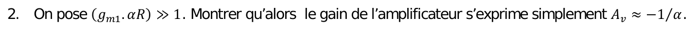{fig-alt="2. On pose (gm1·αR) ≫ 1. Montrer qu'alors le gain de l'amplificateur s'exprime simplement Av ≈ −1/α."}

{fig-alt="3. Déterminer Rs en fonction de gm2. On supposera par la suite que cette résistance est suffisamment petite par rapport aux autres grandeurs environnantes pour être négligée (M2 est une « source suiveuse »)."}

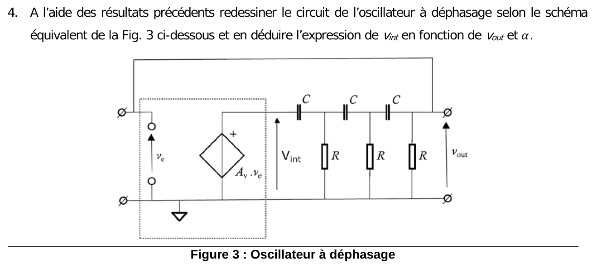{fig-alt="4. À l'aide des résultats précédents, redessiner le circuit de l'oscillateur à déphasage selon le schéma équivalent de la figure 3 et en déduire l'expression de vint en fonction de vout et α. Figure 3 : quadripôle de l'amplificateur (source Av·ve), tension Vint, trois cellules C série et R vers la masse, sortie vout ramenée sur ve."}

{fig-alt="5. À l'aide de l'annexe, montrez que la condition de fréquence du critère de Barkhausen est vérifiée lorsque ω0 = 1/(√6 · RC)."}

{fig-alt="6. Calculer l'atténuation observée entre v2 et v1 du fait du réseau déphaseur lorsque ω = ω0."}

{fig-alt="7. En déduire la valeur de α nécessaire à la réalisation de la condition d'entretien du critère de Barkhausen."}

{fig-alt="8. Un couple RC assurant un déphasage de 90°, expliquez pourquoi il est nécessaire d'en mettre trois en série dans cet oscillateur à déphasage pour garantir la rotation de phase de 180° qui compense celle de l'amplificateur inverseur."}

::: {.complement}
**Variante de 2022** [td04-2026, p. 3-4] : même étude avec un amplificateur à deux transistors ($M_2$ en source suiveuse, $R_s$ négligeable) et un réseau **passe-haut** ($C$ série, $R$ vers la masse). L'annexe donne $\frac{v_2}{v_1} = \frac{1}{\left(1 - \frac{5}{X^2}\right) + j\left(\frac{1}{X^3} - \frac{6}{X}\right)}$ avec $X = RC\omega$ : la partie imaginaire s'annule pour $X^2 = \frac{1}{6}$, soit $\omega_0 = \frac{1}{\sqrt{6}\,RC}$, et $\frac{v_2}{v_1} = \frac{1}{1 - 30} = -\frac{1}{29}$ : même condition d'entretien.
:::

## Exercice 3 : référence de tension bipolaire stable en température (2025) {#sec-td-brokaw-deval}

::: {#exr-bandgap-brokaw-deval}
## Référence de tension bipolaire stable en température [td04-2026, p. 5-6]

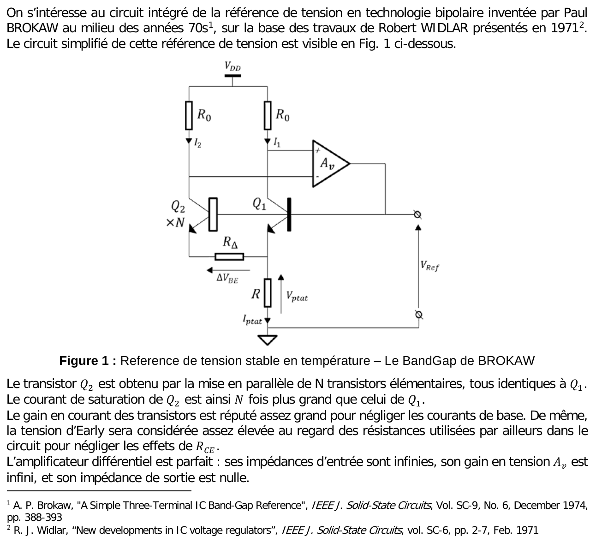{fig-alt="Référence de tension bipolaire stable en température (sujet du 24 octobre 2025, EANA3 - EA234, Y. Deval). On s'intéresse au circuit intégré de la référence de tension en technologie bipolaire inventée par Paul Brokaw au milieu des années 70 (note 1 : A. P. Brokaw, « A Simple Three-Terminal IC Band-Gap Reference », IEEE J. Solid-State Circuits, vol. SC-9, no 6, décembre 1974, p. 388-393), sur la base des travaux de Robert Widlar présentés en 1971 (note 2 : R. J. Widlar, « New developments in IC voltage regulators », IEEE J. Solid-State Circuits, vol. SC-6, p. 2-7, février 1971). Figure 1 : référence de tension stable en température, le bandgap de Brokaw ; Q2 (×N) et Q1, collecteurs chargés par R0 vers VDD (courants I2 et I1), amplificateur Av entre les deux collecteurs, sortie VRef sur les bases ; RΔ dans l'émetteur de Q2 (tension ΔVBE), R commune vers la masse (courant Iptat, tension Vptat). Le transistor Q2 est obtenu par la mise en parallèle de N transistors élémentaires, tous identiques à Q1 : son courant de saturation est N fois plus grand que celui de Q1. Le gain en courant des transistors est réputé assez grand pour négliger les courants de base ; la tension d'Early est considérée assez élevée pour négliger les effets de RCE. L'amplificateur différentiel est parfait : impédances d'entrée infinies, gain en tension Av infini, impédance de sortie nulle."}

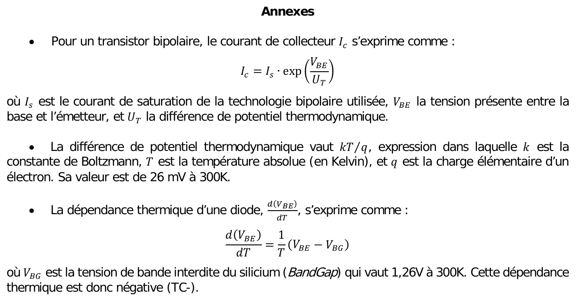{fig-alt="Annexes : pour un transistor bipolaire, Ic = Is · exp(VBE/UT), où Is est le courant de saturation, VBE la tension base-émetteur et UT la différence de potentiel thermodynamique. UT = kT/q (k constante de Boltzmann, T température absolue, q charge élémentaire) ; elle vaut 26 mV à 300 K. La dépendance thermique d'une diode s'exprime d(VBE)/dT = (1/T)(VBE − VBG), où VBG est la tension de bande interdite du silicium (bandgap), 1,26 V à 300 K : cette dépendance est négative (TC−)."}
:::

![Bandgap de Brokaw du sujet de Y. Deval : $Q_2$ ($N$ transistors en parallèle) et $Q_1$ chargés par $R_0$, amplificateur différentiel parfait. D'après le sujet [td04-2026, p. 5, figure 1], redessiné.](../figures/05-bandgap-brokaw.svg){#fig-bandgap-brokaw-deval}

::: {.complement}
**Proposition de solution (aucun corrigé).** La partie Rivet du même sujet (lecture en contre-réaction) est corrigée dans sa [propre page](td03-2026-bandgap-brokaw.qmd#sec-td-brokaw).
:::

{fig-alt="Partie 1 : polarisation en courant – alternative au miroir de courant. 1. L'amplificateur différentiel étant parfait, lorsque le point de fonctionnement du circuit complet est atteint la différence de potentiel entre les entrées de l'amplificateur est nécessairement nulle. En déduire la relation particulière reliant VC1 et VC2, les tensions des collecteurs de Q1 et Q2."}

::: {.complement}
$V_+ = V_-$, donc $V_{C1} = V_{C2}$.
:::

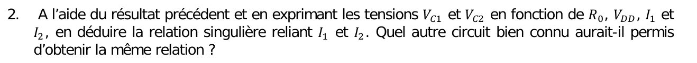{fig-alt="2. À l'aide du résultat précédent et en exprimant les tensions VC1 et VC2 en fonction de R0, VDD, I1 et I2, en déduire la relation singulière reliant I1 et I2. Quel autre circuit bien connu aurait-il permis d'obtenir la même relation ?"}

::: {.complement}
$V_{C1} = V_{DD} - R_0 I_1$ et $V_{C2} = V_{DD} - R_0 I_2$, donc $I_1 = I_2$ : c'est ce qu'aurait imposé un **miroir de courant**.
:::

{fig-alt="3. Donner l'expression de Iptat en fonction de I2."}

::: {.complement}
Les deux courants d'émetteur se rejoignent dans $R$ : $I_{ptat} = I_1 + I_2 = 2I_2$.
:::

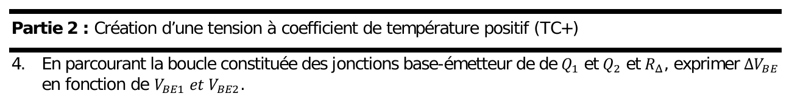{fig-alt="Partie 2 : création d'une tension à coefficient de température positif (TC+). 4. En parcourant la boucle constituée des jonctions base-émetteur de Q1 et Q2 et de RΔ, exprimer ΔVBE en fonction de VBE1 et VBE2."}

::: {.complement}
Les bases sont communes ; l'émetteur de $Q_2$ rejoint celui de $Q_1$ à travers $R_\Delta$ : $V_{BE1} = V_{BE2} + R_\Delta I_2$, donc $\Delta V_{BE} = V_{BE1} - V_{BE2}$ (tension aux bornes de $R_\Delta$).
:::

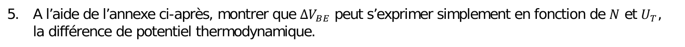{fig-alt="5. À l'aide de l'annexe, montrer que ΔVBE peut s'exprimer simplement en fonction de N et UT, la différence de potentiel thermodynamique."}

::: {.complement}
$I_1 = I_S e^{V_{BE1}/U_T}$ et $I_2 = N I_S e^{V_{BE2}/U_T}$ ; avec $I_1 = I_2$ :
$$
\Delta V_{BE} = U_T \ln N .
$$
:::

{fig-alt="6. Montrer que d(ΔVBE)/dT, la dépendance thermique de ΔVBE, est une constante positive (TC+). C'est cette particularité qui lui vaut son nom de Proportional to Absolute Temperature (PTAT)."}

::: {.complement}
$\frac{\mathrm{d}(\Delta V_{BE})}{\mathrm{d}T} = \frac{k}{q}\ln N$ : constante, positive pour $N > 1$.
:::

{fig-alt="7. Exprimer Vptat, la tension présente aux bornes de R, en fonction de N, UT, RΔ et R."}

::: {.complement}
$I_2 = \frac{\Delta V_{BE}}{R_\Delta}$ et $I_{ptat} = 2I_2$ :
$$
V_{ptat} = R\, I_{ptat} = 2\,\frac{R}{R_\Delta}\,U_T \ln N .
$$
:::

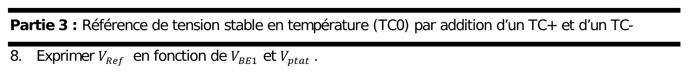{fig-alt="Partie 3 : référence de tension stable en température (TC0) par addition d'un TC+ et d'un TC−. 8. Exprimer VRef en fonction de VBE1 et Vptat."}

::: {.complement}
La base de $Q_1$ est à $V_{Ref}$ et son émetteur au haut de $R$ : $V_{Ref} = V_{BE1} + V_{ptat}$.
:::

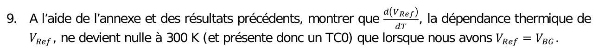{fig-alt="9. À l'aide de l'annexe et des résultats précédents, montrer que d(VRef)/dT, la dépendance thermique de VRef, ne devient nulle à 300 K (et présente donc un TC0) que lorsque nous avons VRef = VBG."}

::: {.complement}
$\frac{\mathrm{d}V_{Ref}}{\mathrm{d}T} = \frac{1}{T}(V_{BE1} - V_{BG}) + \frac{V_{ptat}}{T} = \frac{1}{T}\left(V_{Ref} - V_{BG}\right)$ (car $V_{ptat}$ est proportionnelle à $T$) : nulle si et seulement si $V_{Ref} = V_{BG} = 1{,}26$ V.
:::

{fig-alt="Partie 4 : polarisation en courant, le retour. 10. Quel est le composant qui fixe la valeur de Iptat ?"}

::: {.complement}
$I_{ptat} = \frac{2U_T\ln N}{R_\Delta}$ : c'est $R_\Delta$ (avec $N$) qui fixe le courant ; $R$ sert ensuite à doser $V_{ptat}$ pour atteindre $V_{Ref} = V_{BG}$. Le circuit fournit donc aussi un courant PTAT de polarisation.
:::

## Exercice 4 : générateur de courant suppresseur de variations (2026) {#sec-td-generateur-courant}

::: {#exr-generateur-courant}
## Générateur de courant suppresseur de variations [td04-2026, p. 7-10]

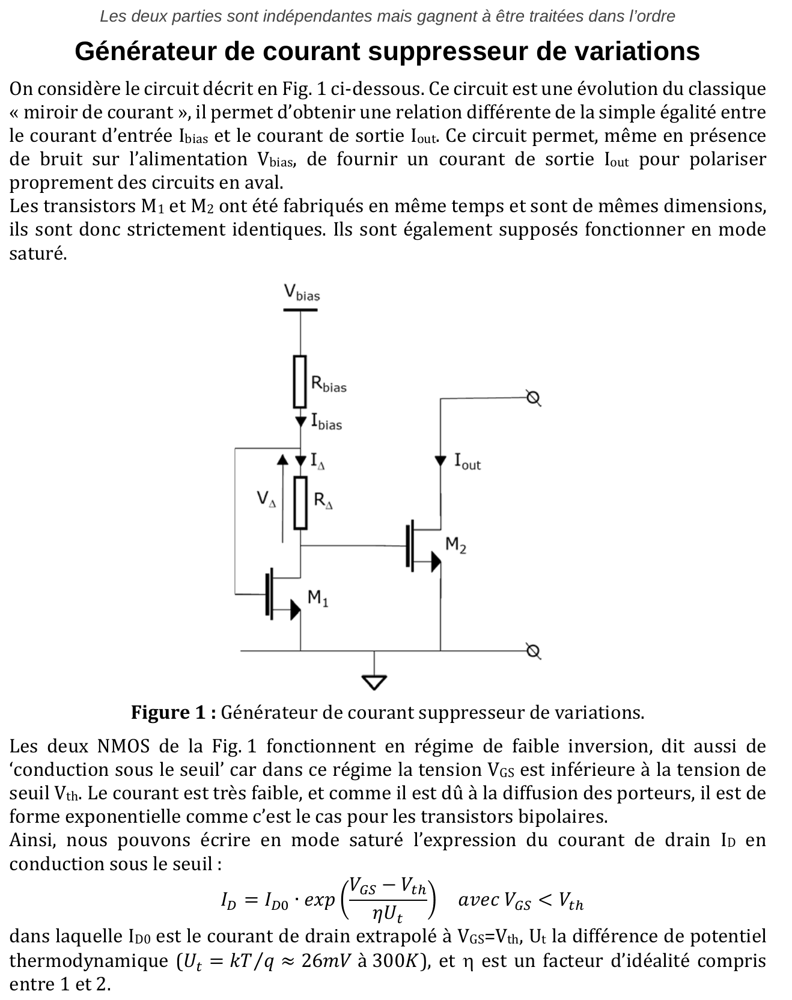{fig-alt="Générateur de courant suppresseur de variations (sujet du 2 avril 2026, EANA3 - EA234, Y. Deval et F. Rivet ; les deux parties sont indépendantes mais gagnent à être traitées dans l'ordre). On considère le circuit de la figure 1, évolution du classique miroir de courant : il permet d'obtenir une relation différente de la simple égalité entre le courant d'entrée Ibias et le courant de sortie Iout et, même en présence de bruit sur l'alimentation Vbias, de fournir un courant de sortie Iout pour polariser proprement des circuits en aval. Les transistors M1 et M2 sont strictement identiques et supposés fonctionner en mode saturé. Figure 1 : Vbias, Rbias, courant Ibias traversant RΔ (tension VΔ) puis M1 ; grille de M1 en haut de RΔ, grille de M2 en bas ; M2 fournit Iout. Les deux NMOS fonctionnent en faible inversion (conduction sous le seuil, VGS < Vth) ; le courant, dû à la diffusion, est exponentiel : ID = ID0 · exp((VGS − Vth)/(ηUt)), ID0 courant extrapolé à VGS = Vth, Ut = kT/q ≈ 26 mV à 300 K, η facteur d'idéalité compris entre 1 et 2."}

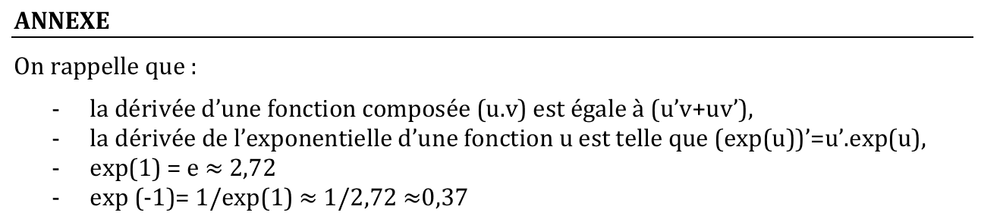{fig-alt="Annexe. On rappelle que : la dérivée d'une fonction composée (u.v) est égale à (u'v + uv') ; la dérivée de l'exponentielle d'une fonction u est telle que (exp(u))' = u'.exp(u) ; exp(1) = e ≈ 2,72 ; exp(−1) = 1/exp(1) ≈ 1/2,72 ≈ 0,37."}
:::

![Générateur de courant suppresseur de variations (a) et générateur auto-polarisé (b). D'après le sujet [td04-2026, p. 7-8, figures 1 et 2], redessiné.](../figures/05-generateur-courant.svg){#fig-generateur-courant}

::: {.complement}
**Proposition de solution (aucun corrigé).**
:::

### Partie I : polarisation

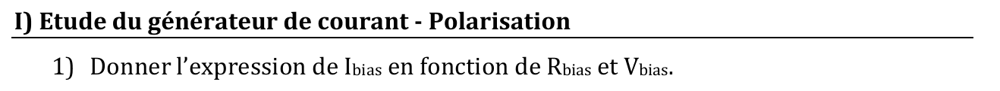{fig-alt="I) Étude du générateur de courant – polarisation. 1) Donner l'expression de Ibias en fonction de Rbias et Vbias."}

::: {.complement}
$I_{bias} = \frac{V_{bias} - V_{GS1}}{R_{bias}} \approx \frac{V_{bias}}{R_{bias}}$ ($V_{GS1}$, inférieure au seuil, est petite devant $V_{bias}$).
:::

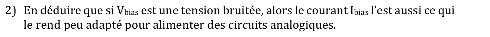{fig-alt="2) En déduire que si Vbias est une tension bruitée, alors le courant Ibias l'est aussi, ce qui le rend peu adapté pour alimenter des circuits analogiques."}

::: {.complement}
Toute variation $\delta V_{bias}$ donne $\delta I_{bias} \approx \frac{\delta V_{bias}}{R_{bias}}$ : le bruit de l'alimentation passe dans le courant.
:::

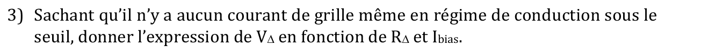{fig-alt="3) Sachant qu'il n'y a aucun courant de grille même en régime de conduction sous le seuil, donner l'expression de VΔ en fonction de RΔ et Ibias."}

::: {.complement}
Sans courant de grille, tout $I_{bias}$ traverse $R_\Delta$ : $V_\Delta = R_\Delta I_{bias}$.
:::

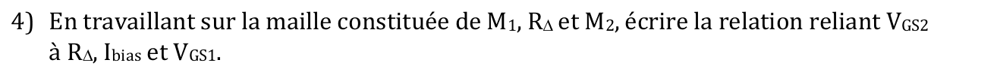{fig-alt="4) En travaillant sur la maille constituée de M1, RΔ et M2, écrire la relation reliant VGS2 à RΔ, Ibias et VGS1."}

::: {.complement}
La grille de $M_1$ est au haut de $R_\Delta$, celle de $M_2$ au bas : $V_{GS2} = V_{GS1} - R_\Delta I_{bias}$.
:::

{fig-alt="5) Montrer que, dès lors, il est possible d'écrire la relation Iout = ID0 · exp((VGS1 − Vth)/(ηUt)) · exp(−RΔ·Ibias/(ηUt))."}

::: {.complement}
$I_{out} = I_{D0}\exp\left(\frac{V_{GS2} - V_{th}}{\eta U_t}\right)$ ; on remplace $V_{GS2}$ et on sépare l'exponentielle.
:::

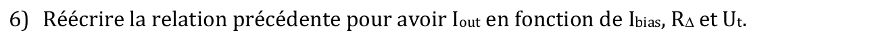{fig-alt="6) Réécrire la relation précédente pour avoir Iout en fonction de Ibias, RΔ et Ut."}

::: {.complement}
$M_1$ est traversé par $I_{bias}$ : $I_{bias} = I_{D0}\exp\left(\frac{V_{GS1} - V_{th}}{\eta U_t}\right)$, d'où
$$
I_{out} = I_{bias}\exp\left(-\frac{R_\Delta I_{bias}}{\eta U_t}\right) .
$$ {#eq-iout-suppresseur}
:::

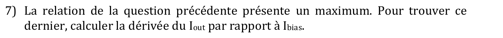{fig-alt="7) La relation de la question précédente présente un maximum. Pour trouver ce dernier, calculer la dérivée de Iout par rapport à Ibias."}

::: {.complement}
$\frac{\mathrm{d}I_{out}}{\mathrm{d}I_{bias}} = \left(1 - \frac{R_\Delta I_{bias}}{\eta U_t}\right)\exp\left(-\frac{R_\Delta I_{bias}}{\eta U_t}\right)$.
:::

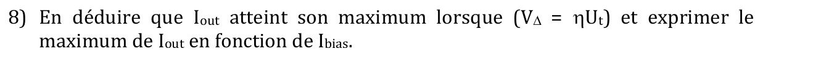{fig-alt="8) En déduire que Iout atteint son maximum lorsque VΔ = ηUt et exprimer le maximum de Iout en fonction de Ibias."}

::: {.complement}
La dérivée s'annule pour $R_\Delta I_{bias} = \eta U_t$, soit $V_\Delta = \eta U_t$ ; alors $I_{out,max} = \frac{I_{bias}}{e} \approx 0{,}37\, I_{bias}$.
:::

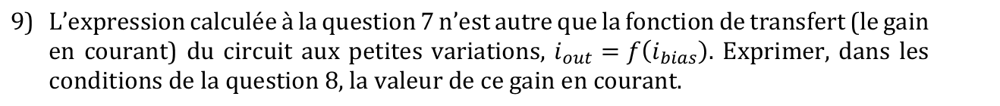{fig-alt="9) L'expression calculée à la question 7 n'est autre que la fonction de transfert (le gain en courant) du circuit aux petites variations, iout = f(ibias). Exprimer, dans les conditions de la question 8, la valeur de ce gain en courant."}

::: {.complement}
Au maximum, le gain en courant aux petites variations est **nul**.
:::

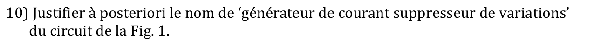{fig-alt="10) Justifier a posteriori le nom de « générateur de courant suppresseur de variations » du circuit de la figure 1."}

::: {.complement}
Au voisinage de ce point, une petite variation de $I_{bias}$ (bruit de $V_{bias}$) ne modifie pas $I_{out}$ au premier ordre : les variations sont « supprimées ».
:::

### Partie II : générateur auto-polarisé, contre-réaction

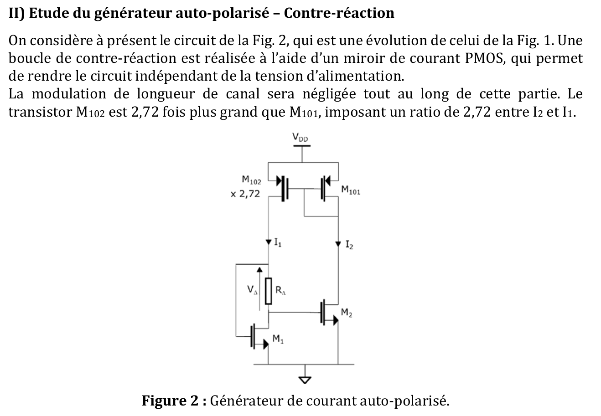{fig-alt="II) Étude du générateur auto-polarisé – contre-réaction. On considère le circuit de la figure 2, évolution de celui de la figure 1 : une boucle de contre-réaction est réalisée à l'aide d'un miroir de courant PMOS, qui permet de rendre le circuit indépendant de la tension d'alimentation. La modulation de longueur de canal sera négligée. Le transistor M102 est 2,72 fois plus grand que M101, imposant un ratio de 2,72 entre I2 et I1. Figure 2 : générateur de courant auto-polarisé ; miroir PMOS M102 (×2,72) et M101 sous VDD, courants I1 et I2 vers M1, RΔ et M2."}

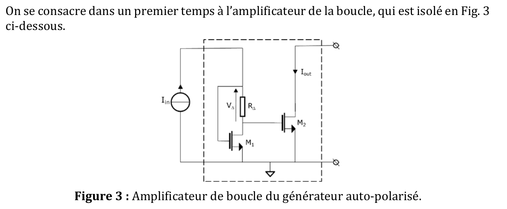{fig-alt="On se consacre dans un premier temps à l'amplificateur de la boucle, isolé en figure 3. Figure 3 : amplificateur de boucle du générateur auto-polarisé ; source de courant Iin au nœud haut de RΔ, M1 et RΔ, M2 dont le drain fournit Iout."}

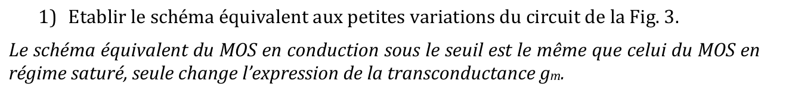{fig-alt="1) Établir le schéma équivalent aux petites variations du circuit de la figure 3. Le schéma équivalent du MOS en conduction sous le seuil est le même que celui du MOS en régime saturé, seule change l'expression de la transconductance gm."}

::: {.complement}
$M_1$ : source commandée $g_{m1}v_{gs1}$ entre drain et source (masse) ; $R_\Delta$ entre la grille de $M_1$ (entrée) et le drain de $M_1$ ; la grille de $M_2$ au drain de $M_1$ ; $M_2$ : $g_{m2}v_{gs2}$ en sortie ($r_{ds}$ négligée).
:::

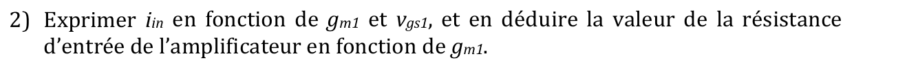{fig-alt="2) Exprimer iin en fonction de gm1 et vgs1, et en déduire la valeur de la résistance d'entrée de l'amplificateur en fonction de gm1."}

::: {.complement}
Le courant d'entrée traverse $R_\Delta$ et entre dans le drain de $M_1$ : $i_{in} = g_{m1}v_{gs1}$, donc $R_{in} = \frac{v_{gs1}}{i_{in}} = \frac{1}{g_{m1}}$.
:::

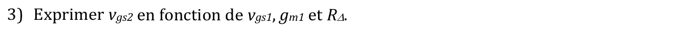{fig-alt="3) Exprimer vgs2 en fonction de vgs1, gm1 et RΔ."}

::: {.complement}
$v_{gs2} = v_{gs1} - R_\Delta i_{in} = v_{gs1}(1 - g_{m1}R_\Delta)$.
:::

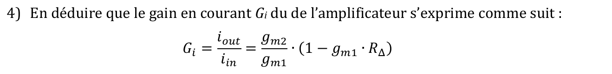{fig-alt="4) En déduire que le gain en courant Gi de l'amplificateur s'exprime comme suit : Gi = iout/iin = (gm2/gm1) · (1 − gm1 · RΔ)."}

::: {.complement}
$i_{out} = g_{m2}v_{gs2} = g_{m2}(1 - g_{m1}R_\Delta)\frac{i_{in}}{g_{m1}}$ : on retrouve $G_i$.
:::

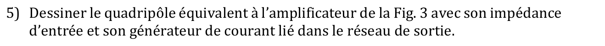{fig-alt="5) Dessiner le quadripôle équivalent à l'amplificateur de la figure 3 avec son impédance d'entrée et son générateur de courant lié dans le réseau de sortie."}

::: {.complement}
Entrée : résistance $\frac{1}{g_{m1}}$ ; sortie : source de courant $G_i\, i_{in}$ (amplificateur de courant, [chapitre 2](../cours/02-amplificateurs-contre-reaction.qmd#sec-topologies-quadripoles)).
:::

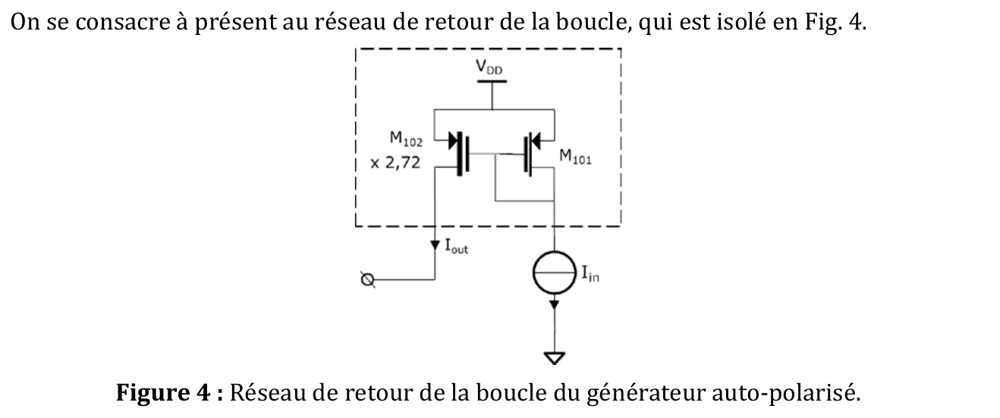{fig-alt="On se consacre à présent au réseau de retour de la boucle, isolé en figure 4. Figure 4 : réseau de retour de la boucle du générateur auto-polarisé ; miroir PMOS M102 (×2,72) et M101 sous VDD, source Iin sur M101, sortie Iout sur M102."}

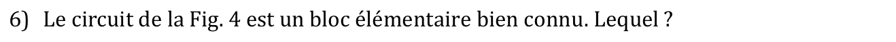{fig-alt="6) Le circuit de la figure 4 est un bloc élémentaire bien connu. Lequel ?"}

::: {.complement}
Un **miroir de courant** PMOS.
:::

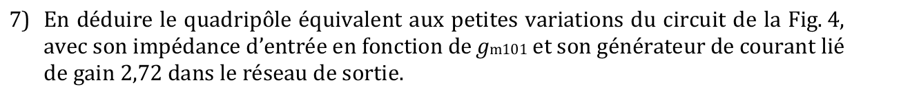{fig-alt="7) En déduire le quadripôle équivalent aux petites variations du circuit de la figure 4, avec son impédance d'entrée en fonction de gm101 et son générateur de courant lié de gain 2,72 dans le réseau de sortie."}

::: {.complement}
Entrée : $\frac{1}{g_{m101}}$ (transistor monté en diode) ; sortie : source de courant $2{,}72\, i_{in}$.
:::

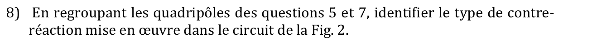{fig-alt="8) En regroupant les quadripôles des questions 5 et 7, identifier le type de contre-réaction mise en œuvre dans le circuit de la figure 2."}

::: {.complement}
Les deux blocs sont des amplificateurs de courant : le retour prélève le courant de sortie de l'amplificateur (en série dans sa branche) et réinjecte un courant au nœud d'entrée (en parallèle) : contre-réaction **courant-parallèle** ([chapitre 2](../cours/02-amplificateurs-contre-reaction.qmd#sec-cr-courant-parallele)).
:::

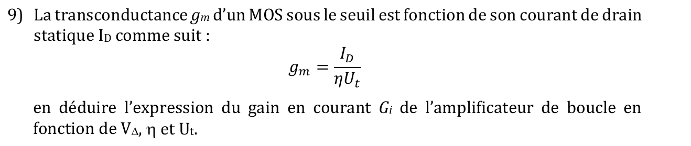{fig-alt="9) La transconductance gm d'un MOS sous le seuil est fonction de son courant de drain statique ID : gm = ID/(ηUt). En déduire l'expression du gain en courant Gi de l'amplificateur de boucle en fonction de VΔ, η et Ut."}

::: {.complement}
$g_{m1} = \frac{I_1}{\eta U_t}$, $g_{m2} = \frac{I_2}{\eta U_t}$ et $V_\Delta = R_\Delta I_1$ :
$$
G_i = \frac{I_2}{I_1}\left(1 - \frac{V_\Delta}{\eta U_t}\right) .
$$
:::

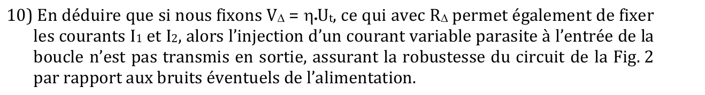{fig-alt="10) En déduire que si nous fixons VΔ = η·Ut, ce qui avec RΔ permet également de fixer les courants I1 et I2, alors l'injection d'un courant variable parasite à l'entrée de la boucle n'est pas transmise en sortie, assurant la robustesse du circuit de la figure 2 par rapport aux bruits éventuels de l'alimentation."}

::: {.complement}
Pour $V_\Delta = \eta U_t$, $G_i = 0$ : une variation de courant injectée à l'entrée de la boucle n'atteint pas la sortie. C'est cohérent avec la partie I : @eq-iout-suppresseur donne alors $I_2 = I_1/e$, exactement le rapport $1/2{,}72$ imposé par le miroir ; le point de fonctionnement se place de lui-même au sommet de la courbe, et $I_1 = \frac{\eta U_t}{R_\Delta}$ ne dépend que de $R_\Delta$ et de la température, pas de $V_{DD}$.
:::
