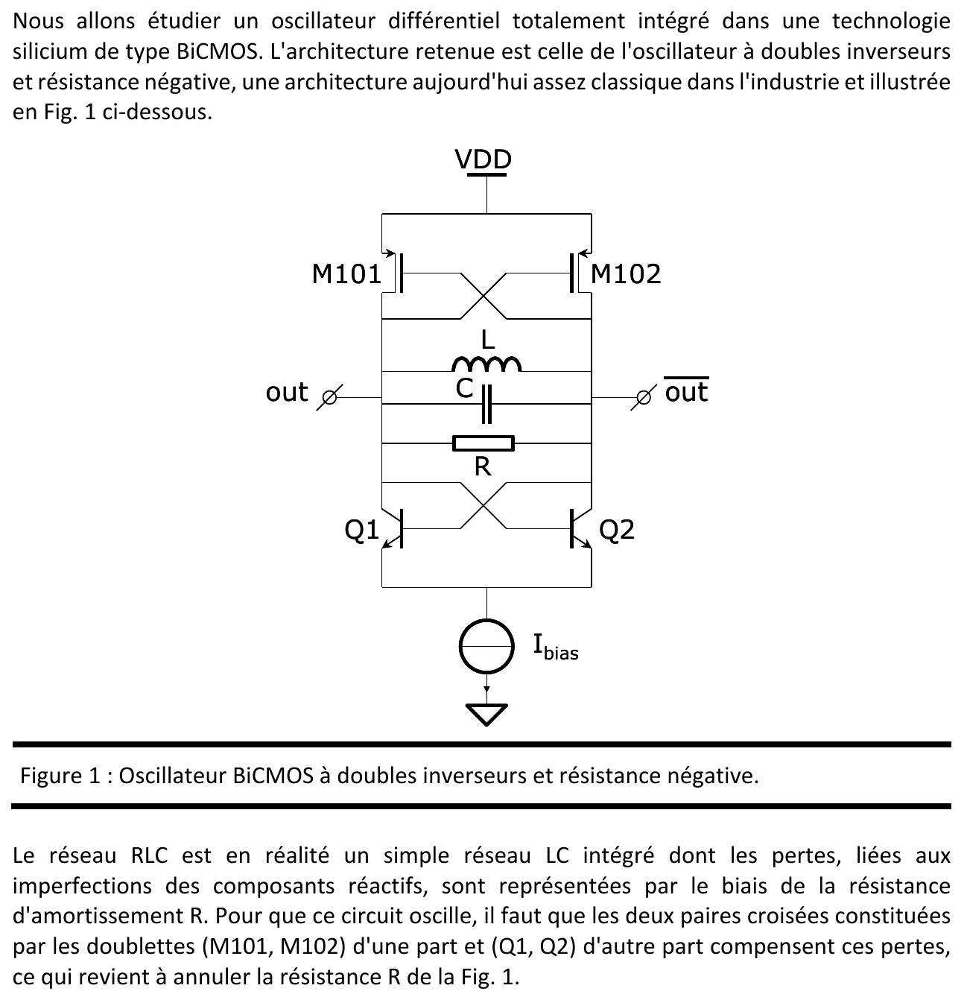
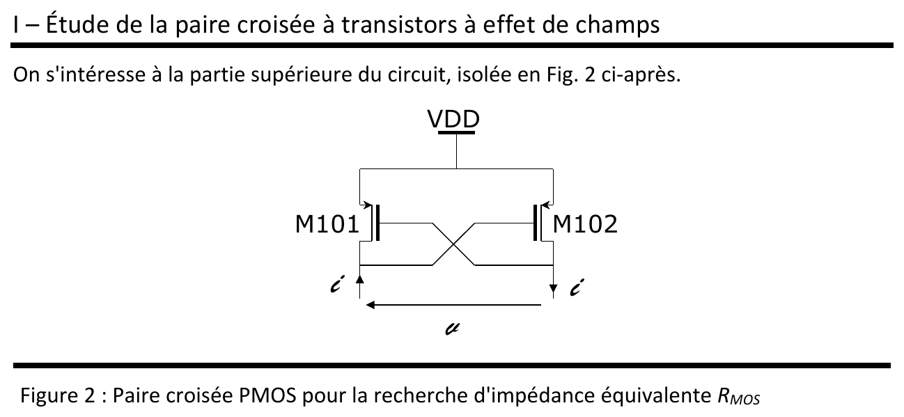
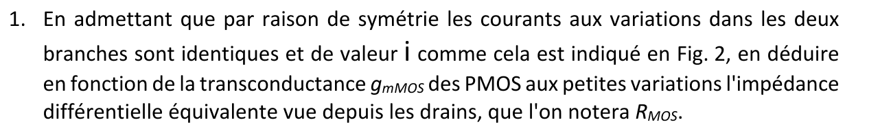
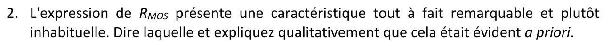
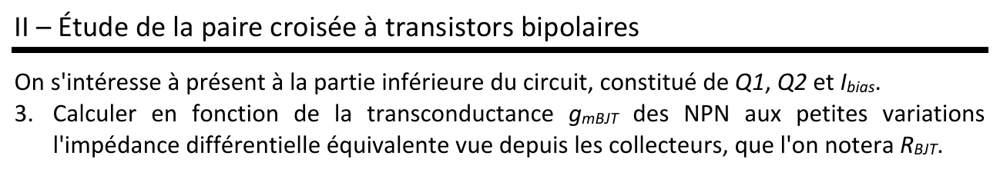
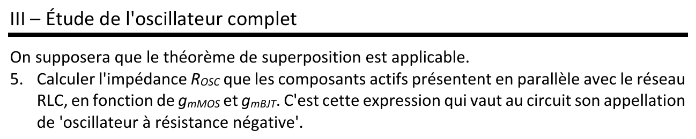
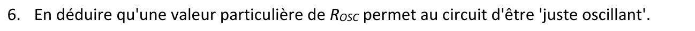
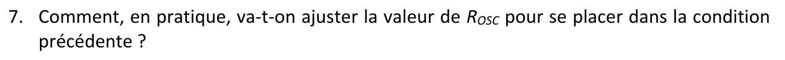



::: {.complement}
Énoncé découpé question par question [td04] ; sous chaque question, les corrigés d'anciens élèves (*Notes externes* : corrigés de 2025 [corr-2025-td04] et de 2023 [corr-2023-td04]), puis les explications ajoutées par Claude (*Complément*). Il n'y a pas de notes d'Armand pour ce TD.

Cours associé : [chapitre 4, oscillateur à résistance négative](../cours/04-oscillateurs.qmd#sec-resistance-negative).
:::

## Exercice 1 : oscillateur à résistance négative {#sec-td-resistance-negative}

::: {#exr-oscillateur-resistance-negative}
## Oscillateur à résistance négative [support, p. 20-21]

{fig-alt="Nous allons étudier un oscillateur différentiel totalement intégré dans une technologie silicium de type BiCMOS. L'architecture retenue est celle de l'oscillateur à doubles inverseurs et résistance négative, une architecture aujourd'hui assez classique dans l'industrie, illustrée en figure 1. Figure 1 : oscillateur BiCMOS à doubles inverseurs et résistance négative ; paire croisée PMOS M101, M102 sous VDD, réseau L, C, R entre les sorties out et out barre, paire croisée NPN Q1, Q2 polarisée par la source de courant Ibias. Le réseau RLC est en réalité un simple réseau LC intégré dont les pertes, liées aux imperfections des composants réactifs, sont représentées par la résistance d'amortissement R. Pour que ce circuit oscille, il faut que les deux paires croisées (M101, M102) d'une part et (Q1, Q2) d'autre part compensent ces pertes, ce qui revient à annuler la résistance R de la figure 1."}
:::

![Oscillateur BiCMOS à doubles inverseurs et résistance négative du TD 4 : paire croisée PMOS $M_{101}$, $M_{102}$, réseau $RLC$, paire croisée NPN $Q_1$, $Q_2$ polarisée par $I_{bias}$. D'après le support [support, p. 20, figure 1], redessiné.](../figures/04-resistance-negative.svg){#fig-resistance-negative}

::: {.notes-externes}
D'après les corrigés externes [corr-2025-td04, p. 1-5] et [corr-2023-td04, p. 1-3], qui concordent.
:::

{fig-alt="I – Étude de la paire croisée à transistors à effet de champ. On s'intéresse à la partie supérieure du circuit, isolée en figure 2. Figure 2 : paire croisée PMOS pour la recherche d'impédance équivalente RMOS ; M101 et M102 sous VDD, courants i dans les deux branches, tension v entre les drains."}

{fig-alt="1. En admettant que par raison de symétrie les courants aux variations dans les deux branches sont identiques et de valeur i comme cela est indiqué en figure 2, en déduire en fonction de la transconductance gmMOS des PMOS aux petites variations l'impédance différentielle équivalente vue depuis les drains, que l'on notera RMOS."}

::: {.notes-externes}
Schéma petits signaux : sources des PMOS à la masse ; au nœud gauche (drain de $M_{101}$, grille de $M_{102}$), $g_m v_{gs101}$ et $r_{ds}$ ; au nœud droit (drain de $M_{102}$, grille de $M_{101}$), $g_m v_{gs102}$ et $r_{ds}$ ; source de test $v$ entre les drains, courant $i$ entrant à gauche et sortant à droite. Par symétrie, $g_{m101} = g_{m102}$ et $r_{ds101} = r_{ds102}$ [corr-2025-td04, p. 1].
- Maille : $v = v_{gs102} - v_{gs101}$ ;
- nœuds : $i = g_m v_{gs101} + \frac{v_{gs102}}{r_{ds}}$ et $-i = g_m v_{gs102} + \frac{v_{gs101}}{r_{ds}}$.

En égalant, $v_{gs101}\left(g_m + \frac{1}{r_{ds}}\right) = -v_{gs102}\left(g_m + \frac{1}{r_{ds}}\right)$, donc $v_{gs101} = -v_{gs102}$ et $v = -2v_{gs101}$. Alors
$$
R_{MOS} = \frac{v}{i} = \frac{-2}{g_{mMOS} - \frac{1}{r_{ds}}} \simeq -\frac{2}{g_{mMOS}} \quad (g_m r_{ds} \gg 1) .
$$ {#eq-r-mos}
:::

{fig-alt="2. L'expression de RMOS présente une caractéristique tout à fait remarquable et plutôt inhabituelle. Dire laquelle et expliquer qualitativement que cela était évident a priori."}

::: {.notes-externes}
$R_{MOS}$ est **négative** [corr-2025-td04, p. 2]. Le corrigé de 2023 l'explique par le câblage : chaque transistor est à la fois « câblé en diode » et en source commune (gain $-g_m R_D$), montage inverseur [corr-2023-td04, p. 2].
:::

::: {.complement}
**Question 2, version détaillée** (le corrigé de 2025 pose la question sans y répondre). Si chaque PMOS était monté en diode (grille sur son propre drain), chacun présenterait $\frac{1}{g_m}$ et la résistance différentielle vaudrait $+\frac{2}{g_m}$ : une charge ordinaire. En croisant les connexions, une hausse de la tension d'un drain fait **baisser** l'autre drain (étage source commune), ce qui fait encore monter le premier : c'est une réaction positive, et la résistance change de signe. On retrouve [équation du chapitre 4](../cours/04-oscillateurs.qmd#eq-resistance-paire-croisee) du cours.
:::

{fig-alt="II – Étude de la paire croisée à transistors bipolaires. On s'intéresse à présent à la partie inférieure du circuit, constituée de Q1, Q2 et Ibias. 3. Calculer en fonction de la transconductance gmBJT des NPN aux petites variations l'impédance différentielle équivalente vue depuis les collecteurs, que l'on notera RBJT."}

::: {.notes-externes}
Même étude avec, à chaque nœud, $r_{be}$, $r_{ce}$ et $g_m v_{be}$ ; par symétrie ($I_{C1} = I_{C2} = I_{bias}/2$), $v_{be1} = -v_{be2}$ et $v = 2v_{be2}$ [corr-2025-td04, p. 3-4] :
$$
R_{BJT} = \frac{2}{\frac{1}{r_{be}} + \frac{1}{r_{ce}} - g_{mBJT}} \simeq -\frac{2}{g_{mBJT}},
$$ {#eq-r-bjt}
car $r_{ce} \gg r_{be}$ et $g_m r_{be} = \beta \gg 1$.
:::

{fig-alt="4. Le résultat obtenu est très proche du précédent. Dire en quoi cela était attendu."}

::: {.notes-externes}
C'est attendu : même câblage (paire croisée).
:::

{fig-alt="III – Étude de l'oscillateur complet. On supposera que le théorème de superposition est applicable. 5. Calculer l'impédance ROSC que les composants actifs présentent en parallèle avec le réseau RLC, en fonction de gmMOS et gmBJT. C'est cette expression qui vaut au circuit son appellation d'« oscillateur à résistance négative »."}

::: {.notes-externes}
Aux variations, $R_{MOS}$, le réseau $LC$ avec ses pertes $R$ et $R_{BJT}$ sont en parallèle :
$$
R_{OSC} = R_{MOS} /\!/ R_{BJT} = -\frac{2}{g_{mMOS} + g_{mBJT}} < 0 .
$$ {#eq-r-osc}
:::

{fig-alt="6. En déduire qu'une valeur particulière de ROSC permet au circuit d'être « juste oscillant »."}

::: {.notes-externes}
Pour compenser les pertes, $R_{OSC} = -R$ : la résistance totale en parallèle avec $L$ et $C$ est alors infinie [corr-2025-td04, p. 5].
:::

::: {.complement}
**Question 6.** « Juste oscillant » correspond à l'égalité : avec $R_{OSC} = -R$, le circuit $LC$ est sans pertes et oscille à $\omega_0 = \frac{1}{\sqrt{LC}}$. Pour garantir le démarrage malgré les dispersions, on choisit en pratique $|R_{OSC}|$ un peu plus petit que $R$ (plus de $g_m$ qu'il n'en faut) ; l'amplitude se limite ensuite d'elle-même.
:::

{fig-alt="7. Comment, en pratique, va-t-on ajuster la valeur de ROSC pour se placer dans la condition précédente ?"}

::: {.notes-externes}
$g_{mMOS} = 2\sqrt{k\frac{W}{L}\,|I_{Dsat}|}$ et $g_{mBJT} = \frac{I_C}{U_T}$, avec $|I_{Dsat}| = I_C = \frac{I_{bias}}{2}$ dans chaque branche : on règle $R_{OSC}$ avec le courant $I_{bias}$ [corr-2025-td04, p. 5].
:::

::: {.complement}
**Intérêt de la double paire.** Les deux paires sont en parallèle et parcourues par le même courant $I_{bias}$ : pour un même courant, on obtient $g_{mMOS} + g_{mBJT}$, donc une résistance négative plus forte qu'avec une seule paire.
:::
