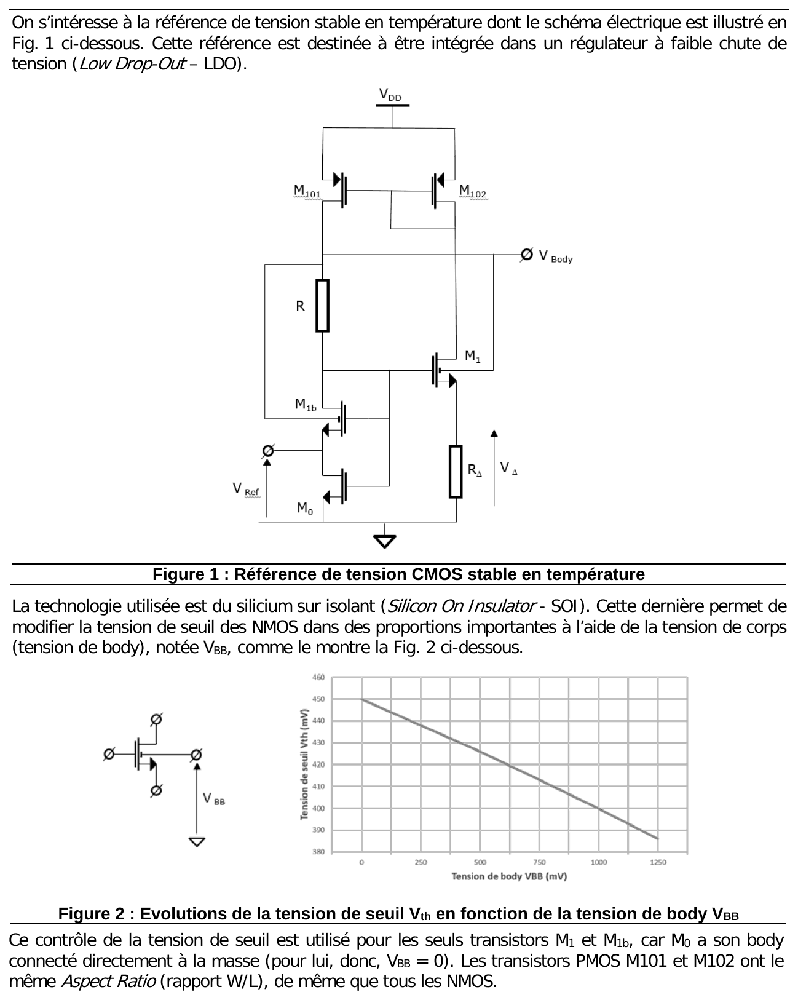
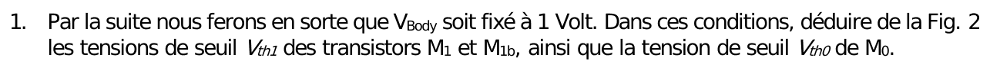
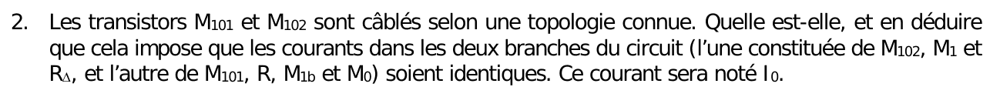
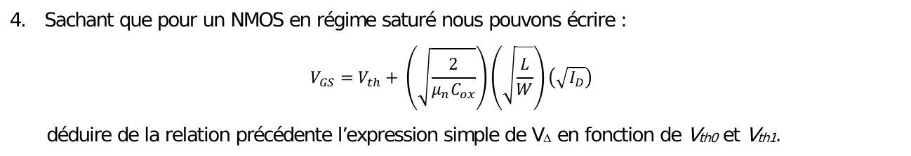
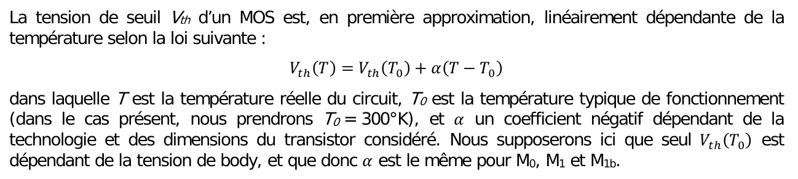



::: {.complement}
Énoncé découpé question par question [td05] ; sous chaque question, la solution proposée par Claude (*Complément*) : il n'y a ni notes d'Armand ni corrigé de cette version du TD (le corrigé externe de 2023 porte sur une autre version, traitée au [chapitre 5](../cours/05-references-de-tension.qmd#sec-reference-dual-vth)). À relire avec un œil critique ; signaler toute erreur.

Cours associé : [chapitre 5, référence « full CMOS » à double tension de seuil](../cours/05-references-de-tension.qmd#sec-reference-dual-vth).
:::

## Exercice 1 : référence de tension CMOS stable en température {#sec-td-reference-cmos}

::: {#exr-reference-cmos}
## Référence de tension CMOS stable en température [support, p. 22-23]

{fig-alt="Référence de tension CMOS stable en température (sujet du 6 novembre 2023, Y. Deval). On s'intéresse à la référence de tension stable en température dont le schéma électrique est illustré en figure 1, destinée à être intégrée dans un régulateur à faible chute de tension (Low Drop-Out, LDO). Figure 1 : miroir PMOS M101, M102 sous VDD ; branche M102, M1, RΔ (tension VΔ) ; branche M101, R, M1b, M0 ; nœud VBody en haut de R ; sortie VRef entre M1b et M0. La technologie utilisée est du silicium sur isolant (Silicon On Insulator, SOI), qui permet de modifier la tension de seuil des NMOS dans des proportions importantes à l'aide de la tension de corps (tension de body) VBB, comme le montre la figure 2. Figure 2 : évolution de la tension de seuil Vth en fonction de la tension de body VBB, décroissance linéaire d'environ 450 mV à 0 V jusqu'à environ 385 mV à 1,25 V. Ce contrôle de la tension de seuil est utilisé pour les seuls transistors M1 et M1b, car M0 a son body connecté directement à la masse (pour lui, VBB = 0). Les transistors PMOS M101 et M102 ont le même rapport W/L, de même que tous les NMOS."}
:::

![Référence de tension CMOS stable en température du TD 5 (technologie SOI) : tensions de seuil de $M_1$ et $M_{1b}$ abaissées par la tension de body $V_{Body}$. D'après le support [support, p. 22, figure 1], redessiné.](../figures/05-reference-cmos-soi.svg){#fig-reference-cmos-soi}

![Tension de seuil des NMOS en fonction de la tension de body $V_{BB}$. D'après le support [support, p. 22, figure 2], redessinée (lecture graphique : 450 mV à 0 V, 400 mV à 1 V).](../figures/05-vth-vbb.svg){#fig-vth-vbb}

::: {.complement}
**Proposition de solution (aucun corrigé de cette version).**
:::

{fig-alt="1. Par la suite, nous ferons en sorte que VBody soit fixé à 1 V. Dans ces conditions, déduire de la figure 2 les tensions de seuil Vth1 des transistors M1 et M1b, ainsi que la tension de seuil Vth0 de M0."}

::: {.complement}
À $V_{BB} = 1$ V : $V_{th1} = 400$ mV (pour $M_1$ et $M_{1b}$) ; à $V_{BB} = 0$ : $V_{th0} = 450$ mV.
:::

{fig-alt="2. Les transistors M101 et M102 sont câblés selon une topologie connue. Quelle est-elle ? En déduire que cela impose que les courants dans les deux branches du circuit (l'une constituée de M102, M1 et RΔ, l'autre de M101, R, M1b et M0) soient identiques. Ce courant sera noté I0."}

::: {.complement}
$M_{102}$ monté en diode et grilles communes : **miroir de courant**. Même $W/L$, même $V_{GS}$ : $M_{101}$ recopie le courant de $M_{102}$, les deux branches portent $I_0$.
:::

{fig-alt="3. Écrire la relation liant VGS0, VGS1 et VΔ."}

::: {.complement}
Les grilles de $M_0$ et $M_1$ sont au même nœud (drain de $M_{1b}$) ; $M_0$ a sa source à la masse, $M_1$ a sa source au potentiel $V_\Delta$ : $V_{GS0} = V_{GS1} + V_\Delta$, soit $V_\Delta = V_{GS0} - V_{GS1}$.
:::

{fig-alt="4. Sachant que pour un NMOS en régime saturé nous pouvons écrire VGS = Vth + √(2/(µn Cox)) · √(L/W) · √ID, déduire de la relation précédente l'expression simple de VΔ en fonction de Vth0 et Vth1."}

::: {.complement}
$M_0$ et $M_1$ ont le même $W/L$ et le même courant $I_0$ : les termes en racine sont égaux, et
$$
V_\Delta = V_{th0} - V_{th1} .
$$
:::

{fig-alt="5. En déduire la valeur de VΔ depuis les tensions de seuil obtenues à la première question."}

::: {.complement}
$V_\Delta = 450 - 400 = 50$ mV.
:::

{fig-alt="6. En déduire la valeur de RΔ qui permet de fixer I0 = 5 µA."}

::: {.complement}
$R_\Delta = \frac{V_\Delta}{I_0} = \frac{50\ \mathrm{mV}}{5\ \mu\mathrm{A}} = 10\ \mathrm{k\Omega}$.
:::

{fig-alt="7. En supposant VGS0 très peu différent de Vth0, ce qui est légitime du fait des faibles courants manipulés, calculer la valeur de R qui permet de fixer VBody à la tension voulue de 1 V."}

::: {.complement}
$V_{Body}$ est le haut de $R$ ; le bas de $R$ est le nœud des grilles, au potentiel $V_{GS0} \approx V_{th0} = 0{,}45$ V. Donc $R I_0 = 1 - 0{,}45 = 0{,}55$ V et $R = \frac{0{,}55}{5 \cdot 10^{-6}} = 110\ \mathrm{k\Omega}$.
:::

{fig-alt="Si le miroir de courant PMOS n'est pas parfait, l'expression trouvée en question 4 ne sera plus valable. Le transistor M1b ne souffre pas de ce défaut, car il partage nécessairement le même courant que M0. Nous préférerons donc utiliser comme référence la tension Vref plutôt que la tension VΔ."}

{fig-alt="8. Exprimer VRef en fonction de Vth0 et Vth1, et comparer VRef à VΔ."}

::: {.complement}
$M_{1b}$ a sa grille au nœud des grilles et sa source à $V_{Ref}$ : $V_{GS1b} = V_{GS0} - V_{Ref}$. $M_{1b}$ et $M_0$ sont en série (même courant, quel que soit le miroir), même $W/L$ : $V_{GS0} - V_{th0} = V_{GS1b} - V_{th1}$, d'où
$$
V_{Ref} = V_{th0} - V_{th1} = V_\Delta = 50\ \mathrm{mV},
$$
même valeur que $V_\Delta$, mais indépendante de l'appariement du miroir PMOS.
:::

{fig-alt="La tension de seuil Vth d'un MOS est, en première approximation, linéairement dépendante de la température : Vth(T) = Vth(T0) + α(T − T0), où T est la température réelle du circuit, T0 la température typique de fonctionnement (ici T0 = 300 K) et α un coefficient négatif dépendant de la technologie et des dimensions du transistor. Nous supposerons que seul Vth(T0) dépend de la tension de body, et que donc α est le même pour M0, M1 et M1b."}

{fig-alt="9. Calculer d(VRef)/dT, la dépendance thermique de VRef. En quoi cette valeur est-elle remarquable ?"}

::: {.complement}
$\frac{\mathrm{d}V_{Ref}}{\mathrm{d}T} = \alpha - \alpha = 0$ : la référence est **TC0** par construction, sans dosage de résistances (contrairement au bandgap) : les deux dérives thermiques s'annulent parce que les deux transistors ne diffèrent que par leur tension de body.
:::

{fig-alt="10. À aucun moment nous n'avons considéré VDD. Que peut-on en conclure concernant VRef ?"}

::: {.complement}
$V_{Ref}$ ne dépend pas de $V_{DD}$ (au premier ordre) : bonne réjection des variations d'alimentation, ce qu'on attend d'une référence pour un LDO.
:::

::: {.complement}
**Remarque.** La valeur de 50 mV est faible ; on peut l'amplifier ensuite (par exemple dans la boucle du LDO, [TD « VDD is not your BFF »](td-add-vdd-is-not-your-bff.qmd#sec-td-vdd)).
:::
