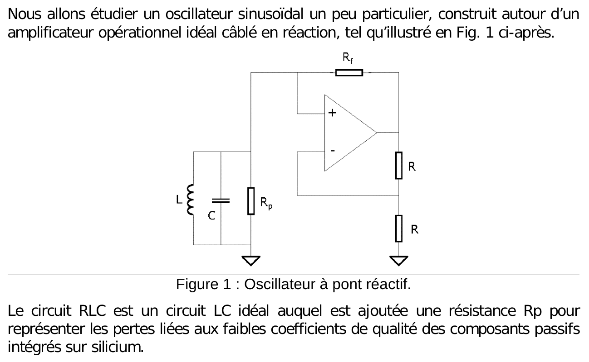
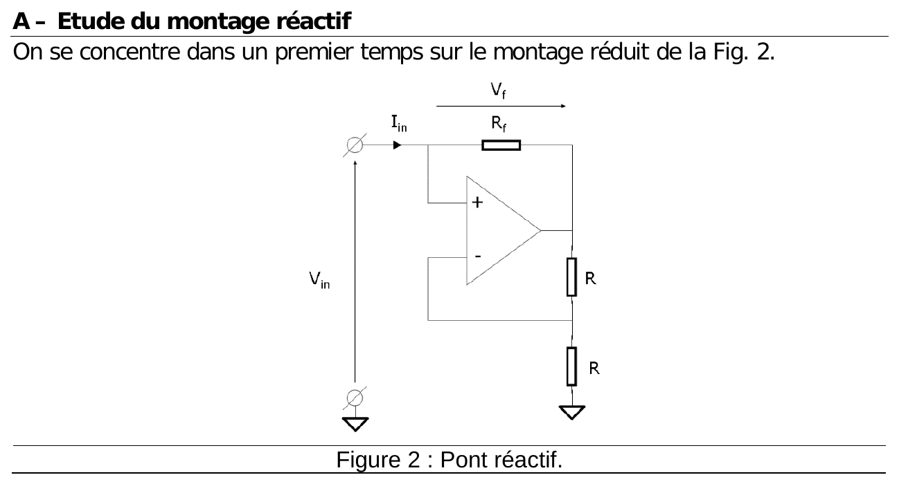
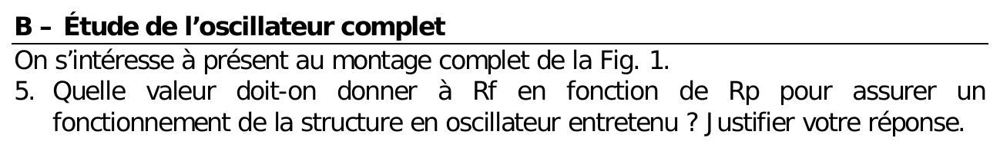



::: {.complement}
Énoncé découpé question par question [td06] ; sous chaque question, la solution proposée par Claude (*Complément*) : il n'y a ni notes d'Armand ni corrigé pour ce TD. À relire avec un œil critique ; signaler toute erreur.

Cours associé : [chapitre 4, oscillateur à résistance négative](../cours/04-oscillateurs.qmd#sec-resistance-negative).
:::

## Exercice 1 : oscillateur sinusoïdal à base d'amplificateur opérationnel {#sec-td-oscillateur-aop}

::: {#exr-oscillateur-aop}
## Oscillateur sinusoïdal à base d'amplificateur opérationnel [support, p. 24-25]

{fig-alt="Nous allons étudier un oscillateur sinusoïdal un peu particulier, construit autour d'un amplificateur opérationnel idéal câblé en réaction, tel qu'illustré en figure 1. Figure 1 : oscillateur à pont réactif ; circuit L, C, Rp en parallèle vers la masse, relié à l'entrée + de l'amplificateur et, par Rf, à sa sortie ; pont de deux résistances R de la sortie vers la masse, point milieu sur l'entrée −. Le circuit RLC est un circuit LC idéal auquel est ajoutée une résistance Rp pour représenter les pertes liées aux faibles coefficients de qualité des composants passifs intégrés sur silicium."}
:::

![Oscillateur à pont réactif du TD 6 (a) et montage réactif seul (b). D'après le support [support, p. 24, figures 1 et 2], redessiné.](../figures/04-pont-reactif.svg){#fig-pont-reactif}

::: {.complement}
**Proposition de solution (aucun corrigé).**
:::

{fig-alt="A – Étude du montage réactif. On se concentre dans un premier temps sur le montage réduit de la figure 2. Figure 2 : pont réactif ; tension d'entrée Vin sur l'entrée +, courant d'entrée Iin traversant Rf vers la sortie (tension Vf aux bornes de Rf), pont de deux résistances R de la sortie vers la masse, point milieu sur l'entrée −."}

{fig-alt="1. L'amplificateur opérationnel est idéal : en déduire la valeur de la tension de sortie de l'amplificateur en fonction de Vin."}

::: {.complement}
L'amplificateur est en réaction négative par le pont de deux résistances $R$ (entrée $-$), donc $V_+ = V_-$ ; le pont donne $V_- = \frac{V_{out}}{2}$ et $V_+ = V_{in}$ : c'est un amplificateur non inverseur de gain $1 + \frac{R}{R} = 2$, soit $V_{out} = 2V_{in}$.
:::

{fig-alt="2. Déduire du résultat précédent la tension Vf disponible aux bornes de la résistance de réaction Rf, toujours en fonction de Vin."}

::: {.complement}
$R_f$ relie l'entrée à la sortie : $V_f = V_{in} - V_{out} = -V_{in}$ (tension orientée de l'entrée vers la sortie, comme sur la figure).
:::

{fig-alt="3. En déduire la valeur du courant Iin en fonction de Rf et Vin et, par conséquent, l'impédance d'entrée du montage en fonction de Rf."}

::: {.complement}
Aucun courant n'entre dans l'entrée $+$ : tout $I_{in}$ traverse $R_f$, $I_{in} = \frac{V_f}{R_f} = -\frac{V_{in}}{R_f}$, d'où
$$
Z_{in} = \frac{V_{in}}{I_{in}} = -R_f .
$$ {#eq-impedance-pont-reactif}
:::

{fig-alt="4. Dire en quoi cette valeur est particulière."}

::: {.complement}
L'impédance d'entrée est une **résistance négative** : le montage fournit du courant à ce qui est branché sur son entrée au lieu d'en absorber (convertisseur d'impédance négative).
:::

{fig-alt="B – Étude de l'oscillateur complet. On s'intéresse à présent au montage complet de la figure 1. 5. Quelle valeur doit-on donner à Rf en fonction de Rp pour assurer un fonctionnement de la structure en oscillateur entretenu ? Justifier votre réponse."}

::: {.complement}
Le montage est en parallèle avec $L$, $C$ et $R_p$. La résistance équivalente vaut $\frac{1}{\frac{1}{R_p} - \frac{1}{R_f}}$ : elle est infinie (circuit $LC$ sans pertes, oscillation entretenue) pour
$$
R_f = R_p .
$$
En pratique, $R_f$ légèrement inférieure à $R_p$ pour que l'oscillation démarre (conductance totale négative), l'amplitude étant ensuite limitée par la saturation de l'amplificateur.
:::

{fig-alt="6. Quelle sera la fréquence d'oscillation en fonction de L et de C ?"}

::: {.complement}
Il reste un circuit $LC$ idéal : $f_0 = \frac{1}{2\pi\sqrt{LC}}$ ($\omega_0 = \frac{1}{\sqrt{LC}}$).
:::

::: {.complement}
C'est le même principe que le [TD 4](td04-oscillateur-resistance-negative.qmd#sec-td-resistance-negative) : une résistance négative compense les pertes du résonateur ; ici elle est obtenue avec un amplificateur opérationnel au lieu d'une paire croisée.
:::
