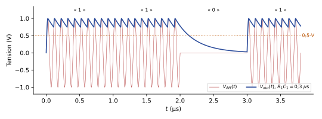



Dans une modulation **linéaire**, l'information est portée par l'**amplitude** du signal modulé. Ce chapitre présente les trois modulations d'amplitude (AM) : double bande sans porteuse, double bande avec porteuse et bande latérale unique, avec leurs allures temporelles, leurs spectres, leur génération et leur démodulation.

## Principe de la modulation d'amplitude {#sec-principe-am}

::: {#def-am}
## Modulation d'amplitude (AM)

La modulation d'amplitude consiste à introduire l'information du signal modulant dans l'**amplitude** du signal modulé [mod-ana, p. 20] :

$$
s(t) = A(t)\cos(2\pi f_p t),
$$

où l'amplitude $A(t)$ dépend du modulant.
:::

Il existe trois types de modulation d'amplitude :

- la modulation d'amplitude **double bande sans porteuse** (AMDBSP) ;
- la modulation d'amplitude **double bande avec porteuse** (AMDBAP) ;
- la modulation d'amplitude à **bande latérale unique** (AM BLU).

## AM double bande sans porteuse (AMDBSP) {#sec-amdbsp}

### Principe {#sec-amdbsp-principe}

::: {#def-amdbsp}
## AMDBSP

La porteuse $p(t) = \cos(2\pi f_p t)$ est directement mélangée avec le signal modulant $m(t)$ [mod-ana, p. 21] :

$$
s_{AMDBSP}(t) = m(t)\,p(t) = m(t)\cos(2\pi f_p t).
$$ {#eq-amdbsp}
:::

**Modulant sinusoïdal**, $m(t) = A\cos(2\pi f_m t)$ : d'après le [chapitre 1](01-introduction-signaux-outils.qmd#eq-melange-sinus), le spectre comporte deux raies d'amplitude $A/2$ en $f_p - f_m$ et $f_p + f_m$, séparées de $2f_m$ ; **aucune raie à $f_p$** (@fig-amdbsp-temporel).

![AMDBSP avec un modulant sinusoïdal : porteuse, modulant et signal modulé. L'enveloppe du signal modulé est $|m(t)|$. D'après le support [mod-ana, p. 21], recalculée ($f_p = 20 f_m$).](../figures/02-amdbsp-temporel.svg){#fig-amdbsp-temporel}

**Modulant quelconque**, de largeur spectrale $B_m$ [mod-ana, p. 22] :

- **pas d'harmonique à la fréquence de la porteuse** $f_p$ ;
- la **bande passante du signal modulé est doublée** : $2B_m$.

::: {.complement}
L'enveloppe d'un signal AMDBSP est $|m(t)|$ et non $m(t)$ : quand $m(t)$ change de signe, la porteuse change de phase de $\pi$ (@fig-amdbsp-temporel). Un simple détecteur d'enveloppe ([TD 3](#exr-td3-detecteur-principe)) ne restitue donc pas $m(t)$ : il faut une démodulation **cohérente** (synchrone), décrite ci-dessous.
:::

### Modulation et démodulation {#sec-amdbsp-demodulation}

**Génération** : un mélangeur analogique reçoit $m(t)$ et $p(t) = \cos(2\pi f_p t)$ et délivre $s_{AMDBSP}(t) = m(t)\cos(2\pi f_p t)$ [mod-ana, p. 23].

**Démodulation** : on multiplie le signal reçu par une porteuse locale $\cos(2\pi f_p t)$, puis on filtre par un **passe-bas** de fréquence de coupure $f_c \ll f_p$ [mod-ana, p. 23] :

$$
v(t) = s_{AMDBSP}(t)\cos(2\pi f_p t) = m(t)\cos^2(2\pi f_p t) = \frac12\,m(t) + \frac12\,m(t)\cos(4\pi f_p t),
$$

$$
r(t) = \frac12\,m(t).
$$ {#eq-demod-amdbsp}

Le passe-bas élimine le terme centré sur $2f_p$.

::: {.complement}
Pour que le passe-bas sépare les deux termes, il faut $B_m < f_c < 2f_p - B_m$ : en pratique $B_m \ll f_p$, d'où la condition « $f_c \ll f_p$ » du support.
:::

### Problème de la démodulation {#sec-amdbsp-probleme}

En pratique, la porteuse de réception n'est pas en phase avec celle de l'émission : $p_{Rx}(t) = \cos(2\pi f_p t + \varphi)$, où $\varphi$, le **déphasage entre les porteuses Tx et Rx**, est variable dans le temps [mod-ana, p. 24-25]. Alors :

$$
v(t) = m(t)\cos(2\pi f_p t)\cos(2\pi f_p t + \varphi) = \frac12\,m(t)\cos\varphi + \frac12\,m(t)\cos(4\pi f_p t + \varphi),
$$

$$
r(t) = \frac12\,m(t)\cos\varphi.
$$ {#eq-demod-amdbsp-dephasage}

Le facteur $\cos\varphi$ **affecte l'amplitude du signal démodulé** : l'information est corrompue, $r(t) \neq m(t)$. En particulier, $r(t) = 0$ si $\varphi = \pi/2$.

::: {.notes-externes}
Problème de démodulation : émission et réception ne sont pas en phase, d'où un problème de décalage [notes-2023-ana, p. 4].
:::

La solution du support (« Solution… », p. 25) est d'**envoyer la porteuse** avec le signal : c'est la modulation double bande avec porteuse.

## AM double bande avec porteuse (AMDBAP) {#sec-amdbap}

### Principe et taux de modulation {#sec-amdbap-principe}

::: {#def-amdbap}
## AMDBAP

Une portion de la porteuse $p(t) = \cos(2\pi f_p t)$ est introduite dans le signal modulé [mod-ana, p. 26] :

$$
s_{AMDBAP}(t) = \bigl(A + m(t)\bigr)\cos(2\pi f_p t).
$$ {#eq-amdbap}
:::

**Modulant sinusoïdal**, $m(t) = A_m\cos(2\pi f_m t)$ :

$$
s_{AMDBAP}(t) = \bigl[A + A_m\cos(2\pi f_m t)\bigr]\cos(2\pi f_p t) = A\bigl[1 + k\cos(2\pi f_m t)\bigr]\cos(2\pi f_p t),
\qquad k = \frac{A_m}{A}.
$$ {#eq-amdbap-sinus}

::: {#def-taux-modulation}
## Taux de modulation

Le **taux de modulation** $k$ est le rapport entre l'amplitude du signal modulant et celle de la porteuse [mod-ana, p. 26] :

$$
k = \frac{|m(t)|_\mathrm{max}}{A}.
$$ {#eq-taux-modulation}
:::

### Allure temporelle {#sec-amdbap-temporel}

Avec $m(t) = A_m\cos(2\pi f_m t)$, $p(t) = A\cos(2\pi f_p t)$ et $k = A_m/A$ [mod-ana, p. 27] (@fig-amdbap-taux) :

- $k < 1$ : l'enveloppe du signal modulé $s(t)$ est de la forme de $m(t)$ ; le taux se mesure sur l'allure temporelle :

  $$
  k = \frac{S_\mathrm{max} - S_\mathrm{min}}{S_\mathrm{max} + S_\mathrm{min}} ;
  $$ {#eq-taux-smax-smin}

- $k = 1$ : l'enveloppe est encore de la forme de $m(t)$, mais la porteuse **disparaît** au passage à zéro de l'enveloppe ;
- $k > 1$ : l'enveloppe **ne correspond plus** à la forme de $m(t)$ : le signal est **surmodulé**.

![Signal AMDBAP pour trois taux de modulation ; en pointillés, l'enveloppe $\pm A(1 + k\cos 2\pi f_m t)$. D'après le support [mod-ana, p. 27], recalculée ($f_p = 20 f_m$).](../figures/02-amdbap-taux.svg){#fig-amdbap-taux}

::: {.complement}
@eq-taux-smax-smin se démontre avec $S_\mathrm{max} = A(1 + k)$ et $S_\mathrm{min} = A(1 - k)$ : $S_\mathrm{max} - S_\mathrm{min} = 2Ak$ et $S_\mathrm{max} + S_\mathrm{min} = 2A$. Exemple de la figure : $k = 0{,}5$ donne $S_\mathrm{max} = 1{,}5A$ et $S_\mathrm{min} = 0{,}5A$.
:::

::: {.a-verifier .tranche #av-condition-surmodulation}
**Source** [notes-2023-ana, p. 4] : « 8) Taux de modulation $k = A_m/A$ […] $< 1$ pour pouvoir exploiter » ; « 9) $|k| < 1$ sinon surmodulation ».

**Problème** : le support [mod-ana, p. 27] range $k = 1$ parmi les cas où l'enveloppe est encore de la forme de $m(t)$, la surmodulation commençant pour $k > 1$.

**Proposition** : condition d'exploitation $k \leq 1$ (le support fait foi) ; $k = 1$ est la limite : l'enveloppe s'annule et la détection d'enveloppe devient critique, d'où la marge $k < 1$ recommandée en pratique.

**Décision** : proposition retenue (décision déléguée par Armand, 2026-10-29).
:::

### Représentation spectrale {#sec-amdbap-spectre}

**Modulant sinusoïdal** [mod-ana, p. 28] :

$$
s_{AMDBAP}(t) = A\cos(2\pi f_p t) + \frac{kA}{2}\cos\bigl[2\pi(f_p - f_m)t\bigr] + \frac{kA}{2}\cos\bigl[2\pi(f_p + f_m)t\bigr].
$$ {#eq-amdbap-trois-raies}

Le spectre comporte la **porteuse** (raie d'amplitude $A$ à $f_p$) et deux raies latérales d'amplitude $kA/2$ en $f_p \pm f_m$.

**Modulant quelconque** : la porteuse, une **bande latérale inférieure** (BLI) et une **bande latérale supérieure** (BLS), symétriques par rapport à $f_p$ ; l'occupation spectrale totale est $2B_m$, de $f_p - B_m$ à $f_p + B_m$ (@fig-spectres-am).

::: {.a-verifier .tranche #av-bornes-spectre-dbap}
**Source** [mod-ana, p. 28] : sur le spectre de l'AMDBAP à modulant quelconque, les deux bornes de la bande sont notées « $f_p+B_m$ ».

**Problème** : la borne de gauche, sous la BLI, est $f_p - B_m$ (la largeur totale indiquée, $2B_m$, le confirme).

**Proposition** : bornes $f_p - B_m$ et $f_p + B_m$.

**Décision** : proposition retenue (décision déléguée par Armand, 2026-10-29).
:::

![Spectres d'amplitude (fréquences positives) pour un modulant quelconque de largeur $B_m$ : AMDBSP (pas de porteuse, $2B_m$), AMDBAP (porteuse, BLI et BLS, $2B_m$), AM BLU (une seule bande, $B_m$). D'après le support [mod-ana, p. 22, 28 et 30], redessinée.](../figures/02-spectres-am.svg){#fig-spectres-am}

### Modulation et démodulation {#sec-amdbap-demodulation}

**Génération** [mod-ana, p. 29] : un mélangeur forme $m(t)\,p(t)$ ; une branche parallèle amplifie la porteuse par $A$ ; un sommateur additionne les deux :

$$
s_{AMDBAP}(t) = A\bigl[1 + k\cos(2\pi f_m t)\bigr]\cos(2\pi f_p t).
$$

Il existe de nombreuses solutions pour mettre en œuvre ce schéma fonctionnel.

**Démodulation** [mod-ana, p. 29] : la porteuse est **récupérée** dans le signal reçu ($p_{Tx}$) pour synchroniser la porteuse de réception $p_{Rx}(t) = \cos(2\pi f_p t)$, **sans déphasage**. On multiplie, on filtre par un passe-bas, puis on **supprime la composante continue** (condensateur de liaison) :

$$
v(t) = s_{AMDBAP}(t)\cos(2\pi f_p t) = A\bigl[1 + k\,m(t)\bigr]\cos^2(2\pi f_p t)
= \frac{A}{2} + \frac{kA}{2}\,m(t) + \frac{A}{2}\cos(4\pi f_p t) + \frac{kA}{2}\,m(t)\cos(4\pi f_p t),
$$

$$
v'(t) = \frac{A}{2} + \frac{kA}{2}\,m(t),
\qquad
r(t) = \frac{kA}{2}\,m(t).
$$ {#eq-demod-amdbap}

::: {.complement}
Dans @eq-demod-amdbap, le support écrit le signal sous la forme $A[1 + k\,m(t)]\cos(2\pi f_p t)$ : $m(t)$ y désigne le modulant **normalisé** ($|m(t)|_\mathrm{max} = 1$), alors que @eq-amdbap utilise le modulant non normalisé ($A + m(t)$). Les deux écritures coïncident en remplaçant $m(t)$ par $m(t)/|m(t)|_\mathrm{max}$.
:::

### Puissance et rendement {#sec-amdbap-rendement}

::: {.complement}
Puissance d'un signal AMDBAP à modulant sinusoïdal, par Parseval ([chapitre 1](01-introduction-signaux-outils.qmd#eq-parseval-periodique)) sur les trois raies de @eq-amdbap-trois-raies :

$$
P_{AMDBAP} = \frac{A^2}{2} + 2 \cdot \frac{(kA/2)^2}{2} = \frac{A^2}{2}\Bigl(1 + \frac{k^2}{2}\Bigr).
$$ {#eq-puissance-amdbap}

Seules les bandes latérales portent l'information. Le **rendement** de la modulation est

$$
\eta = \frac{P_\mathrm{info}}{P_{AMDBAP}} = \frac{k^2/2}{1 + k^2/2} = \frac{k^2}{2 + k^2},
$$ {#eq-rendement-amdbap}

soit au mieux $1/3$ ($k = 1$) : au moins deux tiers de la puissance émise sont dépensés dans la porteuse. C'est le « mauvais rendement des émetteurs » des modulations linéaires ([chapitre 3](03-modulations-angulaires.qmd#sec-bilan-analogiques)). Cette formule est celle du TD 1 (@exr-td1-am-sinus).
:::

## AM à bande latérale unique (AM BLU) {#sec-am-blu}

### Principe {#sec-blu-principe}

::: {#def-am-blu}
## AM BLU

L'une des bandes latérales, BLS ou BLI, est supprimée afin de réduire l'encombrement spectral du signal AM [mod-ana, p. 30].
:::

En AM double bande (AMDBSP ou AMDBAP), l'information est **dupliquée** dans les deux bandes latérales, ce qui est inutile : la bande passante est deux fois plus large, ce qui coûte cher. En AM BLU, le signal modulé n'occupe que $B_m$, au-dessus de $f_p$ (BLS) ou au-dessous (BLI) (@fig-spectres-am).

### Modulation et démodulation {#sec-blu-modulation}

**Génération par filtrage** [mod-ana, p. 31] : on produit un signal AM double bande, puis un **filtre passe-bande HF** ne garde que la BLS ou la BLI. Comme les deux bandes se touchent en $f_p$, ce filtre doit avoir une **forte réjection** (-60 à -80 dB/décade) : sa réalisation est difficile.

**Variante** : si le modulant ne contient pas d'énergie en dessous d'une fréquence $\Delta f$ (on le filtre au préalable par un passe-bande BF), les deux bandes latérales sont séparées d'un intervalle $2\Delta f$ autour de $f_p$. Le filtre passe-bande HF peut alors avoir une **réjection modérée** : sa réalisation est facilitée. Le signal BLU occupe alors $f_m - \Delta f$ [mod-ana, p. 31].

La **démodulation** se fait sur le même principe que l'AM double bande (démodulation cohérente).

::: {.complement}
Pour un modulant de bande $[\Delta f, f_m]$, le signal BLS occupe $[f_p + \Delta f,\ f_p + f_m]$, de largeur $f_m - \Delta f$ ; la transition du filtre HF dispose de $2\Delta f$ (entre $f_p - \Delta f$ et $f_p + \Delta f$). Pour la voix, dont l'information utile est au-dessus de quelques centaines de hertz, cette variante est naturelle.
:::

## Questions de cours {#sec-questions-lineaires}

::: {#exr-questions-am}
## Questions du support sur les modulations linéaires

[mod-ana, p. 32]

1. Pourquoi module-t-on et démodule-t-on un signal ?
2. Combien de types de modulations ?
3. Que trouve-t-on dans le signal modulant ? dans le signal modulé ?
4. Quelle grandeur contient l'information dans un signal AM ?
5. Quelle fonction ou quel circuit permet de générer un signal modulé ?
6. Nommer trois modulations linéaires.
7. Problème de l'AMDBSP ?
8. Paramètres caractéristiques d'une AMDBAP ?
9. Quelle contrainte pour que le signal AMDBAP soit exploitable ?
10. Si la bande passante du signal modulant est $B_0$, quelle est la bande passante du signal AM double bande ?
11. Si la bande passante du signal modulant est $B_0$, quelle est la bande passante du signal BLU ?
:::

:::: {.notes-externes}
::: {.solution}
Réponses des notes de 2023 aux questions 2 à 11 [notes-2023-ana, p. 4] :

2. Deux types : linéaire (amplitude) ; angulaire (fréquence et phase).
3. Dans le signal modulant : l'information à transmettre ; dans le signal modulé : l'information transmise.
4. L'amplitude.
5. Le mélangeur.
6. Double bande sans porteuse, double bande avec porteuse, bande latérale unique.
7. Problème de démodulation : émission et réception pas en phase, donc problème de décalage.
8. Taux de modulation $k = A_m/A$.
9. $|k| < 1$, sinon surmodulation (voir `av-condition-surmodulation`).
10. $2B_0$.
11. $B_0$.
:::
::::

::: {.complement}
Question 1 (sans réponse dans les notes) : pour rayonner efficacement avec une antenne de taille raisonnable ($L_0 = \lambda/2$, [chapitre 1](01-introduction-signaux-outils.qmd#sec-antenne)), on transpose l'information en haute fréquence ; la démodulation la ramène en bande de base. Question 8 : on peut ajouter la fréquence porteuse $f_p$, la bande $2B_m$ et le rendement @eq-rendement-amdbap.
:::

## Exercices du TD {#sec-exercices-td-ch02}

### TD 1 (GNU Radio) : modulation d'amplitude analogique {#sec-td1-am}

::: {#exr-td1-am-sinus}
## Modulation AMDBAP, modulant sinusoïdal

Le TD utilise $S_{AMDBAP}(t) = A_p[1 + m\cos(2\pi f_m t)]\cos(2\pi f_p t)$, avec $A_p$, $f_p$ l'amplitude et la fréquence de la porteuse, $A_m$, $f_m$ celles du modulant, et $m = A_m/A_p$ le taux de modulation (noté $k$ dans le cours). Rappel : puissance $= (\text{valeur efficace})^2$ en $\mathrm{V}^2$ ; en décibels, $P[\mathrm{dBV}] = 10\log[(\text{valeur efficace})^2] = 20\log\bigl[A/\sqrt2\bigr]$ pour $A\cos(\omega t)$ [td1, p. 2-3].

1. Développer $S_{AMDBAP}(t)$ en somme de trois cosinus ; identifier chaque harmonique (BLI, BLS…) et dire si elle porte de l'information.
2. Exprimer la puissance moyenne du signal AMDBAP en conservant les trois termes.
3. Compléter le tableau (fréquence, amplitude en V et en dBV) du modulant, de la porteuse, de la BLI et de la BLS pour la configuration par défaut : $A_m = 1\ \mathrm{V}$, $f_m = 0{,}7\ \mathrm{kHz}$ ; $A_p = 1\ \mathrm{V}$, $f_p = 20\ \mathrm{kHz}$ ; $m = 1$. Comparer à la simulation.
4. Exprimer le rendement $\mathrm{Rend}(m) = 2P_\mathrm{info}/P_{AMDBAP}$ en fonction de $m$ ; le calculer pour $m = 1$ et $m = 0{,}5$. Conclure.

[td1, p. 4]
:::

:::: {.complement}
::: {.solution}
1. $S_{AMDBAP}(t) = A_p\cos(2\pi f_p t) + \frac{mA_p}{2}\cos[2\pi(f_p - f_m)t] + \frac{mA_p}{2}\cos[2\pi(f_p + f_m)t]$ : porteuse à $f_p$ (sans information), BLI à $f_p - f_m$ et BLS à $f_p + f_m$ (porteuses d'information, et la même dans les deux) (@eq-amdbap-trois-raies).
2. $P_{AMDBAP} = \dfrac{A_p^2}{2} + \dfrac{(mA_p/2)^2}{2} + \dfrac{(mA_p/2)^2}{2} = \dfrac{A_p^2}{2}\Bigl(1 + \dfrac{m^2}{2}\Bigr)$ ; ici $0{,}75\ \mathrm{V^2}$.
3. Calcul théorique ($20\log(A/\sqrt2)$ ; la colonne « simulation » se remplit en séance) :

   | | Fréquence (kHz) | Amplitude (V) | Amplitude (dBV) |
   |---|---|---|---|
   | Modulant | 0,7 | 1 | −3,0 |
   | Porteuse | 20 | 1 | −3,0 |
   | BLI | 19,3 | 0,5 | −9,0 |
   | BLS | 20,7 | 0,5 | −9,0 |

4. $P_\mathrm{info} = (mA_p/2)^2/2$ par bande, d'où $\mathrm{Rend}(m) = \dfrac{2P_\mathrm{info}}{P_{AMDBAP}} = \dfrac{m^2}{2 + m^2}$ (@eq-rendement-amdbap) : $33{,}3\ \%$ pour $m = 1$, $11{,}1\ \%$ pour $m = 0{,}5$. Le rendement est faible et diminue vite avec $m$ : on a intérêt à travailler avec $m$ proche de 1, sans dépasser 1 (surmodulation).
:::
::::

### TD 3 : démodulateur d'enveloppe {#sec-td3-enveloppe}

::: {#exr-td3-detecteur-principe}
## Principe du démodulateur d'enveloppe

Le circuit (diode $D$ en série, puis $R_1$ et $C_1$ en parallèle vers la masse, sortie $V_{out}$ aux bornes de $C_1$) est le premier démodulateur historique : simple, entièrement passif, il fonctionne à haute fréquence. On applique $V_{AM}(t) = U\sin(\omega_0 t)$ ; la diode est idéale (seuil quasi nul) et $R_1C_1 \gg$ la période de $V_{AM}$ (signal HF).

1. Expliquer les deux états de fonctionnement du circuit, donner un schéma équivalent pour chacun. Quand passe-t-on d'un état à l'autre ?
2. Donner l'expression de $V_{out}(t)$ dans chaque état.
3. Représenter $V_{out}(t)$ sur plusieurs périodes de $V_{AM}(t)$.
4. Quel est le nom de ce circuit ? Quelles sont ses principales applications ?

[td3, p. 1]
:::

:::: {.notes-externes}
::: {.solution}
D'après le corrigé de 2023 [corrige-2023-td03, p. 1-2] :

1. **Diode passante** quand $V_{AM} > V_{out}$ ; **diode bloquée** quand $V_{AM} < V_{out}$.
2. État passant : $V_{out} = V_{AM}$ (diode idéale). État bloqué : $C_1$ se décharge dans $R_1$, avec $i = -C_1\,\mathrm{d}V_{out}/\mathrm{d}t$ et $V_{out} = R_1 i$, soit $R_1C_1\,\mathrm{d}V_{out}/\mathrm{d}t + V_{out} = 0$ ; avec $V_{out}(0) = U$ et une valeur finale nulle, $V_{out}(t) = U\,e^{-t/\tau}$, $\tau = R_1C_1$.
3. $V_{out}$ suit les crêtes positives de $V_{AM}$, puis décroît lentement (exponentielle) jusqu'à ce que $V_{AM}$ la rejoigne à la crête suivante.
4. C'est un **détecteur d'enveloppe** ; c'est aussi un redresseur AC-DC.
:::
::::

::: {.complement}
- Pendant la charge, la diode conduit sur une petite fraction de période, autour de chaque crête ; si $\tau \gg 2\pi/\omega_0$, la décroissance entre deux crêtes est faible et $V_{out} \approx U$ : la sortie suit l'**amplitude** (l'enveloppe) du signal.
- Applications : démodulation AM (AMDBAP avec $k \leq 1$, OOK), détection de crête, redressement et alimentation (avec filtrage). Il ne convient pas à l'AMDBSP, dont l'enveloppe est $|m(t)|$.
:::

::: {#exr-td3-detecteur-ook}
## Application : démodulateur OOK

$V_{AM}(t)$ est un signal modulé en amplitude de fréquence porteuse 10 MHz et de débit binaire 1 Mbit/s : amplitude 1 V de 0 à 2 µs, nulle de 2 à 3 µs, de nouveau 1 V à partir de 3 µs ; la figure de l'énoncé trace aussi un niveau de référence à +0,5 V.

5. En déduire la forme temporelle de $V_{out}(t)$.
6. Quelles conditions doit remplir la constante de temps $R_1C_1$ ? Pourquoi ?
7. Quelles sont les principales limitations de ce circuit ?

[td3, p. 1-2]
:::

:::: {.notes-externes}
::: {.solution}
D'après le corrigé de 2023 [corrige-2023-td03, p. 2] :

5. $V_{out}$ reste proche de 1 V pendant les « 1 », décroît exponentiellement pendant le « 0 » (de 2 à 3 µs) vers 0, et remonte à 1 V dès le « 1 » suivant.
6. Si $T_b = \tau$, la sortie n'est descendue qu'à 37 % de sa valeur en fin de bit (elle a perdu 63 %) : trop proche du seuil. Si $T_b = 2\tau$, elle a perdu 87 % : loin du seuil. Le corrigé retient $T_b/4 < \tau < T_b/2$.
:::
::::

::: {.complement}
- 6 (justification des deux bornes). **Borne basse** : $\tau$ doit rester grand devant la période de la porteuse, $1/f_p = 0{,}1\ \mu\mathrm{s}$, sinon $V_{out}$ ondule fortement entre deux crêtes. **Borne haute** : pendant un « 0 », la sortie doit passer sous le seuil de décision (le niveau 0,5 V de la figure) avant la fin du bit, $U\,e^{-T_b/\tau} < 0{,}5\ \mathrm{V}$ avec $U = 1\ \mathrm{V}$, soit $\tau < T_b/\ln 2 \approx 1{,}44\ \mu\mathrm{s}$ ; avec une marge, $\tau \approx T_b/4$ à $T_b/2$, soit 0,25 à 0,5 µs. On a donc $0{,}1\ \mu\mathrm{s} \ll \tau \lesssim 0{,}5\ \mu\mathrm{s}$ : la plage est étroite parce que la porteuse n'est que 10 fois plus rapide que le débit (@fig-detecteur-enveloppe).
- 7. Limitations : compromis sur $\tau$ (ondulation contre vitesse de décroissance), donc débit limité par rapport à la porteuse ; diode réelle à seuil non nul (petits signaux mal détectés, ou il faut un niveau suffisant) ; sensibilité au bruit et aux variations d'amplitude (pas de filtrage sélectif) ; inutilisable pour l'AMDBSP et les modulations à enveloppe constante (FM, PSK) sans circuit additionnel.
:::

{#fig-detecteur-enveloppe}

::: {.a-verifier .tranche #av-niveau-05-td3}
**Source** [td3, p. 2, figure 2] : la figure du signal OOK trace deux niveaux en pointillés, « +1V » et « +0,5V », alors que le signal ne prend que les amplitudes 1 V et 0.

**Problème** : le rôle du niveau 0,5 V n'est pas précisé par l'énoncé (amplitude d'un symbole ? seuil ?).

**Proposition** : niveau de **seuil de décision** entre « 1 » et « 0 », comme dans le corrigé de 2023 qui fait décroître la sortie sous ce niveau pendant le « 0 » [corrige-2023-td03, p. 2].

**Décision** : proposition retenue (décision déléguée par Armand, 2026-10-29).
:::

### Exemples d'application (corrigé de 2023) {#sec-exemples-2023-am}

::: {.notes-externes}
Le corrigé d'une ancienne version du TD 1 (« Principe des modulations », 2023) traite deux exercices d'AM dont l'**énoncé n'est pas disponible** ; seules les données lisibles dans le corrigé sont reprises [corrige-2023-td01, p. 1-2].

**Exemple 1.** Spectre d'un signal AMDBAP : porteuse de pulsation $2\pi f_0 = 3{,}77 \cdot 10^6\ \mathrm{rad/s}$, soit $f_p \approx 600\ \mathrm{kHz}$ ; raie de porteuse d'amplitude 100, raies latérales d'amplitude 43,5, BLI à 594,9 kHz.

- $f_m = f_p - f_{BLI} = f_{BLS} - f_p = 5{,}1\ \mathrm{kHz}$ ;
- les raies latérales valent $kA/2$, avec $A = 100$ : $k = 43{,}5/50 = 0{,}87$, soit 87 % (le corrigé marque d'un « ⚠ » le piège $k = A_m/A$) ;
- $B = 2f_m = 10{,}2\ \mathrm{kHz}$ ;
- $P = \frac{A_p^2}{2}\bigl(1 + \frac{m^2}{2}\bigr) = 6892\ \mathrm{V^2}$, soit $137{,}8\ \mathrm{W}$ dans $50\ \Omega$.

**Exemple 2.** AMDBAP de porteuse $f_p = 100\ \mathrm{kHz}$, modulant $f_m = 100\ \mathrm{Hz}$, enveloppe comprise entre $S_\mathrm{min} = 0{,}5$ et $S_\mathrm{max} = 1$ :

- $m = \frac{S_\mathrm{max} - S_\mathrm{min}}{S_\mathrm{max} + S_\mathrm{min}} = \frac13$ ;
- $S_\mathrm{max} = A_p(1 + m)$ donne $A_p = 3/4$ et $A_m = mA_p = 1/4$ ; raies : porteuse $3/4$ à 100 kHz, raies latérales $1/8$ à 99,9 et 100,1 kHz ;
- $\eta = \frac{m^2/2}{1 + m^2/2}$ : 33 % pour $m = 100\ \%$, 5 % pour $m = 33\ \%$.
:::

::: {.complement}
Contrôles : $3{,}77 \cdot 10^6/(2\pi) = 600{,}0\ \mathrm{kHz}$ ; $\frac{100^2}{2}(1 + 0{,}87^2/2) = 6892$ et $6892/50 = 137{,}8$ ; $m\,A_p/2 = \frac13 \cdot \frac34 \cdot \frac12 = \frac18$ ; $\frac{1/18}{1 + 1/18} = \frac{1}{19} \approx 5{,}3\ \%$. Le corrigé écrit deux fois « $f_p - f_m$ » pour 99,9 et 100,1 kHz : la seconde est $f_p + f_m$.
:::

## À retenir {#sec-retenir-lineaires}

- AM : l'information est dans l'amplitude ; trois variantes : AMDBSP, AMDBAP, AM BLU (@def-am).
- AMDBSP : $s = m(t)\cos(2\pi f_p t)$ (@eq-amdbsp) ; pas de raie à $f_p$ ; bande $2B_m$ ; démodulation cohérente $r = \frac12 m(t)$ (@eq-demod-amdbsp), corrompue par un déphasage : $r = \frac12 m(t)\cos\varphi$ (@eq-demod-amdbsp-dephasage).
- AMDBAP : $s = (A + m(t))\cos(2\pi f_p t) = A[1 + k\cos(2\pi f_m t)]\cos(2\pi f_p t)$ (@eq-amdbap-sinus) ; taux $k = |m|_\mathrm{max}/A$ (@eq-taux-modulation) $= (S_\mathrm{max} - S_\mathrm{min})/(S_\mathrm{max} + S_\mathrm{min})$ (@eq-taux-smax-smin), à condition que $k \leq 1$ (sinon surmodulation).
- Spectre AMDBAP sinusoïdal : porteuse $A$ et deux raies $kA/2$ en $f_p \pm f_m$ (@eq-amdbap-trois-raies) ; bande $2B_m$ ; puissance $\frac{A^2}{2}(1 + \frac{k^2}{2})$ et rendement $k^2/(2 + k^2) \leq 1/3$ (@eq-rendement-amdbap).
- AM BLU : une seule bande latérale, bande $B_m$ ; génération par filtrage HF très sélectif, facilitée si le modulant n'a pas d'énergie sous $\Delta f$.
- Détecteur d'enveloppe (diode + $R_1C_1$) : démodule l'AMDBAP ($k \leq 1$) et l'OOK ; $T_p \ll R_1C_1$ et décroissance assez rapide pour suivre l'enveloppe.
