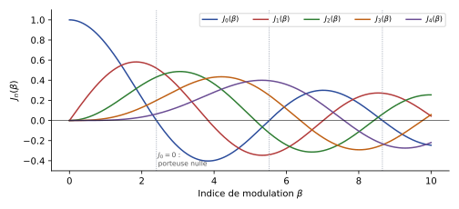



Dans une modulation **angulaire**, l'information est portée par la **fréquence** (modulation FM) ou la **phase** (modulation PM) instantanée du signal modulé ; son amplitude reste constante. Ce chapitre étudie la modulation de fréquence (indice de modulation, spectre de Bessel, puissance, règle de Carson, modulateur et démodulateur), puis la modulation de phase, et termine par un bilan des modulations analogiques.

Notation : le support écrit la fréquence porteuse $f_0$ aux pages 34 à 44 et $f_p$ ensuite ; ce chapitre écrit **$f_p$** partout (table des notations de la [fiche matière](../index.qmd)).

## Principe des modulations angulaires {#sec-principe-angulaires}

::: {#def-modulation-angulaire}
## Modulations angulaires (FM, PM)

Une modulation angulaire consiste à introduire l'information du signal modulant dans la **fréquence instantanée** (modulation FM) ou dans la **phase instantanée** (modulation PM) du signal modulé [mod-ana, p. 34] :

$$
s(t) = A\cos\bigl(2\pi f_p t + \varphi(t)\bigr).
$$ {#eq-signal-angulaire}
:::

::: {#def-phase-frequence-instantanees}
## Phase et fréquence instantanées

$$
\theta_i(t) = 2\pi f_p t + \varphi(t),
\qquad
f_i(t) = \frac{1}{2\pi}\,\frac{\mathrm{d}\theta_i(t)}{\mathrm{d}t} = f_p + \frac{1}{2\pi}\,\frac{\mathrm{d}\varphi(t)}{\mathrm{d}t}.
$$ {#eq-phase-frequence-instantanees}

[mod-ana, p. 34]
:::

Avantages des modulations angulaires [mod-ana, p. 34] :

- signal modulé à **enveloppe constante** : meilleur rendement des émetteurs (amplificateurs de puissance en classes non linéaires) ;
- bonne **immunité au bruit**, rapport signal à bruit (SNR) favorable : meilleure sensibilité des récepteurs ;
- moins sensibles que la modulation AM aux non-linéarités des blocs radio.

::: {.complement}
L'enveloppe constante explique les deux premiers avantages : l'information n'étant pas dans l'amplitude, un amplificateur non linéaire (saturé, donc efficace) ne la déforme pas, et un bruit additif qui modifie surtout l'amplitude perturbe peu la phase.
:::

## Modulation de fréquence (FM) {#sec-fm}

### Principe {#sec-fm-principe}

::: {#def-fm}
## Modulation FM

Le signal modulant $m(t)$ est introduit **de manière linéaire** dans la fréquence instantanée du signal modulé [mod-ana, p. 35] :

$$
f_i(t) = f_p + k_f\,m(t).
$$ {#eq-fm-frequence}

La phase instantanée devient

$$
\theta_i(t) = 2\pi\int_0^t f_i(u)\,\mathrm{d}u = 2\pi f_p t + 2\pi k_f\int_0^t m(u)\,\mathrm{d}u,
$$

et le signal modulé FM s'écrit

$$
s_{FM}(t) = A\cos\Bigl[2\pi f_p t + 2\pi k_f\int_0^t m(u)\,\mathrm{d}u\Bigr].
$$ {#eq-fm}
:::

$k_f$ est la **sensibilité du modulateur**, en Hz/V [mod-ana, p. 45].

### Modulant sinusoïdal : excursion et indice de modulation {#sec-fm-sinus}

Avec $m(t) = A_m\cos(2\pi f_m t)$, la fréquence instantanée [mod-ana, p. 36]

$$
f_i(t) = f_p + k_f A_m\cos(2\pi f_m t)
$$

varie de manière sinusoïdale de $f_p - \Delta f$ à $f_p + \Delta f$ (@fig-signal-fm), avec

$$
\Delta f = k_f A_m,
$$ {#eq-excursion}

l'**excursion maximale en fréquence instantanée**.

La phase instantanée vaut [mod-ana, p. 37]

$$
\theta_i(t) = 2\pi\int_0^t f_i(u)\,\mathrm{d}u = 2\pi f_p t + \frac{k_f A_m}{f_m}\sin(2\pi f_m t).
$$

::: {#def-indice-modulation}
## Indice de modulation

$$
\beta = \frac{k_f A_m}{f_m} = \frac{\Delta f}{f_m},
\qquad
s_{FM}(t) = A\cos\bigl[2\pi f_p t + \beta\sin(2\pi f_m t)\bigr].
$$ {#eq-fm-sinus}

$\beta$ est appelé l'**indice de modulation** [mod-ana, p. 37].
:::

![Modulation de fréquence par un modulant sinusoïdal : le modulant, la fréquence instantanée, qui oscille entre $f_p - \Delta f$ et $f_p + \Delta f$, et le signal FM, d'amplitude constante. D'après le support [mod-ana, p. 36-37], recalculée ($f_p = 12 f_m$, $\beta = 8$).](../figures/03-signal-fm.svg){#fig-signal-fm}

::: {.notes-externes}
« $\Delta f$ est l'excursion maximale en fréquence instantanée, c'est-à-dire qu'on l'observe en fonction du temps » ; pour un signal aléatoire, la fréquence $f_m$ de l'indice est remplacée par la bande du modulant [notes-2023-ana, p. 5] (voir @sec-fm-quelconque).
:::

### Analyse spectrale : fonctions de Bessel {#sec-fm-bessel}

Pour représenter $s_{FM}(t)$ en fonction de la fréquence, on le réécrit sous la forme [mod-ana, p. 38] :

$$
s_{FM}(t) = A\sum_{n=-\infty}^{+\infty} J_n(\beta)\cos\bigl[2\pi(f_p + n f_m)t\bigr],
$$ {#eq-fm-bessel}

où $J_n(\beta)$ est la **fonction de Bessel de première espèce d'ordre $n$** :

$$
J_n(\beta) = \sum_{m=0}^{+\infty}\frac{(-1)^m\,(\beta/2)^{n+2m}}{m!\,(n+m)!}.
$$ {#eq-bessel}

::: {.a-verifier .tranche #av-signe-serie-bessel}
**Source** [mod-ana, p. 38] : « $J_n(\beta) = \sum_{m=0}^{+\infty}\frac{(-1)^n(\beta/2)^{n+2m}}{m!\,(n+m)!}$ ».

**Problème** : le signe alterné porte sur l'indice de sommation $m$, pas sur $n$. Avec $(-1)^n$, tous les termes ont le même signe et la série donnerait $I_n(\beta)$ (fonction de Bessel *modifiée*), qui ne s'annule jamais : ce n'est pas le tableau de la p. 39 ($J_0(3) = -0{,}26$).

**Proposition** : $(-1)^m$, comme dans @eq-bessel.

**Décision** : proposition retenue (décision déléguée par Armand, 2026-10-29).
:::

Le support donne un **tableau de valeurs de $J_n(\beta)$** pour $\beta$ de 0 à 7 et $n$ de 0 à 16 [mod-ana, p. 39]. Extrait (arrondi à $10^{-2}$) :

| $n$ \\ $\beta$ | 0,2 | 0,5 | 1 | 2 | 3 | 5 |
|---|---|---|---|---|---|---|
| 0 | 0,99 | 0,94 | 0,77 | 0,22 | −0,26 | −0,18 |
| 1 | 0,10 | 0,24 | 0,44 | 0,58 | 0,34 | −0,33 |
| 2 | 0,00 | 0,03 | 0,11 | 0,35 | 0,49 | 0,05 |
| 3 | | | 0,02 | 0,13 | 0,31 | 0,36 |
| 4 | | | | 0,03 | 0,13 | 0,39 |
| 5 | | | | 0,01 | 0,04 | 0,26 |
| 6 | | | | | 0,01 | 0,13 |
| 7 | | | | | | 0,05 |
| 8 | | | | | | 0,02 |

: Valeurs de $J_n(\beta)$ (cases vides : $|J_n| < 0{,}01$). Colonnes 0,2, 1, 2, 3, 5 : tableau du support [mod-ana, p. 39] ; colonne 0,5 : calculée (*Complément*), utilisée au TD 1. {#tbl-bessel}

{#fig-bessel}

![Spectre d'amplitude d'un signal FM à modulant sinusoïdal ($A = 1$) : raies $|J_n(\beta)|$ en $f_p + n f_m$ pour $\beta = 0{,}2$ ; 1 ; 3 ; 5. Zone grisée : bande de Carson $2(\beta + 1)f_m$. D'après le support [mod-ana, p. 40], recalculée.](../figures/03-spectres-fm.svg){#fig-spectres-fm}

**En théorie**, le module du spectre du signal FM est constitué [mod-ana, p. 41] :

- d'une **infinité de raies** distantes de $f_m$, centrées sur $f_p$ ;
- de raies d'amplitude $A\,J_n(\beta)$ ;
- de raies symétriques en $f_p \pm n f_m$, de même amplitude mais **en opposition de phase pour $n$ impair** : $J_{-n}(\beta) = (-1)^n J_n(\beta)$ ;
- le nombre de raies est infini, mais $J_n(\beta) \to 0$ quand $n \to \infty$.

::: {.a-verifier .tranche #av-symetrie-bessel}
**Source** [mod-ana, p. 41] : « Raies symétriques à $f_0 \pm nf_m$ de même amplitude mais en opposition de phase pour $n$ impair $A.J_n(\beta) = (-1)^n J_{-n}(\beta)$ ».

**Problème** : le facteur $A$ n'apparaît que d'un côté de l'égalité (elle serait fausse pour $A \neq 1$). Sans ce facteur, la relation est juste (et équivalente à la forme usuelle, puisque $(-1)^{2n} = 1$).

**Proposition** : $J_{-n}(\beta) = (-1)^n J_n(\beta)$.

**Décision** : proposition retenue (décision déléguée par Armand, 2026-10-29).
:::

::: {.complement}
- Pour $\beta \ll 1$ : $J_0 \approx 1$, $J_1 \approx \beta/2$ et $J_{n \geq 2} \approx 0$ : le spectre se réduit à la porteuse et à deux raies en $f_p \pm f_m$, comme en AM (mais la raie inférieure est en opposition de phase) : c'est la **FM à bande étroite** (@fig-spectres-fm, $\beta = 0{,}2$).
- L'amplitude de la porteuse, $A\,J_0(\beta)$, dépend de $\beta$ et s'**annule** pour $\beta = 2{,}405$ (@fig-bessel) : la puissance est alors entièrement dans les raies latérales.
:::

**En pratique**, à mesure que l'on s'éloigne de la porteuse, les raies s'atténuent : un nombre fini $N(\beta)$ de raies, de part et d'autre de $f_p$, suffit à représenter l'essentiel du signal FM, et une **bande passante finie** $B_s$ est possible [mod-ana, p. 42] :

$$
B_s = 2N(\beta)\,f_m.
$$ {#eq-bande-n-beta}

Reste à choisir $N(\beta)$.

### Puissance et règle de Carson {#sec-carson}

La puissance d'un signal FM se calcule par le théorème de Parseval sur les raies de @eq-fm-bessel [mod-ana, p. 43] :

$$
P_{FM} = \sum_{n=-\infty}^{+\infty}\frac{\bigl(A\,J_n(\beta)\bigr)^2}{2} = \frac{A^2}{2}\sum_{n=-\infty}^{+\infty}J_n^2(\beta) = \frac{A^2}{2}.
$$ {#eq-puissance-fm}

::: {.complement}
On a utilisé l'identité $\sum_{n=-\infty}^{+\infty}J_n^2(\beta) = 1$. Le résultat se retrouve directement : $s_{FM}$ est une sinusoïde d'amplitude constante $A$, de puissance $A^2/2$ quelle que soit la modulation. La modulation ne fait que **répartir** cette puissance entre la porteuse et les raies latérales.
:::

::: {#thm-carson}
## Règle de Carson

98 % de la puissance totale du signal FM est contenue dans les raies $n \in [-N(\beta), +N(\beta)]$ [mod-ana, p. 43] :

$$
\frac{A^2}{2}\sum_{n=-N(\beta)}^{+N(\beta)}J_n^2(\beta) \geq 0{,}98\,\frac{A^2}{2}
\quad\text{pour}\quad
N(\beta) = \beta + 1.
$$

La bande passante du signal FM s'écrit alors

$$
B_s = 2(\beta + 1)f_m.
$$ {#eq-carson}

- Pour $\beta \ll 1$ : $B_s \approx 2f_m$ ;
- pour $\beta \gg 1$ : $B_s \approx 2\beta f_m = 2\Delta f$.
:::

::: {.notes-externes}
Sur le tableau de Bessel, les notes de 2023 surlignent les valeurs à retenir selon que $\beta < 1$ (porteuse et premières raies) ou $\beta > 1$ (raies jusqu'à $n = \beta + 1$ environ) [notes-2023-ana, p. 6].
:::

::: {.complement}
$N(\beta) = \beta + 1$ n'est pas forcément entier : on retient les raies $|n| \leq \beta + 1$. Exemples (@tbl-bessel) : pour $\beta = 1$, $N = 2$ et $J_0^2 + 2(J_1^2 + J_2^2) = 0{,}999$ ; pour $\beta = 3$, $N = 4$ et la somme vaut $0{,}998$. La règle de Carson est donc un peu pessimiste : elle garantit au moins 98 %.
:::

### Modulant quelconque {#sec-fm-quelconque}

Pour un signal modulant quelconque, d'occupation spectrale $B_m$ [mod-ana, p. 44] :

$$
\beta_{FM} = \frac{\Delta f}{B_m} = \frac{k_f\,|m(t)|_\mathrm{max}}{B_m},
\qquad
B_s = 2(\beta_{FM} + 1)\,B_m = 2(\Delta f + B_m).
$$ {#eq-carson-quelconque}

$\Delta f$ est l'excursion maximale en fréquence instantanée.

::: {#exm-radio-fm}
## Radiodiffusion FM

En radiodiffusion, la bande FM s'étend de 88 à 108 MHz. L'excursion maximale autorisée est $\Delta f = 75\ \mathrm{kHz}$, et $B_m = 15\ \mathrm{kHz}$ (norme haute fidélité, HiFi). Alors [mod-ana, p. 44] :

$$
\beta_{FM} = \frac{\Delta f}{B_m} = 5,
\qquad
B_s = 2(\Delta f + B_m) = 180\ \mathrm{kHz}.
$$
:::

### Modulation et démodulation : principe {#sec-fm-mod-demod}

**Génération** : l'objectif est de réaliser une transformation **linéaire** d'une variation de tension $u$ en variation de fréquence [mod-ana, p. 45] :

$$
f(u) = f_p + k_f\,u,
$$

où $k_f$ est la sensibilité du modulateur, en Hz/V. C'est le rôle d'un **oscillateur commandé en tension** (VCO), comme l'oscillateur LC à varicap du [TD 2](../td/td02-modulateurs.qmd#exr-td2-modulateur-varicap).

**Démodulation** : l'objectif est la transformation inverse, linéaire, d'une variation de fréquence en variation de tension. Cette contrainte de linéarité est difficile à tenir ; plusieurs solutions existent [mod-ana, p. 45] :

- le **discriminateur** (ci-dessous) ;
- la **boucle à verrouillage de phase** (*Phase Locked Loop*, PLL), vue dans le cours de N. Deltimple sur les PLL ;
- d'autres circuits.

### Modulateur d'Armstrong {#sec-armstrong}

En développant @eq-signal-angulaire avec $\varphi(t) = 2\pi k_f\int_0^t m(u)\,\mathrm{d}u$ [mod-ana, p. 46] :

$$
s_{FM}(t) = A\cos(2\pi f_p t)\cos\varphi(t) - A\sin(2\pi f_p t)\sin\varphi(t).
$$

**À faible indice** : avec $m(t) = A_m\cos(2\pi f_m t)$, $\varphi(t) = \beta\sin(2\pi f_m t)$ et $|\varphi(t)| \leq \beta$. Si $\beta \ll 1$, alors $|\varphi(t)| \ll 1$, donc $\cos\varphi(t) \approx 1$ et $\sin\varphi(t) \approx \varphi(t)$ :

$$
s_{FM}(t) \approx A\cos(2\pi f_p t) - A\,\varphi(t)\sin(2\pi f_p t).
$$ {#eq-armstrong}

Le **modulateur d'Armstrong** réalise cette expression avec un intégrateur ($2\pi k_f\int_0^t$), un mélangeur, un déphaseur de $-\pi/2$ qui produit $A\sin(2\pi f_p t)$ à partir de la porteuse $A\cos(2\pi f_p t)$, et un sommateur (@fig-armstrong).

![Modulateur d'Armstrong (FM à faible indice $\beta$). D'après le support [mod-ana, p. 46], redessinée.](../figures/03-modulateur-armstrong.svg){#fig-armstrong}

::: {.complement}
@eq-armstrong n'utilise qu'un mélangeur, comme une modulation d'amplitude, mais avec une porteuse en **quadrature** : c'est ce qui distingue la FM à bande étroite de l'AMDBAP, dont le spectre a la même largeur ($2f_m$). Pour obtenir un indice élevé, on multiplie ensuite la fréquence (une multiplication par $n$ multiplie aussi $\beta$ par $n$), technique classique non détaillée dans le support.
:::

### Démodulation par discrimination {#sec-discriminateur}

On dérive le signal FM [mod-ana, p. 47] :

$$
\frac{\mathrm{d}s_{FM}(t)}{\mathrm{d}t} = -A\Bigl(2\pi f_p + \frac{\mathrm{d}\varphi(t)}{\mathrm{d}t}\Bigr)\sin\bigl[2\pi f_p t + \varphi(t)\bigr],
\qquad
\text{en FM : }\ \frac{\mathrm{d}\varphi(t)}{\mathrm{d}t} = 2\pi k_f\,m(t),
$$

$$
\frac{\mathrm{d}s_{FM}(t)}{\mathrm{d}t} = -2\pi A\bigl(f_p + k_f\,m(t)\bigr)\sin\bigl[2\pi f_p t + \varphi(t)\bigr].
$$ {#eq-discriminateur}

L'information est maintenant contenue dans l'**enveloppe** du signal : un **filtre dérivateur** suivi d'un **détecteur d'enveloppe** restitue $m^*(t)$, image de $m(t)$ (@fig-discriminateur).

::: {.a-verifier .tranche #av-derivee-fm-facteur-2pi}
**Source** [mod-ana, p. 47] : « $\frac{dS_{FM}(t)}{dt} = -A.(2\pi f_P + k_f m(t))\sin[2\pi f_p t + \varphi(t)]$ ».

**Problème** : avec $\mathrm{d}\varphi/\mathrm{d}t = 2\pi k_f\,m(t)$ (écrit sur la même diapositive), le terme en $m(t)$ doit garder le facteur $2\pi$.

**Proposition** : $-A\bigl(2\pi f_p + 2\pi k_f\,m(t)\bigr)\sin[\dots] = -2\pi A\bigl(f_p + k_f\,m(t)\bigr)\sin[\dots]$ (@eq-discriminateur). La conclusion (enveloppe affine en $m(t)$) est inchangée.

**Décision** : proposition retenue (décision déléguée par Armand, 2026-10-29).
:::

![Démodulation FM par discrimination : signal FM, sa dérivée (enveloppe $\propto f_p + k_f m(t)$, en pointillés) et sortie du détecteur d'enveloppe. D'après le support [mod-ana, p. 47], recalculée ($f_p = 12 f_m$, $\Delta f = 6 f_m$).](../figures/03-discriminateur.svg){#fig-discriminateur}

::: {.complement}
L'enveloppe $2\pi A(f_p + k_f m(t))$ reste positive tant que $\Delta f < f_p$ : la sortie du détecteur vaut $m(t)$ à un gain et à une composante continue ($\propto f_p$) près, que l'on retire par un condensateur de liaison. L'amplitude $A$ intervient dans le gain : en pratique, on fait précéder le dérivateur d'un **limiteur** qui rend l'amplitude constante.
:::

## Modulation de phase (PM) {#sec-pm}

::: {#def-pm}
## Modulation PM

Le signal modulant $m(t)$ est introduit **de manière linéaire** dans la phase du signal modulé [mod-ana, p. 48] :

$$
\varphi(t) = k_p\,m(t),
\qquad
s_{PM}(t) = A\cos\bigl[2\pi f_p t + k_p\,m(t)\bigr].
$$ {#eq-pm}
:::

**Modulant sinusoïdal**, $m(t) = A_m\cos(2\pi f_m t)$ :

$$
s_{PM}(t) = A\cos\bigl[2\pi f_p t + \beta_{PM}\cos(2\pi f_m t)\bigr],
\qquad
\beta_{PM} = k_p A_m,
$$ {#eq-pm-sinus}

où $\beta_{PM}$ est l'**indice de modulation** du signal modulé en phase. Occupation spectrale suivant la règle de Carson :

$$
B_{PM} = 2(\beta_{PM} + 1)f_m.
$$ {#eq-carson-pm}

C'est la **même théorie que la modulation de fréquence** [mod-ana, p. 48].

### Modulation et démodulation du signal PM {#sec-pm-mod-demod}

Un modulateur PM s'obtient en plaçant un **filtre dérivateur** devant un **modulateur de fréquence** [mod-ana, p. 49] :

$$
s_{PM}(t) = A\cos\Bigl[2\pi f_p t + k_p\int\frac{\partial m(u)}{\partial u}\,\mathrm{d}u\Bigr] = A\cos\bigl[2\pi f_p t + k_p\,m(t)\bigr].
$$

À retenir :

- à une intégrale ou une dérivée près selon le cas, les modulateurs de phase et de fréquence se ressemblent ;
- un signal modulé en fréquence présente toujours aussi une modulation de phase, et inversement ;
- les démodulateurs, comme les modulateurs, se ressemblent à une intégrale ou une dérivée près.

::: {.complement}
- Si le modulateur de fréquence a une sensibilité $k_f$, sa phase vaut $2\pi k_f\int m'(u)\,\mathrm{d}u = 2\pi k_f\,m(t)$ : on obtient une PM de sensibilité $k_p = 2\pi k_f$ (à la constante d'intégration près).
- Pour la PM, la fréquence instantanée vaut $f_i = f_p + \frac{k_p}{2\pi}\frac{\mathrm{d}m}{\mathrm{d}t}$ ; avec un modulant sinusoïdal, l'excursion est $\Delta f = \beta_{PM} f_m$ : on retrouve $\beta = \Delta f/f_m$ comme en FM. La différence : en FM, $\beta$ diminue quand $f_m$ augmente (à $\Delta f$ fixé) ; en PM, $\beta_{PM} = k_p A_m$ ne dépend pas de $f_m$.
:::

## Questions de cours {#sec-questions-angulaires}

::: {#exr-questions-angulaires}
## Questions du support sur les modulations angulaires

[mod-ana, p. 50]

1. Quel(s) paramètre(s) d'un signal permet(tent) de supporter une modulation angulaire ?
2. Quel est le principe d'une modulation FM ? PM ?
3. Quelles sont les trois caractéristiques importantes d'un signal modulé FM ?
4. Quelle est en théorie la bande passante d'un signal modulé FM ?
5. Quelles sont les caractéristiques harmoniques d'un signal modulé FM ?
6. Selon la règle de Carson, quelle est la bande passante utile d'un signal FM ?
7. Quelle conséquence sur le spectre si $\beta \ll 1$ ? $\beta \gg 1$ ?
8. Comment obtient-on un (dé)modulateur PM à partir d'un (dé)modulateur FM ?
9. Quel circuit simple permet de réaliser cette fonction ?
10. Pourquoi ne choisit-on pas un indice $\beta < 1$ ou $\beta > 20$ ?
:::

:::: {.notes-externes}
::: {.solution}
Réponses des notes de 2023 [notes-2023-ana, p. 7] (les deux erreurs relevées sont corrigées dans le bloc suivant) :

2. Introduire l'information de manière linéaire dans la phase (PM).
3. Excursion maximale en fréquence instantanée ; indice de modulation ; bande passante.
4. Elle est infinie.
5. Raies symétriques puis qui diminuent quand on s'éloigne.
6. $B_s = 2(\beta_{FM} + 1)B_m$.
8. On doit réaliser une action dérivée.
9. Un circuit RC.
10. Si $\beta > 20$, pour un signal de 100 kHz de bande passante, on obtient après modulation 4000 kHz : la bande passante est trop élevée.
:::
::::

::: {.complement}
- 1 : la **fréquence** ou la **phase** de la porteuse (les notes écrivent « fréquence ou amplitude », ce qui est faux : l'amplitude est le paramètre des modulations linéaires).
- 2 : FM, $m(t)$ introduit linéairement dans la fréquence instantanée ; PM, dans la phase (@def-fm, @def-pm).
- 5 : raies en $f_p \pm n f_m$, d'amplitude $A|J_n(\beta)|$, symétriques autour de **$f_p$** (et non de 0), décroissantes loin de $f_p$.
- 7 : $\beta \ll 1$ : $B_s \approx 2f_m$, porteuse et deux raies (spectre semblable à l'AM) ; $\beta \gg 1$ : $B_s \approx 2\beta f_m = 2\Delta f$ (les notes écrivent « $B_s = 2\beta_{FM}$ », sans le facteur $f_m$).
- 9 : le dérivateur le plus simple est un filtre **CR passe-haut** utilisé loin sous sa fréquence de coupure ($H(j\omega) \approx jRC\omega$).
- 10 : avec $\beta < 1$, on perd l'avantage de la FM (immunité au bruit, qui augmente avec $\beta$) ; avec $\beta > 20$, la bande $2(\beta + 1)B_m$ devient excessive : $2 \times 21 \times 100\ \mathrm{kHz} = 4{,}2\ \mathrm{MHz}$ pour l'exemple des notes (qui arrondissent à $2\beta B_m = 4000\ \mathrm{kHz}$).
:::

## Exercices du TD {#sec-exercices-td-ch03}

Les TD sont corrigés question par question dans leurs propres pages, énoncé découpé à l'appui :

- [TD 1, partie III : modulation de fréquence analogique](../td/td01-gnuradio-modulations.qmd#sec-td01-ex3) (et l'[ancienne version de 2023](../td/td01-gnuradio-modulations.qmd#sec-exemples-2023-fm)) ;
- [TD 2, exercice 1 : modulateur FM à diode varicap](../td/td02-modulateurs.qmd#sec-td02-ex1) ;
- [TD 3, exercice 2 : démodulateur FM à intégrateur](../td/td03-demodulateurs.qmd#sec-td03-ex2).

## Bilan des modulations analogiques {#sec-bilan-analogiques}

Conclusion du support [mod-ana, p. 52-53] :

- **Modulation** : le principe est de décaler en fréquence, vers le haut ou vers le bas, une information $m(t)$.
- **Type de modulation** : l'information ou message $m(t)$, appelé signal modulant, peut être introduit dans l'amplitude, la phase ou la fréquence du signal modulé $s(t) = A(t)\cos(2\pi f(t)t + \varphi_c(t))$ :

  | Modulations linéaires (amplitude) | Modulations angulaires (fréquence, phase) |
  |---|---|
  | + simples à mettre en œuvre | + robustes aux perturbations (bon SNR) |
  | + encombrement spectral réductible (AMDB → BLU) | + meilleur rendement des émetteurs |
  | − mauvais rendement des émetteurs | − systèmes de (dé)modulation complexes |
  | − peu robustes aux perturbations | |

- **Transformée de Fourier** : principal outil mathématique d'étude des modulations analogiques ; elle permet de passer du domaine temporel au domaine spectral.
- **Représentation spectrale** : les signaux modulés sont étudiés pour un modulant sinusoïdal, puis le résultat est généralisé à des modulants quelconques.
- **Caractéristiques d'une modulation** : AM, taux de modulation $k_{AM}$ ; FM, indice $\beta_{FM}$ et bande utile $B_{FM}$ ; PM, indice $\beta_{PM}$ et bande utile $B_{PM}$.

La transition vers les modulations numériques (p. 54 du support) ouvre le [chapitre 4](04-modulations-numeriques.qmd).

## À retenir {#sec-retenir-angulaires}

- Modulations angulaires : information dans la phase ou la fréquence instantanée, $\theta_i = 2\pi f_p t + \varphi(t)$, $f_i = f_p + \frac{1}{2\pi}\frac{\mathrm{d}\varphi}{\mathrm{d}t}$ (@eq-phase-frequence-instantanees) ; enveloppe constante.
- FM : $f_i = f_p + k_f m(t)$, $s_{FM} = A\cos[2\pi f_p t + 2\pi k_f\int_0^t m]$ (@eq-fm) ; $k_f$ en Hz/V.
- Modulant sinusoïdal : $\Delta f = k_f A_m$, $\beta = \Delta f/f_m$, $s_{FM} = A\cos[2\pi f_p t + \beta\sin(2\pi f_m t)]$ (@eq-fm-sinus).
- Spectre : raies $A J_n(\beta)$ en $f_p + n f_m$ (@eq-fm-bessel), $J_{-n} = (-1)^n J_n$, infinité de raies en théorie.
- Puissance $P_{FM} = A^2/2$, indépendante de $\beta$ (@eq-puissance-fm).
- Carson : 98 % de la puissance pour $|n| \leq \beta + 1$ ; $B_s = 2(\beta + 1)f_m$ (@eq-carson) ; quelconque : $\beta = \Delta f/B_m$, $B_s = 2(\Delta f + B_m)$ (@eq-carson-quelconque) ; radio FM : 180 kHz.
- Modulateur d'Armstrong (faible indice) : $s \approx A\cos(2\pi f_p t) - A\varphi(t)\sin(2\pi f_p t)$ (@eq-armstrong).
- Discriminateur : dérivateur + détecteur d'enveloppe, enveloppe $\propto f_p + k_f m(t)$ (@eq-discriminateur).
- PM : $s_{PM} = A\cos[2\pi f_p t + k_p m(t)]$, $\beta_{PM} = k_p A_m$, $B_{PM} = 2(\beta_{PM} + 1)f_m$ (@eq-pm-sinus, @eq-carson-pm) ; PM = dérivateur + modulateur FM.
