

::: {.complement}
Énoncé découpé question par question [td1] ; **solutions rédigées par Claude** (*Complément*) : il n'y a ni notes d'Armand ni corrigé pour cette version du TD. Les valeurs qui dépendent du fichier de simulation (absent des sources) ne sont données qu'en méthode. Le corrigé d'une ancienne version du TD 1 (2023), dont l'énoncé manque, est repris en fin de page.

L'énoncé numérote deux questions « III.3 » : ici, la seconde est la question 4 de la partie III, et les suivantes sont décalées (III.4 → q5, III.5 → q6).
:::

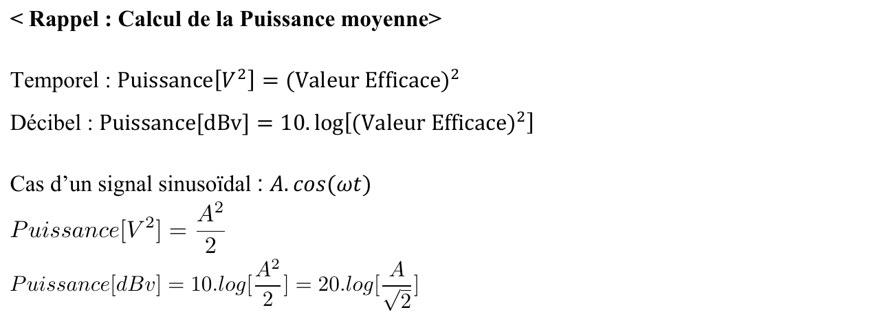{fig-alt="Rappel : puissance moyenne. Puissance[V²] = (valeur efficace)² ; Puissance[dBV] = 10 log[(valeur efficace)²] ; pour A cos(ωt) : A²/2 et 20 log(A/√2)."}

## Partie I : modulation d'amplitude analogique {#sec-td01-ex1}

::: {#exr-td1-am-sinus}
## Modulation AMDBAP, modulant sinusoïdal

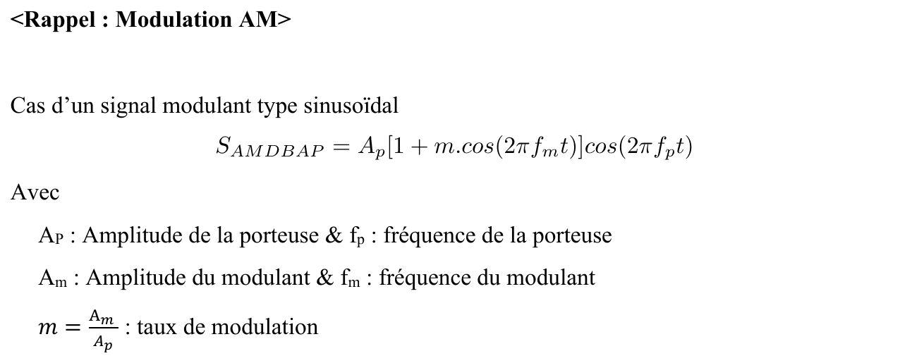{fig-alt="Rappel AM : S_AMDBAP = Ap[1 + m cos(2π fm t)] cos(2π fp t) ; Ap, fp amplitude et fréquence de la porteuse ; Am, fm celles du modulant ; m = Am/Ap taux de modulation."}
:::

Cours associé : [chapitre 2, AMDBAP](../cours/02-modulations-lineaires.qmd#sec-amdbap). Le taux noté $m$ dans le TD est le $k$ du cours.

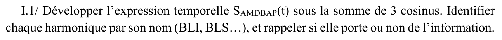{fig-alt="I.1 : développer S_AMDBAP(t) en somme de 3 cosinus ; identifier chaque harmonique (BLI, BLS…) et dire si elle porte de l'information."}

::: {.complement}
$S_{AMDBAP}(t) = A_p\cos(2\pi f_p t) + \frac{mA_p}{2}\cos[2\pi(f_p - f_m)t] + \frac{mA_p}{2}\cos[2\pi(f_p + f_m)t]$ : porteuse à $f_p$ (sans information), BLI à $f_p - f_m$ et BLS à $f_p + f_m$ (elles portent l'information, la même dans les deux) ([cours](../cours/02-modulations-lineaires.qmd#eq-amdbap-trois-raies)).
:::

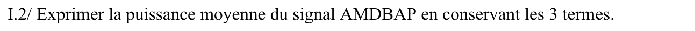{fig-alt="I.2 : puissance moyenne du signal AMDBAP en conservant les 3 termes."}

::: {.complement}
$P_{AMDBAP} = \dfrac{A_p^2}{2} + 2 \times \dfrac{(mA_p/2)^2}{2} = \dfrac{A_p^2}{2}\Bigl(1 + \dfrac{m^2}{2}\Bigr)$ ; ici $0{,}75\ \mathrm{V^2}$.
:::

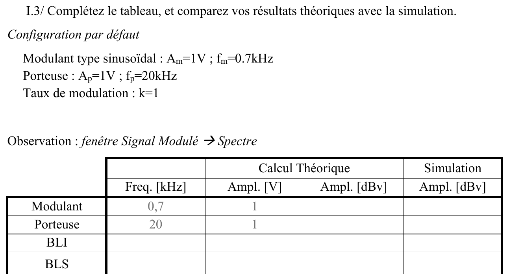{fig-alt="I.3 : compléter le tableau (fréquence, amplitude en V et dBV, théorie et simulation) du modulant, de la porteuse, de la BLI et de la BLS. Configuration par défaut : Am = 1 V, fm = 0,7 kHz ; Ap = 1 V, fp = 20 kHz ; k = 1."}

::: {.complement}
Calcul théorique ($20\log(A/\sqrt2)$ ; la colonne « simulation » se remplit en séance) :

| | Fréquence (kHz) | Amplitude (V) | Amplitude (dBV) |
|---|---|---|---|
| Modulant | 0,7 | 1 | −3,0 |
| Porteuse | 20 | 1 | −3,0 |
| BLI | 19,3 | 0,5 | −9,0 |
| BLS | 20,7 | 0,5 | −9,0 |
:::

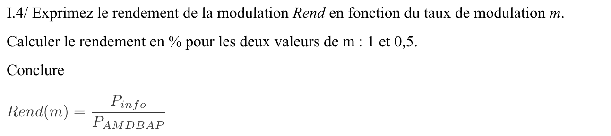{fig-alt="I.4 : rendement Rend(m) = Pinfo/P_AMDBAP en fonction de m ; le calculer pour m = 1 et 0,5 ; conclure."}

::: {.complement}
$P_\mathrm{info} = (mA_p/2)^2/2$ par bande, d'où $\mathrm{Rend}(m) = \dfrac{2P_\mathrm{info}}{P_{AMDBAP}} = \dfrac{m^2}{2 + m^2}$ ([cours](../cours/02-modulations-lineaires.qmd#eq-rendement-amdbap)) : $33{,}3\ \%$ pour $m = 1$, $11{,}1\ \%$ pour $m = 0{,}5$. Le rendement est faible et diminue vite avec $m$ : on a intérêt à travailler avec $m$ proche de 1, sans dépasser 1 (surmodulation). (La formule de l'énoncé compte les deux bandes latérales dans $P_\mathrm{info}$.)
:::

## Partie II : modulations d'amplitude numériques {#sec-td01-ex2}

::: {#exr-td1-ask-numerique}
## Modulations d'amplitude numériques

{fig-alt="Configuration : fenêtre Signal Modulant, Temporel, case « Random Data » cochée."}
:::

Cours associé : [chapitre 4, OOK](../cours/04-modulations-numeriques.qmd#eq-ook).

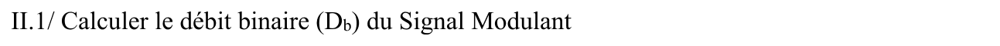{fig-alt="II.1 : calculer le débit binaire Db du signal modulant."}

::: {.complement}
Mesurer la durée $T_r$ d'un bit (le plus court palier du signal aléatoire) : $D_b = 1/T_r$.
:::

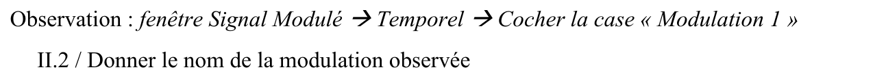{fig-alt="II.2 : fenêtre Signal Modulé, Temporel, « Modulation 1 » : nom de la modulation observée."}

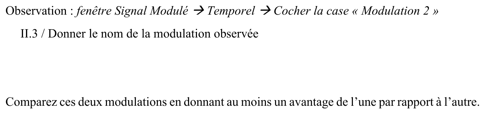{fig-alt="II.3 : « Modulation 2 » : nom de la modulation observée ; comparer les deux modulations avec au moins un avantage de l'une sur l'autre."}

::: {.complement}
(Questions 2 et 3.) Les deux formes possibles d'une ASK à deux niveaux sont l'**OOK** (amplitudes $0$ et $E$, la porteuse disparaît pendant les « 0 ») et l'ASK **antipodale** (amplitudes $\pm E$, identique à la BPSK) ; l'identification se fait sur l'allure observée. Avantage de l'OOK : démodulation simple par détecteur d'enveloppe ([TD 3](td03-demodulateurs.qmd#exr-td3-detecteur-ook)) ; avantage de l'antipodale : pas de raie de porteuse (toute la puissance porte l'information) et, à puissance crête égale, points deux fois plus éloignés (meilleure détectabilité).
:::

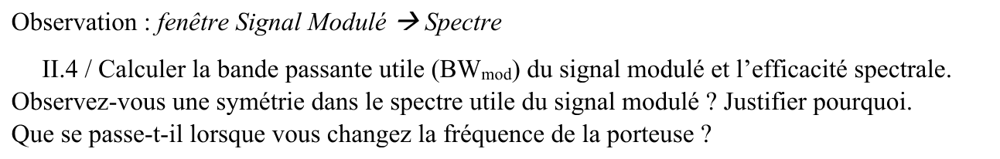{fig-alt="II.4 : fenêtre Spectre : bande passante utile BWmod et efficacité spectrale ; symétrie du spectre utile, pourquoi ; effet d'un changement de fréquence porteuse."}

::: {.complement}
$BW_{mod} = 2D_b$ (lobe principal) et $\eta = 0{,}5$ ([cours](../cours/04-modulations-numeriques.qmd#eq-bpsk)). Le spectre est symétrique autour de $f_p$ : le modulant est réel, ses bandes latérales inférieure et supérieure sont images l'une de l'autre (comme en AM double bande). Changer la fréquence porteuse translate le spectre sans changer sa forme ni sa largeur.
:::

## Partie III : modulation de fréquence analogique {#sec-td01-ex3}

::: {#exr-td1-fm}
## Modulation FM, modulant sinusoïdal

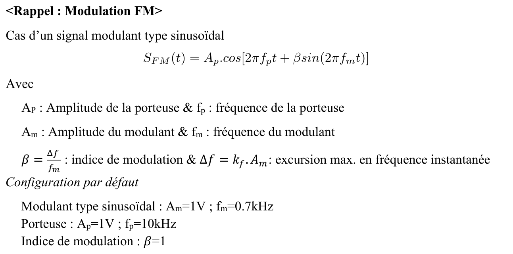{fig-alt="Rappel FM : S_FM(t) = Ap cos[2π fp t + β sin(2π fm t)], β = Δf/fm, Δf = kf Am. Configuration par défaut : Am = 1 V, fm = 0,7 kHz ; Ap = 1 V, fp = 10 kHz ; β = 1."}
:::

Cours associé : [chapitre 3, spectre FM](../cours/03-modulations-angulaires.qmd#sec-fm-bessel).

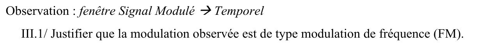{fig-alt="III.1 : justifier, sur le signal temporel, que la modulation observée est une FM."}

::: {.complement}
L'amplitude reste constante ; seule la durée des périodes (donc la fréquence instantanée) varie, au rythme du modulant.
:::

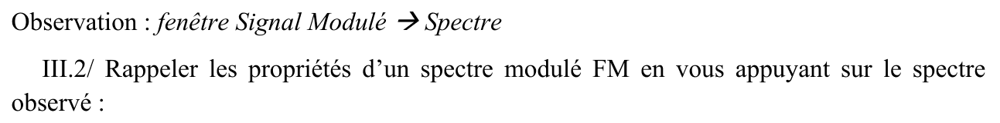{fig-alt="III.2 : rappeler les propriétés d'un spectre FM en s'appuyant sur le spectre observé."}

::: {.complement}
Raies espacées de $f_m$, centrées sur $f_p$, d'amplitude $A_p|J_n(\beta)|$, symétriques, décroissantes loin de $f_p$ ; pour $\beta = 1$ : porteuse 0,77 V, raies 0,44 V, 0,11 V, 0,02 V ([table de Bessel](../cours/03-modulations-angulaires.qmd#tbl-bessel)).
:::

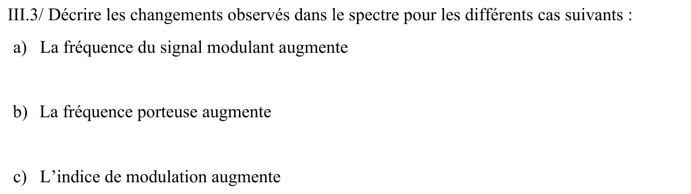{fig-alt="III.3 : changements du spectre quand a) la fréquence du modulant augmente ; b) la fréquence porteuse augmente ; c) l'indice de modulation augmente."}

::: {.complement}
a) À $\Delta f$ fixé, l'espacement des raies ($f_m$) augmente et $\beta = \Delta f/f_m$ diminue : moins de raies significatives. (Si c'est $\beta$ qui est fixé dans le logiciel, seules les raies s'écartent et la bande $2(\beta+1)f_m$ augmente.) b) Le spectre est translaté, sans changer de forme. c) L'énergie se répartit sur davantage de raies : la bande s'élargit, l'amplitude de la porteuse $J_0(\beta)$ diminue (et s'annule pour $\beta = 2{,}405$).
:::

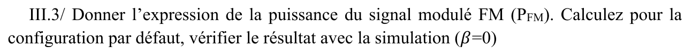{fig-alt="III.3 (seconde, question 4) : expression de la puissance PFM ; la calculer pour la configuration par défaut, vérifier en simulation (β = 0)."}

::: {.complement}
$P_{FM} = A_p^2/2 = 0{,}5\ \mathrm{V^2}$ ([cours](../cours/03-modulations-angulaires.qmd#eq-puissance-fm)), indépendante de $\beta$ : on peut la vérifier sur la porteuse non modulée ($\beta = 0$), seule raie alors présente, ce que demande l'énoncé.
:::

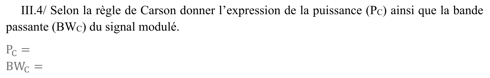{fig-alt="III.4 (question 5) : selon la règle de Carson, expression de la puissance PC et de la bande passante BWC du signal modulé."}

::: {.complement}
$P_C = \dfrac{A_p^2}{2}\displaystyle\sum_{n=-N}^{N}J_n^2(\beta)$, avec $N$ = partie entière de $\beta + 1$ ; $BW_C = 2(\beta + 1)f_m$ ([cours](../cours/03-modulations-angulaires.qmd#eq-carson)).
:::

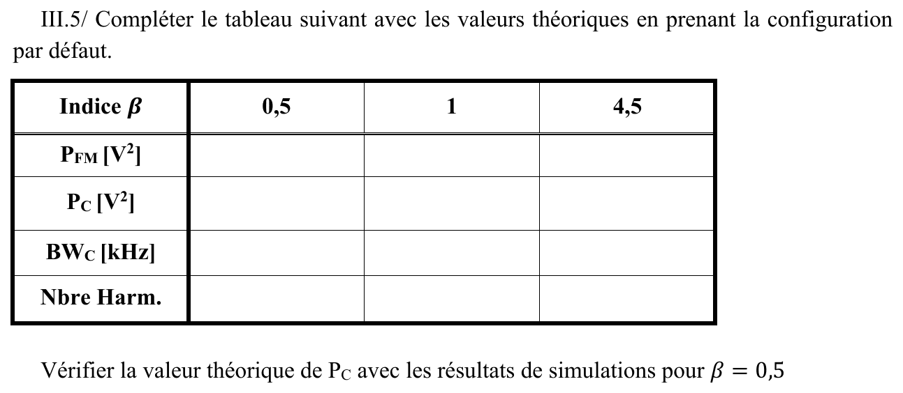{fig-alt="III.5 (question 6) : compléter le tableau PFM, PC, BWC et nombre d'harmoniques pour β = 0,5 ; 1 ; 4,5 ; vérifier PC en simulation pour β = 0,5."}

::: {.complement}
Avec $f_m = 0{,}7\ \mathrm{kHz}$ et $A_p = 1\ \mathrm{V}$ (sommes calculées avec les valeurs exactes de $J_n$) :

| $\beta$ | 0,5 | 1 | 4,5 |
|---|---|---|---|
| $P_{FM}$ ($\mathrm{V^2}$) | 0,5 | 0,5 | 0,5 |
| $N$ (raies de part et d'autre) | 1 | 2 | 5 |
| $P_C$ ($\mathrm{V^2}$) | 0,499 | 0,4996 | 0,492 |
| $BW_C$ (kHz) | 2,1 | 2,8 | 7,7 |
| Nombre de raies ($2N + 1$) | 3 | 5 | 11 |

Pour $\beta = 0{,}5$ : $P_C = \frac12[J_0^2 + 2J_1^2] = \frac12[0{,}938^2 + 2 \times 0{,}242^2] = 0{,}499\ \mathrm{V^2}$.
:::

## Partie IV : modulation de fréquence numérique {#sec-td01-ex4}

::: {#exr-td1-fsk}
## Modulation de fréquence numérique

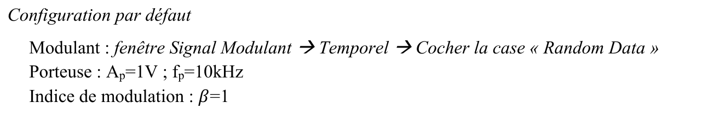{fig-alt="Configuration par défaut : modulant aléatoire (Random Data) ; porteuse Ap = 1 V, fp = 10 kHz ; β = 1."}
:::

Cours associé : [chapitre 4, FSK](../cours/04-modulations-numeriques.qmd#sec-fsk-cpfsk).

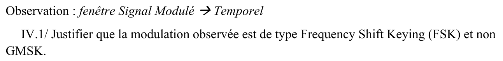{fig-alt="IV.1 : justifier que la modulation observée est une FSK et non une GMSK."}

::: {.complement}
Les changements de fréquence sont brusques à chaque transition de bit ; en GMSK, le filtre gaussien adoucit les transitions de fréquence (et l'excursion vaut $D/4$).
:::

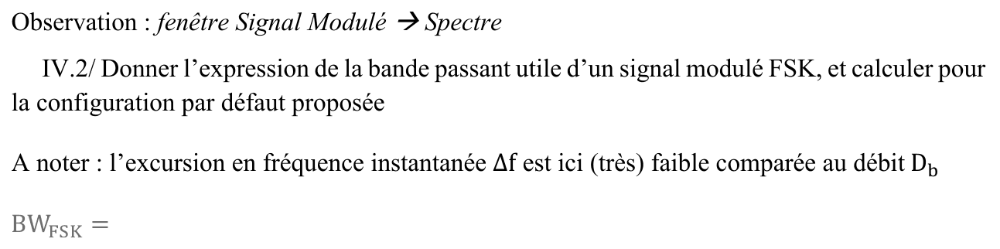{fig-alt="IV.2 : expression de la bande passante utile d'un signal FSK et calcul pour la configuration par défaut ; Δf est très faible devant Db."}

::: {.complement}
Par la règle de Carson, avec un modulant binaire de débit $D$ : $BW_{FSK} \approx 2(\Delta f + D)$ (forme du corrigé de 2023, [TD 2](td02-modulateurs.qmd#exr-td2-fsk-varicap)) ; si $\Delta f \ll D$, $BW_{FSK} \approx 2D$. La valeur numérique dépend du débit de la simulation.
:::

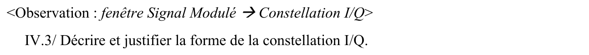{fig-alt="IV.3 : décrire et justifier la forme de la constellation I/Q."}

::: {.complement}
Les points se déplacent **sur un cercle** de rayon $A_p$ : l'amplitude est constante, seule la phase tourne, dans un sens pour un « 1 » et dans l'autre pour un « 0 » [mod-num, p. 24-25].
:::

## Ancienne version du TD 1 (corrigé de 2023) {#sec-td01-2023}

Le corrigé d'une ancienne version du TD 1 (« Principe des modulations », 2023) traite des exercices dont l'**énoncé n'est pas disponible** ; seules les données lisibles dans le corrigé sont reprises.

### Modulation d'amplitude {#sec-exemples-2023-am}

::: {.notes-externes}
[corrige-2023-td01, p. 1-2]

**Exemple 1.** Spectre d'un signal AMDBAP : porteuse de pulsation $2\pi f_0 = 3{,}77 \cdot 10^6\ \mathrm{rad/s}$, soit $f_p \approx 600\ \mathrm{kHz}$ ; raie de porteuse d'amplitude 100, raies latérales d'amplitude 43,5, BLI à 594,9 kHz.

- $f_m = f_p - f_{BLI} = f_{BLS} - f_p = 5{,}1\ \mathrm{kHz}$ ;
- les raies latérales valent $kA/2$, avec $A = 100$ : $k = 43{,}5/50 = 0{,}87$, soit 87 % (le corrigé marque d'un « ⚠ » le piège $k = A_m/A$) ;
- $B = 2f_m = 10{,}2\ \mathrm{kHz}$ ;
- $P = \frac{A_p^2}{2}\bigl(1 + \frac{m^2}{2}\bigr) = 6892\ \mathrm{V^2}$, soit $137{,}8\ \mathrm{W}$ dans $50\ \Omega$.

**Exemple 2.** AMDBAP de porteuse $f_p = 100\ \mathrm{kHz}$, modulant $f_m = 100\ \mathrm{Hz}$, enveloppe comprise entre $S_\mathrm{min} = 0{,}5$ et $S_\mathrm{max} = 1$ :

- $m = \frac{S_\mathrm{max} - S_\mathrm{min}}{S_\mathrm{max} + S_\mathrm{min}} = \frac13$ ;
- $S_\mathrm{max} = A_p(1 + m)$ donne $A_p = 3/4$ et $A_m = mA_p = 1/4$ ; raies : porteuse $3/4$ à 100 kHz, raies latérales $1/8$ à 99,9 et 100,1 kHz ;
- $\eta = \frac{m^2/2}{1 + m^2/2}$ : 33 % pour $m = 100\ \%$, 5 % pour $m = 33\ \%$.
:::

::: {.complement}
Contrôles : $3{,}77 \cdot 10^6/(2\pi) = 600{,}0\ \mathrm{kHz}$ ; $\frac{100^2}{2}(1 + 0{,}87^2/2) = 6892$ et $6892/50 = 137{,}8$ ; $m\,A_p/2 = \frac13 \cdot \frac34 \cdot \frac12 = \frac18$ ; $\frac{1/18}{1 + 1/18} = \frac{1}{19} \approx 5{,}3\ \%$. Le corrigé écrit deux fois « $f_p - f_m$ » pour 99,9 et 100,1 kHz : la seconde est $f_p + f_m$.
:::

### Modulation de fréquence {#sec-exemples-2023-fm}

::: {.notes-externes}
[corrige-2023-td01, p. 3]

- signal FM $s_{FM}(t) = A_p\cos(2\pi f_p t + \beta\sin(2\pi f_m t))$, où $\beta = \Delta f/f_m$ est l'indice de modulation et $\Delta f$ l'excursion maximale en fréquence instantanée ;
- **exemple** : $\Delta f = f_\mathrm{max} - f_p = 75\ \mathrm{kHz}$ et $f_m = 2{,}5\ \mathrm{kHz}$ donnent $\beta = 30$ et $B_{FM} = 2(\beta + 1)f_m = 155\ \mathrm{kHz}$.
:::

::: {.complement}
Contrôle : $2 \times 31 \times 2{,}5 = 155\ \mathrm{kHz}$, proche de $2\Delta f = 150\ \mathrm{kHz}$ ($\beta \gg 1$). Les autres exercices FM du corrigé (bande de 24 kHz, spectre à 9 raies) ne sont pas repris : leurs données viennent de l'énoncé manquant et ne peuvent pas être contrôlées.
:::

### Modulations numériques {#sec-exemples-2023-num}

::: {.notes-externes}
[corrige-2023-td01, p. 3-4]

- **OOK** : 6 bits en 0,6 ms, donc $T_b = 0{,}1\ \mathrm{ms}$, $D_b = 1/T_b = 10\ \mathrm{kbit/s}$ et $BW = 2D_b = 20\ \mathrm{kHz}$.
- **Modulation à amplitude constante, 8PSK** (la FSK étant écartée) : $N_{sym} = \log_2 8 = 3$ bits par symbole ; vitesse $D_b/3$ ; $\Delta\varphi = 45°$ ; $\eta = \dfrac{D_b}{2D_b/N_{sym}} = \dfrac32 = 1{,}5$.
:::
