

::: {.complement}
Énoncé découpé question par question [td2] ; sous chaque question, dans cet ordre : la correction d'Armand faite en séance (*Notes de cours*, [corrige-armand-td02], photos du 9 octobre 2026), le corrigé d'un ancien élève (*Notes externes*, [corrige-2023-td02]), puis les explications et contrôles ajoutés par Claude (*Complément*). Les valeurs numériques ont été recalculées.

Cours associé : [Modulations angulaires](../cours/03-modulations-angulaires.qmd#sec-fm) (exercice 1) et [Introduction aux modulations numériques](../cours/04-modulations-numeriques.qmd#sec-fsk-cpfsk) (exercices 2 et 3).
:::

## Exercice 1 : modulateur FM à diode varicap {#sec-td02-ex1}

::: {#exr-td2-modulateur-varicap}
## Modulateur FM à varicap

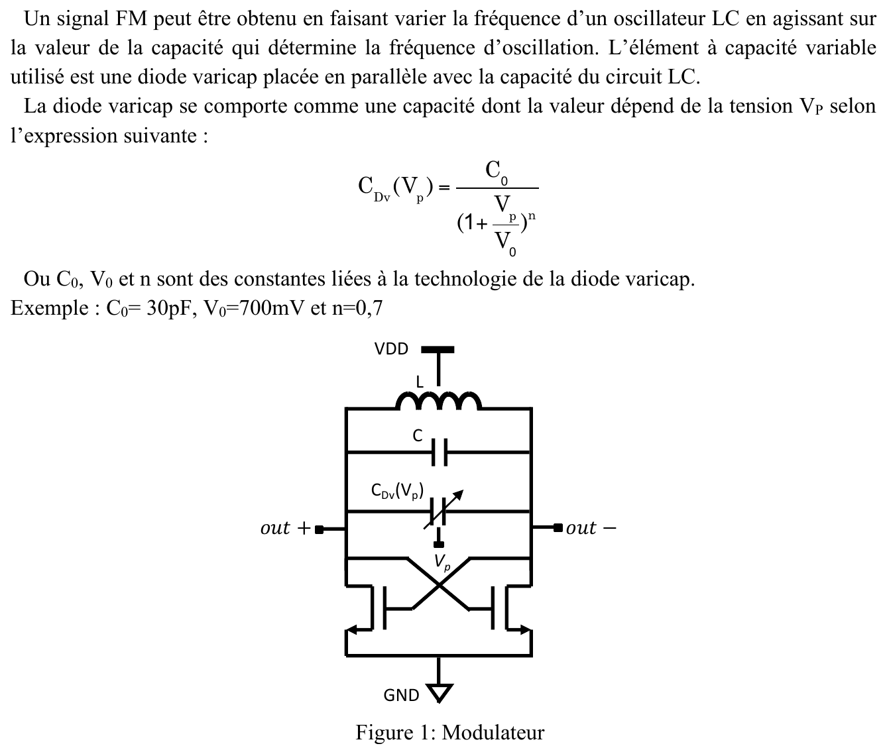{fig-alt="Un signal FM s'obtient en faisant varier la fréquence d'un oscillateur LC par une diode varicap en parallèle avec C : CDv(Vp) = C0/(1 + Vp/V0)^n, C0 = 30 pF, V0 = 700 mV, n = 0,7. Figure 1 : L entre VDD et les nœuds out+ et out−, C et CDv(Vp) entre ces nœuds, paire de transistors MOS croisés vers la masse."}
:::

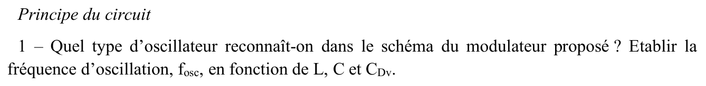{fig-alt="Principe du circuit. Q1 : quel type d'oscillateur reconnaît-on ? Établir la fréquence d'oscillation fosc en fonction de L, C et CDv."}

:::: {.notes}
::: {.solution}
$C_{eq} = C + C_{Dv}$ : circuit $LC$, $f_{osc} = \dfrac{1}{2\pi\sqrt{L\,C_{eq}}}$ [corrige-armand-td02, p. 1].
:::
::::

::: {.notes-externes}
Oscillateur à résistance négative : $f_{osc} = \dfrac{1}{2\pi\sqrt{L(C + C_{Dv})}}$ [corrige-2023-td02, p. 1].
:::

::: {.complement}
$C$ et $C_{Dv}$ sont en parallèle entre $out+$ et $out-$ : leurs capacités s'ajoutent. C'est un oscillateur $LC$ **à résistance négative** (la paire croisée de la question 2 entretient l'oscillation du résonateur), comme dans le cours de circuits intégrés (EANA3, oscillateurs).
:::

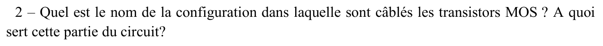{fig-alt="Q2 : nom de la configuration dans laquelle sont câblés les transistors MOS ; à quoi sert cette partie du circuit ?"}

:::: {.notes}
::: {.solution}
Les transistors sont montés en **paire croisée** ; elle sert à compenser les pertes du circuit $LC$ : résistance négative $-\dfrac{2}{g_m}$ [corrige-armand-td02, p. 1].
:::
::::

::: {.notes-externes}
Transistors câblés en paire croisée ; impédance équivalente $-2/g_m$ [corrige-2023-td02, p. 1].
:::

::: {.complement}
La résistance négative $-2/g_m$ vue entre $out+$ et $out-$ compense la résistance parallèle $R_p$ des pertes du résonateur : l'oscillation démarre si $2/g_m < R_p$.
:::

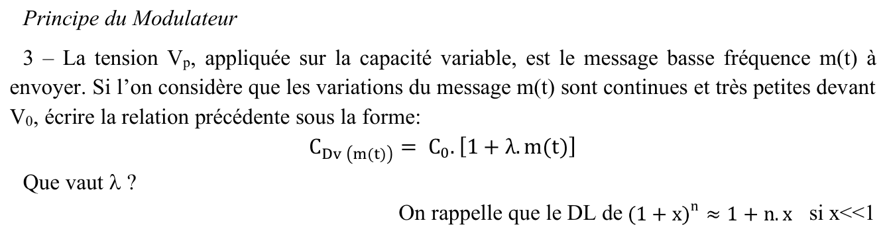{fig-alt="Principe du modulateur. Q3 : Vp est le message basse fréquence m(t), de variations continues et très petites devant V0 ; écrire CDv(m(t)) = C0[1 + λ m(t)]. Que vaut λ ? Rappel : (1 + x)^n ≈ 1 + n x si x << 1."}

:::: {.notes}
::: {.solution}
$C_{Dv}(V_p) = \dfrac{C_0}{(1 + V_p/V_0)^n}$ avec $V_p = m(t)$ ; avec $(1 + x)^\alpha \approx 1 + \alpha x$ si $|x| \ll 1$ :
$$C_{Dv} = C_0\Bigl(1 - n\,\frac{m(t)}{V_0}\Bigr) = C_0\bigl(1 + \lambda\,m(t)\bigr), \qquad \lambda = -\frac{n}{V_0}$$
[corrige-armand-td02, p. 1].
:::
::::

::: {.notes-externes}
$C_{Dv}(m) = C_0\bigl(1 + \frac{m}{V_0}\bigr)^{-n} \approx C_0\bigl(1 - \frac{n}{V_0}m\bigr)$, donc $\lambda = -n/V_0$ [corrige-2023-td02, p. 1].
:::

::: {.complement}
Numériquement, $\lambda = -0{,}7/0{,}7 = -1\ \mathrm{V^{-1}}$. L'approximation vaut si $|m| \ll V_0/n = 1\ \mathrm{V}$, ce que vérifie l'application ($|m|_\mathrm{max} = 10\ \mathrm{mV}$).
:::

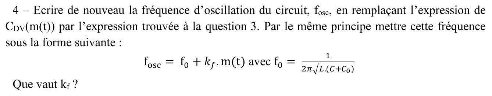{fig-alt="Q4 : réécrire fosc en remplaçant CDv par l'expression de la question 3 et la mettre sous la forme fosc = f0 + kf m(t) avec f0 = 1/(2π√(L(C + C0))). Que vaut kf ?"}

:::: {.notes}
::: {.solution}
$$f_{osc} = \frac{1}{2\pi\sqrt{L\bigl(C + C_0(1 + \lambda m(t))\bigr)}} = \frac{1}{2\pi}\Bigl[(C + C_0)L\Bigl(1 + \frac{C_0\lambda}{C + C_0}m(t)\Bigr)\Bigr]^{-1/2}.$$
Avec $\Bigl|\dfrac{C_0\lambda\,m(t)}{C + C_0}\Bigr| \ll 1$ :
$$f_{osc} = \frac{1}{2\pi\sqrt{L(C + C_0)}}\Bigl(1 - \frac12\,\frac{C_0\lambda}{C + C_0}\,m(t)\Bigr) = f_0 + k_f\,m(t),$$
$$k_f = -\frac{f_0 C_0\lambda}{2(C + C_0)} = \frac{f_0 C_0\,n}{2V_0(C + C_0)}, \qquad f_0 = \frac{1}{2\pi\sqrt{L(C + C_0)}}$$
[corrige-armand-td02, p. 1].
:::
::::

::: {.notes-externes}
Même calcul, $k_f = -\dfrac{\lambda f_0}{2}\,\dfrac{C_0}{C + C_0}$ [corrige-2023-td02, p. 1-2].
:::

::: {.complement}
$\lambda < 0$ donc $k_f > 0$ : la fréquence **augmente** avec $V_p$, puisque la capacité de la varicap diminue.
:::

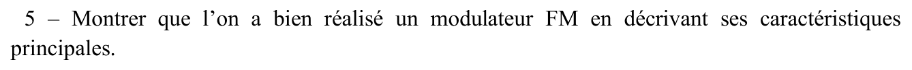{fig-alt="Q5 : montrer que l'on a bien réalisé un modulateur FM en décrivant ses caractéristiques principales."}

:::: {.notes}
::: {.solution}
Modulation FM, car la fréquence varie de manière linéaire en fonction du signal d'entrée [corrige-armand-td02, p. 2].
:::
::::

::: {.complement}
Caractéristiques : porteuse $f_0$, sensibilité $k_f$ (Hz/V), excursion $\Delta f = k_f|m|_\mathrm{max}$ ; l'amplitude d'oscillation ne dépend pas de $m$ ; linéarité tant que $|m| \ll V_0/n$. C'est un **VCO** ([cours, FM](../cours/03-modulations-angulaires.qmd#sec-fm)).
:::

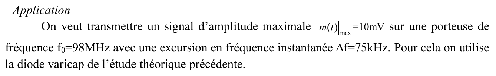{fig-alt="Application : transmettre un signal d'amplitude maximale |m(t)|max = 10 mV sur une porteuse f0 = 98 MHz avec une excursion Δf = 75 kHz, avec la diode varicap précédente."}

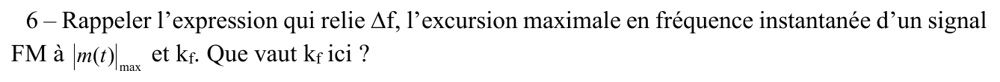{fig-alt="Q6 : rappeler la relation entre Δf, |m(t)|max et kf. Que vaut kf ici ?"}

:::: {.notes}
::: {.solution}
$\Delta f = |k_f|\,|m(t)|_\mathrm{max}$, donc $|k_f| = \dfrac{\Delta f}{|m(t)|_\mathrm{max}} = 7{,}5 \cdot 10^6\ \mathrm{Hz/V}$ [corrige-armand-td02, p. 2].
:::
::::

::: {.complement}
$75 \cdot 10^3 / 10 \cdot 10^{-3} = 7{,}5\ \mathrm{MHz/V}$ (même résultat dans [corrige-2023-td02, p. 2]).
:::

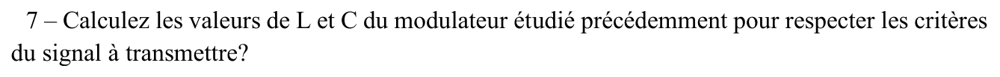{fig-alt="Q7 : calculer les valeurs de L et C du modulateur pour respecter les critères du signal à transmettre."}

:::: {.notes}
::: {.solution}
$f_0^2 = \dfrac{1}{4\pi^2 L(C + C_0)} \iff L = \dfrac{1}{4\pi^2 f_0^2 (C + C_0)}$ ;
$|k_f| = \dfrac{f_0 C_0|\lambda|}{2(C + C_0)} \iff C = \dfrac{f_0 C_0|\lambda|}{2|k_f|} - C_0$, d'où $C = 166\ \mathrm{pF}$ et $L = 13{,}5\ \mathrm{nH}$ [corrige-armand-td02, p. 2].
:::
::::

::: {.notes-externes}
$C = \dfrac{nC_0f_0}{2k_fV_0} - C_0$ et $L = \dfrac{1}{(2\pi f_0)^2(C + C_0)}$ [corrige-2023-td02, p. 2].
:::

::: {.complement}
Application numérique : $C + C_0 = \dfrac{98 \cdot 10^6 \times 30\ \mathrm{pF} \times 1}{2 \times 7{,}5 \cdot 10^6} = 196\ \mathrm{pF}$, donc $C = 166\ \mathrm{pF}$ et $L = \dfrac{1}{(2\pi \cdot 98 \cdot 10^6)^2 \times 196\ \mathrm{pF}} = 13{,}46\ \mathrm{nH}$. L'exercice 2 reprend ces valeurs arrondies : $L = 13{,}4\ \mathrm{nH}$, $C = 167\ \mathrm{pF}$. (L'unité est écrite « nH » dans les notes d'Armand ; le « n » ressemble à un « m », mais seul le nanohenry est cohérent.)
:::

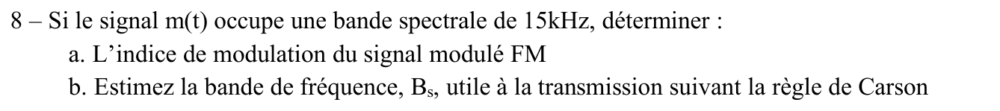{fig-alt="Q8 : si m(t) occupe une bande de 15 kHz : a. indice de modulation du signal FM ; b. bande Bs utile selon la règle de Carson."}

:::: {.notes}
::: {.solution}
a. $\beta = \dfrac{\Delta f}{f_{m,\max}} = 5$ ; b. $B_s = 2(\Delta f + f_{m,\max}) = 180\ \mathrm{kHz}$ [corrige-armand-td02, p. 2].
:::
::::

::: {.complement}
$\beta = 75/15 = 5$ ; $B_s = 2(\beta + 1)B_m = 2 \times 6 \times 15 = 180\ \mathrm{kHz}$ ([règle de Carson](../cours/03-modulations-angulaires.qmd#eq-carson-quelconque)). C'est l'exemple de la radiodiffusion FM du cours ([exemple](../cours/03-modulations-angulaires.qmd#exm-radio-fm)).
:::

## Exercice 2 : message binaire sur la varicap {#sec-td02-ex2}

::: {#exr-td2-fsk-varicap}
## Message binaire sur la varicap

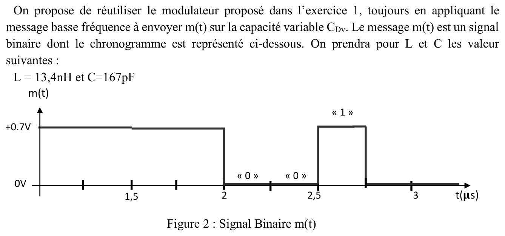{fig-alt="On réutilise le modulateur de l'exercice 1, message appliqué sur CDv ; m(t) est un signal binaire (figure 2 : +0,7 V pour « 1 », 0 V pour « 0 » ; « 1 » jusqu'à 2 µs, « 0 » « 0 » de 2 à 2,5 µs, « 1 » de 2,5 à 2,75 µs, puis « 0 ») ; L = 13,4 nH et C = 167 pF."}
:::

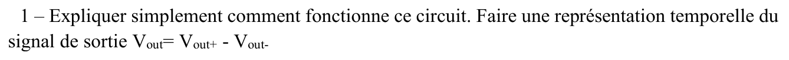{fig-alt="Q1 : expliquer simplement le fonctionnement du circuit ; représentation temporelle du signal de sortie Vout = Vout+ − Vout−."}

:::: {.notes}
::: {.solution}
$V_{out} = V_{out+} - V_{out-}$. Pour $m(t) = 0$ : $C_{Dv} = 30\ \mathrm{pF}$ ; pour $m(t) = 0{,}7\ \mathrm{V}$ : $C_{Dv} = \dfrac{30}{(1 + 0{,}7/0{,}7)^{0,7}} = \dfrac{30}{2^{0,7}} = 18{,}47\ \mathrm{pF}$. Croquis : sinusoïde d'amplitude constante, de fréquence plus élevée pendant les « 1 » [corrige-armand-td02, p. 2-3].
:::
::::

::: {.notes-externes}
Niveau haut : $C_{Dv}(0{,}7) = 0{,}615\,C_0$, $f_1 = 101\ \mathrm{MHz}$ ; niveau bas : $C_{Dv}(0) = C_0$, $f_0 = 98\ \mathrm{MHz}$ ; sortie : deux fréquences, même amplitude [corrige-2023-td02, p. 2-3].
:::

::: {.complement}
Ici $V_p = V_0$ : l'approximation linéaire de l'exercice 1 ($|m| \ll V_0/n$) ne vaut plus ; on calcule les deux fréquences exactement (question 3). La phase d'un oscillateur ne saute pas : la sortie change de fréquence **sans discontinuité de phase**.
:::

{fig-alt="Q2 : quel type de modulateur réalise-t-on avec cette configuration ?"}

:::: {.notes}
::: {.solution}
Modulation de type **FSK** : « 0 » → $f_0'$, « 1 » → $f_1'$ [corrige-armand-td02, p. 3].
:::
::::

::: {.complement}
Plus précisément une FSK **à phase continue** (CPFSK, [cours](../cours/04-modulations-numeriques.qmd#sec-fsk-cpfsk)).
:::

{fig-alt="Q3 : avec L et C de l'exercice 1 et les caractéristiques de la varicap, donner les caractéristiques de ce modulateur pour le signal binaire proposé."}

:::: {.notes}
::: {.solution}
$f = \dfrac{1}{2\pi\sqrt{L(C + C_{Dv})}}$.

- $m(t) = 0$ : $C_{tot,0} = 167 + 30 = 197\ \mathrm{pF}$, $f_0' = 98{,}0\ \mathrm{MHz}$ ;
- $m(t) = 0{,}7\ \mathrm{V}$ : $C_{tot,1} = 167 + 18{,}47 = 185{,}47\ \mathrm{pF}$, $f_1' = 101{,}0\ \mathrm{MHz}$ ;
- $f_c = \dfrac{f_{osc1} + f_{osc2}}{2} = 99{,}5\ \mathrm{MHz}$, $\Delta f = f_{osc1} - f_c = 1{,}5\ \mathrm{MHz}$ ;
- $D_b = 1/T_b = 4\ \mathrm{Mbit/s}$ car $T_b = 0{,}25\ \mu\mathrm{s}$ ;
- $h = \dfrac{2\Delta f}{D_b} = 0{,}5$ (voir le bloc ci-dessous) ;
- $B_{W_{FSK}} = 2(D_b + \Delta f) = 11\ \mathrm{MHz}$, $D_s = 4\ \mathrm{Mb/s}$, $\eta_s = \dfrac{D_b}{B_{W_{FSK}}} = \dfrac{4}{11} = 0{,}36$.

Pour une GMSK : ajouter un filtre passe-bas gaussien entre le signal binaire et la commande de modulation ; $\Delta f = D_b/4$, $B_{W_{GMSK}} = D_b = 4\ \mathrm{MHz}$, $D_s = D_b = 4\ \mathrm{Mb/s}$, $\eta_s = 1$ ; $B_{W_{GMSK}} < B_{W_{FSK}}$, donc l'efficacité augmente [corrige-armand-td02, p. 3].
:::
::::

::: {.notes-externes}
$T_\mathrm{bit} = 0{,}25\ \mu\mathrm{s}$, $D_b = 4\ \mathrm{Mbit/s}$ ; $f_c = 99{,}5\ \mathrm{MHz}$ ; $\Delta f = 1{,}5\ \mathrm{MHz}$ ; $BW_{FSK} = 2(D_b + \Delta f) = 11\ \mathrm{MHz}$ ; vitesse $= D_b$ ; $\eta = 0{,}36$. Pour une GMSK : filtre gaussien, $\Delta f = D_b/4 = 1\ \mathrm{MHz}$, $BW_{GMSK} = D_b = 4\ \mathrm{MHz}$, $\eta = 1$ [corrige-2023-td02, p. 3].
:::

::: {.a-verifier #av-td02-indice-h}
**Source** [corrige-armand-td02, p. 3] : « $h = \dfrac{2\Delta f}{D_b} = 0{,}5$ », suivi de « $\to \Delta f = D_b/4$ ».

**Problème** : avec les valeurs de la question, $\Delta f = 1{,}5\ \mathrm{MHz}$ et $D_b = 4\ \mathrm{Mbit/s}$ donnent $h = 2\Delta f/D_b = (f_1' - f_0')\,T_b = 0{,}75$, pas 0,5. La valeur 0,5 est celle d'une **MSK**, d'où $\Delta f = D_b/4 = 1\ \mathrm{MHz}$ : la ligne mélange peut-être l'indice obtenu et la condition visée pour la GMSK.

**Proposition** : $h = 0{,}75$ pour ce modulateur ; $h = 0{,}5$, soit $\Delta f = D_b/4 = 1\ \mathrm{MHz}$, est la condition MSK/GMSK (exercice 3, question 5).
:::

::: {.complement}
Contrôle : $2^{0,7} = 1{,}625$, $C_{Dv} = 18{,}47\ \mathrm{pF}$ ; $f_0' = 97{,}96\ \mathrm{MHz}$, $f_1' = 100{,}96\ \mathrm{MHz}$. Sensibilité moyenne $3\ \mathrm{MHz}/0{,}7\ \mathrm{V} \approx 4{,}3\ \mathrm{MHz/V}$, au lieu de $7{,}5\ \mathrm{MHz/V}$ en petit signal (non-linéarité de la varicap). Pour obtenir une MSK, il faudrait réduire les niveaux de $V_p$ jusqu'à $\Delta f = 1\ \mathrm{MHz}$ ([cours, MSK](../cours/04-modulations-numeriques.qmd#eq-msk-excursion)).
:::

## Exercice 3 : message binaire sur l'alimentation {#sec-td02-ex3}

::: {#exr-td2-ook-vdd}
## Message binaire sur l'alimentation

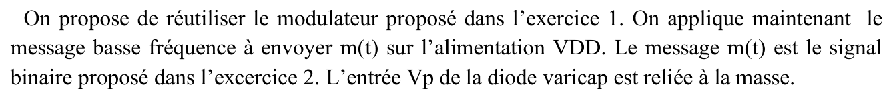{fig-alt="Le message binaire de l'exercice 2 est maintenant appliqué sur l'alimentation VDD ; l'entrée Vp de la varicap est reliée à la masse."}
:::

{fig-alt="Q1 : expliquer simplement le fonctionnement ; représentation temporelle de Vout = Vout+ − Vout−."}

:::: {.notes}
::: {.solution}
La capacité variable ne varie plus avec le message : la fréquence de résonance $LC$ reste idéalement constante. Mais modifier $V_{DD}$ modifie l'amplitude du signal de sortie : $V_{out}(t) = A(t)\cos(2\pi f_0 t + \varphi)$, $A(t)$ dépendant du message binaire [corrige-armand-td02, p. 3].
:::
::::

::: {.notes-externes}
« 0 » : oscillateur éteint, pas de signal ; « 1 » : oscillation à $f_1 = \dfrac{1}{2\pi\sqrt{L(C + C_0)}} = 98\ \mathrm{MHz}$ [corrige-2023-td02, p. 3].
:::

::: {.complement}
Les notes écrivent « $A(t)$ dépendant du débit binaire » : c'est le **message** binaire (la valeur des bits) qui fixe $A(t)$.
:::

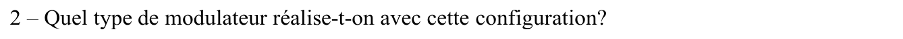{fig-alt="Q2 : quel type de modulateur réalise-t-on ?"}

:::: {.notes}
::: {.solution}
*Amplitude Shift Keying* (ASK) ; si le niveau bas coupe complètement les oscillations : **OOK** [corrige-armand-td02, p. 3].
:::
::::

::: {.complement}
Avec « 0 » = 0 V sur $V_{DD}$, l'oscillateur s'arrête : c'est bien une OOK ([cours](../cours/04-modulations-numeriques.qmd#eq-ook)).
:::

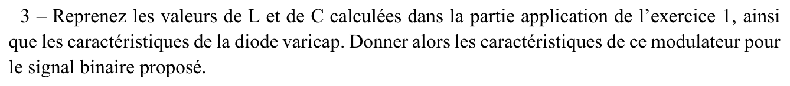{fig-alt="Q3 : avec L et C de l'exercice 1 et la varicap, donner les caractéristiques du modulateur pour le signal binaire proposé."}

:::: {.notes}
::: {.solution}
$C_{Dv} = 30\ \mathrm{pF}$ ($V_p = 0$), donc $f_0 = 98\ \mathrm{MHz}$ ; $D_b = \dfrac{1}{T_b} = \dfrac{1}{0{,}25\ \mu\mathrm{s}} = 4\ \mathrm{Mbit/s}$ ; $BW_{OOK} = 8\ \mathrm{MHz}$ ; efficacité $0{,}5$ [corrige-armand-td02, p. 4].
:::
::::

::: {.notes-externes}
$D_b = 4\ \mathrm{Mbit/s}$ ; $BW_{OOK} = 2D_b = 8\ \mathrm{MHz}$ ; vitesse $= D_b$ ; $\eta = 0{,}5$ [corrige-2023-td02, p. 3-4].
:::

::: {.a-verifier #av-td02-notes-p4-lecture}
**Source** [corrige-armand-td02, p. 4] : sous $D_b$, une ligne commence par « $f_p =$ » (ou « $B_p =$ ») suivie d'une valeur illisible ; l'efficacité se lit « $0{,}5$ » ou « $0{,}05$ ».

**Problème** : lecture douteuse des notes.

**Proposition** : efficacité $\eta = D_b/BW_{OOK} = 4/8 = 0{,}5$ ; la ligne illisible n'est pas reprise. À confirmer par Armand.
:::

{fig-alt="Q4 : quels sont les défauts principaux de ce modulateur ?"}

:::: {.notes}
::: {.solution}
Sensibilité de l'amplitude aux variations de l'alimentation et à la charge ; débit limité par le temps de démarrage et d'extinction de l'oscillateur [corrige-armand-td02, p. 4].
:::
::::

::: {.notes-externes}
Il est difficile de distinguer l'envoi d'un « 0 » de l'absence d'émission [corrige-2023-td02, p. 4].
:::

::: {.complement}
À 98 MHz, un bit ne dure que 24,5 périodes : le temps d'établissement de l'oscillation pèse directement sur le débit. S'y ajoutent la faible efficacité spectrale de l'OOK (0,5) et son enveloppe non constante (amplificateurs linéaires nécessaires).
:::

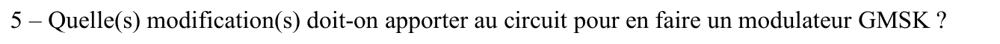{fig-alt="Q5 : quelles modifications apporter au circuit pour en faire un modulateur GMSK ?"}

::: {.notes-externes}
Voir la solution GMSK de l'exercice 2 : ajout d'un filtre gaussien ; $\Delta f = D_b/4$ [corrige-2023-td02, p. 3-4].
:::

::: {.complement}
Pas de réponse dans les notes d'Armand pour cette question (sa réponse GMSK est à la question 3 de l'exercice 2). Il faut appliquer le message sur la **varicap** (et non sur $V_{DD}$), le filtrer par un **filtre gaussien**, et régler les niveaux de $V_p$ pour obtenir $\Delta f = D/4$ ([cours, GMSK](../cours/04-modulations-numeriques.qmd#eq-gmsk)).
:::
