

::: {.complement}
Énoncé découpé question par question [td3] ; sous chaque question : la correction d'Armand (*Notes de cours*, [corrige-armand-td03]), le corrigé d'un ancien élève (*Notes externes*, [corrige-2023-td03]), puis les explications et contrôles de Claude (*Complément*). Les croquis des notes d'Armand sont décrits en texte ; les figures de cette page sont des simulations.

Cours associé : [détecteur d'enveloppe](../cours/02-modulations-lineaires.qmd#sec-amdbap) (exercice 1), [discriminateur](../cours/03-modulations-angulaires.qmd#eq-discriminateur) (exercice 2).
:::

## Exercice 1 : démodulateur d'enveloppe {#sec-td03-ex1}

::: {#exr-td3-detecteur-principe}
## Principe du démodulateur d'enveloppe

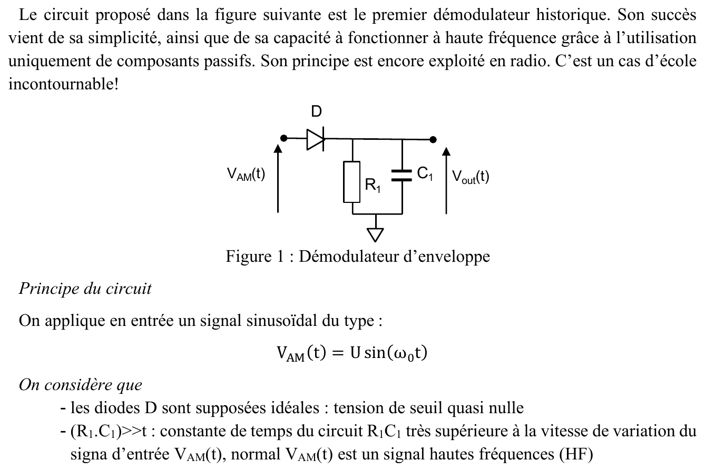{fig-alt="Premier démodulateur historique (figure 1) : diode D en série, puis R1 et C1 en parallèle vers la masse, sortie Vout aux bornes de C1. Entrée VAM(t) = U sin(ω0 t) ; diodes idéales (seuil quasi nul) ; R1C1 très supérieure à la vitesse de variation du signal d'entrée, signal haute fréquence."}
:::

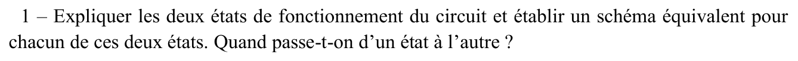{fig-alt="Q1 : expliquer les deux états de fonctionnement du circuit, établir un schéma équivalent pour chacun. Quand passe-t-on d'un état à l'autre ?"}

:::: {.notes}
::: {.solution}
- **Diode passante** : $V_{AM} > V_{out}$, la diode est un court-circuit ; la source attaque $R_1 \parallel C_1$ et le condensateur se charge.
- **Diode bloquée** : $V_{AM} < V_{out}$, circuit ouvert ; $C_1$ se décharge dans $R_1$.
- Juste avant chaque crête, la tension d'entrée rattrape celle du condensateur. Pendant la conduction,
$$i_D = \frac{V_{AM}}{R_1} + C_1\frac{\mathrm{d}V_{AM}}{\mathrm{d}t} = \frac{U}{R_1}\bigl[\sin(\omega_0 t) + R_1C_1\omega_0\cos(\omega_0 t)\bigr],$$
et la diode se bloque quand $i_D = 0$ : $\tan(\omega_0 t_b) = -R_1C_1\omega_0$, soit $\omega_0 t_b \simeq \dfrac{\pi}{2} + \dfrac{1}{R_1C_1\omega_0}$ avec $R_1C_1\omega_0 \gg 1$. La diode se bloque donc pratiquement à la crête [corrige-armand-td03, p. 1].
:::
::::

::: {.notes-externes}
Diode passante quand $V_{AM} > V_{out}$ ; bloquée quand $V_{AM} < V_{out}$ [corrige-2023-td03, p. 1].
:::

::: {.complement}
Contrôle du blocage : $\tan x = -a$ avec $a \gg 1$ donne $x = \pi - \arctan a = \frac{\pi}{2} + \arctan\frac1a \approx \frac{\pi}{2} + \frac1a$. Exemple : $R_1C_1\omega_0 = 20$ donne un blocage $2{,}9°$ après la crête.
:::

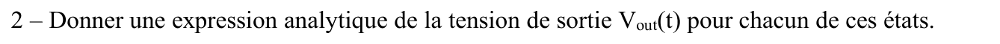{fig-alt="Q2 : expression analytique de Vout(t) dans chacun des états."}

:::: {.notes}
::: {.solution}
- Diode passante : $V_{out}(t) = U\sin(\omega_0 t)$.
- Diode bloquée : $V_{out}(t) \simeq U\,e^{-\frac{t - t_b}{R_1C_1}} \simeq U\Bigl(1 - \dfrac{t - t_b}{R_1C_1}\Bigr)$ (développement limité, $R_1C_1 \gg t - t_b$) [corrige-armand-td03, p. 1].
:::
::::

::: {.notes-externes}
État bloqué : $R_1C_1\,\mathrm{d}V_{out}/\mathrm{d}t + V_{out} = 0$, $V_{out}(t) = U\,e^{-t/\tau}$, $\tau = R_1C_1$ [corrige-2023-td03, p. 1-2].
:::

::: {.complement}
La décroissance est quasi linéaire entre deux crêtes : la chute relative sur une période $T_0$ vaut environ $T_0/(R_1C_1)$, d'où l'ondulation résiduelle.
:::

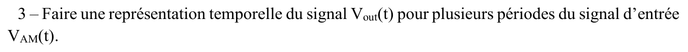{fig-alt="Q3 : représentation temporelle de Vout(t) sur plusieurs périodes de VAM(t)."}

:::: {.notes}
::: {.solution}
Croquis sur trois périodes ($0$, $T_0$, $2T_0$, $3T_0$) : $V_{out}$ suit $V_{AM}$ sur la montée de chaque arche positive (zones « diode passante » hachurées), puis décroît lentement, de façon quasi linéaire, jusqu'à la crête suivante [corrige-armand-td03, p. 1].
:::
::::

::: {.complement}
Voir la simulation de la question 5 (@fig-detecteur-enveloppe).
:::

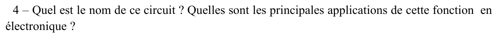{fig-alt="Q4 : nom du circuit et principales applications."}

:::: {.notes}
::: {.solution}
Détecteur de crête / démodulateur AM à diode. Applications : démodulation OOK/ASK ; redressement avec filtrage capacitif [corrige-armand-td03, p. 1].
:::
::::

::: {.notes-externes}
Détecteur d'enveloppe ; c'est aussi un redresseur AC-DC [corrige-2023-td03, p. 2].
:::

::: {.complement}
Il démodule l'AMDBAP avec $k \leq 1$ et l'OOK, mais pas l'AMDBSP, dont l'enveloppe est $|m(t)|$ ([cours](../cours/02-modulations-lineaires.qmd#sec-amdbsp-principe)).
:::

### Application : démodulateur OOK {#sec-td03-ex1-ook}

::: {#exr-td3-detecteur-ook}
## Démodulateur OOK

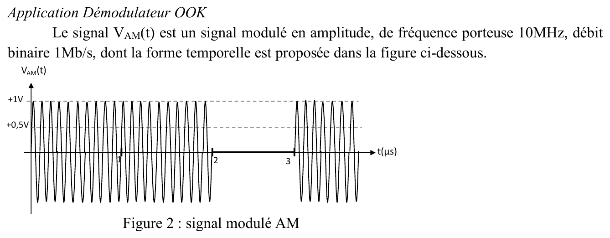{fig-alt="VAM(t) : signal modulé en amplitude, porteuse 10 MHz, débit 1 Mb/s (figure 2) : amplitude 1 V de 0 à 2 µs, nulle de 2 à 3 µs, 1 V après 3 µs ; niveaux +1 V et +0,5 V en pointillés."}
:::

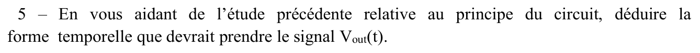{fig-alt="Q5 : en déduire la forme temporelle de Vout(t)."}

:::: {.notes}
::: {.solution}
Porteuse $f_0 = 10\ \mathrm{MHz}$, $T_0 = 100\ \mathrm{ns}$ ; $1\ \mathrm{Mb/s}$, $T_b = 1\ \mu\mathrm{s}$ : 10 périodes de porteuse par bit. Pendant le « 0 », $V_{out}(t) = e^{-(t - t_c)/\tau}$ (en volts), qui passe sous le seuil 0,5 V au bout de $t_\mathrm{seuil} - t_c = \tau\ln 2$. Croquis (bits 1, 1, 0, 1) : enveloppe proche de 1 V pendant les « 1 », décroissance exponentielle sous le seuil de 0,5 V pendant le « 0 », remontée à 1 V au « 1 » suivant [corrige-armand-td03, p. 2].
:::
::::

::: {.notes-externes}
$V_{out}$ reste proche de 1 V pendant les « 1 », décroît exponentiellement pendant le « 0 » (de 2 à 3 µs) vers 0, et remonte à 1 V dès le « 1 » suivant [corrige-2023-td03, p. 2].
:::

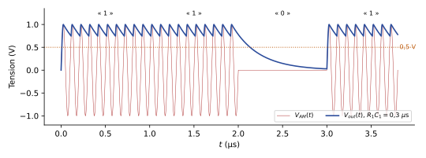{#fig-detecteur-enveloppe}

::: {.a-verifier .tranche #av-niveau-05-td3}
**Source** [td3, p. 2, figure 2] : la figure du signal OOK trace deux niveaux en pointillés, « +1V » et « +0,5V », alors que le signal ne prend que les amplitudes 1 V et 0.

**Problème** : le rôle du niveau 0,5 V n'est pas précisé par l'énoncé (amplitude d'un symbole ? seuil ?).

**Proposition** : niveau de **seuil de décision** entre « 1 » et « 0 », comme dans le corrigé de 2023 qui fait décroître la sortie sous ce niveau pendant le « 0 » [corrige-2023-td03, p. 2].

**Décision** : proposition retenue (décision déléguée par Armand, 2026-10-29). La correction d'Armand lit aussi ce niveau comme un seuil [corrige-armand-td03, p. 2].
:::

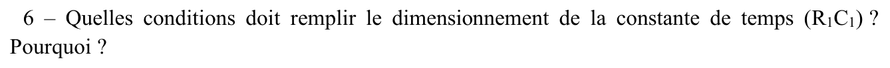{fig-alt="Q6 : quelles conditions doit remplir le dimensionnement de la constante de temps R1C1 ? Pourquoi ?"}

:::: {.notes}
::: {.solution}
- $R_1C_1 \gg T_0 = 100\ \mathrm{ns}$, sinon la sortie suit la porteuse et pas son enveloppe.
- $R_1C_1 \ll T_b = 1\ \mu\mathrm{s}$ : la sortie doit passer sous le seuil bien avant la fin du « 0 », sinon il devient un « 1 ». Pour franchir le seuil en moins d'une demi-période bit : $\tau\ln 2 < \dfrac{T_b}{2}$, soit $\tau < 0{,}72\ \mu\mathrm{s}$.
- Choix : $\tau = 330\ \mathrm{ns}$ ($1\ \mathrm{k\Omega}$ et $330\ \mathrm{pF}$) [corrige-armand-td03, p. 2].
:::
::::

::: {.notes-externes}
Si $T_b = \tau$, la sortie n'est descendue qu'à 37 % de sa valeur en fin de bit : trop proche du seuil. Si $T_b = 2\tau$, elle a perdu 87 % : loin du seuil. Le corrigé retient $T_b/4 < \tau < T_b/2$ [corrige-2023-td03, p. 2].
:::

::: {.complement}
- Contrôle : $0{,}5\ \mu\mathrm{s}/\ln 2 = 0{,}721\ \mu\mathrm{s}$. Sans marge, la condition « passer sous 0,5 V avant la fin du bit » donnerait $\tau < T_b/\ln 2 = 1{,}44\ \mu\mathrm{s}$ ; le critère d'Armand (seuil franchi en une demi-période) prend une marge d'un facteur 2.
- Les trois réponses sont cohérentes : $0{,}1\ \mu\mathrm{s} \ll \tau \lesssim 0{,}5$ à $0{,}7\ \mu\mathrm{s}$. Le choix $\tau = 330\ \mathrm{ns}$ est dans l'intervalle $T_b/4$–$T_b/2$ du corrigé 2023, mais il ne vaut que 3,3 périodes de porteuse : l'ondulation reste visible (@fig-detecteur-enveloppe, simulée avec $0{,}3\ \mu$s). La plage est étroite parce que la porteuse n'est que 10 fois plus rapide que le débit.
:::

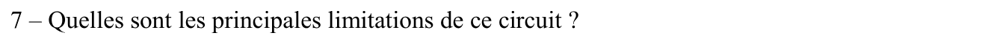{fig-alt="Q7 : principales limitations de ce circuit."}

:::: {.notes}
::: {.solution}
Asymétrie charge/décharge, donc rapport cyclique déformé, ce qui limite le débit. (Une première réponse, « seuil vif de la diode, 0,6 V », est barrée.) [corrige-armand-td03, p. 2]
:::
::::

::: {.complement}
Autres limitations : compromis sur $\tau$ (ondulation contre vitesse de décroissance), donc débit limité par rapport à la porteuse ; diode réelle à seuil non nul (≈ 0,6 V pour une diode silicium : les petits signaux ne sont pas détectés, l'énoncé suppose ce seuil nul) ; sensibilité au bruit et aux variations d'amplitude ; inutilisable pour l'AMDBSP et les modulations à enveloppe constante (FM, PSK) sans circuit additionnel.
:::

## Exercice 2 : démodulateur FM {#sec-td03-ex2}

::: {#exr-td3-demodulateur-fm}
## Démodulateur FM à intégrateur

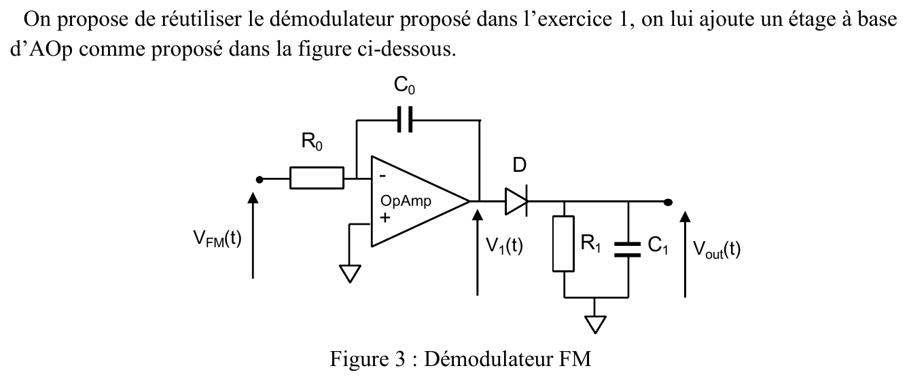{fig-alt="On ajoute devant le démodulateur de l'exercice 1 un étage à amplificateur opérationnel (figure 3) : VFM(t) attaque l'entrée inverseuse par R0, C0 entre la sortie V1(t) et l'entrée inverseuse, entrée non inverseuse à la masse ; V1 attaque la diode D et le circuit R1C1 de sortie Vout(t)."}
:::

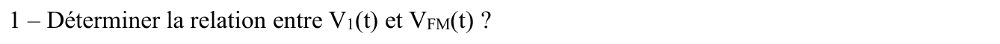{fig-alt="Q1 : relation entre V1(t) et VFM(t)."}

:::: {.notes}
::: {.solution}
AOP idéal en régime linéaire : $V_- = V_+ = 0$ et $i_+ = i_- = 0$ ; $\dfrac{V_{FM}}{R_0} = -C_0\dfrac{\mathrm{d}V_1}{\mathrm{d}t}$, d'où
$$V_1(t) = -\frac{1}{R_0C_0}\int V_{FM}(t)\,\mathrm{d}t :$$
intégrateur inverseur [corrige-armand-td03, p. 3].
:::
::::

::: {.notes-externes}
Même relation, obtenue en régime harmonique : $V_1 = -\dfrac{1}{R_0C_0}\,\dfrac{1}{j\omega}V_{FM}$ [corrige-2023-td03, p. 2].
:::

{fig-alt="Q2 : expression de V1(t) si VFM(t) = U sin(ωFM t)."}

:::: {.notes}
::: {.solution}
$V_1(t) = \dfrac{U}{R_0C_0\,\omega_{FM}}\cos(\omega_{FM}t)$ [corrige-armand-td03, p. 3].
:::
::::

::: {.complement}
$-\frac{1}{R_0C_0}\int U\sin(\omega_{FM}t)\,\mathrm{d}t = +\frac{U}{R_0C_0\omega_{FM}}\cos(\omega_{FM}t)$ (constante d'intégration nulle) ; même résultat dans [corrige-2023-td03, p. 3]. L'amplitude est **inversement proportionnelle à la fréquence**.
:::

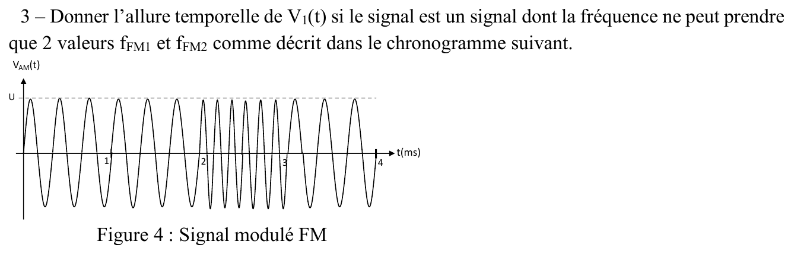{fig-alt="Q3 : allure de V1(t) si la fréquence du signal ne prend que deux valeurs fFM1 et fFM2 (figure 4, signal FM d'amplitude U sur 4 ms : fréquence basse jusqu'à 2 ms, haute de 2 à 3 ms environ, puis basse)."}

:::: {.notes}
::: {.solution}
$V_1$ est un cosinus de même fréquence que $V_{FM}$, dont l'amplitude varie avec la fréquence :
$$A_1 = \frac{1}{2\pi R_0C_0\,f_{FM1}}, \qquad A_2 = A_1\,\frac{f_{FM1}}{f_{FM2}} \approx \frac{A_1}{2}$$
[corrige-armand-td03, p. 3].
:::
::::

::: {.a-verifier #av-td03-amplitude-u}
**Source** [corrige-armand-td03, p. 3] : « $A_1 = \dfrac{1}{2\pi R_0C_0 f_{FM1}}$ ».

**Problème** : il manque l'amplitude $U$ du signal d'entrée (la question 2 donne $U/(R_0C_0\omega_{FM})$) ; la formule n'est homogène que si $U = 1\ \mathrm{V}$.

**Proposition** : $A_1 = \dfrac{U}{2\pi R_0C_0 f_{FM1}}$, $A_2 = A_1\,f_{FM1}/f_{FM2}$.
:::

::: {.complement}
$A_2 \approx A_1/2$ suppose $f_{FM2} \approx 2f_{FM1}$, ce qu'on lit sur la figure 4 (environ 3 et 6 kHz). Cette dépendance de l'amplitude à la fréquence est voulue : c'est elle que le détecteur d'enveloppe va lire.
:::

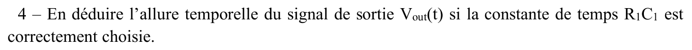{fig-alt="Q4 : en déduire l'allure de Vout(t) si R1C1 est correctement choisie."}

:::: {.notes}
::: {.solution}
- $\tau \gg \dfrac{1}{f_{FM1}}$, car l'ondulation est la plus forte à la fréquence la plus basse ;
- $\tau\ln 2 \ll T_b = 1\ \mathrm{ms}$.

Croquis (3 kHz, 3 kHz, 6 kHz, 3 kHz) : l'enveloppe reste proche de $A_1$ pendant les tronçons à 3 kHz, décroît vers $A_1/2$ pendant le tronçon à 6 kHz, puis remonte à $A_1$ [corrige-armand-td03, p. 3].
:::
::::

::: {.notes-externes}
$V_1$ a une amplitude $U/(R_0C_0\omega_{FM1})$ ou $U/(R_0C_0\omega_{FM2})$ selon la fréquence ; le détecteur d'enveloppe suit ces deux niveaux [corrige-2023-td03, p. 3]. Ce corrigé suit une autre version de l'énoncé (fréquence haute, puis basse, puis haute) ; le raisonnement est le même.
:::

![TD 3, exercice 2 : signal à deux fréquences (3 et 6 kHz), sortie de l'intégrateur $V_1$ et sortie du détecteur d'enveloppe $V_{out}$ ($R_1C_1 = 1$ ms). Reconstruite : simulation, fréquences choisies d'après l'allure de la figure de l'énoncé [td3, p. 3].](../figures/03-td3-demodulateur-fm.svg){#fig-td3-demodulateur-fm}

::: {.complement}
Les fréquences 3 et 6 kHz et $T_b = 1\ \mathrm{ms}$ sont lues sur la figure 4 (environ 4 périodes par milliseconde) : l'énoncé ne les donne pas. Avec si peu de périodes par bit, les deux conditions sur $\tau$ sont difficiles à tenir ensemble (@fig-td3-demodulateur-fm).
:::

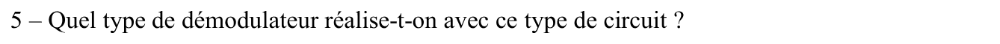{fig-alt="Q5 : quel type de démodulateur réalise-t-on ?"}

:::: {.notes}
::: {.solution}
Détecteur de pente ; démodulateur FSK binaire [corrige-armand-td03, p. 3].
:::
::::

::: {.complement}
L'intégrateur convertit la variation de **fréquence** en variation d'**amplitude** ($|V_1| \propto 1/f$), que le détecteur d'enveloppe démodule : c'est un **discriminateur**, dual de celui du cours qui utilise un dérivateur ($|\mathrm{d}s/\mathrm{d}t| \propto f$, [cours](../cours/03-modulations-angulaires.qmd#eq-discriminateur)).
:::

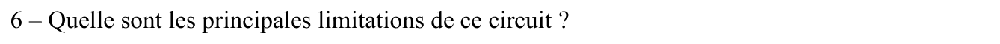{fig-alt="Q6 : principales limitations de ce circuit."}

:::: {.notes}
::: {.solution}
Sensibilité à l'amplitude d'entrée, alors qu'en FSK l'information est dans la fréquence [corrige-armand-td03, p. 3].
:::
::::

::: {.notes-externes}
On doit bien choisir deux fréquences distinctes [corrige-2023-td03, p. 3].
:::

::: {.complement}
Autres limitations : la conversion $1/f$ n'est pas linéaire en $f$ (sans gêne pour deux fréquences, gênante en FM analogique à forte excursion) ; un intégrateur idéal dérive (offset intégré : en pratique, résistance en parallèle sur $C_0$) ; $R_1C_1$ doit à la fois filtrer la porteuse et suivre les changements de fréquence. Contre la sensibilité à l'amplitude, on place un **limiteur** en entrée.
:::
