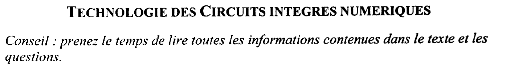
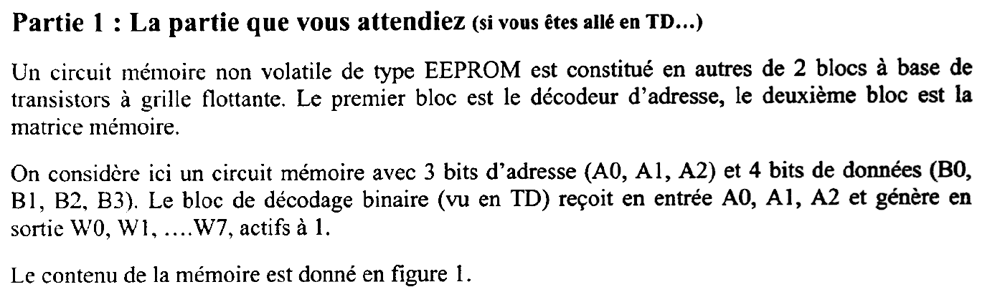
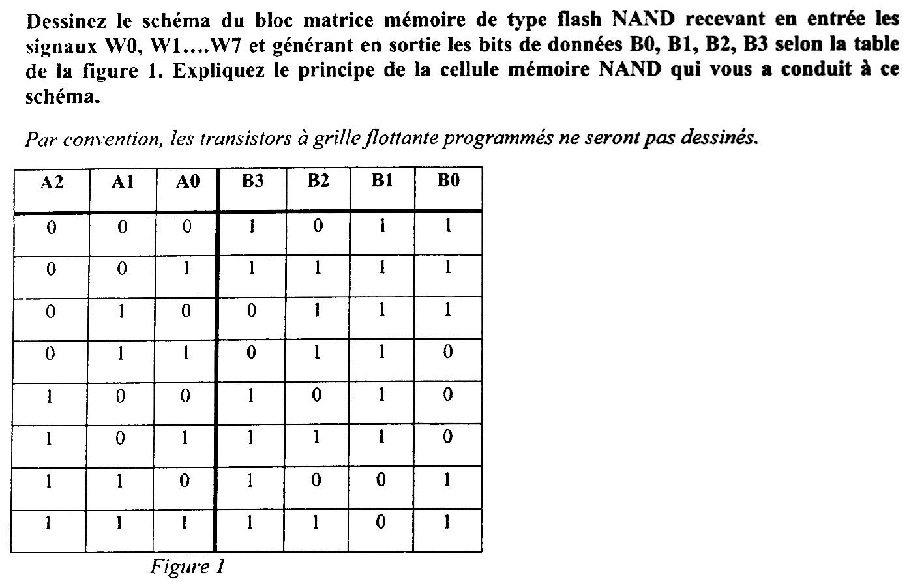
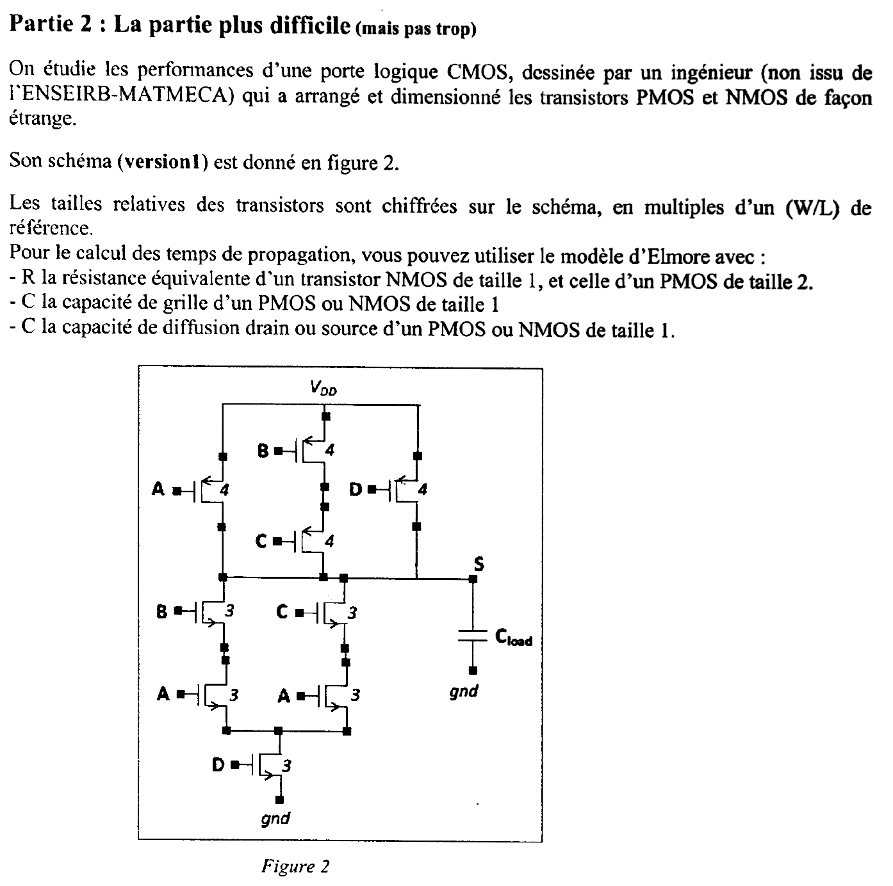
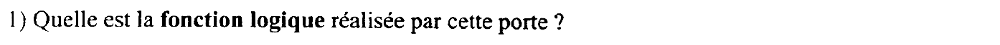
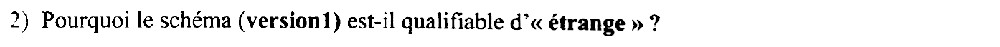
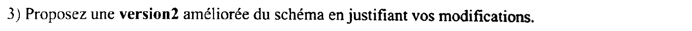
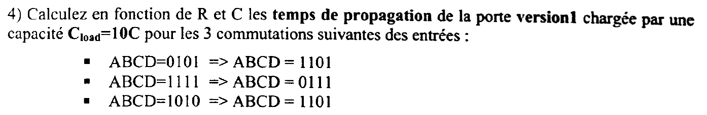
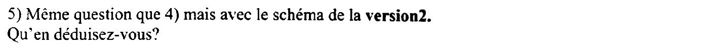



::: {.complement}
Aucun corrigé n'est disponible : **toutes les solutions de cette page sont rédigées par Claude**. À relire avec un œil critique ; signaler toute erreur.

**Énoncé.** Images découpées dans la photocopie du sujet [sujet-2016]. Des annotations manuscrites d'un étudiant ont été effacées de la figure 2 : les lettres « P » et « N » écrites dans la marge du schéma et quatre traits de stylo qui barraient les PMOS A, B, D et le NMOS C. Les pointes de flèche de ces transistors peuvent en garder une légère trace.

**Correspondances.** La partie 1 reprend la question 3 du TD « Les mémoires numériques non volatiles » (`td/tcin-td01-propagation-cmos-eeprom.pdf`, matrice NAND de 4 mots de 3 bits) avec 8 mots de 4 bits. La partie 2 utilise le modèle d'Elmore du support [techno, p. 8] ; la même démarche sert dans les partiels [2017-2018](2017-2018-partiel.qmd) et [2019-2020](2019-2020-partiel.qmd).
:::

{fig-alt="Titre : Technologie des circuits intégrés numériques. Conseil : prenez le temps de lire toutes les informations contenues dans le texte et les questions."}

## Partie 1 : mémoire flash NAND {#sec-ann1617-ex1}

{fig-alt="Partie 1, « la partie que vous attendiez (si vous êtes allé en TD…) ». Un circuit mémoire non volatile de type EEPROM est constitué entre autres de 2 blocs à base de transistors à grille flottante : le décodeur d'adresse et la matrice mémoire. Le circuit a 3 bits d'adresse (A0, A1, A2) et 4 bits de données (B0, B1, B2, B3). Le bloc de décodage binaire (vu en TD) reçoit A0, A1, A2 et génère W0, W1, …, W7, actifs à 1. Le contenu de la mémoire est donné en figure 1."}

{fig-alt="Question : dessinez le schéma du bloc matrice mémoire de type flash NAND recevant en entrée les signaux W0 à W7 et générant en sortie les bits de données B0 à B3 selon la table de la figure 1 ; expliquez le principe de la cellule mémoire NAND qui vous a conduit à ce schéma. Par convention, les transistors à grille flottante programmés ne seront pas dessinés. Figure 1, table A2 A1 A0 → B3 B2 B1 B0 : 000 → 1011 ; 001 → 1111 ; 010 → 0111 ; 011 → 0110 ; 100 → 1010 ; 101 → 1110 ; 110 → 1001 ; 111 → 1101."}

:::: {.complement}
::: {.solution}
**Principe de la cellule NAND** (convention du TD : grille flottante « programmable positivement »).

- Une cellule **non programmée** est un NMOS ordinaire : passant si sa grille est à 1, bloqué si elle est à 0.
- Une cellule **programmée** porte une charge positive sur sa grille flottante : son seuil devient négatif et elle conduit **quelle que soit** la tension de grille. Elle se comporte comme un fil, d'où la convention de ne pas la dessiner.
- Une **colonne** (*bit line*) est une chaîne de cellules **en série** entre une charge de rappel vers $V_{DD}$ et la masse : c'est la structure d'une porte NAND, d'où le nom. La sortie vaut 0 seulement si **toutes** les cellules conduisent.

**Lecture du mot $i$.** On met à 0 la grille de la ligne $i$ et à 1 toutes les autres. Les cellules non sélectionnées conduisent toutes (grille à 1, ou programmées). La colonne $j$ ne dépend donc que de la cellule $(i, j)$ :

| Cellule $(i, j)$ | Grille à 0 | Chaîne | Bit lu $B_j$ |
|---|---|---|---|
| non programmée (dessinée) | bloquée | ouverte | 1 (rappel vers $V_{DD}$) |
| programmée (fil) | passante | fermée | 0 |

**Règle de programmation** : on dessine un transistor là où le bit vaut **1**, on met un fil là où il vaut **0**.

**Commande des lignes.** La matrice NAND sélectionne une ligne par un **0**, alors que le décodeur fournit des $W_i$ **actifs à 1**. Chaque ligne de mot est donc commandée par $\overline{W_i}$ (un inverseur par sortie du décodeur, ou un décodeur à sorties complémentées) : la ligne sélectionnée passe à 0, les sept autres restent à 1.

| Mot (ligne $\overline{W_i}$) | $B_3$ | $B_2$ | $B_1$ | $B_0$ |
|---|---|---|---|---|
| 0 | T | fil | T | T |
| 1 | T | T | T | T |
| 2 | fil | T | T | T |
| 3 | fil | T | T | fil |
| 4 | T | fil | T | fil |
| 5 | T | T | T | fil |
| 6 | T | fil | fil | T |
| 7 | T | T | fil | T |

(T : transistor non programmé, dessiné ; fil : transistor programmé.) Il y a 22 transistors dessinés et 10 cellules programmées.

{#fig-ann1617-matrice-nand}

**Vérification** sur l'adresse 3 ($A_2A_1A_0 = 011$) : seule la ligne $\overline{W_3}$ est à 0. Colonne $B_3$ : cellule 3 programmée, la chaîne conduit, $B_3 = 0$ ; colonnes $B_2$ et $B_1$ : cellule 3 bloquée, $B_2 = B_1 = 1$ ; colonne $B_0$ : fil, $B_0 = 0$. On lit $0110$, conforme à la table.

Remarques : la charge de rappel est en pratique un PMOS (ou un circuit de précharge suivi d'un amplificateur de lecture) ; les mémoires flash réelles ajoutent un transistor de sélection en haut et en bas de chaque chaîne. Avec la convention inverse (cellule programmée bloquée), il faudrait dessiner les transistors là où le bit vaut 0.
:::
::::

## Partie 2 : porte CMOS complexe et temps de propagation {#sec-ann1617-ex2}

{fig-alt="Partie 2, « la partie plus difficile (mais pas trop) ». On étudie une porte logique CMOS dessinée par un ingénieur qui a arrangé et dimensionné les transistors de façon étrange (version 1, figure 2). Tailles relatives en multiples d'un W/L de référence. Modèle d'Elmore : R résistance équivalente d'un NMOS de taille 1 et d'un PMOS de taille 2 ; C capacité de grille d'un transistor de taille 1 ; C capacité de diffusion drain ou source d'un transistor de taille 1. Figure 2 : réseau PMOS entre VDD et S formé de trois branches en parallèle, PMOS A (taille 4), PMOS B et C en série (taille 4 chacun), PMOS D (taille 4) ; réseau NMOS entre S et la masse : deux branches en parallèle, NMOS B puis NMOS A, et NMOS C puis NMOS A (taille 3 chacun), qui se rejoignent sur le drain du NMOS D (taille 3) relié à la masse ; charge Cload entre S et la masse."}

**Notations utilisées dans les solutions.** Modèle du support [techno, p. 8] : un transistor de taille $k$ a une résistance $R/k$ (NMOS) ou $2R/k$ (PMOS), une capacité de grille $kC$ et une capacité $kC$ sur chacune de ses diffusions (drain et source). Nœuds internes de la version 1 : $x$ entre les PMOS B et C ; $n_1$ entre le NMOS B et le NMOS A de gauche ; $n_2$ entre le NMOS C et le NMOS A de droite ; $n_3$, nœud commun des deux NMOS A et du drain du NMOS D.

{fig-alt="Question 1 : quelle est la fonction logique réalisée par cette porte ?"}

:::: {.complement}
::: {.solution}
**Réseau NMOS** (il tire $S$ à 0) : deux branches en parallèle, $B$ puis $A$ et $C$ puis $A$, en série avec $D$ :
$$f_N = (A B + A C)\, D = A\,D\,(B + C).$$
**Réseau PMOS** (il tire $S$ à 1) : $A$, $(B$ en série avec $C)$ et $D$ en parallèle, chaque PMOS conduisant pour une entrée à 0 :
$$f_P = \bar A + \bar B\,\bar C + \bar D = \overline{A\,D\,(B + C)} = \overline{f_N}.$$
Les deux réseaux sont bien duaux (jamais passants ensemble, jamais bloqués ensemble). D'où
$$\boxed{S = \overline{A\,D\,(B + C)} = \overline{A B D + A C D}}$$
$S = 0$ pour les trois combinaisons $ABCD = 1101$, $1011$, $1111$ ; $S = 1$ pour les 13 autres (table vérifiée par simulation au niveau interrupteur sur les 16 combinaisons).
:::
::::

{fig-alt="Question 2 : pourquoi le schéma (version 1) est-il qualifiable d'« étrange » ?"}

:::: {.complement}
::: {.solution}
**Arrangement.** Le réseau NMOS réalise $AB + AC$ avec **deux** transistors commandés par $A$, alors que $AB + AC = A(B + C)$ : un seul NMOS $A$ en série avec le couple $B \parallel C$ suffit. Le transistor en trop ajoute de la surface, des diffusions sur les nœuds internes ($n_1$, $n_2$, $n_3$) et double la capacité vue par l'entrée $A$ côté NMOS. Le réseau PMOS, lui, est le dual de la forme factorisée : les deux réseaux ne sont pas écrits « en miroir ».

**Dimensionnement.** La règle habituelle est que chaque chemin de conduction ait au pire la résistance $R$ d'un inverseur de référence (NMOS de taille 1, PMOS de taille 2).

- Réseau NMOS : trois transistors en série sur tout chemin, de taille 3 : $3 \times \frac{R}{3} = R$. Cohérent.
- Réseau PMOS : la branche $B$-$C$ (deux PMOS en série de taille 4) vaut $2 \times \frac{2R}{4} = R$, cohérent ; mais $A$ et $D$, **seuls** dans leur branche, sont aussi de taille 4, soit $\frac{R}{2}$. Une taille 2 suffit ($\frac{2R}{2} = R$).

Les PMOS $A$ et $D$ sont donc **surdimensionnés** : ils doublent leur capacité de grille (charge pour les portes qui pilotent $A$ et $D$) et leur capacité de diffusion sur la sortie $S$, pour n'accélérer que les montées où ils conduisent seuls.
:::
::::

{fig-alt="Question 3 : proposez une version 2 améliorée du schéma en justifiant vos modifications."}

:::: {.complement}
::: {.solution}
**Version 2** (une solution possible, celle qui corrige les deux défauts relevés) :

- **réseau NMOS factorisé** : $S$ — ($B \parallel C$) — $m_1$ — $A$ — $m_2$ — $D$ — masse ; quatre NMOS de taille 3 (trois transistors en série sur tout chemin : $R$) ;
- **réseau PMOS** inchangé dans sa structure, redimensionné : $A$ et $D$ de taille **2**, $B$ et $C$ de taille 4 (chaque branche vaut $R$).

| | Version 1 | Version 2 |
|---|---|---|
| Transistors | 9 | 8 |
| Résistance au pire, montée / descente | $R$ / $R$ | $R$ / $R$ |
| Capacité de grille vue par $A$ / $B$ / $C$ / $D$ | $10C$ / $7C$ / $7C$ / $7C$ | $5C$ / $7C$ / $7C$ / $5C$ |
| Diffusions sur $S$ | $4 + 4 + 4 + 3 + 3 = 18C$ | $2 + 4 + 2 + 3 + 3 = 14C$ |
| Nœuds internes NMOS | $n_1 = n_2 = 6C$, $n_3 = 9C$ | $m_1 = 9C$, $m_2 = 6C$ |

Justification : même résistance au pire dans les deux sens, un transistor de moins, moins de capacité sur la sortie et sur les nœuds internes, et des entrées $A$ et $D$ deux fois moins chargées pour les portes qui les commandent. L'ordre $B \parallel C$ côté sortie et $D$ côté masse reprend celui de la version 1, pour que la comparaison de la question 5 ne porte que sur les deux modifications.
:::
::::

{fig-alt="Question 4 : calculez en fonction de R et C les temps de propagation de la porte version 1 chargée par une capacité Cload = 10C pour les 3 commutations suivantes des entrées : ABCD = 0101 vers 1101 ; ABCD = 1111 vers 0111 ; ABCD = 1010 vers 1101."}

:::: {.complement}
::: {.solution}
**Méthode.** Modèle d'Elmore : le temps de propagation sur $S$ est
$$t_p = \sum_k R_{kS}\, C_k ,$$
où $C_k$ est la capacité du nœud $k$ et $R_{kS}$ la résistance **commune** aux chemins qui relient le rail ($V_{DD}$ ou la masse) au nœud $k$ et à $S$. On ne compte que les nœuds reliés au rail par des transistors passants **après** la commutation et qui doivent **changer d'état** ; un nœud déjà au bon potentiel ne coûte rien. (Le modèle donne $t_p$ à un facteur près : multiplier par $\ln 2 \approx 0{,}69$ pour le temps à 50 %.)

**Capacités de la version 1** (diffusions des transistors reliés au nœud) :

| Nœud | Diffusions | Capacité |
|---|---|---|
| $S$ | PMOS $A$, $C$, $D$ ($3 \times 4C$) ; NMOS $B$, $C$ ($2 \times 3C$) ; $C_{load} = 10C$ | $28C$ |
| $x$ | PMOS $B$ et $C$ | $8C$ |
| $n_1$, $n_2$ | NMOS $B$ (ou $C$) et un NMOS $A$ | $6C$ chacun |
| $n_3$ | deux NMOS $A$ et le NMOS $D$ | $9C$ |

Résistances : NMOS de taille 3, $\frac{R}{3}$ ; PMOS de taille 4, $\frac{R}{2}$.

**1) $ABCD = 0101 \to 1101$** ($A$ monte). Avant : $A = 0$, le PMOS $A$ conduit, $S = 1$. Après : chemin NMOS $S$ — $B$ — $n_1$ — $A$ — $n_3$ — $D$ — masse, **descente** de $S$ ($t_{pHL}$).

- $S$ ($28C$) : résistance $\frac{R}{3} \times 3 = R$ ;
- $x$ ($8C$) : relié à $S$ par le PMOS $C$ passant ($C = 0$), chargé à $V_{DD}$ avant ; il se vide à travers $S$, résistance commune $R$ ;
- $n_1$ ($6C$) : chargé avant par le NMOS $B$ passant ; résistance commune $\frac{2R}{3}$ ;
- $n_2$ ($6C$) : relié à $n_3$ par le NMOS $A$ de droite ; avant, il était **isolé** ($A = C = 0$) et son état dépend du passé. Au pire il est chargé : résistance commune $\frac{R}{3}$ ;
- $n_3$ : déjà à 0 avant ($D = 1$), ne compte pas.

$$t_{pHL,1} = 28RC + 8RC + 6C \cdot \frac{2R}{3} + 6C \cdot \frac{R}{3} = 28 + 8 + 4 + 2 \quad\Longrightarrow\quad \boxed{t_{pHL,1} = 42\,RC}$$
($40\,RC$ si $n_2$ était déchargé.)

**2) $ABCD = 1111 \to 0111$** ($A$ descend). Avant : $S = 0$. Après : seul le PMOS $A$ conduit ($B = C = D = 1$), **montée** de $S$ ($t_{pLH}$), résistance $\frac{R}{2}$.

- $S$ ($28C$) ;
- $n_1$ et $n_2$ ($6C$ chacun) : reliés à $S$ par les NMOS $B$ et $C$ passants, à 0 avant, ils se chargent aussi (jusqu'à $V_{DD} - V_T$) à travers le PMOS $A$ ;
- $x$ et $n_3$ : isolés, ne comptent pas.

$$t_{pLH,2} = \frac{R}{2}\,(28C + 6C + 6C) \quad\Longrightarrow\quad \boxed{t_{pLH,2} = 20\,RC}$$

**3) $ABCD = 1010 \to 1101$** ($B$ et $D$ montent, $C$ descend). Avant : $D = 0$, $S = 1$ par le PMOS $D$ ; les NMOS $C$ et les deux $A$ conduisaient : $n_2$, $n_3$ et $n_1$ étaient tous chargés depuis $S$, et $x$ à $V_{DD}$ par le PMOS $B$. Après : même chemin de descente qu'en 1), mais **tous** les nœuds sont à vider :
$$t_{pHL,3} = 28RC + 8RC + 6C \cdot \frac{2R}{3} + 6C \cdot \frac{R}{3} + 9C \cdot \frac{R}{3} = 28 + 8 + 4 + 2 + 3 \quad\Longrightarrow\quad \boxed{t_{pHL,3} = 45\,RC}$$

C'est le cas le plus lent : la commutation précédente a laissé chargés tous les nœuds internes du réseau NMOS. Les trois valeurs ont été recalculées par un programme (réseau d'interrupteurs, résistances de transfert du réseau RC).

Si l'on applique Elmore « au pire », en supposant tous les nœuds du chemin chargés, on trouve $45\,RC$, $20\,RC$ et $45\,RC$.
:::
::::

{fig-alt="Question 5 : même question que 4) mais avec le schéma de la version 2. Qu'en déduisez-vous ?"}

:::: {.complement}
::: {.solution}
**Capacités de la version 2** : $S = 14C + 10C = 24C$ ; $x = 8C$ ; $m_1 = 9C$ (NMOS $B$, $C$, $A$) ; $m_2 = 6C$ (NMOS $A$, $D$). Résistances : NMOS $\frac{R}{3}$ ; PMOS $A$ et $D$ de taille 2, $R$ ; PMOS $B$ et $C$, $\frac{R}{2}$.

**1) $0101 \to 1101$** (descente) : chemin $S$ — $B$ — $m_1$ — $A$ — $m_2$ — $D$ — masse ; $m_1$ chargé avant (NMOS $B$ passant), $m_2$ déjà à 0, $x$ chargé et relié à $S$ :
$$t_{pHL,1} = 24RC + 8RC + 9C \cdot \frac{2R}{3} = \boxed{38\,RC}$$

**2) $1111 \to 0111$** (montée par le PMOS $A$ seul, désormais de résistance $R$) ; $m_1$ se charge par les NMOS $B$ et $C$ :
$$t_{pLH,2} = R\,(24C + 9C) = \boxed{33\,RC}$$

**3) $1010 \to 1101$** (descente, tous les nœuds chargés avant) :
$$t_{pHL,3} = 24RC + 8RC + 9C \cdot \frac{2R}{3} + 6C \cdot \frac{R}{3} = \boxed{40\,RC}$$

| Commutation | Version 1 | Version 2 |
|---|---|---|
| $0101 \to 1101$ ($t_{pHL}$) | $42\,RC$ | $38\,RC$ |
| $1111 \to 0111$ ($t_{pLH}$) | $20\,RC$ | $33\,RC$ |
| $1010 \to 1101$ ($t_{pHL}$) | $45\,RC$ | $40\,RC$ |
| Pire des trois | $45\,RC$ | $40\,RC$ |

**Conclusion.**

- Les **descentes** sont plus rapides en version 2 : moins de capacité sur $S$ et un nœud interne de moins à vider. Le **pire cas** passe de $45\,RC$ à $40\,RC$.
- La **montée** par le PMOS $A$ seul est plus lente ($33\,RC$ au lieu de $20\,RC$) : c'est le seul bénéfice du surdimensionnement de la version 1, qui n'accélère que des transitions déjà loin du pire cas.
- La version 2 a en plus un transistor de moins, des entrées $A$ et $D$ deux fois moins chargées (ce qui accélère aussi les portes qui les pilotent) et moins de capacité commutée, donc une consommation dynamique $\alpha C V_{DD}^2 F$ plus faible.

Le temps de propagation d'une porte complexe dépend de la commutation et de l'**histoire** des nœuds internes ; un bon dimensionnement vise une résistance égale au pire cas sur tous les chemins, avec le moins de capacité possible, plutôt que des transistors surdimensionnés au hasard.
:::
::::
