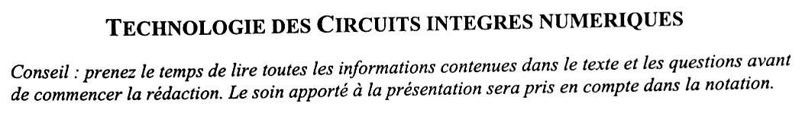
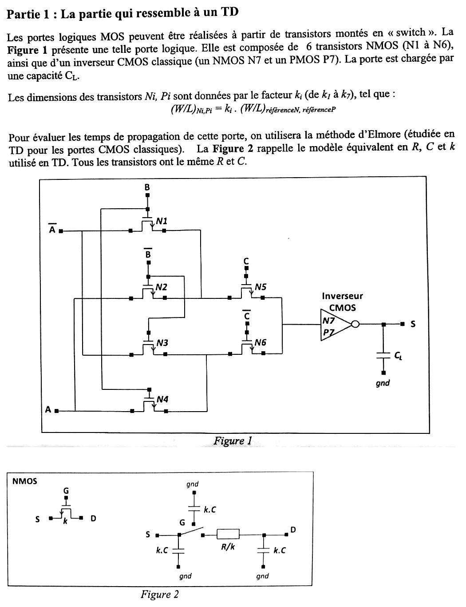
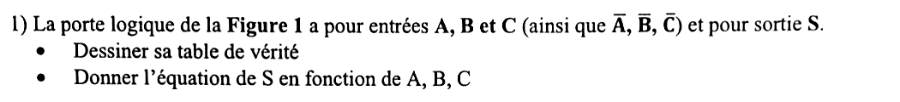
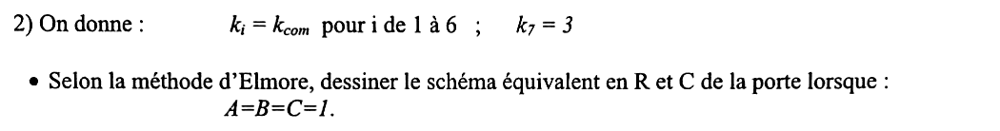
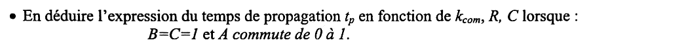
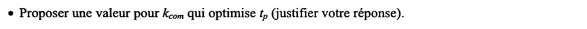
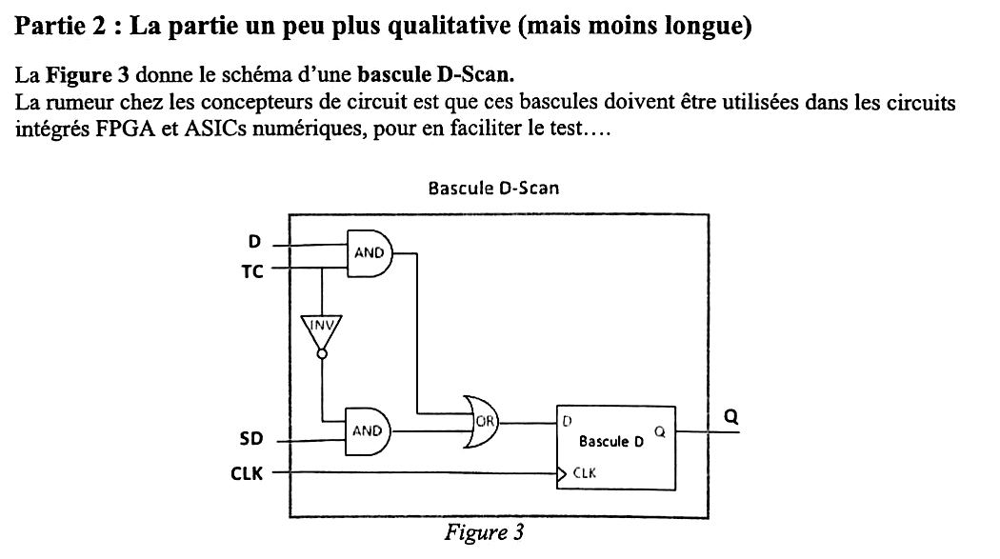
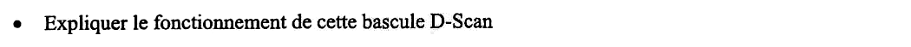
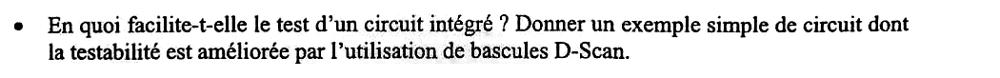
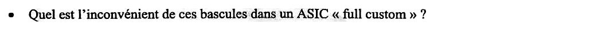



::: {.complement}
Aucun corrigé n'est disponible : **toutes les solutions de cette page sont rédigées par Claude**. À relire avec un œil critique ; signaler toute erreur.

**Énoncé.** Images découpées dans les deux photos du sujet [sujet-2017] (sans annotation), fond éclairci ; leur netteté est celle des photos.

**Correspondances.** Le modèle d'Elmore est celui du support [techno, p. 8], déjà utilisé dans les partiels [2016-2017](2016-2017-partiel.qmd#sec-ann1617-ex2) et [2019-2020](2019-2020-partiel.qmd#sec-ann1920-ex1). La bascule D-Scan revient dans l'examen [2025-2026](2025-2026-partiel.qmd#sec-ann2526-ex1) (bascule scan d'un compteur 4 bits).
:::

{fig-alt="Titre : Technologie des circuits intégrés numériques. Conseil : prenez le temps de lire toutes les informations contenues dans le texte et les questions avant de commencer la rédaction ; le soin apporté à la présentation sera pris en compte dans la notation."}

## Partie 1 : porte à transistors de passage {#sec-ann1718-ex1}

{fig-alt="Partie 1, « la partie qui ressemble à un TD ». Les portes logiques MOS peuvent être réalisées avec des transistors montés en interrupteurs. La figure 1 présente une porte composée de 6 NMOS (N1 à N6) et d'un inverseur CMOS classique (N7, P7), chargée par CL. Dimensions : (W/L) de Ni ou Pi = ki fois le (W/L) de référence. Temps de propagation par la méthode d'Elmore ; la figure 2 rappelle le modèle en R, C et k ; tous les transistors ont le même R et C. Figure 1 : N1 (grille B) relie l'entrée Ā au nœud qui attaque N5 ; N2 (grille B̄) relie l'entrée A à ce même nœud ; N3 (grille B̄) relie Ā au nœud qui attaque N6 ; N4 (grille B) relie A à ce même nœud ; N5 (grille C) et N6 (grille C̄) relient ces deux nœuds à l'entrée de l'inverseur CMOS N7-P7, dont la sortie S est chargée par CL. Figure 2 : NMOS de taille k équivalent à un interrupteur commandé par la grille en série avec R/k, capacité k.C sur la grille, sur la source et sur le drain."}

**Notations utilisées dans les solutions.** $X$ : nœud commun à N1, N2 et N5 ; $Y$ : nœud commun à N3, N4 et N6 ; $Z$ : entrée de l'inverseur (N5, N6). Un PMOS de taille $k$ a une résistance $2R/k$ (mobilité moitié, [techno, p. 8]).

{fig-alt="Question 1 : la porte de la figure 1 a pour entrées A, B et C (ainsi que leurs compléments) et pour sortie S. Dessiner sa table de vérité ; donner l'équation de S en fonction de A, B, C."}

:::: {.complement}
::: {.solution}
Chaque paire de transistors de passage forme un multiplexeur 2 vers 1 :

- $X$ : N1 passe $\bar A$ si $B = 1$, N2 passe $A$ si $B = 0$, donc $X = B\bar A + \bar B A = A \oplus B$ ;
- $Y$ : N4 passe $A$ si $B = 1$, N3 passe $\bar A$ si $B = 0$, donc $Y = AB + \bar A \bar B = \overline{A \oplus B}$ ;
- $Z$ : N5 passe $X$ si $C = 1$, N6 passe $Y$ si $C = 0$, donc $Z = C(A \oplus B) + \bar C\,\overline{A \oplus B} = \overline{A \oplus B \oplus C}$ ;
- l'inverseur donne $S = \bar Z$.

| $A$ | $B$ | $C$ | $X$ | $Y$ | $Z$ | $S$ |
|---|---|---|---|---|---|---|
| 0 | 0 | 0 | 0 | 1 | 1 | 0 |
| 0 | 0 | 1 | 0 | 1 | 0 | 1 |
| 0 | 1 | 0 | 1 | 0 | 0 | 1 |
| 0 | 1 | 1 | 1 | 0 | 1 | 0 |
| 1 | 0 | 0 | 1 | 0 | 0 | 1 |
| 1 | 0 | 1 | 1 | 0 | 1 | 0 |
| 1 | 1 | 0 | 0 | 1 | 1 | 0 |
| 1 | 1 | 1 | 0 | 1 | 0 | 1 |

$$\boxed{S = A \oplus B \oplus C}$$
C'est un **OU exclusif à 3 entrées** (fonction de parité, ou somme d'un additionneur complet) : $S = 1$ quand un nombre impair d'entrées vaut 1. Il ne coûte ici que 6 NMOS et un inverseur, contre plus d'une vingtaine de transistors en CMOS complémentaire.

Les NMOS transmettent mal le niveau haut ($V_{DD} - V_T$ au mieux) : l'inverseur de sortie **restaure** les niveaux logiques et isole les transistors de passage de la charge $C_L$.
:::
::::

{fig-alt="Question 2 : on donne ki = kcom pour i de 1 à 6 et k7 = 3. Selon la méthode d'Elmore, dessiner le schéma équivalent en R et C de la porte lorsque A = B = C = 1."}

:::: {.complement}
::: {.solution}
Avec $A = B = C = 1$ ($\bar A = \bar B = \bar C = 0$) : N1, N4 et N5 sont **passants**, N2, N3 et N6 **bloqués**. Un transistor bloqué est un interrupteur ouvert, mais ses capacités de diffusion restent sur les nœuds.

Schéma équivalent (taille $k = k_{com}$ pour N1 à N6) :

- **chemin vers la sortie** : entrée $\bar A$ — $\frac{R}{k}$ (N1) — nœud $X$ — $\frac{R}{k}$ (N5) — nœud $Z$ ;
- **capacité de $X$** : diffusions de N1, N2 et N5, soit $3kC$ ;
- **capacité de $Z$** : diffusions de N5 et N6 ($2kC$) et grilles de l'inverseur, N7 et P7 de taille 3 ($3C + 3C$), soit $2kC + 6C$ ;
- **branche morte** : entrée $A$ — $\frac{R}{k}$ (N4) — nœud $Y$ ($3kC$ : N3, N4, N6), isolée de $Z$ par N6 bloqué ; elle ne compte pas pour la sortie ;
- **étage de sortie** : $Z$ commande l'inverseur ; P7 vaut $\frac{2R}{3}$, N7 vaut $\frac{R}{3}$ ; nœud $S$ chargé par $C_L$ et les diffusions de N7 et P7 ($3C + 3C$), soit $C_L + 6C$.

On suppose les entrées $A$, $\bar A$… pilotées par des sources idéales (résistance nulle) : les diffusions côté entrée de N1 et N4 ne comptent pas.
:::
::::

{fig-alt="En déduire l'expression du temps de propagation tp en fonction de kcom, R, C lorsque B = C = 1 et A commute de 0 à 1."}

:::: {.complement}
::: {.solution}
Avec $B = C = 1$, le chemin est celui de la question précédente. Quand $A$ passe de 0 à 1, $\bar A$ passe de 1 à 0 : $X$ puis $Z$ se **déchargent** à travers N5 et N1, puis l'inverseur fait **monter** $S$ (de 0 à 1, conforme à $S = A \oplus 1 \oplus 1 = A$).

**Étage à transistors de passage** (Elmore sur l'échelle $R$-$C$) :
$$t_Z = \frac{R}{k}\,(3kC) + \frac{2R}{k}\,(2kC + 6C) = 3RC + 4RC + \frac{12\,RC}{k} = 7RC + \frac{12\,RC}{k} .$$
**Inverseur** (montée de $S$ par P7) :
$$t_S = \frac{2R}{3}\,(C_L + 6C) = 4RC + \frac{2}{3}\,R\,C_L .$$
**Total** :
$$\boxed{t_p = 11\,RC + \frac{12\,RC}{k_{com}} + \frac{2}{3}\,R\,C_L}$$
Les diffusions de N1, N2, N5 et N6 croissent comme $k$ et leur résistance décroît comme $1/k$ : leur contribution ($7RC$) ne dépend pas de $k_{com}$. Seule la charge **fixe** (les grilles de l'inverseur, $6C$) donne le terme en $1/k_{com}$.
:::
::::

{fig-alt="Proposer une valeur pour kcom qui optimise tp (justifier votre réponse)."}

:::: {.complement}
::: {.solution}
D'après l'expression précédente, $t_p$ **décroît** quand $k_{com}$ augmente et tend vers $11\,RC + \frac23 R C_L$ : il n'y a pas d'optimum fini dans ce modèle.

| $k_{com}$ | 1 | 2 | 3 | 4 | 6 | $\infty$ |
|---|---|---|---|---|---|---|
| $\frac{12}{k_{com}}$ (en $RC$) | 12 | 6 | 4 | 3 | 2 | 0 |

Le gain s'épuise vite : au-delà de $k_{com} \approx 3$, on ne gagne plus que quelques $RC$ alors que la surface et, surtout, la **charge imposée aux portes qui pilotent les entrées** croissent comme $k_{com}$ (chaque entrée $B$, $\bar B$, $C$, $\bar C$ voit $2k_{com}C$ ou $k_{com}C$ de grilles, et chaque entrée $A$, $\bar A$ doit charger les diffusions et les nœuds $X$, $Y$ à travers les transistors de passage). Si l'on comptait la résistance de ces portes d'entrée, $t_p$ aurait un minimum.

Proposition : **$k_{com} = 3$**, la taille de l'inverseur ($k_7 = 3$) : le terme variable vaut alors $4\,RC$, du même ordre que le retard propre de l'inverseur ($4\,RC$), et les transistors de passage ne chargent pas plus leurs entrées qu'un inverseur de taille 3. Toute valeur entre 2 et 4 se justifie par le même compromis.
:::
::::

## Partie 2 : bascule D-Scan {#sec-ann1718-ex2}

{fig-alt="Partie 2, « la partie un peu plus qualitative (mais moins longue) ». La figure 3 donne le schéma d'une bascule D-Scan ; la rumeur chez les concepteurs est que ces bascules doivent être utilisées dans les circuits intégrés FPGA et ASIC numériques pour en faciliter le test. Figure 3 : une porte AND reçoit D et TC ; TC passe par un inverseur vers une seconde porte AND qui reçoit aussi SD ; les deux AND attaquent une porte OR dont la sortie est l'entrée D d'une bascule D d'horloge CLK, de sortie Q."}

{fig-alt="Expliquer le fonctionnement de cette bascule D-Scan."}

::: {.a-verifier #av-ann1718-polarite-tc}
**Source** [sujet-2017, p. 2, figure 3] : la porte AND du haut reçoit $D$ et $TC$, celle du bas $SD$ et $\overline{TC}$.

**Problème** : selon le schéma, la bascule recopie $D$ quand $TC = 1$ et $SD$ quand $TC = 0$. Si $TC$ (*test control*) est actif à 1 et $SD$ l'entrée de *scan*, comme le suggèrent les noms, les deux entrées sont inversées sur la figure. Le sujet ne définit pas $TC$ ni $SD$. La figure 2 de l'examen [2025-2026](2025-2026-partiel.qmd#sec-ann2526-ex1) a la même disposition.

**Proposition** : suivre le schéma tel qu'il est dessiné ($TC = 1$ : fonctionnement normal, $D$ ; $TC = 0$ : mode test, $SD$) ; le raisonnement est identique avec la polarité inverse.
:::

:::: {.complement}
::: {.solution}
La bascule D-Scan est une bascule D précédée d'un **multiplexeur 2 vers 1** commandé par $TC$ :
$$D_{bascule} = TC \cdot D + \overline{TC} \cdot SD .$$

- $TC = 1$ (lecture du schéma, voir le bloc ci-dessus) : **mode normal**, la bascule mémorise $D$, la sortie de la logique combinatoire, au front de $CLK$ ;
- $TC = 0$ : **mode test** (*scan*), elle mémorise $SD$ (*scan data*).

En mode test, on relie la sortie $Q$ de chaque bascule à l'entrée $SD$ de la suivante : toutes les bascules du circuit forment un **registre à décalage** (*chaîne de scan*), dont l'entrée $SD$ de la première et la sortie $Q$ de la dernière sont des broches du circuit.
:::
::::

{fig-alt="En quoi facilite-t-elle le test d'un circuit intégré ? Donner un exemple simple de circuit dont la testabilité est améliorée par l'utilisation de bascules D-Scan."}

:::: {.complement}
::: {.solution}
Dans un circuit séquentiel, les bascules sont internes : pour mettre un nœud dans un état voulu (**contrôlabilité**) ou voir l'effet d'une faute (**observabilité**), il faut faire passer le circuit par une longue suite d'états. Avec une chaîne de scan :

1. en mode test, on **charge** en série (un bit par front) l'état voulu dans toutes les bascules ;
2. on passe **un** front en mode normal : la logique combinatoire calcule l'état suivant, capturé par les bascules ;
3. on repasse en mode test et on **décharge** cet état en série pour le comparer à l'état attendu (en chargeant en même temps le vecteur suivant).

Le test d'un circuit séquentiel se ramène ainsi au test de sa **logique combinatoire**, dont les vecteurs se calculent automatiquement (ATPG) avec un modèle de fautes de collage.

**Exemple** : un **compteur** binaire de $n$ bits. Pour vérifier le passage de $2^{n} - 1$ à 0 (retenue sur tous les bits) ou un collage à 0 du bit de poids fort, il faut $2^{n-1}$ à $2^{n}$ fronts d'horloge en fonctionnement normal ; avec la chaîne de scan, on charge directement l'état $11\ldots1$ en $n$ fronts et un front normal suffit. C'est l'objet de la partie I de l'examen [2025-2026](2025-2026-partiel.qmd#sec-ann2526-ex1). Autre exemple : une machine à états dont certains états ne sont atteints qu'après une longue séquence d'entrées.
:::
::::

{fig-alt="Quel est l'inconvénient de ces bascules dans un ASIC « full custom » ?"}

:::: {.complement}
::: {.solution}
Le multiplexeur ajouté devant chaque bascule coûte :

- de la **surface** (une dizaine de transistors de plus par bascule, plus le routage de la chaîne et du signal $TC$ vers toutes les bascules) ;
- de la **vitesse** : il se place sur le chemin de données $D$, donc sur le chemin critique, et charge davantage la sortie $Q$ (qui attaque aussi l'entrée $SD$ suivante) ;
- des **broches** supplémentaires (entrée et sortie de scan, $TC$) et un peu de consommation.

En *full custom*, où chaque transistor et chaque picoseconde sont optimisés à la main, ce surcoût est payé sur **toutes** les bascules du circuit.
:::
::::

{fig-alt="L'inconvénient est-il aussi fort dans un FPGA ? Pourquoi ?"}

:::: {.complement}
::: {.solution}
Non, il est beaucoup plus faible.

- Dans un FPGA, les ressources sont **déjà fabriquées** : chaque bascule d'un bloc logique est précédée d'une LUT qui a souvent des entrées libres. Le multiplexeur de scan peut y être absorbé (une LUT à 6 entrées réalise $TC \cdot D + \overline{TC} \cdot SD$ en plus d'une petite fonction) : pas de silicium supplémentaire à payer, seulement des ressources disponibles.
- Le FPGA est **reconfigurable** : on peut charger une configuration de test avec chaîne de scan, puis la configuration finale sans elle ; la fonction livrée ne paie alors aucun surcoût.
- La puce FPGA elle-même est testée par son fabricant, et le contenu des bascules peut être relu par l'interface de configuration (relecture, JTAG) : le scan sert moins.

Il reste un coût en LUT, en routage et, si le multiplexeur occupe un niveau de LUT de plus, en fréquence maximale.
:::
::::
