

::: {.complement}
Aucun corrigé n'est disponible : **toutes les solutions de cette page sont rédigées par Claude**. À relire avec un œil critique ; signaler toute erreur.

**Énoncé.** Images découpées dans le scan du sujet [sujet-2019]. La figure 2 (page 3) était couverte d'annotations d'un étudiant : chronogrammes en couleur (suites de 0 et de 1 sur les nœuds), mots « ouvert », « fermé », « passant » près des transistors, « X1 = 0 », « H = 0 », « Y = 1 », « H = 1 », traits sur les inverseurs, surlignage gris et un schéma griffonné sous la figure. Elles ont été effacées (encre colorée et zones de crayon) ; quelques traces peuvent subsister. Un trait de crayon dans la marge de la page 1 a aussi été effacé.

**Date.** L'en-tête porte « 2019-2020 / 1ère session » et « Date : 06/01/2019 ». La session de janvier de l'année 2019-2020 tombe en janvier **2020** : la date imprimée est probablement une coquille (année non mise à jour), sans effet sur le sujet.

**Correspondances.** Même modèle d'Elmore que dans les partiels [2016-2017](2016-2017-partiel.qmd#sec-ann1617-ex2) et [2017-2018](2017-2018-partiel.qmd#sec-ann1718-ex1) ([techno, p. 8]). La partie 2 prolonge le TD sur les inverseurs BiCMOS (`td/tcin-td02-bicmos.pdf`).
:::

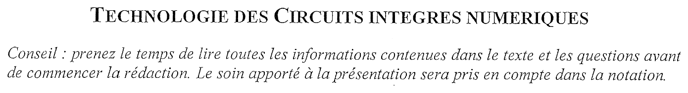{fig-alt="Titre : Technologie des circuits intégrés numériques. Conseil : prenez le temps de lire toutes les informations contenues dans le texte et les questions avant de commencer la rédaction ; le soin apporté à la présentation sera pris en compte dans la notation."}

## Partie 1 : dimensionnement des portes logiques CMOS {#sec-ann1920-ex1}

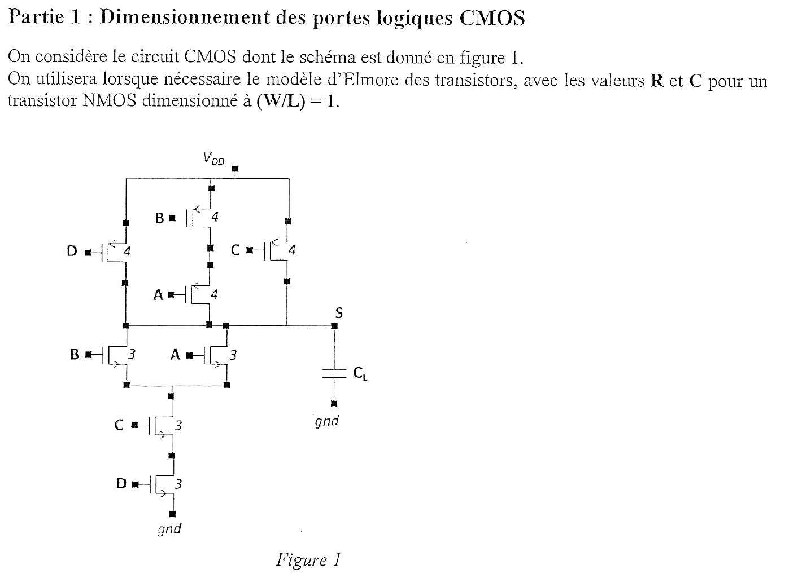{fig-alt="Partie 1 : dimensionnement des portes logiques CMOS. On considère le circuit CMOS de la figure 1 ; on utilisera le modèle d'Elmore des transistors, avec les valeurs R et C pour un NMOS dimensionné à W/L = 1. Figure 1 : réseau PMOS entre VDD et S formé de trois branches en parallèle, PMOS D, PMOS B en série avec PMOS A, PMOS C (chiffre 4 à côté de chaque PMOS) ; réseau NMOS entre S et la masse : NMOS B et NMOS A en parallèle, en série avec NMOS C puis NMOS D (chiffre 3 à côté de chaque NMOS) ; capacité CL entre S et la masse."}

**Notations utilisées dans les solutions.** Modèle du support [techno, p. 8] : un transistor de taille $k$ a une résistance $R/k$ (NMOS) ou $2R/k$ (PMOS, mobilité moitié), une capacité $kC$ sur chaque diffusion. Nœuds internes : $x$ entre les PMOS B et A ; $n_1$ entre le couple de NMOS A, B et le NMOS C ; $n_2$ entre les NMOS C et D.

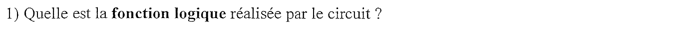{fig-alt="Question 1 : quelle est la fonction logique réalisée par le circuit ?"}

:::: {.complement}
::: {.solution}
Réseau NMOS : $(A \parallel B)$ en série avec $C$ et $D$, il conduit si $(A + B)\,C\,D = 1$. Réseau PMOS : $D$, $(B$ série $A)$ et $C$ en parallèle, il conduit si $\bar D + \bar A \bar B + \bar C = \overline{(A + B)\,C\,D}$ : les deux réseaux sont duaux.
$$\boxed{S = \overline{(A + B)\,C\,D}}$$
$S = 0$ pour $ABCD \in \{0111, 1011, 1111\}$, $S = 1$ pour les 13 autres combinaisons (vérifié par simulation au niveau interrupteur).
:::
::::

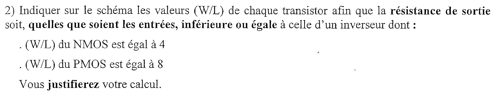{fig-alt="Question 2 : indiquer sur le schéma les valeurs W/L de chaque transistor afin que la résistance de sortie soit, quelles que soient les entrées, inférieure ou égale à celle d'un inverseur dont le W/L du NMOS est égal à 4 et le W/L du PMOS est égal à 8. Vous justifierez votre calcul."}

::: {.a-verifier #av-ann1920-tailles-figure}
**Source** [sujet-2019, p. 1, figure 1] : chaque PMOS porte le chiffre 4 et chaque NMOS le chiffre 3 ; la question 2 demande d'« indiquer sur le schéma les valeurs (W/L) de chaque transistor ».

**Problème** : les chiffres imprimés ressemblent à des tailles (comme dans la figure du partiel 2016-2017, de même dessin), mais la question demande de les déterminer et le résultat diffère (12 pour les NMOS, 8 ou 16 pour les PMOS). Ils sont probablement restés d'une ancienne version de la figure.

**Proposition** : ignorer ces chiffres et utiliser les tailles calculées ci-dessous dans toute la partie 1.
:::

:::: {.complement}
::: {.solution}
**Inverseur de référence** : NMOS de taille 4, $R_N = \frac{R}{4}$ ; PMOS de taille 8, $R_P = \frac{2R}{8} = \frac{R}{4}$. Il faut que **tout chemin de conduction** ait une résistance $\le \frac{R}{4}$, le pire cas étant celui où un seul chemin conduit.

**Réseau NMOS.** Le pire chemin traverse trois transistors en série ($A$ ou $B$ seul, puis $C$, puis $D$). Avec trois tailles égales $k$ : $3 \cdot \frac{R}{k} \le \frac{R}{4}$, soit $k \ge 12$.

**Réseau PMOS.** Branches $D$ seul et $C$ seul : $\frac{2R}{k} \le \frac{R}{4}$, $k \ge 8$. Branche $B$-$A$ : $2 \cdot \frac{2R}{k} \le \frac{R}{4}$, $k \ge 16$.

| Transistor | NMOS $A$, $B$, $C$, $D$ | PMOS $D$, $C$ | PMOS $A$, $B$ |
|---|---|---|---|
| $W/L$ | **12** | **8** | **16** |

Règle générale : un transistor en série avec $n - 1$ autres sur le pire chemin prend $n$ fois la taille du transistor correspondant de l'inverseur de référence. On peut aussi répartir autrement les tailles d'un chemin série (par exemple NMOS $C$ et $D$ plus gros, $A$ et $B$ plus petits), mais les tailles égales minimisent la surface totale pour une résistance donnée.
:::
::::

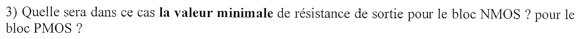{fig-alt="Question 3 : quelle sera dans ce cas la valeur minimale de résistance de sortie pour le bloc NMOS ? pour le bloc PMOS ?"}

:::: {.complement}
::: {.solution}
La résistance est minimale quand **le plus de branches parallèles** conduisent.

- **Bloc NMOS** : $A = B = 1$ (et $C = D = 1$) ; $A \parallel B$ vaut $\frac{R}{24}$ :
$$R_{N,min} = \frac{R}{24} + \frac{R}{12} + \frac{R}{12} = \boxed{\frac{5R}{24} \approx 0{,}21\,R}$$
- **Bloc PMOS** : $A = B = C = D = 0$ ; trois branches de $\frac{R}{4}$ en parallèle :
$$R_{P,min} = \boxed{\frac{R}{12}}$$
:::
::::

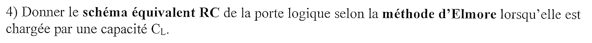{fig-alt="Question 4 : donner le schéma équivalent RC de la porte logique selon la méthode d'Elmore lorsqu'elle est chargée par une capacité CL."}

:::: {.complement}
::: {.solution}
Chaque transistor devient un **interrupteur** commandé par sa grille, en série avec sa résistance ; chaque nœud reçoit la somme des capacités de diffusion des transistors qui y sont reliés.

| Élément | Résistance (passant) |
|---|---|
| NMOS $A$, $B$, $C$, $D$ (taille 12) | $\frac{R}{12}$ |
| PMOS $D$, $C$ (taille 8) | $\frac{R}{4}$ |
| PMOS $A$, $B$ (taille 16) | $\frac{R}{8}$ |

| Nœud | Diffusions | Capacité |
|---|---|---|
| $S$ | PMOS $D$ ($8C$), $A$ ($16C$), $C$ ($8C$) ; NMOS $A$, $B$ ($2 \times 12C$) ; charge | $56C + C_L$ |
| $x$ | PMOS $B$ et $A$ | $32C$ |
| $n_1$ | NMOS $A$, $B$, $C$ | $36C$ |
| $n_2$ | NMOS $C$, $D$ | $24C$ |

Schéma (de haut en bas) : $V_{DD}$ — [$\frac{R}{4}$, $D$] — $S$ ; $V_{DD}$ — [$\frac{R}{8}$, $B$] — $x$ ($32C$) — [$\frac{R}{8}$, $A$] — $S$ ; $V_{DD}$ — [$\frac{R}{4}$, $C$] — $S$ ; $S$ ($56C + C_L$) — [$\frac{R}{12}$, $A$] et [$\frac{R}{12}$, $B$] en parallèle — $n_1$ ($36C$) — [$\frac{R}{12}$, $C$] — $n_2$ ($24C$) — [$\frac{R}{12}$, $D$] — masse. Les capacités de grille ($12C + 16C$ pour $A$ et $B$, $12C + 8C$ pour $C$ et $D$) chargent les portes qui pilotent les entrées, pas la sortie.

**Méthode de calcul** (questions 5 et 6, comme dans le [partiel 2016-2017](2016-2017-partiel.qmd#sec-ann1617-ex2)) : $t_p = \sum_k R_{kS}\, C_k$, où $R_{kS}$ est la résistance commune aux chemins du rail vers le nœud $k$ et vers $S$ ; on ne compte que les nœuds reliés au rail après la commutation et qui **changent d'état**.
:::
::::

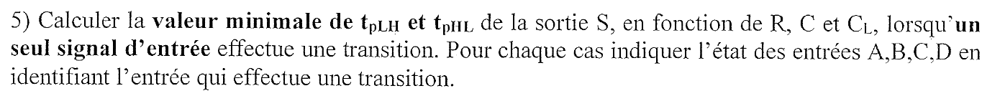{fig-alt="Question 5 : calculer la valeur minimale de tpLH et tpHL de la sortie S, en fonction de R, C et CL, lorsqu'un seul signal d'entrée effectue une transition ; pour chaque cas indiquer l'état des entrées A, B, C, D en identifiant l'entrée qui effectue une transition."}

:::: {.complement}
::: {.solution}
Les 16 transitions d'une seule entrée qui font commuter $S$ ont été évaluées par programme (réseau d'interrupteurs, états des nœuds avant et après) ; les cas extrêmes sont détaillés ici.

**$t_{pLH}$ minimal : $A$ passe de 1 à 0, avec $B = 0$, $C = D = 1$.** Après la transition, seule la branche $B$-$A$ conduit ($\frac{R}{8} + \frac{R}{8} = \frac{R}{4}$). Le nœud $x$ était déjà à $V_{DD}$ (PMOS $B$ passant) ; $n_1$ est isolé ($A = B = 0$). Seul $S$ se charge :
$$t_{pLH,min} = \frac{R}{4}\,(56C + C_L) = \boxed{14\,RC + \frac{R\,C_L}{4}}$$
Toutes les montées passent par une seule branche PMOS de $\frac{R}{4}$ (une entrée qui coupe le réseau NMOS laisse au moins une des deux autres branches PMOS bloquée) : elles ont toutes le terme $\frac{R C_L}{4}$ et ne diffèrent que par les nœuds internes à charger.

**$t_{pHL}$ minimal.** Deux candidats :

- **$A$ passe de 0 à 1, avec $B = 0$, $C = D = 1$** : chemin $A$-$C$-$D$ ($\frac{R}{4}$) ; $n_1$ et $n_2$ étaient déjà à 0 (reliés à la masse par $C$ et $D$), $x$ est isolé (PMOS $A$ bloqué) :
$$t_{pHL} = \frac{R}{4}\,(56C + C_L) = 14\,RC + \frac{R\,C_L}{4} ;$$
- **$C$ passe de 0 à 1, avec $A = B = D = 1$** : chemin le moins résistant ($\frac{5R}{24}$), mais $n_1$, chargé par $A$ et $B$ depuis $S$, doit aussi se vider (résistance commune $\frac{R}{12} + \frac{R}{12} = \frac{R}{6}$) ; $n_2$ était déjà à 0 :
$$t_{pHL} = \frac{R}{6}\,36C + \frac{5R}{24}\,(56C + C_L) = \frac{53}{3}\,RC + \frac{5\,R\,C_L}{24} \approx 17{,}7\,RC + 0{,}21\,R\,C_L .$$

Les deux droites se croisent pour $C_L = 88\,C$ :
$$\boxed{t_{pHL,min} = \begin{cases} 14\,RC + \dfrac{R\,C_L}{4} & \text{si } C_L \le 88\,C \ (A \uparrow,\ B = 0,\ C = D = 1)\\[2mm] \dfrac{53}{3}\,RC + \dfrac{5\,R\,C_L}{24} & \text{si } C_L \ge 88\,C \ (C \uparrow,\ A = B = D = 1)\end{cases}}$$
Pour une faible charge, les capacités internes dominent : mieux vaut un chemin plus résistant dont les nœuds sont déjà déchargés ; pour une forte charge, c'est la résistance du chemin qui compte.
:::
::::

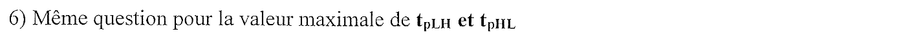{fig-alt="Question 6 : même question pour la valeur maximale de tpLH et tpHL."}

:::: {.complement}
::: {.solution}
**$t_{pLH}$ maximal : $D$ passe de 1 à 0, avec $A = 0$, $B = C = 1$.** Seul le PMOS $D$ conduit ($\frac{R}{4}$), et **tous** les nœuds internes, à 0 avant, sont reliés à $S$ et doivent se charger : $n_1$ par le NMOS $B$, $n_2$ par le NMOS $C$, $x$ par le PMOS $A$ (passant, $A = 0$ ; $x$ était tiré à 0 depuis $S$, le PMOS $B$ étant bloqué). Tous partagent la résistance $\frac{R}{4}$ :
$$t_{pLH,max} = \frac{R}{4}\,(56C + C_L + 36C + 24C + 32C) = \boxed{37\,RC + \frac{R\,C_L}{4}}$$

**$t_{pHL}$ maximal : $D$ passe de 0 à 1, avec $A = 0$, $B = C = 1$.** Chemin $B$-$C$-$D$ ($\frac{R}{4}$) ; avant, $n_1$ et $n_2$ étaient chargés depuis $S$ (NMOS $B$ et $C$ passants) et $x$ était à $V_{DD}$, relié à $S$ par le PMOS $A$ :
$$t_{pHL,max} = \frac{R}{12}\,24C + \frac{R}{6}\,36C + \frac{R}{4}\,(56C + C_L) + \frac{R}{4}\,32C = 2 + 6 + 14 + 8 \quad\Longrightarrow\quad \boxed{t_{pHL,max} = 30\,RC + \frac{R\,C_L}{4}}$$

| | Minimum | Maximum |
|---|---|---|
| $t_{pLH}$ | $14\,RC + 0{,}25\,RC_L$ ($A \downarrow$ ; $B = 0$, $C = D = 1$) | $37\,RC + 0{,}25\,RC_L$ ($D \downarrow$ ; $A = 0$, $B = C = 1$) |
| $t_{pHL}$ | $14\,RC + 0{,}25\,RC_L$ ou $17{,}7\,RC + 0{,}21\,RC_L$ (voir q. 5) | $30\,RC + 0{,}25\,RC_L$ ($D \uparrow$ ; $A = 0$, $B = C = 1$) |

Le dimensionnement de la question 2 garantit le même terme $\frac{R C_L}{4}$ que l'inverseur de référence dans le pire cas ; ce sont les **capacités internes**, et leur état avant la commutation, qui font varier le retard du simple au double. Les transistors les plus proches du rail ($D$) donnent les pires cas, car leur commutation oblige à charger ou vider tout le réseau au-dessus d'eux.
:::
::::

## Partie 2 : la famille logique « Dynamic BiMOS » {#sec-ann1920-ex2}

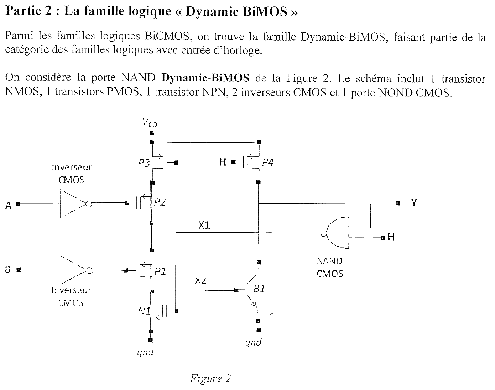{fig-alt="Partie 2 : la famille logique Dynamic BiMOS. Parmi les familles logiques BiCMOS, on trouve la famille Dynamic-BiMOS, qui fait partie des familles logiques avec entrée d'horloge. On considère la porte NAND Dynamic-BiMOS de la figure 2 : 1 NMOS, 1 PMOS (en fait 4 PMOS sur le schéma), 1 NPN, 2 inverseurs CMOS et 1 porte NAND CMOS. Figure 2 : entre VDD et le nœud X2, trois PMOS en série, P3 (grille X1), P2 (grille Ā, sortie d'un inverseur CMOS d'entrée A) et P1 (grille B̄, sortie d'un inverseur d'entrée B) ; NMOS N1 (grille X1) entre X2 et la masse ; X2 attaque la base du transistor bipolaire NPN B1, émetteur à la masse, collecteur sur la sortie Y ; PMOS P4 (grille H) entre VDD et Y ; porte NAND CMOS d'entrées Y et H, de sortie X1."}

::: {.a-verifier #av-ann1920-nombre-pmos}
**Source** [sujet-2019, p. 2] : « Le schéma inclut 1 transistor NMOS, 1 transistors PMOS, 1 transistor NPN, 2 inverseurs CMOS et 1 porte NAND CMOS. »

**Problème** : la figure 2 comporte **quatre** PMOS (P1 à P4), et la question 2 les cite tous.

**Proposition** : lire « 4 transistors PMOS ».
:::

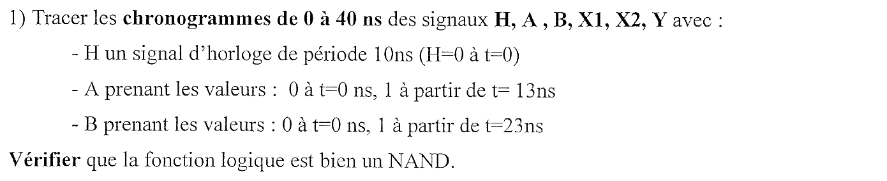{fig-alt="Question 1 : tracer les chronogrammes de 0 à 40 ns des signaux H, A, B, X1, X2, Y avec H un signal d'horloge de période 10 ns (H = 0 à t = 0), A prenant la valeur 0 à t = 0 et 1 à partir de t = 13 ns, B prenant la valeur 0 à t = 0 et 1 à partir de t = 23 ns. Vérifier que la fonction logique est bien un NAND."}

:::: {.complement}
::: {.solution}
**Fonctionnement** (rapport cyclique de $H$ supposé égal à $\frac12$ : $H = 0$ sur $[0, 5[$, 1 sur $[5, 10[$, etc.).

- **Précharge** ($H = 0$) : P4 conduit, $Y = 1$. La porte NAND donne $X_1 = \overline{Y \cdot 0} = 1$ : P3 bloqué, N1 passant, $X_2 = 0$, B1 bloqué.
- **Évaluation** ($H = 1$) : P4 se bloque, $Y$ garde sa charge (nœud **dynamique**). $X_1 = \bar Y = 0$ : P3 conduit, N1 se bloque.
  - Si $A = B = 1$ : P2 et P1 conduisent ($\bar A = \bar B = 0$), $X_2$ monte, B1 conduit et décharge $Y$. Alors $X_1 = \overline{0 \cdot 1} = 1$ : P3 se bloque, N1 vide la base, B1 se bloque. $Y$ reste à 0.
  - Sinon : la chaîne P3-P2-P1 est ouverte, $X_2$ reste à 0, $Y$ reste à 1.

Pendant l'évaluation, $Y = \overline{A \cdot B}$ : c'est bien une porte **NAND**. La boucle $Y \to X_1 \to$ P3/N1 coupe d'elle-même le courant de base dès que $Y$ est tombé.

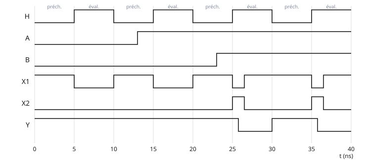{#fig-ann1920-chronogrammes-bimos}

| Phase | $[0,5[$ | $[5,10[$ | $[10,15[$ | $[15,20[$ | $[20,25[$ | $[25,30[$ | $[30,35[$ | $[35,40[$ |
|---|---|---|---|---|---|---|---|---|
| $H$ | 0 | 1 | 0 | 1 | 0 | 1 | 0 | 1 |
| $A$ | 0 | 0 | 0 → 1 à 13 ns | 1 | 1 | 1 | 1 | 1 |
| $B$ | 0 | 0 | 0 | 0 | 0 → 1 à 23 ns | 1 | 1 | 1 |
| $X_1$ | 1 | 0 | 1 | 0 | 1 | impulsion à 0, puis 1 | 1 | impulsion à 0, puis 1 |
| $X_2$ | 0 | 0 | 0 | 0 | 0 | impulsion à 1, puis 0 | 0 | impulsion à 1, puis 0 |
| $Y$ | 1 | 1 | 1 | 1 | 1 | **0** | 1 | **0** |

$Y$ ne vaut 0 que pendant les phases d'évaluation où $A = B = 1$ : $Y = \overline{AB}$ ✓. En précharge, $Y = 1$ quelles que soient les entrées : la sortie n'est valide qu'en évaluation.
:::
::::

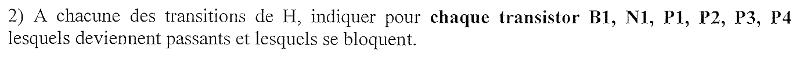{fig-alt="Question 2 : à chacune des transitions de H, indiquer pour chaque transistor B1, N1, P1, P2, P3, P4 lesquels deviennent passants et lesquels se bloquent."}

:::: {.complement}
::: {.solution}
P1 et P2 ne dépendent que de $B$ et $A$ (P2 conduit dès $t = 13$ ns, P1 dès $t = 23$ ns) : ils ne changent **pas** aux fronts de $H$.

| Front de $H$ | P4 | P3 | N1 | B1 | P2 | P1 |
|---|---|---|---|---|---|---|
| ↑ 5 ns, ↑ 15 ns | se bloque | devient passant | se bloque | reste bloqué | bloqué (5 ns) / passant (15 ns) | bloqué |
| ↓ 10 ns, ↓ 20 ns | devient passant | se bloque | devient passant | reste bloqué | idem | bloqué |
| ↑ 25 ns, ↑ 35 ns | se bloque | passant **puis** bloqué | bloqué **puis** passant | passant **puis** bloqué | passant | passant |
| ↓ 30 ns, (↓ 40 ns) | devient passant | reste bloqué | reste passant | reste bloqué | passant | passant |

À 25 et 35 ns, la séquence est : P4 se bloque, P3 conduit et N1 se bloque ($X_1 \downarrow$), $X_2$ monte, B1 conduit, $Y$ tombe, $X_1$ remonte, P3 se bloque, N1 conduit, B1 se bloque. À 30 ns, $X_1$ vaut déjà 1 : seul P4 change d'état et recharge $Y$.
:::
::::

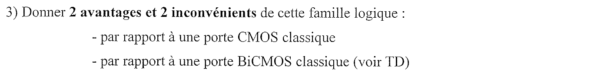{fig-alt="Question 3 : donner 2 avantages et 2 inconvénients de cette famille logique par rapport à une porte CMOS classique, et par rapport à une porte BiCMOS classique (voir TD)."}

:::: {.complement}
::: {.solution}
**Par rapport à une porte CMOS classique**

- Avantages : le bipolaire B1 fournit un fort courant de décharge, donc une descente rapide sur une **grosse capacité** de sortie (sortance élevée, longues lignes) ; la logique d'évaluation ne demande qu'une chaîne de PMOS (pas de réseau dual complet) et la sortie n'a qu'un transistor de rappel (P4), donc peu de capacité.
- Inconvénients : il faut une **horloge** et la sortie n'est valide qu'en phase d'évaluation (précharge systématique, consommation de l'horloge, contraintes de mise en cascade comme pour toute logique dynamique) ; le nœud $Y$ est **dynamique** (fuites, sensibilité au bruit et au partage de charge) ; la technologie BiCMOS est plus coûteuse ; la chaîne de PMOS en série est lente pour beaucoup d'entrées.

**Par rapport à une porte BiCMOS classique** (inverseurs du TD, avec deux NPN en totem)

- Avantages : **excursion pleine** en sortie (précharge à $V_{DD}$ par P4, au lieu de $V_{DD} - V_{BE}$), niveau bas proche de $V_{CE,sat}$ ; un seul bipolaire au lieu de deux, donc moins de surface ; pas de courant de base permanent, la boucle par $X_1$ coupe B1 dès la décharge (et N1 vide la base, ce qui accélère le blocage).
- Inconvénients : la montée de $Y$ n'est pas accélérée par un bipolaire (seulement P4) ; fonctionnement dynamique cadencé (horloge, précharge, maintien de l'état limité dans le temps) ; conception plus délicate (rebouclage par la porte NAND, temps de précharge à garantir).
:::
::::
