

::: {.complement}
Aucun corrigé n'est disponible : **toutes les solutions de cette page sont rédigées par Claude**. À relire avec un œil critique ; signaler toute erreur.

**Énoncé.** Images découpées dans le scan du sujet [sujet-2025]. Annotations d'un étudiant effacées : surlignage orange (page 1), cercles de stylo autour des numéros 2.2, 2.3, 1.7 et 3.4 (de petites traces peuvent rester), mot « BONUS » et accolade au crayon dans la marge de la partie II, section 3 (rien n'indique dans le texte imprimé que cette section soit un bonus).

**VHDL.** Le code des solutions de la partie II a été **compilé et simulé avec GHDL 4.1** (norme VHDL-2008) : les deux descriptions de FB (questions 1.3 et 1.4) donnent la même sortie ; le banc de test mesure une période de 127 et des suites d'au plus sept 1 et six 0 consécutifs (questions 3.1 et 3.3). La synthèse générique de GHDL (`--synth`) donne bien 7 bascules et une porte XOR.

**Correspondances.** La bascule scan (partie I) est la bascule D-Scan du [partiel 2017-2018](2017-2018-partiel.qmd#sec-ann1718-ex2), avec les mêmes questions de polarité de l'entrée de commande.
:::

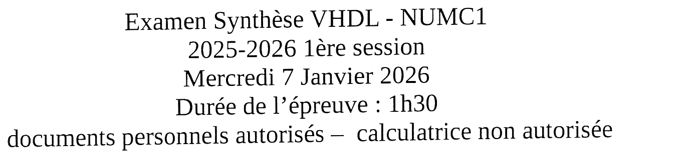{fig-alt="En-tête : Examen Synthèse VHDL - NUMC1, 2025-2026 1re session, mercredi 7 janvier 2026, durée de l'épreuve 1 h 30, documents personnels autorisés, calculatrice non autorisée."}

## Partie I : test des CI numériques {#sec-ann2526-ex1}

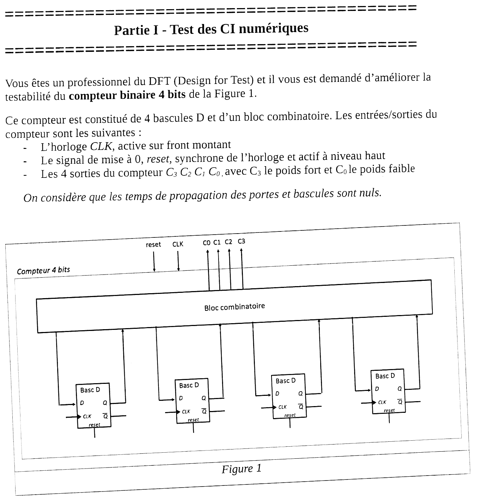{fig-alt="Partie I, test des CI numériques. Vous êtes un professionnel du DFT (Design for Test) et devez améliorer la testabilité du compteur binaire 4 bits de la figure 1, constitué de 4 bascules D et d'un bloc combinatoire. Entrées-sorties : horloge CLK active sur front montant ; signal de mise à 0 reset, synchrone de l'horloge et actif à niveau haut ; 4 sorties C3 C2 C1 C0, C3 de poids fort. Les temps de propagation des portes et bascules sont nuls. Figure 1 : bloc « Compteur 4 bits » contenant un bloc combinatoire (entrées reset et CLK en haut, sorties C0 à C3) et quatre bascules D (entrées D, CLK, reset ; sorties Q et Q barre) ; chaque sortie Q revient au bloc combinatoire, qui fournit l'entrée D de chaque bascule."}

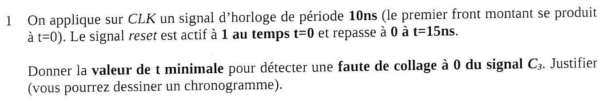{fig-alt="Question 1 : on applique sur CLK un signal d'horloge de période 10 ns (premier front montant à t = 0). Le signal reset est actif à 1 au temps t = 0 et repasse à 0 à t = 15 ns. Donner la valeur de t minimale pour détecter une faute de collage à 0 du signal C3. Justifier (vous pourrez dessiner un chronogramme)."}

:::: {.complement}
::: {.solution}
Une faute de **collage à 0** de $C_3$ n'est visible que si le circuit sans faute met $C_3$ à **1** : il faut atteindre la valeur $8 = 1000_2$. On suppose un compteur **croissant** à partir de 0 (le sujet dit seulement « compteur binaire »).

- Fronts montants à $t = 0, 10, 20, \ldots$ ns.
- À 0 et 10 ns, $reset = 1$ (reset **synchrone**) : le compteur est mis à 0.
- $reset$ retombe à 15 ns ; le premier front de comptage est à 20 ns (valeur 1), puis une valeur de plus tous les 10 ns : la valeur $n$ apparaît à $t = 10\,n + 10$ ns.
- La valeur 8 apparaît au front de **90 ns** ; les temps de propagation étant nuls, $C_3$ vaut 1 dès cet instant.

$$\boxed{t_{min} = 90\ \text{ns}}$$

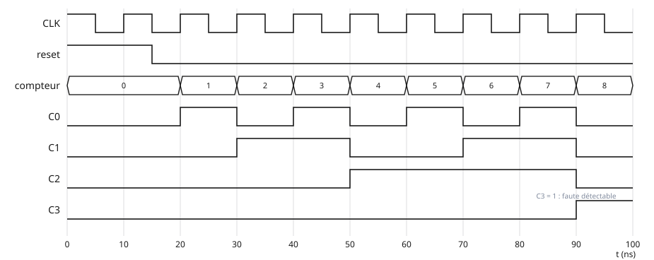{#fig-ann2526-chronogramme-compteur}

Il faut $2^{n-1}$ fronts de comptage pour tester le poids fort d'un compteur de $n$ bits : c'est ce coût, exponentiel en $n$, que la bascule scan supprime.
:::
::::

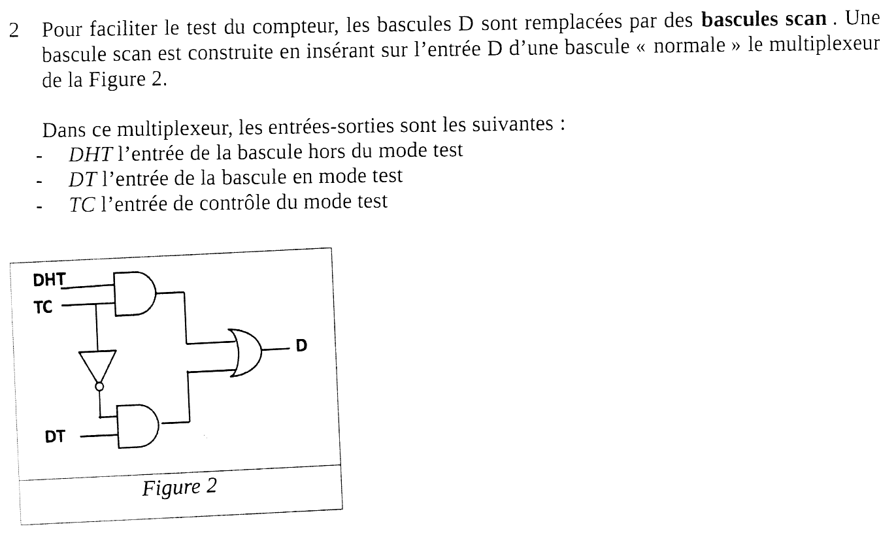{fig-alt="Question 2 : pour faciliter le test du compteur, les bascules D sont remplacées par des bascules scan. Une bascule scan est construite en insérant sur l'entrée D d'une bascule normale le multiplexeur de la figure 2. Entrées : DHT l'entrée de la bascule hors du mode test ; DT l'entrée de la bascule en mode test ; TC l'entrée de contrôle du mode test. Figure 2 : une porte AND reçoit DHT et TC ; TC passe par un inverseur vers une seconde AND qui reçoit DT ; les deux AND attaquent une porte OR de sortie D."}

::: {.a-verifier #av-ann2526-polarite-tc}
**Source** [sujet-2025, p. 2, figure 2] : la porte AND du haut reçoit $DHT$ et $TC$, celle du bas $DT$ et $\overline{TC}$ ; le texte définit $TC$ comme « l'entrée de contrôle du mode test ».

**Problème** : d'après le schéma, $D = TC \cdot DHT + \overline{TC} \cdot DT$ : c'est l'entrée **hors test** qui est choisie quand $TC = 1$. Si « contrôle du mode test » signifie « mode test quand $TC = 1$ », la figure est inversée. Même disposition dans la figure 3 du [partiel 2017-2018](2017-2018-partiel.qmd#av-ann1718-polarite-tc).

**Proposition** : suivre la figure ($TC = 0$ : mode test, $DT$ ; $TC = 1$ : fonctionnement normal, $DHT$). Les réponses ne changent pas avec l'autre polarité, à l'inversion de $TC$ près.
:::

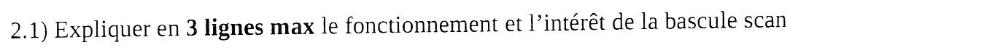{fig-alt="Question 2.1 : expliquer en 3 lignes maximum le fonctionnement et l'intérêt de la bascule scan."}

:::: {.complement}
::: {.solution}
Un multiplexeur commandé par $TC$ choisit l'entrée de la bascule : $DHT$ (sortie de la logique, fonctionnement normal) ou $DT$ (mode test, ici $TC = 0$). En mode test, les bascules chaînées ($Q \to DT$ de la suivante) forment un registre à décalage : on charge et on relit directement l'état interne, ce qui rend chaque bascule contrôlable et observable sans parcourir la séquence d'états.
:::
::::

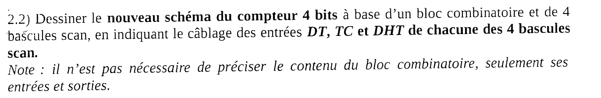{fig-alt="Question 2.2 : dessiner le nouveau schéma du compteur 4 bits à base d'un bloc combinatoire et de 4 bascules scan, en indiquant le câblage des entrées DT, TC et DHT de chacune des 4 bascules. Note : il n'est pas nécessaire de préciser le contenu du bloc combinatoire, seulement ses entrées et sorties."}

:::: {.complement}
::: {.solution}
Le bloc combinatoire est inchangé (entrées : $C_3 \ldots C_0$ et $reset$ ; sorties : les quatre valeurs suivantes $N_3 \ldots N_0$). On ajoute deux entrées au compteur, **$TC$** et **$SI$** (*scan in*, entrée série de test) ; la sortie de la chaîne (*scan out*) est l'une des sorties $C_i$, déjà accessible.

Câblage proposé, chaîne **$SI \to C_3 \to C_2 \to C_1 \to C_0$** (ordre choisi pour la question 2.3) :

| Bascule scan | $DHT$ | $DT$ | $TC$ | $CLK$, $reset$ |
|---|---|---|---|---|
| $C_3$ | $N_3$ (bloc combinatoire) | $SI$ (nouvelle entrée) | $TC$ commun | communs |
| $C_2$ | $N_2$ | $C_3$ | $TC$ commun | communs |
| $C_1$ | $N_1$ | $C_2$ | $TC$ commun | communs |
| $C_0$ | $N_0$ | $C_1$ | $TC$ commun | communs |

Sur le schéma de la figure 1 : chaque fil qui allait du bloc combinatoire à l'entrée $D$ d'une bascule arrive désormais sur son entrée $DHT$ ; un fil supplémentaire relie la sortie $Q$ de chaque bascule à l'entrée $DT$ de la suivante ; $TC$ est distribué à toutes les bascules ; $C_0$, dernière de la chaîne, sert de sortie de scan. Les sorties $Q$ restent reliées au bloc combinatoire et aux sorties $C_i$.

Tout autre ordre de chaîne est correct pour la fonction ; il change seulement le nombre de fronts nécessaires pour amener une valeur dans une bascule donnée.
:::
::::

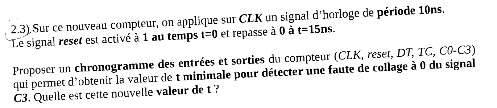{fig-alt="Question 2.3 : sur ce nouveau compteur, on applique sur CLK un signal d'horloge de période 10 ns ; le signal reset est activé à 1 au temps t = 0 et repasse à 0 à t = 15 ns. Proposer un chronogramme des entrées et sorties du compteur (CLK, reset, DT, TC, C0-C3) qui permet d'obtenir la valeur de t minimale pour détecter une faute de collage à 0 du signal C3. Quelle est cette nouvelle valeur de t ?"}

:::: {.complement}
::: {.solution}
Il suffit de mettre **un 1 dans la bascule $C_3$** et de l'observer sur la sortie $C_3$.

- Le reset synchrone reste prioritaire (il agit sur les bascules elles-mêmes) : les fronts de 0 et 10 ns remettent le compteur à 0.
- Dès le front de **20 ns**, en mode test ($TC = 0$) avec $SI = 1$ : la bascule $C_3$, première de la chaîne, recopie $SI$. $C_3$ vaut 1 à $t = 20$ ns : un collage à 0 est détecté.

$$\boxed{t_{min} = 20\ \text{ns}}$$

{#fig-ann2526-chronogramme-scan}

| Front | 0 ns | 10 ns | 20 ns |
|---|---|---|---|
| $reset$ | 1 | 1 | 0 |
| $TC$ | 0 | 0 | 0 |
| $SI$ ($DT$ de $C_3$) | 1 | 1 | 1 |
| $C_3 C_2 C_1 C_0$ après le front | 0000 | 0000 | **1**000 |

Si la chaîne était câblée dans l'autre sens ($SI \to C_0 \to \ldots \to C_3$), il faudrait quatre fronts de décalage : $t = 50$ ns, encore bien mieux que les 90 ns de la question 1. Le gain est d'autant plus grand que le compteur est long ($n$ fronts au plus au lieu de $2^{n-1}$).
:::
::::

## Partie II : langage VHDL, architecture numérique {#sec-ann2526-ex2}

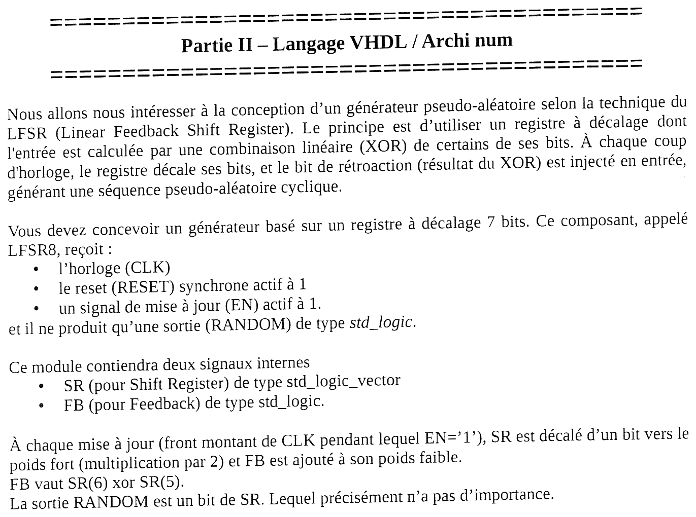{fig-alt="Partie II, langage VHDL / archi num. Générateur pseudo-aléatoire selon la technique du LFSR (Linear Feedback Shift Register) : un registre à décalage dont l'entrée est une combinaison linéaire (XOR) de certains de ses bits ; à chaque coup d'horloge, le registre décale ses bits et le bit de rétroaction est injecté en entrée, d'où une séquence pseudo-aléatoire cyclique. Générateur basé sur un registre à décalage 7 bits, composant appelé LFSR8 ; entrées : horloge CLK, reset RESET synchrone actif à 1, signal de mise à jour EN actif à 1 ; une sortie RANDOM de type std_logic. Signaux internes : SR (shift register) de type std_logic_vector et FB (feedback) de type std_logic. À chaque mise à jour (front montant de CLK pendant lequel EN = '1'), SR est décalé d'un bit vers le poids fort (multiplication par 2) et FB est ajouté à son poids faible. FB vaut SR(6) xor SR(5). La sortie RANDOM est un bit de SR ; lequel précisément n'a pas d'importance."}

::: {.complement}
Le composant s'appelle LFSR8 bien que son registre ait 7 bits ; la version 8 bits n'apparaît qu'à la question 2.2. Les solutions gardent le nom imposé.
:::

### Écriture {#sec-ann2526-ecriture}

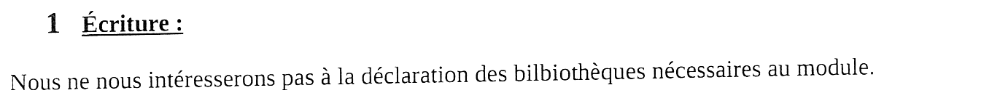{fig-alt="Section 1, écriture. Nous ne nous intéresserons pas à la déclaration des bibliothèques nécessaires au module."}

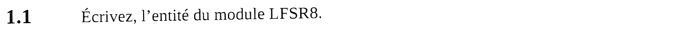{fig-alt="Question 1.1 : écrivez l'entité du module LFSR8."}

:::: {.complement}
::: {.solution}
```vhdl
entity LFSR8 is
  port (
    CLK    : in  std_logic;
    RESET  : in  std_logic;   -- reset synchrone, actif à 1
    EN     : in  std_logic;   -- mise à jour, active à 1
    RANDOM : out std_logic
  );
end entity LFSR8;
```
(Bibliothèques supposées déclarées : `library ieee; use ieee.std_logic_1164.all;`.)
:::
::::

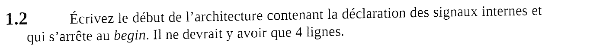{fig-alt="Question 1.2 : écrivez le début de l'architecture contenant la déclaration des signaux internes et qui s'arrête au begin. Il ne devrait y avoir que 4 lignes."}

:::: {.complement}
::: {.solution}
```vhdl
architecture rtl of LFSR8 is
  signal SR : std_logic_vector(6 downto 0);
  signal FB : std_logic;
begin
```
Sept bits, indices 6 (poids fort) à 0 (poids faible), pour que `SR(6)` et `SR(5)` désignent les deux bits de poids fort.
:::
::::

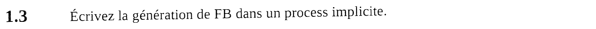{fig-alt="Question 1.3 : écrivez la génération de FB dans un process implicite."}

:::: {.complement}
::: {.solution}
Un *process* implicite est une **affectation concurrente** :
```vhdl
  FB <= SR(6) xor SR(5);
```
Elle se comporte comme un *process* sensible à `SR` : FB est recalculé à chaque changement de SR. C'est de la logique combinatoire (une porte XOR).
:::
::::

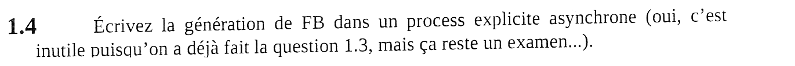{fig-alt="Question 1.4 : écrivez la génération de FB dans un process explicite asynchrone (oui, c'est inutile puisqu'on a déjà fait la question 1.3, mais ça reste un examen…)."}

:::: {.complement}
::: {.solution}
```vhdl
  P_FB : process (SR)
  begin
    FB <= SR(6) xor SR(5);
  end process P_FB;
```
La liste de sensibilité doit contenir **tous** les signaux lus (ici `SR`) : sinon la simulation ne recalculerait pas FB alors que le circuit synthétisé, lui, est combinatoire. En VHDL-2008, `process (all)` évite l'oubli. (Les deux versions ne doivent pas coexister dans la même architecture : FB aurait deux pilotes.)
:::
::::

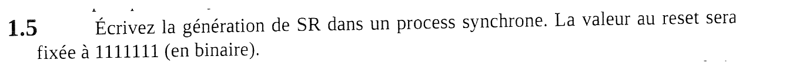{fig-alt="Question 1.5 : écrivez la génération de SR dans un process synchrone. La valeur au reset sera fixée à 1111111 (en binaire)."}

:::: {.complement}
::: {.solution}
```vhdl
  P_SR : process (CLK)
  begin
    if rising_edge(CLK) then
      if RESET = '1' then
        SR <= "1111111";                 -- reset synchrone
      elsif EN = '1' then
        SR <= SR(5 downto 0) & FB;       -- décalage vers le poids fort, FB au poids faible
      end if;
    end if;
  end process P_SR;
```
Reset **synchrone** : testé à l'intérieur de `rising_edge(CLK)`, et `CLK` seul dans la liste de sensibilité. Sans `else`, SR garde sa valeur quand `EN = '0'` (bascules avec validation). La valeur de reset est non nulle : l'état « tout à 0 » bloquerait le générateur (question 3.1).
:::
::::

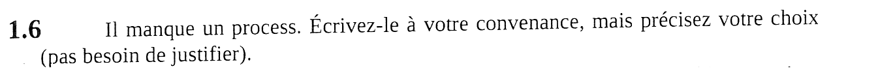{fig-alt="Question 1.6 : il manque un process. Écrivez-le à votre convenance, mais précisez votre choix (pas besoin de justifier)."}

:::: {.complement}
::: {.solution}
Il manque l'affectation de la **sortie**. Choix : process implicite, bit de poids fort.
```vhdl
  RANDOM <= SR(6);

end architecture rtl;
```
Le module complet (questions 1.1 à 1.6) a été compilé et simulé avec GHDL ; une seconde architecture avec le *process* explicite de la question 1.4 donne la même séquence.
:::
::::

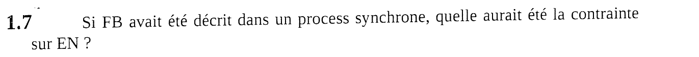{fig-alt="Question 1.7 : si FB avait été décrit dans un process synchrone, quelle aurait été la contrainte sur EN ?"}

:::: {.complement}
::: {.solution}
FB deviendrait un **registre** : sa valeur au front $k$ serait $SR_6 \oplus SR_5$ calculé au front $k - 1$, donc sur l'**ancienne** valeur de SR. Si l'on écrit
```vhdl
  P_FB_SYNC : process (CLK)
  begin
    if rising_edge(CLK) then
      FB <= SR(6) xor SR(5);   -- mis à jour à chaque front
    end if;
  end process P_FB_SYNC;
```
la rétroaction n'est juste que si SR n'a **pas changé** au front précédent. Contrainte : **EN ne doit jamais être actif sur deux fronts consécutifs** (au moins un front avec `EN = '0'` entre deux mises à jour, par exemple EN actif un cycle sur deux). Vérifié par simulation : avec EN actif un front sur deux, la séquence est identique à celle du module de référence ; avec EN toujours à 1, elle diffère.

Autre solution sans contrainte sur EN : calculer FB à l'avance, sur la valeur que SR va prendre (`FB <= SR(5) xor SR(4)` dans la même branche `EN = '1'` que le décalage), ce qui revient à une rétroaction anticipée d'un coup.
:::
::::

### Synthèse {#sec-ann2526-synthese}

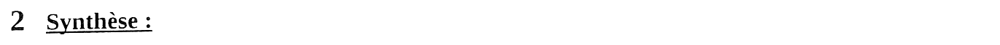{fig-alt="Section 2, synthèse."}

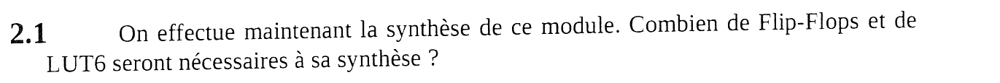{fig-alt="Question 2.1 : on effectue maintenant la synthèse de ce module. Combien de flip-flops et de LUT6 seront nécessaires à sa synthèse ?"}

:::: {.complement}
::: {.solution}
- **Bascules : 7**, une par bit de SR. FB est combinatoire et RANDOM n'est qu'un fil vers `SR(6)`.
- **LUT6 : 1**, pour le XOR à deux entrées de FB. Sur un FPGA Xilinx, chaque bascule a une entrée de validation (CE, reliée à EN) et une mise à 1 synchrone (S, reliée à RESET) : le décalage, la validation et le reset ne coûtent aucune LUT.

Si l'outil n'utilisait pas CE et S, chaque bit demanderait une LUT pour $RESET\ ?\ 1 : (EN\ ?\ SR_{i-1} : SR_i)$ (4 entrées), celle du bit 0 absorbant le XOR (5 entrées) : 7 LUT. La synthèse générique de GHDL trouve bien 7 bascules, une porte XOR et deux multiplexeurs (validation et reset) par bit.
:::
::::

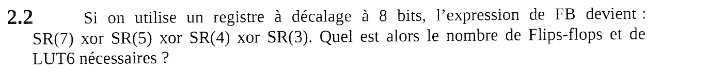{fig-alt="Question 2.2 : si on utilise un registre à décalage à 8 bits, l'expression de FB devient SR(7) xor SR(5) xor SR(4) xor SR(3). Quel est alors le nombre de flip-flops et de LUT6 nécessaires ?"}

:::: {.complement}
::: {.solution}
- **8 bascules**.
- **1 LUT6** : un XOR de 4 entrées tient dans une seule LUT (jusqu'à 6 entrées).

Cette rétroaction donne une séquence de longueur maximale $2^8 - 1 = 255$ (vérifié par simulation).
:::
::::

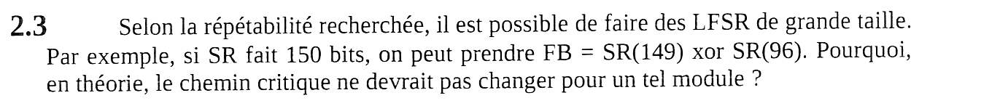{fig-alt="Question 2.3 : selon la répétabilité recherchée, il est possible de faire des LFSR de grande taille ; par exemple, si SR fait 150 bits, on peut prendre FB = SR(149) xor SR(96). Pourquoi, en théorie, le chemin critique ne devrait pas changer pour un tel module ?"}

:::: {.complement}
::: {.solution}
Entre deux bascules, la logique reste la même quelle que soit la taille : un simple fil pour le décalage ($SR_{i-1} \to SR_i$) et **un seul niveau de LUT** (XOR de deux bits) pour la rétroaction. Le chemin critique, bascule → XOR → bascule, a la même profondeur logique qu'avec 7 bits : la fréquence maximale ne dépend pas, en théorie, du nombre de bits.
:::
::::

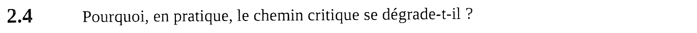{fig-alt="Question 2.4 : pourquoi, en pratique, le chemin critique se dégrade-t-il ?"}

:::: {.complement}
::: {.solution}
Par le **routage**. 150 bascules occupent de nombreuses tranches (*slices*) réparties sur une grande surface : les bits $SR_{149}$ et $SR_{96}$, et le retour de FB vers $SR_0$, sont physiquement éloignés, donc reliés par de longs fils dont le temps de propagation s'ajoute à celui de la LUT. De plus, RESET et EN attaquent 150 bascules : ces signaux à forte sortance sont lents ou doivent être dupliqués. À 7 bits, tout tient dans un ou deux blocs logiques voisins.
:::
::::

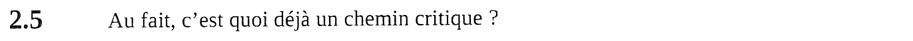{fig-alt="Question 2.5 : au fait, c'est quoi déjà un chemin critique ?"}

:::: {.complement}
::: {.solution}
C'est le chemin combinatoire **le plus lent** (logique et routage) entre deux éléments synchrones : sortie d'une bascule (ou entrée du circuit) jusqu'à l'entrée d'une bascule (ou sortie du circuit). Il fixe la période minimale d'horloge :
$$T_{CLK} \ge t_{co} + t_{logique} + t_{routage} + t_{setup} ,$$
donc la fréquence maximale du circuit.
:::
::::

### Réflexion {#sec-ann2526-reflexion}

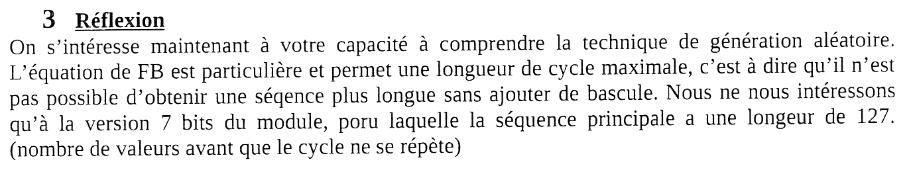{fig-alt="Section 3, réflexion. On s'intéresse à votre capacité à comprendre la technique de génération aléatoire. L'équation de FB est particulière et permet une longueur de cycle maximale : il n'est pas possible d'obtenir une séquence plus longue sans ajouter de bascule. On ne s'intéresse qu'à la version 7 bits du module, pour laquelle la séquence principale a une longueur de 127 (nombre de valeurs avant que le cycle ne se répète)."}

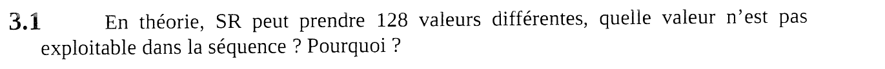{fig-alt="Question 3.1 : en théorie, SR peut prendre 128 valeurs différentes ; quelle valeur n'est pas exploitable dans la séquence ? Pourquoi ?"}

:::: {.complement}
::: {.solution}
La valeur **0000000**. Avec $SR = 0$, $FB = 0 \oplus 0 = 0$ et le décalage redonne 0 : c'est un **point fixe**, le générateur y resterait bloqué. Elle forme un cycle de longueur 1 à elle seule ; les 127 autres valeurs forment le cycle principal ($127 = 2^7 - 1$, longueur vérifiée par simulation). C'est pourquoi la valeur de reset est non nulle (1111111).
:::
::::

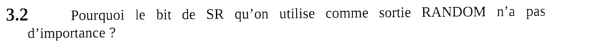{fig-alt="Question 3.2 : pourquoi le bit de SR qu'on utilise comme sortie RANDOM n'a pas d'importance ?"}

:::: {.complement}
::: {.solution}
SR est un registre à décalage : le bit $SR_i$ au coup $k$ est le bit $SR_0$ au coup $k - i$. Tous les bits portent **la même séquence**, simplement **décalée dans le temps** de quelques coups. Les propriétés statistiques (période 127, proportion de 1 et de 0, longueur des suites) sont donc les mêmes quel que soit le bit choisi.
:::
::::

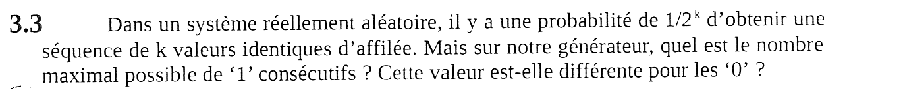{fig-alt="Question 3.3 : dans un système réellement aléatoire, il y a une probabilité de 1/2^k d'obtenir une séquence de k valeurs identiques d'affilée ; sur notre générateur, quel est le nombre maximal possible de 1 consécutifs ? Cette valeur est-elle différente pour les 0 ?"}

:::: {.complement}
::: {.solution}
Une suite de $k$ bits identiques en sortie correspond à $k$ bits identiques côte à côte dans le registre.

- **1 consécutifs : 7 au maximum.** L'état 1111111 fait partie du cycle (c'est même l'état de reset) : il produit une suite de sept 1. Huit 1 d'affilée exigeraient de passer deux fois de suite par 1111111, ce qui ferait un cycle de longueur 1.
- **0 consécutifs : 6 au maximum.** Sept 0 d'affilée feraient passer par l'état 0000000, exclu (question 3.1).

La valeur est donc **différente** pour les 0 (6) et pour les 1 (7). C'est une propriété générale des séquences de longueur maximale d'un LFSR de $n$ bits : une seule suite de $n$ uns, une seule de $n - 1$ zéros, et 64 uns pour 63 zéros sur une période. Valeurs 7 et 6 confirmées par simulation sur une période complète.
:::
::::

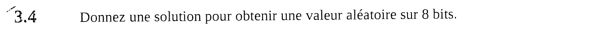{fig-alt="Question 3.4 : donnez une solution pour obtenir une valeur aléatoire sur 8 bits."}

:::: {.complement}
::: {.solution}
Lire **8 bits** d'un LFSR, mais **toutes les 8 mises à jour** seulement : deux lectures consécutives du registre ne diffèrent que d'un décalage d'un bit (7 bits sur 8 communs), ce qui serait très corrélé. Par exemple :

- utiliser le LFSR 8 bits de la question 2.2 (période 255) et lire `SR(7 downto 0)` après 8 décalages ; la valeur 0 n'apparaît alors jamais ;
- mieux, prendre un LFSR plus long (16 bits, par exemple) et en lire 8 bits tous les 8 coups : les 256 valeurs, 0 compris, deviennent possibles et la période est bien plus longue ;
- ou décaler 8 fois le module 7 bits et accumuler les 8 bits successifs de RANDOM dans un registre de sortie de 8 bits (sur une période de 127, chaque octet n'est pas indépendant : la qualité reste limitée).
:::
::::
