

::: {.complement}
Aucun corrigé officiel : **toutes les solutions de cette page sont rédigées par Claude**. Les énoncés sont des extraits des photos du sujet [sujet-2015] ; les annotations manuscrites d'un étudiant (points d'interrogation, « 1/2 », « $\delta(t - nT_s)$ », formule ajoutée à la question 12, surligneur) ont été effacées des images. À relire avec un œil critique ; signaler toute erreur.

**Notations.** Le sujet suit les notations du TD : $g_\alpha(t)$ pour le filtre de mise en forme (cours : $h(t)$), $v_\alpha(t)$ pour le filtre global (cours : $g(t)$), $n_l(t)$ et $n'_l[n]$ pour le bruit (cours : $z_l(t)$, $Z'_n$), $r_l[n]$ pour l'échantillon reçu (cours : $r_n$), $R_A[n] = \E(A_k A_{k+n})$ (cours : $\E[A_n A^*_{n-m}]$, même valeur pour des symboles réels stationnaires). La question 16 définit $\operatorname{sinc}(x) = \frac{\sin x}{x}$ ; les solutions utilisent celle du cours, $\sinc(x) = \frac{\sin \pi x}{\pi x}$ (voir la [fiche matière](../index.qmd)).

**Correspondances.** Les questions 1, 3, 5 et 6 reviennent à l'identique en 2019-2020 (questions 1, 2, 3 et 6, [corrigé 2019-2020](2019-2020-partiel.qmd#sec-ann1920-gen)). Le cas $\alpha = 1$ de l'exercice 2 est la DSP de l'OOK de l'exercice 2, question 11 du TD ([exercice du chapitre 3](../cours/03-dsp-signaux-codes-en-ligne.qmd#exr-td-dsp-ook)) ; le cas $\alpha = \frac12$ est le [code Manchester](../cours/02-communication-sans-bruit.qmd#exm-manchester) ; la question 17 reprend l'exercice 3 du TD ([filtrage adapté](../cours/04-transmission-presence-bruit.qmd#exr-td-filtre-adapte)).
:::

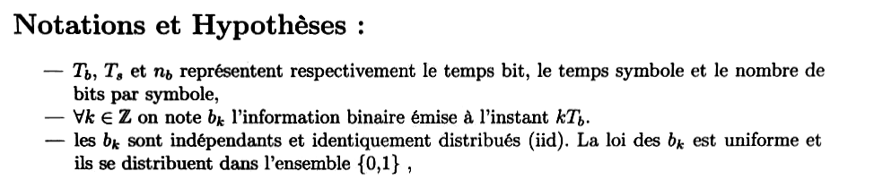{fig-alt="Notations et hypothèses : Tb, Ts et nb désignent le temps bit, le temps symbole et le nombre de bits par symbole ; bk est l'information binaire émise à l'instant kTb ; les bk sont iid, de loi uniforme sur {0, 1}."}

## Généralités sur les communications numériques {#sec-ann1516-gen}

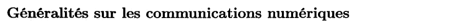{fig-alt="Titre de la première partie : Généralités sur les communications numériques."}

Chapitres du cours : [Introduction](../cours/01-introduction.qmd#sec-definitions-telecom) et [Bruit blanc gaussien](../cours/03-dsp-signaux-codes-en-ligne.qmd#sec-bruit-blanc).

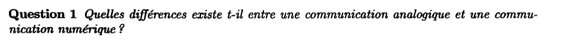{fig-alt="Question 1 : quelles différences existe-t-il entre une communication analogique et une communication numérique ?"}

:::: {.complement}
::: {.solution}
- **Analogique** : le message est un signal continu en temps et en amplitude (voix, image), transmis tel quel ou après modulation d'une porteuse (AM, FM). Toute perturbation s'ajoute au message et ne peut plus en être séparée ; les dégradations s'accumulent d'un relais à l'autre.
- **Numérique** : le message est d'abord échantillonné et quantifié, puis représenté par une suite de bits ([définition du cours](../cours/01-introduction.qmd#def-communications-numeriques)) ; on émet une suite de **symboles** choisis dans un alphabet fini. Le récepteur n'a pas à reproduire une forme d'onde mais à **décider** quel symbole a été émis : tant que le bruit ne fait pas franchir un seuil, le message est retrouvé exactement.

Conséquences : en numérique, régénération du signal sans accumulation du bruit, codage correcteur d'erreurs, chiffrement, compression, multiplexage de sources différentes (voix, données, vidéo) sur le même support, traitements par circuits numériques bon marché. En contrepartie : bande occupée souvent plus grande, erreurs de quantification, besoin de synchronisation (rythme symbole, porteuse).
:::
::::

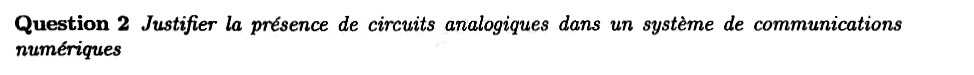{fig-alt="Question 2 : justifier la présence de circuits analogiques dans un système de communications numériques."}

:::: {.complement}
::: {.solution}
Le **canal est physique** : câble, fibre, air. Ce qui s'y propage est une onde, donc un signal à temps continu et à amplitude continue, même s'il porte des bits (voir le [canal du modèle de Shannon et Weaver](../cours/01-introduction.qmd#sec-canal)). Il faut donc, à l'émission, convertir les échantillons en signal (convertisseur numérique-analogique, filtre de mise en forme ou de reconstruction), transposer en fréquence (mélangeur, oscillateur local), amplifier (amplificateur de puissance) et rayonner (antenne) ; à la réception, capter, amplifier à faible bruit, filtrer, transposer en bande de base, puis échantillonner (convertisseur analogique-numérique). Tous ces étages sont analogiques ; seuls le codage, la décision et le traitement des échantillons sont numériques.
:::
::::

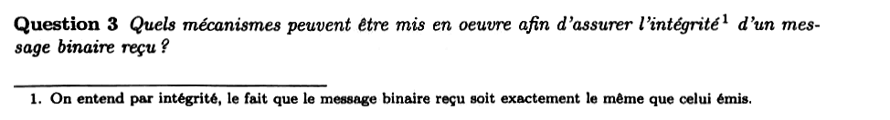{fig-alt="Question 3 : quels mécanismes peuvent être mis en œuvre afin d'assurer l'intégrité d'un message binaire reçu ? Note 1 : on entend par intégrité le fait que le message binaire reçu soit exactement le même que celui émis."}

:::: {.complement}
::: {.solution}
On distingue les mécanismes qui **réduisent** la probabilité d'erreur et ceux qui **détectent ou corrigent** les erreurs restantes :

- couche physique : récepteur optimal ([filtre adapté](../cours/04-transmission-presence-bruit.qmd#sec-recepteur-optimal), filtre global de Nyquist pour supprimer l'IES, égalisation du canal), augmentation du rapport $E_b/N_0$ (puissance d'émission), choix d'une modulation robuste et d'un étiquetage de Gray ;
- **codage de canal** : ajout de redondance. Codes détecteurs (bit de parité, somme de contrôle, CRC) et codes correcteurs (Hamming, codes convolutifs, Reed-Solomon, turbo-codes, LDPC), souvent associés à un entrelacement contre les paquets d'erreurs ;
- protocole : **retransmission** des trames détectées fausses (ARQ, accusés de réception).

Seule la combinaison détection + retransmission garantit l'intégrité au sens de la note 1 (à une probabilité d'erreur non détectée près, rendue très faible par le CRC).
:::
::::

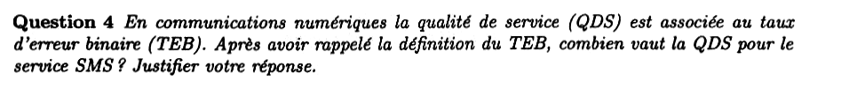{fig-alt="Question 4 : en communications numériques, la qualité de service (QDS) est associée au taux d'erreur binaire (TEB). Après avoir rappelé la définition du TEB, combien vaut la QDS pour le service SMS ? Justifier."}

:::: {.complement}
::: {.solution}
**TEB.** Rapport du nombre de bits faux au nombre de bits transmis, mesuré sur une longue séquence : $\text{TEB} = \frac{N_\text{erreurs}}{N_\text{bits}}$. C'est l'estimateur de la [probabilité d'erreur binaire](../cours/04-transmission-presence-bruit.qmd#def-probabilite-erreur-binaire) $P_b$.

**SMS.** Un SMS est un message texte : **un seul bit faux change un caractère** (code ASCII, voir le [partiel 2019-2020](2019-2020-partiel.qmd#sec-ann1920-ex2)) et le message n'a pas de redondance qui permette au lecteur de corriger (contrairement à la voix, pour laquelle un TEB de l'ordre de $10^{-3}$ reste audible). La QDS exigée est donc un TEB **nul en pratique** au niveau de l'application : on vise un TEB brut faible (typiquement $10^{-5}$ à $10^{-6}$ après décodage de canal), puis la détection d'erreurs et la retransmission (question 3) rendent la probabilité d'un message faux négligeable.

Le cours ne donne pas de valeur chiffrée de QDS par service (le support cite seulement $P_b = 10^{-3}$ comme qualité de service de référence pour comparer des modulations [poly, p. 177]) : les ordres de grandeur ci-dessus sont des connaissances générales.
:::
::::

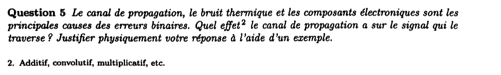{fig-alt="Question 5 : le canal de propagation, le bruit thermique et les composants électroniques sont les principales causes des erreurs binaires. Quel effet (additif, convolutif, multiplicatif, etc., note 2) le canal de propagation a-t-il sur le signal qui le traverse ? Justifier physiquement à l'aide d'un exemple."}

:::: {.complement}
::: {.solution}
Le canal agit d'abord de façon **convolutive** : il se modélise par un filtre linéaire $h_c(t)$ ([chaîne du cours](../cours/02-communication-sans-bruit.qmd#sec-canal-filtre-reception)), et le signal reçu vaut $(h_c \star s)(t)$.

- Cas le plus simple, sans distorsion : $h_c(t) = \alpha_0\,\delta(t - \tau_0)$, effet **multiplicatif** (atténuation $\alpha_0$) et retard $\tau_0$. Exemple : en espace libre, la puissance reçue décroît comme $1/d^2$ avec la distance (formule de Friis), et le retard vaut $d/c$.
- Cas général : **trajets multiples**. En radio mobile, l'onde arrive par plusieurs chemins (réflexions sur les bâtiments, le sol) avec des retards $\tau_i$ et des atténuations $\alpha_i$ : $h_c(t) = \sum_i \alpha_i\,\delta(t - \tau_i)$. Si l'étalement des retards n'est pas petit devant $\Ts$, chaque symbole déborde sur les suivants : c'est de l'**interférence entre symboles** ([IES](../cours/02-communication-sans-bruit.qmd#sec-ies)). En fréquence, $H_c(f)$ n'est plus plat (évanouissements sélectifs). Un câble long a le même effet : son atténuation croît avec la fréquence, ce qui étale les impulsions.
- Si l'émetteur ou le récepteur bouge, $h_c$ varie dans le temps (effet Doppler) : l'atténuation devient un gain **multiplicatif** variable (évanouissements).

Le bruit thermique, lui, est **additif** (questions 6 à 8).
:::
::::

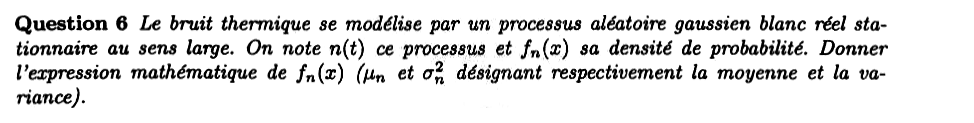{fig-alt="Question 6 : le bruit thermique se modélise par un processus aléatoire gaussien blanc réel stationnaire au sens large n(t), de densité de probabilité fn(x). Donner l'expression de fn(x), μn et σn² désignant la moyenne et la variance."}

:::: {.complement}
::: {.solution}
À chaque instant $t$, $n(t)$ est une variable aléatoire gaussienne ; la stationnarité rend sa loi indépendante de $t$ ([loi gaussienne](../cours/03-dsp-signaux-codes-en-ligne.qmd#eq-densite-gaussienne)) :
$$\boxed{f_n(x) = \frac{1}{\sqrt{2\pi\sigma_n^2}}\, \exp\!\left(-\frac{(x - \mu_n)^2}{2\sigma_n^2}\right)}$$
Pour le bruit thermique, $\mu_n = 0$. (Pour un bruit rigoureusement blanc, $\sigma_n^2 = R_n(0)$ serait infinie : en pratique $\sigma_n^2$ est la variance du bruit **filtré** dans la bande du récepteur, voir la question 7.)
:::
::::

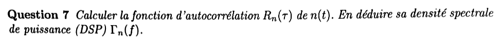{fig-alt="Question 7 : calculer la fonction d'autocorrélation Rn(τ) de n(t) ; en déduire sa densité spectrale de puissance Γn(f)."}

:::: {.complement}
::: {.solution}
« Blanc » signifie que deux valeurs du bruit prises à des instants différents sont **décorrélées**, aussi proches soient-elles : $R_n(\tau) = \E[n(t)\, n(t - \tau)] = 0$ pour $\tau \neq 0$ (moyenne nulle). L'autocorrélation est donc concentrée en $\tau = 0$ :
$$\boxed{R_n(\tau) = \frac{N_0}{2}\,\delta(\tau)}$$
Le processus est stationnaire au sens large : sa DSP est la TF de l'autocorrélation ([Wiener-Khintchine](../cours/03-dsp-signaux-codes-en-ligne.qmd#eq-wiener-khintchine)), avec $\TF[\delta] = 1$ :
$$\boxed{\Gamma_n(f) = \frac{N_0}{2} \quad \forall f}$$
($N_0/2$ en W/Hz, DSP bilatérale ; pour le bruit thermique, $N_0 = k_B T$.) Le sujet ne donne pas la constante : $\frac{N_0}{2}$ est la notation du cours ([bruit blanc gaussien](../cours/03-dsp-signaux-codes-en-ligne.qmd#sec-bruit-blanc)).
:::
::::

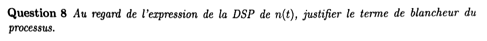{fig-alt="Question 8 : au regard de l'expression de la DSP de n(t), justifier le terme de blancheur du processus."}

:::: {.complement}
::: {.solution}
La DSP est **constante sur toutes les fréquences** : toutes les composantes fréquentielles ont la même puissance, comme toutes les longueurs d'onde dans la lumière blanche (par analogie avec l'optique). C'est un modèle : sa puissance totale $\int \Gamma_n = R_n(0)$ serait infinie. Il est valable parce que le bruit thermique a une DSP plate jusqu'à des fréquences (de l'ordre de $k_B T / h \approx 6$ THz à 300 K) bien supérieures à la bande de tout récepteur.
:::
::::

## Exercice 2 : modulation numérique OOK à filtre ajustable {#sec-ann1516-ex2}

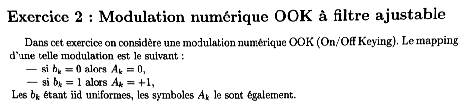{fig-alt="Exercice 2 : modulation OOK (On/Off Keying) ; bk = 0 donne Ak = 0, bk = 1 donne Ak = +1 ; les bk étant iid uniformes, les symboles Ak le sont également."}

Chapitres du cours : [Formule de Bennett](../cours/03-dsp-signaux-codes-en-ligne.qmd#sec-formule-bennett), [Critère de Nyquist](../cours/02-communication-sans-bruit.qmd#sec-nyquist-temporel), [Probabilité d'erreur binaire](../cours/04-transmission-presence-bruit.qmd#sec-pb-equiprobable).

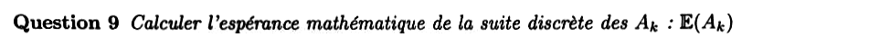{fig-alt="Question 9 : calculer l'espérance mathématique de la suite discrète des Ak, E(Ak)."}

:::: {.complement}
::: {.solution}
$A_k \in \{0, 1\}$ équiprobables ([espérance](../cours/03-dsp-signaux-codes-en-ligne.qmd#def-esperance)) :
$$\E(A_k) = 0 \times \tfrac12 + 1 \times \tfrac12 = \boxed{\tfrac12}$$
Les symboles ne sont **pas centrés** : c'est ce qui fera apparaître des raies dans la DSP.
:::
::::

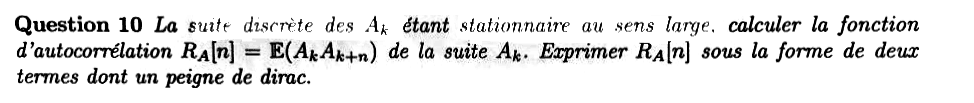{fig-alt="Question 10 : la suite des Ak étant stationnaire au sens large, calculer RA[n] = E(Ak Ak+n) et l'exprimer sous la forme de deux termes dont un peigne de Dirac."}

:::: {.complement}
::: {.solution}
- $n = 0$ : $R_A[0] = \E(A_k^2) = 0^2 \times \frac12 + 1^2 \times \frac12 = \frac12$.
- $n \neq 0$ : $A_k$ et $A_{k+n}$ sont indépendants, donc $R_A[n] = \E(A_k)\,\E(A_{k+n}) = \frac14$.

$$\boxed{R_A[n] = \frac14\,\delta[n] + \frac14 \sum_{m \in \mathbb{Z}} \delta[n - m]}$$
Le premier terme est la variance $\sigma_A^2 = \frac12 - \frac14 = \frac14$ (partie centrée, « blanche ») ; le second est la constante $m_A^2 = \frac14$, écrite comme un **peigne** d'impulsions discrètes. C'est ce terme constant dont la TF à temps discret est un peigne de Dirac en fréquence (question 12), d'où l'expression attendue par l'énoncé. Dans la convention du cours, $R_A[m] = \E[A_n A^*_{n-m}]$ donne la même suite (symboles réels, $R_A$ paire).
:::
::::

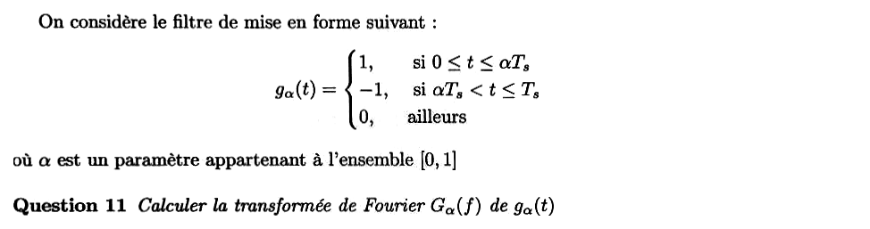{fig-alt="Filtre de mise en forme gα(t) = 1 si 0 ≤ t ≤ αTs, −1 si αTs < t ≤ Ts, 0 ailleurs, avec α dans [0, 1]. Question 11 : calculer la transformée de Fourier Gα(f) de gα(t)."}

:::: {.complement}
::: {.solution}
$g_\alpha$ est la différence de deux portes : $+1$ sur $[0, \alpha\Ts]$ (largeur $\alpha\Ts$, centre $\frac{\alpha\Ts}{2}$) et $-1$ sur $[\alpha\Ts, \Ts]$ (largeur $(1 - \alpha)\Ts$, centre $\frac{(1 + \alpha)\Ts}{2}$). Avec $\TF[\Pi_T](f) = T\sinc(fT)$ et le théorème du retard ($e^{-j2\pi f t_0}$) :
$$\boxed{G_\alpha(f) = \alpha\Ts \sinc(\alpha f\Ts)\, e^{-j\pi f\alpha\Ts} - (1 - \alpha)\Ts \sinc\big((1 - \alpha) f\Ts\big)\, e^{-j\pi f(1 + \alpha)\Ts}}$$

Cas particuliers :

- $\alpha = 1$ (porte de durée $\Ts$) : $G_1(f) = \Ts \sinc(f\Ts)\, e^{-j\pi f\Ts}$ ;
- $\alpha = \frac12$ (code Manchester) : $G_{1/2}(f) = \frac{\Ts}{2}\sinc\!\left(\frac{f\Ts}{2}\right) e^{-j\pi f\Ts/2}\left(1 - e^{-j\pi f\Ts}\right)$, d'où, avec $|1 - e^{-jx}| = 2\left|\sin\frac{x}{2}\right|$ :
$$|G_{1/2}(f)|^2 = \Ts^2 \sinc^2\!\left(\frac{f\Ts}{2}\right) \sin^2\!\left(\frac{\pi f\Ts}{2}\right).$$

Contrôles : $G_\alpha(0) = \int g_\alpha = \alpha\Ts - (1 - \alpha)\Ts = (2\alpha - 1)\Ts$ ✓ ; $|G_{1/2}|^2$ comparé à la TF calculée numériquement en plusieurs fréquences ✓.
:::
::::

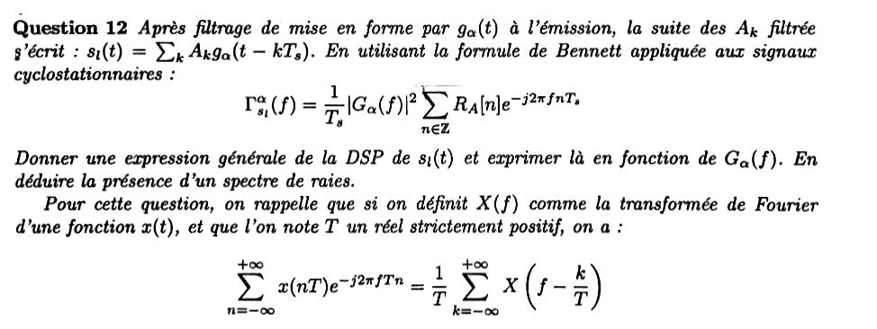{fig-alt="Question 12 : après filtrage par gα(t), sl(t) = somme sur k de Ak gα(t − kTs). Avec la formule de Bennett Γ = (1/Ts)|Gα(f)|² somme sur n de RA[n] e^{−j2πfnTs}, donner l'expression générale de la DSP de sl(t) en fonction de Gα(f) et en déduire la présence d'un spectre de raies. Rappel : la somme sur n de x(nT) e^{−j2πfTn} vaut (1/T) somme sur k de X(f − k/T)."}

:::: {.complement}
::: {.solution}
On reporte $R_A$ (question 10) dans la [formule de Bennett](../cours/03-dsp-signaux-codes-en-ligne.qmd#thm-bennett) :
$$\sum_n R_A[n]\, e^{-j2\pi fn\Ts} = \frac14 + \frac14 \sum_n e^{-j2\pi fn\Ts}.$$
Le rappel de l'énoncé, appliqué à $x \equiv 1$ (donc $X(f) = \delta(f)$) avec $T = \Ts$, donne la formule sommatoire de Poisson : $\sum_n e^{-j2\pi fn\Ts} = \frac{1}{\Ts}\sum_k \delta\!\left(f - \frac{k}{\Ts}\right)$. D'où, avec $|G_\alpha(f)|^2\,\delta(f - f_k) = |G_\alpha(f_k)|^2\,\delta(f - f_k)$ :
$$\boxed{\Gamma_{s_l}^\alpha(f) = \underbrace{\frac{|G_\alpha(f)|^2}{4\Ts}}_{\text{partie continue}} + \underbrace{\frac{1}{4\Ts^2}\sum_{k \in \mathbb{Z}} \left|G_\alpha\!\left(\tfrac{k}{\Ts}\right)\right|^2 \delta\!\left(f - \tfrac{k}{\Ts}\right)}_{\text{raies}}}$$
La moyenne non nulle $m_A = \frac12$ crée un **spectre de raies** aux multiples du débit symbole $\frac{k}{\Ts}$, de poids $\frac{m_A^2}{\Ts^2}|G_\alpha(k/\Ts)|^2$. Une raie n'existe que si $G_\alpha$ ne s'annule pas en $k/\Ts$ : la forme du filtre décide quelles raies subsistent.
:::
::::

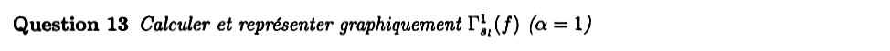{fig-alt="Question 13 : calculer et représenter graphiquement la DSP pour α = 1."}

:::: {.complement}
::: {.solution}
$|G_1(f)|^2 = \Ts^2\sinc^2(f\Ts)$ s'annule en $f = \frac{k}{\Ts}$ pour $k \neq 0$ et vaut $\Ts^2$ en $0$ : seule la raie en $f = 0$ subsiste.
$$\boxed{\Gamma_{s_l}^1(f) = \frac{\Ts}{4}\sinc^2(f\Ts) + \frac14\,\delta(f)}$$
C'est le résultat de l'[exercice du TD sur l'OOK](../cours/03-dsp-signaux-codes-en-ligne.qmd#exr-td-dsp-ook). Lobe principal sur $[-\frac{1}{\Ts}, \frac{1}{\Ts}]$, sommet $\frac{\Ts}{4}$ ; la raie (composante continue du signal, puissance $m_A^2 = \frac14$) est en $f = 0$ (@fig-ann15-dsp-ook-alpha, en haut).
:::
::::

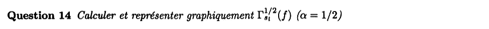{fig-alt="Question 14 : calculer et représenter graphiquement la DSP pour α = 1/2."}

:::: {.complement}
::: {.solution}
Avec $|G_{1/2}|^2$ de la question 11 : en $f = \frac{k}{\Ts}$, $\sin^2\frac{\pi k}{2} = 0$ pour $k$ pair (y compris $k = 0$ : pas de composante continue, $\int g_{1/2} = 0$), et pour $k$ impair $|G_{1/2}(k/\Ts)|^2 = \Ts^2 \cdot \frac{4}{\pi^2 k^2}$. D'où
$$\boxed{\Gamma_{s_l}^{1/2}(f) = \frac{\Ts}{4}\sinc^2\!\left(\frac{f\Ts}{2}\right)\sin^2\!\left(\frac{\pi f\Ts}{2}\right) + \sum_{k\ \text{impair}} \frac{1}{\pi^2 k^2}\, \delta\!\left(f - \frac{k}{\Ts}\right)}$$
Partie continue nulle en $f = 0$, maximale vers $f \approx \frac{0{,}74}{\Ts}$, nulle aux multiples de $\frac{2}{\Ts}$ ; raies en $\pm\frac{1}{\Ts}$ (poids $\frac{1}{\pi^2} \approx 0{,}101$), $\pm\frac{3}{\Ts}$ (poids $\frac{1}{9\pi^2}$)… (@fig-ann15-dsp-ook-alpha, en bas). Poids des raies vérifiés numériquement par la TF de $g_{1/2}$ ✓.

{#fig-ann15-dsp-ook-alpha}
:::
::::

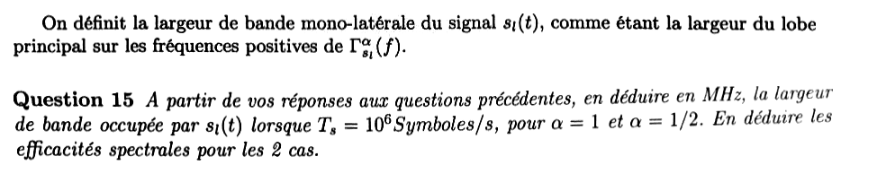{fig-alt="Définition : largeur de bande monolatérale = largeur du lobe principal de la DSP sur les fréquences positives. Question 15 : en déduire en MHz la bande occupée lorsque Ts = 10^6 symboles/s, pour α = 1 et α = 1/2, puis les efficacités spectrales."}

::: {.a-verifier #av-ann1516-ts-debit}
**Source** [sujet-2015, p. 3, q. 15] : « lorsque $T_s = 10^6$ Symboles/s ».

**Problème** : $\Ts$ est une durée (en s) ; « symboles/s » est l'unité du débit symbole $D_s = 1/\Ts$.

**Proposition** : lire $D_s = 10^6$ symboles/s, soit $\Ts = 1\ \mu$s.
:::

:::: {.complement}
::: {.solution}
Avec $\Ts = 1\ \mu$s (bloc ci-dessus) et la définition de l'énoncé :

- $\alpha = 1$ : sur $f > 0$, le lobe principal va de $0$ au premier zéro $\frac{1}{\Ts}$ : $B_1 = \frac{1}{\Ts} = \boxed{1\ \text{MHz}}$ ;
- $\alpha = \frac12$ : la partie continue s'annule en $0$ et aux multiples de $\frac{2}{\Ts}$ ; le premier lobe sur $f > 0$ va de $0$ à $\frac{2}{\Ts}$ : $B_{1/2} = \frac{2}{\Ts} = \boxed{2\ \text{MHz}}$.

OOK : un bit par symbole, donc $D_b = D_s = 10^6$ bit/s. [Efficacité spectrale](../cours/02-communication-sans-bruit.qmd#sec-efficacite-spectrale) $\eta = D_b/B$ :
$$\eta_1 = \frac{10^6}{10^6} = \boxed{1\ \text{bit/s/Hz}}, \qquad \eta_{1/2} = \frac{10^6}{2 \cdot 10^6} = \boxed{0{,}5\ \text{bit/s/Hz}}.$$
Le code Manchester occupe deux fois plus de bande : chaque symbole contient une transition au milieu, donc des variations deux fois plus rapides.
:::
::::

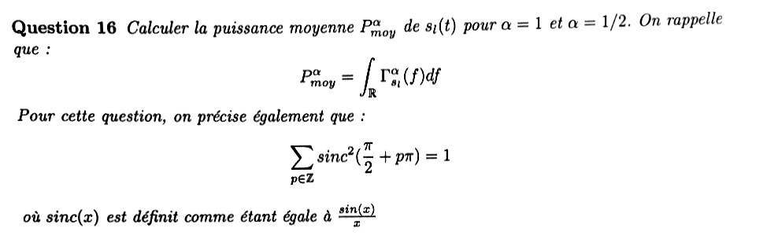{fig-alt="Question 16 : calculer la puissance moyenne P moy de sl(t) pour α = 1 et α = 1/2, avec P = intégrale de la DSP ; on précise que la somme sur p de sinc²(π/2 + pπ) vaut 1, où sinc(x) = sin(x)/x."}

:::: {.complement}
::: {.solution}
**Partie continue.** Par Parseval, $\int |G_\alpha(f)|^2\, \mathrm{d}f = \int g_\alpha^2(t)\, \mathrm{d}t = \Ts$ pour tout $\alpha$ ($g_\alpha^2 = 1$ sur $[0, \Ts]$). Sa contribution vaut donc $\frac{\Ts}{4\Ts} = \frac14$ dans les deux cas.

**Raies.**

- $\alpha = 1$ : une raie de poids $\frac14$.
- $\alpha = \frac12$ : $\sum_{k\ \text{impair}} \frac{1}{\pi^2 k^2}$. Avec $k = 2p + 1$, $\frac{1}{\pi^2 k^2} = \frac14 \cdot \frac{\sin^2(\frac{\pi}{2} + p\pi)}{(\frac{\pi}{2} + p\pi)^2}$, et le rappel de l'énoncé (avec son $\operatorname{sinc}(x) = \frac{\sin x}{x}$) donne $\sum_{k\ \text{impair}} \frac{1}{\pi^2 k^2} = \frac14 \times 1 = \frac14$.

$$\boxed{P_{moy}^1 = P_{moy}^{1/2} = \frac14 + \frac14 = \frac12}$$
Contrôle direct : $|s_l(t)|^2 = A_k^2$ sur chaque intervalle $[k\Ts, (k+1)\Ts[$ ($|g_\alpha| = 1$), donc $P = \E(A_k^2) = \frac12$ ✓. Dans les deux cas, **la moitié de la puissance** part dans les raies, qui ne portent aucune information.
:::
::::

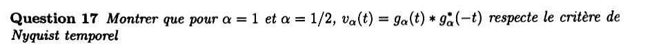{fig-alt="Question 17 : montrer que pour α = 1 et α = 1/2, vα(t) = gα(t) * gα*(−t) respecte le critère de Nyquist temporel."}

:::: {.complement}
::: {.solution}
$v_\alpha(t) = \int g_\alpha(u)\, g_\alpha(u - t)\, \mathrm{d}u$ est l'autocorrélation déterministe de $g_\alpha$ (filtre adapté non causal, [cours](../cours/04-transmission-presence-bruit.qmd#eq-filtre-adapte)). Le [critère de Nyquist temporel](../cours/02-communication-sans-bruit.qmd#sec-nyquist-temporel) demande $v_\alpha(n\Ts) = 0$ pour $n \neq 0$ et $v_\alpha(0) \neq 0$.

- $g_\alpha$ est nul hors de $[0, \Ts]$, donc $g_\alpha(u)\,g_\alpha(u - t)$ est nul pour $|t| \geq \Ts$ : $v_\alpha(n\Ts) = 0$ pour tout $n \neq 0$.
- $v_\alpha(0) = \int g_\alpha^2 = \Ts \neq 0$.

Le critère est donc respecté, pour $\alpha = 1$ comme pour $\alpha = \frac12$ (et en fait pour tout $\alpha$). Formes explicites : $v_1(t) = \Ts\,\Lambda(t/\Ts)$ (triangle de base $[-\Ts, \Ts]$) ; $v_{1/2}$ vaut $\Ts - 3|t|$ pour $|t| \leq \frac{\Ts}{2}$ et $|t| - \Ts$ pour $\frac{\Ts}{2} \leq |t| \leq \Ts$ (minimum $-\frac{\Ts}{2}$ en $\pm\frac{\Ts}{2}$, nul en $\pm\frac{\Ts}{3}$ et $\pm\Ts$). C'est l'exercice 3 du TD avec la porte ([exercice](../cours/04-transmission-presence-bruit.qmd#exr-td-filtre-adapte)).
:::
::::

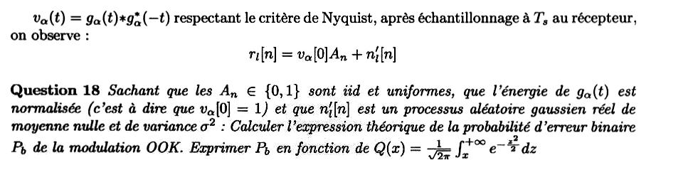{fig-alt="Avec vα respectant le critère de Nyquist, après échantillonnage à Ts on observe rl[n] = vα[0] An + n'l[n]. Question 18 : An dans {0, 1} iid uniformes, énergie de gα normalisée (vα[0] = 1), n'l[n] gaussien réel centré de variance σ² : calculer la probabilité d'erreur binaire Pb de l'OOK en fonction de Q(x)."}

::: {.a-verifier #av-ann1516-energie-normalisee}
**Source** [sujet-2015, p. 3, q. 18] : « l'énergie de $g_\alpha(t)$ est normalisée (c'est à dire que $v_\alpha[0] = 1$) ».

**Problème** : avec $g_\alpha = \pm 1$ sur $[0, \Ts]$ (définition de l'énoncé), l'énergie vaut $v_\alpha[0] = \Ts$, qui ne vaut $1$ que si $\Ts = 1$ ; or la question 15 prend $\Ts = 1\ \mu$s.

**Proposition** : lire « $g_\alpha$ est remplacé par $g_\alpha/\sqrt{\Ts}$ » (amplitude $\pm\frac{1}{\sqrt{\Ts}}$), ce qui ne change ni la forme des DSP ni la conclusion de la question 17, mais divise les DSP et les puissances des questions 12 à 16 par $\Ts$. La solution ci-dessous suppose $v_\alpha[0] = 1$ comme l'énoncé.
:::

:::: {.complement}
::: {.solution}
**Modèle.** $r_l[n] = A_n + n'_l[n]$, $A_n \in \{0, 1\}$, $n'_l[n] \sim \mathcal{N}(0, \sigma^2)$ ([modèle du cours](../cours/04-transmission-presence-bruit.qmd#eq-modele-bruit) avec $g_0 = 1$).

**Seuil.** Symboles équiprobables et bruit gaussien : le seuil optimal est le milieu des deux points, $\gamma^* = \frac12$ ([exercice du cours sur l'OOK](../cours/04-transmission-presence-bruit.qmd#exr-seuil-ook)). Décision : $\hat{A}_n = 1$ si $r_l[n] \geq \frac12$, $0$ sinon.

**Probabilité d'erreur.** Le bit est faux si le bruit fait franchir le seuil :
$$P_b = \tfrac12 P\!\left(n' \geq \tfrac12\right) + \tfrac12 P\!\left(1 + n' < \tfrac12\right) = \tfrac12 Q\!\left(\tfrac{1}{2\sigma}\right) + \tfrac12 Q\!\left(\tfrac{1}{2\sigma}\right)$$
$$\boxed{P_b = Q\!\left(\frac{1}{2\sigma}\right)}$$
Conditions : critère de Nyquist respecté (pas d'IES), bruit gaussien centré indépendant des symboles, seuil au milieu. Contrôle par simulation de Monte-Carlo ($2 \cdot 10^6$ bits, $\sigma = 0{,}3$) : TEB $= 0{,}0479$ pour $Q(1{,}67) = 0{,}0478$ ✓.

Comparaison : à distance égale entre symboles, l'OOK a la même $P_b$ qu'une 2-PAM $\{-\frac12, \frac12\}$, mais une puissance double ($\frac12$ au lieu de $\frac14$) : en fonction de $E_b/N_0$, elle perd 3 dB.
:::
::::

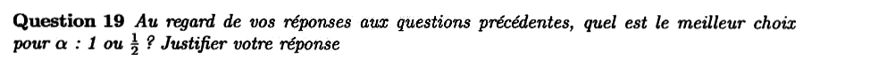{fig-alt="Question 19 : au regard des réponses précédentes, quel est le meilleur choix pour α : 1 ou 1/2 ? Justifier."}

:::: {.complement}
::: {.solution}
Bilan des questions précédentes :

| | $\alpha = 1$ | $\alpha = \frac12$ |
|---|---|---|
| Puissance moyenne (q. 16) | $\frac12$ | $\frac12$ |
| $P_b$ à $v_\alpha[0]$ et $\sigma$ fixés (q. 18) | $Q(\frac{1}{2\sigma})$ | $Q(\frac{1}{2\sigma})$ |
| Bande (q. 15) | 1 MHz | 2 MHz |
| Efficacité spectrale | 1 bit/s/Hz | 0,5 bit/s/Hz |
| Raies | en $f = 0$ seulement | en $\pm\frac{k}{\Ts}$, $k$ impair ; rien en $f = 0$ |

À puissance et probabilité d'erreur égales, **$\alpha = 1$ est le meilleur choix** : il occupe deux fois moins de bande.

$\alpha = \frac12$ (Manchester) se justifie seulement si le canal ne laisse pas passer la composante continue (liaison à couplage capacitif ou par transformateur) ou si l'on veut récupérer le rythme symbole : chaque symbole porte une transition, et la raie en $\frac{1}{\Ts}$ fournit directement l'horloge.
:::
::::
