

::: {.complement}
Aucun corrigé officiel : **toutes les solutions de cette page sont rédigées par Claude**. Les énoncés sont des extraits du scan du sujet [sujet-2016] ; les annotations manuscrites d'un étudiant (calculs au bas de la page 2, « 5 = Tb », « 2 f(n) », trait sous « ±3σ ») ont été effacées des images. À relire avec un œil critique ; signaler toute erreur.

**Notations.** Le sujet suit les notations du TD : $g(t)$ filtre de mise en forme (cours : $h(t)$), $g_a(t)$ filtre de réception (cours : $h_a(t)$), $v(t) = (g \star g_a)(t)$ filtre global (cours : $g(t)$), $h_l(t)$ canal (cours : $h_c(t)$), $n_l(t)$ bruit (cours : $z_l(t)$), $r_l[n]$ échantillon reçu (cours : $r_n$), $R_A[n]$ autocorrélation des symboles. Voir la table des notations de la [fiche matière](../index.qmd).

**Correspondances.** La question 2 est la question 5 de 2017-2018, la question 5 sa question 12, la question 6 sa question 14 ; la question 3 recoupe sa question 9 ([corrigé 2017-2018](2017-2018-partiel.qmd)). Les questions 8 et 9 reprennent l'étude pratique du TD (ex. 5, q. 12-13, [exercice du chapitre 4](../cours/04-transmission-presence-bruit.qmd#exr-td-constellation-bruitee)) avec $\sigma = \frac16$. L'exercice utilise le récepteur I/Q de la [figure 1 du partiel 2018-2019](2018-2019-partiel.qmd#sec-ann1819-ex) ; il relève du chapitre 5 du cours (transmission sur fréquence porteuse), pas encore rédigé.
:::

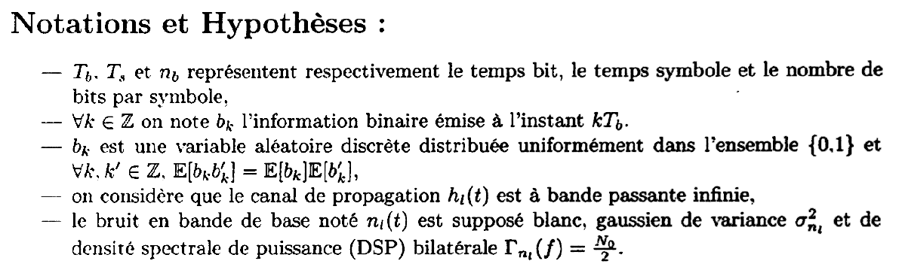{fig-alt="Notations et hypothèses : Tb, Ts, nb ; bk information binaire émise à kTb, variable aléatoire discrète uniforme sur {0, 1}, E[bk bk'] = E[bk] E[bk'] ; canal hl(t) à bande passante infinie ; bruit en bande de base nl(t) blanc, gaussien de variance σ²nl et de DSP bilatérale N0/2."}

::: {.a-verifier #av-ann1617-variance-bruit-blanc}
**Source** [sujet-2016, p. 1] : « le bruit en bande de base noté $n_l(t)$ est supposé blanc, gaussien de variance $\sigma^2_{n_l}$ et de densité spectrale de puissance (DSP) bilatérale $\Gamma_{n_l}(f) = \frac{N_0}{2}$ ».

**Problème** : un bruit blanc de DSP $\frac{N_0}{2}$ a une autocorrélation $\frac{N_0}{2}\delta(\tau)$, donc une variance $R_{n_l}(0)$ infinie ; $\sigma^2_{n_l}$ ne peut pas être la variance de $n_l(t)$ lui-même. La question 8 donne $\sigma_{n_l} = \frac16$ pour des symboles « estimés », donc après filtrage et échantillonnage.

**Proposition** : lire $\sigma^2_{n_l}$ comme la variance du bruit échantillonné en sortie du filtre de réception, $n'_l[n]$ (le $\sigma^2$ du [cours](../cours/04-transmission-presence-bruit.qmd#eq-variance-bruit-filtre), $\frac{N_0}{2}\int |g_a|^2$). C'est la lecture retenue aux questions 8 et 9.
:::

## Questions de cours (14 points) {#sec-ann1617-cours}

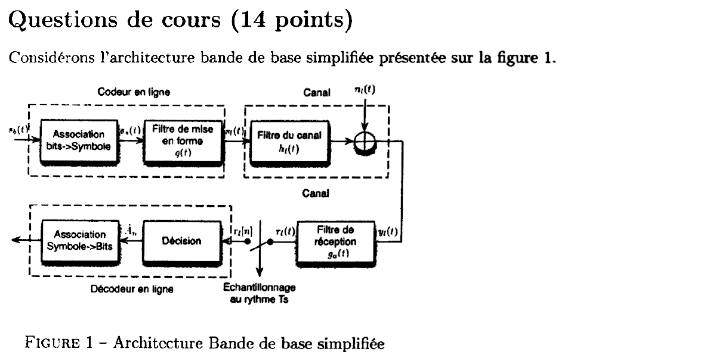{fig-alt="Questions de cours (14 points). Considérons l'architecture bande de base simplifiée de la figure 1 : codeur en ligne (association bits vers symbole, filtre de mise en forme g(t)), canal (filtre hl(t), bruit additif nl(t)), filtre de réception ga(t), échantillonnage au rythme Ts, décision, association symbole vers bits."}

Chapitres du cours : [Rappels de probabilités](../cours/03-dsp-signaux-codes-en-ligne.qmd#sec-rappels-probabilites), [Critère de Nyquist](../cours/02-communication-sans-bruit.qmd#sec-critere-nyquist), [Récepteur optimal](../cours/04-transmission-presence-bruit.qmd#sec-recepteur-optimal).

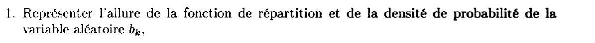{fig-alt="Question 1 : représenter l'allure de la fonction de répartition et de la densité de probabilité de la variable aléatoire bk."}

:::: {.complement}
::: {.solution}
$b_k$ suit une loi de Bernoulli de paramètre $\frac12$ : $P(b_k = 0) = P(b_k = 1) = \frac12$.

- **Fonction de répartition** $F(x) = P(b_k \leq x)$ ([cours](../cours/03-dsp-signaux-codes-en-ligne.qmd#sec-repartition-densite)) : un escalier, $F(x) = 0$ pour $x < 0$, $\frac12$ pour $0 \leq x < 1$, $1$ pour $x \geq 1$ (sauts de $\frac12$ en $0$ et en $1$, continuité à droite).
- **Densité** : dérivée de $F$ au sens des distributions, deux impulsions de poids $\frac12$ :
$$f_{b_k}(x) = \tfrac12\,\delta(x) + \tfrac12\,\delta(x - 1).$$
:::
::::

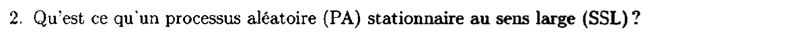{fig-alt="Question 2 : qu'est-ce qu'un processus aléatoire (PA) stationnaire au sens large (SSL) ?"}

:::: {.complement}
::: {.solution}
Un processus $X(t)$ est [stationnaire au sens large](../cours/03-dsp-signaux-codes-en-ligne.qmd#def-stationnarite) si ses deux premiers moments ne dépendent pas de l'origine des temps :

1. sa moyenne est constante : $m_X(t) = \E[X(t)] = m_X$ ;
2. son autocorrélation ne dépend que de l'écart : $R_X(t, \tau) = \E[X(t)\, X^*(t - \tau)] = R_X(\tau)$.

On peut alors définir sa DSP comme la TF de $R_X(\tau)$ (Wiener-Khintchine), et sa puissance vaut $R_X(0)$.
:::
::::

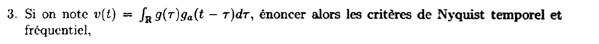{fig-alt="Question 3 : si v(t) est l'intégrale de g(τ) ga(t − τ) dτ, énoncer les critères de Nyquist temporel et fréquentiel."}

:::: {.complement}
::: {.solution}
$v = g \star g_a$ est le filtre global (canal à bande infinie). Il n'y a pas d'interférence entre symboles aux instants d'échantillonnage si et seulement si :

- **temporel** ([théorème](../cours/02-communication-sans-bruit.qmd#thm-nyquist-temporel)) : $v(n\Ts) = v_0\,\delta[n]$, avec $v_0 \neq 0$, c'est-à-dire $v(0) \neq 0$ et $v(n\Ts) = 0$ pour $n \neq 0$ ;
- **fréquentiel** ([théorème](../cours/02-communication-sans-bruit.qmd#thm-nyquist-frequentiel)) : $\dfrac{1}{\Ts}\displaystyle\sum_{m \in \mathbb{Z}} V\!\left(f - \frac{m}{\Ts}\right) = v_0$ pour tout $f$, avec $V(f) = \TF[v](f)$ : les répliques du spectre décalées de $\frac{1}{\Ts}$ se somment en une constante.

Conséquence : la bande de $v$ est au moins $\frac{1}{2\Ts}$ ([bande minimale](../cours/02-communication-sans-bruit.qmd#sec-bande-minimale)).
:::
::::

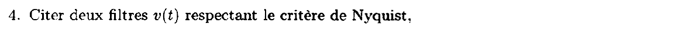{fig-alt="Question 4 : citer deux filtres v(t) respectant le critère de Nyquist."}

:::: {.complement}
::: {.solution}
- Le **cosinus surélevé** de facteur de retombée $\beta \in [0, 1]$, de bande $\frac{1 + \beta}{2\Ts}$ ([exemple du cours](../cours/02-communication-sans-bruit.qmd#exm-cosinus-sureleve)) ; pour $\beta = 0$, le sinus cardinal $v(t) = \sinc(t/\Ts)$, de bande minimale $\frac{1}{2\Ts}$.
- Le **triangle** $v(t) = \Ts\,\Lambda(t/\Ts)$ de base $[-\Ts, \Ts]$, obtenu avec une porte de durée $\Ts$ et son filtre adapté (exercice 3 du TD, [exercice](../cours/04-transmission-presence-bruit.qmd#exr-td-filtre-adapte)) : nul en $n\Ts$, $n \neq 0$.

Plus généralement, tout $v$ nul hors de $]-\Ts, \Ts[$ et non nul en $0$ convient.
:::
::::

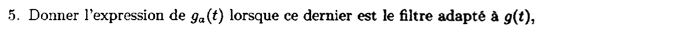{fig-alt="Question 5 : donner l'expression de ga(t) lorsque ce dernier est le filtre adapté à g(t)."}

:::: {.complement}
::: {.solution}
[Filtre adapté](../cours/04-transmission-presence-bruit.qmd#eq-filtre-adapte) (bruit blanc, maximise le rapport signal sur bruit à l'instant de décision) :
$$\boxed{g_a(t) = \lambda\, g^*(-t)}, \quad \lambda \neq 0 .$$
Si $g$ est de durée finie $T_g$ (par exemple $T_g = \Ts$ pour une porte), la version causale est $g_a(t) = \lambda\, g^*(T_g - t)$, et l'on échantillonne aux instants $T_g + n\Ts$ ([remarque du cours](../cours/04-transmission-presence-bruit.qmd#sec-filtre-adapte-causal)).
:::
::::

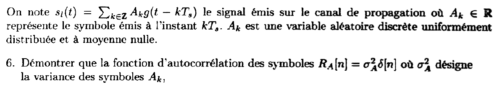{fig-alt="On note sl(t) = somme de Ak g(t − kTs) le signal émis, Ak réel, variable aléatoire discrète uniforme et de moyenne nulle. Question 6 : démontrer que RA[n] = σA² δ[n], σA² étant la variance des symboles."}

:::: {.complement}
::: {.solution}
Hypothèse utilisée : les $A_k$ sont **indépendants** (chaque symbole est formé de bits distincts, et les $b_k$ sont indépendants d'après les hypothèses). Avec $R_A[n] = \E(A_k A_{k+n})$ ($A_k$ réels) :

- $n = 0$ : $R_A[0] = \E(A_k^2) = \mathrm{VAR}(A_k) + \E(A_k)^2 = \sigma_A^2$ puisque $\E(A_k) = 0$ ;
- $n \neq 0$ : indépendance, $R_A[n] = \E(A_k)\,\E(A_{k+n}) = 0$.

$$\boxed{R_A[n] = \sigma_A^2\,\delta[n]}$$
La suite des symboles est « blanche » ; la DSP de $s_l$ prend alors la forme $\sigma_A^2 |G(f)|^2/\Ts$ ([corollaire du cours](../cours/03-dsp-signaux-codes-en-ligne.qmd#cor-bennett-iid)).
:::
::::

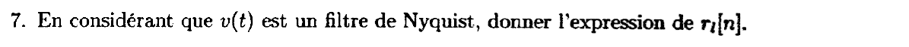{fig-alt="Question 7 : en considérant que v(t) est un filtre de Nyquist, donner l'expression de rl[n]."}

:::: {.complement}
::: {.solution}
En sortie du filtre de réception, $r_l(t) = \sum_k A_k\, v(t - k\Ts) + n'_l(t)$, avec $n'_l = g_a \star n_l$. Échantillonné en $n\Ts$ : $r_l[n] = \sum_k A_k\, v[n - k] + n'_l[n]$. Le critère de Nyquist supprime tous les termes $k \neq n$ :
$$\boxed{r_l[n] = v[0]\, A_n + n'_l[n]}$$
avec $n'_l[n]$ gaussien centré (bruit gaussien filtré). C'est le [modèle discret du cours](../cours/04-transmission-presence-bruit.qmd#eq-modele-bruit), $R_n = g_0 A_n + Z'_n$.
:::
::::

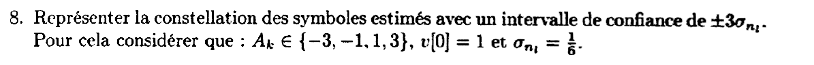{fig-alt="Question 8 : représenter la constellation des symboles estimés avec un intervalle de confiance de ±3σnl, pour Ak dans {−3, −1, 1, 3}, v[0] = 1 et σnl = 1/6."}

:::: {.complement}
::: {.solution}
Avec $v[0] = 1$, $r_l[n] = A_n + n'_l[n]$ et $\sigma = \frac16$ (bloc `av-ann1617-variance-bruit-blanc`) : $\pm 3\sigma = \pm\frac12$. Les échantillons reçus se trouvent, avec 99,7 % de confiance ([loi gaussienne](../cours/03-dsp-signaux-codes-en-ligne.qmd#prp-loi-gaussienne)), dans quatre intervalles de l'axe réel :
$$[-3{,}5\,;\,-2{,}5], \quad [-1{,}5\,;\,-0{,}5], \quad [0{,}5\,;\,1{,}5], \quad [2{,}5\,;\,3{,}5].$$
Les seuils de décision optimaux (symboles équiprobables) sont au milieu des symboles, en $-2$, $0$ et $2$. Les intervalles sont **disjoints** et ne contiennent aucun seuil : il reste une marge de $0{,}5$ entre chaque intervalle et le seuil voisin. Le dessin est celui de la figure du TD avec des intervalles plus étroits ([figure du chapitre 4](../cours/04-transmission-presence-bruit.qmd#fig-constellation-bruitee), où $\sigma = \frac14$).
:::
::::

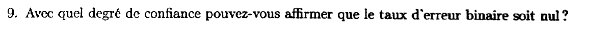{fig-alt="Question 9 : avec quel degré de confiance pouvez-vous affirmer que le taux d'erreur binaire est nul ?"}

:::: {.complement}
::: {.solution}
**Réponse attendue (raisonnement à ±3σ).** Tant que le bruit reste dans $\pm 3\sigma$, aucun seuil n'est franchi : on peut affirmer l'absence d'erreur sur un symbole avec une confiance d'au moins **99,7 %** (99,73 %).

**Valeur exacte.** Une erreur demande que le bruit franchisse un seuil situé à $1 = 6\sigma$ du symbole. Avec la [formule de la $M$-PAM](../cours/04-transmission-presence-bruit.qmd#eq-ps-mpam) ($g_0/\sigma = 6$) :
$$P_s = 2\,\frac{M - 1}{M}\, Q(6) = \frac32 \times 9{,}87 \cdot 10^{-10} \approx 1{,}5 \cdot 10^{-9}, \qquad P_b \simeq \frac{P_s}{2} \approx 7{,}4 \cdot 10^{-10}\ \text{(Gray)}.$$
La confiance réelle est donc de $1 - 1{,}5 \cdot 10^{-9}$ par symbole. Le taux d'erreur n'est jamais rigoureusement nul (le bruit gaussien n'est pas borné) : sur un très grand nombre de symboles (de l'ordre de $10^9$), des erreurs finissent par apparaître.
:::
::::

## Exercice : décalage de fréquence d'une communication sur fréquence porteuse (6 points) {#sec-ann1617-ex}

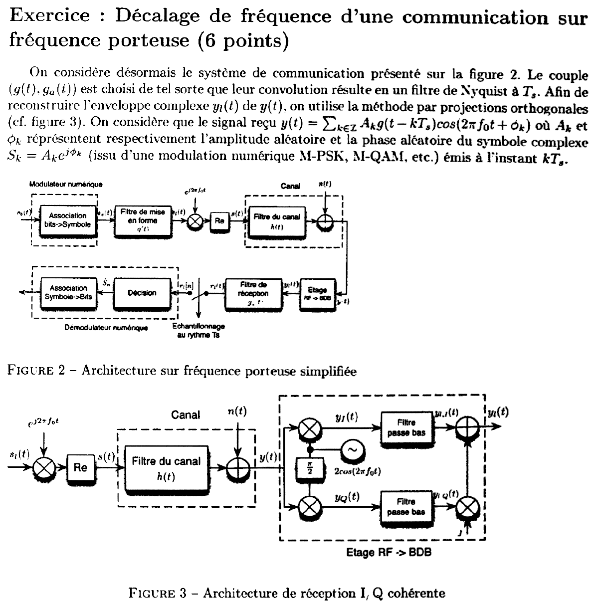{fig-alt="Exercice : système de la figure 2 (modulateur numérique, filtre de mise en forme g(t), multiplication par e^{j2πf0t}, partie réelle, canal h(t), bruit n(t), étage RF vers bande de base, filtre de réception ga(t), échantillonnage à Ts, décision). Le couple (g, ga) donne un filtre de Nyquist à Ts. L'enveloppe complexe yl(t) est reconstruite par projections orthogonales (figure 3 : deux voies multipliées par 2cos(2πf0t) et sa version déphasée de π/2, filtres passe-bas, voie Q multipliée par j puis sommée). Signal reçu y(t) = somme de Ak g(t − kTs) cos(2πf0t + φk), symbole complexe Sk = Ak e^{jφk} (M-PSK, M-QAM…)."}

Ce sujet relève du chapitre 5 du cours (transmission sur fréquence porteuse, démodulateur I/Q), pas encore rédigé dans Bristol : pas de lien vers le cours.

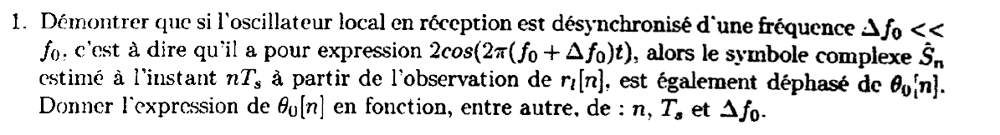{fig-alt="Question 1 : démontrer que si l'oscillateur local de réception est désynchronisé d'une fréquence Δf0 très petite devant f0, c'est-à-dire vaut 2cos(2π(f0 + Δf0)t), alors le symbole complexe estimé Ŝn à partir de rl[n] est déphasé de θ0[n]. Donner θ0[n] en fonction, entre autres, de n, Ts et Δf0."}

:::: {.complement}
::: {.solution}
On néglige le bruit et le canal ($h(t) = \delta(t)$) et l'on note $\Delta f_0$ le décalage.

**Voie I.** Avec $2\cos a\cos b = \cos(a + b) + \cos(a - b)$ :
$$y(t) \cdot 2\cos\big(2\pi(f_0 + \Delta f_0)t\big) = \sum_k A_k\, g(t - k\Ts)\Big[\cos\big(2\pi(2f_0 + \Delta f_0)t + \phi_k\big) + \cos\big(\phi_k - 2\pi\Delta f_0 t\big)\Big].$$
Le filtre passe-bas élimine le terme autour de $2f_0$ (il faut $f_0$ grand devant la bande de $g$) : $y_{l,I}(t) = \sum_k A_k\, g(t - k\Ts)\cos(\phi_k - 2\pi\Delta f_0 t)$.

**Voie Q.** L'oscillateur déphasé de $+\frac{\pi}{2}$ vaut $2\cos\big(2\pi(f_0 + \Delta f_0)t + \frac{\pi}{2}\big) = -2\sin\big(2\pi(f_0 + \Delta f_0)t\big)$ ; avec $-2\cos a\sin b = \sin(a - b) - \sin(a + b)$, après passe-bas : $y_{l,Q}(t) = \sum_k A_k\, g(t - k\Ts)\sin(\phi_k - 2\pi\Delta f_0 t)$.

**Enveloppe complexe.** $y_l = y_{l,I} + j\, y_{l,Q}$ :
$$y_l(t) = e^{-j2\pi\Delta f_0 t} \sum_k S_k\, g(t - k\Ts), \qquad S_k = A_k e^{j\phi_k}.$$
Sans décalage ($\Delta f_0 = 0$), on retrouve exactement l'enveloppe complexe émise.

**Après filtrage et échantillonnage.** $r_l(t) = \int g_a(t - u)\, y_l(u)\, \mathrm{d}u$. Comme $\Delta f_0 \Ts \ll 1$, l'exponentielle varie très peu sur la durée d'une impulsion : on peut la sortir de l'intégrale en la prenant à l'instant d'échantillonnage. Avec $v = g \star g_a$ de Nyquist :
$$r_l[n] \simeq e^{-j2\pi\Delta f_0 n\Ts} \sum_k S_k\, v[n - k] = v[0]\, S_n\, e^{j\theta_0[n]}, \qquad \boxed{\theta_0[n] = -2\pi\,\Delta f_0\, n\,\Ts}$$
(à une constante près, qui dépend du retard des filtres causaux). Le déphasage **croît linéairement** avec l'indice du symbole : la constellation tourne de $2\pi\Delta f_0\Ts$ rad par symbole.

Contrôles : simulation de la chaîne (BPSK, porte, $f_0 = 20/\Ts$, $\Delta f_0\Ts = \frac{1}{400}$, passe-bas idéal, filtre adapté) : phase mesurée $-0{,}791$ rad au symbole 50 et $-1{,}562$ rad au symbole 99, contre $-2\pi\Delta f_0(n + \frac12)\Ts = -0{,}793$ et $-1{,}563$ ✓ (le $\frac12$ vient de l'instant moyen de l'impulsion). Le signe de $\theta_0$ dépend du sens du déphasage $\frac{\pi}{2}$ de la figure 3, qui n'est pas précisé : avec $-\frac{\pi}{2}$, $\theta_0[n] = +2\pi\Delta f_0 n\Ts$.
:::
::::

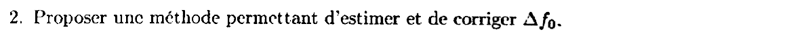{fig-alt="Question 2 : proposer une méthode permettant d'estimer et de corriger Δf0."}

:::: {.complement}
::: {.solution}
**Estimation.** On mesure la pente de la phase $\theta_0[n]$ :

- *avec symboles pilotes* (connus du récepteur, en tête de trame) : $r_l[n]\, S_n^* = v[0]\,|S_n|^2 e^{j\theta_0[n]}$ ; la différence de phase entre deux pilotes consécutifs vaut $-2\pi\Delta f_0\Ts$, d'où $\widehat{\Delta f_0} = -\frac{1}{2\pi\Ts}\arg\big(z[n]\, z^*[n - 1]\big)$ avec $z[n] = r_l[n]\, S_n^*$ (moyennée sur plusieurs pilotes pour réduire l'effet du bruit) ;
- *sans pilote*, pour une $M$-PSK : $S_n^M$ est constant ($e^{jM\phi_n}$ ne dépend pas du symbole, par exemple $S_n^2 = 1$ en BPSK), donc $r_l[n]^M \propto e^{-j2\pi M\Delta f_0 n\Ts}$ : la position du pic de la TF discrète de $r_l[n]^M$ donne $M\Delta f_0$ (estimateur par élévation à la puissance $M$). Contrainte : $|M\Delta f_0\Ts| < \frac12$ pour éviter l'ambiguïté.

**Correction.** Soit on multiplie les échantillons par $e^{+j2\pi\widehat{\Delta f_0}\, n\Ts}$ (contre-rotation numérique), soit on recale la fréquence de l'oscillateur local (contrôle automatique de fréquence). Le décalage résiduel et la phase constante sont ensuite suivis par une boucle à verrouillage de phase (boucle de Costas, par exemple).
:::
::::

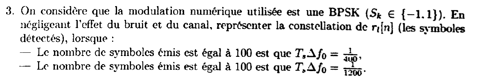{fig-alt="Question 3 : modulation BPSK, Sk dans {−1, 1}, bruit et canal négligés : représenter la constellation de rl[n] lorsque 100 symboles sont émis avec Ts Δf0 = 1/400, puis avec Ts Δf0 = 1/1200."}

:::: {.complement}
::: {.solution}
L'énoncé imprime « $S_k \in \{-1.1\}$ » : lire $\{-1, 1\}$ (virgule rendue comme un point). Avec $v[0] = 1$, $r_l[n] = S_n\, e^{-j2\pi\Delta f_0 n\Ts}$, $n = 0, \dots, 99$ : chaque point reste sur le cercle unité et tourne de $2\pi\Delta f_0\Ts$ par symbole.

- $\Ts\Delta f_0 = \frac{1}{400}$ : $0{,}9°$ par symbole, $\theta_0[99] \approx -89°$, soit **un quart de tour** sur la trame. Les points issus de $+1$ décrivent l'arc de $1$ à $-j$, ceux issus de $-1$ l'arc de $-1$ à $+j$.
- $\Ts\Delta f_0 = \frac{1}{1200}$ : $0{,}3°$ par symbole, rotation totale d'environ **$30°$** : deux arcs courts autour de $\pm 1$.

![Échantillons $r_l[n]$ d'une BPSK sans bruit avec un décalage de fréquence, pour 100 symboles (couleur : indice $n$). Croix : symboles émis $\pm 1$ ; pointillés gris : seuil de décision. Figure calculée.](../figures/ann-2016-bpsk-decalage-frequence.svg){#fig-ann16-bpsk-decalage}
:::
::::

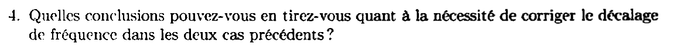{fig-alt="Question 4 : quelles conclusions tirez-vous quant à la nécessité de corriger le décalage de fréquence dans les deux cas précédents ?"}

:::: {.complement}
::: {.solution}
La décision BPSK se fait sur le signe de $\mathrm{Re}(r_l[n]) = S_n\cos\theta_0[n]$ ; la distance au seuil passe de $1$ à $|\cos\theta_0[n]|$.

- **$\Ts\Delta f_0 = \frac{1}{400}$** : en fin de trame, $\cos\theta_0 \approx 0$ ; les points arrivent sur le seuil, et la moindre perturbation de bruit provoque une erreur sur une décision sur deux. Au-delà de 100 symboles, la rotation dépasse $90°$ et toutes les décisions s'inversent. **La correction est indispensable.**
- **$\Ts\Delta f_0 = \frac{1}{1200}$** : au pire $\cos 30° = 0{,}87$, soit une perte de marge de $20\log_{10}(0{,}87) \approx -1{,}25$ dB en fin de trame. Sans bruit, aucune erreur sur 100 symboles ; avec du bruit, la probabilité d'erreur augmente un peu. On peut s'en passer pour des trames courtes, mais pas pour une transmission continue : la rotation s'accumule et atteint $90°$ au bout de 300 symboles.

Conclusion : le critère est le produit $N\,\Delta f_0\,\Ts$ (rotation accumulée sur la durée pendant laquelle on ne recale pas la phase). Il faut corriger dès que la rotation accumulée n'est plus petite devant la demi-distance angulaire entre symboles ($90°$ en BPSK, $45°$ en QPSK).
:::
::::
