

::: {.complement}
Aucun corrigé officiel : **toutes les solutions de cette page sont rédigées par Claude**. Les énoncés sont des extraits des photos du sujet [sujet-2017], sans annotation. À relire avec un œil critique ; signaler toute erreur.

**Notations.** Le sujet suit les notations du TD : $g(t)$ filtre d'émission (cours : $h(t)$), $g_a(t)$ filtre de réception (cours : $h_a(t)$), $v(t) = (g \star g_a)(t)$ filtre global (cours : $g(t)$), $h_l(t)$ canal (cours : $h_c(t)$), $n_l(t)$ bruit (cours : $z_l(t)$), $R_A(n) = \E[A_k A_{k+n}]$ (cours : $R_A[m] = \E[A_n A^*_{n-m}]$, même valeur pour des symboles réels stationnaires).

**Correspondances.** Questions 5, 12 et 14 : questions 2, 5 et 6 du [partiel 2016-2017](2016-2017-partiel.qmd#sec-ann1617-cours) ; questions 15 à 17 : questions 9 à 11 du [partiel 2019-2020](2019-2020-partiel.qmd#sec-ann1920-ex1) ; questions 14 à 16 : exercice 2 du TD (q. 9-10, [DSP d'une 2-PAM](../cours/03-dsp-signaux-codes-en-ligne.qmd#exr-td-dsp-2pam)) avec une 4-PAM ; partie 2 : étude pratique du TD (ex. 5), avec $D_s = 1$ Msymbole/s et $F_e = 10$ MHz au lieu de 2 ksymboles/s et 8 kHz.
:::

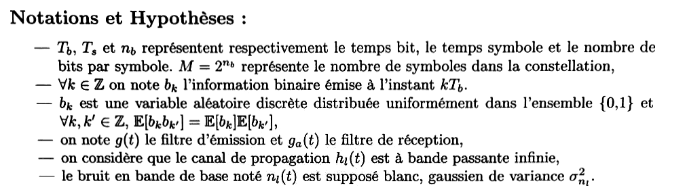{fig-alt="Notations et hypothèses : Tb, Ts, nb ; M = 2^nb symboles ; bk information binaire émise à kTb, uniforme sur {0, 1}, E[bk bk'] = E[bk] E[bk'] ; g(t) filtre d'émission et ga(t) filtre de réception ; canal hl(t) à bande passante infinie ; bruit nl(t) blanc gaussien de variance σ²nl."}

## Partie 1 : questions de cours (14 points) {#sec-ann1718-cours}

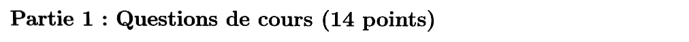{fig-alt="Partie 1 : questions de cours (14 points)."}

Chapitres du cours : [Rappels de probabilités](../cours/03-dsp-signaux-codes-en-ligne.qmd#sec-rappels-probabilites), [Chaîne de transmission](../cours/02-communication-sans-bruit.qmd#sec-chaine-bande-de-base), [Critère de Nyquist](../cours/02-communication-sans-bruit.qmd#sec-critere-nyquist), [Formule de Bennett](../cours/03-dsp-signaux-codes-en-ligne.qmd#sec-formule-bennett), [Lien entre $P_b$ et $E_b/N_0$](../cours/04-transmission-presence-bruit.qmd#sec-pb-eb-n0).

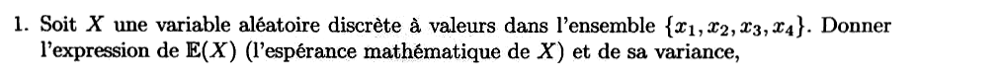{fig-alt="Question 1 : X variable aléatoire discrète à valeurs dans {x1, x2, x3, x4} ; donner l'expression de E(X) et de sa variance."}

:::: {.complement}
::: {.solution}
Avec $p_i = P(X = x_i)$ ([espérance](../cours/03-dsp-signaux-codes-en-ligne.qmd#def-esperance), [variance](../cours/03-dsp-signaux-codes-en-ligne.qmd#def-variance)) :
$$\E(X) = \sum_{i=1}^{4} x_i\, p_i, \qquad \mathrm{VAR}(X) = \sum_{i=1}^{4} p_i\,\big(x_i - \E(X)\big)^2 = \E(X^2) - \E(X)^2 .$$
:::
::::

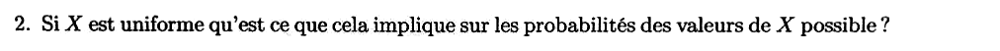{fig-alt="Question 2 : si X est uniforme, qu'est-ce que cela implique sur les probabilités des valeurs possibles de X ?"}

:::: {.complement}
::: {.solution}
Loi uniforme discrète : toutes les valeurs sont équiprobables, $p_i = \frac14$ pour $i = 1, \dots, 4$ (et $\sum p_i = 1$). Alors $\E(X) = \frac14\sum x_i$ et $\mathrm{VAR}(X) = \frac14\sum x_i^2 - \E(X)^2$.
:::
::::

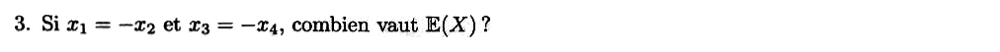{fig-alt="Question 3 : si x1 = −x2 et x3 = −x4, combien vaut E(X) ?"}

::: {.a-verifier #av-ann1718-esperance-symetrique}
**Source** [sujet-2017, p. 1, q. 3] : « Si $x_1 = -x_2$ et $x_3 = -x_4$, combien vaut $\mathbb{E}(X)$ ? »

**Problème** : la question ne dit pas si $X$ est uniforme. Sans hypothèse sur les $p_i$, $\E(X) = x_1(p_1 - p_2) + x_3(p_3 - p_4)$, qui n'est pas nul en général.

**Proposition** : garder l'hypothèse d'uniformité de la question 2 (enchaînement probable des questions), d'où $\E(X) = 0$.
:::

:::: {.complement}
::: {.solution}
$\E(X) = x_1 p_1 - x_1 p_2 + x_3 p_3 - x_3 p_4 = x_1(p_1 - p_2) + x_3(p_3 - p_4)$. Si $X$ est uniforme (question 2), $p_1 = p_2$ et $p_3 = p_4$ :
$$\boxed{\E(X) = 0}$$
C'est le cas des constellations symétriques par rapport à $0$ ($M$-PAM $\{\pm 1, \pm 3\}$) : symboles **centrés**, pas de raie dans la DSP.
:::
::::

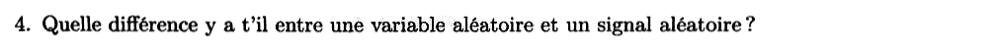{fig-alt="Question 4 : quelle différence y a-t-il entre une variable aléatoire et un signal aléatoire ?"}

:::: {.complement}
::: {.solution}
Une [variable aléatoire](../cours/03-dsp-signaux-codes-en-ligne.qmd#def-variable-aleatoire) associe **un nombre** au résultat d'une expérience aléatoire (la valeur d'un symbole, d'un échantillon de bruit). Un [signal (processus) aléatoire](../cours/03-dsp-signaux-codes-en-ligne.qmd#def-processus-aleatoire) $X(t)$ associe à chaque résultat **une fonction du temps** (une réalisation) ; à $t$ fixé, $X(t)$ est une variable aléatoire. Il faut donc, en plus de la loi à chaque instant, décrire les liens entre instants (autocorrélation $R_X(t, \tau)$).
:::
::::

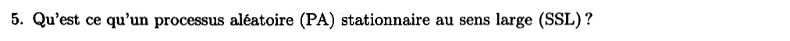{fig-alt="Question 5 : qu'est-ce qu'un processus aléatoire (PA) stationnaire au sens large (SSL) ?"}

:::: {.complement}
::: {.solution}
Voir la [question 2 du partiel 2016-2017](2016-2017-partiel.qmd#sec-ann1617-cours) : moyenne constante et autocorrélation $R_X(t, \tau) = \E[X(t)\,X^*(t - \tau)]$ ne dépendant que de $\tau$ ([définition du cours](../cours/03-dsp-signaux-codes-en-ligne.qmd#def-stationnarite)).
:::
::::

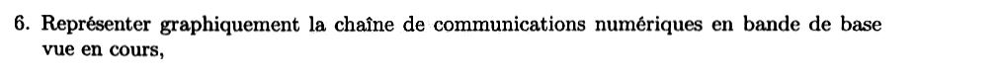{fig-alt="Question 6 : représenter graphiquement la chaîne de communications numériques en bande de base vue en cours."}

:::: {.complement}
::: {.solution}
Voir la [figure de la chaîne en bande de base](../cours/02-communication-sans-bruit.qmd#fig-chaine-bande-de-base). Dans l'ordre :

bits $b_k$ → **association bits → symboles** ($A_k$, débit $D_s = 1/\Ts$) → **filtre de mise en forme** $g(t)$ (signal émis $s_l(t) = \sum_k A_k\, g(t - k\Ts)$) → **canal** $h_l(t)$ + **bruit additif** $n_l(t)$ → **filtre de réception** $g_a(t)$ → **échantillonnage** au rythme $\Ts$ ($r_l[n]$) → **décision** ($\hat{A}_n$) → **association symboles → bits** ($\hat{b}_k$).
:::
::::

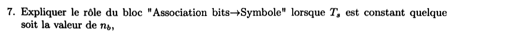{fig-alt="Question 7 : expliquer le rôle du bloc association bits vers symbole lorsque Ts est constant quelle que soit la valeur de nb."}

:::: {.complement}
::: {.solution}
Le bloc regroupe les bits par paquets de $n_b$ et associe à chaque paquet un des $M = 2^{n_b}$ symboles de la constellation ([cours](../cours/02-communication-sans-bruit.qmd#sec-association-bits-symboles)), de préférence avec un étiquetage de Gray. Avec $\Ts$ fixé, le débit symbole $D_s = 1/\Ts$ et la bande occupée (fixée par $g$ et $\Ts$) ne changent pas, mais le **débit binaire** $D_b = n_b D_s = n_b/\Ts$ augmente avec $n_b$ ([relation du cours](../cours/02-communication-sans-bruit.qmd#eq-db-nb-ds)) : on gagne en efficacité spectrale. La contrepartie, à puissance fixée, est un rapprochement des symboles (question 17).
:::
::::

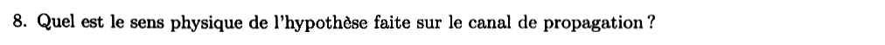{fig-alt="Question 8 : quel est le sens physique de l'hypothèse faite sur le canal de propagation ?"}

:::: {.complement}
::: {.solution}
Canal « à bande passante infinie » : $H_l(f)$ est constant sur toutes les fréquences, donc $h_l(t) = \delta(t)$ (à un gain et un retard près). Physiquement, la bande du canal est **très grande devant celle du signal** : le canal ne déforme pas les impulsions et ne crée pas d'interférence entre symboles. Le filtre global se réduit à $v = g \star g_a$, et seul le bruit additif dégrade la transmission. Exemple : liaison filaire courte, ou radio en visibilité directe sans trajets multiples.
:::
::::

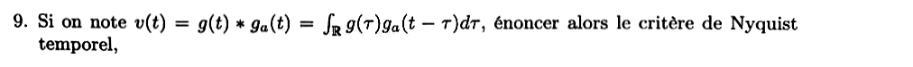{fig-alt="Question 9 : si v(t) = g(t) * ga(t), énoncer le critère de Nyquist temporel."}

:::: {.complement}
::: {.solution}
Absence d'interférence entre symboles aux instants d'échantillonnage ([théorème du cours](../cours/02-communication-sans-bruit.qmd#thm-nyquist-temporel)) :
$$v(n\Ts) = v(0)\,\delta[n], \quad v(0) \neq 0,$$
c'est-à-dire $v(n\Ts) = 0$ pour tout $n \neq 0$. Alors $r_l[n] = v(0)\,A_n + n'_l[n]$.
:::
::::

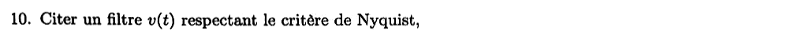{fig-alt="Question 10 : citer un filtre v(t) respectant le critère de Nyquist."}

:::: {.complement}
::: {.solution}
Le **cosinus surélevé** de facteur de retombée $\beta$ ([exemple](../cours/02-communication-sans-bruit.qmd#exm-cosinus-sureleve)), ou le triangle $\Ts\Lambda(t/\Ts)$ obtenu avec une porte de durée $\Ts$ et son filtre adapté (voir la [question 4 du partiel 2016-2017](2016-2017-partiel.qmd#sec-ann1617-cours)).
:::
::::

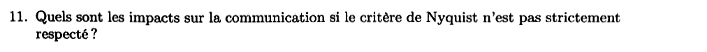{fig-alt="Question 11 : quels sont les impacts sur la communication si le critère de Nyquist n'est pas strictement respecté ?"}

:::: {.complement}
::: {.solution}
Il reste de l'**interférence entre symboles** ([IES](../cours/02-communication-sans-bruit.qmd#def-ies)) : $r_l[n] = v(0)A_n + \sum_{k \neq n} A_k\, v((n - k)\Ts) + n'_l[n]$. Le terme d'IES dépend des symboles voisins : il déplace les points reçus de façon aléatoire, ferme le [diagramme de l'œil](../cours/02-communication-sans-bruit.qmd#sec-diagramme-oeil) et réduit la marge face au bruit. La probabilité d'erreur augmente ; si l'IES est assez forte, des erreurs apparaissent même sans bruit (plancher d'erreur). Remède : égalisation à la réception.
:::
::::

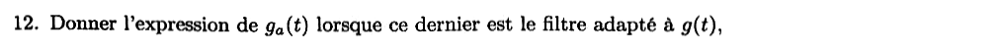{fig-alt="Question 12 : donner l'expression de ga(t) lorsque ce dernier est le filtre adapté à g(t)."}

:::: {.complement}
::: {.solution}
$g_a(t) = \lambda\, g^*(-t)$, version causale $\lambda\, g^*(T_g - t)$ pour $g$ de durée $T_g$ ([filtre adapté](../cours/04-transmission-presence-bruit.qmd#eq-filtre-adapte)). Même question que la [question 5 de 2016-2017](2016-2017-partiel.qmd#sec-ann1617-cours).
:::
::::

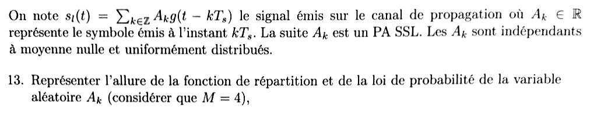{fig-alt="On note sl(t) = somme de Ak g(t − kTs), Ak réel ; la suite Ak est un PA SSL, les Ak sont indépendants, à moyenne nulle et uniformément distribués. Question 13 : représenter l'allure de la fonction de répartition et de la loi de probabilité de Ak (M = 4)."}

:::: {.complement}
::: {.solution}
Pour $M = 4$, symboles centrés et uniformes : $A_k \in \{-3, -1, 1, 3\}$ (alphabet de la partie 2 et du cours), $P(A_k = a) = \frac14$.

- **Loi** : quatre barres (ou impulsions $\frac14\,\delta(x - a)$ pour la densité) de hauteur $\frac14$ en $-3$, $-1$, $1$, $3$.
- **Fonction de répartition** : escalier croissant, $0$ pour $x < -3$, puis $\frac14$, $\frac12$, $\frac34$ et $1$ à partir de $-3$, $-1$, $1$ et $3$ (sauts de $\frac14$, continuité à droite).

L'énoncé ne fixe pas les valeurs des symboles : l'alphabet $\{\pm 1, \pm 3\}$ est celui de la partie 2.
:::
::::

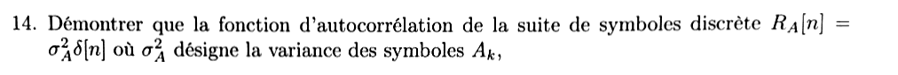{fig-alt="Question 14 : démontrer que l'autocorrélation de la suite de symboles RA[n] = σA² δ[n], σA² variance des symboles."}

:::: {.complement}
::: {.solution}
Symboles indépendants et centrés : $R_A[0] = \E(A_k^2) = \sigma_A^2$, et pour $n \neq 0$, $R_A[n] = \E(A_k)\,\E(A_{k+n}) = 0$. Donc $R_A[n] = \sigma_A^2\,\delta[n]$ (même démonstration qu'à la [question 6 de 2016-2017](2016-2017-partiel.qmd#sec-ann1617-cours)). Pour la 4-PAM $\{\pm 1, \pm 3\}$ : $\sigma_A^2 = \frac14(9 + 1 + 1 + 9) = 5$.
:::
::::

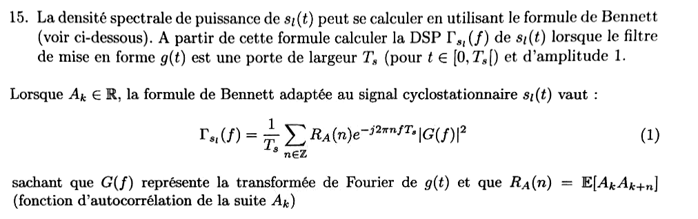{fig-alt="Question 15 : à partir de la formule de Bennett, calculer la DSP de sl(t) lorsque g(t) est une porte de largeur Ts (t dans [0, Ts[) et d'amplitude 1. Formule (1) : Γ(f) = (1/Ts) somme sur n de RA(n) e^{−j2πnfTs} |G(f)|², avec RA(n) = E[Ak Ak+n]."}

:::: {.complement}
::: {.solution}
Avec $R_A(n) = \sigma_A^2\,\delta[n]$, la somme se réduit au terme $n = 0$ ([corollaire du cours](../cours/03-dsp-signaux-codes-en-ligne.qmd#cor-bennett-iid)) : $\Gamma_{s_l}(f) = \frac{\sigma_A^2}{\Ts}|G(f)|^2$. La porte sur $[0, \Ts[$ a pour TF $G(f) = \Ts\sinc(f\Ts)\,e^{-j\pi f\Ts}$, $|G(f)|^2 = \Ts^2\sinc^2(f\Ts)$ :
$$\boxed{\Gamma_{s_l}(f) = \sigma_A^2\,\Ts\,\sinc^2(f\Ts) = 5\,\Ts\,\sinc^2(f\Ts)}$$
avec $\sinc(x) = \frac{\sin \pi x}{\pi x}$ ([DSP avec une porte](../cours/03-dsp-signaux-codes-en-ligne.qmd#eq-dsp-porte)) et $\sigma_A^2 = 5$ pour la 4-PAM $\{\pm 1, \pm 3\}$.
:::
::::

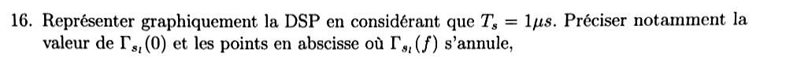{fig-alt="Question 16 : représenter la DSP pour Ts = 1 µs ; préciser Γ(0) et les points où Γ(f) s'annule."}

:::: {.complement}
::: {.solution}
- $\Gamma_{s_l}(0) = \sigma_A^2\Ts = 5 \times 10^{-6}$ (unité : V²/Hz si $s_l$ est en volts, soit W/Hz sur 1 Ω).
- Zéros : $\sinc(f\Ts) = 0$ pour $f\Ts = k \in \mathbb{Z}^*$, soit $f = k$ MHz, $k \neq 0$ ($\pm 1$, $\pm 2$, … MHz).
- Allure : lobe principal en $\sinc^2$ sur $[-1, 1]$ MHz, lobes secondaires décroissant en $1/f^2$ (le premier vaut environ 4,5 % du sommet, soit $-13$ dB). Même forme que la [figure du cours](../cours/03-dsp-signaux-codes-en-ligne.qmd#fig-dsp-porte), à l'échelle $5\Ts$.
:::
::::

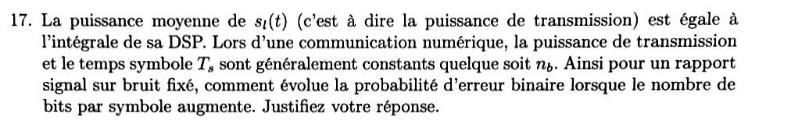{fig-alt="Question 17 : la puissance moyenne de sl(t) est l'intégrale de sa DSP ; puissance d'émission et Ts sont généralement constants quel que soit nb. Pour un rapport signal sur bruit fixé, comment évolue la probabilité d'erreur binaire lorsque nb augmente ? Justifier."}

:::: {.complement}
::: {.solution}
**Puissance.** $P = \int\Gamma_{s_l} = \frac{\sigma_A^2}{\Ts}\int|G|^2 = \frac{\sigma_A^2 E_g}{\Ts}$ ([cours](../cours/04-transmission-presence-bruit.qmd#eq-puissance-signal-emis)). Avec $P$, $\Ts$ et $g$ fixés, **$\sigma_A^2$ est fixée**.

**Constellation.** Une $M$-PAM d'espacement $2d$ ($\pm d, \pm 3d, \dots$) a $\sigma_A^2 = d^2\frac{M^2 - 1}{3}$. À $\sigma_A^2$ fixée, $d = \sqrt{3\sigma_A^2/(M^2 - 1)}$ **diminue** quand $M = 2^{n_b}$ augmente (environ comme $1/M$) : les symboles se rapprochent des seuils.

**Probabilité d'erreur.** $P_b \simeq 2\frac{M - 1}{M\log_2 M}\, Q\!\left(\frac{d\,v(0)}{\sigma}\right)$ ([cours](../cours/04-transmission-presence-bruit.qmd#eq-pb-mpam)) : à bruit $\sigma$ fixé, l'argument de $Q$ diminue, donc **$P_b$ augmente** avec $n_b$. Exemple : pour $\sigma_A^2 = 1$, $d = 1$ en 2-PAM, $0{,}45$ en 4-PAM, $0{,}22$ en 8-PAM (voir la [figure du partiel 2019-2020](2019-2020-partiel.qmd#fig-ann19-pam-puissance-constante)).
:::
::::

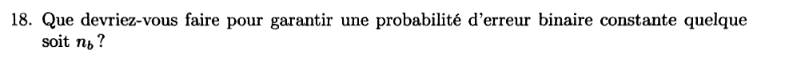{fig-alt="Question 18 : que devriez-vous faire pour garantir une probabilité d'erreur binaire constante quel que soit nb ?"}

:::: {.complement}
::: {.solution}
Garder la distance entre symboles voisins (donc $d/\sigma$) constante : il faut **augmenter la puissance d'émission** proportionnellement à $\sigma_A^2 = d^2\frac{M^2 - 1}{3}$, soit d'un facteur $\frac{M^2 - 1}{3}$ par rapport à la 2-PAM ($\times 5$, soit $+7$ dB, pour passer de la 2-PAM à la 4-PAM). Dit autrement, le rapport $E_b/N_0$ requis pour un $P_b$ donné croît avec $n_b$ (facteur $\frac{M^2 - 1}{3\log_2 M}$, [formule du cours](../cours/04-transmission-presence-bruit.qmd#eq-pb-min-mpam)). Autres leviers, si la puissance est bornée : codage correcteur d'erreurs, ou réduire le débit (garder $n_b$ petit).
:::
::::

## Partie 2 : un peu de Matlab (6 points) {#sec-ann1718-matlab}

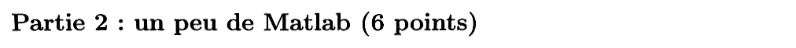{fig-alt="Partie 2 : un peu de Matlab (6 points)."}

Chapitres du cours : [Association bits → symboles](../cours/02-communication-sans-bruit.qmd#sec-association-bits-symboles) et [Filtre de mise en forme](../cours/02-communication-sans-bruit.qmd#sec-mise-en-forme).

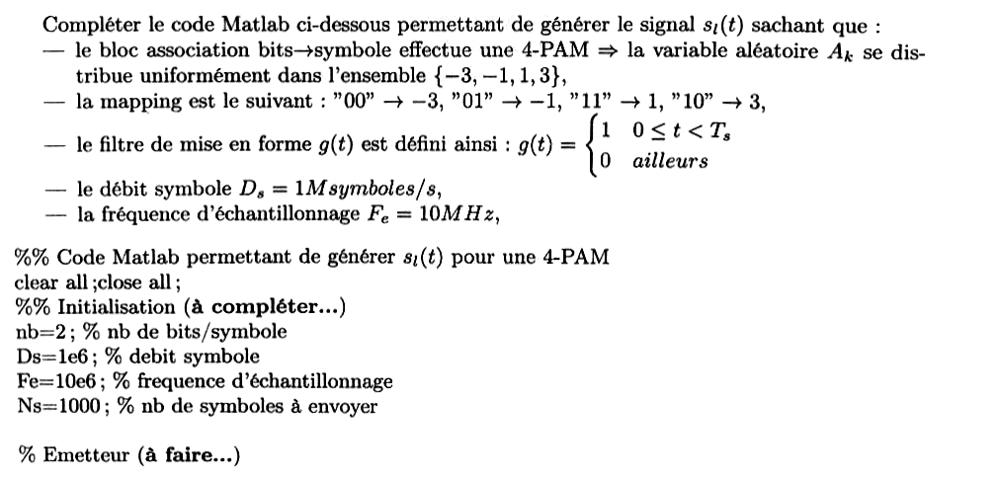{fig-alt="Compléter le code Matlab générant sl(t) : 4-PAM, Ak uniforme sur {−3, −1, 1, 3}, étiquetage 00 → −3, 01 → −1, 11 → 1, 10 → 3, g(t) = 1 pour 0 ≤ t < Ts et 0 ailleurs, Ds = 1 Msymbole/s, Fe = 10 MHz. Code fourni : nb = 2, Ds = 1e6, Fe = 10e6, Ns = 1000 ; puis « % Emetteur (à faire...) »."}

::: {.a-verifier #av-ann1718-matlab-incomplet}
**Source** [sujet-2017, p. 2] : le sujet photographié s'arrête après « % Emetteur (à faire...) », en bas de la page 2.

**Problème** : la suite de la partie 2 (questions éventuelles, autres blocs de code à compléter, barème détaillé) manque dans la source.

**Proposition** : corriger uniquement l'émetteur, seul bloc visible ; ajouter la suite si une photo de la page 3 est retrouvée.
:::

:::: {.complement}
::: {.solution}
Le facteur de suréchantillonnage vaut $F_{se} = F_e/D_s = 10$ échantillons par symbole ; la porte de durée $\Ts$ échantillonnée à $F_e$ est un vecteur de 10 uns.

```matlab
%% Emetteur
Ts  = 1/Ds;                       % durée symbole (1 µs)
Fse = Fe/Ds;                      % nb d'échantillons par symbole (10)
b   = randi([0 1], 1, nb*Ns);     % bits émis, iid uniformes
bm  = reshape(b, nb, Ns);         % une colonne = les nb bits d'un symbole
% étiquetage de Gray de l'énoncé : "00"->-3, "01"->-1, "11"->1, "10"->3
idx = 2*bm(1,:) + bm(2,:);        % 0, 1, 2, 3 pour "00", "01", "10", "11"
table = [-3 -1 3 1];              % symbole associé à chaque valeur de idx
Ak  = table(idx + 1);             % suite des symboles
g   = ones(1, Fse);               % filtre de mise en forme : porte de durée Ts
sa  = zeros(1, Ns*Fse);
sa(1:Fse:end) = Ak;               % peigne de symboles au rythme Ts
sl  = conv(sa, g);                % signal émis s_l[n] = sum_k A_k g[n - k Fse]
t   = (0:length(sl)-1)/Fe;        % axe des temps (s)
plot(t, sl); xlabel('t (s)'); ylabel('s_l(t)'); grid on;
```

Points de contrôle : `sl` compte $N_s F_{se} + F_{se} - 1 = 10\,009$ échantillons ; ses $10\,000$ premiers échantillons sont chaque symbole répété 10 fois (équivalent : `sl = kron(Ak, ones(1, Fse))`) ; la moyenne de `Ak.^2` tend vers $\sigma_A^2 = 5$. Logique vérifiée par une traduction ligne à ligne en Python (le code Matlab lui-même n'a pas été exécuté).
:::
::::
