

::: {.complement}
Aucun corrigé officiel : **toutes les solutions de cette page sont rédigées par Claude**. Les énoncés sont des extraits de trois photos du sujet [sujet-2018], sans annotation, redressées (la feuille est photographiée en biais) ; leur netteté est limitée par celle des photos. À relire avec un œil critique ; signaler toute erreur.

**Notations.** Le sujet suit les notations du TD : $g(t)$ filtre de mise en forme (cours : $h(t)$), $g_a(t)$ filtre de réception (cours : $h_a(t)$), $v(t) = (g \star g_a)(t)$ filtre global (cours : $g(t)$), $h(t)$ canal (cours : $h_c(t)$), $n'_l[n]$ bruit échantillonné (cours : $Z'_n$), $r_l[n]$ échantillon reçu (cours : $r_n$).

**Correspondances.** Les questions 7 et 9 reviennent en 2019-2020 (questions 4 et 5, [corrigé 2019-2020](2019-2020-partiel.qmd#sec-ann1920-gen)) ; la question 1 est la question 2 de l'exercice 1 du TD avec une 4-PAM au lieu d'une 8-PAM ; les questions 19 et 20 transposent l'étude pratique du TD (ex. 5, q. 12-13, [exercice du chapitre 4](../cours/04-transmission-presence-bruit.qmd#exr-td-constellation-bruitee)) à une QPSK. Le récepteur I/Q de l'exercice est celui de la figure 3 du [partiel 2016-2017](2016-2017-partiel.qmd#sec-ann1617-ex).
:::

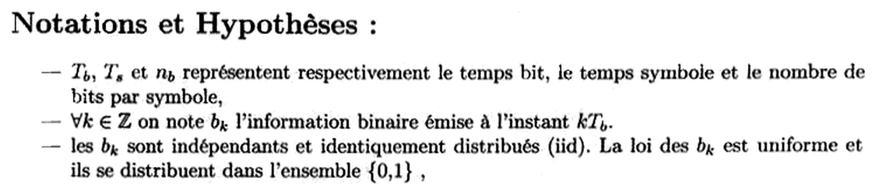{fig-alt="Notations et hypothèses : Tb, Ts et nb désignent le temps bit, le temps symbole et le nombre de bits par symbole ; bk est l'information binaire émise à l'instant kTb ; les bk sont iid, de loi uniforme sur {0, 1}."}

## Généralités sur les communications numériques {#sec-ann1819-gen}

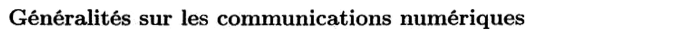{fig-alt="Titre de la première partie : Généralités sur les communications numériques."}

Chapitres du cours : [Communication sans bruit](../cours/02-communication-sans-bruit.qmd#sec-association-bits-symboles), [Bruit blanc gaussien](../cours/03-dsp-signaux-codes-en-ligne.qmd#sec-bruit-blanc), [Transmission en présence de bruit](../cours/04-transmission-presence-bruit.qmd#sec-probabilites-erreur).

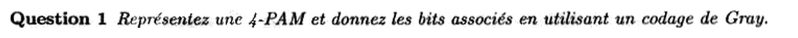{fig-alt="Question 1 : représentez une 4-PAM et donnez les bits associés en utilisant un codage de Gray."}

:::: {.complement}
::: {.solution}
Quatre symboles réels équidistants sur l'axe : $\{-3, -1, 1, 3\}$. Étiquetage de Gray (celui du [cours](../cours/02-communication-sans-bruit.qmd#exm-4pam-gray), construit en miroir) :

| Symbole | $-3$ | $-1$ | $1$ | $3$ |
|---|---|---|---|---|
| Bits | 00 | 01 | 11 | 10 |

Deux symboles voisins ne diffèrent que d'un bit. Seuils de décision au milieu : $-2$, $0$, $2$.
:::
::::

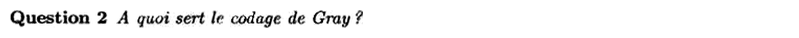{fig-alt="Question 2 : à quoi sert le codage de Gray ?"}

:::: {.complement}
::: {.solution}
Le bruit fait surtout franchir **le seuil le plus proche** : une erreur de symbole donne presque toujours un symbole **voisin**. Avec Gray, voisins = un seul bit différent, donc une erreur de symbole ne coûte qu'un bit faux : $P_b \simeq \frac{P_s}{\log_2 M}$, la plus petite valeur possible ([cours](../cours/04-transmission-presence-bruit.qmd#prp-pb-ps)). Avec un étiquetage binaire naturel (00, 01, 10, 11), l'erreur entre $-1$ (01) et $1$ (10) coûterait deux bits.
:::
::::

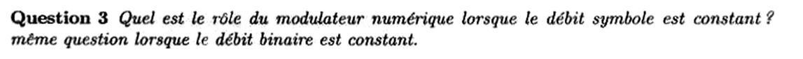{fig-alt="Question 3 : quel est le rôle du modulateur numérique lorsque le débit symbole est constant ? Même question lorsque le débit binaire est constant."}

:::: {.complement}
::: {.solution}
Le modulateur associe $n_b$ bits à un symbole parmi $M = 2^{n_b}$ et met en forme ; $D_b = n_b D_s$ ([cours](../cours/02-communication-sans-bruit.qmd#eq-db-nb-ds)).

- **$D_s$ constant** (donc bande constante, fixée par $\Ts$ et le filtre) : augmenter $n_b$ augmente le **débit binaire** $D_b$ ; on transmet plus vite dans la même bande (efficacité spectrale plus grande).
- **$D_b$ constant** : augmenter $n_b$ réduit le **débit symbole** $D_s = D_b/n_b$, donc allonge $\Ts$ et **réduit la bande occupée** ; on transmet le même débit dans moins de bande.

Dans les deux cas, à puissance donnée, les symboles se rapprochent et la probabilité d'erreur augmente (question 13).
:::
::::

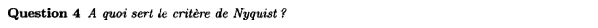{fig-alt="Question 4 : à quoi sert le critère de Nyquist ?"}

:::: {.complement}
::: {.solution}
Il donne la condition sur le filtre global $v = g \star h \star g_a$ pour qu'il n'y ait **pas d'interférence entre symboles** aux instants d'échantillonnage : $v(n\Ts) = v(0)\,\delta[n]$ ([critère de Nyquist](../cours/02-communication-sans-bruit.qmd#sec-critere-nyquist)). Il sert à choisir les filtres d'émission et de réception, et fixe la bande minimale $\frac{1}{2\Ts}$, donc le débit symbole maximal $2B$ dans une bande $B$.
:::
::::

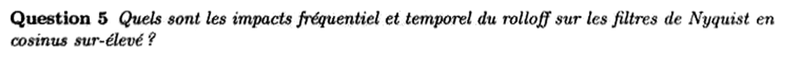{fig-alt="Question 5 : quels sont les impacts fréquentiel et temporel du rolloff sur les filtres de Nyquist en cosinus surélevé ?"}

:::: {.complement}
::: {.solution}
Pour le [cosinus surélevé](../cours/02-communication-sans-bruit.qmd#exm-cosinus-sureleve) de facteur de retombée (*roll-off*) $\beta \in [0, 1]$ :

- **en fréquence** : la bande occupée vaut $\frac{1 + \beta}{2\Ts}$ ; elle croît avec $\beta$ (de la bande minimale $\frac{1}{2\Ts}$ pour $\beta = 0$ à $\frac{1}{\Ts}$ pour $\beta = 1$) ; l'efficacité spectrale diminue ;
- **en temps** : la réponse impulsionnelle s'annule toujours aux $n\Ts$, mais ses lobes décroissent d'autant plus vite que $\beta$ est grand (en $1/|t|^3$ au lieu de $1/|t|$ pour le $\sinc$) ; le [diagramme de l'œil](../cours/02-communication-sans-bruit.qmd#sec-diagramme-oeil) est plus ouvert horizontalement, la transmission est moins sensible aux erreurs d'instant d'échantillonnage, et le filtre, plus court, est plus facile à réaliser.

Compromis : bande contre robustesse temporelle.
:::
::::

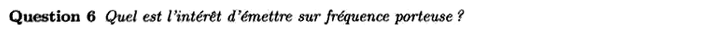{fig-alt="Question 6 : quel est l'intérêt d'émettre sur fréquence porteuse ?"}

:::: {.complement}
::: {.solution}
- **Adapter le signal au canal** : un canal radio ne transmet efficacement que des fréquences élevées (antennes de taille de l'ordre de la longueur d'onde : $\lambda = 3$ m à 100 MHz, contre 3 km à 100 kHz) ; chaque bande a ses propriétés de propagation (portée, pénétration).
- **Partager le spectre** : plusieurs utilisateurs ou services émettent simultanément sur des porteuses différentes (multiplexage fréquentiel), dans les bandes que leur attribue la réglementation.
- **Transmettre deux voies** : l'enveloppe complexe permet de moduler en phase et en quadrature (PSK, QAM), donc deux fois plus de symboles réels dans la même bande ([bande transposée](../cours/02-communication-sans-bruit.qmd#sec-bande-base-transposee)).
:::
::::

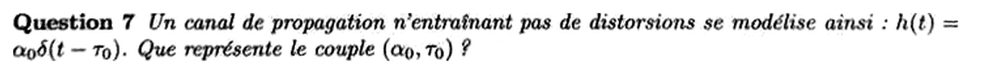{fig-alt="Question 7 : un canal sans distorsion se modélise par h(t) = α0 δ(t − τ0). Que représente le couple (α0, τ0) ?"}

:::: {.complement}
::: {.solution}
Le signal reçu vaut $(h \star s)(t) = \alpha_0\, s(t - \tau_0)$ : une copie non déformée du signal émis.

- $\alpha_0$ : **gain (atténuation)** du canal, dû aux pertes de propagation ($|\alpha_0| < 1$) ;
- $\tau_0$ : **retard de propagation**, $\tau_0 = d/c$ pour une distance $d$ parcourue à la vitesse $c$.

En fréquence, $H(f) = \alpha_0\, e^{-j2\pi f\tau_0}$ : module constant et phase linéaire, d'où l'absence de distorsion.
:::
::::

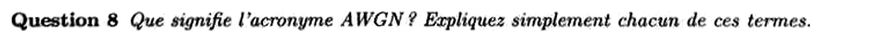{fig-alt="Question 8 : que signifie l'acronyme AWGN ? Expliquez simplement chacun de ces termes."}

:::: {.complement}
::: {.solution}
*Additive White Gaussian Noise*, bruit blanc gaussien additif ([cours](../cours/03-dsp-signaux-codes-en-ligne.qmd#sec-bruit-blanc)) :

- **additif** : il s'ajoute au signal, $y(t) = s(t) + n(t)$, indépendamment de lui ;
- **blanc** : DSP constante $\frac{N_0}{2}$ sur toutes les fréquences (deux instants distincts sont décorrélés) ;
- **gaussien** : à chaque instant, l'amplitude suit une loi normale centrée (somme d'un très grand nombre de contributions indépendantes : agitation thermique des électrons, théorème central limite).
:::
::::

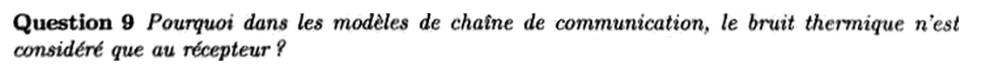{fig-alt="Question 9 : pourquoi, dans les modèles de chaîne de communication, le bruit thermique n'est-il considéré qu'au récepteur ?"}

:::: {.complement}
::: {.solution}
C'est au récepteur que le **rapport signal sur bruit** est le plus faible : le signal y arrive très atténué (question 7), alors que le bruit thermique des premiers étages (antenne, amplificateur faible bruit) a toujours la même puissance $k_B T B$. À l'émission, le bruit thermique existe aussi, mais il est négligeable devant le signal fort émis, et il subit ensuite la même atténuation que lui. Le bruit dominant, qui fixe les performances, est donc celui ramené à l'entrée du récepteur.
:::
::::

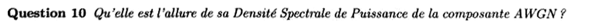{fig-alt="Question 10 : quelle est l'allure de la densité spectrale de puissance de la composante AWGN ?"}

:::: {.complement}
::: {.solution}
Plate : $\Gamma_n(f) = \frac{N_0}{2}$ pour tout $f$ (DSP bilatérale), et $R_n(\tau) = \frac{N_0}{2}\delta(\tau)$ ([figure du cours](../cours/03-dsp-signaux-codes-en-ligne.qmd#fig-bruit-blanc)). Après le filtre de réception, la DSP prend la forme $\frac{N_0}{2}|G_a(f)|^2$.
:::
::::

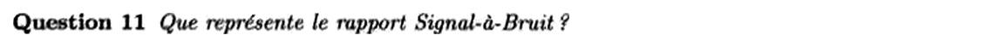{fig-alt="Question 11 : que représente le rapport signal à bruit ?"}

:::: {.complement}
::: {.solution}
Le rapport entre la puissance utile du signal et celle du bruit, au point considéré (en général à l'entrée du dispositif de décision), souvent exprimé en dB : $10\log_{10}\frac{P_\text{signal}}{P_\text{bruit}}$. Dans le cours, il est défini sur les échantillons comme le rapport d'amplitudes $\frac{g_0}{\sigma}$ ([définition](../cours/04-transmission-presence-bruit.qmd#def-rsb)), ou par énergie de bit, $\frac{E_b}{N_0}$. Il mesure la marge du signal face au bruit et fixe la probabilité d'erreur.
:::
::::

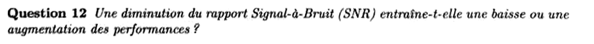{fig-alt="Question 12 : une diminution du rapport signal à bruit (SNR) entraîne-t-elle une baisse ou une augmentation des performances ?"}

:::: {.complement}
::: {.solution}
Une **baisse** des performances : $P_b = Q(g_0/\sigma)$ en binaire ([cours](../cours/04-transmission-presence-bruit.qmd#eq-pb-binaire)) et $Q$ est décroissante ; quand le RSB diminue, la probabilité d'erreur **augmente** ([courbe du cours](../cours/04-transmission-presence-bruit.qmd#fig-pb-rsb)).
:::
::::

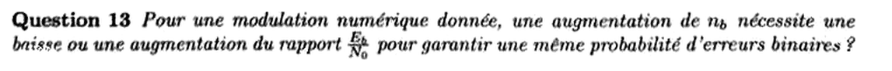{fig-alt="Question 13 : pour une modulation numérique donnée, une augmentation de nb nécessite-t-elle une baisse ou une augmentation du rapport Eb/N0 pour garantir une même probabilité d'erreur binaire ?"}

:::: {.complement}
::: {.solution}
Une **augmentation**, pour les modulations à amplitude et phase (PAM, PSK, QAM) : à énergie par bit égale, les $M = 2^{n_b}$ symboles sont plus serrés. Pour la $M$-PAM, $P_b \simeq 2\frac{M - 1}{M\log_2 M}\, Q\!\left(\sqrt{\frac{6\log_2 M}{M^2 - 1}\frac{E_b}{N_0}}\right)$ ([cours](../cours/04-transmission-presence-bruit.qmd#eq-pb-min-mpam)) : le facteur $\frac{6\log_2 M}{M^2 - 1}$ vaut 2 pour $M = 2$, 0,8 pour $M = 4$, 0,29 pour $M = 8$ ; il faut donc environ 4 dB de plus pour passer de la 2-PAM à la 4-PAM ($10\log_{10}\frac{2}{0{,}8} \approx 4$ dB).

Exception (hors programme du chapitre 4) : les modulations orthogonales ($M$-FSK) demandent au contraire un $E_b/N_0$ plus faible quand $n_b$ augmente, au prix d'une bande plus large.
:::
::::

## Exercice : communications numériques sur fréquence porteuse {#sec-ann1819-ex}

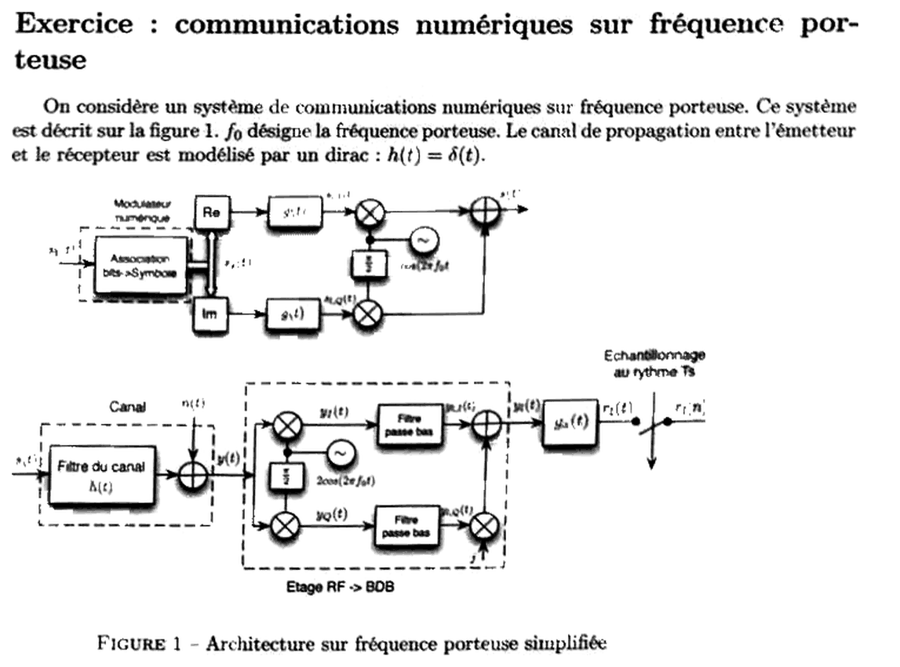{fig-alt="Exercice : système de communications numériques sur fréquence porteuse f0 (figure 1). Émetteur : association bits vers symbole, voies Re et Im filtrées par g(t), multipliées par cos(2πf0t) et sa version déphasée de π/2, sommées en s(t). Canal h(t) = δ(t) et bruit n(t). Récepteur : étage RF vers bande de base (mélangeurs avec 2cos(2πf0t) et sa version déphasée, filtres passe-bas, voie Q multipliée par j), filtre ga(t), échantillonnage au rythme Ts."}

Ce sujet relève des chapitres 4 et 5 du cours ; le chapitre 5 (transmission sur fréquence porteuse) n'est pas encore rédigé dans Bristol. Chapitre lié : [Récepteur optimal](../cours/04-transmission-presence-bruit.qmd#sec-recepteur-optimal).

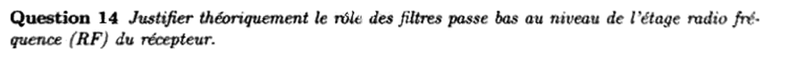{fig-alt="Question 14 : justifier théoriquement le rôle des filtres passe-bas de l'étage radiofréquence (RF) du récepteur."}

:::: {.complement}
::: {.solution}
On note $s(t) = s_I(t)\cos(2\pi f_0 t) - s_Q(t)\sin(2\pi f_0 t)$, avec $s_I + j s_Q = \sum_k S_k\, g(t - k\Ts)$ (enveloppe complexe, bande $[-B, B]$). Voie I : avec $2\cos^2 a = 1 + \cos 2a$ et $2\sin a\cos a = \sin 2a$,
$$y(t) \cdot 2\cos(2\pi f_0 t) = s_I(t) + \underbrace{s_I(t)\cos(4\pi f_0 t) - s_Q(t)\sin(4\pi f_0 t)}_{\text{autour de } 2f_0} .$$
Le produit contient l'enveloppe en bande de base **et** une copie autour de $2f_0$. Le passe-bas, de fréquence de coupure entre $B$ et $2f_0 - B$, élimine la copie à $2f_0$ et ne garde que $s_I(t)$ ; de même la voie Q restitue $s_Q(t)$ (au signe près du déphasage $\frac{\pi}{2}$, voir la [question 1 de 2016-2017](2016-2017-partiel.qmd#sec-ann1617-ex)). Il faut $f_0 > B$. Le passe-bas limite aussi la bande du bruit.
:::
::::

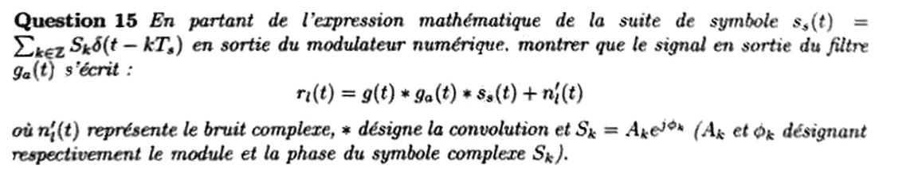{fig-alt="Question 15 : à partir de la suite de symboles ss(t) = somme de Sk δ(t − kTs) en sortie du modulateur numérique, montrer que le signal en sortie du filtre ga(t) s'écrit rl(t) = g(t) * ga(t) * ss(t) + n'l(t), où n'l(t) est le bruit complexe, * la convolution et Sk = Ak e^{jφk}."}

:::: {.complement}
::: {.solution}
1. Émission : les voies Re et Im filtrées par $g$ forment l'enveloppe complexe $s_l(t) = \sum_k S_k\, g(t - k\Ts) = (g \star s_s)(t)$, puisque $g \star \delta(\cdot - k\Ts) = g(\cdot - k\Ts)$. Le signal émis est $s(t) = \mathrm{Re}\big(s_l(t)\, e^{j2\pi f_0 t}\big)$.
2. Canal : $h(t) = \delta(t)$, donc $y(t) = s(t) + n(t)$.
3. Étage RF (question 14) : il restitue l'enveloppe complexe, $y_l(t) = s_l(t) + n_l(t)$, où $n_l = n_I + j n_Q$ est l'enveloppe complexe (filtrée passe-bas) du bruit.
4. Filtre de réception, linéaire : $r_l = g_a \star y_l = g_a \star g \star s_s + g_a \star n_l$.

$$\boxed{r_l(t) = (g \star g_a \star s_s)(t) + n'_l(t), \qquad n'_l = g_a \star n_l}$$
:::
::::

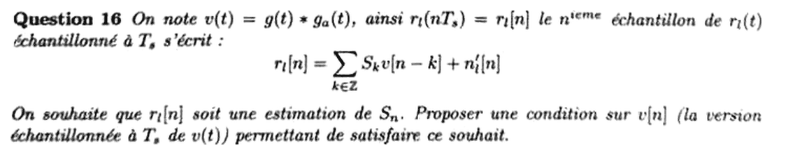{fig-alt="Question 16 : avec v(t) = g(t) * ga(t), l'échantillon rl[n] = somme sur k de Sk v[n − k] + n'l[n]. On souhaite que rl[n] soit une estimation de Sn : proposer une condition sur v[n], version échantillonnée à Ts de v(t)."}

:::: {.complement}
::: {.solution}
Il faut que seul le terme $k = n$ subsiste, avec un gain unité :
$$\boxed{v[n] = \delta[n]}, \quad \text{c'est-à-dire } v[0] = 1 \text{ et } v[n] = 0 \text{ pour } n \neq 0 .$$
C'est le [critère de Nyquist temporel](../cours/02-communication-sans-bruit.qmd#thm-nyquist-temporel) ($v[0] \neq 0$ suffit si l'on divise ensuite par $v[0]$). Alors $r_l[n] = S_n + n'_l[n]$.
:::
::::

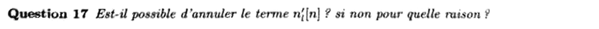{fig-alt="Question 17 : est-il possible d'annuler le terme n'l[n] ? Si non, pour quelle raison ?"}

:::: {.complement}
::: {.solution}
**Non.** Le bruit est aléatoire, inconnu du récepteur, et il occupe les **mêmes fréquences** que le signal utile : tout filtre qui le supprimerait supprimerait aussi le signal. Le bruit thermique est en outre intrinsèque aux composants (agitation thermique des électrons à toute température non nulle). On ne peut que réduire son influence.
:::
::::

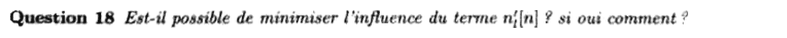{fig-alt="Question 18 : est-il possible de minimiser l'influence du terme n'l[n] ? Si oui, comment ?"}

:::: {.complement}
::: {.solution}
**Oui.**

- Utiliser le **filtre adapté** $g_a(t) = g^*(-t)$ : il maximise le rapport signal sur bruit à l'instant de décision, qui vaut alors $\frac{2E_g}{N_0}$ ([cours](../cours/04-transmission-presence-bruit.qmd#eq-rsb-max)). Avec $g$ demi-Nyquist, il respecte en plus le critère de Nyquist.
- Augmenter l'énergie par symbole (puissance d'émission) pour écarter les points de la constellation (question 20).
- Réduire le bruit lui-même : amplificateur faible bruit en tête de réception, filtrage strict à la bande utile.
- Au-delà de la couche physique : codage correcteur d'erreurs.
:::
::::

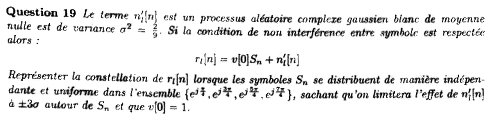{fig-alt="Question 19 : n'l[n] est un processus aléatoire complexe gaussien blanc de moyenne nulle et de variance σ² = 2/9 ; sans IES, rl[n] = v[0] Sn + n'l[n]. Représenter la constellation de rl[n] pour Sn indépendants et uniformes dans {e^{jπ/4}, e^{j3π/4}, e^{j5π/4}, e^{j7π/4}}, en limitant l'effet de n'l[n] à ±3σ autour de Sn, avec v[0] = 1."}

::: {.a-verifier #av-ann1819-variance-complexe}
**Source** [sujet-2018, p. 3, q. 19] : « processus aléatoire complexe gaussien blanc de moyenne nulle est de variance $\sigma^2 = \frac{2}{9}$ […] on limitera l'effet de $n'_l[n]$ à $\pm 3\sigma$ autour de $S_n$ ».

**Problème** : pour un bruit complexe, « variance » peut désigner la variance totale $\E|n'_l|^2$ (alors $\frac{\sigma^2}{2} = \frac19$ par voie, écart type $\frac13$ par voie) ou la variance de chaque voie (écart type $\frac{\sqrt2}{3} \approx 0{,}47$). Les deux lectures donnent des zones $\pm 3\sigma$ différentes : $\pm 1$ ou $\pm\sqrt2$ par voie.

**Proposition** : variance totale $\sigma^2 = \E|n'_l|^2$ (définition usuelle pour un bruit complexe circulaire), soit $\sigma_v = \frac13$ et $\pm 3\sigma_v = \pm 1$ par voie, lecture retenue ci-dessous. Avec l'autre lecture, les conclusions qualitatives restent les mêmes et le facteur d'amplitude de la question 20 devient 2 au lieu de $\sqrt2$.
:::

:::: {.complement}
::: {.solution}
Les symboles forment une **QPSK** : $S_n = \frac{\pm 1 \pm j}{\sqrt2}$, coordonnées $\pm\frac{\sqrt2}{2} \approx \pm 0{,}71$ sur chaque voie. Bruit complexe circulaire, voies I et Q indépendantes de variance $\frac19$, $\sigma_v = \frac13$ (bloc ci-dessus) : chaque point reçu se trouve, avec 99,7 % de confiance par voie, dans un **carré de demi-côté $3\sigma_v = 1$** centré sur $S_n$.

Les régions de décision sont les quatre quadrants (seuils : les axes). Or chaque symbole n'est qu'à $0{,}71$ des axes, moins que $3\sigma_v = 1$ : les carrés **débordent sur les quadrants voisins** et se chevauchent (@fig-ann18-qpsk-bruit, à gauche). Des erreurs sont donc fréquentes : par voie, $P\big(n_I < -0{,}71\big) = Q\!\left(\frac{0{,}71}{1/3}\right) = Q(2{,}12) \approx 1{,}7\ \%$, soit $P_b \approx 1{,}7\ \%$ avec Gray et $P_s \approx 3{,}3\ \%$ (simulation de Monte-Carlo, $2 \cdot 10^6$ symboles : $P_b = 1{,}68\ \%$, $P_s = 3{,}33\ \%$ ✓).

![Constellation QPSK reçue avec un bruit complexe de variance totale $\frac29$ ($\sigma_v = \frac13$ par voie). Carrés : zones $\pm 3\sigma_v$ autour des symboles (croix) ; pointillés gris : seuils de décision. À gauche, $v[0] = 1$ (question 19) ; à droite, amplitude multipliée par $\sqrt2$ (question 20). 400 échantillons simulés. Figure calculée.](../figures/ann-2018-qpsk-bruit.svg){#fig-ann18-qpsk-bruit}
:::
::::

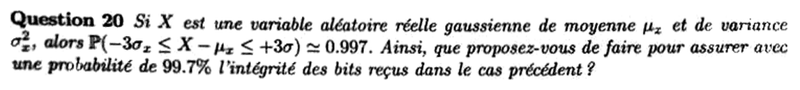{fig-alt="Question 20 : si X est gaussienne réelle de moyenne μx et de variance σx², P(−3σx ≤ X − μx ≤ +3σ) ≈ 0,997. Que proposez-vous pour assurer avec une probabilité de 99,7 % l'intégrité des bits reçus dans le cas précédent ?"}

:::: {.complement}
::: {.solution}
Il faut que les zones $\pm 3\sigma_v$ ne franchissent plus les seuils : la distance de chaque symbole aux axes, $\frac{v[0]}{\sqrt2}$, doit atteindre $3\sigma_v = 1$ :
$$\frac{v[0]}{\sqrt2} \geq 3\sigma_v = 1 \quad\Longleftrightarrow\quad \boxed{v[0] \geq \sqrt2}$$
soit **doubler l'énergie par symbole** (+3 dB de puissance d'émission), à bruit inchangé (@fig-ann18-qpsk-bruit, à droite). On peut aussi garder la puissance et diminuer le bruit d'un facteur 2 en variance (meilleur amplificateur, filtrage). Avec $v[0] = \sqrt2$, chaque bit (une voie) est juste avec une probabilité $1 - Q(3) = 99{,}87\ \%$ (simulation : $P_b = 0{,}137\ \%$ ✓), au moins les 99,7 % demandés ; le symbole entier (deux voies) est juste avec une probabilité d'environ 99,7 %.

Avec l'autre lecture de $\sigma^2$ (bloc `av-ann1819-variance-complexe`), $3\sigma_v = \sqrt2$, et il faut $v[0] \geq 2$ (énergie × 4, +6 dB).
:::
::::
